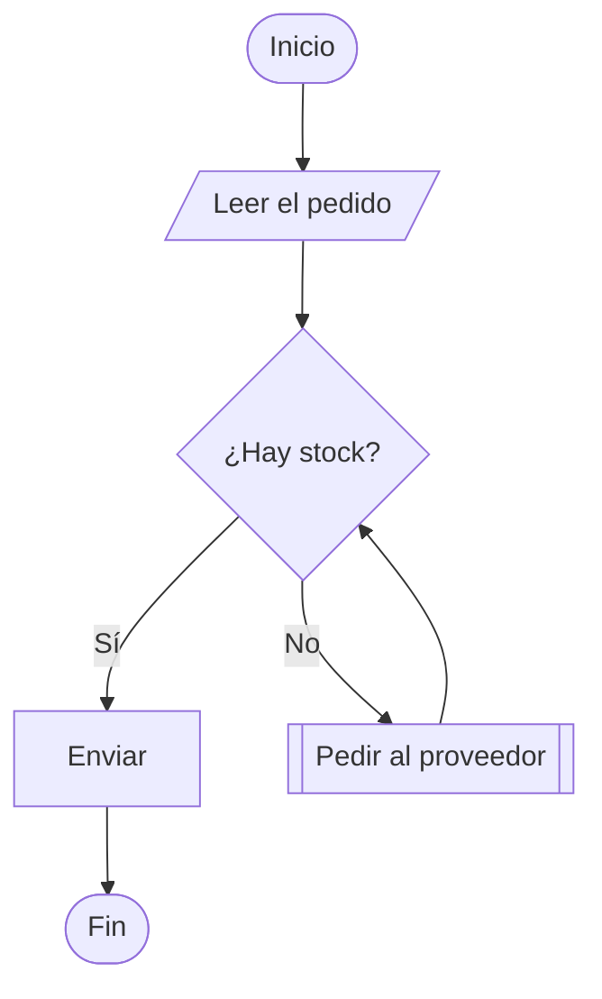
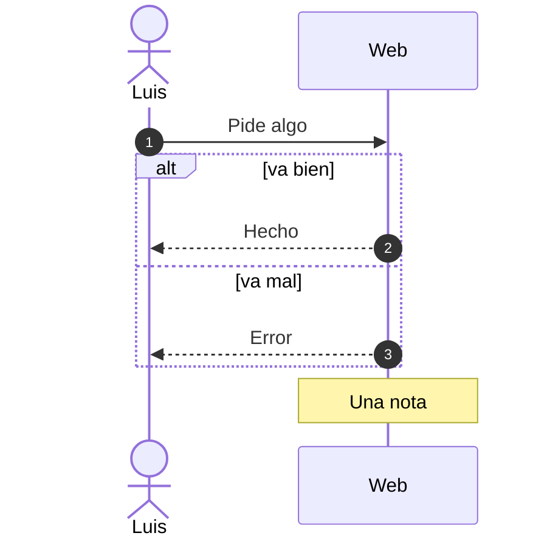

# Chuleta global

> Todas las chuletas de los módulos del curso, reunidas en un solo fichero para consultarlas rápido.
> Se genera con `generar_chuleta_global.py` del kit de cursos: no lo edites a mano.

📚 [Índice del curso](00-indice.md) · 🏠 [Portada](README.md)

## Contenido

- **Fase 01 — Qué es programar**
  - [01.01 Qué es programar](#0101-qué-es-programar)
  - [01.02 Algoritmos y pseudocódigo](#0102-algoritmos-y-pseudocódigo)
  - [01.03 ¿Cómo sé que funciona? Probar un programa](#0103-cómo-sé-que-funciona-probar-un-programa)
  - [01.04 Paradigmas de programación](#0104-paradigmas-de-programación)
- **Fase 02 — Tu ordenador por dentro**
  - [02.01 Cómo funciona un ordenador](#0201-cómo-funciona-un-ordenador)
  - [02.02 Archivos, carpetas y rutas](#0202-archivos-carpetas-y-rutas)
  - [02.03 Instalar programas, variables de entorno y PATH](#0203-instalar-programas-variables-de-entorno-y-path)
- **Fase 03 — Herramientas del programador**
  - [03.01 La terminal: lo básico](#0301-la-terminal-lo-básico)
  - [03.02 La terminal: sacarle partido](#0302-la-terminal-sacarle-partido)
  - [03.03 El editor de código](#0303-el-editor-de-código)
  - [03.04 Errores y depuración](#0304-errores-y-depuración)
- **Fase 04 — Formatos y diagramas**
  - [04.01 Texto, binario y codificación](#0401-texto-binario-y-codificación)
  - [04.02 Markdown](#0402-markdown)
  - [04.03 JSON y YAML](#0403-json-y-yaml)
  - [04.04 XML, CSV y otros](#0404-xml-csv-y-otros)
  - [04.05 Diagramas y Mermaid](#0405-diagramas-y-mermaid)
- **Fase 05 — Git y GitHub**
  - [05.01 Git: fundamentos](#0501-git-fundamentos)
  - [05.02 Ramas y conflictos](#0502-ramas-y-conflictos)
  - [05.03 GitHub](#0503-github)
- **Fase 06 — Internet y aplicaciones**
  - [06.01 Redes: IP, router, DNS y cortafuegos](#0601-redes-ip-router-dns-y-cortafuegos)
  - [06.02 Puertos y localhost: tu ordenador como servidor](#0602-puertos-y-localhost-tu-ordenador-como-servidor)
  - [06.03 La web: HTTP, peticiones, respuestas y APIs](#0603-la-web-http-peticiones-respuestas-y-apis)
  - [06.04 Qué es una base de datos](#0604-qué-es-una-base-de-datos)
  - [06.05 Las piezas de una aplicación](#0605-las-piezas-de-una-aplicación)

---

## Fase 01 — Qué es programar

---

### 01.01 Qué es programar

📖 Módulo completo: [fase-01-que-es-programar/01-que-es-programar.md](fase-01-que-es-programar/01-que-es-programar.md)

#### Conceptos clave

| Concepto | Definición en una línea |
|---|---|
| **Programar** | Escribir instrucciones precisas para que un ordenador resuelva un problema |
| **Entrada / proceso / salida** | Los datos que recibe un programa, lo que hace con ellos y el resultado que entrega |
| **Algoritmo** | Secuencia ordenada, finita y precisa de pasos que resuelve un problema; no depende del lenguaje |
| **Programa** | Un algoritmo escrito en un lenguaje de programación |
| **Código fuente** | El texto del programa que escribe una persona |
| **Ejecutar** | Poner en marcha un programa para que el ordenador siga sus instrucciones |
| **Código máquina** | Instrucciones en binario, las únicas que entiende el procesador |
| **Lenguaje de alto nivel** | Lenguaje pensado para personas, que oculta los detalles de la máquina |
| **Compilador** | Programa que traduce el código fuente entero antes de ejecutarlo |
| **Intérprete** | Programa que lee y ejecuta el código instrucción a instrucción, en el momento |
| **Máquina virtual** | Programa que ejecuta un código intermedio ya compilado (así funcionan Java y C#) |

#### Compilado frente a interpretado

| | Compilado | Interpretado |
|---|---|---|
| Traducción | Una vez, antes de ejecutar | En cada ejecución |
| Errores de escritura | Antes de ejecutar | Al llegar a la línea |
| Probar un cambio | Hay que compilar primero | Al instante |
| Dónde funciona | Hay que compilar para cada sistema | Donde haya intérprete |
| Ejemplos | C, C++, Rust, Go | Python, JavaScript, Ruby, PHP |

Mixtos: Java y C# compilan a un código intermedio que ejecuta una máquina virtual.

#### Tres tipos de errores

| Tipo | Síntoma | Quién lo detecta |
|---|---|---|
| De escritura (sintaxis) | El código no sigue las reglas del lenguaje | El compilador, o el intérprete al llegar a la línea |
| De ejecución | El programa se para con un mensaje mientras funciona | Nadie, hasta que ocurre |
| De lógica | El programa termina, pero el resultado está mal | Solo tus casos de prueba |

#### Cómo leer un mensaje de error

1. **Dónde:** fichero y línea (`CajasConError.java:16`, `line 14`).
2. **Qué:** el tipo de error (`cannot find symbol`, `NameError`, `';' expected`).
3. **La marca** (`^`) señala el sitio exacto.
4. Si hay varios errores, arregla **el primero** y vuelve a probar.
5. Si en la línea indicada no ves nada, mira también la de arriba.

#### Antes de programar, pregúntate

1. ¿Qué datos tengo (**entrada**)?
2. ¿Qué tengo que obtener (**salida**)?
3. ¿Qué pasos me llevan de una a otra (**proceso**)?
4. ¿Qué pasa en los **casos límite**: cero, ninguno, el valor justo del límite?
5. ¿Qué **resultado espero** en cada caso, antes de ejecutar nada?

#### División entera y resto

| Operación | Ejemplo | Para qué sirve |
|---|---|---|
| División entera | 53 entre 12 = 4 | Cuántas veces cabe algo: cajas llenas, mesas completas |
| Resto | 53 entre 12, sobran 5 | Cuánto sobra: libros sueltos, personas sin mesa |
| Repartir redondeando hacia arriba | 4 llenas, y una más si sobra algo | Cajas, mesas, autobuses, páginas |

---

### 01.02 Algoritmos y pseudocódigo

📖 Módulo completo: [fase-01-que-es-programar/02-algoritmos-y-pseudocodigo.md](fase-01-que-es-programar/02-algoritmos-y-pseudocodigo.md)

#### Convenciones de pseudocódigo del curso

```text
ALGORITMO Nombre
    ENTRADA: ...
    SALIDA: ...

    CONSTANTE NOMBRE ← valor

INICIO
    LEER x
    x ← expresión
    ESCRIBIR "texto", x
FIN
```

| Elemento | Significado |
|---|---|
| `ALGORITMO`, `INICIO`, `FIN` | Nombre, principio y final del algoritmo |
| `ENTRADA` / `SALIDA` | Qué recibe y qué produce (y sus suposiciones) |
| `CONSTANTE NOMBRE ← valor` | Constante, antes de `INICIO`, en MAYÚSCULAS con guiones bajos |
| `LEER x` | Obtiene un dato del exterior y lo guarda en `x` |
| `ESCRIBIR "texto", x` | Muestra un resultado: el texto entre comillas tal cual y `x` por su valor |
| `x ← expresión` | Asignación: `x` toma el valor de la expresión |
| `=` | Comparación («¿es igual a?»), nunca asignación |
| `//` | Comentario |
| `VERDADERO`, `FALSO` | Los dos valores lógicos |
| `[1250, 980, 1430]`, `[]` | Una lista con sus valores; una lista vacía |
| `ventas[0]`, `LETRAS[i]` | El elemento de una lista (o de un texto) en una posición; **la primera es la 0** |
| `pedido.libros` | Una parte de un dato con partes («los libros del pedido») |
| `4.95` | Los decimales, con punto |
| Sangría | Lo que va dentro de otra instrucción, más a la derecha |
| Nombres | Variables en *camelCase* (`horaEntrada`); algoritmos con mayúscula inicial en cada palabra (`CalcularCajas`); sin tildes ni eñes (`anio`) |

#### Estructuras de control

| Estructura | Pseudocódigo |
|---|---|
| Selección simple | `SI c ENTONCES ... FIN SI` |
| Selección doble | `SI c ENTONCES ... SI NO ... FIN SI` |
| Selección encadenada | `SI c1 ENTONCES ... SI NO SI c2 ENTONCES ... SI NO ... FIN SI` |
| Por casos | `SEGÚN x HACER` / `1, 2: ...` / `DE OTRO MODO: ...` / `FIN SEGÚN` |
| Mientras | `MIENTRAS c HACER ... FIN MIENTRAS` |
| Repetir hasta | `REPETIR ... HASTA QUE c` |
| Para | `PARA i DESDE 1 HASTA n HACER ... FIN PARA` |
| Para cada | `PARA cada elemento DE lista HACER ... FIN PARA` |
| Subalgoritmo | `SUBALGORITMO F(p1, p2) ... DEVOLVER r ... FIN SUBALGORITMO` |
| Llamada | `r ← F(a, b)` o `F()` si no tiene parámetros |

> **⚠️ Cuidado:** `REPETIR ... HASTA QUE c` repite **hasta que** `c` sea verdadera. El `do ... while` de algunos lenguajes repite **mientras** su condición sea verdadera: al traducir, la condición se niega.

#### ¿Qué bucle uso?

| ¿Sé cuántas vueltas? | ¿Al menos una seguro? | Bucle |
|---|---|---|
| Sí (o recorro una lista entera) | — | `PARA` / `PARA cada` |
| No | No (pueden ser cero) | `MIENTRAS` |
| No | Sí | `REPETIR ... HASTA QUE` |

#### Operadores

| Tipo | Operadores |
|---|---|
| Aritméticos | `+` `-` `*` `/` `DIV` (división entera) `MOD` (resto) |
| Comparación | `=` `≠` `<` `>` `≤` `≥` |
| Lógicos | `Y` (las dos), `O` (al menos una), `NO` (invierte) |
| Asignación | `←` |

**Orden de evaluación:** paréntesis → `*` `/` `DIV` `MOD` → `+` `-` → comparaciones → `NO` → `Y` → `O`. Ante la duda, paréntesis.

#### Tipos de datos

| Tipo | Ejemplos |
|---|---|
| Entero | `53`, `0`, `-7` |
| Real | `4.95`, `-0.5` |
| Texto | `"Calle Mayor 5"`, `"Z"` |
| Lógico | `VERDADERO`, `FALSO` |

#### Patrones

| Patrón | Inicialización (antes del bucle) | En cada vuelta |
|---|---|---|
| Contador | `n ← 0` | `SI condición ENTONCES n ← n + 1` |
| Acumulador | `total ← 0` (suma) o `1` (producto) | `total ← total + valor` |
| Máximo | `max ← primer valor` | `SI valor > max ENTONCES max ← valor` |
| Mínimo | `min ← primer valor` | `SI valor < min ENTONCES min ← valor` |
| Bandera | `encontrado ← FALSO` | `SI ocurre ENTONCES encontrado ← VERDADERO` |
| Validación | — | `REPETIR LEER x HASTA QUE x es válido` |

#### Trucos con DIV y MOD

| Para... | Expresión |
|---|---|
| Saber si `n` es par | `n MOD 2 = 0` |
| Saber si `a` es divisible entre `b` | `a MOD b = 0` |
| Pasar minutos a horas y minutos | `m DIV 60` h y `m MOD 60` min |
| Repartir `n` cosas en grupos de `g` (redondeando hacia arriba) | `n DIV g`, más 1 si `n MOD g > 0` |
| Obtener la última cifra de un número | `n MOD 10` |

#### Símbolos de los diagramas de flujo

| Símbolo | Forma | Uso |
|---|---|---|
| Terminal | Óvalo | Inicio y fin |
| Proceso | Rectángulo | Asignación o cálculo |
| Decisión | Rombo | Condición con salidas «Sí» y «No» |
| Entrada / salida | Paralelogramo | Leer o escribir |
| Subproceso | Rectángulo con dobles líneas laterales | Llamada a un subalgoritmo |

#### La traza, paso a paso

1. Elige unos datos de entrada concretos.
2. Una columna por variable (y por condición); una fila por paso o por vuelta.
3. Sigue el algoritmo línea a línea, sin saltarte nada, y apunta cada cambio.
4. Compara el resultado con el esperado.

Mínimo: la **primera** vuelta, la **última** y algún caso en la **frontera**.

#### Errores típicos

| Error | Síntoma | Remedio |
|---|---|---|
| Bucle infinito | No termina | Algo debe avanzar en cada vuelta |
| Una vuelta de más o de menos | Falta o sobra un elemento | Traza de la primera y la última vuelta |
| Acumulador sin inicializar | Resultados absurdos | Inicializar **antes** del bucle |
| Condiciones mal ordenadas | Casos en el bloque equivocado | De la más restrictiva a la más general |
| `>` en lugar de `≥` | Falla justo en el límite | Probar el valor exacto del límite |
| División entre cero | Error con listas vacías | Comprobar el divisor antes |
| Confundir `←` y `=` | Condiciones u órdenes sin sentido | `←` guarda; `=` pregunta |

---

### 01.03 ¿Cómo sé que funciona? Probar un programa

📖 Módulo completo: [fase-01-que-es-programar/03-probar-un-programa.md](fase-01-que-es-programar/03-probar-un-programa.md)

#### El caso de prueba

| Parte | Qué es | Cuándo se sabe |
|---|---|---|
| Entrada | Los datos que se dan | Antes |
| Salida esperada | Lo que **debería** salir, según el enunciado | **Antes** de ejecutar |
| Salida obtenida (real) | Lo que **ha salido** de verdad | Después |
| Veredicto | Pasa ✅ si son iguales; falla ❌ si no | Después |

#### Tabla de casos de prueba

| Nº | Qué se prueba | Entrada | Salida esperada | Salida obtenida | ¿Pasa? |
|---|---|---|---|---|---|

Las cuatro primeras columnas, **antes** de ejecutar; las dos últimas, después.

#### Qué casos elegir

| Tipo | Qué es | Ejemplo (piscina: gratis hasta 3 años, 2,50 € de 4 a 17…) |
|---|---|---|
| Normales | Uno de cada grupo | 2, 10, 30, 80 años |
| Límite | Los dos lados de cada frontera | 3 y 4, 17 y 18, 64 y 65 |
| No válidos | Lo que debe rechazarse | −1, 121 |

**Prueba siempre:** el cero, el uno y el ninguno · el primero y el último · los muy grandes · los vacíos · un tipo inesperado (texto en lugar de número).

#### Probar a mano

1. Tabla de casos de prueba (mejor antes del algoritmo).
2. Una traza por caso: valor de cada variable en cada paso; en las condiciones, el cálculo **y** el resultado.
3. Compara obtenida con esperada.
4. Si falla, la traza te dice en qué paso se tuerce.
5. Tras corregir, vuelve a pasar **todos** los casos.

#### Qué errores encuentran las pruebas

| Tipo | Quién lo encuentra |
|---|---|
| Escritura (sintaxis) | El lenguaje, antes de que el programa haga nada |
| Ejecución | Las pruebas de casos límite, vacíos y no válidos (o el cliente, si no las hay) |
| Lógica | **Solo las pruebas** |

#### Pruebas automáticas

| Concepto | Qué es |
|---|---|
| Prueba automática | Un programa que prueba otro: entrada, esperado, obtenido, ¿coinciden? |
| Prueba unitaria | Prueba una pieza sola. Rápida y precisa |
| Prueba de integración | Prueba varias piezas juntas. Encuentra los errores en las uniones |
| Aserción | La comprobación: «esto debe ser igual a esto» |
| Regresión | Algo que funcionaba y se ha estropeado al cambiar otra cosa |
| Integración continua (CI) | Un servidor ejecuta todas las pruebas con cada cambio |
| TDD | Escribir cada prueba antes que el código: rojo, verde, refactorizar |
| Refactorizar | Cambiar cómo está escrito el código sin cambiar lo que hace |

```text
PRUEBA "Nombre que dice qué se prueba"
    resultado ← Subalgoritmo(entrada)      // preparar y ejecutar
    COMPROBAR resultado = esperado         // comprobar
FIN PRUEBA
```

#### Leer un corrector automático

| Busca | Python (`unittest`) | Otras herramientas |
|---|---|---|
| Cuántas fallan | `FAILED (failures=1)` | `fail 1`, `1 failed` |
| Cuál | `FAIL: test_…` | El nombre de la prueba, marcado con `FAIL` o ✖ |
| Dónde | `File "…", line 10` | Un fichero y un número de línea |
| Obtenido y esperado | `obtenido != esperado` (mira la línea de la aserción) | `actual` (o `got`, `received`) y `expected` |

Pasos: cuántas fallan → cuál → dónde → esperado y obtenido (¡cuál es cuál!) → compáralos → traza con esa entrada.

#### Recuerda

- Funcionar con un ejemplo **no** es funcionar.
- La salida esperada sale del **enunciado**, nunca del programa.
- Probar demuestra que **hay** errores, nunca que **no** los hay.
- No cambies una prueba para que pase: averigua primero quién tiene razón.

---

### 01.04 Paradigmas de programación

📖 Módulo completo: [fase-01-que-es-programar/04-paradigmas-de-programacion.md](fase-01-que-es-programar/04-paradigmas-de-programacion.md)

#### Los paradigmas de un vistazo

| Paradigma | Idea clave | Analogía |
|---|---|---|
| **Imperativo / estructurado** | Pasos que cambian variables; secuencia, selección y repetición | Una receta |
| **Orientado a objetos** | Objetos que juntan datos y comportamiento | Una empresa con empleados |
| **Funcional** | Funciones sin efectos secundarios; cadenas de transformaciones | Una cadena de montaje |
| **Declarativo** | Decir qué, no cómo | El taxi: «a la Plaza Mayor» |
| **Concurrente / paralelo** | Varias tareas a la vez (en curso o literalmente a la vez) | Uno o varios camareros |
| **Asíncrono** | Lanzar y seguir; aviso al terminar | El avisador del restaurante |
| **Orientado a eventos** | Reaccionar a lo que ocurre | El timbre de casa |
| **Reactivo** | Flujos de datos que se propagan solos | Una hoja de cálculo |
| **Orientado a aspectos** | Tareas transversales escritas una vez | El control de seguridad del aeropuerto |
| **Genérico** | Código válido para cualquier tipo de dato | Un molde de repostería |
| **Lógico** | Hechos y reglas; el programa deduce | Un detective que razona con pistas |

#### Imperativo frente a declarativo

| | Imperativo | Declarativo |
|---|---|---|
| Describe | **Cómo** (el camino) | **Qué** (el destino) |
| Ejemplos | Bucles, pseudocódigo, recetas | SQL, HTML, CSS, fórmulas de hoja de cálculo |
| Ventaja | Control total | Más corto y legible; el motor se encarga |
| Inconveniente | Más detalles en los que equivocarse | Hay que entender lo que hace el motor por debajo |

#### Las tres operaciones funcionales

| Operación | Qué hace | Nombre habitual en los lenguajes |
|---|---|---|
| Filtrar | Quedarse con los elementos que cumplen una condición | `filter` |
| Transformar | Convertir cada elemento en otra cosa | `map` |
| Reducir | Combinar todos en un único resultado | `reduce`, `sum`, `count` |

#### Notaciones de este módulo

```text
OBJETO Nombre                          // orientado a objetos
    DATOS: dato1, dato2
    SUBALGORITMO Pregunta() ... DEVOLVER ... FIN SUBALGORITMO
FIN OBJETO
objeto.Pregunta()                      // se le pregunta al objeto

resultado ← lista                      // funcional
    → FILTRAR los que cumplen ...
    → TRANSFORMAR cada uno en ...
    → REDUCIR sumándolos
```

#### Para elegir

- ¿Un cálculo sencillo? → **Imperativo**, sin complicarlo.
- ¿Muchos conceptos con datos y reglas? → **Objetos**.
- ¿Procesar una colección? → **Funcional**.
- ¿Hay un motor que sepa resolver el «cómo»? → **Declarativo**.
- ¿Una tarea lenta que no debe bloquear lo demás? → **Asíncrono**.
- ¿Varias partes reaccionan a un hecho? → **Eventos**.
- ¿Datos que llegan sin parar a muchos usuarios? → **Reactivo**.
- ¿Algo que se repite en todas las operaciones? → **Aspectos**.

---

## Fase 02 — Tu ordenador por dentro

---

### 02.01 Cómo funciona un ordenador

📖 Módulo completo: [fase-02-tu-ordenador/01-como-funciona-un-ordenador.md](fase-02-tu-ordenador/01-como-funciona-un-ordenador.md)

#### Las piezas y lo que hacen

| Pieza | Qué hace | Se mide en | Al apagar |
|---|---|---|---|
| **Procesador (CPU)** | Ejecuta las instrucciones | Núcleos y GHz | — |
| **Memoria RAM** | Guarda lo que se usa ahora | GB (8, 16, 32…) | Se borra |
| **Almacenamiento** (SSD o disco duro) | Guarda ficheros y programas | GB o TB | Se conserva |
| **Tarjeta gráfica (GPU)** | Dibuja la pantalla; cálculos en paralelo | — | — |
| **Sistema operativo** | Administra todo lo anterior | — | — |

#### Unidades

| Unidad | Qué es |
|---|---|
| 1 bit | Un 0 o un 1 |
| 1 byte (B) | 8 bits: 256 combinaciones |
| KB, MB, GB, TB | Cada uno, 1000 veces el anterior |
| KiB, MiB, GiB, TiB | Cada uno, 1024 veces el anterior (Windows los muestra como «KB», «MB», «GB», «TB») |
| Mb/s (b minúscula) | Megabits por segundo: velocidad de internet. Entre 8 → MB/s |
| 1 TB del fabricante | Unos 931 GB en Windows |

#### Qué hace el sistema operativo

Programas (los pone en marcha y reparte el procesador) · memoria (y la memoria virtual si se llena) · ficheros y carpetas · dispositivos (con controladores) · usuarios y permisos.

#### Programa y proceso

| Programa | Proceso |
|---|---|
| Ficheros en el disco | Un programa en marcha |
| Ocupa almacenamiento | Ocupa RAM y procesador |
| Uno | Puede haber varios del mismo programa |

**Ver los procesos:** Administrador de tareas (Windows, <kbd>Ctrl</kbd>+<kbd>Mayús</kbd>+<kbd>Esc</kbd>) · Monitor de Actividad (macOS) · Recursos o Monitor del sistema (Linux). **Solo para mirar.**

#### Abrir, guardar y apagar

1. Abrir: del disco a la RAM.
2. Trabajar: los cambios están solo en la RAM.
3. Guardar: de la RAM al disco.
4. Apagar o cortar la corriente: se borra la RAM. Suspender: la RAM se conserva. Hibernar: la RAM se copia al disco.

#### Qué instalador descargar

| Si tu ordenador dice… | Arquitectura | Busca |
|---|---|---|
| x64, x86_64, amd64, Intel, AMD | x86-64 | `x64` |
| ARM, arm64, aarch64, Snapdragon | ARM | `arm64` |
| Mac con «Chip: Apple M…» | ARM (Apple Silicon) | `Apple Silicon` o `Universal` |
| Mac con «Procesador: Intel…» | x86-64 | `Intel` o `Universal` |

Siempre de 64 bits si hay elección, y siempre desde la página oficial.

#### Dónde mirar tus datos

- **Windows 11:** Configuración → Sistema → Información → Tipo de sistema.
- **macOS:** menú Apple → Acerca de este Mac → Chip o Procesador.
- **Linux (Ubuntu):** Configuración → Sistema.

#### Para elegir un ordenador para programar

1. **RAM** suficiente (16 GB va holgado, a 8 de noviembre de 2026), mejor si es ampliable.
2. **SSD**, no disco duro.
3. Procesador: cualquiera actual sirve para empezar.

---

### 02.02 Archivos, carpetas y rutas

📖 Módulo completo: [fase-02-tu-ordenador/02-archivos-carpetas-y-rutas.md](fase-02-tu-ordenador/02-archivos-carpetas-y-rutas.md)

#### Conceptos clave

| Concepto | En una línea |
|---|---|
| **Fichero (archivo)** | Datos guardados en el disco con un nombre |
| **Carpeta (directorio)** | Contenedor de ficheros y de otras carpetas |
| **Carpeta padre** | La carpeta que contiene a otra o a un fichero |
| **Árbol de carpetas** | Las carpetas unas dentro de otras, desde la raíz |
| **Raíz** | La carpeta de la que cuelga todo: `/` en Linux y macOS, `C:\` (una por unidad) en Windows |
| **Carpeta personal** | Tu carpeta: documentos, descargas, proyectos. Se abrevia `~` |
| **Ruta** | La dirección de un fichero o carpeta en el árbol |
| **Ruta absoluta** | Empieza en la raíz; sirve desde cualquier sitio, pero solo en ese ordenador |
| **Ruta relativa** | Empieza en la carpeta actual; sirve en cualquier ordenador si el proyecto viaja entero |
| **Carpeta actual (de trabajo)** | La carpeta desde la que se cuentan las rutas relativas de un programa en marcha |
| **Extensión** | Lo que va tras el último punto del nombre: pista del tipo de fichero |
| **Fichero oculto** | No se ve en el explorador; en Linux y macOS, los que empiezan por `.` |

#### La misma ruta en cada sistema

| Sistema | Carpeta personal | Ejemplo | Separador |
|---|---|---|---|
| Windows | `C:\Users\ana` | `C:\Users\ana\proyectos\web\index.html` | `\` |
| macOS | `/Users/ana` | `/Users/ana/proyectos/web/index.html` | `/` |
| Linux | `/home/ana` | `/home/ana/proyectos/web/index.html` | `/` |
| Git Bash | `/c/Users/ana` | `/c/Users/ana/proyectos/web/index.html` | `/` |

De Windows a Git Bash: `C:` → `/c` y cada `\` → `/`. `~` es la carpeta personal en macOS, Linux y Git Bash (no en el Explorador de archivos de Windows).

#### Moverse con rutas relativas

| Escribes | Significa |
|---|---|
| `nombre` | Entra en esa carpeta (o es ese fichero) |
| `.` | Esta misma carpeta |
| `..` | La carpeta padre: sube un nivel |
| `../..` | Sube dos niveles |
| `../img/logo.png` | Sube uno, entra en `img`, coge `logo.png` |

Para resolverla: empieza en la carpeta actual y sigue la ruta parte a parte, apuntando dónde estás.

#### ¿Desde dónde se cuenta una ruta relativa?

| Quién la usa | Se cuenta desde |
|---|---|
| Una página web | La carpeta donde está la página |
| Una hoja de estilos | La carpeta donde está la hoja de estilos |
| Un programa en marcha | Su **carpeta actual**, no la carpeta donde está guardado |

#### Ver rutas, extensiones y ocultos (8 de noviembre de 2026)

| | Windows 11 | macOS | Linux (GNOME) |
|---|---|---|---|
| Ver la ruta de la carpeta | Clic en un hueco de la barra de direcciones | Visualización › Mostrar barra de ruta | Barra de rutas; Propiedades › Carpeta padre |
| Copiar la ruta de un fichero | Clic derecho › opción de copiar la ruta | Clic derecho con <kbd>Opción</kbd> pulsada › opción de copiar la ruta | Propiedades › Carpeta padre, más el nombre |
| Ver las extensiones | Menú Ver › Extensiones de nombre de archivo | Finder › Ajustes › Avanzado › Mostrar todas las extensiones de los archivos | Siempre visibles |
| Ver los ocultos | Menú Ver › Elementos ocultos | Un atajo del Finder (o la terminal, fase 3) | <kbd>Ctrl</kbd>+<kbd>H</kbd> |

#### Nombres en las carpetas de programación

- Minúsculas, sin espacios, sin tildes, sin eñes: `web-panaderia`, `ventas-2026.csv`.
- Solo letras, números, `-` y `_`.
- Linux distingue mayúsculas (`Logo.png` ≠ `logo.png`); Windows y macOS normalmente no. Escribe las rutas letra a letra.
- Ruta con espacios: entre comillas, `"C:\Users\ana\Mis proyectos"`.

#### Si un programa no encuentra un fichero

1. Lee la ruta del mensaje **letra a letra**, mayúsculas incluidas.
2. ¿Es **relativa**? Averigua la **carpeta actual**.
3. Une las dos y comprueba en el explorador si esa ruta absoluta existe.

---

### 02.03 Instalar programas, variables de entorno y PATH

📖 Módulo completo: [fase-02-tu-ordenador/03-instalar-programas-y-path.md](fase-02-tu-ordenador/03-instalar-programas-y-path.md)

#### Conceptos clave

| Concepto | Definición en una línea |
|---|---|
| **Instalar** | Copiar los ficheros de un programa, avisar al sistema de que existe y prepararlo para que lo encuentren |
| **Instalador** | Programa que te guía, pantalla a pantalla, para instalar otro programa |
| **Gestor de paquetes** | Programa que instala, actualiza y desinstala otros programas con una orden: winget, Homebrew, apt, dnf |
| **Paquete** | Un programa preparado para instalarse con un gestor de paquetes |
| **Terminal** | Ventana en la que escribes órdenes y el ordenador te contesta con texto |
| **Git Bash** | La terminal con bash que trae Git for Windows; la del curso en Windows |
| **bash / zsh** | Los «idiomas» de órdenes de la terminal de Linux (y Git Bash) y de macOS; las órdenes del curso funcionan en los dos |
| **Indicador** (*prompt*) | El texto con el que la terminal espera una orden; termina en `$` (bash) o `%` (zsh) |
| **Variable de entorno** | Dato con nombre que guarda el sistema y pueden leer todos los programas |
| **PATH** | Variable de entorno con la lista ordenada de carpetas donde se buscan los programas |

#### Instalar Git y VS Code (a 8 de noviembre de 2026)

| Sistema | VS Code | Git |
|---|---|---|
| Windows | `code.visualstudio.com`, instalador de usuario (con *Add to PATH*) | `git-scm.com`, Git for Windows (x64 o ARM64): editor VS Code y rama `main`; el resto, como viene |
| macOS | `.dmg`, arrastrar a `Aplicaciones` (Universal) | Escribir `git --version` y aceptar las herramientas de Apple, o `brew install git` |
| Linux | `.deb` (o `.rpm`) de `code.visualstudio.com` | `sudo apt install git` o `sudo dnf install git` |

#### Las tres órdenes de comprobación

| Orden | Qué dice | Qué tienes que ver |
|---|---|---|
| `git --version` | La versión de Git | `git version` y un número |
| `echo $PATH` | Las carpetas donde se buscan los programas | Una lista separada por `:` |
| `command -v git` | En qué carpeta está el `git` que se ejecuta | Una ruta; si no sale nada, no está en el PATH |

#### Cómo busca el sistema un programa

1. Mira las carpetas del PATH **en orden**.
2. Ejecuta el **primero** que encuentra con ese nombre exacto.
3. Si no está en ninguna: «command not found», «orden no encontrada» o «no se reconoce como un comando».

#### Ante un «command not found»

1. ¿Lo has escrito bien? (minúsculas, sin tildes).
2. ¿Has abierto una terminal **nueva** después de instalar?
3. ¿Qué dice `command -v`?
4. ¿Está la carpeta del programa en el PATH (`echo $PATH`)?

#### Reglas de oro

- Descarga solo de la **web oficial** (mira el dominio desde el final).
- Elige el instalador de tu **sistema** y tu **arquitectura**.
- En Windows, usa **Git Bash** para seguir el curso.
- El `$` (o `%`) de las sesiones del curso **no se escribe**.
- Tu salida no será idéntica a la del curso: fíjate en **lo importante**.

---

## Fase 03 — Herramientas del programador

---

### 03.01 La terminal: lo básico

📖 Módulo completo: [fase-03-herramientas/01-terminal-lo-basico.md](fase-03-herramientas/01-terminal-lo-basico.md)

#### Cómo es una orden

```text
nombre  -opciones  argumentos       ls -lh img
```

- Opciones cortas con un guion (`-l`), que se pueden juntar (`-lah`); largas, con dos (`--help`).
- El espacio separa las piezas; un nombre con espacios va entre comillas.
- Las mayúsculas cuentan. El `$` de las sesiones del curso no se escribe.

#### Mirar y moverse

| Orden | Qué hace |
|---|---|
| `pwd` | Escribe la ruta de la carpeta actual |
| `ls` / `ls carpeta` | Lista la carpeta actual / esa carpeta |
| `ls -l` · `-a` · `-h` · `-R` | Con detalles · con ocultos · tamaños legibles · con las subcarpetas |
| `cd carpeta` | Entra en una carpeta (ruta relativa o absoluta) |
| `cd ..` · `cd ../otra` | Sube un nivel · pasa a una carpeta hermana |
| `cd` o `cd ~` | Va a tu carpeta personal |
| `cd -` | Vuelve a la carpeta anterior |
| `explorer .` · `open .` · `xdg-open .` | Abre la carpeta actual en el explorador (Git Bash · macOS · Linux) |

#### Crear, copiar, mover y borrar

| Orden | Qué hace |
|---|---|
| `mkdir a b` · `mkdir -p a/b/c` | Crea carpetas · crea también las carpetas padre que falten |
| `touch fichero` | Crea un fichero vacío (o le pone la fecha de ahora) |
| `cp origen destino` · `cp -r carpeta copia` | Copia un fichero · una carpeta entera |
| `mv origen destino` | Mueve, o renombra si el destino no es una carpeta |
| `rm fichero` · `rm -r carpeta` | Borra un fichero · una carpeta con todo (**sin papelera**) |
| `rmdir carpeta` | Borra una carpeta solo si está vacía |
| `-i` (en `cp`, `mv`, `rm`) | Pregunta antes de sustituir o borrar |

#### Ver y buscar

| Orden | Qué hace |
|---|---|
| `cat fichero` | Escribe el fichero entero |
| `less fichero` | Lo enseña página a página (<kbd>Espacio</kbd> avanza, <kbd>/</kbd> busca, <kbd>Q</kbd> sale) |
| `head -n 5 fichero` · `tail -n 5 fichero` | Las 5 primeras · las 5 últimas líneas (sin `-n`, 10) |
| `grep texto fichero` | Las líneas que contienen el texto (`-i` sin mayúsculas, `-n` con número de línea) |
| `find carpeta -name "nombre"` | Busca ficheros por su nombre en esa carpeta y en las de dentro (`.`: desde aquí) |
| `echo texto` | Escribe el texto (y enseña cómo entiende bash lo que escribes) |

#### Ayuda y trucos

| Qué | Cómo |
|---|---|
| Ayuda de una orden | `orden --help` (no en muchas de macOS); `man orden` (no en Git Bash); `help cd` para las de bash (en zsh, `man zshbuiltins`) |
| Autocompletar | <kbd>Tab</kbd> (dos veces: ver las opciones) |
| Historial | <kbd>↑</kbd> y <kbd>↓</kbd>; buscar con <kbd>Ctrl</kbd>+<kbd>R</kbd> |
| Parar una orden | <kbd>Ctrl</kbd>+<kbd>C</kbd> (en `less` y `man`, <kbd>Q</kbd>) |
| Limpiar la pantalla | `clear` o <kbd>Ctrl</kbd>+<kbd>L</kbd> |
| Escribir una ruta sin errores | Arrastra el fichero o la carpeta a la ventana de la terminal |
| Copiar y pegar | Linux: <kbd>Ctrl</kbd>+<kbd>Mayús</kbd>+<kbd>C</kbd> / <kbd>V</kbd> · macOS: <kbd>Cmd</kbd>+<kbd>C</kbd> / <kbd>V</kbd> · Git Bash: seleccionar copia, <kbd>Mayús</kbd>+<kbd>Insert</kbd> pega |

#### Comodines y comillas

| Escribes | Significa |
|---|---|
| `*` | Cualquier texto, también ninguno: `*.jpg`, `informe*`, `*2026*` |
| `?` | Exactamente un carácter: `foto-0?.jpg` |
| `"Mis fotos"` o `Mis\ fotos` | Un nombre con espacios, como una sola pieza |
| `"*.txt"` | El patrón tal cual, sin cambiarlo por los ficheros |

#### Antes de borrar

1. `pwd`: ¿estoy donde creo?
2. `ls` con **el mismo patrón** que vas a borrar: ¿es eso lo que quiero borrar?
3. ¿Tengo copia? Si no, `cp -r`.
4. Lee la orden entera, espacio a espacio, y entonces <kbd>Intro</kbd>.

#### PowerShell y cmd, para reconocerlas

| bash | PowerShell | cmd |
|---|---|---|
| `pwd` · `ls` · `cd` | `Get-Location` · `Get-ChildItem` · `Set-Location` | `cd` · `dir` · `cd` |
| `cp` · `mv` · `rm` | `Copy-Item` · `Move-Item` · `Remove-Item` | `copy` · `move` · `del` |
| `cat` · `grep` · `clear` | `Get-Content` · `Select-String` · `Clear-Host` | `type` · `findstr` · `cls` |

---

### 03.02 La terminal: sacarle partido

📖 Módulo completo: [fase-03-herramientas/02-terminal-sacarle-partido.md](fase-03-herramientas/02-terminal-sacarle-partido.md)

#### Redirecciones

| Escribes | Qué hace |
|---|---|
| `orden > f` | La salida, a `f`, **vaciándolo antes** |
| `orden >> f` | La salida, **al final** de `f` |
| `orden 2> f` | Los errores, a `f` |
| `orden 2> /dev/null` | Tira los errores |
| `orden > f 2>&1` | La salida y los errores, a `f` |
| `orden < f` | Lee de `f` en lugar del teclado |
| `orden1 \| orden2` | La salida de `orden1` es la entrada de `orden2` |
| `echo "…" >&2` | En un script, escribe por la salida de error |

#### Filtros

| Orden | Qué hace |
|---|---|
| `grep texto f` | Las líneas con `texto` (`-i` sin mayúsculas, `-c` contar, `-v` las que no, `-q` sin escribir) |
| `sort` | Ordena (`-n` como números, `-r` al revés) |
| `uniq -c` | Cuenta las líneas iguales **seguidas** (siempre después de `sort`) |
| `wc -l` | Cuenta las líneas |
| `cut -d ';' -f 3` | La columna 3, separadas por `;` |
| `head -n 5` / `tail -n 5` | Las 5 primeras / últimas |

#### Recetas

| Para | Escribe |
|---|---|
| Contar las líneas con algo | `grep -c texto f` |
| Las líneas con una cosa y otra | `grep uno f \| grep otro` |
| Cuántas veces sale cada valor de una columna | `cut -d ';' -f 3 f \| sort \| uniq -c \| sort -rn` |
| Los 3 que más salen | … `\| sort -rn \| head -n 3` |
| Guardar los errores de un registro | `grep ERROR app.log > errores.txt` |

#### Variables y PATH

| Escribes | Qué hace |
|---|---|
| `nombre=valor` | Crea una variable (**sin espacios** alrededor del `=`) |
| `echo "$nombre"` | Usa su valor (comillas dobles: se sustituye; simples: tal cual) |
| `export nombre` | La pasan a heredar los programas que lances |
| `export PATH="$HOME/bin:$PATH"` | Añade `~/bin` al principio del PATH, en esta terminal |
| `echo 'export PATH="$HOME/bin:$PATH"' >> ~/.bashrc` | Lo mismo, para siempre (en macOS, `~/.zshrc`). Después, terminal nueva |

#### Permisos, administrador y procesos

| Escribes | Qué hace |
|---|---|
| `ls -l` | Lista con permisos: tipo + propietario, grupo y demás (`rwx`) |
| `chmod +x script.sh` | Da permiso de ejecución |
| `sudo orden` | Ejecuta esa orden como administrador (Linux y macOS). Solo si hace falta |
| `ps` / `ps aux` | Los procesos de esta terminal / todos (en Git Bash, `ps -a`) |
| `top` | Los que más gastan, en directo (<kbd>Q</kbd> para salir) |
| <kbd>Ctrl</kbd>+<kbd>C</kbd> | Para la orden que está en marcha |
| `kill PID` / `kill %1` | Pide a un proceso que termine (`kill -9`, último recurso) |
| `orden &` | La lanza en segundo plano |

#### Códigos de salida

| Escribes | Qué hace |
|---|---|
| `echo $?` | El código de la última orden: **0, bien**; otro número, algo falló |
| `orden1 && orden2` | `orden2` solo si `orden1` fue bien |
| `orden1 \|\| orden2` | `orden2` solo si `orden1` falló |
| `exit 1` | En un script, termina con ese código |

#### Plantilla de un script

```bash
#!/usr/bin/env bash
# Qué hace el script.
# Uso: bash mi-script.sh ARGUMENTO

if [ $# -ne 1 ]; then
    echo "Uso: bash mi-script.sh ARGUMENTO" >&2
    exit 2
fi

dato=$1

for elemento in uno dos tres; do
    echo "$dato: $elemento"
done
```

| En el script | Significa |
|---|---|
| `$1`, `$2`… / `$#` | Los argumentos / cuántos son |
| `$(orden)` | Lo que escribe esa orden |
| `$((total + 1))` | Una cuenta con enteros |
| `if [ … ]; then … else … fi` | `SI … ENTONCES … SI NO … FIN SI` |
| `for x in a b c; do … done` | `PARA cada x DE … HACER … FIN PARA` |
| `-eq -ne -lt -le -gt -ge` | Comparar números |
| `= !=` | Comparar texto |
| `-f` / `-d` / `-e` | Es un fichero / una carpeta / existe |
| `bash script.sh` / `./script.sh` | Ejecutarlo (para `./`, antes `chmod +x`) |

#### Diferencias entre sistemas

| Qué | Linux | macOS | Git Bash |
|---|---|---|---|
| Fichero de configuración de la terminal | `~/.bashrc` | `~/.zshrc` (si tu terminal sigue con bash, `~/.bash_profile`) | `~/.bashrc` (se carga a través de `~/.bash_profile`) |
| `chmod +x` | Funciona | Funciona | Casi sin efecto: es ejecutable lo que empieza por `#!` |
| `sudo` | Sí | Sí | No lo trae |
| `wc -l`, `uniq -c` | El número, con este espaciado | El mismo número, con otro espaciado | Como Linux |
| `date` de ayer | `date -d yesterday` | `date -v-1d` | Como Linux |
| `sed -i` | `sed -i …` | `sed -i '' …` | Como Linux |

---

### 03.03 El editor de código

📖 Módulo completo: [fase-03-herramientas/03-editor-de-codigo.md](fase-03-herramientas/03-editor-de-codigo.md)

#### Conceptos clave

| Concepto | En una línea |
|---|---|
| **Editor de código** | Programa para escribir ficheros de texto plano, con ayudas para programar |
| **Texto plano** | Solo caracteres: sin negritas, tamaños ni imágenes. Es lo que leen los programas |
| **Procesador de textos** | Word y similares: texto con formato para personas. No sirve para programar |
| **IDE** | Editor con todo lo de un lenguaje concreto integrado: ejecutar, probar, depurar |
| **Resaltado de sintaxis** | Colores que pone el editor según el lenguaje, que decide por la extensión |
| **Paleta de comandos** | Caja donde escribes lo que quieres hacer y el editor te da la orden |
| **Extensión de VS Code** | Complemento que añade funciones al editor; tiene sus mismos permisos |
| **Terminal integrada** | Terminal dentro del editor, que se abre en la carpeta abierta |
| **Multicursor** | Varios cursores a la vez: lo que escribes aparece en todos |
| **LF / CRLF** | Los saltos de línea de Linux y macOS / de Windows; se ven y se cambian en la barra de estado. Los scripts de bash, siempre con `LF` (ajuste `files.eol`: `\n`) |

#### Atajos esenciales (teclado estadounidense; mira los tuyos en el editor)

| Para | Windows y Linux | macOS |
|---|---|---|
| Guardar | <kbd>Ctrl</kbd>+<kbd>S</kbd> | <kbd>Cmd</kbd>+<kbd>S</kbd> |
| Deshacer / rehacer | <kbd>Ctrl</kbd>+<kbd>Z</kbd> / <kbd>Ctrl</kbd>+<kbd>Y</kbd> | <kbd>Cmd</kbd>+<kbd>Z</kbd> / <kbd>Cmd</kbd>+<kbd>Mayús</kbd>+<kbd>Z</kbd> |
| Paleta de comandos | <kbd>Ctrl</kbd>+<kbd>Mayús</kbd>+<kbd>P</kbd> | <kbd>Cmd</kbd>+<kbd>Mayús</kbd>+<kbd>P</kbd> |
| Abrir rápido un fichero | <kbd>Ctrl</kbd>+<kbd>P</kbd> | <kbd>Cmd</kbd>+<kbd>P</kbd> |
| Buscar / reemplazar en el fichero | <kbd>Ctrl</kbd>+<kbd>F</kbd> / <kbd>Ctrl</kbd>+<kbd>H</kbd> | <kbd>Cmd</kbd>+<kbd>F</kbd> / <kbd>Cmd</kbd>+<kbd>Opción</kbd>+<kbd>F</kbd> |
| Buscar / reemplazar en la carpeta | <kbd>Ctrl</kbd>+<kbd>Mayús</kbd>+<kbd>F</kbd> / <kbd>Ctrl</kbd>+<kbd>Mayús</kbd>+<kbd>H</kbd> | <kbd>Cmd</kbd>+<kbd>Mayús</kbd>+<kbd>F</kbd> / <kbd>Cmd</kbd>+<kbd>Mayús</kbd>+<kbd>H</kbd> |
| Comentar la línea | <kbd>Ctrl</kbd>+<kbd>/</kbd> | <kbd>Cmd</kbd>+<kbd>/</kbd> |
| Mover la línea | <kbd>Alt</kbd>+<kbd>↑</kbd> / <kbd>Alt</kbd>+<kbd>↓</kbd> | <kbd>Opción</kbd>+<kbd>↑</kbd> / <kbd>Opción</kbd>+<kbd>↓</kbd> |
| Multicursor | <kbd>Alt</kbd>+clic | <kbd>Opción</kbd>+clic |
| Vista previa de Markdown | <kbd>Ctrl</kbd>+<kbd>Mayús</kbd>+<kbd>V</kbd> | <kbd>Cmd</kbd>+<kbd>Mayús</kbd>+<kbd>V</kbd> |

#### Antes de instalar una extensión

1. ¿La necesito de verdad?
2. ¿Quién la publica? ¿Está verificado (✓)? ¿El nombre es exactamente el que espero?
3. ¿Cuántas instalaciones y qué opiniones tiene?
4. ¿Se actualiza?

#### Reglas de oro

- Abre **la carpeta del proyecto**, no ficheros sueltos.
- Si la pestaña tiene **●**, el disco tiene la versión vieja.
- Los colores los decide la **extensión** del fichero.
- **Mira los resultados** antes de reemplazar en todos los ficheros.
- En Windows, la terminal integrada con **Git Bash**.

---

### 03.04 Errores y depuración

📖 Módulo completo: [fase-03-herramientas/04-errores-y-depuracion.md](fase-03-herramientas/04-errores-y-depuracion.md)

#### Método para depurar

1. **Reproducir** con un caso concreto: qué hago, qué esperaba, qué pasa.
2. **Leer el mensaje entero**, empezando por el primero.
3. **Aislar** dónde falla, dividiendo a la mitad.
4. **Hipótesis** y comprobarla antes de cambiar nada.
5. **Corregir la causa** cambiando una sola cosa (y deshacerla si no sirve).
6. **Volver a probar todos los casos.**

Y si te atascas: el **patito de goma**, una pausa, buscar el mensaje.

#### Mensajes frecuentes

| En español | En inglés | Causa más probable |
|---|---|---|
| `orden no encontrada` | `command not found` | Orden mal escrita o programa no instalado o fuera del PATH |
| `No existe el archivo o el directorio` | `No such file or directory` | Carpeta actual equivocada, nombre mal escrito (mayúsculas, tildes), ruta con espacios sin comillas |
| `Permiso denegado` | `Permission denied` | Script sin `chmod +x`, o escribir donde no debes (mira la ruta: ¿una variable vacía?) |
| `No es un directorio` | `Not a directory` | Usas como carpeta algo que no lo es: un fichero, o un nombre con `/` al final que no existe (`mv foto.jpg imagenes/`, sin haber creado `imagenes`) |
| `variable sin asignar` | `unbound variable` | Con `set -u`: variable mal escrita o sin valor |
| `$'\r': orden no encontrada` | `$'\r': command not found` | Script guardado con saltos de línea de Windows (CRLF): cámbialo a LF en la barra de estado de VS Code |
| `error de sintaxis: no se esperaba el final del fichero` | `syntax error: unexpected end of file` | Falta un `fi`, un `done` o unas comillas de cierre: mira hacia arriba |

#### Herramientas

| Herramienta | Para qué |
|---|---|
| `echo "DEPURACIÓN x: $x"` | Ver un valor en un punto concreto (añade `>&2` para mandarlo a la salida de error). Bórralos al terminar |
| `bash -x script.sh` | La traza: cada orden con sus valores, precedida de `+` (y `++` las de dentro de `$( )`) |
| `set -x` … `set +x` | La traza solo de un trozo del script |
| `bash -n script.sh` | Comprobar la escritura sin ejecutar |
| `set -eu` | Al principio del script: parar si una orden falla (`-e`) o si se usa una variable sin valor (`-u`) |
| Ejecutar media tubería | Aislar qué orden de una tubería falla |
| Depurador | Puntos de parada, paso a paso y ver variables (cada lenguaje tiene el suyo) |

#### Antes de dar un error por arreglado

- ¿He corregido la **causa** o solo el síntoma?
- ¿Funciona el caso que fallaba **y todos los demás**?
- ¿He borrado los `echo` de **DEPURACIÓN** y los `set -x`?

---

## Fase 04 — Formatos y diagramas

---

### 04.01 Texto, binario y codificación

📖 Módulo completo: [fase-04-formatos-y-diagramas/01-texto-binario-y-codificacion.md](fase-04-formatos-y-diagramas/01-texto-binario-y-codificacion.md)

#### Bytes en UTF-8

| Carácter | Bytes | Hexadecimal | `od -c` |
|---|---|---|---|
| `A` | 1 | `41` | `A` |
| `ñ` | 2 | `c3 b1` | `303 261` |
| `€` | 3 | `e2 82 ac` | `342 202 254` |
| LF | 1 | `0a` | `\n` |
| CRLF | 2 | `0d 0a` | `\r  \n` |
| BOM | 3 | `ef bb bf` | `357 273 277` |

#### Órdenes

| Escribes | Qué hace |
|---|---|
| `file f` | Qué contiene `f`, sin mirar la extensión: si es texto, una pista de su codificación (y si tiene BOM) |
| `wc -c f` / `wc -m f` | Bytes / caracteres (`-m`, solo con la terminal en UTF-8) |
| `od -c f` | Los bytes, como caracteres o en octal (en macOS, `LC_ALL=C od -c f`) |
| `od -t x1 f` | Los bytes, en hexadecimal (igual en todos los sistemas) |
| `iconv -f WINDOWS-1252 -t UTF-8 f > f-utf8` | Convierte a UTF-8, en un fichero nuevo |
| `tail -c +4 f > f-sin-bom` | Quita los 3 bytes del BOM (solo si lo tiene) |
| `tr -d '\r' < f > f-lf` | Pasa de CRLF a LF |

#### Diagnóstico rápido

| Ves | Qué pasa | Qué haces |
|---|---|---|
| `ñ`, `é` | UTF-8 leído como Windows-1252 | Que el programa lea UTF-8. El fichero está bien |
| `�` o `?` | Windows-1252 leído como UTF-8 | Convertir el fichero a UTF-8 |
| `UTF-8 (with BOM)` | Tiene BOM | Quitarlo |
| `\r  \n` en `od -c` | Saltos de Windows | Pasar a LF |

#### En VS Code

| Dónde | Qué |
|---|---|
| Barra de estado, `UTF-8` | La codificación del fichero. Clic para cambiarla |
| **Reopen with Encoding** (**Volver a abrir con codificación**) | Relee el fichero con otra tabla. No lo cambia |
| **Save with Encoding** (**Guardar con codificación**) | Lo guarda en otra codificación. Sí lo cambia |

**Regla de oro:** UTF-8 sin BOM y LF.

---

### 04.02 Markdown

📖 Módulo completo: [fase-04-formatos-y-diagramas/02-markdown.md](fase-04-formatos-y-diagramas/02-markdown.md)

#### Lo básico

| Para | Escribes |
|---|---|
| Título de nivel 1, 2, 3… | `# Título`, `## Sección`, `### Apartado` (con espacio) |
| Párrafo nuevo | Una línea en blanco |
| Salto de línea dentro del párrafo | `\` al final de la línea |
| Cursiva | `*cursiva*` |
| Negrita | `**negrita**` |
| Tachado (GFM) | `~~tachado~~` |
| Lista sin orden | `- elemento` |
| Lista numerada | `1. paso` |
| Sublista | Sangrada hasta el texto de arriba: 2 espacios bajo `- `, 3 bajo `1. ` |
| Lista de tareas (GFM) | `- [ ] pendiente` y `- [x] hecha` |
| Cita | `> texto` |
| Línea horizontal | `---`, con una línea en blanco encima |

#### Enlaces, imágenes y código

| Para | Escribes |
|---|---|
| Enlace | `[texto que dice adónde](https://www.ejemplo.com)` |
| Enlace a otro fichero | `[texto](fase-04-formatos-y-diagramas/docs/guia.md)` o `[texto](README.md)` |
| Enlace a un título | `[texto](fase-04-formatos-y-diagramas/02-markdown.md#título-en-minúsculas)` o `[texto](fase-04-formatos-y-diagramas/guia.md#ancla)` |
| Imagen | `` |
| Código en línea | `` `pwd` `` |
| Escapar una marca | `\*`, `\#`, `\_` (y la barra vertical de una tabla, con una barra invertida delante) |

#### Cómo genera GitHub un ancla

1. Quita el formato.
2. Todo a minúsculas.
3. Quita la puntuación, menos `-` y `_` (las tildes se quedan).
4. Cada espacio, un guion.
5. Repetidos: `-1`, `-2`…

`## 1.2. ¿Cómo me apunto?` → `#12-cómo-me-apunto`

#### En VS Code

| Para | Windows y Linux | macOS |
|---|---|---|
| Vista previa | <kbd>Ctrl</kbd>+<kbd>Mayús</kbd>+<kbd>V</kbd> | <kbd>Cmd</kbd>+<kbd>Mayús</kbd>+<kbd>V</kbd> |
| Vista previa al lado | <kbd>Ctrl</kbd>+<kbd>K</kbd> y <kbd>V</kbd> | <kbd>Cmd</kbd>+<kbd>K</kbd> y <kbd>V</kbd> |
| Saltar a un título | <kbd>Ctrl</kbd>+<kbd>Mayús</kbd>+<kbd>O</kbd> | <kbd>Cmd</kbd>+<kbd>Mayús</kbd>+<kbd>O</kbd> |
| Avisos de enlaces rotos | Ajuste `markdown.validate.enabled` | Igual |

#### Un README tiene

Título · qué hace y por qué es útil (una o dos frases) · captura · índice · cómo empezar (instalación y uso) · estado · dónde pedir ayuda · quién lo mantiene y cómo colaborar · licencia.

---

### 04.03 JSON y YAML

📖 Módulo completo: [fase-04-formatos-y-diagramas/03-json-y-yaml.md](fase-04-formatos-y-diagramas/03-json-y-yaml.md)

#### Conceptos clave

| Concepto | En una línea |
|---|---|
| **YAML 1.1 / 1.2** | La 1.1 lee `yes`, `no`, `on` y `off` como booleanos; la 1.2, solo `true` y `false` |
| **JSON with Comments** | Variante de JSON con comentarios que usa VS Code en su `settings.json` |

#### JSON

```json
{
  "texto": "con comillas dobles",
  "numero": 12.5,
  "booleano": true,
  "nulo": null,
  "lista": ["a", "b"],
  "objeto": {"clave": "valor"},
  "vacios": [[], {}, ""]
}
```

Comillas dobles · coma entre elementos y ninguna tras el último · sin comentarios · punto decimal y sin ceros delante · `true`, `false` y `null` en minúsculas · un solo valor de primer nivel · UTF-8

#### YAML

```yaml
# Comentario
clave: valor                # espacio tras los dos puntos
mapa:
  dentro: 1                 # sangría con ESPACIOS, nunca tabuladores
lista:
  - a
  - b
lista_de_mapas:
  - nombre: Ana
    edad: 34                # alineada con nombre, no con el guion
en_linea: [a, b]
vacios: []
texto_largo: |              # | conserva los saltos de línea; > los junta
  línea 1
  línea 2
seguro: "NO"                # comillas: NO, yes, on, off, 01001, 1.10, 12:30, #color, fechas
---
otro_documento: true
```

#### En VS Code

| Para | Qué hacer |
|---|---|
| Ver los errores | Panel **Problems**: <kbd>Ctrl</kbd>+<kbd>Mayús</kbd>+<kbd>M</kbd> (macOS: <kbd>Cmd</kbd>+<kbd>Mayús</kbd>+<kbd>M</kbd>); <kbd>F8</kbd>, el siguiente |
| Dar formato a un JSON | **Format Document**: <kbd>Mayús</kbd>+<kbd>Alt</kbd>+<kbd>F</kbd> (Windows), <kbd>Ctrl</kbd>+<kbd>Mayús</kbd>+<kbd>I</kbd> (Linux), <kbd>Mayús</kbd>+<kbd>Opción</kbd>+<kbd>F</kbd> (macOS) |
| Comprobar un YAML | Extensión **YAML** de Red Hat (de serie, solo colores) |
| Ver espacios y tabuladores | **View > Appearance > Render Whitespace** |

#### Cuál elegir

| Para | Formato |
|---|---|
| Intercambiar datos entre programas, API | JSON |
| Configuración escrita y comentada por personas | YAML |
| Lo que pida la herramienta | Lo que pida la herramienta |
| Tablas | CSV ([04.04](fase-04-formatos-y-diagramas/04-xml-csv-y-otros.md)) |

---

### 04.04 XML, CSV y otros

📖 Módulo completo: [fase-04-formatos-y-diagramas/04-xml-csv-y-otros.md](fase-04-formatos-y-diagramas/04-xml-csv-y-otros.md)

#### XML

| Pieza | Así se escribe |
|---|---|
| Declaración (la primera línea) | `<?xml version="1.0" encoding="UTF-8"?>` |
| Elemento | `<titulo>Don Quijote</titulo>` |
| Elemento vacío | `<agotado/>` |
| Atributo (siempre con comillas) | `<libro codigo="L-001">` |
| Comentario | `<!-- texto -->` |
| Entidades | `&lt;` `<` · `&amp;` `&` · `&gt;` `>` · `&quot;` `"` · `&apos;` `'` |

**Bien formado:** un solo elemento raíz · toda etiqueta se cierra · en orden inverso · las mayúsculas cuentan · atributos entre comillas · ni `<` ni `&` sueltos. **Válido:** bien formado y, además, sigue su esquema (XSD o DTD). **Comprobarlo:** ábrelo en el navegador (Firefox o Chrome).

#### CSV y TSV

| Regla | Ejemplo |
|---|---|
| Un campo con separador, comillas o salto de línea, entre comillas | `"Serrano, Lucía"` |
| Una comilla dentro de un campo, doblada | `"Su perro ""Toby"""` |
| Un campo vacío | `1,Lucía,,Madrid` |
| Mismo número de campos en todas las filas | Comprueba con la cabecera |
| CSV de Excel en español | `;` como separador y coma decimal |
| TSV | Tabulador como separador; casi nunca comillas |

| Para | Escribe |
|---|---|
| Ver el separador y la cabecera | `head -n 3 fichero.csv` |
| Una columna de un CSV con `;` y sin comillas | `cut -d ';' -f 3 fichero.csv` |
| Una columna de un TSV | `cut -f 3 fichero.tsv` |
| Abrirlo en Excel sin sorpresas | Datos > Desde texto o CSV: codificación, delimitador y columnas de códigos como texto |

`wc -l` cuenta **líneas**, no filas · `cut` no sabe de comillas.

#### Configuración

| Formato | Así es | Tipos |
|---|---|---|
| `.properties` | `tienda.puerto=8080` · comentarios con `#` o `!` | Todo es texto |
| INI | `[tienda]` y `puerto = 8080` · comentarios con `;` | Todo es texto |
| TOML 1.1.0 | `[tienda]` y `puerto = 8080`, `nombre = "Sol"`, `idiomas = ["es", "en"]` · comentarios con `#` | Texto con comillas, números, `true`/`false`, listas |
| `.env` | `CLAVE=valor` · comentarios con `#` | Variables de entorno |

**Secretos:** en el `.env`, y `.env` en el `.gitignore` · en Git, un `.env.example` sin valores reales.

---

### 04.05 Diagramas y Mermaid

📖 Módulo completo: [fase-04-formatos-y-diagramas/05-diagramas-y-mermaid.md](fase-04-formatos-y-diagramas/05-diagramas-y-mermaid.md)

#### Los tres diagramas

| Diagrama | Responde a | En Mermaid |
|---|---|---|
| De flujo | ¿Qué pasos y qué decisiones? | `flowchart TD` |
| De bloques | ¿Qué piezas hay y cómo se conectan? | `flowchart LR` con `subgraph` |
| De secuencia | ¿Quién habla con quién, y en qué orden? | `sequenceDiagram` |

#### Diagrama de flujo

````text

````

| Formas | Flechas |
|---|---|
| `(["…"])` óvalo · `["…"]` rectángulo · `{"…"}` rombo | `-->` flecha · `---` línea · `-.->` puntos · `==>` gruesa |
| `[/"…"/]` paralelogramo · `[["…"]]` subproceso | `-- texto -->` o `-->\|texto\|` · `-. "texto" .->` |
| `("…")` redondeado · `[("…")]` cilindro | `A --> B --> C` encadenar |

Direcciones: `TD` (o `TB`), `LR`, `BT`, `RL`. Grupos: `subgraph id ["Título"]` … `end`. Comentario: `%% texto`, en su propia línea.

#### Diagrama de secuencia

````text

````

| Se escribe | Qué es |
|---|---|
| `participant id as Nombre` · `actor id as Nombre` | Participante (un programa) · persona |
| `A->>B: texto` · `B-->>A: texto` | Mensaje (continua) · respuesta (discontinua) |
| `alt` … `else` … `end` · `opt` … `end` · `loop` … `end` | Si… si no · si · repetir |
| `Note over A,B: texto` · `autonumber` | Nota · numerar los mensajes |

#### Caracteres especiales

| Para | Escribe |
|---|---|
| Paréntesis, corchetes, llaves… (y, por costumbre, cualquier etiqueta) en un diagrama de flujo | La etiqueta entre comillas: `A["Pagar (con tarjeta)"]` |
| `"` `<` `>` `&` dentro de una etiqueta | `&quot;` `&lt;` `&gt;` `&amp;` |
| Un salto de línea | `<br/>` |
| Un nodo final | `fin`, nunca `end` |

#### Dónde se ve

GitHub (ficheros `.md` e *issues*), la academia, la vista previa de VS Code (desde la 1.121, sin extensiones) y el editor en línea `https://mermaid.live`, para probar.

---

## Fase 05 — Git y GitHub

---

### 05.01 Git: fundamentos

📖 Módulo completo: [fase-05-git-y-github/01-git-fundamentos.md](fase-05-git-y-github/01-git-fundamentos.md)

#### Configurar Git (una vez por ordenador)

```bash
git config --global user.name "Tu Nombre"
git config --global user.email "tu@correo.com"
git config --global init.defaultBranch main
git config --global core.editor "code --wait"
git config --global --list
```

#### El ciclo de cada día

| Orden | Qué hace |
|---|---|
| `git init` | Crea un repositorio en la carpeta actual |
| `git status` · `git status --short` | El estado de cada fichero |
| `git add fichero` · `git add .` | Prepara un fichero · todo lo cambiado |
| `git commit -m "mensaje"` | Guarda lo preparado como un commit |
| `git diff` | Lo cambiado **sin preparar** |
| `git diff --staged` | Lo **preparado**: lo que irá en el commit |
| `git log` · `git log --oneline` | La historia · resumida |
| `git show id` · `git show --stat id` | Un commit con su cambio · con el resumen |
| `git mv a b` · `git rm f` | Renombra · borra, y lo prepara |

#### git status --short

| Código | Significa |
|---|---|
| `??` | Sin seguimiento |
| ` M` | Modificado, sin preparar |
| `M ` · `A ` · `D ` · `R ` | Preparado: modificado · nuevo · borrado · renombrado |
| `MM` | Preparado y cambiado otra vez después |

#### Deshacer

| Quiero… | Orden | ¿Pierdo algo? |
|---|---|---|
| Descartar los cambios sin preparar de un fichero (vuelve a como está en el área de preparación) | `git restore f` | **Sí** |
| Sacar un fichero del área de preparación | `git restore --staged f` | No |
| Cambiar el mensaje del último commit | `git commit --amend -m "…"` | No (lo sustituye) |
| Añadir algo olvidado al último commit | `git add f` y `git commit --amend --no-edit` | No (lo sustituye) |
| Anular un commit, aunque esté compartido | `git revert --no-edit id` | No |
| Dejar de vigilar un fichero sin borrarlo | `git rm --cached f` | No |

**Regla de oro:** `--amend`, solo con lo no compartido. **`reset --hard`**, no: borra los cambios de los ficheros vigilados que no están en un commit.

#### .gitignore

| Patrón | Ignora |
|---|---|
| `.env` | Ese nombre, en cualquier carpeta |
| `*.log` | Esa extensión, en cualquier carpeta |
| `dist/` | Esa carpeta y todo lo que tiene |
| `/notas.txt` | Solo el de la carpeta principal |
| `!fichero` | Excepción: este no (no funciona si está ignorada su carpeta) |

`git check-ignore -v f`: qué línea lo ignora. Lo que ya está en Git no se ignora: `git rm --cached f`.

#### Si se abre Vim o nano

Vim: <kbd>Esc</kbd> y `:q!` + <kbd>Intro</kbd> (salir sin guardar) · <kbd>Esc</kbd> y `:wq` + <kbd>Intro</kbd> (guardar y salir).

nano (atajos con `^` abajo): <kbd>Ctrl</kbd>+<kbd>X</kbd>; si pregunta si guardar, <kbd>N</kbd> (cancelar) o <kbd>S</kbd> e <kbd>Intro</kbd> (hacer el commit).

---

### 05.02 Ramas y conflictos

📖 Módulo completo: [fase-05-git-y-github/02-ramas-y-conflictos.md](fase-05-git-y-github/02-ramas-y-conflictos.md)

#### Ramas

| Orden | Qué hace |
|---|---|
| `git branch` | Lista las ramas (`*` = la actual) |
| `git switch -c rama` | Crea `rama` y cambia a ella |
| `git switch rama` | Cambia a `rama` |
| `git branch -d rama` | Borra una rama ya fusionada |
| `git branch -D rama` | Borra una rama sin comprobar (se pierde lo no fusionado) |
| `git log --oneline --graph --all` | Historial de todas las ramas, dibujado |
| `git switch --detach v1.0.0` | Va a una versión para mirarla (`HEAD` desacoplado); se vuelve con `git switch main` |

#### Fusionar

| Orden | Qué hace |
|---|---|
| `git merge rama` | Trae `rama` a la rama actual (avance rápido o tres vías) |
| `git merge --no-edit rama` | Igual, aceptando el mensaje del commit de fusión sin abrir el editor |
| `git merge -m "mensaje" rama` | Igual, con tu mensaje |
| `git merge --abort` | Cancela una fusión con conflictos: todo como antes |

#### Resolver un conflicto

1. `git status`: qué ficheros están `modificados por ambos`.
2. Edita cada uno: deja lo que debe quedar y **quita los marcadores**.
3. `grep -c '<<<<<<<' fichero` debe dar `0`.
4. `git add fichero`.
5. `git commit --no-edit`.

| Marcador | Qué es |
|---|---|
| `<<<<<<< HEAD` | Empieza tu rama (la actual) |
| `=======` | Separa las dos versiones |
| `>>>>>>> rama` | Termina la rama que se fusiona |

En VS Code: **Accept Current Change** (la tuya) · **Accept Incoming Change** (la otra) · **Accept Both Changes** (las dos) · **Compare Changes** · **Resolve in Merge Editor**.

#### Apartar trabajo: stash

| Orden | Qué hace |
|---|---|
| `git stash push -u -m "mensaje"` | Aparta todos los cambios, también los ficheros nuevos |
| `git stash list` | Lista lo apartado |
| `git stash pop` | Lo recupera y lo borra del almacén |
| `git stash apply` · `git stash drop` | Lo recupera sin borrarlo · lo borra sin recuperarlo |

#### Etiquetas y versiones

| Orden | Qué hace |
|---|---|
| `git tag -a v1.0.0 -m "mensaje"` | Etiqueta anotada en el commit actual |
| `git tag` | Lista las etiquetas |
| `git show --no-patch v1.0.0` | La etiqueta y su commit, sin los cambios |

**Versionado semántico, MAYOR.MENOR.PARCHE:** incompatible → MAYOR · nuevo y compatible → MENOR · corrección → PARCHE. Al subir una, las de la derecha a 0.

#### gitGraph de Mermaid

```text
gitGraph
    commit id: "Primera versión" tag: "v1.0.0"
    branch rama
    checkout rama
    commit id: "Cambio en la rama"
    checkout main
    commit id: "Cambio en main"
    merge rama id: "Fusión"
```

#### Para reconocerlos

`git checkout rama` = `git switch rama` (antigua) · `git rebase` reaplica tus commits encima de otra rama y reescribe el historial (nunca con lo compartido) · `git cherry-pick` copia un commit concreto.

---

### 05.03 GitHub

📖 Módulo completo: [fase-05-git-y-github/03-github.md](fase-05-git-y-github/03-github.md)

#### Órdenes de los remotos

| Orden | Qué hace |
|---|---|
| `git init --bare carpeta.git` | Crea un repositorio vacío, sin directorio de trabajo (un remoto de prácticas) |
| `git remote add origin DIRECCIÓN` | Conecta con un remoto llamado `origin` |
| `git remote -v` | Lista los remotos y sus direcciones |
| `git push -u origin rama` | Sube una rama por primera vez y la vincula |
| `git push` | Sube los commits nuevos de la rama actual |
| `git clone DIRECCIÓN [carpeta]` | Descarga un repositorio entero, ya conectado como `origin` |
| `git fetch` · `git fetch upstream` | Renueva la copia del remoto, sin tocar tus ficheros |
| `git pull` · `git pull --no-rebase` | Baja y fusiona · baja y fusiona aunque las ramas hayan divergido |
| `git branch -a` · `git branch -vv` | Ramas, también las del remoto · con su rama vinculada |
| `git push origin --delete rama` | Borra una rama del remoto |
| `git config --global pull.rebase false` | Que `git pull` fusione siempre, sin preguntar |

#### Conectarte a GitHub (a 16 de noviembre de 2026)

| Forma | Dirección | Cómo |
|---|---|---|
| HTTPS + Git Credential Manager | `https://github.com/usuario/repo.git` | Una ventana para iniciar sesión, la primera vez (mejor la del navegador; en Windows, viene con Git) |
| HTTPS + *token* | `https://github.com/usuario/repo.git` | Tu usuario y, donde Git pide la contraseña, el *token* (Settings > Developer settings > Personal access tokens; de grano fino, con *Contents* de escritura) |
| SSH | `git@github.com:usuario/repo.git` | `ssh-keygen -t ed25519 -C "correo"` → el `.pub` en Settings > SSH and GPG keys → `ssh -T git@github.com` |

#### En la web de GitHub

| Para | Dónde |
|---|---|
| Crear un repositorio | **+ > New repository** (vacío si ya lo tienes en tu ordenador) |
| Abrir una *pull request* | Aviso **Compare & pull request** tras subir una rama |
| Revisar | **Files changed**; al terminar, **Comment**, **Approve** o **Request changes** |
| Fusionar | **Merge pull request**, **Squash and merge** o **Rebase and merge** |
| Cerrar una *issue* al fusionar | `Closes #N` (o `fixes`, `resolves`…) en la descripción |
| Hacer un *fork* · ponerlo al día | **Fork** · **Sync fork > Update branch** |
| README de perfil | Repositorio público con tu nombre de usuario y un `README.md` |

---

## Fase 06 — Internet y aplicaciones

---

### 06.01 Redes: IP, router, DNS y cortafuegos

📖 Módulo completo: [fase-06-internet-y-aplicaciones/01-redes.md](fase-06-internet-y-aplicaciones/01-redes.md)

#### Conceptos

| Concepto | En una línea |
|---|---|
| Internet | Una red de redes que se pasan los datos con las mismas reglas |
| Paquete | Cada trozo en que se parten los datos, con su dirección de origen y de destino |
| Cliente / servidor | El que pide / el que espera peticiones y contesta (papeles, no tipos de ordenador) |
| Protocolo | Las reglas de una conversación entre programas (IP, TCP, UDP, DNS, HTTP, SSH…) |
| Dirección IP | El número que identifica a un equipo en una red |
| Router | Une la red de casa con internet; da direcciones, hace de wifi, de DNS y de cortafuegos |
| Puerta de enlace | La dirección del router por dentro, a la que se manda todo lo que va fuera |
| NAT | El router cambia la dirección privada de lo que sale por su pública, y deshace el cambio en las respuestas |
| DNS | Convierte nombres en direcciones IP; las respuestas se guardan un rato (caché) |
| TCP / UDP | Llega todo y en orden / llega rápido, sin garantías |
| Puerto | El número que dice a qué programa del equipo va cada paquete ([06.02](fase-06-internet-y-aplicaciones/02-puertos-y-localhost.md#11-una-dirección-ip-no-basta-el-puerto)) |
| Cortafuegos | Decide qué conexiones pasan: las entrantes se bloquean, las salientes pasan |

#### Direcciones

| Dirección | Qué es |
|---|---|
| Cuatro números del 0 al 255 (`192.168.1.37`) | IPv4 |
| Grupos hexadecimales con `:` (`2001:db8::25`) | IPv6; `::` abrevia los ceros |
| `192.168.x.x`, `10.x.x.x`, `172.16.x.x` a `172.31.x.x` | Privadas: solo valen dentro de su red |
| Las demás | Públicas: únicas en internet |
| `127.0.0.1`, `::1`, `localhost` | Este mismo equipo |
| `169.254.x.x` | El equipo no ha conseguido dirección del router |
| `192.0.2.x`, `198.51.100.x`, `203.0.113.x`, `2001:db8:…` | De documentación, para ejemplos |
| `example.com`, `.invalid` | Nombres para ejemplos y para nombres que no existen |

#### Órdenes

| Orden | Qué hace |
|---|---|
| `ping -c 4 dirección-o-nombre` | Manda 4 paquetes de prueba y dice si responde y cuánto tarda (Linux y macOS) |
| `ping nombre` | En Git Bash (el de Windows): manda 4 y para solo |
| <kbd>Ctrl</kbd>+<kbd>C</kbd> | Para un `ping` sin `-c` y escribe el resumen |
| `nslookup nombre` | Pregunta al DNS la dirección de un nombre |

#### Cómo leer las salidas

| Ves | Quiere decir |
|---|---|
| `4 received, 0% packet loss` | Todo ha ido y vuelto |
| `0 received, 100% packet loss` | No ha vuelto nada: no contesta (que no es lo mismo que «está caído») |
| `time=2.85 ms` | Lo que tarda en ir y volver |
| `ping: …: Nombre o servicio desconocido` | No ha conseguido la dirección del nombre |
| `Non-authoritative answer` + `Address` | El DNS ha contestado: lo normal |
| `NXDOMAIN` | El DNS contesta que el nombre no existe |
| `timed out`, `no servers could be reached` | El servidor DNS no contesta |

#### Diagnóstico de «no hay internet», de dentro hacia fuera

1. ¿Tiene el equipo una dirección de la red (no una `169.254.x.x`)?
2. ¿Responde el router? `ping -c 4 192.168.1.1` (la tuya, en los ajustes de red).
3. ¿Se llega a internet con una dirección, sin DNS? `ping -c 4` a una dirección conocida.
4. ¿Contesta el DNS? `nslookup example.com`.
5. ¿Les pasa a los demás equipos? Si sí, router o proveedor.

---

### 06.02 Puertos y localhost: tu ordenador como servidor

📖 Módulo completo: [fase-06-internet-y-aplicaciones/02-puertos-y-localhost.md](fase-06-internet-y-aplicaciones/02-puertos-y-localhost.md)

#### Conceptos clave

| Concepto | En una línea |
|---|---|
| **Puerto** | Número del 0 al 65535 que dice a qué programa de un ordenador va un mensaje |
| **IP y puerto** | La dirección completa de un programa: `192.0.2.10:443`; en IPv6, `[2001:db8::1]:443` |
| **Escuchar** | Lo que hace un servidor: esperar conexiones en un puerto |
| **`localhost`** | Tu propio ordenador: `127.0.0.1` en IPv4, `::1` en IPv6. Funciona sin red y nadie de fuera lo ve |
| **`localhost:8080`** | El programa del puerto 8080 de tu ordenador: tu servidor de desarrollo |
| **`0.0.0.0`** | «Todas mis direcciones»: el servidor acepta conexiones de la red. No se escribe en el navegador |
| **Puerto en uso** | `EADDRINUSE`, *address already in use*: otro programa escucha ya en ese puerto |

#### Puertos que verás siempre

| Puerto | Para qué |
|---|---|
| 80 / 443 | Web con HTTP / con HTTPS (los de por defecto de `http://` y `https://`) |
| 22 | SSH (y Git con direcciones `git@…`) |
| 5432 / 3306 | PostgreSQL / MySQL |
| 8080, 3000, 8000, 5000, 5173… | Servidores de desarrollo, por costumbre |
| Por debajo de 1024 | En Linux, solo con administrador |

#### Órdenes

| Para | Orden |
|---|---|
| ¿Responde un servidor? Solo el código | `curl -s -o /dev/null -w '%{http_code}\n' http://localhost:8080/` |
| Ver la respuesta | `curl http://localhost:8080/` |
| Código de salida de `curl` | `echo $?`: `0` conectó · `7` nadie escucha · `35` falló el cifrado (¿`https` a un servidor `http`?) |
| Quién escucha (Linux) | `ss -ltnp` · `ss -ltnp \| grep 8080` |
| Quién escucha en el 8080 (macOS) | `lsof -nP -iTCP:8080 -sTCP:LISTEN` |
| Quién escucha (Windows, en Git Bash) | `netstat -ano \| grep 8080` (el último número, el PID) |
| Parar tu servidor | <kbd>Ctrl</kbd>+<kbd>C</kbd> en su terminal · `kill PID` · Windows: Administrador de tareas, Detalles |

#### Cuando no conecta

1. ¿Está arrancado? Mira su terminal.
2. ¿En qué puerto y en qué dirección dice que escucha?
3. ¿Es `http` y no `https`?
4. Desde otro aparato: ¿IP del ordenador (no `localhost`), servidor en `0.0.0.0` y cortafuegos en redes privadas?

---

### 06.03 La web: HTTP, peticiones, respuestas y APIs

📖 Módulo completo: [fase-06-internet-y-aplicaciones/03-la-web-http-y-apis.md](fase-06-internet-y-aplicaciones/03-la-web-http-y-apis.md)

#### Una URL

```text
https://tienda.example.com:8443/libros/novela?orden=precio&pagina=2#opiniones
esquema  dominio            puerto ruta        parámetros            fragmento
```

Sin puerto: 443 con `https` y 80 con `http`. El fragmento no viaja al servidor. La ruta distingue mayúsculas.

#### Métodos

| Método | Para | Cambia algo |
|---|---|---|
| `GET` | Leer | No |
| `POST` | Crear (o una acción) | Sí |
| `PUT` | Sustituir entero | Sí |
| `PATCH` | Cambiar una parte | Sí |
| `DELETE` | Borrar | Sí |

#### Códigos de estado

| Familia | Quiere decir | Los más comunes |
|---|---|---|
| 2xx | Ha ido bien | `200` OK · `201` Created (+ `Location`) · `204` No Content |
| 3xx | Ve a otro sitio | `301` · `302` (+ `Location`) · `304` Not Modified |
| 4xx | Tu petición está mal | `400` mal escrita · `401` ¿quién eres? · `403` no puedes · `404` no existe · `405` método no admitido (+ `Allow`) · `429` demasiadas |
| 5xx | Falla el servidor | `500` error interno · `503` no disponible |

#### curl

| Orden | Qué hace |
|---|---|
| `curl URL` | `GET` y escribe el cuerpo |
| `curl -i URL` | Con la línea de estado y las cabeceras |
| `curl -s -o fichero URL` | Guarda el cuerpo en un fichero, sin barra de progreso |
| `curl -s -o /dev/null -w '%{http_code}\n' URL` | Solo el código de estado (`000` si no hay respuesta) |
| `curl -X DELETE URL` | Con otro método |
| `curl -H 'Content-Type: application/json' -d '{"a": 1}' URL` | `POST` con un cuerpo en JSON |
| `curl -H 'Content-Type: application/json' -d @fichero.json URL` | Lo mismo, con el JSON en un fichero |
| `curl -s -f URL` | Termina con el código 22 si la respuesta es `400` o mayor |
| `curl -v URL` | Todo lo que envía y recibe (para investigar; cambia con la versión) |

Códigos de salida de `curl`: 0, ha hablado con el servidor (aunque responda `404`); 7, no ha podido conectar; 35, ha fallado la conexión cifrada ([06.02](fase-06-internet-y-aplicaciones/02-puertos-y-localhost.md#23-http-no-es-https)); 22, con `-f`, respuesta `400` o mayor.

#### Para no fallar

- Direcciones con `?` o `&` y el JSON de `-d`, **entre comillas simples**.
- `-s` siempre con `-o` o con una tubería.
- La clave de una API, en `.env` y en una variable de entorno: nunca en el código ni en Git.
- Pestaña **Red** del navegador: <kbd>F12</kbd> (en Firefox, también <kbd>Ctrl</kbd>+<kbd>Mayús</kbd>+<kbd>E</kbd>).
- Para practicar con una API real: `curl -i https://api.github.com/users/octocat` (60 peticiones por hora sin identificarte, a 16 de noviembre de 2026).

---

### 06.04 Qué es una base de datos

📖 Módulo completo: [fase-06-internet-y-aplicaciones/04-que-es-una-base-de-datos.md](fase-06-internet-y-aplicaciones/04-que-es-una-base-de-datos.md)

#### Base de datos y motor

| Palabra | Qué es |
|---|---|
| **Base de datos** | Conjunto de datos organizados para guardarlos y consultarlos |
| **Motor** (SGBD) | El programa que guarda los datos y atiende a quien los pide: PostgreSQL, MySQL, SQLite… |
| **Transacción** | Varios cambios que se hacen todos o ninguno |

**Lo que hace el motor por ti:** guardar · atender a muchos a la vez · responder preguntas · cumplir reglas · todo o nada · permisos · copias de seguridad.

#### Relacional

| Pieza | Qué es | Ejemplo |
|---|---|---|
| **Tabla** | Un tipo de cosa | `socios` |
| **Fila** (registro) | Una cosa concreta | Raúl Medina |
| **Columna** (campo) | Un dato de cada cosa, con su tipo | `fecha_alta`, fecha |
| **Clave primaria** | Identifica cada fila; ni se repite ni está vacía | `id` |
| **Clave foránea** | Apunta a la clave primaria de otra tabla | `socio_id` en `reservas` |

**Relaciones:** uno a muchos (un socio, muchas reservas) · uno a uno · muchos a muchos (con una tabla intermedia).

**SQL:** el lenguaje de las bases de datos relacionales; declarativo; norma ISO/IEC 9075 (SQL:2023); cada motor, su dialecto.

#### Diagrama entidad-relación en Mermaid

```text
erDiagram
    SOCIO ||--o{ RESERVA : "hace"
    SOCIO {
        int id PK
        string nombre
    }
    RESERVA {
        int id PK
        int socio_id FK
    }
```

`||` exactamente uno · `|o` cero o uno · `o{` cero o más · `|{` uno o más · `PK` clave primaria · `FK` clave foránea · la etiqueta, tras `:` y entre comillas, obligatoria · nombres sin tildes ni espacios.

#### Tipos de bases de datos

| Tipo | Guarda | Motores | Para |
|---|---|---|---|
| Relacional | Tablas relacionadas | PostgreSQL, MySQL, MariaDB, SQLite, Oracle Database, SQL Server | Casi todo |
| Documental | Documentos tipo JSON | MongoDB | Forma muy variable |
| Clave-valor | Clave → valor, en memoria | Redis | Sesiones, caché |
| De grafos | Nodos y relaciones | Neo4j | Redes |

**Dónde vive:** embebida (dentro de la aplicación, un fichero: SQLite) · cliente-servidor (un programa aparte, por la red: PostgreSQL en el 5432, MySQL en el 3306).

**Para elegir:** si dudas, relacional · si ya hay una, esa · datos de una persona en su dispositivo, embebida · NoSQL para un problema concreto, además de la relacional · configuración e informes, ficheros.

---

### 06.05 Las piezas de una aplicación

📖 Módulo completo: [fase-06-internet-y-aplicaciones/05-piezas-de-una-aplicacion.md](fase-06-internet-y-aplicaciones/05-piezas-de-una-aplicacion.md)

#### Las piezas

| Pieza | Qué es | Dónde está |
|---|---|---|
| **Frontend** | Lo que ve y usa la persona: pantallas, botones, formularios | En su navegador o su móvil |
| **Backend** | El programa que decide: comprueba, calcula, guarda, cobra | En un servidor |
| **Base de datos** | La memoria de la aplicación | En un servidor; solo habla con el backend |
| **API** | El acuerdo para pedir y contestar entre programas | Entre frontend y backend, y entre el backend y los servicios externos |
| **Servicio externo** | Lo que hace otra empresa: pagos, correo, mapas, inicio de sesión | En sus servidores; se usa por su API |

#### Quién habla con quién

```text
Persona → Frontend → (API) → Backend → Base de datos
                                     → Servicios externos
```

#### Publicar una aplicación

| Palabra | Qué es |
|---|---|
| **Desplegar** | Llevar la aplicación a los servidores donde la usan los demás y dejarla funcionando |
| **Servidor** | El ordenador donde funcionan el backend y la base de datos |
| **Dominio** | El nombre que lleva al servidor (`panaderia-sol.example`) |
| **Hosting** | Empresa o servicio que te deja tu web o tu aplicación en sus servidores |
| **Nube** | Ordenadores de otra empresa que se alquilan, a menudo con servicios ya montados |
| **Web estática** | Solo ficheros, iguales para todos; sin backend (GitHub Pages) |

#### Entornos

| Entorno | Datos | Para qué |
|---|---|---|
| **Desarrollo** | Inventados | Programar y probar mientras se hace |
| **Pruebas** | Inventados | Comprobar todo junto antes de publicar |
| **Producción** | Reales | Los usuarios de verdad. No se toca para probar |

#### Reglas de oro

- **¿Tiene que recordar o decidir algo?** Si no, web estática.
- **El frontend enseña; el backend decide.**
- **Solo el backend** habla con la base de datos y guarda los secretos.
- **Lo que cambia entre entornos, en la configuración**, no en el código.

---
📚 [Índice del curso](00-indice.md) · 🏠 [Portada](README.md)
