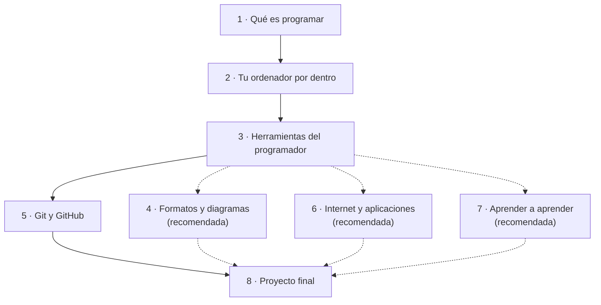

# 🗺️ Ruta de Fundamentos para programar

> Esta es la ruta de aprendizaje del curso. Cada fase es una carpeta (`fase-NN-…`).
> Si estudias en MyOpenAcademy, tu avance se guarda solo; si sigues el curso desde GitHub o tu editor, puedes marcar aquí cada fase con `[x]` al terminarla.

## Mapa del recorrido

En texto: las fases **imprescindibles** son la 1, la 2, la 3, la 5 y la 8, y se hacen en ese orden. Las fases 4, 6 y 7 son **recomendadas**: puedes hacerlas cuando te venga bien, incluso a la vez que el curso siguiente. Aun así, algunos de sus módulos son **Núcleo** (por ejemplo Markdown, JSON y YAML, o Seguridad básica) porque los usa el proyecto final; el [índice](00-indice.md) marca cuáles.

## Cómo seguirla

- **En orden**, si empiezas de cero: cada fase se apoya en las anteriores.
- **Por libre**, si ya sabes algo: todo está abierto y nada se bloquea. Cada módulo dice al principio qué conviene saber antes, con enlaces.
- **Núcleo y Ampliación:** los módulos de Núcleo son los imprescindibles; los de Ampliación puedes dejarlos para más adelante.
- **Retos:** al final de cada fase (salvo la 8, donde el proyecto es el reto) hay retos opcionales para afianzar lo aprendido.

## Progreso

| ✔ | Fase | Tipo | Qué consigues |
|---|---|---|---|
| [ ] | **1 · Qué es programar** | Imprescindible | Pensar como un programador: algoritmos, pseudocódigo y cómo comprobar que algo funciona |
| [ ] | **2 · Tu ordenador por dentro** | Imprescindible | Entender tu ordenador: piezas, archivos, rutas e instalar programas |
| [ ] | **3 · Herramientas del programador** | Imprescindible | Usar la terminal y el editor, y enfrentarte a los errores |
| [ ] | **4 · Formatos y diagramas** | Recomendada | Leer y escribir Markdown, JSON, YAML, XML y CSV, y dibujar diagramas |
| [ ] | **5 · Git y GitHub** | Imprescindible | Guardar la historia de tu trabajo y compartirlo |
| [ ] | **6 · Internet y aplicaciones** | Recomendada | Entender redes, la web, las APIs, las bases de datos, las piezas de una aplicación y la IA |
| [ ] | **7 · Aprender a aprender** | Recomendada | Estudiar, organizarte, buscar ayuda, usar la IA con cabeza y trabajar con seguridad |
| [ ] | **8 · Proyecto final** | Imprescindible | Tu primer repositorio, publicado en internet con GitHub Pages |

## Y después

Al terminar, estás preparado para empezar cualquier otro curso de MyOpenAcademy. El módulo «Las piezas de una aplicación» (fase 6) te orienta sobre qué curso enseña cada pieza.

---
📚 [Índice](00-indice.md) · 🏠 [Portada](README.md)
