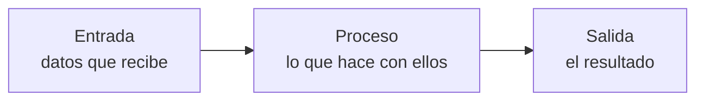
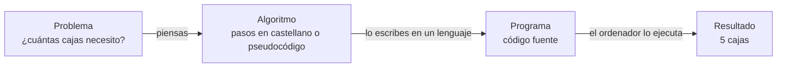
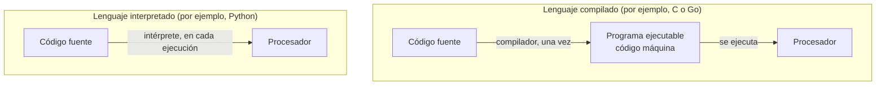
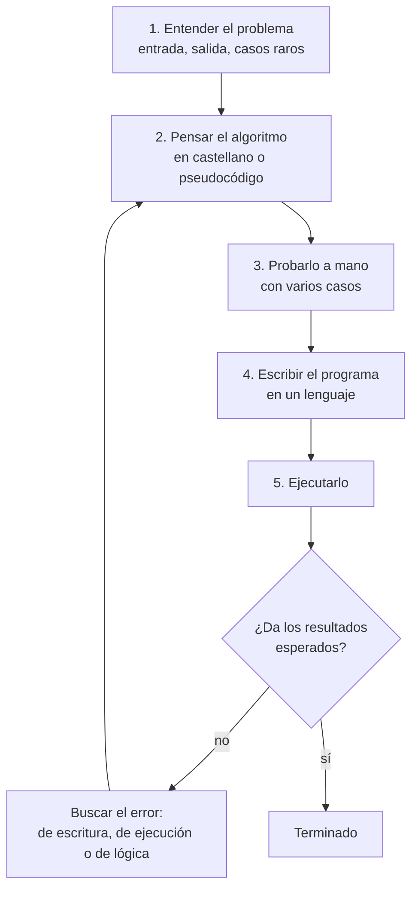

# 01.01 Qué es programar

> **Versiones:** Los fragmentos de ejemplo se han comprobado con Python 3.14, Java 25 y Node.js 24 (8 de noviembre de 2026)
> **Conviene saber antes:** Nada
> **Tiempo estimado:** 2 horas
> **Nivel:** Básico · Núcleo

## Qué aprenderás

- Qué hace de verdad un ordenador y por qué necesita instrucciones tan precisas.
- Qué es programar y el esquema que siguen casi todos los programas: **entrada, proceso y salida**.
- Qué es un **algoritmo**, qué es un **programa** y en qué se diferencian.
- Qué es un **lenguaje de programación**, por qué hay tantos y para qué se usan los más conocidos.
- La diferencia entre lenguajes **compilados** e **interpretados**, y qué consecuencias tiene cuando te equivocas al escribir.
- Los tres tipos de errores que te vas a encontrar: de **escritura**, de **ejecución** y de **lógica**.
- Cómo es, en el día a día, el trabajo de programar.

Este es el primer módulo del curso: no hace falta que sepas nada de antemano ni que instales nada. Aquí vas a **leer y pensar**; los programas que aparecen son solo para que veas las ideas en acción.

## 1. Teoría

### 1.1. Un ordenador es muy rápido y muy obediente

Antes de hablar de programar, conviene entender con quién vas a hablar.

Un ordenador (y también un móvil, una tableta o el sistema que controla una lavadora) es, en el fondo, una máquina que hace **operaciones muy simples a una velocidad enorme**: sumar dos números, comparar si uno es mayor que otro, copiar un dato de un sitio a otro, saltar a otra instrucción… Un procesador actual hace miles de millones de esas operaciones por segundo.

Para entender lo que viene te basta con conocer tres piezas:

| Pieza | Qué hace | Analogía en una cocina |
|---|---|---|
| **Procesador (CPU)** | Ejecuta las instrucciones, una detrás de otra | El cocinero |
| **Memoria (RAM)** | Guarda los datos con los que se está trabajando ahora mismo. Es rápida, pero se borra al apagar | La encimera: lo que tienes a mano mientras cocinas |
| **Almacenamiento (disco)** | Guarda los datos de forma permanente: ficheros, programas instalados, fotos | La despensa: más lenta de consultar, pero lo que hay se conserva |

Las verás con calma en el módulo «Cómo funciona un ordenador» (fase 2). Ahora lo importante es otra idea, que te acompañará en todos los cursos:

> **📌 Nota:** un ordenador **no entiende nada**. No sabe lo que es un libro, un cliente ni una factura. No adivina lo que querías decir ni rellena los huecos con sentido común. Hace **exactamente** lo que le dices, ni más ni menos, y lo hace sin cansarse ni equivocarse.

Imagina un cocinero rapidísimo e incansable, pero que sigue las recetas al pie de la letra. Si la receta dice «añade sal» y no dice cuánta, ese cocinero no puede improvisar: necesita que alguien le diga «añade 5 gramos de sal». Si la receta dice «bate los huevos» antes de «casca los huevos», intentará batir huevos enteros, con cáscara. **Programar es escribir recetas para ese cocinero.**

Esto tiene una consecuencia que al principio sorprende: cuando un programa hace algo raro, casi nunca es que el ordenador «se haya equivocado». Lo normal es que haya hecho justo lo que se le pidió, y que lo que se le pidió no fuera lo que queríamos.

### 1.2. Qué es programar

**Programar es escribir instrucciones precisas para que un ordenador resuelva un problema.**

Casi cualquier programa, desde una calculadora hasta la aplicación de tu banco, sigue el mismo esquema de tres pasos:



Dicho con palabras: el programa recibe unos datos (entrada), hace algo con ellos (proceso) y entrega un resultado (salida).

- **Entrada**: los datos con los que trabaja el programa. Pueden venir de lo que escribe una persona, de un fichero, de una base de datos, de un sensor (una báscula, un termómetro, la cámara del móvil) o de otro programa.
- **Proceso**: las operaciones que se hacen con esos datos: calcular, comparar, ordenar, buscar, decidir.
- **Salida**: el resultado. Un texto en pantalla, un fichero, un correo enviado, un dato guardado o una orden a otra máquina (abrir una barrera, encender una luz).

Mira cómo encaja en situaciones que conoces:

| Situación | Entrada | Proceso | Salida |
|---|---|---|---|
| Cajero automático | Tarjeta, PIN, importe que quieres sacar | Comprueba el PIN, mira si hay saldo, descuenta el importe | Billetes, recibo y saldo actualizado |
| Caja del supermercado | Códigos de barras de los productos | Busca el precio de cada uno y los suma | Total a pagar y ticket |
| Navegador del coche | Dónde estás y adónde quieres ir | Calcula la ruta más rápida con el tráfico actual | Indicaciones paso a paso |
| Almacén de una tienda online | Libros de un pedido y cuántos caben en una caja | Calcula cuántas cajas hacen falta | Número de cajas que hay que preparar |

El último ejemplo es el que vas a usar a lo largo de este módulo.

> **💡 Consejo:** cuando te enfrentes a cualquier problema de programación, empieza siempre por estas tres preguntas: **¿qué datos tengo?**, **¿qué tengo que obtener?** y **¿qué pasos me llevan de lo primero a lo segundo?** Responderlas antes de escribir una sola línea te ahorrará muchísimo tiempo.

### 1.3. Qué es un algoritmo

Un **algoritmo** es una secuencia **ordenada** y **finita** de pasos **precisos** que resuelve un problema.

Cada palabra importa:

- **Ordenada**: los pasos se hacen en un orden concreto. No es lo mismo «abrir la puerta y salir» que «salir y abrir la puerta».
- **Finita**: el algoritmo termina en algún momento. Unas instrucciones que se repiten para siempre no resuelven nada.
- **Precisa**: cada paso se puede seguir sin dudas y sin tomar decisiones por tu cuenta. «Añade un poco de sal» no es preciso; «añade 5 gramos de sal» sí.

Una receta de cocina, las instrucciones para montar un mueble o el procedimiento para dar de alta a un cliente en una empresa son algoritmos escritos para personas. Un algoritmo **no depende de ningún lenguaje de programación**: se puede escribir en castellano.

Este es el algoritmo del almacén, escrito en lenguaje normal:

```text
Algoritmo: calcular las cajas para enviar un pedido de libros

Entrada: número de libros del pedido y número de libros que caben en una caja
Salida: número de cajas necesarias

1. Divide el número de libros entre la capacidad de una caja,
   quedándote solo con la parte entera. Eso son las cajas que van llenas.
2. Calcula cuántos libros sobran (el resto de esa división).
3. Si sobra algún libro, añade una caja más para ellos.
4. Comunica el número total de cajas.
```

Síguelo con 53 libros y cajas de 12: 53 entre 12 da 4 cajas llenas (4 × 12 = 48 libros) y sobran 53 − 48 = 5. Como sobran libros, hace falta una caja más: **5 cajas**.

Fíjate en las dos operaciones de los pasos 1 y 2. La **división entera** («cuántas veces cabe») y el **resto** («cuánto sobra») son las mismas que hacías en el colegio al dividir con lápiz y papel: 53 entre 12 da 4 y sobran 5. Vas a usarlas muchísimo.

Escrito en castellano corriente, el algoritmo se entiende, pero deja cosas al aire (¿«comunica» a quién?, ¿cómo se llama cada dato?). Por eso los programadores usan a menudo el **pseudocódigo**, palabras normales con una estructura fija, que es lo que aprenderás en el [módulo siguiente](02-algoritmos-y-pseudocodigo.md#15-pseudocódigo). Como adelanto, el mismo algoritmo en el pseudocódigo de este curso queda así:

```text
ALGORITMO CalcularCajas
    ENTRADA: libros del pedido y capacidad de una caja
    SALIDA: número de cajas necesarias

INICIO
    LEER libros, capacidad
    cajas ← libros DIV capacidad          // cajas que van llenas
    sobrantes ← libros MOD capacidad      // libros que no llenan una caja
    SI sobrantes > 0 ENTONCES
        cajas ← cajas + 1                 // una caja más para los que sobran
    FIN SI
    ESCRIBIR "Cajas necesarias: ", cajas
FIN
```

No hace falta que lo domines todavía: `LEER` recoge los datos, `←` guarda un valor con un nombre, `DIV` es la división entera, `MOD` el resto, `SI … ENTONCES … FIN SI` hace algo solo cuando se cumple una condición, y `ESCRIBIR` comunica el resultado. Todo esto lo aprenderás con calma en el [siguiente módulo, «Algoritmos y pseudocódigo»](02-algoritmos-y-pseudocodigo.md).

### 1.4. Qué es un programa

Un **programa** es un algoritmo escrito en un **lenguaje de programación**, de forma que un ordenador lo pueda ejecutar.

- El texto que escribe el programador se llama **código fuente** (o simplemente **código**). Se guarda en ficheros de texto normales.
- **Ejecutar** un programa significa ponerlo en marcha: que el ordenador siga sus instrucciones.
- Un programa grande (un procesador de textos, una tienda online) está formado por miles de pequeños algoritmos que colaboran entre sí.

La relación entre estas ideas es esta:



Es decir: partes de un problema, piensas un algoritmo que lo resuelve, lo escribes en un lenguaje de programación (eso es el programa) y el ordenador, al ejecutarlo, te da el resultado.

> **📌 Nota:** la parte difícil de programar casi nunca es escribir el código, sino **pensar el algoritmo**: entender bien el problema y encontrar los pasos correctos. Por eso este curso empieza por aquí, sin ningún lenguaje concreto: lo que aprendas en esta fase te servirá para todos.

Y falta un paso que mucha gente olvida: **comprobar que el resultado es correcto**. Que el programa dé «5 cajas» no significa que esté bien; hay que probarlo con otros casos (¿y si los libros llenan las cajas justas?, ¿y si el pedido está vacío?). Cómo se hace lo verás en el módulo [«¿Cómo sé que funciona? Probar un programa»](03-probar-un-programa.md).

### 1.5. Lenguajes de programación

El procesador solo entiende **código máquina**: secuencias de números binarios (unos y ceros) que representan instrucciones muy básicas. Escribir programas directamente así es lentísimo y se presta a errores, así que se inventaron los **lenguajes de programación**: idiomas intermedios, pensados para que las personas los escriban y los lean, que después se traducen a código máquina.

Se suelen clasificar por lo cerca que están de la máquina o de las personas:

| Nivel | Cómo es | Ejemplos | Para qué se usa |
|---|---|---|---|
| **Código máquina** | Números binarios que entiende directamente el procesador | `10110000 01100001` | Nadie lo escribe a mano hoy en día |
| **Bajo nivel** | Instrucciones que se corresponden casi una a una con las del procesador | Ensamblador | Partes muy concretas de sistemas operativos o de controladores de dispositivos |
| **Alto nivel** | Parecido al lenguaje humano y a las matemáticas; se ocupa por ti de los detalles de la máquina | Python, Java, JavaScript, C#, Go, Kotlin | La inmensa mayoría de los programas |

Cuanto más alto es el nivel, más fácil es de leer y de escribir para una persona, y más trabajo hace por ti la herramienta que lo traduce. Todos los lenguajes que vas a ver en la academia son de alto nivel.

**¿Por qué hay tantos lenguajes?** Por la misma razón que hay muchas herramientas en una caja: cada uno se diseñó para resolver mejor un tipo de problema, en una época concreta y con unas prioridades distintas (velocidad, seguridad, facilidad de aprendizaje, trabajo en equipos grandes, funcionar dentro de un navegador…). La buena noticia es que **las ideas de fondo son las mismas en todos**: datos con nombre, condiciones, repeticiones, bloques que se reutilizan… Lo que aprendas bien en uno te servirá para aprender el siguiente mucho más deprisa. Lo comprobarás en el [apartado 2.1](#21-el-mismo-algoritmo-en-tres-lenguajes), con el mismo algoritmo escrito en tres lenguajes.

### 1.6. Lenguajes conocidos y para qué se usan

No necesitas memorizar esta tabla; está para que te suenen los nombres cuando los oigas:

| Lenguaje | Para qué se usa sobre todo |
|---|---|
| **Python** | Análisis de datos, inteligencia artificial, automatizar tareas, servicios web. Muy usado para aprender por lo legible que es |
| **JavaScript** | Páginas web: es el lenguaje que ejecutan los navegadores. También servidores |
| **Java** | Aplicaciones de empresa y servicios en el servidor (bancos, comercio electrónico, administraciones); aplicaciones Android |
| **C#** | Aplicaciones de empresa en el mundo de Microsoft, videojuegos (con el motor Unity) |
| **Kotlin** | Aplicaciones Android (es el lenguaje que recomienda Google) y servicios en el servidor |
| **Go** | Servicios en la nube y herramientas de infraestructura |
| **SQL** | Consultar y modificar datos en bases de datos. No sirve para hacer una aplicación entera, pero casi todas lo usan |

Además de servir para cosas distintas, los lenguajes se pueden usar con **estilos** distintos de plantear un programa. Los verás en el módulo [«Paradigmas de programación»](04-paradigmas-de-programacion.md).

Los cursos de la academia que enseñan un lenguaje concreto parten de lo que aprendes en este: es el paso previo a todos ellos.

> **⚠️ Cuidado:** **Java y JavaScript no tienen nada que ver**, salvo el parecido del nombre, que fue una decisión comercial de los años noventa. Son lenguajes distintos, con usos distintos.

### 1.7. Lenguajes compilados e interpretados

Hay dos grandes formas de convertir el código fuente en algo que el ordenador pueda ejecutar. La mejor manera de entenderlas es con una analogía de traducción.

**Compilar** es como **traducir un libro entero** antes de publicarlo. Un programa especial, el **compilador**, lee todo tu código, comprueba que está bien escrito y genera un fichero nuevo, ya traducido, listo para ejecutarse. La traducción se hace una vez; después se ejecuta tantas veces como quieras sin volver a traducir.

**Interpretar** es como tener un **intérprete simultáneo** en una conferencia. Un programa, el **intérprete**, lee tu código y lo va ejecutando instrucción a instrucción, en el momento. No hay un fichero traducido: cada vez que ejecutas el programa, el intérprete vuelve a leerlo y a traducirlo.



En el lenguaje compilado, el compilador traduce el código fuente una sola vez a un programa ejecutable, y es ese ejecutable el que se pone en marcha. En el interpretado, el intérprete lee el código fuente y lo ejecuta directamente, cada vez.

Cada enfoque tiene sus ventajas:

| | Compilado | Interpretado |
|---|---|---|
| **Cuándo se detectan muchos errores de escritura** | Al compilar, **antes** de ejecutar | Al ejecutar, **cuando se llega** a la línea con el error |
| **Velocidad de ejecución** | Normalmente más rápida: ya está traducido | Normalmente más lenta: se traduce sobre la marcha |
| **Rapidez para probar un cambio** | Hay que compilar antes de probar | Se prueba al instante |
| **Dónde se puede ejecutar** | El ejecutable sirve para un sistema y un procesador concretos; para otro hay que volver a compilar | En cualquier sitio donde esté instalado el intérprete |
| **Ejemplos** | C, C++, Rust, Go | Python, JavaScript, Ruby, PHP |

> **📌 Nota:** esta clasificación es una simplificación útil para empezar. Hoy muchos lenguajes combinan las dos técnicas. Java y C#, por ejemplo, **compilan** el código a un formato intermedio que no es el de ningún procesador concreto, y luego un programa instalado en cada ordenador (una **máquina virtual**) lo ejecuta y lo va traduciendo sobre la marcha. Por eso un mismo programa en Java funciona en Windows, Linux y macOS, y aun así el compilador detecta muchos errores antes de ejecutar. En la práctica, lo que te interesa saber de cada lenguaje es **cuándo te avisa de los errores**: antes de ejecutar o al llegar a ellos. Lo verás en el [apartado 2.2](#22-la-misma-errata-en-un-lenguaje-compilado-y-en-uno-interpretado).

### 1.8. Tres tipos de errores

Equivocarse al programar es lo normal, también para quien lleva décadas haciéndolo. Lo que cambia con la experiencia es lo rápido que se encuentran los errores. Y para eso ayuda saber que hay tres tipos:

| Tipo | Qué es | Ejemplo | Quién lo detecta |
|---|---|---|---|
| **Error de escritura** (también **de sintaxis** o, si lo detecta el compilador, **de compilación**) | El código no está bien escrito según las reglas del lenguaje | Falta un signo, un nombre mal escrito | El compilador, antes de ejecutar; en un lenguaje interpretado, al llegar a esa línea |
| **Error de ejecución** | El código está bien escrito, pero algo falla mientras el programa está en marcha | Dividir entre cero, abrir un fichero que no existe | Nadie hasta que ocurre: el programa se detiene con un mensaje |
| **Error de lógica** | El programa funciona sin quejarse, pero el resultado es incorrecto | Sumar el IVA dos veces, calcular mal el número de cajas | **Nadie**, salvo tú al comprobar los resultados |

Los errores de lógica son los más peligrosos, precisamente porque no avisan: el programa termina con normalidad y da un resultado equivocado con toda tranquilidad. La única defensa es **probar** el programa con casos cuyo resultado correcto conoces de antemano, y a eso dedicarás el módulo [«¿Cómo sé que funciona? Probar un programa»](03-probar-un-programa.md). Leer mensajes de error y buscar fallos de forma ordenada lo verás en el módulo «Errores y depuración» (fase 3).

### 1.9. Cómo es el trabajo de programar

Para terminar la teoría, una idea realista de en qué consiste programar en el día a día, porque no se parece mucho a lo que muestran las películas:

- **Se piensa mucho antes de escribir.** Entender qué hay que hacer (y preguntar lo que no está claro) ocupa buena parte del tiempo.
- **Se lee mucho más código del que se escribe.** La mayor parte del tiempo trabajas sobre código que ya existe, escrito por otras personas (o por ti hace meses).
- **Equivocarse es lo normal.** Los mensajes de error no son un fracaso: son el ordenador diciéndote qué no ha entendido. Aprender a leerlos con calma es una de las habilidades más valiosas que vas a desarrollar.
- **Se prueba todo.** Un programa no está terminado cuando «parece que funciona», sino cuando se ha comprobado con casos normales y con casos raros.
- **Se trabaja en equipo.** Con herramientas para guardar el historial del código y compartirlo (Git y GitHub, en la fase 5 de este curso) y revisando el trabajo de los compañeros.
- **Se usan herramientas de ayuda**, cada vez más los asistentes de inteligencia artificial. Bien usados, aceleran mucho; mal usados, te impiden aprender. Lo verás en el módulo «Programar con asistentes de IA» (fase 7).
- **No hace falta ser un genio de las matemáticas.** Para la mayoría de los programas basta con las operaciones básicas. Lo que sí hace falta es **pensar con orden**, ser **paciente** y **fijarse en los detalles**.

## 2. Ejemplos de código

> **📌 Nota:** no tienes que instalar ni ejecutar nada de esta sección. Los fragmentos están en lenguajes reales solo para que **veas** las ideas de la teoría funcionando. Este curso no enseña ningún lenguaje: eso queda para los cursos de cada uno.

### 2.1. El mismo algoritmo en tres lenguajes

**Situación real:** el almacén de una tienda online necesita saber cuántas cajas preparar para cada pedido. Cada caja admite 12 libros y el pedido es de 53.

Este es el algoritmo del [apartado 1.3](#13-qué-es-un-algoritmo) escrito en **Python**. No hace falta que entiendas cada línea: fíjate en que cada paso del algoritmo tiene su línea.

```python
# Calcula cuántas cajas hacen falta para enviar un pedido de libros
libros = 53          # libros que hay que enviar
capacidad = 12       # libros que caben en una caja

llenas = libros // capacidad       # cajas que van completamente llenas
sobrantes = libros % capacidad     # libros que no llenan una caja

cajas = llenas
if sobrantes > 0:
    cajas = cajas + 1              # una caja más para los que sobran

print("Libros a enviar:", libros)
print("Cajas necesarias:", cajas)
print("La última caja lleva", sobrantes, "libros")
```

Al ejecutarlo, muestra:

```text
Libros a enviar: 53
Cajas necesarias: 5
La última caja lleva 5 libros
```

El mismo algoritmo en **Java**. Tampoco hace falta que entiendas cada línea: fíjate en que los pasos son los mismos y en el mismo orden, aunque cambie la forma de escribirlos.

```java
// Calcula cuántas cajas hacen falta para enviar un pedido de libros
void main() {
    int libros = 53;                     // libros que hay que enviar
    int capacidad = 12;                  // libros que caben en una caja

    int llenas = libros / capacidad;     // cajas que van completamente llenas
    int sobrantes = libros % capacidad;  // libros que no llenan una caja

    int cajas = llenas;
    if (sobrantes > 0) {
        cajas = cajas + 1;               // una caja más para los que sobran
    }

    IO.println("Libros a enviar: " + libros);
    IO.println("Cajas necesarias: " + cajas);
    IO.println("La última caja lleva " + sobrantes + " libros");
}
```

Y en **JavaScript**, el lenguaje de los navegadores. Fíjate otra vez en los pasos, no en los símbolos:

```javascript
// Calcula cuántas cajas hacen falta para enviar un pedido de libros
const libros = 53;                          // libros que hay que enviar
const capacidad = 12;                       // libros que caben en una caja

const llenas = Math.floor(libros / capacidad); // cajas que van completamente llenas
const sobrantes = libros % capacidad;          // libros que no llenan una caja

let cajas = llenas;
if (sobrantes > 0) {
  cajas = cajas + 1;                        // una caja más para los que sobran
}

console.log("Libros a enviar:", libros);
console.log("Cajas necesarias:", cajas);
console.log("La última caja lleva", sobrantes, "libros");
```

Los dos muestran exactamente la misma salida que el de Python.

Compara los tres con el pseudocódigo del [apartado 1.3](#13-qué-es-un-algoritmo):

| Paso del algoritmo | Pseudocódigo | Python | Java | JavaScript |
|---|---|---|---|---|
| Guardar un dato con nombre | `libros ← 53` | `libros = 53` | `int libros = 53;` | `const libros = 53;` |
| División entera | `libros DIV capacidad` | `libros // capacidad` | `libros / capacidad` | `Math.floor(libros / capacidad)` |
| Resto | `libros MOD capacidad` | `libros % capacidad` | `libros % capacidad` | `libros % capacidad` |
| Condición | `SI sobrantes > 0 ENTONCES … FIN SI` | `if sobrantes > 0:` y sangría | `if (sobrantes > 0) { … }` | `if (sobrantes > 0) { … }` |
| Mostrar un resultado | `ESCRIBIR …` | `print(…)` | `IO.println(…)` | `console.log(…)` |
| Comentario para personas | `// …` | `# …` | `// …` | `// …` |

Cambian los detalles de escritura: Java exige decir qué tipo de dato es cada cosa (`int`, número entero), Python marca los bloques con sangría en vez de llaves, JavaScript necesita `Math.floor` para quedarse con la parte entera de la división… Pero **los pasos son idénticos**. Por eso, una vez que sabes pensar el algoritmo, cambiar de lenguaje es mucho más fácil que empezar de cero.

> **📌 Nota:** los nombres de estos fragmentos (`libros`, `capacidad`, `sobrantes`) están en español para que se entiendan bien. En la mayoría de las empresas, también en España, los nombres del código se escriben en inglés (`books`, `boxCapacity`) para que cualquier programador del mundo pueda leerlo; los textos que ve el usuario sí van en su idioma. Cada curso de lenguaje te dirá qué costumbre sigue.

> **💡 Consejo:** fíjate también en los **comentarios** (las líneas que empiezan por `#` o `//`): son texto para las personas, y el ordenador los ignora. Y en los **nombres**: `sobrantes` dice lo que guarda; `s` o `dato2` no dirían nada. Elegir buenos nombres es una de las costumbres más importantes de quien programa.

### 2.2. La misma errata en un lenguaje compilado y en uno interpretado

**Situación real:** equivocarse al escribir es lo más habitual del mundo. Veamos cómo reaccionan Java (que compila antes de ejecutar) y Python (que interpreta línea a línea) ante el mismo fallo: en la última línea del programa de las cajas se ha escrito `sobrante` en lugar de `sobrantes`. No hace falta que entiendas el código: fíjate en **cuándo** avisa cada lenguaje.

**En Java**, la última línea queda así:

```java
    IO.println("La última caja lleva " + sobrante + " libros");
```

Al compilar el programa (guardado en un fichero llamado `CajasConError.java`), el compilador se niega a generarlo:

```text
CajasConError.java:16: error: cannot find symbol
    IO.println("La última caja lleva " + sobrante + " libros");
                                         ^
  symbol:   variable sobrante
  location: class CajasConError
1 error
```

**No se ejecuta nada**: ni siquiera las dos primeras líneas, que estaban bien. Java ha detectado el error antes de empezar.

**En Python**, con la misma errata:

```python
print("La última caja lleva", sobrante, "libros")
```

Al ejecutarlo:

```text
Libros a enviar: 53
Cajas necesarias: 5
Traceback (most recent call last):
  File "/home/ana/cursos/cajas_con_error.py", line 14, in <module>
    print("La última caja lleva", sobrante, "libros")
                                  ^^^^^^^^
NameError: name 'sobrante' is not defined. Did you mean: 'sobrantes'?
```

**Python ejecuta las primeras líneas** y falla solo al llegar a la del error. (La ruta que aparece tras `File` es la carpeta donde está el fichero; aquí se ha cambiado por una ruta de ejemplo, y en cada ordenador será otra.)

En un programa de pocas líneas da igual. Pero imagina un proceso que tarda dos horas en preparar los envíos del día y que, al final, falla por una errata en la última línea, después de haber hecho la mitad del trabajo. Detectar el error antes de empezar es una gran ventaja de los lenguajes compilados. A cambio, en Python pruebas un cambio al instante, sin el paso de compilar. Ninguno es «mejor»: son compromisos distintos.

> **📌 Nota:** los dos mensajes están en inglés aunque el ordenador esté en español. Es lo habitual: casi todos los compiladores e intérpretes dan sus mensajes en inglés. No hace falta un inglés avanzado para leerlos: se repiten siempre las mismas pocas frases. Cómo leerlos lo tienes en el [error típico 3.3](#33-asustarse-con-el-primer-mensaje-de-error).

> **📌 Nota:** compilar no garantiza que el programa sea correcto. El compilador detecta errores de **escritura** (un nombre que no existe, un signo que falta), pero no errores de **lógica**: si el algoritmo está mal pensado, el programa compilará y dará un resultado equivocado. Lo verás en el [ejercicio 6](#ejercicio-6--el-error-que-el-compilador-no-ve).

### 2.3. Del problema al resultado, paso a paso

**Situación real:** juntemos todo lo visto con el ejemplo del almacén, tal y como se trabajaría de verdad.



En texto: primero se entiende el problema, después se piensa el algoritmo y se prueba a mano; solo entonces se escribe el programa y se ejecuta. Si los resultados no son los esperados, se busca el error y se vuelve a pensar el algoritmo; si lo son, se da por terminado.

Aplicado al almacén:

1. **Entender el problema.** Entrada: libros del pedido y capacidad de una caja. Salida: número de cajas. Preguntas: ¿puede haber un pedido de 0 libros? ¿Qué pasa si los libros llenan las cajas justas?
2. **Pensar el algoritmo.** El del [apartado 1.3](#13-qué-es-un-algoritmo).
3. **Probarlo a mano**, con casos cuyo resultado sabes de antemano:

   | Libros | Capacidad | Cajas esperadas | Por qué |
   |---|---|---|---|
   | 53 | 12 | 5 | 4 llenas y 5 libros sueltos |
   | 48 | 12 | 4 | Llenan las cajas justas: no sobra nada |
   | 5 | 12 | 1 | Menos de una caja: va una, sin llenar |
   | 0 | 12 | 0 | No hay nada que enviar |

4. **Escribirlo** en el lenguaje que toque, como en el [apartado 2.1](#21-el-mismo-algoritmo-en-tres-lenguajes).
5. **Ejecutarlo** con los mismos casos y comparar.

Esa tabla de casos es la herramienta más útil que te llevas de este módulo. En el módulo [«¿Cómo sé que funciona? Probar un programa»](03-probar-un-programa.md) aprenderás a elegir bien esos casos.

## 3. Errores típicos

### 3.1. Dar instrucciones que no son precisas

**Qué pasa:** escribes unas instrucciones que a ti te parecen claras, pero dejan casos sin cubrir o se pueden interpretar de varias formas.

**Por qué ocurre:** las personas rellenamos los huecos con sentido común sin darnos cuenta. El ordenador no tiene sentido común: hace exactamente lo escrito.

**Ejemplo real:** «manda un correo a los clientes que llevan tiempo sin comprar». ¿Cuánto tiempo es «tiempo»? ¿Un mes? ¿Un año? ¿Y los clientes que no han comprado nunca? Un programa necesita algo como «manda un correo a los clientes cuya última compra fue hace más de 180 días; los que no han comprado nunca no reciben este correo».

**Cómo evitarlo:** antes de programar, pregúntate qué pasa en los casos extremos (cero, uno, ninguno, todos, el valor justo del límite) y escribe la respuesta. Si no la sabes, pregúntala: no te la inventes.

### 3.2. Creer que, si funciona con un ejemplo, funciona siempre

**Qué pasa:** pruebas el programa con un caso, da bien, y das el trabajo por terminado.

**Por qué ocurre:** el caso que pruebas suele ser el «normal», el que tenías en la cabeza al escribirlo. Los fallos suelen esconderse en los casos raros.

**Cómo evitarlo:** prueba siempre varios casos, incluidos los límites, como en la tabla del [apartado 2.3](#23-del-problema-al-resultado-paso-a-paso). En el programa de las cajas, ¿qué pasa si los libros llenan las cajas justas? El [ejercicio 6](#ejercicio-6--el-error-que-el-compilador-no-ve) va justo de esto, y el módulo [«¿Cómo sé que funciona? Probar un programa»](03-probar-un-programa.md), de cómo evitarlo siempre.

### 3.3. Asustarse con el primer mensaje de error

**Qué pasa:** el compilador o el intérprete te muestra un mensaje en inglés, lleno de símbolos, y parece que todo está roto.

**Por qué ocurre:** los mensajes son muy escuetos, pero casi siempre dicen exactamente qué pasa y dónde. Este es el error real del [apartado 2.2](#22-la-misma-errata-en-un-lenguaje-compilado-y-en-uno-interpretado):

```text
CajasConError.java:16: error: cannot find symbol
    IO.println("La última caja lleva " + sobrante + " libros");
                                         ^
  symbol:   variable sobrante
  location: class CajasConError
1 error
```

**Cómo leerlo:**

| Parte | Qué te dice |
|---|---|
| `CajasConError.java:16` | El fichero y la **línea** del error: la 16 |
| `error: cannot find symbol` | El tipo de error: «no encuentro el símbolo», es decir, has usado un nombre que no existe |
| La línea de código con `^` | La línea exacta, con una marca debajo señalando dónde está el problema |
| `symbol: variable sobrante` | El nombre que no encuentra: `sobrante` |
| `1 error` | Cuántos errores hay en total |

**Cómo arreglarlo:** ir a la línea 16 y comprobar el nombre. El dato se llama `sobrantes`, con `s` final. El mensaje de Python dice lo mismo con otras palabras, y hasta sugiere la solución: `Did you mean: 'sobrantes'?` («¿querías decir `sobrantes`?»).

> **💡 Consejo:** cuando aparezcan varios errores, arregla **el primero** y vuelve a probar. A menudo un solo fallo provoca varios mensajes en cascada, y al corregir el primero desaparecen los demás. Leer errores con método es el tema del módulo «Errores y depuración» (fase 3).

### 3.4. Confundir lenguajes de nombre parecido

**Qué pasa:** buscas ayuda sobre Java en internet y acabas en una página de JavaScript (o al revés), copias el código y no funciona.

**Por qué ocurre:** los nombres se parecen, pero son lenguajes distintos, con usos distintos y escritura diferente. Pasa también con versiones muy distintas del mismo lenguaje.

**Cómo evitarlo:** asegúrate de que la página o la respuesta habla del lenguaje (y de la versión) que estás usando. Como pista: si ves `console.log`, `let` o `const`, es JavaScript.

### 3.5. Las tildes y las eñes salen mal en la consola

**Qué pasa:** ejecutas un programa y, en lugar de `La última caja`, ves algo como esto:

```text
La última caja
```

o como esto:

```text
La ?ltima caja
```

**Por qué ocurre:** el programa escribe el texto bien, pero la **consola** (la ventana de texto donde se ve lo que escribe un programa) usa una **codificación de caracteres** distinta. Una codificación es la tabla que asocia cada letra con un número; si el programa y la consola usan tablas distintas, las letras que no son del inglés (tildes, eñes, `ü`, `¿`) se estropean. En el primer caso, la consola lee la `ú` con la tabla equivocada y dibuja dos caracteres raros; en el segundo, no sabe dibujarla y pone `?`. Pasa sobre todo en consolas de Windows antiguas.

**Cómo se arregla:** haciendo que todo use **UTF-8**, la codificación que entiende todos los idiomas y que es la habitual hoy. No tienes que hacer nada ahora: lo verás a fondo en el módulo «Texto, binario y codificación» (fase 4). Lo importante es que, si te pasa, sepas que **tu programa no está mal**: es un problema de cómo se muestra el texto.

### 3.6. Copiar código sin entenderlo

**Qué pasa:** encuentras un fragmento que hace lo que necesitas, lo pegas y funciona… hasta que deja de funcionar y no sabes por qué.

**Por qué ocurre:** el código copiado puede estar pensado para otro lenguaje, otra versión u otra situación, o simplemente tener errores. Pasa igual con el que te da un asistente de inteligencia artificial: suena muy seguro de sí mismo aunque se equivoque.

**Cómo evitarlo:** usa el código de otros (también el de los cursos y el que te genere la IA) para **aprender**, no para saltarte el aprendizaje. Si no puedes explicar qué hace un fragmento, todavía no deberías usarlo. Y compruébalo siempre con tus casos de prueba.

### 3.7. Querer elegir primero el «mejor lenguaje»

**Qué pasa:** pasas semanas leyendo comparativas para decidir qué lenguaje aprender, o saltas de uno a otro cada pocos días.

**Por qué ocurre:** parece una decisión enorme, y en internet cada uno defiende el suyo.

**Cómo evitarlo:** recuerda que **las ideas de fondo son las mismas** ([apartado 2.1](#21-el-mismo-algoritmo-en-tres-lenguajes)). Termina este curso, elige un lenguaje según lo que quieras hacer (la tabla del [apartado 1.6](#16-lenguajes-conocidos-y-para-qué-se-usan) te orienta) y quédate con él hasta dominarlo. El segundo te costará mucho menos.

## 4. Buenas prácticas

- **Entiende el problema antes de escribir código.** Identifica la entrada, la salida y los pasos intermedios. Si no sabes explicar la solución en castellano, tampoco sabrás escribirla en ningún lenguaje.
- **Divide los problemas grandes en otros pequeños.** «Gestionar los pedidos» es inabordable; «calcular las cajas de un pedido» es fácil. Todos los programas grandes se construyen así.
- **Piensa en los casos límite desde el principio**: cero, uno, ninguno, muchísimos, el valor exacto de un límite, datos vacíos o incorrectos.
- **Decide los resultados esperados antes de ejecutar.** Si no sabes qué debería salir, no puedes saber si lo que sale está bien.
- **Pregunta lo que no esté claro** en vez de inventártelo. Una pregunta a tiempo ahorra días de trabajo.
- **Usa nombres que expliquen lo que guardan.** `sobrantes` es mejor que `s`, `num` o `dato2`.
- **Comenta el porqué, no el qué.** El código ya dice qué hace; los comentarios deben explicar lo que no es evidente, como por qué se añade una caja más.
- **Lee los mensajes de error con calma** y empieza siempre por el primero.

**Lo que conviene evitar:**

- Ponerte a escribir código en cuanto lees un enunciado, sin pensar antes la solución.
- Dar por bueno un programa porque funciona con un único ejemplo.
- Elegir lenguaje o herramienta por moda: lo importante son los fundamentos, que sirven para todos.

## 5. Ejercicios prácticos resueltos

> **💡 Consejo:** intenta resolver cada ejercicio **antes** de abrir las pistas y la solución. En este curso no escribes código en ningún lenguaje: los ejercicios son de pensar, de razonar y de leer. Hazlos por escrito, en papel o en un documento. Si usas un asistente de IA, que sea para que te explique o te revise, no para que lo haga por ti.

### 🟢 Básico

#### Ejercicio 1 · Entrada, proceso y salida

Identifica la entrada, el proceso y la salida de estas tres situaciones:

1. Una báscula de la sección de fruta del supermercado que imprime la etiqueta con el precio.
2. Una aplicación del tiempo que te dice si mañana va a llover en tu ciudad.
3. El sistema que calcula tu nómina a final de mes.

<details>
<summary>Pista 1</summary>

Para cada caso, pregúntate: ¿qué datos necesita el sistema para trabajar? ¿Qué hace con ellos? ¿Qué te entrega al final? Recuerda que la entrada no siempre la escribe una persona.

</details>

<details>
<summary>Ver solución</summary>

**Razonamiento:** se aplican las tres preguntas del [apartado 1.2](#12-qué-es-programar) a cada situación: qué datos recibe el sistema (entrada), qué hace con ellos (proceso) y qué entrega (salida).

| Situación | Entrada | Proceso | Salida |
|---|---|---|---|
| Báscula de fruta | El peso de la bolsa (lo mide la propia báscula) y el producto que eliges en la pantalla | Busca el precio por kilo de ese producto y lo multiplica por el peso | Una etiqueta con el producto, el peso, el precio por kilo, el importe y un código de barras |
| Aplicación del tiempo | Tu ciudad (o tu ubicación) y la fecha de mañana | Consulta las predicciones de un servicio meteorológico para esa ciudad y esa fecha | Un icono y un texto: probabilidad de lluvia, temperaturas… |
| Nómina | Salario bruto, días trabajados, horas extra, bajas, situación familiar y tipo de contrato | Calcula el bruto del mes y le resta la retención de IRPF y las cotizaciones a la Seguridad Social | El recibo de nómina con el desglose y el importe neto, y la transferencia al banco |

**Fíjate en que** la entrada no siempre la escribe una persona: en la báscula la da un **sensor**, y en la aplicación del tiempo parte de los datos llegan de **otro sistema**. Y la salida tampoco es siempre un texto en pantalla: puede ser una etiqueta impresa o una transferencia bancaria.

**Errores frecuentes al resolverlo:**

- Confundir el proceso con la salida: «calcula el precio» es proceso; «la etiqueta con el precio» es salida.
- Olvidar entradas que no se ven: en la nómina, la situación familiar cambia la retención aunque no la teclees cada mes.

</details>

#### Ejercicio 2 · ¿Es un algoritmo?

Recuerda que un algoritmo es una secuencia **ordenada**, **finita** y **precisa** de pasos que resuelve un problema. Di si cada una de estas instrucciones es un algoritmo y, si no lo es, qué propiedad le falta o qué tiene mal:

1. Para hacer café: pon agua, añade café y espera un rato.
2. Para saber si un número entero es par: divídelo entre 2; si el resto es 0, es par; si no, es impar.
3. Para contar: escribe el número 1 y, a partir de ahí, escribe siempre el número anterior más 1.
4. Para poner una lavadora: mete la ropa, pulsa el botón de inicio, elige el programa de 40 °C y cierra la puerta.
5. Para llegar a la estación desde la plaza: sigue recto hasta la segunda calle, gira a la derecha y camina 200 metros; la estación está a tu izquierda.

<details>
<summary>Pista 1</summary>

Comprueba las tres propiedades una por una en cada caso. ¿Podrías seguir cada paso sin decidir nada por tu cuenta? ¿Termina en algún momento? ¿El orden tiene sentido?

</details>

<details>
<summary>Pista 2</summary>

En el caso 4, los pasos están en un orden concreto… pero ¿es el orden correcto? Un algoritmo también tiene que **resolver el problema**.

</details>

<details>
<summary>Ver solución</summary>

**Razonamiento:** se revisa cada propiedad del [apartado 1.3](#13-qué-es-un-algoritmo) y, además, si los pasos resuelven de verdad el problema.

| # | ¿Algoritmo? | Por qué |
|---|---|---|
| 1 | No | **No es preciso.** ¿Cuánta agua? ¿Cuánto café? ¿Cuánto es «un rato»? ¿Hay que calentar el agua? Una persona lo rellena con sentido común; un ordenador, no |
| 2 | Sí | Ordenado, finito (son dos pasos) y preciso: el resto de dividir entre 2 solo puede ser 0 o 1, y cada caso tiene su respuesta |
| 3 | No | **No es finito.** Nunca dice cuándo parar: escribiría números para siempre. Bastaría con añadir «hasta llegar a 100» |
| 4 | No (está mal) | Es preciso y finito, pero **el orden es incorrecto**: pulsa «inicio» antes de elegir el programa y de cerrar la puerta. Muchas lavadoras no arrancarían, o lo harían con el programa anterior. El orden correcto: meter la ropa, cerrar la puerta, elegir el programa y pulsar inicio |
| 5 | Sí | Ordenado, finito y preciso: cada paso se puede seguir sin dudas. (Podría matizarse «la segunda calle» si hay dudas sobre cuál cuenta, pero en general se entiende sin ambigüedad) |

**Lo importante:** que unas instrucciones parezcan claras no basta. El caso 4 es especialmente traicionero: tiene todo el aspecto de un algoritmo correcto, y precisamente por eso los errores de orden son tan difíciles de ver.

**Errores frecuentes al resolverlo:**

- Dar por bueno el caso 1 porque «todo el mundo sabe hacer café». El ordenador no.
- No ver el problema del caso 4 por leerlo deprisa: el cerebro reordena los pasos sin que te des cuenta.

</details>

#### Ejercicio 3 · ¿Compilado o interpretado?

Contesta razonando cada respuesta:

1. Tienes un programa escrito en C y ya compilado para Windows. ¿Puedes ejecutar ese mismo fichero en un Mac?
2. Un programa en Python tiene una errata en una línea que solo se ejecuta los domingos. ¿Cuándo te enterarás del error?
3. Ana cambia una línea de un programa en Python y Luis una de un programa en C. Los dos quieren probar el cambio cuanto antes. ¿Quién tiene un paso más que hacer y cuál es?
4. Una compañera te pasa un programa en Python (el fichero de código fuente). ¿Qué necesitas tener instalado en tu ordenador para ejecutarlo?

<details>
<summary>Pista 1</summary>

Repasa la tabla de ventajas del [apartado 1.7](#17-lenguajes-compilados-e-interpretados): cuándo se detectan los errores, si hay que traducir antes de probar y dónde se puede ejecutar cada tipo.

</details>

<details>
<summary>Ver solución</summary>

**Razonamiento:** cada pregunta se responde con una fila de la tabla del [apartado 1.7](#17-lenguajes-compilados-e-interpretados): dónde se puede ejecutar, cuándo aparecen los errores, si hay que traducir antes de probar y qué hace falta para ejecutar.

1. **No.** El compilador de C genera código máquina para un sistema operativo y un procesador concretos. Para el Mac habría que volver a compilar el código fuente con un compilador para Mac.
2. **El domingo.** Python interpreta las instrucciones al ejecutarlas: si esa línea no se ejecuta, el error no se descubre. Puede pasar una semana entera sin que nadie note nada. (En un lenguaje compilado, una errata de escritura como esa la habría detectado el compilador antes de ejecutar nada.)
3. **Luis.** Antes de probar tiene que **compilar** el programa para generar el ejecutable nuevo. Ana lo ejecuta directamente: el intérprete lee el código cambiado en ese momento.
4. **El intérprete de Python.** El fichero es código fuente: sin el programa que lo lee y lo ejecuta, tu ordenador no sabe qué hacer con él. A cambio, el mismo fichero te sirve tanto si usas Windows como Linux o macOS.

**Errores frecuentes al resolverlo:**

- Pensar que en la pregunta 2 Python avisa «al abrir el programa». Algunos fallos muy graves sí los detecta antes de empezar, pero un nombre mal escrito como el del [apartado 2.2](#22-la-misma-errata-en-un-lenguaje-compilado-y-en-uno-interpretado) no se descubre hasta que se ejecuta esa línea.
- Creer que compilado o interpretado es «mejor» o «peor» en general. Son compromisos distintos.

</details>

### 🟡 Intermedio

#### Ejercicio 4 · Sigue un algoritmo a mano

**Situación real:** un restaurante necesita saber cuántas mesas de 4 plazas montar para un grupo.

Sin ordenador, sigue este algoritmo paso a paso y escribe exactamente lo que comunica, en el orden en que lo hace. Ve anotando el valor de cada dato después de cada paso.

```text
1. Comensales vale 23. Plazas por mesa vale 4.
2. Mesas vale la división entera de comensales entre plazas por mesa.
3. Sin sitio vale el resto de esa división.
4. Escribe «Mesas completas: » seguido del valor de mesas.
5. Escribe «Personas sin mesa completa: » seguido del valor de sin sitio.
6. Si sin sitio es mayor que 0, mesas pasa a valer mesas + 1.
7. Escribe «Mesas que hay que montar: » seguido del valor de mesas.
```

<details>
<summary>Pista 1</summary>

La división entera de 23 entre 4 es cuántas veces cabe el 4 en el 23 **sin pasarse**. El resto es lo que queda.

</details>

<details>
<summary>Pista 2</summary>

Fíjate en el paso 6: el valor de «mesas» **cambia**. El paso 4 escribe el valor que tiene en ese momento, y el paso 7, el que tenga después.

</details>

<details>
<summary>Ver solución</summary>

**Razonamiento:** se sigue el algoritmo paso a paso, como haría el ordenador, anotando el valor de cada dato:

| Paso | Qué ocurre | Comensales | Plazas | Mesas | Sin sitio |
|---|---|---|---|---|---|
| 1 | Se guardan los datos de entrada | 23 | 4 | — | — |
| 2 | 23 entre 4 cabe 5 veces (5 × 4 = 20) | 23 | 4 | 5 | — |
| 3 | Sobran 23 − 20 = 3 | 23 | 4 | 5 | 3 |
| 4 | Se escribe «Mesas completas: 5» | 23 | 4 | 5 | 3 |
| 5 | Se escribe «Personas sin mesa completa: 3» | 23 | 4 | 5 | 3 |
| 6 | 3 es mayor que 0: mesas pasa a 6 | 23 | 4 | **6** | 3 |
| 7 | Se escribe «Mesas que hay que montar: 6» | 23 | 4 | 6 | 3 |

**Lo que comunica:**

```text
Mesas completas: 5
Personas sin mesa completa: 3
Mesas que hay que montar: 6
```

**Fíjate en que** «mesas» vale 5 en el paso 4 y 6 en el paso 7: cada vez que se escribe un dato, se escribe el valor que tiene **en ese momento**. Seguir un algoritmo a mano anotando los valores, como acabas de hacer, se llama hacer una **traza**, y la verás a fondo en [«Algoritmos y pseudocódigo»](02-algoritmos-y-pseudocodigo.md#la-traza).

**Errores frecuentes al resolverlo:**

- Escribir 6 también en la primera línea, por adelantarse al paso 6.
- Calcular la división con decimales (23 ÷ 4 = 5,75) en vez de la división entera.

</details>

#### Ejercicio 5 · Lee un mensaje de error

**Situación real:** una compañera está escribiendo en Java un programa para la cafetería que suma los precios de un ticket (en céntimos). Al compilarlo, le sale este mensaje y te pide ayuda:

```text
Ticket.java:4: error: ';' expected
    int precioTostada = 220      // en céntimos
                           ^
1 error
```

No necesitas saber Java. Contesta:

1. ¿En qué fichero y en qué línea está el error?
2. ¿Qué dice el mensaje que falta? (Pista de inglés: *expected* significa «esperado».)
3. ¿Dónde señala exactamente?
4. ¿Es un error de escritura, de ejecución o de lógica? ¿Se ha llegado a ejecutar el programa?
5. ¿Qué le dirías a tu compañera que cambie?

<details>
<summary>Pista 1</summary>

Usa la tabla del [error típico 3.3](#33-asustarse-con-el-primer-mensaje-de-error): el principio del mensaje dice el fichero y la línea; después viene el tipo de error, y debajo, la línea con una marca.

</details>

<details>
<summary>Pista 2</summary>

En Java, cada instrucción termina con un punto y coma (`;`). Mira qué hay justo donde apunta la marca `^`.

</details>

<details>
<summary>Ver solución</summary>

**Razonamiento:** se lee el mensaje por partes, como en el [error típico 3.3](#33-asustarse-con-el-primer-mensaje-de-error): dónde, qué y la marca.

1. **Fichero `Ticket.java`, línea 4.** Es lo que dice `Ticket.java:4` al principio.
2. **Falta un punto y coma.** `';' expected` significa «se esperaba `;`». En Java, como en muchos lenguajes, cada instrucción termina con `;`, igual que en castellano las frases terminan con punto.
3. **Justo después del `220`.** La marca `^` señala el sitio donde el compilador esperaba encontrar el `;`. Lo que viene detrás (`// en céntimos`) es un comentario, que el compilador ignora.
4. **Es un error de escritura**, detectado por el compilador. Por eso **no se ha ejecutado nada**: el compilador no genera el programa mientras haya errores (es lo que viste en el [apartado 2.2](#22-la-misma-errata-en-un-lenguaje-compilado-y-en-uno-interpretado)).
5. **Que añada `;` después del `220`**: `int precioTostada = 220;`. Con ese cambio, el programa compila y muestra `Total: 370 céntimos` (150 + 220).

**Lo importante:** no has necesitado saber Java para entender el error. El mensaje dice **dónde** (fichero y línea), **qué** (falta un `;`) y lo **señala** con la marca. Leer el mensaje entero, con calma, resuelve la mayoría de los errores de escritura.

**Errores frecuentes al resolverlo:**

- Asustarse por el inglés y no leer el resto del mensaje.
- Buscar el fallo en otra línea. A veces el error está en la línea anterior a la que se señala (por ejemplo, si el `;` que falta es el de la línea de antes), así que, si en la línea indicada no ves nada raro, mira también la de arriba.

</details>

#### Ejercicio 6 · El error que el compilador no ve

El almacén cambia de proveedor: ahora las cajas admiten **10 libros**, y llega un pedido de **40 libros**. Se usa el mismo programa de las cajas del [apartado 2.1](#21-el-mismo-algoritmo-en-tres-lenguajes) con esos valores, sin errores de escritura, y muestra esto:

```text
Libros a enviar: 40
Cajas necesarias: 4
La última caja lleva 0 libros
```

1. ¿Qué está mal en la salida?
2. ¿Por qué no avisó de nada el compilador (ni el intérprete)?
3. ¿Cómo cambiarías el algoritmo para corregirlo? Escríbelo en castellano, paso a paso.
4. ¿Con qué casos comprobarías tu corrección?

<details>
<summary>Pista 1</summary>

Imagina que eres la persona del almacén y lees esa salida. ¿Cuántos libros hay en cada una de las 4 cajas? ¿Cuántos en la última?

</details>

<details>
<summary>Pista 2</summary>

El programa escribe como «libros de la última caja» el **resto** de la división. ¿Cuándo es eso cierto y cuándo no?

</details>

<details>
<summary>Ver solución</summary>

**Razonamiento:** se lee la salida como la leería la persona del almacén, se compara con lo que debería salir y se busca qué regla del algoritmo no se cumple en este caso.

1. **La última línea es falsa.** 40 libros en cajas de 10 llenan 4 cajas justas, así que la última caja lleva **10** libros, no 0. Quien leyera esa salida en el almacén se quedaría desconcertado: ¿una caja vacía?

2. **Porque no es un error de escritura, sino de lógica.** El programa está bien escrito: todos los nombres existen y todas las operaciones son válidas. El problema es que el algoritmo daba por hecho que «los libros de la última caja» son siempre «los que sobran», y eso solo es cierto **cuando sobra alguno**. Con 53 libros funcionaba, porque sobraban 5; con 40, que llenan las cajas justas, falla. Es el [error típico 3.2](#32-creer-que-si-funciona-con-un-ejemplo-funciona-siempre): el programa se había probado con un único caso.

3. **Corrección:** la última caja lleva los libros sobrantes **si sobra alguno**; si no sobra ninguno, va **llena**.

   ```text
   1. Divide los libros entre la capacidad (parte entera): cajas llenas.
   2. Calcula los libros que sobran (resto).
   3. Si sobra algún libro:
      3.1. Añade una caja más.
      3.2. La última caja lleva los libros sobrantes.
      Si no sobra ninguno:
      3.3. La última caja va llena: lleva tantos libros como la capacidad.
   4. Comunica el número de cajas y cuántos libros lleva la última.
   ```

4. **Casos para comprobarlo:** el que fallaba y el que ya funcionaba, como mínimo.

   | Libros | Capacidad | Cajas esperadas | En la última, esperado |
   |---|---|---|---|
   | 40 | 10 | 4 | 10 (el caso que fallaba) |
   | 53 | 12 | 5 | 5 (el caso que ya funcionaba) |

**Para que lo veas funcionando**, esta es la corrección escrita en JavaScript. No hace falta que entiendas cada línea: fíjate en el dato nuevo, `enLaUltima`, que empieza valiendo la capacidad completa y solo cambia si sobran libros.

```javascript
// Calcula las cajas y cuántos libros van en la última
function calcularCajas(libros, capacidad) {
  const llenas = Math.floor(libros / capacidad);
  const sobrantes = libros % capacidad;

  let cajas = llenas;
  let enLaUltima = capacidad;        // si no sobra nada, la última va llena
  if (sobrantes > 0) {
    cajas = cajas + 1;
    enLaUltima = sobrantes;          // si sobra algo, la última lleva lo que sobra
  }
  console.log(libros, "libros en cajas de", capacidad, "->",
              cajas, "cajas; la última lleva", enLaUltima);
}

calcularCajas(40, 10);   // el caso que fallaba
calcularCajas(53, 12);   // el caso que ya funcionaba
```

Muestra:

```text
40 libros en cajas de 10 -> 4 cajas; la última lleva 10
53 libros en cajas de 12 -> 5 cajas; la última lleva 5
```

Los dos resultados coinciden con la tabla: la corrección arregla el caso nuevo **sin estropear el antiguo**, que es lo que siempre hay que comprobar al corregir un error.

**Errores frecuentes al resolverlo:**

- Arreglarlo solo para el caso concreto («si son 40 libros, escribe 10»). Hay que corregir la regla general.
- No volver a probar el caso que ya funcionaba.
- No pensar en el caso de **0 libros**. Con esta versión, diría que hacen falta 0 cajas y que la última lleva 10 libros, lo cual tampoco tiene sentido. Un programa real debería tratarlo aparte («no hay nada que enviar»). Buscar de forma ordenada esos casos es justo lo que aprenderás en [«¿Cómo sé que funciona? Probar un programa»](03-probar-un-programa.md).

</details>

### 🔴 Avanzado

#### Ejercicio 7 · Un algoritmo preciso para devolver el cambio

**Situación real:** una caja registradora automática tiene que devolver el cambio usando el **menor número posible** de billetes y monedas. Dispone de billetes de 20, 10 y 5 €, y de monedas de 2 y 1 €.

1. Escribe en castellano, paso a paso, un algoritmo que reciba el importe a devolver (un número entero de euros) y diga cuántas piezas de cada tipo hay que entregar.
2. Síguelo con un cambio de **38 €**.

<details>
<summary>Pista 1</summary>

Piensa en cómo lo hace una persona en una tienda: ¿empieza dando monedas de 1 € o el billete más grande que puede?

</details>

<details>
<summary>Pista 2</summary>

«Cuántos billetes de 20 caben en 38» es una división entera, y «cuánto falta por devolver después» es el resto. Son las mismas dos operaciones del algoritmo de las cajas.

</details>

<details>
<summary>Ver solución</summary>

**Razonamiento:** para usar el menor número de piezas, conviene empezar por la de **mayor valor** y dar todas las que quepan; con lo que falte, pasar a la siguiente, y así hasta la más pequeña. Es lo que hace cualquier cajero sin pensarlo. Para «dar todas las que quepan» sirven la división entera (cuántas caben) y el resto (cuánto falta).

```text
Algoritmo: devolver el cambio con el menor número de piezas

Entrada: importe a devolver, en euros enteros
Salida: número de piezas de 20, 10, 5, 2 y 1 €

1. Llama «pendiente» al importe a devolver.
2. Para cada valor, en este orden: 20, 10, 5, 2 y 1:
   2.1. Divide «pendiente» entre el valor, quedándote con la parte entera.
        Ese es el número de piezas de ese valor que hay que entregar.
   2.2. Sustituye «pendiente» por el resto de esa división.
3. Comunica cuántas piezas de cada valor hay que entregar.
```

**Traza con 38 €:**

| Valor | Cuenta | Piezas | Pendiente después |
|---|---|---|---|
| 20 € | 38 entre 20 = 1, resto 18 | 1 | 18 |
| 10 € | 18 entre 10 = 1, resto 8 | 1 | 8 |
| 5 € | 8 entre 5 = 1, resto 3 | 1 | 3 |
| 2 € | 3 entre 2 = 1, resto 1 | 1 | 1 |
| 1 € | 1 entre 1 = 1, resto 0 | 1 | 0 |

**Resultado:** un billete de 20, uno de 10, uno de 5, una moneda de 2 y una de 1. Cinco piezas en total, y 20 + 10 + 5 + 2 + 1 = 38 €.

**Por qué es preciso:** cada paso se puede seguir sin decidir nada por tu cuenta, el orden está fijado y termina siempre, porque se recorren cinco valores y se para. Fíjate en que el paso 2 se **repite** para cada valor: las repeticiones (los **bucles**) son una de las piezas básicas de cualquier algoritmo, y las verás en [«Algoritmos y pseudocódigo»](02-algoritmos-y-pseudocodigo.md).

**Errores frecuentes al resolverlo:**

- Empezar por la pieza más pequeña: devolverías 38 monedas de 1 €. El algoritmo «funciona», pero no cumple el requisito de usar el mínimo de piezas.
- No decir en qué orden se recorren los valores. Para una persona es evidente; para un ordenador, no.
- Olvidar actualizar «pendiente» después de cada valor: volverías a repartir los 38 € con cada pieza.

> **📌 Nota:** esta estrategia (coger siempre la pieza más grande posible) se llama **algoritmo voraz**. Con los billetes y monedas del euro da siempre la solución óptima, pero no con cualquier sistema de monedas. Con monedas de 4, 3 y 1, para devolver 6 daría 4 + 1 + 1 (tres monedas), cuando 3 + 3 (dos monedas) es mejor. Es un buen recordatorio de que un algoritmo hay que **comprobarlo**, no darlo por bueno porque «parece lógico».

</details>

#### Ejercicio 8 · Instrucciones ambiguas de un gimnasio

**Situación real:** la responsable de un gimnasio te pasa estas instrucciones para que las conviertas en un programa que calcule la cuota mensual de cada socio:

> «La cuota normal son 40 euros. Los jóvenes tienen descuento. Si alguien viene mucho, le hacemos un precio especial. A los que pagan el año entero les cobramos menos. Y a los que se apuntan con un amigo, también.»

1. Señala todas las ambigüedades que impiden convertir estas instrucciones en un programa.
2. Escribe las preguntas concretas que le harías a la responsable.
3. Suponiendo unas respuestas razonables, reescribe las reglas de forma precisa y calcula la cuota de un socio de 22 años que paga el año entero.

<details>
<summary>Pista 1</summary>

Recorre cada frase preguntándote: ¿podría un ordenador aplicarla sin tomar ninguna decisión propia? Cada vez que la respuesta sea «no», has encontrado una ambigüedad.

</details>

<details>
<summary>Pista 2</summary>

Fíjate también en lo que las instrucciones **no dicen**: ¿qué pasa si alguien es joven, paga el año entero **y** se apunta con un amigo?

</details>

<details>
<summary>Ver solución</summary>

**Razonamiento:** se recorre cada frase buscando lo que no está definido, y después se piensa en las combinaciones de condiciones, que las instrucciones no mencionan.

**1. Ambigüedades:**

| Frase | Qué no está claro |
|---|---|
| «Los jóvenes tienen descuento» | ¿Hasta qué edad es «joven»? ¿Cuánto descuento: una cantidad fija o un porcentaje? ¿La edad se mira al apuntarse o cada mes? |
| «Si alguien viene mucho» | ¿Qué es «mucho»? ¿Cuántas visitas, en qué periodo? ¿Cómo se cuentan? Y además: ¿el precio especial es más caro o más barato? |
| «Precio especial» | ¿Qué precio exactamente? |
| «Les cobramos menos» | ¿Cuánto menos? ¿Se paga todo por adelantado? ¿Qué pasa si se da de baja a mitad de año? |
| «Con un amigo, también» | ¿Cuánto descuento? ¿Para los dos o solo para el nuevo? ¿Durante cuánto tiempo? |
| (lo que no se dice) | Si alguien cumple varias condiciones, ¿se suman los descuentos, se aplica solo el mayor o se aplican uno detrás de otro? ¿Hay una cuota mínima? |

**2. Preguntas para la responsable:**

1. ¿Hasta qué edad se considera joven? ¿Se comprueba la edad cada mes o solo al apuntarse?
2. ¿Qué descuento tienen los jóvenes, en euros o en porcentaje?
3. ¿Qué cuenta como «venir mucho»: cuántas visitas y en qué periodo? ¿Ese precio especial es más caro o más barato?
4. ¿Cuánto se paga si se abona el año completo? ¿Hay devolución si se da de baja antes?
5. ¿Qué descuento tiene quien se apunta con un amigo? ¿Lo tienen los dos? ¿Durante cuánto tiempo?
6. ¿Qué pasa si alguien cumple varias condiciones a la vez? ¿Hay una cuota mínima?

**3. Reglas reescritas** (con unas respuestas supuestas, que en la vida real habría que confirmar):

```text
Cuota base: 40,00 € al mes.

Descuentos (porcentajes sobre la cuota base):
- Joven: el socio tiene menos de 26 años el día 1 del mes que se cobra → 20 %.
- Pago anual: se pagan 12 meses por adelantado → 15 %.
- Alta con un amigo: los dos socios que se apuntan juntos → 10 %,
  solo durante sus 3 primeros meses.

Combinación: los porcentajes de todos los descuentos que se cumplan se suman,
con un máximo del 30 % en total.

Uso intensivo: no cambia la cuota (la frase «si alguien viene mucho» resultó
referirse a una promoción antigua que ya no existe).
```

**Socio de 22 años que paga el año entero:** 20 % + 15 % = 35 %, que se queda en el máximo del 30 %. Paga 40,00 × 0,70 = **28,00 € al mes**.

**Lo importante de este ejercicio:** en un trabajo real, gran parte del esfuerzo no es programar, sino **entender qué hay que programar**. Las peticiones llegan casi siempre así de imprecisas, y la habilidad clave es detectar los huecos y preguntar **antes** de escribir código. Fíjate también en la regla del uso intensivo: preguntar a veces revela que una regla ya no se aplica, y te ahorras programarla.

**Errores frecuentes al resolverlo:**

- Inventarse las respuestas en lugar de preguntarlas. En un trabajo real, eso acaba en un programa que hace algo distinto de lo que se necesitaba.
- Olvidar las combinaciones de condiciones, que es donde más errores aparecen en programas reales de precios y descuentos.
- Aplicar el tope del 30 % a cada descuento por separado en vez de al total.

</details>

### 🏆 Caso real

#### Ejercicio 9 · Gastos de envío de una tienda online

**Situación real:** una librería online te pide calcular los gastos de envío de cada pedido. Estas son sus reglas, ya precisas:

- A la **península**, el envío cuesta **4,95 €**, pero es **gratis** si el pedido es de **50 € o más**.
- A **Baleares y Canarias**, el envío cuesta siempre **12,95 €**, sea cual sea el importe.

Prepara todo lo necesario **antes** de programar:

1. La entrada, la salida y el algoritmo en castellano, paso a paso.
2. Una tabla de [**casos de prueba**](03-probar-un-programa.md#13-el-caso-de-prueba): los pedidos con los que comprobarías que el programa funciona y el resultado esperado de cada uno. Incluye los casos límite.

<details>
<summary>Pista 1</summary>

¿Qué regla decide el resultado por sí sola, sin mirar nada más? Empieza por comprobar esa.

</details>

<details>
<summary>Pista 2</summary>

Lee con cuidado «50 € o más». ¿Un pedido de 50 € justos paga envío? ¿Y uno de 49,99 €? Esos dos casos tienen que estar en tu tabla.

</details>

<details>
<summary>Ver solución</summary>

**Razonamiento:** antes de escribir el algoritmo, conviene fijarse en el orden de las comprobaciones. La regla de las islas no depende del importe, así que se comprueba **primero**: si el destino es insular, ya sabemos el resultado. Solo si es peninsular hay que mirar el importe. Y hay que leer con cuidado el límite: «50 € o más» significa que **50 € justos también es gratis**.

**1. Entrada, salida y algoritmo:**

```text
Entrada: importe del pedido y destino (península o islas)
Salida: gastos de envío y total a pagar

1. Si el destino son las islas:
   los gastos de envío son 12,95 €.
2. Si no (el destino es la península):
   2.1. Si el importe es mayor o igual que 50 €, los gastos de envío son 0 €.
   2.2. Si no, los gastos de envío son 4,95 €.
3. El total es el importe más los gastos de envío.
4. Comunica los gastos de envío y el total.
```

**2. Casos de prueba:**

| # | Importe | Destino | Envío esperado | Total esperado | Qué comprueba |
|---|---|---|---|---|---|
| 1 | 30,00 € | Península | 4,95 € | 34,95 € | Caso normal sin envío gratis |
| 2 | 80,00 € | Península | 0,00 € | 80,00 € | Caso normal con envío gratis |
| 3 | **50,00 €** | Península | **0,00 €** | 50,00 € | **Límite exacto**: «o más» incluye el 50 |
| 4 | **49,99 €** | Península | **4,95 €** | 54,94 € | **Justo por debajo** del límite |
| 5 | 80,00 € | Islas | 12,95 € | 92,95 € | Las islas no tienen envío gratis aunque se supere el límite |
| 6 | 20,00 € | Islas | 12,95 € | 32,95 € | Islas con un importe bajo |

Los casos 3 y 4 son los más importantes: es justo en los límites donde se cometen más errores. Un fallo muy habitual es escribir «mayor que 50» en lugar de «mayor o igual que 50», y solo el caso de 50 € justos lo descubre. El caso 5 descubre el otro error típico: aplicar el envío gratis a las islas.

**Alternativa en el orden del algoritmo:** también podrías comprobar primero el importe y después el destino, pero quedaría más enrevesado: tendrías que preguntar por el destino en las dos ramas. Comprobar primero la condición que decide el resultado por sí sola (el destino insular) da un algoritmo más corto y más fácil de leer.

**Esta es la forma de trabajar profesional:** primero decides qué resultados son correctos y después compruebas que el programa los da. Cuando ese programa exista, en cualquier lenguaje, bastará con ejecutarlo con los seis pedidos y comparar con la tabla. Cómo elegir los casos de forma sistemática y cómo automatizar esa comprobación lo verás en [«¿Cómo sé que funciona? Probar un programa»](03-probar-un-programa.md).

**Errores frecuentes al resolverlo:**

- Usar «mayor que» en lugar de «mayor o igual que» en el límite de 50 €.
- Aplicar el envío gratis también a las islas por comprobar el importe antes que el destino sin pensar en ese caso.
- Probar solo los casos normales y olvidar los límites: 50,00 € y 49,99 €.
- Olvidar el total: el enunciado pide también lo que paga el cliente, no solo el envío.

</details>

## 6. Chuleta

### Conceptos clave

| Concepto | Definición en una línea |
|---|---|
| **Programar** | Escribir instrucciones precisas para que un ordenador resuelva un problema |
| **Entrada / proceso / salida** | Los datos que recibe un programa, lo que hace con ellos y el resultado que entrega |
| **Algoritmo** | Secuencia ordenada, finita y precisa de pasos que resuelve un problema; no depende del lenguaje |
| **Programa** | Un algoritmo escrito en un lenguaje de programación |
| **Código fuente** | El texto del programa que escribe una persona |
| **Ejecutar** | Poner en marcha un programa para que el ordenador siga sus instrucciones |
| **Código máquina** | Instrucciones en binario, las únicas que entiende el procesador |
| **Lenguaje de alto nivel** | Lenguaje pensado para personas, que oculta los detalles de la máquina |
| **Compilador** | Programa que traduce el código fuente entero antes de ejecutarlo |
| **Intérprete** | Programa que lee y ejecuta el código instrucción a instrucción, en el momento |
| **Máquina virtual** | Programa que ejecuta un código intermedio ya compilado (así funcionan Java y C#) |

### Compilado frente a interpretado

| | Compilado | Interpretado |
|---|---|---|
| Traducción | Una vez, antes de ejecutar | En cada ejecución |
| Errores de escritura | Antes de ejecutar | Al llegar a la línea |
| Probar un cambio | Hay que compilar primero | Al instante |
| Dónde funciona | Hay que compilar para cada sistema | Donde haya intérprete |
| Ejemplos | C, C++, Rust, Go | Python, JavaScript, Ruby, PHP |

Mixtos: Java y C# compilan a un código intermedio que ejecuta una máquina virtual.

### Tres tipos de errores

| Tipo | Síntoma | Quién lo detecta |
|---|---|---|
| De escritura (sintaxis) | El código no sigue las reglas del lenguaje | El compilador, o el intérprete al llegar a la línea |
| De ejecución | El programa se para con un mensaje mientras funciona | Nadie, hasta que ocurre |
| De lógica | El programa termina, pero el resultado está mal | Solo tus casos de prueba |

### Cómo leer un mensaje de error

1. **Dónde:** fichero y línea (`CajasConError.java:16`, `line 14`).
2. **Qué:** el tipo de error (`cannot find symbol`, `NameError`, `';' expected`).
3. **La marca** (`^`) señala el sitio exacto.
4. Si hay varios errores, arregla **el primero** y vuelve a probar.
5. Si en la línea indicada no ves nada, mira también la de arriba.

### Antes de programar, pregúntate

1. ¿Qué datos tengo (**entrada**)?
2. ¿Qué tengo que obtener (**salida**)?
3. ¿Qué pasos me llevan de una a otra (**proceso**)?
4. ¿Qué pasa en los **casos límite**: cero, ninguno, el valor justo del límite?
5. ¿Qué **resultado espero** en cada caso, antes de ejecutar nada?

### División entera y resto

| Operación | Ejemplo | Para qué sirve |
|---|---|---|
| División entera | 53 entre 12 = 4 | Cuántas veces cabe algo: cajas llenas, mesas completas |
| Resto | 53 entre 12, sobran 5 | Cuánto sobra: libros sueltos, personas sin mesa |
| Repartir redondeando hacia arriba | 4 llenas, y una más si sobra algo | Cajas, mesas, autobuses, páginas |

## 7. Preguntas de repaso

1. ¿Por qué decimos que un ordenador «no entiende nada»? ¿Qué consecuencia tiene para quien programa?

   <details>
   <summary>Ver respuesta</summary>

   Porque solo hace operaciones muy simples y sigue las instrucciones al pie de la letra, sin sentido común ni capacidad de adivinar lo que querías decir. La consecuencia es que las instrucciones tienen que ser completamente precisas: cuando un programa hace algo raro, lo normal es que haya hecho justo lo que se le pidió. Lo tienes en [1.1. Un ordenador es muy rápido y muy obediente](#11-un-ordenador-es-muy-rápido-y-muy-obediente).

   </details>

2. ¿Cuáles son las tres partes del esquema que siguen casi todos los programas? Pon un ejemplo.

   <details>
   <summary>Ver respuesta</summary>

   Entrada (los datos que recibe), proceso (lo que hace con ellos) y salida (el resultado). Por ejemplo, la caja del supermercado: entrada, los códigos de barras; proceso, buscar los precios y sumarlos; salida, el total y el ticket. Lo tienes en [1.2. Qué es programar](#12-qué-es-programar).

   </details>

3. ¿Qué tres propiedades tiene que cumplir un algoritmo?

   <details>
   <summary>Ver respuesta</summary>

   Ser **ordenado** (los pasos van en un orden concreto), **finito** (termina en algún momento) y **preciso** (cada paso se puede seguir sin dudas). Y, por supuesto, resolver el problema. Lo tienes en [1.3. Qué es un algoritmo](#13-qué-es-un-algoritmo).

   </details>

4. ¿Qué diferencia hay entre un algoritmo y un programa?

   <details>
   <summary>Ver respuesta</summary>

   El algoritmo son los pasos que resuelven el problema y no depende de ningún lenguaje: se puede escribir en castellano o en pseudocódigo. El programa es ese algoritmo escrito en un lenguaje de programación, para que un ordenador lo pueda ejecutar. Lo tienes en [1.4. Qué es un programa](#14-qué-es-un-programa).

   </details>

5. ¿Por qué existen los lenguajes de programación, si el procesador solo entiende código máquina? ¿Y por qué hay tantos?

   <details>
   <summary>Ver respuesta</summary>

   Porque escribir directamente en código máquina (unos y ceros) es lentísimo y se presta a errores: los lenguajes están pensados para que las personas los lean y escriban, y después se traducen a código máquina. Hay tantos porque cada uno se diseñó para un tipo de problema y con unas prioridades distintas, aunque las ideas de fondo son las mismas en todos. Lo tienes en [1.5. Lenguajes de programación](#15-lenguajes-de-programación).

   </details>

6. ¿Qué diferencia hay entre compilar e interpretar? Da una ventaja de cada uno.

   <details>
   <summary>Ver respuesta</summary>

   Compilar es traducir todo el código una vez, antes de ejecutarlo, a un programa ejecutable; interpretar es ir leyendo y ejecutando el código instrucción a instrucción cada vez que se ejecuta. Ventaja del compilado: detecta muchos errores de escritura antes de ejecutar nada y suele ser más rápido. Ventaja del interpretado: pruebas un cambio al instante y el mismo código funciona donde esté instalado el intérprete. Lo tienes en [1.7. Lenguajes compilados e interpretados](#17-lenguajes-compilados-e-interpretados).

   </details>

7. Con la misma errata, ¿qué hace Java y qué hace Python? ¿Por qué?

   <details>
   <summary>Ver respuesta</summary>

   Java, que compila antes de ejecutar, se niega a generar el programa y no ejecuta nada. Python, que interpreta, ejecuta las primeras líneas y falla al llegar a la línea con la errata. Lo tienes en [2.2. La misma errata en un lenguaje compilado y en uno interpretado](#22-la-misma-errata-en-un-lenguaje-compilado-y-en-uno-interpretado).

   </details>

8. ¿Cuáles son los tres tipos de errores y cuál es el más peligroso?

   <details>
   <summary>Ver respuesta</summary>

   De escritura (el código no sigue las reglas del lenguaje), de ejecución (algo falla mientras el programa está en marcha) y de lógica (el programa termina, pero el resultado es incorrecto). El más peligroso es el de lógica, porque nadie avisa: solo lo descubren tus casos de prueba. Lo tienes en [1.8. Tres tipos de errores](#18-tres-tipos-de-errores).

   </details>

9. ¿Qué cuatro cosas te dice el mensaje `CajasConError.java:16: error: cannot find symbol` con su marca `^` y su línea `symbol: variable sobrante`?

   <details>
   <summary>Ver respuesta</summary>

   El fichero (`CajasConError.java`), la línea (la 16), el tipo de error (no encuentra un nombre) y cuál es ese nombre (`sobrante`), además de señalar con `^` el sitio exacto. Lo tienes en [3.3. Asustarse con el primer mensaje de error](#33-asustarse-con-el-primer-mensaje-de-error).

   </details>

10. Un programa funciona bien con el primer caso que pruebas. ¿Puedes darlo por terminado? ¿Qué harías?

    <details>
    <summary>Ver respuesta</summary>

    No. Los fallos suelen esconderse en los casos raros: los límites, el cero, los valores que llenan algo justo. Hay que decidir antes los resultados esperados de varios casos, incluidos los límite, y comprobar que el programa los da. Lo tienes en [3.2. Creer que, si funciona con un ejemplo, funciona siempre](#32-creer-que-si-funciona-con-un-ejemplo-funciona-siempre) y en [2.3. Del problema al resultado, paso a paso](#23-del-problema-al-resultado-paso-a-paso).

    </details>

11. Si en la consola ves `La ?ltima caja` en lugar de `La última caja`, ¿está mal tu programa?

    <details>
    <summary>Ver respuesta</summary>

    Normalmente no: es un problema de **codificación de caracteres**. El programa y la consola usan tablas distintas para convertir letras en números, y las letras que no son del inglés se estropean. Se arregla haciendo que todo use UTF-8. Lo tienes en [3.5. Las tildes y las eñes salen mal en la consola](#35-las-tildes-y-las-eñes-salen-mal-en-la-consola).

    </details>

---
📚 [Índice](../00-indice.md) · ➡️ [Siguiente: Algoritmos y pseudocódigo](02-algoritmos-y-pseudocodigo.md)
