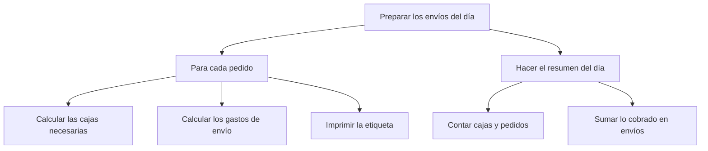
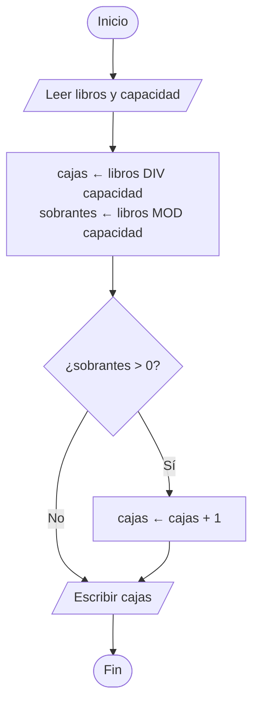
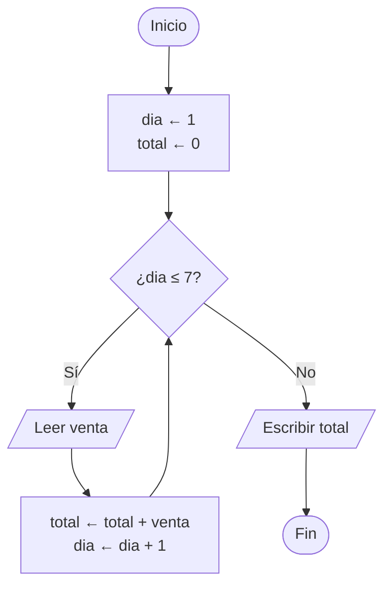
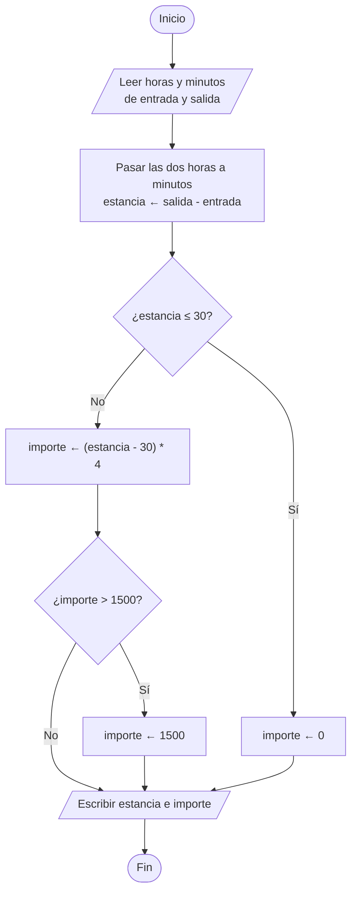
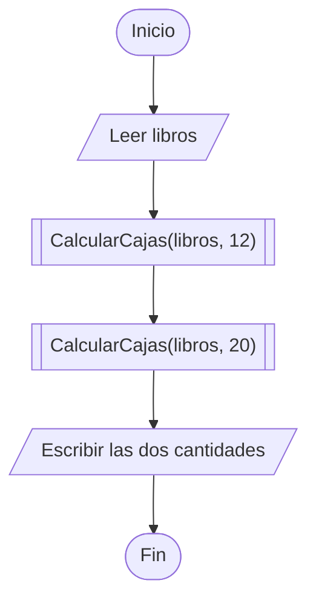
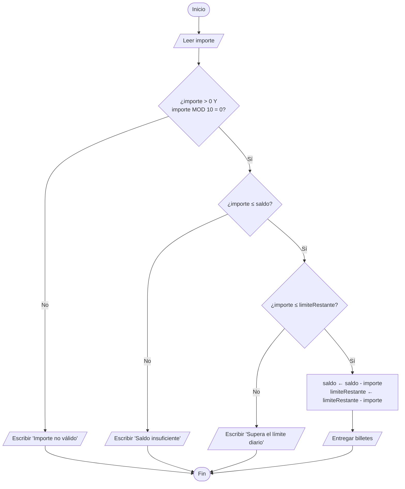
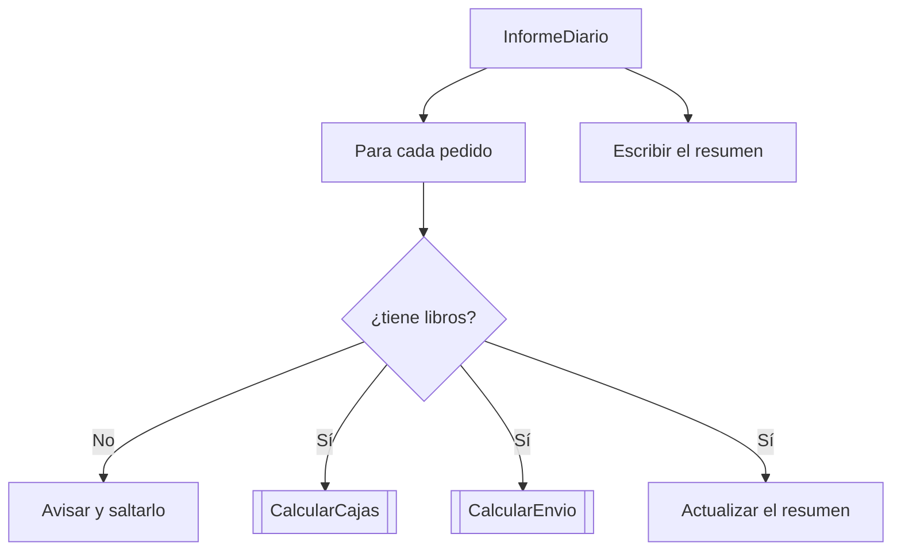

# 01.02 Algoritmos y pseudocódigo

> **Versiones:** Los fragmentos de ejemplo se han comprobado con Python 3.14 y Node.js 24 (8 de noviembre de 2026)
> **Conviene saber antes:** [01.01 Qué es programar](01-que-es-programar.md)
> **Tiempo estimado:** 3 horas
> **Nivel:** Básico · Núcleo

## Qué aprenderás

- Por qué conviene diseñar el algoritmo **antes** de escribir código.
- A **descomponer** un problema grande en problemas pequeños.
- Qué son las **variables**, las **constantes**, los **tipos de datos** y las **expresiones**, y cómo se usan los **operadores** aritméticos, de comparación y lógicos.
- A escribir algoritmos en **pseudocódigo**, con las convenciones que se usan en todo este curso.
- Las tres **estructuras de control** con las que se construye cualquier algoritmo: secuencia, selección y repetición.
- Los **patrones** que aparecen en casi todos los programas: contador, acumulador, máximo y mínimo, bandera y validación.
- A dividir un algoritmo en **subalgoritmos** reutilizables.
- A dibujar **diagramas de flujo** con los símbolos estándar, y a escribirlos con Mermaid.
- A **comprobar** un algoritmo a mano con una **traza** antes de programarlo.

## 1. Teoría

### 1.1. Primero el algoritmo, después el código

En el módulo anterior viste que un [algoritmo](01-que-es-programar.md#13-qué-es-un-algoritmo) es una secuencia ordenada, finita y precisa de pasos que resuelve un problema, y que un [programa](01-que-es-programar.md#14-qué-es-un-programa) es ese algoritmo escrito en un lenguaje de programación.

Cuando empiezas a programar, la tentación es ponerte a escribir código en cuanto lees el enunciado. Es un error, por una razón sencilla: **escribir código obliga a pensar en dos cosas a la vez**, en *qué* hay que hacer y en *cómo* se escribe en ese lenguaje (dónde va cada signo, qué palabra exacta se usa, en qué orden...). Separar las dos cosas lo hace todo más fácil:

1. **Primero piensas la solución** con herramientas sencillas: pseudocódigo o un diagrama de flujo. Aquí solo te preocupas de la lógica.
2. **Después la traduces a código.** Con la lógica ya resuelta, traducir es casi mecánico, y da igual que el lenguaje sea Python, Java, JavaScript o cualquier otro.

Es lo mismo que hace un arquitecto: primero dibuja los planos y después se construye. Corregir un plano cuesta un borrón; corregir un muro ya levantado cuesta mucho más.

> **📌 Nota:** con la experiencia, los algoritmos sencillos los pensarás directamente en la cabeza. Pero ante cualquier problema complicado, incluso los programadores con muchos años de oficio cogen papel y boli, o una pizarra, antes de escribir código.

### 1.2. Descomponer un problema

Casi ningún problema real se resuelve de un tirón. La técnica fundamental para abordarlos se llama **descomposición** (o **diseño descendente**, en inglés *top-down*): dividir el problema en subproblemas más pequeños, y estos en otros más pequeños todavía, hasta que cada uno sea tan sencillo que su solución resulte evidente.

**Ejemplo real:** el responsable del almacén de una librería online te pide «un programa para preparar los envíos del día». Así de grande, no se sabe por dónde empezar. Descompuesto, queda así:



Dicho en texto: «preparar los envíos del día» se divide en dos partes, «para cada pedido» y «hacer el resumen del día». La primera se divide a su vez en calcular las cajas, calcular los gastos de envío e imprimir la etiqueta; la segunda, en contar cajas y pedidos y sumar lo cobrado en envíos.

Cada caja del último nivel es un problema pequeño que ya sabes resolver o casi: calcular cuántas cajas hacen falta para un pedido es justo el algoritmo que viste en el módulo anterior. Al final de este módulo construirás este programa completo ([ejercicio 10](#ejercicio-10--informe-diario-del-almacén)).

**Ventajas de descomponer:**

- Cada parte es **fácil de pensar** y de comprobar por separado.
- Las partes se pueden **reutilizar**: «calcular las cajas» servirá también para los pedidos de la semana que viene o para otro almacén.
- En un equipo, **cada persona puede trabajar en una parte**.
- Si algo falla, es más fácil **localizar dónde**.

> **💡 Consejo:** sigue descomponiendo hasta que cada parte se pueda explicar en una frase corta con un verbo: «calcular las cajas», «sumar lo cobrado». Si para explicar una parte necesitas un «y» («calcular las cajas y además imprimir la etiqueta»), probablemente son dos partes.

### 1.3. Los datos de un algoritmo

Antes de escribir pasos, necesitas una forma de manejar los datos con los que trabaja el algoritmo: el número de libros, el importe de un pedido, el nombre de un cliente...

#### Variables

Una **variable** es un espacio con nombre donde se guarda un dato que puede cambiar mientras se ejecuta el algoritmo. Piensa en ella como en una **caja con una etiqueta**: la etiqueta es el nombre (`libros`), y dentro está el valor (`53`). Puedes mirar lo que hay dentro o sustituirlo por otro valor, pero en cada momento cada caja guarda **un solo valor**.

Guardar un valor en una variable se llama **asignar**. En pseudocódigo se escribe con una flecha que apunta hacia la variable:

```text
libros ← 53
```

Se lee «`libros` toma el valor 53». La flecha deja claro el sentido: el valor de la derecha va a la variable de la izquierda. Si después escribes `libros ← 60`, el 53 desaparece y la caja pasa a guardar 60.

Una variable puede usarse para calcular su propio valor nuevo:

```text
cajas ← cajas + 1
```

Esto **no** es una ecuación matemática (que sería imposible: ningún número es igual a sí mismo más uno). Es una orden: «calcula `cajas + 1` con el valor actual de `cajas`, y guarda el resultado en `cajas`». Si `cajas` valía 4, ahora vale 5.

> **⚠️ Cuidado:** una variable tiene que tener un valor **antes** de usarla. Si escribes `cajas ← cajas + 1` y `cajas` nunca ha recibido un valor, ¿cuánto vale `cajas + 1`? No se sabe. Darle a una variable su primer valor se llama **inicializarla**, y olvidarlo es uno de los [errores típicos](#33-olvidar-inicializar-un-contador-o-un-acumulador).

#### Constantes

Una **constante** es un dato con nombre cuyo valor **no cambia** durante todo el algoritmo, como el IVA general (21 %) o la capacidad de una caja si siempre es la misma. Se escriben en mayúsculas, con las palabras separadas por guiones bajos, para distinguirlas:

```text
CONSTANTE CAPACIDAD_CAJA ← 12
```

¿Por qué no escribir directamente `12` cada vez que haga falta? Por dos razones: si mañana cambian las cajas, solo tendrás que modificar una línea; y `CAPACIDAD_CAJA` explica qué significa ese número, mientras que un `12` suelto, no. A los números sueltos sin explicación se les llama, con razón, **números mágicos**: funcionan, pero nadie sabe por qué están ahí.

#### Cómo se nombran

En este curso, los nombres siguen estas reglas, que son las mismas que usan muchos lenguajes reales:

| Qué | Cómo | Ejemplos |
|---|---|---|
| Variables | Una o varias palabras **juntas**; desde la segunda, cada una empieza por mayúscula. A este estilo se le llama *camelCase* («joroba de camello») | `libros`, `horaEntrada`, `totalEnvios` |
| Constantes | Todo en **mayúsculas**, con las palabras separadas por guiones bajos | `CAPACIDAD_CAJA`, `MINUTOS_GRATIS` |
| Algoritmos y subalgoritmos | Palabras juntas, **todas** empezando por mayúscula; si es una acción, empieza por un verbo | `TarifaAparcamiento`, `CalcularCajas`, `EsBisiesto` |

Los nombres se escriben **sin tildes ni eñes** (`anio`, `CAJA_PEQUENA`), porque muchos lenguajes no las admiten en los nombres. Y lo más importante no es la forma, sino que el nombre **diga qué guarda**: `estancia` es mucho mejor que `e` o que `dato2`. Un buen nombre ahorra comentarios.

#### Tipos de datos

Cada dato es de un **tipo**, que indica qué clase de valor es y qué operaciones admite:

| Tipo | Qué guarda | Ejemplos | Operaciones típicas |
|---|---|---|---|
| **Entero** | Números sin decimales | `53`, `0`, `-7` | Sumar, restar, multiplicar, dividir, resto |
| **Real** | Números con decimales | `4.95`, `21.0`, `-0.5` | Las mismas que los enteros |
| **Texto** | Letras, palabras, frases (entre comillas) | `"Calle Mayor 5"`, `"Z"` | Unir, comparar, buscar |
| **Lógico** | Solo dos valores: verdadero o falso | `VERDADERO`, `FALSO` | `Y`, `O`, `NO` |

Elegir el tipo adecuado importa: un número de unidades es entero (no se piden 3,5 libros), un precio es real, un nombre es texto, y la respuesta a «¿es socio?» es lógica.

> **📌 Nota:** en pseudocódigo los decimales se escriben con punto (`4.95`), como en todos los lenguajes de programación, aunque en España se use la coma al escribir a mano. Ve acostumbrándote. En el texto normal de este curso, en cambio, seguimos escribiendo los números a la española: 4,95 €.

> **📌 Nota:** fíjate en que `53` y `"53"` no son lo mismo: el primero es un número, con el que se puede calcular; el segundo es un texto formado por dos caracteres, el 5 y el 3, como lo sería `"Z"`. Un código postal o un número de teléfono se guardan como texto, porque nadie los suma (y porque el código postal `08001` perdería su cero inicial si fuera un número).

#### Listas y datos con partes

A veces un dato no es un único valor, sino **varios** juntos:

- Una **lista** guarda varios valores en orden, como las ventas de los siete días de la semana o los pedidos del día. Se escribe con sus valores entre corchetes, separados por comas: `ventas ← [1250, 980, 1430]`; y `[]` es una lista vacía. Para trabajar con cada uno de ellos se recorre la lista con un bucle ([1.9](#19-repetición)).
- Un dato **con partes** agrupa varios datos sobre una misma cosa. Un pedido, por ejemplo, tiene un código, un número de libros, un importe y un destino. Para referirse a una parte se escribe el dato, un punto y el nombre de la parte: `pedido.libros` se lee «los libros del pedido».

Para coger **un elemento concreto** de una lista se escribe su nombre y, entre corchetes, su **posición**: `ventas[0]`. En este curso, como en la mayoría de los lenguajes, **la primera posición es la 0**: en la lista de arriba, `ventas[0]` vale 1250, `ventas[1]` vale 980 y `ventas[2]` vale 1430. Un texto funciona igual, como una lista de caracteres: si `LETRAS ← "TRWAG"`, `LETRAS[0]` es la `"T"` y `LETRAS[3]` es la `"A"`.

> **⚠️ Cuidado:** empezar a contar en 0 despista al principio. En una lista de 7 elementos, las posiciones van de la 0 a la **6**: no existe `ventas[7]`.

No necesitas más por ahora: los cursos de cada lenguaje explican con detalle cómo se guardan las listas y los datos con partes.

### 1.4. Expresiones y operadores

Una **expresión** es una combinación de valores, variables y operadores que produce un resultado, como `libros MOD CAPACIDAD_CAJA` o `importe ≥ 50`. Los **operadores** son los símbolos o palabras que indican la operación: `+`, `MOD`, `≥`, `Y`...

#### Operadores aritméticos

Dan un número:

| Operador | Significado | Ejemplo | Resultado |
|---|---|---|---|
| `+` `-` `*` | Suma, resta, multiplicación | `7 * 3` | `21` |
| `/` | División con decimales | `7 / 2` | `3.5` |
| `DIV` | División entera: solo la parte entera | `7 DIV 2` | `3` |
| `MOD` | Resto de la división entera | `7 MOD 2` | `1` |

`DIV` y `MOD` son mucho más útiles de lo que parece. Ya los usaste para calcular cajas en el módulo anterior (53 libros en cajas de 12: `53 DIV 12` = 4 cajas llenas y `53 MOD 12` = 5 libros que sobran), y sirven, por ejemplo, para pasar minutos a horas (`150 DIV 60` = 2 horas y `150 MOD 60` = 30 minutos) o para saber si un número es par (`n MOD 2 = 0`).

#### Operadores de comparación

Comparan dos valores y dan un valor lógico (`VERDADERO` o `FALSO`):

| Operador | Significado | Ejemplo con `edad ← 20` |
|---|---|---|
| `=` | Igual | `edad = 18` → `FALSO` |
| `≠` | Distinto | `edad ≠ 18` → `VERDADERO` |
| `<` `>` | Menor, mayor | `edad > 18` → `VERDADERO` |
| `≤` `≥` | Menor o igual, mayor o igual | `edad ≥ 20` → `VERDADERO` |

> **📌 Nota:** en pseudocódigo, `=` solo **compara** («¿son iguales?»); para **guardar** un valor se usa `←`. Muchos lenguajes reales no tienen la flecha y usan `=` para guardar y `==` para comparar. Lo verás en el [error típico 3.8](#38-confundir-asignar-con-comparar).

#### Operadores lógicos

Combinan valores lógicos:

| Operador | Es verdadero cuando... | Ejemplo |
|---|---|---|
| `Y` | **Las dos** condiciones son verdaderas | `edad ≥ 18 Y tieneCarnet` |
| `O` | **Al menos una** de las condiciones es verdadera | `esFestivo O esDomingo` |
| `NO` | La condición es falsa (invierte el valor) | `NO estaPagado` |

Esta es su **tabla de verdad** completa, que conviene tener a mano:

| A | B | A `Y` B | A `O` B | `NO` A |
|---|---|---|---|---|
| VERDADERO | VERDADERO | VERDADERO | VERDADERO | FALSO |
| VERDADERO | FALSO | FALSO | VERDADERO | FALSO |
| FALSO | VERDADERO | FALSO | VERDADERO | VERDADERO |
| FALSO | FALSO | FALSO | FALSO | VERDADERO |

> **⚠️ Cuidado:** el `O` de la programación es **inclusivo**: `A O B` es verdadero también cuando lo son las dos. Es distinto del «o» de la conversación diaria, que a menudo es excluyente («¿carne o pescado?»).

Un ejemplo de la vida real: un banco concede una tarjeta si `edad ≥ 18 Y (tieneNomina O saldo ≥ 3000)`. Con 25 años, sin nómina y 5.000 € de saldo: `edad ≥ 18` es verdadero; dentro del paréntesis, `tieneNomina` es falso pero `saldo ≥ 3000` es verdadero, así que el `O` da verdadero; y verdadero `Y` verdadero da **verdadero**: se concede.

#### Orden de evaluación

Igual que en matemáticas, no todo se calcula de izquierda a derecha. El orden es:

1. Los **paréntesis**.
2. `*`, `/`, `DIV` y `MOD`.
3. `+` y `-`.
4. Las **comparaciones** (`=`, `≠`, `<`, `>`, `≤`, `≥`).
5. `NO`, después `Y` y, al final, `O`.

Así, `2 + 3 * 4` vale 14 (primero la multiplicación), y `(2 + 3) * 4` vale 20. Ante la duda, **usa paréntesis**: no cuestan nada y evitan errores. En el ejemplo del banco, sin el paréntesis la condición significaría otra cosa, porque `Y` va antes que `O`.

### 1.5. Pseudocódigo

El **pseudocódigo** es una forma de escribir algoritmos a medio camino entre el lenguaje natural y un lenguaje de programación. Usa palabras normales, pero con una estructura fija y sin ambigüedades. No lo ejecuta ningún ordenador: es para que **las personas** piensen y se comuniquen.

No existe un pseudocódigo oficial; cada libro y cada profesor usa sus propias convenciones. Lo importante es ser **coherente**. Estas son las de este curso, y las verás en todos sus módulos:

```text
ALGORITMO NombreDelAlgoritmo
    ENTRADA: qué datos recibe
    SALIDA: qué resultados produce

    CONSTANTE NOMBRE ← valor

INICIO
    LEER variable                    // pide un dato (a una persona, un fichero...)
    variable ← expresión             // asignación
    ESCRIBIR "texto", variable       // muestra un resultado
FIN
```

| Elemento | Significado |
|---|---|
| `ALGORITMO`, `INICIO`, `FIN` | Marcan el nombre, el principio y el final del algoritmo |
| `ENTRADA` / `SALIDA` | Documentan qué recibe y qué produce |
| `CONSTANTE NOMBRE ← valor` | Declara una constante, antes de `INICIO` |
| `LEER x` | Obtiene un dato del exterior y lo guarda en `x` |
| `ESCRIBIR ...` | Muestra o comunica un resultado; lo que va entre comillas se escribe tal cual y el resto se sustituye por su valor |
| `←` | Asignación |
| `//` | Comentario: una aclaración para quien lo lee, que no es un paso del algoritmo |
| Sangría | Las instrucciones que van «dentro» de otra se escriben más a la derecha |
| Palabras clave en MAYÚSCULAS | `SI`, `MIENTRAS`, `PARA`... se distinguen así de los nombres de las variables |

Las palabras clave de las estructuras (`SI`, `SEGÚN`, `MIENTRAS`, `REPETIR`, `PARA`, `SUBALGORITMO`) las irás viendo en los apartados siguientes, y las tienes todas juntas en la [chuleta](#6-chuleta).

Un primer algoritmo completo, para ver todas las piezas juntas: el precio con IVA de un producto.

```text
ALGORITMO PrecioConIva
    ENTRADA: precio sin IVA, en euros
    SALIDA: precio con IVA, en euros

    CONSTANTE IVA ← 21               // IVA general, en tanto por ciento

INICIO
    LEER precio
    precioFinal ← precio + precio * IVA / 100
    ESCRIBIR "Precio con IVA: ", precioFinal, " €"
FIN
```

Con un precio de 50, se escribe `Precio con IVA: 60.5 €`.

> **💡 Consejo:** si quieres **ejecutar** tu pseudocódigo para comprobarlo, existe una herramienta gratuita muy usada en la enseñanza en español, **PSeInt**, que interpreta pseudocódigo en castellano y dibuja automáticamente su diagrama de flujo. Sus convenciones son algo distintas de las de este curso, pero las ideas son las mismas. Es totalmente opcional: los ejercicios de este módulo se hacen con papel y boli.

### 1.6. Las tres estructuras de control

Aquí viene una de las ideas más importantes de toda la programación. En 1966, los investigadores Corrado Böhm y Giuseppe Jacopini demostraron que **cualquier algoritmo se puede construir combinando solo tres estructuras**:

| Estructura | Qué hace | Analogía |
|---|---|---|
| **Secuencia** | Ejecuta las instrucciones una detrás de otra | Seguir los pasos de una receta en orden |
| **Selección** | Elige entre caminos según una condición | «Si llueve, coge el paraguas» |
| **Repetición** | Repite instrucciones mientras se cumpla una condición | «Bate los huevos hasta que estén espumosos» |

Que **todo** se pueda hacer con estas tres piezas es una gran noticia: si las dominas, tienes las herramientas para resolver cualquier problema. Lo que cambia de un lenguaje a otro es solo cómo se escriben. A esta forma de programar, solo con estas tres estructuras, se la llama **programación estructurada**. De dónde viene y qué otros estilos de programar existen lo verás en el módulo [Paradigmas de programación](04-paradigmas-de-programacion.md#14-imperativo-y-estructurado).

A las estructuras de selección y repetición se las llama **estructuras de control** porque controlan el camino que sigue el algoritmo: qué instrucciones se ejecutan, cuáles no y cuántas veces.

### 1.7. Secuencia

La estructura más simple: las instrucciones se ejecutan **una detrás de otra**, de arriba abajo, cada una exactamente una vez.

```text
ALGORITMO DuracionEstancia
    ENTRADA: hora y minuto de entrada y de salida
    SALIDA: duración en horas y minutos

INICIO
    LEER horaEntrada, minutoEntrada, horaSalida, minutoSalida
    entrada ← horaEntrada * 60 + minutoEntrada      // minutos desde medianoche
    salida ← horaSalida * 60 + minutoSalida
    estancia ← salida - entrada
    ESCRIBIR estancia DIV 60, " h ", estancia MOD 60, " min"
FIN
```

Con una entrada a las 9:15 y una salida a las 11:40: `entrada` = 9 × 60 + 15 = 555, `salida` = 11 × 60 + 40 = 700, `estancia` = 145 minutos, y se escribe `2 h 25 min`.

Fíjate en el truco de pasar las horas a **minutos desde medianoche**: restar 11:40 − 9:15 «a mano» es incómodo (con 11:40 − 9:15 los minutos salen bien, pero con 10:05 − 9:50 hay que «pedir prestada» una hora), mientras que restar dos números enteros es trivial. Transformar los datos a una forma más cómoda es una técnica muy habitual.

> **📌 Nota:** en la secuencia **el orden importa**. Si escribieras `estancia ← salida - entrada` antes de calcular `salida`, el algoritmo usaría un valor que todavía no existe.

### 1.8. Selección

La selección permite que el algoritmo **tome decisiones**: ejecutar unas instrucciones u otras según se cumpla o no una **condición**, que es una expresión que da `VERDADERO` o `FALSO`.

#### Selección simple: SI

Ejecuta un bloque **solo si** la condición es verdadera. Si es falsa, no hace nada y sigue.

```text
SI sobrantes > 0 ENTONCES
    cajas ← cajas + 1
FIN SI
```

#### Selección doble: SI ... SI NO

Elige entre **dos caminos**: uno si la condición es verdadera y otro si es falsa. Siempre se ejecuta exactamente uno de los dos.

```text
SI importe ≥ 50 ENTONCES
    gastosEnvio ← 0
SI NO
    gastosEnvio ← 4.95
FIN SI
```

#### Selección encadenada: SI ... SI NO SI ...

Cuando hay **más de dos casos**, se encadenan condiciones. Se comprueban **en orden** y se ejecuta **solo el primer bloque** cuya condición sea verdadera.

```text
SI nota ≥ 9 ENTONCES
    calificacion ← "Sobresaliente"
SI NO SI nota ≥ 7 ENTONCES
    calificacion ← "Notable"
SI NO SI nota ≥ 5 ENTONCES
    calificacion ← "Aprobado"
SI NO
    calificacion ← "Suspenso"
FIN SI
```

Con un 7,5: la primera condición es falsa, la segunda verdadera, así que el resultado es «Notable» y **ya no se comprueba nada más**. Por eso basta con escribir `nota ≥ 7`, y no `nota ≥ 7 Y nota < 9`: si se ha llegado a esa línea, ya se sabe que la nota no es mayor o igual que 9.

> **⚠️ Cuidado:** en una cadena de condiciones **el orden importa**. Si comprobaras primero `nota ≥ 5`, un 9,5 entraría ahí y saldría «Aprobado». Ordena las condiciones de la más restrictiva a la más general.

#### Selección anidada

Un `SI` puede ir dentro de otro. Se usa cuando una decisión solo tiene sentido después de otra:

```text
SI destino = "islas" ENTONCES
    gastosEnvio ← 12.95
SI NO
    SI importe ≥ 50 ENTONCES
        gastosEnvio ← 0
    SI NO
        gastosEnvio ← 4.95
    FIN SI
FIN SI
```

La sangría hace visible qué está dentro de qué. Sin ella, este algoritmo sería muy difícil de leer.

#### Selección por casos: SEGÚN

Cuando la decisión depende del **valor concreto** de una variable (y no de un rango), es más claro usar `SEGÚN`. Por ejemplo, el horario de una tienda según el día de la semana, numerado del 1 (lunes) al 7 (domingo):

```text
SEGÚN diaSemana HACER
    1, 2, 3, 4, 5: horario ← "de 10:00 a 21:00"
    6:             horario ← "de 10:00 a 14:00"
    7:             horario ← "cerrado"
    DE OTRO MODO:  horario ← "día no válido"
FIN SEGÚN
```

Cada línea empieza por uno o varios valores separados por comas (números o textos, como `"X"`), seguidos de dos puntos y de lo que hay que hacer en ese caso. El caso `DE OTRO MODO` recoge cualquier valor no previsto. Inclúyelo siempre: es tu red de seguridad ante datos erróneos. Con `diaSemana` = 6 el horario es «de 10:00 a 14:00», y con un 9, «día no válido».

Con `SI ... SI NO SI` también se podría escribir, pero tendría muchas más condiciones (`diaSemana = 1 O diaSemana = 2 O ...`), y `SEGÚN` deja mucho más claro que la decisión depende de un único valor.

### 1.9. Repetición

La repetición (también llamada **iteración** o **bucle**) permite ejecutar un bloque **varias veces**. Sin ella, para sumar las ventas de 365 días tendrías que escribir 365 sumas. Cada ejecución del bloque se llama **vuelta** o **iteración**.

Hay tres formas de repetir. La diferencia está en **cuándo** se comprueba la condición y en si se sabe de antemano cuántas vueltas habrá.

#### MIENTRAS: repetir mientras se cumpla una condición

Comprueba la condición **antes** de cada vuelta. Si es verdadera, ejecuta el bloque y vuelve a comprobar. Si es falsa, sale del bucle y sigue con lo que haya después de `FIN MIENTRAS`.

```text
MIENTRAS condición HACER
    instrucciones
FIN MIENTRAS
```

Si la condición es falsa desde el principio, el bloque **no se ejecuta ni una vez**. Se usa cuando no sabes cuántas vueltas hará falta dar, por ejemplo, «mientras queden pedidos sin procesar» o «mientras el PIN no sea correcto y queden intentos».

#### REPETIR ... HASTA QUE: repetir hasta que se cumpla una condición

Comprueba la condición **después** de cada vuelta, así que el bloque se ejecuta **al menos una vez**. Fíjate en que la condición funciona al revés que en `MIENTRAS`: se repite **hasta que** sea verdadera.

```text
REPETIR
    instrucciones
HASTA QUE condición
```

Es ideal para menús y para pedir datos: siempre hay que mostrar el menú al menos una vez.

> **📌 Nota:** varios lenguajes reales (Java y JavaScript, por ejemplo) tienen un bucle parecido, llamado `do ... while`, pero que repite **mientras** su condición sea verdadera, no **hasta que** lo sea. Al traducir un `REPETIR ... HASTA QUE` hay que darle la vuelta a la condición. Otros lenguajes, como Python, no lo tienen y se escribe de otra manera. Lo verás en el curso de tu lenguaje; aquí basta con la idea.

#### PARA: repetir un número conocido de veces

Cuando **sabes de antemano** cuántas vueltas hay que dar, `PARA` es lo más claro. Usa una variable, llamada **contador del bucle**, que va tomando valores de uno en uno:

```text
PARA dia DESDE 1 HASTA 7 HACER
    instrucciones                    // dia vale 1, luego 2, ..., hasta 7
FIN PARA
```

`PARA` es una forma abreviada de un `MIENTRAS` muy habitual. Estos dos fragmentos hacen exactamente lo mismo:

```text
PARA dia DESDE 1 HASTA 7 HACER        dia ← 1
    ESCRIBIR dia                      MIENTRAS dia ≤ 7 HACER
FIN PARA                                  ESCRIBIR dia
                                          dia ← dia + 1
                                      FIN MIENTRAS
```

El `PARA` se encarga solo de las tres cosas que en el `MIENTRAS` hay que escribir a mano: dar el valor inicial (`dia ← 1`), comprobar si se ha llegado al final (`dia ≤ 7`) y avanzar (`dia ← dia + 1`). Por eso es más difícil equivocarse con él.

#### PARA cada: recorrer una lista

Una variante muy habitual de `PARA` recorre **todos los elementos de una lista**, uno detrás de otro, sin necesidad de contar:

```text
PARA cada pedido DE pedidosDelDia HACER
    ESCRIBIR pedido.codigo           // en cada vuelta, pedido es el siguiente de la lista
FIN PARA
```

Si la lista tiene seis pedidos, el bloque se ejecuta seis veces, y en cada vuelta `pedido` es uno distinto. Si la lista está vacía, no se ejecuta ninguna.

#### ¿Cuál elijo?

| Situación | Bucle | Ejemplo |
|---|---|---|
| Sé cuántas vueltas habrá, o recorro una lista entera | `PARA` | Los 7 días de la semana, los 12 meses, todos los pedidos del día |
| No sé cuántas vueltas habrá y puede que ninguna | `MIENTRAS` | Procesar pedidos mientras queden; reintentar mientras falle |
| No sé cuántas vueltas habrá, pero al menos una seguro | `REPETIR ... HASTA QUE` | Mostrar un menú; pedir un dato hasta que sea válido |

> **⚠️ Cuidado:** un bucle cuya condición **nunca deja de cumplirse** se repite para siempre: es un **bucle infinito**, uno de los errores más clásicos. Dentro de un `MIENTRAS` o de un `REPETIR`, algo tiene que cambiar en cada vuelta para que, tarde o temprano, la condición de salida se cumpla. Lo verás en los [errores típicos](#31-bucles-infinitos).

### 1.10. Patrones que se repiten en todos los programas

Combinando las tres estructuras aparecen una y otra vez los mismos «trucos». Reconocerlos te ahorrará reinventarlos cada vez, y te servirán igual en cualquier lenguaje.

#### Contador

Una variable que **cuenta** cuántas veces ocurre algo. Empieza en 0 y suma 1 cada vez que se cumple la condición.

```text
diasBuenos ← 0                       // ¡antes del bucle!
PARA cada venta DE ventasSemana HACER
    SI venta > 1000 ENTONCES
        diasBuenos ← diasBuenos + 1
    FIN SI
FIN PARA
```

#### Acumulador

Una variable que **va sumando** valores. Empieza en 0 (el elemento neutro de la suma: sumar 0 no cambia nada) y en cada vuelta le añade un valor. Si en lugar de sumar se multiplica, empieza en 1, por la misma razón.

```text
total ← 0                            // ¡antes del bucle!
PARA cada venta DE ventasSemana HACER
    total ← total + venta
FIN PARA
```

#### Máximo y mínimo

Para encontrar el **mayor** valor de una serie, se guarda el primero como «el mayor visto hasta ahora» y se compara con cada uno de los siguientes. Si aparece uno mayor, pasa a ser el nuevo máximo. El mínimo es igual, cambiando `>` por `<`.

```text
mejorVenta ← la venta del primer día     // el primero es, de momento, el mejor
PARA cada venta de los días siguientes HACER
    SI venta > mejorVenta ENTONCES
        mejorVenta ← venta
    FIN SI
FIN PARA
```

> **⚠️ Cuidado:** no inicialices el máximo a 0 «porque las ventas no pueden ser negativas». Funciona hasta el día en que trabajes con datos que sí pueden serlo, como temperaturas o saldos, y entonces da resultados absurdos: el máximo de −3, −8 y −1 grados saldría 0, una temperatura que no aparece en la lista. Empieza siempre con el **primer valor real** de la serie.

#### Bandera (o interruptor)

Una variable **lógica** que recuerda si **ha ocurrido algo**. Empieza en `FALSO` y pasa a `VERDADERO` cuando sucede. Se usa mucho para salir de un bucle o para decidir qué hacer después.

```text
acertado ← FALSO
MIENTRAS NO acertado Y intentos < 3 HACER
    ...
    SI pin = pinCorrecto ENTONCES
        acertado ← VERDADERO
    FIN SI
FIN MIENTRAS
```

#### Validación de un dato

Pedir un dato **hasta que sea válido**. Es la aplicación más típica de `REPETIR`:

```text
REPETIR
    LEER unidades
    SI unidades ≤ 0 ENTONCES
        ESCRIBIR "Introduce un número mayor que cero"
    FIN SI
HASTA QUE unidades > 0
```

### 1.11. Subalgoritmos

Cuando descompones un problema, cada parte se puede escribir como un **subalgoritmo**: un algoritmo con nombre propio que recibe unos datos (**parámetros**), hace su trabajo y **devuelve** un resultado. Después, cualquier otro algoritmo lo puede **llamar** por su nombre, sin preocuparse de cómo funciona por dentro.

```text
SUBALGORITMO CalcularCajas(libros, capacidad)
    cajas ← libros DIV capacidad
    SI libros MOD capacidad > 0 ENTONCES
        cajas ← cajas + 1
    FIN SI
    DEVOLVER cajas
FIN SUBALGORITMO
```

`DEVOLVER` entrega el resultado a quien ha llamado al subalgoritmo, y en ese momento el subalgoritmo termina. Para usarlo:

```text
cajasPedido ← CalcularCajas(53, 12)          // cajasPedido vale 5
cajasGrandes ← CalcularCajas(53, 20)         // cajasGrandes vale 3
```

En la primera llamada, dentro del subalgoritmo `libros` vale 53 y `capacidad` vale 12; en la segunda, `libros` vale 53 y `capacidad` vale 20. Los parámetros toman los valores que se pasan entre paréntesis, **en el mismo orden**.

Lo has escrito **una vez** y lo usas tantas veces como quieras, con datos distintos. Si algún día hay que corregirlo, se corrige en un solo sitio. Todos los lenguajes tienen subalgoritmos, aunque cada uno los llama a su manera: **funciones**, **métodos** o **procedimientos**.

Un subalgoritmo también puede no devolver nada, y limitarse a hacer algo (por ejemplo, `ImprimirEtiqueta(pedido)`). Y puede no tener parámetros: entonces se escriben los paréntesis vacíos, `BuscarLibro()`.

> **💡 Consejo:** un buen subalgoritmo hace **una sola cosa** y su nombre dice exactamente cuál: `CalcularCajas`, `CalcularEnvio`, `EsBisiesto`. Si te cuesta ponerle nombre, seguramente está haciendo demasiadas cosas.

### 1.12. Diagramas de flujo

Un **diagrama de flujo** representa un algoritmo de forma gráfica: cada paso es una figura y las flechas indican el orden. Es especialmente útil para ver de un vistazo **los caminos** que puede seguir un algoritmo con muchas decisiones, y para explicárselo a personas que no programan.

Los símbolos están definidos en una norma internacional (ISO 5807). Estos son los que necesitas:

| Símbolo | Forma | Significado |
|---|---|---|
| **Terminal** | Óvalo (rectángulo con extremos redondeados) | Inicio o fin del algoritmo |
| **Proceso** | Rectángulo | Una operación: asignación o cálculo |
| **Decisión** | Rombo | Una condición; salen dos flechas, «Sí» y «No» |
| **Entrada / salida** | Paralelogramo (rectángulo inclinado) | Leer un dato o escribir un resultado |
| **Subproceso** | Rectángulo con dobles líneas laterales | Llamada a un subalgoritmo |
| **Flecha** | Línea con punta | El orden en que se ejecutan los pasos |

Este es el algoritmo de las cajas como diagrama de flujo:



En texto: se leen los libros y la capacidad; se calculan las cajas llenas y los libros sobrantes; si sobra alguno, se suma una caja; y se escribe el número de cajas.

**Reglas para dibujar diagramas claros:**

- Un único **inicio** y un único **fin**.
- El flujo va, en general, **de arriba abajo**.
- De cada **rombo** salen exactamente **dos** flechas, etiquetadas («Sí» / «No»).
- Las flechas no deben **cruzarse** si se puede evitar.
- Cada figura contiene **una idea**, escrita de forma breve.

**Así se ve un bucle en un diagrama:** una flecha que **vuelve hacia arriba**, a una decisión anterior.



En texto: se empieza con `dia` a 1 y `total` a 0; mientras `dia` sea como mucho 7, se lee la venta, se suma al total, se pasa al día siguiente y se vuelve a la pregunta; cuando `dia` llega a 8, se escribe el total.

> **📌 Nota:** los diagramas de este curso no son imágenes: están escritos como texto con **Mermaid**, una notación que GitHub y la academia convierten en dibujo. La verás en el módulo «Diagramas y Mermaid» (fase 4). Para los ejercicios de este módulo, un dibujo en papel vale exactamente igual.

**¿Pseudocódigo o diagrama?**

| | Pseudocódigo | Diagrama de flujo |
|---|---|---|
| Ver los caminos posibles de un vistazo | Regular | **Muy bien** |
| Algoritmos largos | **Bien** | Se vuelven enormes e inmanejables |
| Rapidez para escribirlo y modificarlo | **Rápido** | Lento: hay que redibujar |
| Pasarlo después a código | **Casi directo** | Hay que «traducirlo» primero |
| Explicarlo a personas que no programan | Regular | **Muy bien** |

En la práctica profesional se usa más el pseudocódigo (o directamente el código), y los diagramas se reservan para explicar procesos con muchas decisiones. Aun así, dibujarlos al principio ayuda muchísimo a entender cómo «fluye» un algoritmo.

### 1.13. Comprobar un algoritmo antes de programarlo

Un algoritmo no está terminado hasta que lo has comprobado. Y comprobarlo **antes** de programarlo sale muy barato: un error en el papel se arregla con un borrón. La herramienta para hacerlo es la **traza** (ya hiciste una, sin saber su nombre, en el [ejercicio 4 del módulo anterior](01-que-es-programar.md#ejercicio-4--sigue-un-algoritmo-a-mano)).

#### La traza

Hacer una **traza** es ejecutar el algoritmo **a mano**, haciendo tú de ordenador: sigues las instrucciones una a una, sin saltarte ninguna y sin «interpretar» lo que el autor quería decir, y anotas en una tabla el valor de cada variable a medida que cambia. Es lenta, pero es la mejor forma de descubrir por qué un algoritmo no hace lo que esperabas.

Cómo se hace:

1. **Elige unos datos de entrada concretos.** Con datos inventados en la cabeza («un número cualquiera») no se puede hacer una traza.
2. **Prepara una tabla** con una columna por cada variable que cambie y, si hay bucles o decisiones, una columna para la condición. Cada fila es un paso o una vuelta del bucle.
3. **Sigue el algoritmo línea a línea.** Cada vez que una variable cambia, apunta su nuevo valor. Cada vez que hay una condición, calcula si es verdadera o falsa con los valores que tienes **en ese momento**.
4. **Compara el resultado** con el que debería salir. Si no coincide, la tabla te dice en qué paso se torció.

**Ejemplo real:** este algoritmo calcula cuántos meses se tarda en pagar una deuda de 250 € con cuotas de 60 € al mes.

```text
deuda ← 250
cuota ← 60
meses ← 0
MIENTRAS deuda > 0 HACER
    deuda ← deuda - cuota
    meses ← meses + 1
FIN MIENTRAS
ESCRIBIR "Pagada en ", meses, " meses"
```

Su traza:

| Paso | `deuda` | `meses` | ¿`deuda > 0`? |
|---|---|---|---|
| Antes del bucle | 250 | 0 | Sí → entra |
| Fin de la vuelta 1 | 190 | 1 | Sí → otra vuelta |
| Fin de la vuelta 2 | 130 | 2 | Sí → otra vuelta |
| Fin de la vuelta 3 | 70 | 3 | Sí → otra vuelta |
| Fin de la vuelta 4 | 10 | 4 | Sí → otra vuelta |
| Fin de la vuelta 5 | −50 | 5 | No → sale |

Se escribe `Pagada en 5 meses`, que es correcto: con cuatro cuotas de 60 € se pagan 240 € y quedan 10 € para un quinto mes.

Pero la traza enseña algo más: al final, `deuda` vale **−50**. El algoritmo da bien el número de meses, pero si alguien usara `deuda` después (para mostrar «te quedan por pagar...»), saldría un número absurdo. Y en la vida real, el último mes no se pagan 60 €, sino 10. Sin la traza, ese detalle habría pasado desapercibido. Esta es la gran utilidad de la traza: **te obliga a mirar lo que el algoritmo hace de verdad**, no lo que crees que hace.

> **💡 Consejo:** no hace falta hacer la traza de todas las vueltas de un bucle de mil vueltas. Haz la de la **primera**, la de la **última** y la de algún caso especial. Ahí es donde se esconden casi todos los errores.

#### Y los casos de prueba

La traza dice qué **hace** el algoritmo con unos datos. Para saber si eso es lo que **debería** hacer, necesitas compararlo con un resultado que hayas decidido **antes**, a partir del enunciado: para el algoritmo de las cajas de 12 libros, por ejemplo, 53 libros → 5 cajas, 12 libros → 1 caja y 13 libros → 2 cajas. Cada uno de esos ejemplos es un **caso de prueba**, y en los ejemplos y ejercicios de este módulo ya los verás en acción. Qué son exactamente y cómo se eligen es el tema del siguiente módulo: [¿Cómo sé que funciona? Probar un programa](03-probar-un-programa.md#13-el-caso-de-prueba).

## 2. Ejemplos de código

> **📌 Nota:** en este módulo, el «código» es pseudocódigo. En dos de los ejemplos verás también cómo queda el mismo algoritmo en un lenguaje real (Python en uno, JavaScript en otro), solo para que compruebes lo cerca que está uno del otro. No tienes que escribirlos ni ejecutarlos: son para mirar.

### 2.1. Secuencia y selección: la tarifa de un aparcamiento

**Situación real:** un aparcamiento cobra así: los **primeros 30 minutos son gratis**; a partir de ahí, se cobran **4 céntimos por cada minuto** que pase de esos 30, con un **máximo de 15 € por día**. El sistema de la barrera de salida tiene que calcular el importe.

**Antes de escribir nada, los casos de prueba:**

| Entrada | Salida | Estancia | Importe esperado | Por qué |
|---|---|---|---|---|
| 9:15 | 11:40 | 145 min | (145 − 30) × 4 = 460 céntimos = **4,60 €** | Caso normal |
| 10:00 | 10:25 | 25 min | **0 €** | Dentro de los minutos gratis |
| 10:00 | 10:30 | 30 min | **0 €** | Frontera: 30 minutos justos siguen siendo gratis |
| 10:00 | 10:31 | 31 min | **0,04 €** | Frontera: el primer minuto de pago |
| 8:00 | 20:00 | 720 min | 690 × 4 = 2.760 céntimos → se queda en **15,00 €** | Se aplica el máximo |

**Pseudocódigo:**

```text
ALGORITMO TarifaAparcamiento
    ENTRADA: hora y minuto de entrada y de salida (del mismo día)
    SALIDA: estancia en minutos e importe en céntimos

    CONSTANTE MINUTOS_GRATIS ← 30
    CONSTANTE CENTIMOS_POR_MINUTO ← 4
    CONSTANTE MAXIMO_DIARIO ← 1500          // 15 € en céntimos

INICIO
    LEER horaEntrada, minutoEntrada, horaSalida, minutoSalida
    entrada ← horaEntrada * 60 + minutoEntrada
    salida ← horaSalida * 60 + minutoSalida
    estancia ← salida - entrada

    SI estancia ≤ MINUTOS_GRATIS ENTONCES
        importe ← 0
    SI NO
        importe ← (estancia - MINUTOS_GRATIS) * CENTIMOS_POR_MINUTO
        SI importe > MAXIMO_DIARIO ENTONCES
            importe ← MAXIMO_DIARIO
        FIN SI
    FIN SI

    ESCRIBIR "Estancia: ", estancia, " minutos"
    ESCRIBIR "Importe: ", importe, " céntimos"
FIN
```

¿Por qué en céntimos y no en euros? Porque así todos los números son enteros: 460 céntimos en lugar de 4,60 €. Trabajar con dinero en céntimos es una técnica habitual para evitar problemas con los decimales.

**Diagrama de flujo:**



En texto: se leen las horas, se calcula la estancia; si no pasa de 30 minutos, el importe es 0; si pasa, se calcula a 4 céntimos el minuto y, si supera 1.500, se deja en 1.500; al final se escriben la estancia y el importe.

**Traza** con entrada 9:15 y salida 11:40:

| Paso | `entrada` | `salida` | `estancia` | ¿`estancia ≤ 30`? | `importe` | ¿`importe > 1500`? |
|---|---|---|---|---|---|---|
| Pasar a minutos | 555 | 700 | — | — | — | — |
| Calcular la estancia | 555 | 700 | 145 | — | — | — |
| Primera decisión | 555 | 700 | 145 | No | — | — |
| Calcular el importe | 555 | 700 | 145 | — | 460 | — |
| Segunda decisión | 555 | 700 | 145 | — | 460 | No |

Se escribe «Estancia: 145 minutos» e «Importe: 460 céntimos», como decía el primer caso de prueba.

**El mismo algoritmo en Python.** No hace falta que entiendas cada línea: fíjate en que la estructura es **la misma** que la del pseudocódigo, línea a línea.

```python
# Tarifa del aparcamiento: 30 minutos gratis, después 4 céntimos por minuto, máximo 15 €
hora_entrada = 9
minuto_entrada = 15
hora_salida = 11
minuto_salida = 40

entrada = hora_entrada * 60 + minuto_entrada   # minutos desde medianoche
salida = hora_salida * 60 + minuto_salida
estancia = salida - entrada

if estancia <= 30:
    importe = 0
else:
    importe = (estancia - 30) * 4
    if importe > 1500:
        importe = 1500

print("Estancia:", estancia, "minutos")
print("Importe:", importe, "céntimos")
```

**Salida:**

```text
Estancia: 145 minutos
Importe: 460 céntimos
```

Compara: `←` se escribe `=`, `SI ... ENTONCES ... SI NO` se escribe `if ...: ... else: ...`, `≤` se escribe `<=`, `ESCRIBIR` es `print` y los comentarios empiezan por `#` en lugar de `//`. En Python, además, la sangría no es solo para que se lea mejor: es **obligatoria**, y es lo que indica qué está dentro del `if`. La lógica es **idéntica**. Lo único que no aparece es `LEER`: para simplificar, los datos van escritos directamente en el código.

> **📌 Nota:** el algoritmo supone que la entrada y la salida son del mismo día. Si un coche entra a las 23:00 y sale a la 1:00, la estancia daría negativa. Un sistema real tendría que manejar fechas completas, y los lenguajes reales traen herramientas para ello. Detectar las **suposiciones** que hace un algoritmo es tan importante como escribirlo, y por eso esta va escrita en su `ENTRADA`.

### 2.2. Repetición con MIENTRAS y bandera: el PIN de un cajero

**Situación real:** un cajero automático deja introducir el PIN **como máximo tres veces**. Si se acierta, da acceso; si se falla tres veces, retiene la tarjeta.

```text
ALGORITMO ValidarPin
    ENTRADA: los PIN que teclea el cliente
    SALIDA: acceso concedido o tarjeta retenida

    CONSTANTE MAX_INTENTOS ← 3

INICIO
    pinCorrecto ← el PIN de la tarjeta
    intentos ← 0                      // contador
    acertado ← FALSO                  // bandera

    MIENTRAS NO acertado Y intentos < MAX_INTENTOS HACER
        LEER pin
        intentos ← intentos + 1
        SI pin = pinCorrecto ENTONCES
            acertado ← VERDADERO
        SI NO
            ESCRIBIR "PIN incorrecto"
        FIN SI
    FIN MIENTRAS

    SI acertado ENTONCES
        ESCRIBIR "Acceso concedido"
    SI NO
        ESCRIBIR "Tarjeta retenida"
    FIN SI
FIN
```

**Por qué `MIENTRAS`:** no se sabe cuántas vueltas habrá. Pueden ser una (si se acierta a la primera), dos o tres.

**Por qué la condición tiene dos partes unidas con `Y`:** el bucle debe seguir solo si **todavía no se ha acertado** y además **quedan intentos**. En cuanto falla cualquiera de las dos, se sale.

**Por qué hace falta la bandera:** al salir del bucle hay que saber **por qué** se ha salido, si por acertar o por agotar los intentos. La bandera `acertado` lo recuerda.

**Casos de prueba** (PIN correcto: 4321):

| PIN tecleados | Vueltas | Resultado |
|---|---|---|
| 4321 | 1 | Acceso concedido |
| 1111, 4321 | 2 | «PIN incorrecto» y después acceso concedido |
| 1111, 2222, 4321 | 3 | Dos veces «PIN incorrecto» y acceso concedido en el último intento |
| 1111, 2222, 3333 | 3 | Tres veces «PIN incorrecto» y tarjeta retenida |

El tercer caso es el más traicionero: acertar **justo en el último intento**. Si la condición fuera `intentos < MAX_INTENTOS - 1`, o si la bandera se comprobase mal, este es el caso que lo destaparía.

### 2.3. Repetición con REPETIR: un menú de opciones

**Situación real:** el programa de gestión de una biblioteca muestra un menú hasta que el usuario elige salir. El menú tiene que mostrarse **al menos una vez**, así que el bucle adecuado es `REPETIR`.

```text
ALGORITMO MenuBiblioteca
    ENTRADA: la opción que elige el usuario cada vez
    SALIDA: la acción correspondiente

INICIO
    REPETIR
        ESCRIBIR "1. Buscar libro"
        ESCRIBIR "2. Registrar préstamo"
        ESCRIBIR "3. Registrar devolución"
        ESCRIBIR "0. Salir"
        LEER opcion
        SEGÚN opcion HACER
            1: BuscarLibro()
            2: RegistrarPrestamo()
            3: RegistrarDevolucion()
            0: ESCRIBIR "Hasta pronto"
            DE OTRO MODO: ESCRIBIR "Opción no válida"
        FIN SEGÚN
    HASTA QUE opcion = 0
FIN
```

Fíjate en cómo se combinan estructuras: un `SEGÚN` dentro de un `REPETIR`, y cada opción llama a un **subalgoritmo** que se escribiría por separado. Así, este algoritmo se lee como un índice del programa, sin perderse en los detalles. Casi todos los programas de consola que hagas en cualquier lenguaje empezarán con un menú como este.

Con las opciones 1, 7 y 0, el menú se muestra **tres** veces: tras el 1 busca un libro, tras el 7 avisa de «Opción no válida» y tras el 0 se despide y termina.

### 2.4. Repetición con PARA y patrones: el resumen de ventas de la semana

**Situación real:** el dueño de una tienda quiere, cada lunes, un resumen de la semana anterior: el **total** vendido, el **mejor día** y **cuántos días** se superaron los 1.000 €. Este algoritmo combina tres patrones a la vez: acumulador, máximo y contador.

```text
ALGORITMO ResumenVentasSemana
    ENTRADA: las ventas de los 7 días, de lunes (1) a domingo (7)
    SALIDA: total, mejor día y número de días por encima de 1.000 €

INICIO
    LEER venta                        // la del día 1
    total ← venta                     // acumulador
    mejorVenta ← venta                // máximo: el primer día, de momento
    mejorDia ← 1
    SI venta > 1000 ENTONCES
        diasBuenos ← 1                // contador
    SI NO
        diasBuenos ← 0
    FIN SI

    PARA dia DESDE 2 HASTA 7 HACER
        LEER venta
        total ← total + venta
        SI venta > 1000 ENTONCES
            diasBuenos ← diasBuenos + 1
        FIN SI
        SI venta > mejorVenta ENTONCES
            mejorVenta ← venta
            mejorDia ← dia
        FIN SI
    FIN PARA

    ESCRIBIR "Total de la semana: ", total
    ESCRIBIR "Mejor día: ", mejorDia, " (", mejorVenta, ")"
    ESCRIBIR "Días por encima de 1.000 €: ", diasBuenos
FIN
```

**Traza** con las ventas 1.250, 980, 1.430, 1.100, 1.890, 2.340 y 760 €:

| Día | `venta` | `total` | `diasBuenos` | `mejorVenta` | `mejorDia` |
|---|---|---|---|---|---|
| 1 | 1.250 | 1.250 | 1 | 1.250 | 1 |
| 2 | 980 | 2.230 | 1 | 1.250 | 1 |
| 3 | 1.430 | 3.660 | 2 | 1.430 | 3 |
| 4 | 1.100 | 4.760 | 3 | 1.430 | 3 |
| 5 | 1.890 | 6.650 | 4 | 1.890 | 5 |
| 6 | 2.340 | 8.990 | 5 | 2.340 | 6 |
| 7 | 760 | 9.750 | 5 | 2.340 | 6 |

**Resultado:** total de 9.750 €, mejor día el 6 (sábado) con 2.340 €, y 5 días por encima de 1.000 €.

Fíjate en que el primer día se trata **antes** del bucle, para inicializar el máximo con un valor real (como recomendaba el apartado [1.10](#110-patrones-que-se-repiten-en-todos-los-programas)), y el bucle empieza en el día 2.

**El mismo algoritmo en JavaScript.** Aquí las siete ventas están ya guardadas en una lista. No hace falta que entiendas cada línea: fíjate en los tres patrones (el acumulador `total`, el contador `diasBuenos` y el máximo `mejorVenta`) y en que el `PARA` se convierte en `for`.

```javascript
// Resumen de las ventas de una semana: total, mejor día y días por encima de 1.000 €
const ventas = [1250, 980, 1430, 1100, 1890, 2340, 760]; // de lunes a domingo

let total = 0;               // acumulador
let diasBuenos = 0;          // contador
let mejorDia = 1;            // máximo: de momento, el lunes
let mejorVenta = ventas[0];

for (let dia = 1; dia <= 7; dia++) {
  const venta = ventas[dia - 1]; // la lista empieza a contar en 0
  total = total + venta;
  if (venta > 1000) {
    diasBuenos = diasBuenos + 1;
  }
  if (venta > mejorVenta) {
    mejorVenta = venta;
    mejorDia = dia;
  }
}

console.log("Total de la semana: " + total + " €");
console.log("Mejor día: " + mejorDia + " (" + mejorVenta + " €)");
console.log("Días por encima de 1.000 €: " + diasBuenos);
```

**Salida:**

```text
Total de la semana: 9750 €
Mejor día: 6 (2340 €)
Días por encima de 1.000 €: 5
```

`PARA dia DESDE 1 HASTA 7` se escribe en JavaScript `for (let dia = 1; dia <= 7; dia++)`: las tres partes del paréntesis son justo las tres cosas que hace `PARA` (valor inicial, condición y avance). Esta versión es un poco distinta del pseudocódigo: el acumulador y el contador empiezan en 0 y el bucle recorre los siete días, incluido el primero. Comparar el lunes con el propio máximo inicial no cambia nada, así que el resultado coincide con la traza. Hay más de una forma correcta de escribir un algoritmo.

> **📌 Nota:** fíjate en `ventas[dia - 1]`. En JavaScript, como en el pseudocódigo del curso ([listas](#listas-y-datos-con-partes)), la primera posición de una lista es la **0**. Por eso el lunes (día 1) está en `ventas[0]`. Es una fuente clásica de errores de «una vuelta de más o de menos» ([3.2](#32-dar-una-vuelta-de-más-o-de-menos)).

### 2.5. Subalgoritmos: reutilizar el cálculo de cajas

**Situación real:** el almacén trabaja con dos tamaños de caja, la pequeña (12 libros) y la grande (20 libros), y quiere saber, para cada pedido, cuántas cajas haría falta de cada tipo para elegir la opción más barata.

Sin subalgoritmos, habría que escribir el cálculo de cajas dos veces. Con el subalgoritmo `CalcularCajas` del [apartado 1.11](#111-subalgoritmos), se escribe una vez y se usa dos:

```text
ALGORITMO CompararCajas
    ENTRADA: libros del pedido
    SALIDA: cajas necesarias de cada tamaño

    CONSTANTE CAJA_PEQUENA ← 12
    CONSTANTE CAJA_GRANDE ← 20

INICIO
    LEER libros
    ESCRIBIR "Cajas pequeñas: ", CalcularCajas(libros, CAJA_PEQUENA)
    ESCRIBIR "Cajas grandes: ", CalcularCajas(libros, CAJA_GRANDE)
FIN
```

Con 53 libros: `CalcularCajas(53, 12)` devuelve 5 y `CalcularCajas(53, 20)` devuelve 3 (dos llenas con 40 libros, y una más con los 13 restantes).

Fíjate en que el resultado de un subalgoritmo se puede usar directamente dentro de otra instrucción, como aquí dentro de `ESCRIBIR`, sin guardarlo antes en una variable.

En un diagrama de flujo, la llamada a un subalgoritmo se dibuja con el símbolo de **subproceso**:



En texto: se leen los libros, se llama dos veces al subalgoritmo `CalcularCajas` (con 12 y con 20) y se escriben las dos cantidades.

## 3. Errores típicos

### 3.1. Bucles infinitos

**Qué pasa:** el algoritmo no termina nunca; en un programa real, se queda «colgado».

**Por qué ocurre:** dentro del bucle no cambia nada que haga que la condición deje de cumplirse.

```text
// MAL: dia nunca cambia, así que «dia ≤ 7» es siempre verdadero
dia ← 1
MIENTRAS dia ≤ 7 HACER
    total ← total + venta
FIN MIENTRAS
```

**Cómo evitarlo:** asegúrate de que algo avanza en cada vuelta hacia la condición de salida.

```text
dia ← 1
MIENTRAS dia ≤ 7 HACER
    total ← total + venta
    dia ← dia + 1                     // ahora sí avanza
FIN MIENTRAS
```

> **💡 Consejo:** cada vez que escribas un `MIENTRAS` o un `REPETIR`, pregúntate: «¿qué cambia en cada vuelta que acabará haciendo falsa la condición?». Si no sabes responder, tienes un bucle infinito.

### 3.2. Dar una vuelta de más o de menos

**Qué pasa:** el bucle procesa un elemento de más o de menos: los días del 1 al 6 en lugar del 1 al 7, o del 0 al 7.

**Por qué ocurre:** por confundir `<` con `≤`, o por empezar a contar en 0 en lugar de en 1 (o al revés). Es tan habitual que en inglés tiene nombre propio: *off-by-one error* («error por uno»).

```text
// MAL: «dia < 7» se deja fuera el domingo
dia ← 1
MIENTRAS dia < 7 HACER
    ...
```

**Cómo evitarlo:** haz la traza de la **primera** y de la **última** vuelta. Pregúntate: «¿cuál es el último valor con el que se ejecuta el bloque?». Si la respuesta no es el último que necesitas, hay un error.

### 3.3. Olvidar inicializar un contador o un acumulador

**Qué pasa:** el resultado sale con un valor absurdo, o el algoritmo no tiene sentido.

**Por qué ocurre:** se usa `total ← total + venta` sin haber dado antes a `total` un valor inicial. ¿Cuánto valía `total` la primera vez?

**Cómo evitarlo:** todo contador y todo acumulador se inicializa **antes** del bucle. Y ojo: si lo inicializas **dentro** del bucle, se reinicia en cada vuelta y al final solo contiene el último valor.

```text
// MAL: total se pone a 0 en cada vuelta
PARA dia DESDE 1 HASTA 7 HACER
    LEER venta
    total ← 0
    total ← total + venta
FIN PARA                              // al final, total = venta del domingo
```

### 3.4. Ordenar mal las condiciones encadenadas

**Qué pasa:** algunos casos caen en el bloque equivocado.

**Por qué ocurre:** en un `SI ... SI NO SI ...` solo se ejecuta la **primera** condición verdadera, y una condición general puesta antes «se come» los casos de las más específicas.

```text
// MAL: con 60 unidades se aplica el 5 %, porque 60 ≥ 10 se comprueba primero
SI unidades ≥ 10 ENTONCES
    descuento ← 5
SI NO SI unidades ≥ 50 ENTONCES       // nunca se llega aquí con 50 o más
    descuento ← 10
FIN SI
```

**Cómo evitarlo:** de la condición más restrictiva a la más general: primero `unidades ≥ 50` y después `unidades ≥ 10`.

### 3.5. Equivocarse en los límites: mayor frente a mayor o igual

**Qué pasa:** el algoritmo falla justo en el valor frontera. Por ejemplo, un pedido de 50 € exactos paga envío cuando las reglas decían «gratis a partir de 50 €».

**Por qué ocurre:** al traducir el lenguaje natural a una condición. «A partir de 50», «desde 50» y «50 o más» significan `≥ 50`; «más de 50» significa `> 50`. «Hasta 30 minutos» significa `≤ 30`; «menos de 30 minutos», `< 30`.

**Cómo evitarlo:** para cada condición, prueba **el valor exacto del límite** y los valores **justo por encima y por debajo**.

### 3.6. Dividir entre cero

**Qué pasa:** el algoritmo intenta calcular, por ejemplo, la media de las notas de un alumno que todavía no tiene ninguna: `suma / cantidad` con `cantidad` = 0. Dividir entre cero no tiene resultado; en un programa real provoca un error y, a menudo, que el programa se detenga.

**Cómo evitarlo:** antes de dividir, comprueba que el divisor no sea cero y decide qué hacer en ese caso (por ejemplo, escribir «sin notas todavía»).

### 3.7. Un algoritmo demasiado vago o demasiado detallado

**Qué pasa:** un paso como «calcula el precio» es tan vago que no se puede seguir; en el otro extremo, un algoritmo que explica cómo se hace una suma es tan largo que esconde la idea principal.

**Cómo evitarlo:** cada paso debe poder seguirse sin dudas, pero sin bajar a detalles que ya están resueltos. Si un paso es demasiado grande, conviértelo en un subalgoritmo y descríbelo aparte.

### 3.8. Confundir asignar con comparar

**Qué pasa:** se escribe una condición donde iba una asignación, o al revés: `SI total ← 0 ENTONCES` o `total = 0` como si fuera una orden.

**Por qué ocurre:** en matemáticas, `=` sirve para todo. En programación son dos cosas distintas: **guardar** un valor (`←`) y **preguntar** si dos valores son iguales (`=`). En pseudocódigo la flecha las distingue bien, pero en muchos lenguajes reales (Python, Java y JavaScript, entre otros) se guarda con `=` y se compara con `==`, y confundirlos es uno de los primeros errores que comete todo el mundo.

**Cómo evitarlo:** lee en voz alta: `←` es «toma el valor», y `=` dentro de un `SI` o de un `MIENTRAS` es «¿es igual a?». Si la frase no tiene sentido, has usado el símbolo equivocado.

## 4. Buenas prácticas

- **Escribe la entrada y la salida antes que los pasos.** Si no puedes decir con claridad qué recibe y qué devuelve el algoritmo, todavía no has entendido el problema.
- **Piensa los casos de prueba antes que el algoritmo**, incluidos los de la frontera y los datos erróneos. Lo verás a fondo en el [siguiente módulo](03-probar-un-programa.md).
- **Descompón**: si un algoritmo no cabe en una pantalla, sepáralo en subalgoritmos con nombres claros.
- **Usa constantes con nombre** en lugar de números sueltos: `MINUTOS_GRATIS` explica qué es; un `30` suelto, no.
- **Pon nombres que digan qué guardan**: `estancia`, no `e`; `totalEnvios`, no `t2`.
- **Elige el bucle adecuado**: `PARA` si sabes cuántas vueltas, `MIENTRAS` si pueden ser cero, `REPETIR` si es al menos una.
- **Usa la sangría** para que se vea qué está dentro de qué.
- **Pon siempre un caso `DE OTRO MODO`** en los `SEGÚN`, y un `SI NO` cuando haya valores no previstos.
- **Haz la traza** de la primera vuelta, de la última y de algún caso límite.
- **Documenta las suposiciones** del algoritmo (por ejemplo, «la entrada y la salida son del mismo día»).

**Lo que conviene evitar:**

- Empezar a escribir pasos sin haber definido la entrada, la salida y los casos de prueba.
- Inicializar el máximo o el mínimo con un valor inventado (0, 9999...) en lugar de con el primer dato real.
- Repetir el mismo bloque de pasos en varios sitios en lugar de convertirlo en un subalgoritmo.
- Condiciones tan largas que no se entienden: divídelas o dales nombre (`esClienteVip ← compras > 20 Y antiguedad > 2`).

## 5. Ejercicios prácticos resueltos

> **💡 Consejo:** resuelve cada ejercicio en papel **antes** de abrir la solución, y haz siempre una traza con algún caso de prueba. Si te atascas, abre primero las pistas. Si tu solución es distinta de la propuesta, no tiene por qué estar mal: compruébala con los mismos casos de prueba.

### 🟢 Básico

#### Ejercicio 1 · Identifica las estructuras

Indica qué estructura de control (secuencia, selección o repetición) y qué tipo concreto (`SI`, `SI ... SI NO`, `SEGÚN`, `MIENTRAS`, `REPETIR`, `PARA`) usarías en cada caso:

1. Calcular el sueldo de los 12 meses del año.
2. Aplicar un recargo del 10 % si una factura se paga con retraso.
3. Pedir una contraseña hasta que el usuario la escriba con al menos 8 caracteres.
4. Mostrar el nombre del mes a partir de su número (1 = enero...).
5. Leer los productos de un ticket mientras el cajero siga pasando productos por el lector.
6. Calcular el precio con IVA de un producto: leer el precio, multiplicarlo y mostrarlo.

<details>
<summary>Pista 1</summary>

Para cada caso, hazte dos preguntas: ¿hay que **decidir** algo (selección) o **repetir** algo (repetición)? Si no hay ni lo uno ni lo otro, es secuencia.

</details>

<details>
<summary>Pista 2</summary>

Para elegir el bucle, usa la tabla [¿Cuál elijo?](#cuál-elijo): ¿sabes cuántas vueltas habrá? Si no, ¿tiene que haber al menos una?

</details>

<details>
<summary>Ver solución</summary>

**Razonamiento:** en cada caso se pregunta primero si hay que decidir o repetir algo y, si hay que repetir, se elige el bucle con la tabla [¿Cuál elijo?](#cuál-elijo).

1. **Repetición con `PARA`**: se sabe de antemano que hay 12 vueltas.
2. **Selección simple, `SI`**: el recargo solo se aplica en un caso; si no hay retraso, no se hace nada.
3. **Repetición con `REPETIR ... HASTA QUE`**: la contraseña hay que pedirla al menos una vez, y no se sabe cuántas veces más.
4. **Selección por casos, `SEGÚN`**: la decisión depende del valor concreto de una variable (doce casos más el `DE OTRO MODO` para números no válidos).
5. **Repetición con `MIENTRAS`**: no se sabe cuántos productos habrá. ¿Por qué no `REPETIR`? Porque un ticket podría quedarse sin ningún producto (si se cancela la compra), y `MIENTRAS` permite cero vueltas.
6. **Secuencia**: tres pasos, uno detrás de otro, sin decisiones ni repeticiones.

**Fíjate en que** los casos 3 y 5 se parecen («no sé cuántas veces»), y la diferencia está en si hace falta **al menos una** vuelta. Esa es exactamente la pregunta que decide entre `REPETIR` y `MIENTRAS`.

**Errores frecuentes al resolverlo:**

- Elegir `SEGÚN` para el caso 2. `SEGÚN` es para varios valores concretos de una variable; aquí solo hay una pregunta de sí o no.
- Elegir `SI ... SI NO` para el caso 2. Funcionaría con un `SI NO` vacío, pero sobra: si no hay retraso, no hay nada que hacer.

</details>

#### Ejercicio 2 · Secuencia: la nota final de un curso

**Situación real:** en una academia, la nota final se calcula con un **60 %** del examen, un **30 %** de las prácticas y un **10 %** de la participación. Escribe el algoritmo en pseudocódigo y compruébalo con un examen de 6,5, unas prácticas de 8 y una participación de 9.

<details>
<summary>Pista 1</summary>

Un 60 % es lo mismo que multiplicar por 0,6. La nota final es la suma de cada nota multiplicada por su peso.

</details>

<details>
<summary>Pista 2</summary>

Los pesos podrían cambiar el curso que viene. ¿Cómo los escribirías para que cambiarlos fuera tocar una sola línea?

</details>

<details>
<summary>Ver solución</summary>

**Razonamiento:** es una media ponderada: cada nota se multiplica por su peso y se suman los resultados. No hay decisiones ni repeticiones, así que es una secuencia pura. Los pesos son datos fijos que podrían cambiar el curso que viene, así que van como constantes.

```text
ALGORITMO NotaFinal
    ENTRADA: nota del examen, de las prácticas y de la participación (de 0 a 10)
    SALIDA: nota final

    CONSTANTE PESO_EXAMEN ← 0.6
    CONSTANTE PESO_PRACTICAS ← 0.3
    CONSTANTE PESO_PARTICIPACION ← 0.1

INICIO
    LEER examen, practicas, participacion
    notaFinal ← examen * PESO_EXAMEN
               + practicas * PESO_PRACTICAS
               + participacion * PESO_PARTICIPACION
    ESCRIBIR "Nota final: ", notaFinal
FIN
```

**Comprobación:** 6,5 × 0,6 + 8 × 0,3 + 9 × 0,1 = 3,9 + 2,4 + 0,9 = **7,2**.

**Comprobaciones extra que conviene hacer:**

- Con todo 10, la nota debe ser 10: 6 + 3 + 1 = 10. Esto confirma que los pesos suman 1 (100 %).
- Con todo 0, debe ser 0.

**Errores frecuentes al resolverlo:**

- Usar los porcentajes como números enteros (`examen * 60`), lo que da notas de 0 a 1.000. O se usa 0,6, o se divide entre 100 al final.
- Calcular la media normal, `(examen + practicas + participacion) / 3`, que daría 7,83: no respeta los pesos.

</details>

#### Ejercicio 3 · Selección: descuento por volumen

**Situación real:** un mayorista de material de oficina vende cajas de folios a 2,50 € la unidad y aplica un descuento según la cantidad: un **5 %** a partir de **10 unidades** y un **10 %** a partir de **50 unidades**. Escribe el algoritmo que calcule el importe final de un pedido y prepara los casos de prueba.

<details>
<summary>Pista 1</summary>

Hay tres tramos: sin descuento, 5 % y 10 %. ¿Qué estructura de selección elige entre más de dos casos?

</details>

<details>
<summary>Pista 2</summary>

60 unidades cumplen a la vez «≥ 10» y «≥ 50». ¿Cuál de las dos condiciones tiene que comprobarse primero para que se aplique el 10 %?

</details>

<details>
<summary>Ver solución</summary>

**Razonamiento:** hay tres tramos (sin descuento, 5 % y 10 %), así que se necesita una selección encadenada. La clave es el **orden**: hay que comprobar primero el tramo más alto, porque 60 unidades cumplen a la vez «≥ 10» y «≥ 50» (es el [error típico 3.4](#34-ordenar-mal-las-condiciones-encadenadas)). Y «a partir de» significa `≥`.

```text
ALGORITMO DescuentoPorVolumen
    ENTRADA: unidades pedidas
    SALIDA: importe bruto, descuento aplicado e importe final

    CONSTANTE PRECIO_UNIDAD ← 2.50

INICIO
    LEER unidades
    bruto ← unidades * PRECIO_UNIDAD

    SI unidades ≥ 50 ENTONCES
        porcentaje ← 10
    SI NO SI unidades ≥ 10 ENTONCES
        porcentaje ← 5
    SI NO
        porcentaje ← 0
    FIN SI

    descuento ← bruto * porcentaje / 100
    importeFinal ← bruto - descuento
    ESCRIBIR "Bruto: ", bruto, " | Descuento: ", porcentaje, " % | Total: ", importeFinal
FIN
```

**Casos de prueba:**

| Unidades | Bruto | Descuento | Total | Qué comprueba |
|---|---|---|---|---|
| 5 | 12,50 € | 0 % | 12,50 € | Sin descuento |
| 9 | 22,50 € | 0 % | 22,50 € | Justo por debajo del primer tramo |
| 10 | 25,00 € | 5 % | 23,75 € | **Frontera** del primer tramo |
| 20 | 50,00 € | 5 % | 47,50 € | Caso normal del primer tramo |
| 50 | 125,00 € | 10 % | 112,50 € | **Frontera** del segundo tramo |
| 60 | 150,00 € | 10 % | 135,00 € | Comprueba que el orden de las condiciones es correcto |

**Alternativa:** también se puede escribir cada tramo con su rango completo (`unidades ≥ 10 Y unidades < 50`). Funciona en cualquier orden, pero es más largo y obliga a escribir cada límite dos veces, con el riesgo de equivocarse en uno. La cadena bien ordenada es más corta y más segura.

**Errores frecuentes al resolverlo:**

- Comprobar `≥ 10` antes que `≥ 50`: con 60 unidades se aplicaría el 5 %.
- Usar `>` en lugar de `≥`: con 10 unidades justas no habría descuento.

> **📌 Nota:** con algunas cantidades el descuento da fracciones de céntimo (por ejemplo, con 49 unidades, el 5 % de 122,50 € son 6,125 €), y hay que decidir cómo redondear. Con dinero, esa decisión no es un detalle: el curso de cada lenguaje explica cómo manejar importes con exactitud.

</details>

#### Ejercicio 4 · Haz la traza de un bucle

**Situación real:** una aplicación de ahorro propone un plan en el que ahorras **50 €** el primer mes y, cada mes, **10 € más** que el anterior. Haz la traza de este algoritmo y di qué escribe:

```text
aportacion ← 50
ahorrado ← 0
mes ← 1
MIENTRAS mes ≤ 4 HACER
    ahorrado ← ahorrado + aportacion
    aportacion ← aportacion + 10
    mes ← mes + 1
FIN MIENTRAS
ESCRIBIR "Tras 4 meses llevas ", ahorrado, " €"
```

<details>
<summary>Pista 1</summary>

Prepara una tabla con una columna para `mes`, otra para la condición `mes ≤ 4`, otra para `ahorrado` y otra para `aportacion`, y una fila por vuelta. Repasa cómo se hace en [La traza](#la-traza).

</details>

<details>
<summary>Pista 2</summary>

Fíjate en el orden de las instrucciones dentro del bucle: ¿se suma la aportación antes o después de aumentarla?

</details>

<details>
<summary>Ver solución</summary>

**Razonamiento:** se apunta el valor de cada variable al final de cada vuelta. Atención al orden dentro del bucle: primero se suma la aportación **actual** y después se incrementa para el mes siguiente.

| Vuelta | `mes` al empezar | ¿`mes ≤ 4`? | `ahorrado` | `aportacion` (para el mes siguiente) | `mes` al terminar |
|---|---|---|---|---|---|
| 1 | 1 | Sí | 0 + 50 = 50 | 60 | 2 |
| 2 | 2 | Sí | 50 + 60 = 110 | 70 | 3 |
| 3 | 3 | Sí | 110 + 70 = 180 | 80 | 4 |
| 4 | 4 | Sí | 180 + 80 = 260 | 90 | 5 |
| — | 5 | **No** → sale | 260 | 90 | 5 |

**Salida:**

```text
Tras 4 meses llevas 260 €
```

**Fíjate en que:**

- La condición se comprueba **5 veces** (4 que dan «sí» y la última que da «no»), pero el bloque se ejecuta **4 veces**.
- Al salir, `aportacion` vale 90: es la aportación que *tocaría* el mes 5, que nunca llega a sumarse.
- Si intercambiaras las dos primeras líneas del bucle (primero incrementar y después sumar), el primer mes sumarías 60 en lugar de 50 y el resultado sería 300. **El orden de las instrucciones dentro de un bucle importa.**

**Errores frecuentes al resolverlo:**

- Hacer las cuentas «de cabeza» (50 + 60 + 70 + 80) sin seguir el algoritmo. Aquí da lo mismo, pero el objetivo de la traza es comprobar lo que **hace** el algoritmo, no lo que debería hacer.
- Olvidar la última comprobación de la condición, la que da «no». Es la que explica por qué el bucle termina.

</details>

### 🟡 Intermedio

#### Ejercicio 5 · Validar la letra del DNI

**Situación real:** cualquier formulario español que pide el DNI comprueba que la letra sea correcta. La letra no es aleatoria: se calcula así:

1. Se divide el número del DNI (8 cifras) entre **23** y se toma el **resto**, que será un número del 0 al 22.
2. Ese resto indica la posición de la letra en esta tabla oficial (la primera posición es la 0):

| Resto | 0 | 1 | 2 | 3 | 4 | 5 | 6 | 7 | 8 | 9 | 10 | 11 | 12 | 13 | 14 | 15 | 16 | 17 | 18 | 19 | 20 | 21 | 22 |
|---|---|---|---|---|---|---|---|---|---|---|---|---|---|---|---|---|---|---|---|---|---|---|---|
| Letra | T | R | W | A | G | M | Y | F | P | D | X | B | N | J | Z | S | Q | V | H | L | C | K | E |

Escribe un algoritmo que reciba el número y la letra de un DNI y diga si es válido. Compruébalo con `12345678Z` y `12345678A`.

<details>
<summary>Pista 1</summary>

«El resto de dividir entre 23» se escribe con un operador que ya conoces: `numero MOD 23`. Y la letra que ocupa una posición de un texto se coge como en las [listas](#listas-y-datos-con-partes): si la tabla está en `LETRAS`, la de la posición 14 es `LETRAS[14]`.

</details>

<details>
<summary>Pista 2</summary>

Separa el problema en dos: **calcular** la letra que le corresponde a un número (un subalgoritmo que la devuelva) y **comparar** esa letra con la que ha escrito el usuario.

</details>

<details>
<summary>Ver solución</summary>

**Razonamiento:** el problema tiene dos partes que conviene separar: **calcular** la letra que corresponde al número, y **comparar** esa letra con la que ha escrito el usuario. Calcular la letra es útil por sí mismo (por ejemplo, para que un formulario la proponga automáticamente), así que lo escribo como subalgoritmo. Antes, hay que comprobar que el número tenga sentido: un DNI tiene como mucho 8 cifras, así que debe estar entre 0 y 99.999.999.

```text
SUBALGORITMO LetraDni(numero)
    CONSTANTE LETRAS ← "TRWAGMYFPDXBNJZSQVHLCKE"
    resto ← numero MOD 23
    DEVOLVER LETRAS[resto]                // la primera posición es la 0: LETRAS[0] es la T
FIN SUBALGORITMO

ALGORITMO ValidarDni
    ENTRADA: número del DNI y letra escrita por el usuario
    SALIDA: si el DNI es válido o no

INICIO
    LEER numero, letra
    SI numero < 0 O numero > 99999999 ENTONCES
        ESCRIBIR "Número de DNI no válido"
    SI NO
        letraCorrecta ← LetraDni(numero)
        SI letra = letraCorrecta ENTONCES
            ESCRIBIR "DNI válido"
        SI NO
            ESCRIBIR "Letra incorrecta: debería ser ", letraCorrecta
        FIN SI
    FIN SI
FIN
```

**Comprobación:**

- `12345678Z`: 12.345.678 entre 23 da 536.768 con resto **14** (536.768 × 23 = 12.345.664; 12.345.678 − 12.345.664 = 14). La posición 14 de la tabla es la **Z**. Coincide: **DNI válido**.
- `12345678A`: la letra correcta es la Z, así que escribe «Letra incorrecta: debería ser Z».

**Más casos de prueba:**

| Número | Resto | Letra correcta |
|---|---|---|
| 00000000 | 0 | T |
| 87654321 | 10 | X |
| 11111111 | 18 | H |

El primero, con resto 0, comprueba que la tabla se cuenta desde la posición 0.

**Ampliación: el NIE.** Los extranjeros residentes en España tienen un NIE, que empieza por X, Y o Z, sigue con 7 cifras y acaba en una letra de control. Se valida con el mismo algoritmo, sustituyendo antes la primera letra por un número: X por 0, Y por 1 y Z por 2. Por ejemplo, para `X1234567` se calcula la letra de 01234567, cuyo resto es 19: la letra es la **L**. Ese es el poder de los subalgoritmos: para validar el NIE basta con añadir la sustitución y volver a llamar a `LetraDni`. Lo harás, guiado por pruebas, en el [ejercicio 8 del módulo «Probar un programa»](03-probar-un-programa.md#ejercicio-8--rojo-verde-y-refactorizar-con-la-letra-del-nie).

**Errores frecuentes al resolverlo:**

- Contar las posiciones de la tabla desde 1 en lugar de desde 0: todas las letras saldrían desplazadas una posición.
- Comparar la letra sin tener en cuenta mayúsculas y minúsculas: un usuario que escribe `12345678z` debería ser aceptado. Un programa real convertiría la letra a mayúscula antes de comparar.

</details>

#### Ejercicio 6 · Diagrama de flujo: retirar dinero en un cajero

**Situación real:** un cajero solo entrega billetes de 10, 20 y 50 €, así que el importe debe ser un **múltiplo de 10** y mayor que cero. Además, no puede superar el **saldo** de la cuenta ni lo que le quede al cliente de su **límite diario**. Si todo es correcto, entrega el dinero y descuenta el importe del saldo y del límite. Si algo falla, muestra un mensaje que explique el motivo.

Dibuja el diagrama de flujo (en papel vale) y prepara los casos de prueba para un cliente con **350 €** de saldo y **300 €** de límite restante hoy.

<details>
<summary>Pista 1</summary>

Hay tres comprobaciones, y cada una que falle necesita su propio mensaje. Encadena tres rombos: cada uno solo se pregunta si el anterior ha dicho «Sí».

</details>

<details>
<summary>Pista 2</summary>

«Ser múltiplo de 10» es lo mismo que «el resto de dividir entre 10 es cero»: `importe MOD 10 = 0`.

</details>

<details>
<summary>Ver solución</summary>

**Razonamiento:** hay tres comprobaciones independientes, y si cualquiera falla hay que dar un mensaje **específico**. Una cadena de decisiones lo resuelve: cada comprobación solo se hace si las anteriores han pasado. El orden elegido va de lo más básico a lo más concreto: primero que el importe tenga sentido (no tiene sentido mirar el saldo para un importe de 35 €), después el saldo y, por último, el límite.



En texto: se lee el importe; si no es mayor que cero y múltiplo de 10, se escribe «Importe no válido»; si lo es pero supera el saldo, «Saldo insuficiente»; si no supera el saldo pero sí el límite restante, «Supera el límite diario»; y si pasa las tres comprobaciones, se descuenta del saldo y del límite y se entregan los billetes.

**Casos de prueba** (saldo 350 €, límite restante 300 €):

| Importe | Resultado esperado | Qué comprueba |
|---|---|---|
| 50 | Entrega. Saldo: 300 €; límite restante: 250 € | Caso normal |
| 35 | Importe no válido | No es múltiplo de 10 |
| 0 | Importe no válido | Caso extremo: cero |
| 320 | Supera el límite diario | Hay saldo (320 ≤ 350), pero no límite (320 > 300) |
| 400 | Saldo insuficiente | No hay saldo (400 > 350) |
| 300 | Entrega. Saldo: 50 €; límite restante: 0 € | **Frontera exacta**: debe permitirse |

**Sobre el orden de las comprobaciones:** con 400 € fallan a la vez el saldo y el límite, y el cliente ve «Saldo insuficiente» porque el saldo se comprueba antes. Es una decisión de diseño razonable (el saldo es el problema más importante), pero hay que tomarla **conscientemente**. Si los casos de prueba se hubieran hecho con un límite mayor que el saldo (por ejemplo, 600 €), el mensaje de límite **no aparecería nunca** y esa rama quedaría sin probar. Por eso los datos del enunciado son 350 € y 300 €.

**Errores frecuentes al resolverlo:**

- Usar `<` en lugar de `≤`: sacar todo el saldo o todo el límite (el caso de 300 €) debe estar permitido.
- Descontar el importe del saldo pero olvidar descontarlo también del límite diario.
- Dar un único mensaje genérico («Operación no permitida»): técnicamente funciona, pero el cliente no sabe qué ha hecho mal.
- Dibujar un rombo con tres salidas. De cada rombo salen siempre dos flechas: si hay más casos, se encadenan rombos.

</details>

#### Ejercicio 7 · ¿Es bisiesto?

**Situación real:** cualquier programa que trabaje con fechas (reservas, nóminas, vencimientos de facturas) necesita saber si un año es bisiesto, es decir, si febrero tiene 29 días. La regla del calendario gregoriano es:

- Un año es bisiesto si es **divisible entre 4**...
- ...**salvo** que sea divisible entre 100, en cuyo caso **no** lo es...
- ...**salvo** que también sea divisible entre 400, en cuyo caso **sí** lo es.

Escribe el subalgoritmo `EsBisiesto(anio)` y compruébalo con 2024, 2025, 1900, 2000 y 2100.

<details>
<summary>Pista 1</summary>

«Divisible entre 4» significa que el resto de dividir entre 4 es cero: `anio MOD 4 = 0`.

</details>

<details>
<summary>Pista 2</summary>

La regla tiene excepciones de excepciones. En una selección encadenada, ¿por cuál conviene empezar: por la regla general (4) o por la más específica (400)?

</details>

<details>
<summary>Ver solución</summary>

**Razonamiento:** «divisible entre 4» significa que el resto de dividir entre 4 es 0: `anio MOD 4 = 0`. La regla tiene excepciones encadenadas, así que el orden importa: hay que comprobar primero la regla más específica (400), después la excepción (100) y por último la regla general (4).

**Versión con selección encadenada:**

```text
SUBALGORITMO EsBisiesto(anio)
    SI anio MOD 400 = 0 ENTONCES
        DEVOLVER VERDADERO
    SI NO SI anio MOD 100 = 0 ENTONCES
        DEVOLVER FALSO
    SI NO SI anio MOD 4 = 0 ENTONCES
        DEVOLVER VERDADERO
    SI NO
        DEVOLVER FALSO
    FIN SI
FIN SUBALGORITMO
```

**Versión con una sola condición compuesta:**

```text
SUBALGORITMO EsBisiesto(anio)
    DEVOLVER (anio MOD 400 = 0) O (anio MOD 4 = 0 Y anio MOD 100 ≠ 0)
FIN SUBALGORITMO
```

Se lee: «es bisiesto si es divisible entre 400, o si es divisible entre 4 pero no entre 100». Las dos versiones son equivalentes; la primera es más fácil de seguir y la segunda, más compacta. Elige la que te resulte más clara.

**Casos de prueba:**

| Año | ¿÷ 400? | ¿÷ 100? | ¿÷ 4? | ¿Bisiesto? | Por qué |
|---|---|---|---|---|---|
| 2024 | No | No | Sí | **Sí** | Regla general |
| 2025 | No | No | No | **No** | No es divisible entre 4 |
| 1900 | No | Sí | Sí | **No** | Excepción del 100 |
| 2000 | Sí | Sí | Sí | **Sí** | Excepción de la excepción (400) |
| 2100 | No | Sí | Sí | **No** | Excepción del 100 |

**Errores frecuentes al resolverlo:**

- Usar solo la regla de «divisible entre 4»: funciona con 2024 y 2025, pero falla con 1900 y 2100. Es un error real que se ha colado en programas de verdad; por eso los años 1900, 2000 y 2100 son casos de prueba imprescindibles.
- Comprobar el 4 antes que el 100 en la versión encadenada: con 1900 se devolvería «sí».

> **📌 Nota:** en un programa real no tendrás que escribir esto: los lenguajes traen bibliotecas de fechas que ya lo resuelven (en Python, por ejemplo, la función `calendar.isleap`). Pero es un ejercicio perfecto para practicar condiciones encadenadas, y saber cómo funciona por dentro te ayudará a no fiarte de soluciones incompletas.

</details>

### 🔴 Avanzado

#### Ejercicio 8 · Encuentra y corrige los errores

**Situación real:** un compañero ha escrito este algoritmo para calcular la nota media de un alumno, y dice que «a veces da resultados raros y a veces se queda colgado». Encuentra **todos** los errores y escribe la versión corregida.

```text
ALGORITMO NotaMedia
    ENTRADA: cantidad de notas y cada una de las notas
    SALIDA: la nota media

INICIO
    LEER cantidad
    i ← 1
    MIENTRAS i < cantidad HACER
        LEER nota
        suma ← suma + nota
    FIN MIENTRAS
    media ← suma / cantidad
    ESCRIBIR "Nota media: ", media
FIN
```

<details>
<summary>Pista 1</summary>

Repasa uno a uno los [errores típicos](#3-errores-típicos): ¿hay alguna variable sin inicializar?, ¿avanza el bucle?, ¿da las vueltas correctas?, ¿hay alguna división peligrosa?

</details>

<details>
<summary>Pista 2</summary>

Hay **cuatro** errores. Haz la traza con 4 notas (7, 5, 9 y 6) y después piensa qué pasaría con un alumno que todavía no tiene ninguna nota.

</details>

<details>
<summary>Ver solución</summary>

**Razonamiento:** se revisa el algoritmo buscando los errores típicos del apartado 3, uno por uno: ¿están inicializados los acumuladores?, ¿avanza el bucle?, ¿da las vueltas correctas?, ¿hay alguna división peligrosa? Una traza con 4 notas (7, 5, 9 y 6) ayuda a confirmar cada sospecha.

**Errores encontrados:**

| # | Error | Consecuencia | Error típico |
|---|---|---|---|
| 1 | `suma` no se inicializa | La primera vez se suma a un valor desconocido: resultados «raros» | [3.3](#33-olvidar-inicializar-un-contador-o-un-acumulador) |
| 2 | `i` nunca cambia dentro del bucle | Si `cantidad` es mayor que 1, `i < cantidad` es siempre verdadero: **se queda colgado** | [3.1](#31-bucles-infinitos) |
| 3 | La condición es `i < cantidad` | Aun arreglando el error 2, con 4 notas solo se leerían 3 (`i` = 1, 2, 3) | [3.2](#32-dar-una-vuelta-de-más-o-de-menos) |
| 4 | Si `cantidad` es 0, se divide entre 0 | El algoritmo falla con un alumno sin notas | [3.6](#36-dividir-entre-cero) |

Fíjate en que el error 2 explica el «se queda colgado» y el error 1 los «resultados raros». Los errores 3 y 4 no los había notado nadie, pero están ahí: aparecerían en cuanto se arreglasen los otros, o con un alumno nuevo.

**Versión corregida:**

```text
ALGORITMO NotaMedia
    ENTRADA: cantidad de notas y cada una de las notas
    SALIDA: la nota media

INICIO
    LEER cantidad
    SI cantidad ≤ 0 ENTONCES
        ESCRIBIR "No hay notas"
    SI NO
        suma ← 0                                 // error 1 corregido
        PARA i DESDE 1 HASTA cantidad HACER      // errores 2 y 3 corregidos
            LEER nota
            suma ← suma + nota
        FIN PARA
        media ← suma / cantidad                  // seguro: cantidad > 0
        ESCRIBIR "Nota media: ", media
    FIN SI
FIN
```

**Por qué `PARA` en lugar de corregir el `MIENTRAS`:** se sabe de antemano cuántas vueltas hay que dar (`cantidad`), y `PARA` se encarga solo de inicializar, comprobar e incrementar el contador. Así desaparecen de golpe los errores 2 y 3, que son justo los que `PARA` evita. Corregir el `MIENTRAS` (con `i ≤ cantidad` y `i ← i + 1` dentro) también sería válido.

**Comprobación** con 7, 5, 9 y 6: suma = 27, media = 27 / 4 = **6,75**. Con `cantidad` = 0: «No hay notas».

**Errores frecuentes al resolverlo:**

- Encontrar los dos errores que «se notan» y dar el algoritmo por bueno sin buscar los demás.
- Arreglar el bucle infinito con `i ← i + 1`, pero dejar `i < cantidad`.

</details>

#### Ejercicio 9 · Reservas que se solapan

**Situación real:** una empresa tiene una sala de reuniones que se reserva por horas. Antes de aceptar una reserva nueva, el sistema debe comprobar que **no se solape** con ninguna de las ya existentes. Las reuniones pueden ir seguidas: si una acaba a las 10:00, otra puede empezar a las 10:00.

Las reservas de hoy son: **9:00–10:00**, **11:00–12:30** y **16:00–17:00**. Escribe el algoritmo y decide qué hay que responder para estas peticiones: 10:00–11:00, 9:30–10:30, 12:00–13:00, 8:00–18:00 y 13:00–16:00.

<details>
<summary>Pista 1</summary>

Enumerar todas las formas en que dos reservas pueden solaparse es largo y es fácil dejarse alguna. Piensa al revés: ¿cuándo **no** se solapan dos reservas? Solo hay dos casos.

</details>

<details>
<summary>Pista 2</summary>

Pasa las horas a minutos desde medianoche, como en el [ejemplo del aparcamiento](#21-secuencia-y-selección-la-tarifa-de-un-aparcamiento), y escribe la comprobación de solape como un subalgoritmo que devuelva `VERDADERO` o `FALSO`. Después, recorre las reservas existentes con una bandera.

</details>

<details>
<summary>Ver solución</summary>

**Razonamiento:** lo difícil es la condición de solape. El primer impulso es enumerar casos («la nueva empieza dentro de la existente», «acaba dentro», «la contiene entera»...), pero salen muchos y es fácil dejarse alguno. Es mucho más sencillo pensar al revés: ¿cuándo **no** se solapan dos reservas? Solo en dos casos:

- La nueva **acaba antes** de que empiece la existente (o justo cuando empieza): `finNueva ≤ inicioExistente`.
- La nueva **empieza después** de que acabe la existente (o justo cuando acaba): `inicioNueva ≥ finExistente`.

Si no ocurre ninguna de las dos cosas, se solapan. Negando la condición, se solapan cuando:

```text
inicioNueva < finExistente Y finNueva > inicioExistente
```

Fíjate en que se usan `<` y `>` estrictos: eso es lo que permite que una reunión empiece justo cuando acaba otra. Para facilitar las comparaciones, las horas se pasan a minutos desde medianoche, como en el ejemplo del aparcamiento (9:00 es 540, 10:00 es 600...).

```text
SUBALGORITMO SeSolapan(inicioA, finA, inicioB, finB)
    DEVOLVER inicioA < finB Y finA > inicioB
FIN SUBALGORITMO

ALGORITMO ComprobarReserva
    ENTRADA: la reserva nueva (inicio y fin, en minutos) y la lista de reservas existentes
    SALIDA: si se puede aceptar y, si no, con qué reserva choca

INICIO
    LEER inicioNueva, finNueva
    conflicto ← FALSO                            // bandera
    PARA cada reserva DE reservasExistentes HACER
        SI NO conflicto Y SeSolapan(inicioNueva, finNueva, reserva.inicio, reserva.fin) ENTONCES
            conflicto ← VERDADERO
            ESCRIBIR "No disponible: coincide con ", reserva
        FIN SI
    FIN PARA
    SI NO conflicto ENTONCES
        ESCRIBIR "Reserva aceptada"
    FIN SI
FIN
```

La bandera `conflicto` cumple dos funciones: al final dice si hay que aceptar la reserva, y dentro del bucle evita que se escriba más de un mensaje (en cuanto hay un conflicto, `NO conflicto` es falso y ya no se escribe nada más). Es la combinación de un recorrido con una bandera del apartado [1.10](#110-patrones-que-se-repiten-en-todos-los-programas).

**Resultados:**

| Petición | Con 9:00–10:00 | Con 11:00–12:30 | Con 16:00–17:00 | Respuesta |
|---|---|---|---|---|
| 10:00–11:00 | No (empieza justo al acabar) | No (acaba justo al empezar) | No | **Aceptada** |
| 9:30–10:30 | **Sí** | No | No | No disponible: 9:00–10:00 |
| 12:00–13:00 | No | **Sí** | No | No disponible: 11:00–12:30 |
| 8:00–18:00 | **Sí** (la contiene entera) | **Sí** | **Sí** | No disponible: 9:00–10:00 |
| 13:00–16:00 | No | No | No (acaba justo al empezar) | **Aceptada** |

La petición de 10:00–11:00 es la prueba de fuego: encaja **exactamente** entre dos reuniones. Si la condición usara `≤` y `≥`, se rechazaría por error.

La de 8:00–18:00 demuestra que la condición también detecta una reserva que **envuelve** completamente a otras, un caso que se suele olvidar al enumerar casos a mano. Choca con las tres, pero solo se informa de la primera, gracias a la bandera.

**Alternativa:** esta versión sigue recorriendo la lista después de encontrar un conflicto, aunque ya no haga nada. Con un `MIENTRAS` que pare en cuanto `conflicto` sea verdadero, se ahorrarían esas vueltas. Y si las reservas estuvieran **ordenadas por hora de inicio**, se podría parar en cuanto apareciera una que empieza después de que acabe la nueva, porque las siguientes empezarán aún más tarde. Con tres reservas da igual; con miles de reservas en el sistema de una cadena de hoteles, ahorra mucho trabajo. Medir cuánto trabajo hace un algoritmo es un tema que verás en los cursos de cada lenguaje.

**Errores frecuentes al resolverlo:**

- Enumerar casos a mano y olvidar el de la reserva que contiene a otra entera.
- Usar `≤` y `≥`, con lo que se rechazan reuniones seguidas.
- No usar bandera y escribir varios mensajes de «No disponible» para una misma petición.
- Escribir «Reserva aceptada» dentro del bucle, cada vez que una reserva no choca: con 9:30–10:30 se diría a la vez que no está disponible y que está aceptada.

</details>

### 🏆 Caso real

#### Ejercicio 10 · Informe diario del almacén

**Situación real:** es el programa del apartado [1.2](#12-descomponer-un-problema). Cada tarde, el almacén de la librería online recibe la lista de pedidos del día. Para cada pedido se conoce su código, el número de libros, el importe y si el destino es la península o las islas. El responsable necesita:

- Para **cada pedido**: cuántas cajas de 12 libros hacen falta y cuánto cuesta el envío, con estas reglas: a la península, 4,95 €, pero **gratis a partir de 50 €** de importe; a las islas, **12,95 € siempre**.
- Un **resumen del día**: pedidos procesados, cajas totales, total cobrado en envíos y cuántos pedidos han tenido envío gratis.
- Los pedidos **sin libros** (por un error en la web) no deben procesarse, pero sí avisar de ellos.

Diseña la solución completa: descomposición, subalgoritmos, algoritmo principal y traza. Comprueba el resultado con estos pedidos:

| Pedido | Libros | Importe | Destino |
|---|---|---|---|
| P-101 | 3 | 45,90 € | Península |
| P-102 | 15 | 187,50 € | Península |
| P-103 | 12 | 150,00 € | Islas |
| P-104 | 1 | 12,50 € | Islas |
| P-105 | 4 | 50,00 € | Península |
| P-106 | 0 | 0,00 € | Península |

<details>
<summary>Pista 1</summary>

Empieza por la descomposición del apartado 1.2. ¿Qué dos cálculos se hacen para cada pedido? Cada uno puede ser un subalgoritmo; el de las cajas ya lo tienes escrito en el apartado [1.11](#111-subalgoritmos).

</details>

<details>
<summary>Pista 2</summary>

El resumen necesita cuatro variables que se inicializan **antes** del bucle: dos contadores (pedidos procesados y pedidos con envío gratis) y dos acumuladores (cajas y envíos). Los pedidos vacíos se descartan al principio de cada vuelta, sin tocar el resumen.

</details>

<details>
<summary>Ver solución</summary>

**Razonamiento:** se sigue la descomposición del apartado 1.2. Hay dos cálculos por pedido, independientes entre sí (cajas y envío), que se convierten en subalgoritmos: así el algoritmo principal queda corto y legible, y cada cálculo se puede probar por separado. El algoritmo principal recorre los pedidos con un `PARA cada` (hay que procesarlos todos) y usa dos contadores y dos acumuladores para el resumen. Los pedidos vacíos se filtran al principio de cada vuelta.

**1. Descomposición:**



En texto: el informe recorre los pedidos; si un pedido no tiene libros, avisa y lo salta; si tiene, calcula sus cajas y su envío con dos subalgoritmos y actualiza el resumen; al terminar, escribe el resumen.

**2. Subalgoritmos:** `CalcularCajas` es el del [apartado 1.11](#111-subalgoritmos), tal cual. Solo hace falta uno nuevo, el del envío:

```text
SUBALGORITMO CalcularEnvio(importe, esInsular)
    SI esInsular ENTONCES
        DEVOLVER 12.95
    SI NO SI importe ≥ 50 ENTONCES
        DEVOLVER 0
    SI NO
        DEVOLVER 4.95
    FIN SI
FIN SUBALGORITMO
```

`esInsular` es un dato lógico: `VERDADERO` si el destino son las islas. Por eso basta con escribir `SI esInsular ENTONCES`, sin `= VERDADERO`.

**3. Algoritmo principal:**

```text
ALGORITMO InformeDiario
    ENTRADA: la lista de pedidos del día (código, libros, importe y destino de cada uno)
    SALIDA: las cajas y el envío de cada pedido, y el resumen del día

    CONSTANTE CAPACIDAD_CAJA ← 12

INICIO
    procesados ← 0                    // contador
    pedidosGratis ← 0                 // contador
    totalCajas ← 0                    // acumulador
    totalEnvios ← 0                   // acumulador

    PARA cada pedido DE pedidosDelDia HACER
        SI pedido.libros ≤ 0 ENTONCES
            ESCRIBIR pedido.codigo, ": pedido vacío, se omite"
        SI NO
            cajas ← CalcularCajas(pedido.libros, CAPACIDAD_CAJA)
            envio ← CalcularEnvio(pedido.importe, pedido.esInsular)
            ESCRIBIR pedido.codigo, ": ", cajas, " caja(s), envío ", envio, " €"

            procesados ← procesados + 1
            totalCajas ← totalCajas + cajas
            totalEnvios ← totalEnvios + envio
            SI envio = 0 ENTONCES
                pedidosGratis ← pedidosGratis + 1
            FIN SI
        FIN SI
    FIN PARA

    ESCRIBIR "Pedidos procesados: ", procesados
    ESCRIBIR "Cajas totales: ", totalCajas
    ESCRIBIR "Cobrado en envíos: ", totalEnvios, " €"
    ESCRIBIR "Pedidos con envío gratis: ", pedidosGratis
FIN
```

**4. Traza con los pedidos del enunciado:**

| Pedido | Cajas | Envío | `procesados` | `totalCajas` | `totalEnvios` | `pedidosGratis` |
|---|---|---|---|---|---|---|
| P-101 | 1 | 4,95 | 1 | 1 | 4,95 | 0 |
| P-102 | 2 | 0,00 | 2 | 3 | 4,95 | 1 |
| P-103 | 1 | 12,95 | 3 | 4 | 17,90 | 1 |
| P-104 | 1 | 12,95 | 4 | 5 | 30,85 | 1 |
| P-105 | 1 | 0,00 | 5 | 6 | 30,85 | 2 |
| P-106 | — (vacío) | — | 5 | 6 | 30,85 | 2 |

**Salida esperada:**

```text
P-101: 1 caja(s), envío 4.95 €
P-102: 2 caja(s), envío 0 €
P-103: 1 caja(s), envío 12.95 €
P-104: 1 caja(s), envío 12.95 €
P-105: 1 caja(s), envío 0 €
P-106: pedido vacío, se omite
Pedidos procesados: 5
Cajas totales: 6
Cobrado en envíos: 30.85 €
Pedidos con envío gratis: 2
```

**Qué casos cubre esta lista de pedidos** (no se eligieron al azar):

| Pedido | Caso que prueba |
|---|---|
| P-101 | Península por debajo de 50 €: paga envío |
| P-102 | Más de 12 libros: necesita dos cajas |
| P-103 | **12 libros justos**: una caja (frontera de `CalcularCajas`); islas con importe alto: paga igualmente |
| P-104 | Un solo libro: una caja |
| P-105 | **50,00 € justos**: envío gratis (frontera de `CalcularEnvio`) |
| P-106 | Pedido vacío: se avisa y **no** cuenta en el resumen |

Un buen conjunto de casos de prueba no es una lista de datos cualquiera: **cada caso está ahí para comprobar algo concreto**. En el [siguiente módulo](03-probar-un-programa.md) aprenderás a elegirlos así de forma sistemática.

**Alternativa de diseño:** en lugar de calcular el resumen mientras se recorren los pedidos, se podría recorrer la lista dos veces: una para escribir cada pedido y otra para calcular los totales. Funcionaría igual, pero recorrer los datos dos veces es más lento y obliga a repetir el filtro de los pedidos vacíos. Hacerlo todo en un único recorrido es más eficiente y evita que los dos recorridos se desincronicen.

**Errores frecuentes al resolverlo:**

- Contar los pedidos vacíos en `procesados`, o sumar sus datos al resumen.
- Inicializar los acumuladores dentro del bucle ([error típico 3.3](#33-olvidar-inicializar-un-contador-o-un-acumulador)): el resumen mostraría solo el último pedido.
- Escribir el cálculo de cajas y el de envío directamente en el algoritmo principal: funciona, pero el algoritmo se vuelve largo y difícil de comprobar.

> **📌 Nota:** este algoritmo se ha comprobado traduciéndolo a un lenguaje real con los mismos pedidos, y da exactamente el resumen de la traza. Con un detalle que conviene conocer desde ya: si sumas esos importes tal cual, con números reales, en Python o en JavaScript, el total que muestra el ordenador no es 30.85, sino `30.849999999999998`. Los ordenadores guardan la mayoría de los decimales de forma aproximada, y por eso los programas que manejan dinero trabajan en céntimos (como el aparcamiento del [ejemplo 2.1](#21-secuencia-y-selección-la-tarifa-de-un-aparcamiento)) o con tipos de datos especiales. El curso de cada lenguaje te explicará cómo.

</details>

## 6. Chuleta

### Convenciones de pseudocódigo del curso

```text
ALGORITMO Nombre
    ENTRADA: ...
    SALIDA: ...

    CONSTANTE NOMBRE ← valor

INICIO
    LEER x
    x ← expresión
    ESCRIBIR "texto", x
FIN
```

| Elemento | Significado |
|---|---|
| `ALGORITMO`, `INICIO`, `FIN` | Nombre, principio y final del algoritmo |
| `ENTRADA` / `SALIDA` | Qué recibe y qué produce (y sus suposiciones) |
| `CONSTANTE NOMBRE ← valor` | Constante, antes de `INICIO`, en MAYÚSCULAS con guiones bajos |
| `LEER x` | Obtiene un dato del exterior y lo guarda en `x` |
| `ESCRIBIR "texto", x` | Muestra un resultado: el texto entre comillas tal cual y `x` por su valor |
| `x ← expresión` | Asignación: `x` toma el valor de la expresión |
| `=` | Comparación («¿es igual a?»), nunca asignación |
| `//` | Comentario |
| `VERDADERO`, `FALSO` | Los dos valores lógicos |
| `[1250, 980, 1430]`, `[]` | Una lista con sus valores; una lista vacía |
| `ventas[0]`, `LETRAS[i]` | El elemento de una lista (o de un texto) en una posición; **la primera es la 0** |
| `pedido.libros` | Una parte de un dato con partes («los libros del pedido») |
| `4.95` | Los decimales, con punto |
| Sangría | Lo que va dentro de otra instrucción, más a la derecha |
| Nombres | Variables en *camelCase* (`horaEntrada`); algoritmos con mayúscula inicial en cada palabra (`CalcularCajas`); sin tildes ni eñes (`anio`) |

### Estructuras de control

| Estructura | Pseudocódigo |
|---|---|
| Selección simple | `SI c ENTONCES ... FIN SI` |
| Selección doble | `SI c ENTONCES ... SI NO ... FIN SI` |
| Selección encadenada | `SI c1 ENTONCES ... SI NO SI c2 ENTONCES ... SI NO ... FIN SI` |
| Por casos | `SEGÚN x HACER` / `1, 2: ...` / `DE OTRO MODO: ...` / `FIN SEGÚN` |
| Mientras | `MIENTRAS c HACER ... FIN MIENTRAS` |
| Repetir hasta | `REPETIR ... HASTA QUE c` |
| Para | `PARA i DESDE 1 HASTA n HACER ... FIN PARA` |
| Para cada | `PARA cada elemento DE lista HACER ... FIN PARA` |
| Subalgoritmo | `SUBALGORITMO F(p1, p2) ... DEVOLVER r ... FIN SUBALGORITMO` |
| Llamada | `r ← F(a, b)` o `F()` si no tiene parámetros |

> **⚠️ Cuidado:** `REPETIR ... HASTA QUE c` repite **hasta que** `c` sea verdadera. El `do ... while` de algunos lenguajes repite **mientras** su condición sea verdadera: al traducir, la condición se niega.

### ¿Qué bucle uso?

| ¿Sé cuántas vueltas? | ¿Al menos una seguro? | Bucle |
|---|---|---|
| Sí (o recorro una lista entera) | — | `PARA` / `PARA cada` |
| No | No (pueden ser cero) | `MIENTRAS` |
| No | Sí | `REPETIR ... HASTA QUE` |

### Operadores

| Tipo | Operadores |
|---|---|
| Aritméticos | `+` `-` `*` `/` `DIV` (división entera) `MOD` (resto) |
| Comparación | `=` `≠` `<` `>` `≤` `≥` |
| Lógicos | `Y` (las dos), `O` (al menos una), `NO` (invierte) |
| Asignación | `←` |

**Orden de evaluación:** paréntesis → `*` `/` `DIV` `MOD` → `+` `-` → comparaciones → `NO` → `Y` → `O`. Ante la duda, paréntesis.

### Tipos de datos

| Tipo | Ejemplos |
|---|---|
| Entero | `53`, `0`, `-7` |
| Real | `4.95`, `-0.5` |
| Texto | `"Calle Mayor 5"`, `"Z"` |
| Lógico | `VERDADERO`, `FALSO` |

### Patrones

| Patrón | Inicialización (antes del bucle) | En cada vuelta |
|---|---|---|
| Contador | `n ← 0` | `SI condición ENTONCES n ← n + 1` |
| Acumulador | `total ← 0` (suma) o `1` (producto) | `total ← total + valor` |
| Máximo | `max ← primer valor` | `SI valor > max ENTONCES max ← valor` |
| Mínimo | `min ← primer valor` | `SI valor < min ENTONCES min ← valor` |
| Bandera | `encontrado ← FALSO` | `SI ocurre ENTONCES encontrado ← VERDADERO` |
| Validación | — | `REPETIR LEER x HASTA QUE x es válido` |

### Trucos con DIV y MOD

| Para... | Expresión |
|---|---|
| Saber si `n` es par | `n MOD 2 = 0` |
| Saber si `a` es divisible entre `b` | `a MOD b = 0` |
| Pasar minutos a horas y minutos | `m DIV 60` h y `m MOD 60` min |
| Repartir `n` cosas en grupos de `g` (redondeando hacia arriba) | `n DIV g`, más 1 si `n MOD g > 0` |
| Obtener la última cifra de un número | `n MOD 10` |

### Símbolos de los diagramas de flujo

| Símbolo | Forma | Uso |
|---|---|---|
| Terminal | Óvalo | Inicio y fin |
| Proceso | Rectángulo | Asignación o cálculo |
| Decisión | Rombo | Condición con salidas «Sí» y «No» |
| Entrada / salida | Paralelogramo | Leer o escribir |
| Subproceso | Rectángulo con dobles líneas laterales | Llamada a un subalgoritmo |

### La traza, paso a paso

1. Elige unos datos de entrada concretos.
2. Una columna por variable (y por condición); una fila por paso o por vuelta.
3. Sigue el algoritmo línea a línea, sin saltarte nada, y apunta cada cambio.
4. Compara el resultado con el esperado.

Mínimo: la **primera** vuelta, la **última** y algún caso en la **frontera**.

### Errores típicos

| Error | Síntoma | Remedio |
|---|---|---|
| Bucle infinito | No termina | Algo debe avanzar en cada vuelta |
| Una vuelta de más o de menos | Falta o sobra un elemento | Traza de la primera y la última vuelta |
| Acumulador sin inicializar | Resultados absurdos | Inicializar **antes** del bucle |
| Condiciones mal ordenadas | Casos en el bloque equivocado | De la más restrictiva a la más general |
| `>` en lugar de `≥` | Falla justo en el límite | Probar el valor exacto del límite |
| División entre cero | Error con listas vacías | Comprobar el divisor antes |
| Confundir `←` y `=` | Condiciones u órdenes sin sentido | `←` guarda; `=` pregunta |

## 7. Preguntas de repaso

1. ¿Por qué conviene escribir el algoritmo antes que el código?

   <details>
   <summary>Ver respuesta</summary>

   Porque escribir código obliga a pensar a la vez en **qué** hay que hacer y en **cómo** se escribe en el lenguaje. Separando las dos cosas, primero resuelves la lógica con herramientas sencillas (pseudocódigo o un diagrama) y después traducir es casi mecánico. Además, corregir un error en el papel es mucho más barato que corregirlo en un programa. Lo tienes en [1.1. Primero el algoritmo, después el código](#11-primero-el-algoritmo-después-el-código).

   </details>

2. ¿Qué es descomponer un problema y qué ventajas tiene?

   <details>
   <summary>Ver respuesta</summary>

   Es dividirlo en subproblemas más pequeños, y estos en otros más pequeños, hasta que cada uno sea sencillo de resolver. Cada parte es fácil de pensar y de comprobar, se puede reutilizar, se puede repartir en un equipo y, si algo falla, es más fácil localizar dónde. Lo tienes en [1.2. Descomponer un problema](#12-descomponer-un-problema).

   </details>

3. ¿Qué diferencia hay entre una variable y una constante? ¿Por qué usar una constante en lugar de escribir el número directamente?

   <details>
   <summary>Ver respuesta</summary>

   Una variable guarda un dato que puede cambiar mientras se ejecuta el algoritmo; una constante, uno que no cambia nunca. Usar una constante con nombre (`CAPACIDAD_CAJA`) en lugar del número (`12`) explica qué significa ese valor y permite cambiarlo tocando una sola línea. Lo tienes en [1.3. Los datos de un algoritmo](#13-los-datos-de-un-algoritmo).

   </details>

4. ¿Qué significa `cajas ← cajas + 1` y por qué no es una ecuación?

   <details>
   <summary>Ver respuesta</summary>

   Es una asignación: «calcula `cajas + 1` con el valor actual de `cajas` y guarda el resultado en `cajas`». Si valía 4, pasa a valer 5. No es una ecuación porque la flecha es una orden con un sentido (de derecha a izquierda), no una afirmación de que los dos lados son iguales. Lo tienes en [1.3. Los datos de un algoritmo](#13-los-datos-de-un-algoritmo).

   </details>

5. ¿Cuánto valen `17 DIV 5` y `17 MOD 5`? ¿Para qué sirve `MOD` en la práctica?

   <details>
   <summary>Ver respuesta</summary>

   `17 DIV 5` vale 3 (la parte entera de la división) y `17 MOD 5` vale 2 (el resto). `MOD` sirve, por ejemplo, para saber si un número es par (`n MOD 2 = 0`) o divisible entre otro, para pasar minutos a horas y minutos, para saber si sobran libros al llenar cajas o para calcular la letra del DNI. Lo tienes en [1.4. Expresiones y operadores](#14-expresiones-y-operadores).

   </details>

6. ¿Cuándo es verdadero `A O B`? ¿En qué se diferencia del «o» de la conversación diaria?

   <details>
   <summary>Ver respuesta</summary>

   Cuando al menos una de las dos condiciones es verdadera, **incluido** el caso en que lo son las dos. El «o» de la conversación diaria suele ser excluyente («¿carne o pescado?»: una cosa u otra, no las dos). Lo tienes en [1.4. Expresiones y operadores](#14-expresiones-y-operadores).

   </details>

7. ¿Cuáles son las tres estructuras con las que se puede construir cualquier algoritmo?

   <details>
   <summary>Ver respuesta</summary>

   **Secuencia** (una instrucción detrás de otra), **selección** (elegir un camino según una condición) y **repetición** (repetir instrucciones mientras se cumpla una condición). Lo demostraron Böhm y Jacopini en 1966, y es la base de la programación estructurada. Lo tienes en [1.6. Las tres estructuras de control](#16-las-tres-estructuras-de-control).

   </details>

8. En una selección encadenada con `nota ≥ 5`, `nota ≥ 7` y `nota ≥ 9`, ¿en qué orden pondrías las condiciones y por qué?

   <details>
   <summary>Ver respuesta</summary>

   De la más restrictiva a la más general: primero `nota ≥ 9`, después `nota ≥ 7` y después `nota ≥ 5`. En una cadena solo se ejecuta el **primer** bloque cuya condición sea verdadera; si `nota ≥ 5` fuera la primera, un 9,5 entraría ahí y saldría «Aprobado». Lo tienes en [1.8. Selección](#18-selección).

   </details>

9. ¿Qué bucle elegirías para mostrar un menú hasta que el usuario elija salir? ¿Y para procesar los pedidos que haya en una cola que puede estar vacía?

   <details>
   <summary>Ver respuesta</summary>

   Para el menú, `REPETIR ... HASTA QUE`, porque el menú tiene que mostrarse **al menos una vez**. Para la cola, `MIENTRAS`, porque no se sabe cuántas vueltas habrá y pueden ser **cero** si no hay pedidos. Si supieras exactamente cuántos hay, o tuvieras que recorrer una lista entera, usarías `PARA`. Lo tienes en [1.9. Repetición](#19-repetición).

   </details>

10. ¿Con qué valor se inicializa un acumulador que suma? ¿Y el máximo de una serie? ¿Por qué no se inicializa el máximo a 0?

    <details>
    <summary>Ver respuesta</summary>

    El acumulador que suma empieza en 0 (y uno que multiplica, en 1). El máximo se inicializa con el **primer valor real** de la serie. Si se inicializa a 0 y todos los valores son negativos (temperaturas, saldos), el resultado sería 0, un valor que ni siquiera está en la serie. Lo tienes en [1.10. Patrones que se repiten en todos los programas](#110-patrones-que-se-repiten-en-todos-los-programas).

    </details>

11. ¿Qué es un subalgoritmo y qué ventajas tiene?

    <details>
    <summary>Ver respuesta</summary>

    Un algoritmo con nombre propio que recibe unos datos (parámetros), hace su trabajo y puede devolver un resultado. Se escribe una vez y se usa tantas veces como haga falta con datos distintos; si hay que corregirlo, se corrige en un solo sitio; y el algoritmo que lo llama queda más corto y legible. En los lenguajes reales se llaman funciones, métodos o procedimientos. Lo tienes en [1.11. Subalgoritmos](#111-subalgoritmos).

    </details>

12. ¿Qué es una traza y de qué vueltas de un bucle conviene hacerla como mínimo?

    <details>
    <summary>Ver respuesta</summary>

    Es ejecutar el algoritmo a mano, como lo haría el ordenador, apuntando en una tabla el valor de cada variable a medida que cambia. Como mínimo, conviene hacerla de la **primera** vuelta, de la **última** y de algún caso en la frontera, que es donde se esconden casi todos los errores. Lo tienes en [1.13. Comprobar un algoritmo antes de programarlo](#113-comprobar-un-algoritmo-antes-de-programarlo).

    </details>

---
⬅️ [Anterior: Qué es programar](01-que-es-programar.md) · 📚 [Índice](../00-indice.md) · ➡️ [Siguiente: ¿Cómo sé que funciona? Probar un programa](03-probar-un-programa.md)
