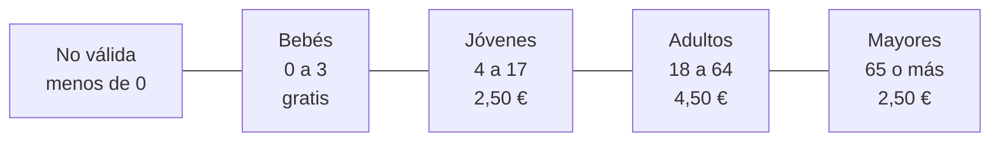
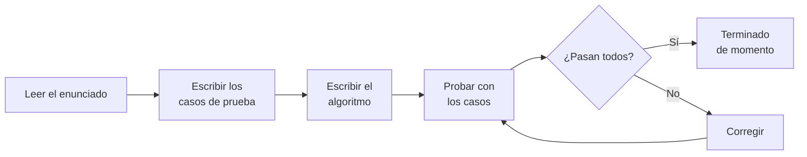
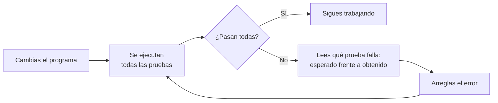
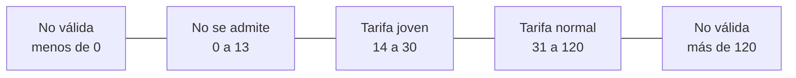

# 01.03 ¿Cómo sé que funciona? Probar un programa

> **Versiones:** Los fragmentos de ejemplo se han comprobado con Python 3.14 y Node.js 24 (8 de noviembre de 2026)
> **Conviene saber antes:** [01.01 Qué es programar](01-que-es-programar.md) · [01.02 Algoritmos y pseudocódigo](02-algoritmos-y-pseudocodigo.md)
> **Tiempo estimado:** 3 horas
> **Nivel:** Básico · Núcleo

## Qué aprenderás

- Por qué **que un programa funcione con un ejemplo no significa que funcione**.
- Qué es un **caso de prueba**: entrada, **salida esperada** y **salida obtenida** (la real).
- A elegir **qué casos probar**: los normales, los **límites** y los **datos no válidos**.
- Por qué conviene **pensar los casos de prueba antes de programar**.
- A **probar a mano** un algoritmo con una **traza** y una **tabla de casos de prueba**.
- **Qué tipos de errores encuentran las pruebas** y cuáles te señala el propio lenguaje.
- Por qué **probar no demuestra que no haya errores**, y aun así es imprescindible.
- Qué son las **pruebas automáticas** y por qué se ejecutan solas y a menudo.
- Qué quieren decir **prueba unitaria**, **prueba de integración** y **TDD**, para que te suenen cuando las veas en tu curso.
- A **leer el mensaje de un corrector automático**: qué se esperaba y qué se obtuvo.

## 1. Teoría

### 1.1. Funcionar una vez no es funcionar

En el [módulo 01.01](01-que-es-programar.md) escribiste los pasos para calcular cuántas cajas hacen falta para enviar un pedido de libros: divides los libros entre la capacidad de la caja quedándote con la parte entera, y si sobra algún libro, añades una caja más. Con 53 libros y cajas de 12 salen 4 cajas llenas, sobran 5 libros y hacen falta **5 cajas**.

Imagina que alguien, con prisa, lo simplifica así: «las cajas son la división entera **más una**, para los libros que sobran». Lo prueba con 53 libros: 53 entre 12 da 4, más una, 5. ¡Correcto! Lo da por bueno y se va a casa.

Al día siguiente llega un pedido de **48 libros**. 48 entre 12 da 4, más una, 5… pero 48 libros caben justos en 4 cajas. El almacén prepara una caja de más, vacía, en cada pedido que llena las cajas justas. Nadie se da cuenta durante semanas, hasta que alguien pregunta por qué se gastan tantas cajas.

Esta historia, con otros nombres, pasa todos los días en empresas de verdad. El programa **funcionaba con un ejemplo**, y quien lo escribió confundió eso con que **funcionaba**. La diferencia entre las dos cosas es justo de lo que trata este módulo.

> **📌 Nota:** fíjate en que el programa con el error **no se queja**. No sale ningún mensaje rojo, no se para, no avisa. Simplemente da un resultado equivocado con toda tranquilidad. Los ordenadores hacen lo que les dices, no lo que querías decir. Por eso hace falta **comprobarlo**.

### 1.2. Qué es probar un programa

**Probar** (en inglés, *testing*) un programa o un algoritmo es **ejecutarlo con unos datos elegidos a propósito y comparar lo que hace con lo que debería hacer**. Si coinciden, la prueba **pasa**; si no, la prueba **falla** y has encontrado un error.

Fíjate en las tres palabras clave:

- **Elegidos a propósito.** No sirve cualquier dato. Hay que escoger los que tienen más posibilidades de descubrir un error (lo verás en el [apartado 1.4](#14-qué-casos-elegir-normales-límite-y-no-válidos)).
- **Lo que hace.** Lo que el programa produce de verdad al ejecutarlo.
- **Lo que debería hacer.** Lo que tú sabes, **antes** de ejecutarlo, que tendría que salir. Si no lo sabes, no puedes decir si el programa está bien o mal.

Probar no es lo mismo que **depurar**. Probar sirve para **descubrir que hay un error**; depurar es **encontrar dónde está y corregirlo**. Las dos cosas van juntas, pero son distintas: primero una prueba falla y te dice «aquí hay algo mal», y después depuras para averiguar qué. La depuración la verás a fondo en el módulo «Errores y depuración» (fase 3).

> **💡 Consejo:** en el mundo profesional se dedica a probar casi tanto tiempo como a programar. No es una pérdida de tiempo: un error encontrado mientras escribes cuesta minutos; el mismo error encontrado por un cliente cuesta dinero, prestigio y, a veces, mucho más.

### 1.3. El caso de prueba

La unidad básica de una prueba es el **caso de prueba**: un ejemplo concreto que dice qué datos se dan y qué debe salir. Tiene tres partes:

| Parte | Qué es | Cuándo se sabe | Ejemplo con las cajas |
|---|---|---|---|
| **Entrada** | Los datos que recibe el programa | Antes de ejecutar | 48 libros, cajas de 12 |
| **Salida esperada** | El resultado correcto, el que **debería** salir | **Antes** de ejecutar | 4 cajas |
| **Salida obtenida** (o salida real) | El resultado que **ha salido de verdad** | **Después** de ejecutar | 5 cajas |

Y el veredicto sale de comparar las dos últimas:

- Si la salida obtenida es **igual** que la esperada, la prueba **pasa** (en inglés, *pass*). Se suele marcar con ✅ o en verde.
- Si son **distintas**, la prueba **falla** (*fail*). Se suele marcar con ❌ o en rojo.

En el ejemplo de la tabla, la prueba **falla**: se esperaban 4 cajas y salieron 5. Esa diferencia es la pista que te lleva al error.

> **⚠️ Cuidado:** la salida esperada se decide **pensando en el problema**, nunca mirando lo que da el programa. Si ejecutas el programa, ves que da 5 y escribes «esperado: 5», tu prueba no comprueba nada: solo copia el error. Este fallo es tan común que tiene su propio apartado en los [errores típicos](#32-sacar-la-salida-esperada-del-propio-programa).

Cuando tienes varios casos de prueba, se ordenan en una **tabla de casos de prueba**. Esta es la forma que usaremos en todo el curso:

| Nº | Qué se prueba | Entrada | Salida esperada | Salida obtenida | ¿Pasa? |
|---|---|---|---|---|---|
| 1 | Pedido normal | 53 libros, cajas de 12 | 5 | 5 | ✅ |
| 2 | Cajas justas | 48 libros, cajas de 12 | 4 | 5 | ❌ |

Las cuatro primeras columnas se rellenan **antes** de ejecutar; las dos últimas, **después**. La columna «Qué se prueba» parece un adorno, pero es muy útil: te obliga a saber **para qué** está cada caso, y cuando uno falla te dice enseguida qué situación no está bien resuelta.

### 1.4. Qué casos elegir: normales, límite y no válidos

Un programa que calcula cajas puede recibir millones de entradas distintas. No puedes probarlas todas, así que tienes que **elegir bien unas pocas**. El truco es pensar que los datos se agrupan en **grupos que se comportan igual**: si el programa acierta con uno del grupo, lo más probable es que acierte con todos los demás del mismo grupo. Basta, entonces, con probar **uno de cada grupo**, más los **bordes** entre grupos.

A estos grupos se les llama **clases de equivalencia** (o **particiones**). Con ellos salen tres tipos de casos que no pueden faltar nunca:

| Tipo | Qué es | Para qué sirve |
|---|---|---|
| **Normales** | Datos habituales, uno de cada grupo | Comprobar que el programa hace lo básico |
| **Límite** | Los valores justo en la frontera entre dos grupos, y los de al lado | Cazar los errores de `>` frente a `≥`, de «una vuelta de más o de menos»… |
| **No válidos** | Datos que el programa **debe rechazar**: vacíos, negativos, fuera de rango, absurdos | Comprobar que el programa no da un resultado sin sentido, sino que avisa |

Vamos a verlo con un **caso real**. Una piscina municipal cobra la entrada según la edad:

- De 0 a 3 años: **gratis**.
- De 4 a 17 años: **2,50 €**.
- De 18 a 64 años: **4,50 €**.
- De 65 años en adelante: **2,50 €**.

Los grupos están claros: bebés, jóvenes, adultos y mayores. Y hay un quinto grupo que no aparece en el enunciado pero existe: **las edades imposibles** (negativas, o de 200 años porque alguien se equivocó al teclear).



El diagrama muestra las edades ordenadas de menor a mayor, partidas en cinco grupos: no válida (menos de 0), bebés (0 a 3), jóvenes (4 a 17), adultos (18 a 64) y mayores (65 o más).

- **Casos normales:** uno de cada grupo, por ejemplo 2, 10, 30 y 80 años.
- **Casos límite:** cada frontera tiene **dos lados**, y hay que probar los dos: 3 y 4, 17 y 18, 64 y 65. Y también el primer valor válido, 0.
- **Casos no válidos:** −1 (el primero por debajo de 0) y una edad absurda como 200.

¿Por qué tanta insistencia en los límites? Porque **los errores se concentran en las fronteras**. Si quien programa escribe `edad > 18` cuando quería `edad ≥ 18`, el programa acierta con 10 años, con 30 y con 80; solo se equivoca con **18 años justos**. Un caso normal nunca lo descubriría. Un caso límite, sí.

> **📌 Nota:** a veces el enunciado no dice qué hacer con un dato. ¿Qué pasa con una edad de 130 años? ¿Es un error o una persona muy longeva? Cuando piensas los casos no válidos aparecen estas preguntas, y es **bueno** que aparezcan: es el momento de preguntárselo a quien encargó el programa (o de decidirlo tú y dejarlo escrito), no de improvisar más tarde.

Hay algunos valores que conviene probar **siempre**, porque dan problemas en casi cualquier programa:

- El **cero**, el **uno** y el **ninguno** (una lista vacía, un pedido sin artículos).
- El **primero** y el **último** de una serie (la primera y la última vuelta de un bucle).
- Los valores **muy grandes**.
- Los datos **vacíos** o de un **tipo inesperado** (texto donde se esperaba un número).

### 1.5. Piensa los casos antes de programar

Puede parecer raro: ¿cómo voy a pensar las pruebas de un programa que todavía no existe? Pues precisamente por eso. Los casos de prueba **no dependen del programa**: dependen del **problema**. Para escribirlos solo necesitas saber qué tiene que salir con cada entrada, y eso lo sabes leyendo bien el enunciado.

Hacerlo **antes** tiene tres ventajas enormes:

1. **Te obliga a entender el problema.** Si no sabes qué debe salir con 48 libros, no estás listo para escribir el algoritmo. Es mejor descubrirlo ahora, con papel y boli, que después de una hora programando.
2. **Saca a la luz las dudas del enunciado.** ¿Qué pasa con 0 libros? ¿Un pedido vacío necesita 0 cajas, o hay que avisar de que no hay nada que enviar? El enunciado casi nunca lo dice. Pensando los casos, te das cuenta y puedes preguntar.
3. **No te dejas engañar por tu propio programa.** Si escribes la salida esperada después de ver la obtenida, inconscientemente tiendes a darla por buena (es el error del [apartado 3.2](#32-sacar-la-salida-esperada-del-propio-programa)). Si ya la tenías escrita antes, la comparación es honrada.

El orden de trabajo queda así:



Es decir: lees el enunciado, escribes los casos de prueba, escribes el algoritmo, lo pruebas con esos casos y, si alguno falla, corriges y vuelves a probar **todos** hasta que pasen.

> **💡 Consejo:** cuando el enunciado no diga qué hacer con un caso, **no lo dejes en blanco** en tu tabla. Escribe lo que has decidido («0 libros → mensaje "No hay nada que enviar"») y por qué. Esa decisión forma parte del diseño del programa.

### 1.6. Probar a mano: la traza y la tabla de casos de prueba

El pseudocódigo no lo ejecuta ningún ordenador, pero se puede probar igual: **lo ejecutas tú, a mano**. Para eso se usan dos herramientas que se complementan.

**La [traza](02-algoritmos-y-pseudocodigo.md#la-traza)**, que ya sabes hacer. Es como grabar a cámara lenta lo que pasa dentro del algoritmo con **una entrada concreta**.

**La tabla de casos de prueba.** Dice **qué entradas** hay que probar y qué debe salir con cada una. Es la lista de comprobación completa.

Se usan juntas así:

1. Escribes la **tabla de casos de prueba** (antes de escribir el algoritmo, si puedes).
2. Escribes el algoritmo.
3. Para **cada caso** de la tabla, haces una **traza** con su entrada y apuntas la salida obtenida.
4. Comparas con la esperada y marcas ✅ o ❌.
5. Si un caso falla, **su traza te dice en qué paso se tuerce el resultado**: es el sitio exacto donde mirar.

No hace falta una traza larga y detallada para cada caso: para los sencillos basta con seguir el algoritmo de cabeza. Reserva la traza completa, con todas sus columnas, para los casos que fallan y para los que pasan por partes del algoritmo que no tienes claras.

Así quedaría la traza del subalgoritmo `CalcularCajas` del [módulo anterior](02-algoritmos-y-pseudocodigo.md#111-subalgoritmos), el correcto, con el caso de las cajas justas (48 libros, cajas de 12):

```text
SUBALGORITMO CalcularCajas(libros, capacidad)
    cajas ← libros DIV capacidad
    SI libros MOD capacidad > 0 ENTONCES
        cajas ← cajas + 1
    FIN SI
    DEVOLVER cajas
FIN SUBALGORITMO
```

| Paso | Instrucción | `libros` | `capacidad` | `cajas` | Condición |
|---|---|---|---|---|---|
| 1 | Recibe los datos | 48 | 12 | — | — |
| 2 | `cajas ← libros DIV capacidad` | 48 | 12 | 4 | — |
| 3 | `SI libros MOD capacidad > 0` | 48 | 12 | 4 | 48 MOD 12 = 0; ¿0 > 0? **No** |
| 4 | `DEVOLVER cajas` | 48 | 12 | **4** | — |

Salida obtenida: 4. Salida esperada: 4. La prueba **pasa** ✅. Y gracias a la traza ves **por qué** pasa: como no sobra ningún libro, el `SI` no suma la caja extra. Justo lo que la versión con prisa del [apartado 1.1](#11-funcionar-una-vez-no-es-funcionar) no hacía.

> **💡 Consejo:** en la columna «Condición» escribe siempre el cálculo **y** el resultado («48 MOD 12 = 0; ¿0 > 0? No»), no solo «No». Cuando una traza no da lo que esperabas, el error suele estar justo en una condición que diste por evaluada sin hacer la cuenta.

### 1.7. Qué errores encuentran las pruebas

En el [módulo 01.01](01-que-es-programar.md#18-tres-tipos-de-errores) viste los tres tipos de errores: de escritura, de ejecución y de lógica. Lo que importa ahora es **qué encuentra cada uno**, porque no todos se descubren igual:

| Tipo | Ejemplo | Quién lo encuentra |
|---|---|---|
| **De escritura** | Escribir `ESCRBIR` en lugar de `ESCRIBIR`; olvidar el `FIN SI` | El propio lenguaje: el compilador o el intérprete se niega a seguir y te dice dónde está. No hace falta ninguna prueba |
| **De ejecución** | Dividir entre cero cuando una lista está vacía | Solo aparece con **ciertos datos**. Lo cazan las pruebas de casos límite y no válidos, antes de que lo encuentre un cliente |
| **De lógica** | Sumar una caja de más cuando los libros llenan las cajas justas | **Solo las pruebas**: el programa se ejecuta sin quejarse y da un resultado equivocado |

Los errores de escritura son molestos, pero **fáciles**: el lenguaje te los señala con el dedo. Las pruebas existen, sobre todo, para los de lógica, que son silenciosos. Y muchos errores de ejecución tienen su origen en uno de lógica (no haber previsto que una lista podía estar vacía), así que los mismos casos «ninguno» y «no válido» sirven para los dos.

> **📌 Nota:** en pseudocódigo no hay compilador que te avise de los errores de escritura, pero tampoco hacen falta: como lo lee una persona, un `FIN SI` olvidado se entiende igual. En pseudocódigo lo que importa es la **lógica**, y esa se prueba con trazas y tablas.

### 1.8. Probar no demuestra que no haya errores

Esta idea es incómoda, pero hay que decirla claramente: **por muchas pruebas que pasen, no puedes estar seguro de que el programa no tiene errores**.

¿Por qué? Porque una prueba solo comprueba **los casos que has elegido**. Si el error está en un caso que no se te ocurrió, ninguna de tus pruebas lo verá. El algoritmo de las cajas con prisa pasaba la prueba de 53 libros; si solo hubieras probado ese caso, lo habrías dado por bueno.

Edsger W. Dijkstra, uno de los pioneros de la informática, lo resumió hacia 1970 en una frase célebre: **«Probar un programa sirve para demostrar que tiene errores, pero nunca para demostrar que no los tiene»**.

Entonces, ¿para qué probar? Por tres razones:

- **Cada prueba que falla es un error encontrado** antes de que lo encuentre un cliente.
- **Cada prueba bien elegida que pasa aumenta la confianza.** No da certeza, pero un programa que pasa 20 casos bien pensados (normales, límites y no válidos) es mucho más fiable que uno que pasa uno solo.
- **Las pruebas se quedan.** Si mañana cambias el programa, puedes volver a pasarlas y saber en segundos si has estropeado algo (lo verás con las pruebas automáticas).

> **⚠️ Cuidado:** que todas las pruebas salgan en verde significa «**no he encontrado errores con estos casos**», no «el programa es correcto». Si las pruebas son malas (pocas, o todas del mismo grupo), el verde no vale casi nada. La calidad de las pruebas importa más que su cantidad.

### 1.9. Las pruebas automáticas

Probar a mano está muy bien para un algoritmo de diez líneas. Pero un programa real tiene miles de líneas y cientos de casos que comprobar, y **cambia todos los días**: se corrigen errores, se añaden funciones, se mejora el código. Cada cambio puede estropear algo que antes funcionaba. ¿Hay que repetir a mano cientos de pruebas cada vez? Sería imposible.

La solución es que **las pruebas las haga el propio ordenador**. Una **prueba automática** es un **pequeño programa que prueba otro programa**: llama al código con una entrada, recoge la salida obtenida, la compara con la esperada y dice si la prueba pasa o falla. Es un caso de prueba, de los que ya conoces, escrito de forma que el ordenador pueda ejecutarlo.

Sus ventajas sobre las pruebas a mano:

- **Se ejecutan solas**, con una sola orden, y **en segundos**, aunque sean cientos.
- **No se cansan ni se despistan.** Comprueban siempre todo, con la misma exactitud, la primera vez y la número mil.
- **Se ejecutan a menudo:** después de cada cambio, antes de guardar el trabajo, antes de publicar una versión nueva.
- **Protegen de las regresiones.** Una **regresión** es un error en algo que **antes funcionaba** y que se ha estropeado al cambiar otra cosa. Son de los errores más frecuentes, y las pruebas automáticas los detectan al momento.



En palabras: cada vez que cambias el programa, se ejecutan todas las pruebas; si pasan, sigues; si alguna falla, lees qué se esperaba y qué se obtuvo, arreglas el error y vuelves a ejecutarlas.

En los equipos profesionales esto va un paso más allá: cada vez que alguien sube un cambio al repositorio común, un servidor ejecuta **todas** las pruebas automáticamente y avisa si alguna falla. Se llama **integración continua** (en inglés, *continuous integration* o CI). GitHub, que conocerás en la fase 5, lo ofrece con una herramienta llamada GitHub Actions.

> **📌 Nota:** cada lenguaje tiene sus propias herramientas para escribir pruebas automáticas: `unittest` o `pytest` en Python, JUnit en Java, el ejecutor de pruebas que trae Node.js para JavaScript… Cambia cómo se escriben, pero **la idea es siempre la misma**: entrada, salida esperada, salida obtenida, ¿coinciden? Las aprenderás en el curso de tu lenguaje. Aquí verás un ejemplo corto, en Python, para que reconozcas la idea.

### 1.10. Cómo es una prueba automática por dentro

Casi todas las pruebas automáticas, en cualquier lenguaje, tienen las mismas **tres partes**:

1. **Preparar.** Se dejan listos los datos de entrada.
2. **Ejecutar.** Se llama a la pieza que se prueba y se guarda lo que devuelve: la salida obtenida.
3. **Comprobar.** Se compara la salida obtenida con la esperada.

La comprobación se escribe con una **aserción** (del inglés *assertion*, «afirmación»): una instrucción que **afirma** que algo debe ser cierto. Si lo es, la prueba sigue tan tranquila; si no lo es, la prueba **falla** en ese mismo punto y dice qué se esperaba y qué se obtuvo.

En este curso escribiremos las pruebas automáticas en pseudocódigo así:

```text
PRUEBA "Cajas justas: 48 libros en cajas de 12 necesitan 4 cajas"
    libros ← 48                                 // 1. preparar
    capacidad ← 12
    resultado ← CalcularCajas(libros, capacidad) // 2. ejecutar
    COMPROBAR resultado = 4                      // 3. comprobar (aserción)
FIN PRUEBA
```

- `PRUEBA "…"` … `FIN PRUEBA` marca una prueba; el texto entre comillas es su nombre, y debe decir **qué se prueba**.
- `COMPROBAR condición` es la aserción: si la condición es falsa, la prueba falla.

Cuando la prueba es sencilla, las tres partes se pueden juntar en una línea:

```text
PRUEBA "Pedido normal: 53 libros en cajas de 12 necesitan 5 cajas"
    COMPROBAR CalcularCajas(53, 12) = 5
FIN PRUEBA
```

Fíjate en que cada `PRUEBA` es **exactamente una fila de la tabla de casos de prueba**, escrita de forma que la pueda ejecutar una máquina. Si ya sabes hacer tablas de casos de prueba, ya sabes qué pruebas automáticas hay que escribir.

> **📌 Nota:** `PRUEBA` y `COMPROBAR` amplían las [convenciones de pseudocódigo del curso](02-algoritmos-y-pseudocodigo.md#15-pseudocódigo) para escribir pruebas. En los lenguajes reales se escriben de otra forma (en el [apartado 2.4](#24-una-prueba-automática-en-python) verás una en Python), pero tienen las mismas partes.

### 1.11. Leer el mensaje de un corrector automático

Tarde o temprano usarás un **corrector automático**: un programa que comprueba tu solución a un ejercicio ejecutando unas pruebas automáticas que ha preparado otra persona. Lo usan las plataformas de ejercicios de programación, muchos cursos y las pruebas técnicas de las empresas. Y las propias herramientas de pruebas de cada lenguaje hacen exactamente lo mismo con tus pruebas.

Cuando una prueba falla, todos dicen, de una forma u otra, **lo mismo**:

| Qué te dice | Cómo puede aparecer | Para qué te sirve |
|---|---|---|
| **Qué prueba ha fallado** | Su nombre: `test_cajas_justas`, `cajas justas: 40 libros en cajas de 10`, `FAIL` | Saber **qué situación** no está bien resuelta |
| **Qué se esperaba** | `expected`, «esperado» | La salida correcta |
| **Qué se obtuvo** | `actual`, `got`, `received`, «obtenido» | Lo que dio tu programa |
| **Dónde** | Un fichero y un número de línea | Ir a la línea de la prueba que falló |

Para leerlo sin agobiarte, sigue siempre estos pasos:

1. **Cuenta cuántas pasan y cuántas fallan.** Normalmente aparece al final: `FAILED (failures=1)`, `fail 1`. Si fallan casi todas, el error suele ser grande y estar al principio; si falla una, suele ser un caso concreto.
2. **Lee el nombre de la prueba que falla.** Si está bien puesto, ya te dice mucho: «cajas justas» te lleva directamente a pensar en qué pasa cuando no sobra nada.
3. **Busca el esperado y el obtenido**, y fíjate bien en **cuál es cuál** (cada herramienta los escribe en un orden; lo verás en los ejemplos).
4. **Compáralos.** ¿Difieren en uno? (Suele ser un límite o una vuelta de más.) ¿Es el doble? ¿Sale cero? ¿Falta una letra? La **forma** de la diferencia es una pista.
5. **Haz una traza** de tu algoritmo con la entrada de esa prueba y busca el paso donde el valor se tuerce.

> **⚠️ Cuidado:** que un corrector diga «falla» no siempre significa que tu idea esté mal. A veces es algo pequeño: un espacio de más, una mayúscula, un punto en vez de una coma, `2.5` frente a `2.50`. El ordenador compara **exactamente**, carácter a carácter. Mira el esperado y el obtenido con lupa antes de reescribirlo todo.

> **💡 Consejo:** nunca «arregles» una prueba que falla cambiando el valor esperado para que coincida con el obtenido, salvo que estés **seguro** de que el esperado estaba mal. Si lo haces sin pensar, convertirás un error del programa en un error escondido en las pruebas.

### 1.12. Ideas que verás en tu curso

Cuando empieces a programar en un lenguaje concreto, oirás hablar de estas ideas. Aquí basta con que te suenen; el curso de tu lenguaje las explica con calma.

- **Prueba unitaria:** prueba **una pieza pequeña, sola**, como un subalgoritmo: «`CalcularCajas(48, 12)` devuelve 4». Son rápidas y, si una falla, sabes exactamente qué pieza está mal. Son las más numerosas.
- **Prueba de integración:** prueba que **varias piezas funcionan bien juntas**, por ejemplo, que el cálculo de cajas, el de los gastos de envío y la factura encajan en un pedido completo. Encuentra los errores **en las uniones**, que las unitarias no ven. El caso más famoso: en 1999, la NASA perdió la sonda Mars Climate Orbiter porque una pieza del software calculaba en unidades anglosajonas y otra esperaba los datos en unidades del sistema internacional. Cada una hacía bien su cuenta; nadie comprobó que se entendieran.
- **Prueba de extremo a extremo** (*end-to-end*): usa el programa completo como lo haría una persona: abre la página web, pulsa los botones, rellena los formularios.
- **TDD** (*Test-Driven Development*, «desarrollo guiado por pruebas»): llevar al extremo la idea del [apartado 1.5](#15-piensa-los-casos-antes-de-programar) y escribir cada prueba **antes** que el código. Se avanza en ciclos de tres pasos: **rojo** (escribes una prueba de algo que el programa aún no hace, y falla), **verde** (escribes lo mínimo para que pase) y **refactorizar** (mejoras cómo está escrito el código sin cambiar lo que hace, y compruebas que las pruebas siguen en verde).

**Refactorizar**, esa última palabra, la oirás mucho: es **cambiar cómo está escrito el código sin cambiar lo que hace**. Gracias a las pruebas se puede hacer sin miedo: si al reorganizar algo lo estropeas, una prueba falla al momento.

## 2. Ejemplos de código

> **📌 Nota:** en este módulo, los «programas» que pruebas son algoritmos en pseudocódigo, y las pruebas, tablas y trazas hechas a mano. Al final verás **una prueba automática real**, en Python, solo para que reconozcas cómo es por dentro una herramienta de pruebas y qué mensajes da. No tienes que ejecutarla ni aprender Python ahora.

### 2.1. Una tabla de casos de prueba completa: las cajas de un pedido

**Situación real:** el almacén de una tienda online de libros calcula las cajas de cada pedido con el subalgoritmo `CalcularCajas(libros, capacidad)` del [módulo anterior](02-algoritmos-y-pseudocodigo.md#111-subalgoritmos), que viste en el [apartado 1.6](#16-probar-a-mano-la-traza-y-la-tabla-de-casos-de-prueba). Antes de usarlo en el almacén, hay que probarlo.

**Paso 1: los grupos.** ¿Qué tipos de pedido hay?

- Pedidos en los que **sobra** algún libro (hace falta una caja «a medio llenar»).
- Pedidos que **llenan las cajas justas**.
- Pedidos **más pequeños que una caja**.
- Pedidos **vacíos** (0 libros): el enunciado no dice nada; decidimos que el resultado debe ser 0 cajas y que el programa que lo usa avisará de que no hay nada que enviar.
- Datos **no válidos**: libros negativos o una capacidad de 0 o negativa (una caja donde no cabe nada).

**Paso 2: los límites.** La frontera importante es **cuando los libros llenan justo un número de cajas**: 12, 24, 36, 48… Hay que probar el valor justo y sus vecinos: 47, 48 y 49, o 11, 12 y 13.

**Paso 3: la tabla**, escrita **antes** de mirar el algoritmo:

| Nº | Qué se prueba | Entrada (libros, capacidad) | Salida esperada |
|---|---|---|---|
| 1 | Normal: sobran libros | 53, 12 | 5 |
| 2 | Límite: cajas justas | 48, 12 | 4 |
| 3 | Límite: uno por debajo de cajas justas | 47, 12 | 4 |
| 4 | Límite: uno por encima de cajas justas | 49, 12 | 5 |
| 5 | Límite: exactamente una caja | 12, 12 | 1 |
| 6 | Límite: una caja y un libro | 13, 12 | 2 |
| 7 | Pedido más pequeño que una caja | 1, 12 | 1 |
| 8 | Pedido vacío | 0, 12 | 0 |
| 9 | No válido: libros negativos | −3, 12 | Error: «Número de libros no válido» |
| 10 | No válido: capacidad cero | 10, 0 | Error: «Capacidad no válida» |

**Paso 4: probar.** Con `CalcularCajas` (el correcto), los casos 1 a 8 **pasan**. Por ejemplo, el caso 6: 13 DIV 12 = 1, 13 MOD 12 = 1 > 0, así que suma una caja: 2 ✅.

Pero los casos 9 y 10 **fallan**, y por razones distintas:

- **Caso 9:** el algoritmo no comprueba nada; calcula alegremente con −3 libros y devuelve un número que no significa nada. Salida obtenida: un número; esperada: un error ❌.
- **Caso 10:** `10 DIV 0` es una **división entre cero**, que no se puede hacer. En un lenguaje real, el programa se pararía con un error de ejecución ❌.

La tabla ha hecho su trabajo: **el algoritmo es correcto para los datos válidos, pero no se defiende de los no válidos**. La versión mejorada los comprueba primero:

```text
SUBALGORITMO CalcularCajas(libros, capacidad)
    SI libros < 0 ENTONCES
        DEVOLVER "Error: número de libros no válido"
    FIN SI
    SI capacidad ≤ 0 ENTONCES
        DEVOLVER "Error: capacidad no válida"
    FIN SI
    cajas ← libros DIV capacidad
    SI libros MOD capacidad > 0 ENTONCES
        cajas ← cajas + 1
    FIN SI
    DEVOLVER cajas
FIN SUBALGORITMO
```

Ahora los diez casos pasan. Y fíjate en una cosa: después de añadir las comprobaciones, **hay que volver a pasar los casos 1 a 8**, no solo el 9 y el 10. Una corrección puede estropear lo que ya funcionaba (una regresión), y la única forma de saberlo es volver a probarlo todo.

> **📌 Nota:** aquí el subalgoritmo devuelve a veces un número y a veces un texto de error. En pseudocódigo nos vale para entendernos. Los lenguajes reales tienen mecanismos específicos para avisar de un error (en muchos, las **excepciones**), que aprenderás en el curso de tu lenguaje.

¿Y la versión «con prisa» del [apartado 1.1](#11-funcionar-una-vez-no-es-funcionar), la de «división entera más una»? Pásale la misma tabla:

| Nº | Entrada | Esperada | Obtenida con «DIV + 1» | ¿Pasa? |
|---|---|---|---|---|
| 1 | 53, 12 | 5 | 5 | ✅ |
| 2 | 48, 12 | 4 | 5 | ❌ |
| 3 | 47, 12 | 4 | 4 | ✅ |
| 4 | 49, 12 | 5 | 5 | ✅ |
| 5 | 12, 12 | 1 | 2 | ❌ |
| 6 | 13, 12 | 2 | 2 | ✅ |
| 7 | 1, 12 | 1 | 1 | ✅ |
| 8 | 0, 12 | 0 | 1 | ❌ |

Pasa **cinco de ocho**, incluido el caso normal. Solo la cazan los **casos límite** (las cajas justas) y el **pedido vacío**. Es la mejor demostración de por qué los límites no son opcionales.

### 2.2. Traza y casos de prueba: el año bisiesto

**Situación real:** una aplicación de reservas necesita saber si un año es bisiesto para saber si febrero tiene 29 días. En el [ejercicio 7 del módulo anterior](02-algoritmos-y-pseudocodigo.md#ejercicio-7--es-bisiesto) escribiste el subalgoritmo `EsBisiesto` con la regla del calendario gregoriano: es bisiesto si es divisible entre 4, salvo que lo sea entre 100, salvo que también lo sea entre 400. Esta es su versión con selección encadenada:

```text
SUBALGORITMO EsBisiesto(anio)
    SI anio MOD 400 = 0 ENTONCES
        DEVOLVER VERDADERO
    SI NO SI anio MOD 100 = 0 ENTONCES
        DEVOLVER FALSO
    SI NO SI anio MOD 4 = 0 ENTONCES
        DEVOLVER VERDADERO
    SI NO
        DEVOLVER FALSO
    FIN SI
FIN SUBALGORITMO
```

Ahora vas a probarlo con método. **Los grupos** salen directamente de la regla: años no divisibles entre 4, divisibles entre 4 pero no entre 100, divisibles entre 100 pero no entre 400, y divisibles entre 400. Con uno o dos casos de cada grupo sale esta tabla:

| Nº | Qué se prueba | Entrada | Salida esperada |
|---|---|---|---|
| 1 | No divisible entre 4 | 2023 | FALSO |
| 2 | Divisible entre 4, no entre 100 | 2024 | VERDADERO |
| 3 | Divisible entre 100, no entre 400 | 1900 | FALSO |
| 4 | Divisible entre 400 | 2000 | VERDADERO |
| 5 | Divisible entre 100, no entre 400 (futuro) | 2100 | FALSO |
| 6 | Justo después de un bisiesto | 2025 | FALSO |

Fíjate en que aquí los «límites» no son valores de una escala, sino **las excepciones de la regla**: 1900 y 2000 son los casos que separan una versión correcta de una ingenua. Cualquier año normal (2023, 2024) lo acierta hasta el algoritmo más simple.

**Traza con el caso 3 (1900)**, el más delicado:

| Paso | Instrucción | `anio` | Condición | Devuelve |
|---|---|---|---|---|
| 1 | Recibe el dato | 1900 | — | — |
| 2 | `SI anio MOD 400 = 0` | 1900 | 1900 MOD 400 = 300; ¿300 = 0? **No** | — |
| 3 | `SI NO SI anio MOD 100 = 0` | 1900 | 1900 MOD 100 = 0; ¿0 = 0? **Sí** | — |
| 4 | `DEVOLVER FALSO` | 1900 | — | **FALSO** |

Salida obtenida: FALSO. Esperada: FALSO ✅. Como la segunda condición ya es verdadera, la tercera (`MOD 4`) **ni se mira**. Ese es el detalle que hace funcionar al algoritmo: las excepciones se comprueban **antes** que la regla general. Los otros cinco casos también pasan (haz tú la traza de 2024: es un buen entrenamiento).

**¿Y si alguien hubiera escrito la versión ingenua**, `DEVOLVER anio MOD 4 = 0`? Acertaría 2023, 2024, 2000 y 2025, y **fallaría** 1900 y 2100 (diría VERDADERO). Con solo los casos «normales», nadie lo habría notado… hasta el año 2100.

### 2.3. Un caso real: los descuentos de una tienda online

**Situación real:** una tienda online aplica descuentos según el importe de la compra:

- Compras de **100 € o más**: **10 %** de descuento.
- Compras de **50 € o más** (y menos de 100 €): **5 %** de descuento.
- Compras de menos de 50 €: sin descuento.
- Un importe de 0 € o negativo es un error.

Un compañero ha escrito este algoritmo y dice que «funciona, que lo ha probado con 75 €»:

```text
ALGORITMO PrecioConDescuento
    ENTRADA: importe de la compra, en euros
    SALIDA: importe que hay que pagar, o un mensaje de error

INICIO
    LEER importe
    SI importe ≤ 0 ENTONCES
        ESCRIBIR "Error: importe no válido"
    SI NO SI importe > 50 ENTONCES
        ESCRIBIR importe * 0.95
    SI NO SI importe ≥ 100 ENTONCES
        ESCRIBIR importe * 0.90
    SI NO
        ESCRIBIR importe
    FIN SI
FIN
```

Con 75 € da 71,25 €, que es correcto. Pero ya sabes que **un caso no basta**. Hagamos la tabla con los grupos y los límites del enunciado (los límites son 50 y 100, y hay que probar cada uno y su vecino de abajo):

| Nº | Qué se prueba | Entrada | Esperada | Obtenida | ¿Pasa? |
|---|---|---|---|---|---|
| 1 | Normal: sin descuento | 30 | 30 | 30 | ✅ |
| 2 | Límite: justo por debajo de 50 | 49.99 | 49.99 | 49.99 | ✅ |
| 3 | Límite: 50 justos | 50 | 47.50 | 50 | ❌ |
| 4 | Normal: 5 % | 75 | 71.25 | 71.25 | ✅ |
| 5 | Límite: justo por debajo de 100 | 99 | 94.05 | 94.05 | ✅ |
| 6 | Límite: 100 justos | 100 | 90.00 | 95.00 | ❌ |
| 7 | Normal: 10 % | 150 | 135.00 | 142.50 | ❌ |
| 8 | No válido: cero | 0 | Error | Error | ✅ |
| 9 | No válido: negativo | −20 | Error | Error | ✅ |

**Tres pruebas fallan.** Ahora, en vez de tocar el algoritmo a ciegas, mira **qué tienen en común** los fallos:

- El **caso 3** (50 €) no aplica el 5 %. Traza: `¿50 > 50?` **No**; `¿50 ≥ 100?` No; así que va al `SI NO` y escribe 50. El problema es el `>`: el enunciado dice «50 € **o más**», que es `≥`. Es el [error de límites](02-algoritmos-y-pseudocodigo.md#35-equivocarse-en-los-límites-mayor-frente-a-mayor-o-igual) que ya conoces.
- Los **casos 6 y 7** (100 y 150 €) aplican el 5 % en vez del 10 %. Traza con 150: `¿150 > 50?` **Sí** → escribe 150 × 0,95 = 142,50, y ya no mira nada más. El `SI NO SI importe ≥ 100` **nunca se llega a comprobar** con importes de 100 o más, porque todos ellos son también mayores que 50 y se quedan en la rama anterior. Es el error de [ordenar mal las condiciones encadenadas](02-algoritmos-y-pseudocodigo.md#34-ordenar-mal-las-condiciones-encadenadas): hay que poner primero la más restrictiva.

**El algoritmo corregido:**

```text
INICIO
    LEER importe
    SI importe ≤ 0 ENTONCES
        ESCRIBIR "Error: importe no válido"
    SI NO SI importe ≥ 100 ENTONCES
        ESCRIBIR importe * 0.90
    SI NO SI importe ≥ 50 ENTONCES
        ESCRIBIR importe * 0.95
    SI NO
        ESCRIBIR importe
    FIN SI
FIN
```

Vuelve a pasar **los nueve casos**: ahora todos dan ✅. Fíjate en lo que ha pasado: el compañero probó con 75 €, que está justo en el único grupo donde los dos errores no se notan. Con la tabla completa, los dos errores aparecieron en cinco minutos.

> **💡 Consejo:** cuando fallan varias pruebas, no las arregles una por una a base de parches. Mira primero **qué tienen en común** las que fallan y **qué tienen en común** las que pasan. Muchas veces, como aquí, dos o tres fallos tienen solo una o dos causas.

### 2.4. Una prueba automática en Python

Vamos a ver cómo es una prueba automática **de verdad**. Este es el subalgoritmo `CalcularCajas`, escrito en **Python**, y tres pruebas automáticas con `unittest`, la herramienta de pruebas que viene incluida en Python. **No hace falta que entiendas cada línea: fíjate en que cada prueba es una fila de la tabla de casos de prueba**, con su entrada y su salida esperada.

El programa, en un fichero llamado `cajas.py`:

```python
def calcular_cajas(libros, capacidad):
    cajas = libros // capacidad          # cajas llenas
    if libros % capacidad > 0:           # si sobran libros...
        cajas = cajas + 1                # ...hace falta una caja más
    return cajas
```

(`//` es el `DIV` del pseudocódigo y `%` es el `MOD`.)

Las pruebas, en otro fichero, `test_cajas.py`:

```python
import unittest
from cajas import calcular_cajas

class PruebasCajas(unittest.TestCase):

    def test_pedido_normal(self):
        self.assertEqual(calcular_cajas(53, 12), 5)

    def test_cajas_justas(self):
        self.assertEqual(calcular_cajas(40, 10), 4)

    def test_un_solo_libro(self):
        self.assertEqual(calcular_cajas(1, 12), 1)

if __name__ == "__main__":
    unittest.main()
```

Fíjate en las líneas que empiezan por `self.assertEqual`: son las **aserciones**, el `COMPROBAR` del pseudocódigo. `assertEqual(calcular_cajas(40, 10), 4)` significa «comprueba que lo que devuelve `calcular_cajas(40, 10)` es igual a 4». Cada `def test_…` es una `PRUEBA`, y su nombre dice qué se prueba.

Para ejecutar **todas** las pruebas basta una orden en la terminal (la terminal la verás en la fase 3):

```text
python3 -m unittest -v test_cajas
```

**Cuando todas pasan**, la salida es esta:

```text
test_cajas_justas (test_cajas.PruebasCajas.test_cajas_justas) ... ok
test_pedido_normal (test_cajas.PruebasCajas.test_pedido_normal) ... ok
test_un_solo_libro (test_cajas.PruebasCajas.test_un_solo_libro) ... ok

----------------------------------------------------------------------
Ran 3 tests in 0.000s

OK
```

Una línea por prueba con `ok`, el resumen «Ran 3 tests» (se han ejecutado 3 pruebas) y un `OK` final. Todo en verde.

Ahora alguien «simplifica» el programa con la versión con prisa del [apartado 1.1](#11-funcionar-una-vez-no-es-funcionar):

```python
def calcular_cajas(libros, capacidad):
    return libros // capacidad + 1       # cajas llenas, más una para lo que sobra
```

Y vuelve a ejecutar **las mismas pruebas**, sin tocarlas. **Cuando una falla**, la salida es esta:

```text
test_cajas_justas (test_cajas.PruebasCajas.test_cajas_justas) ... FAIL
test_pedido_normal (test_cajas.PruebasCajas.test_pedido_normal) ... ok
test_un_solo_libro (test_cajas.PruebasCajas.test_un_solo_libro) ... ok

======================================================================
FAIL: test_cajas_justas (test_cajas.PruebasCajas.test_cajas_justas)
----------------------------------------------------------------------
Traceback (most recent call last):
  File "/home/ana/pruebas/test_cajas.py", line 10, in test_cajas_justas
    self.assertEqual(calcular_cajas(40, 10), 4)
    ~~~~~~~~~~~~~~~~^^^^^^^^^^^^^^^^^^^^^^^^^^^
AssertionError: 5 != 4

----------------------------------------------------------------------
Ran 3 tests in 0.000s

FAILED (failures=1)
```

(La ruta del fichero, `/home/ana/pruebas/`, depende del ordenador; el tiempo, `0.000s`, cambia un poco en cada ejecución.)

**Cómo leerla**, con los pasos del [apartado 1.11](#111-leer-el-mensaje-de-un-corrector-automático):

1. **Cuántas fallan:** al final, `FAILED (failures=1)`: una prueba ha fallado. Arriba ves que las otras dos siguen en `ok`.
2. **Cuál:** `FAIL: test_cajas_justas`. Es la prueba de las cajas justas. Ya sospechas algo de cuando no sobran libros.
3. **Dónde:** `File "…/test_cajas.py", line 10`, y debajo, la línea exacta: `self.assertEqual(calcular_cajas(40, 10), 4)`. Las marcas `~~~^^^` señalan la expresión que ha fallado.
4. **Esperado y obtenido:** `AssertionError: 5 != 4` significa «5 no es igual a 4». `unittest` escribe los dos valores **en el mismo orden en que van en el `assertEqual`**: primero lo que devolvió `calcular_cajas(40, 10)`, que es **5** (el **obtenido**), y luego el **4** (el **esperado**).
5. **La conclusión:** con 40 libros en cajas de 10, el programa dice 5 cajas y deberían ser 4. Sobra una caja justo cuando no sobra ningún libro. El error está en sumar siempre una caja.

Fíjate también en lo que **no** ha detectado nada: el pedido normal y el de un solo libro siguen pasando. Si solo hubiera existido la prueba del pedido normal, el error habría pasado inadvertido.

> **📌 Nota:** `unittest` no obliga a poner primero el obtenido y después el esperado: es lo habitual, pero hay quien lo escribe al revés. Por eso, ante un `5 != 4`, **mira siempre la línea de la aserción** para saber cuál es cuál.

### 2.5. Del corrector a la tabla: esperado frente a obtenido

El mensaje del apartado anterior, y el de casi cualquier corrector automático, se puede «traducir» a la tabla de casos de prueba que ya sabes hacer. Si lo haces, deja de dar miedo:

| Columna de la tabla | En el mensaje de `unittest` |
|---|---|
| Qué se prueba | `FAIL: test_cajas_justas` |
| Entrada | La línea de la aserción: `calcular_cajas(40, 10)` |
| Salida esperada | El segundo número de `5 != 4`: **4** |
| Salida obtenida | El primer número de `5 != 4`: **5** |
| ¿Pasa? | `FAIL` |

Con la fila hecha, el siguiente paso es el de siempre: una **traza** del algoritmo con esa entrada (40 libros, cajas de 10) para ver en qué paso sale 5 en vez de 4.

Otras herramientas dicen lo mismo con otras palabras; muchas lo escriben en claro, con `expected` (esperado) y `actual` (obtenido):

| Herramienta o plataforma | Cómo suele llamar al esperado | Cómo suele llamar al obtenido |
|---|---|---|
| En general, en inglés | `expected` | `actual`, `got`, `received`, `but was` |
| En español | «esperado», «se esperaba» | «obtenido», «recibido», «tu salida» |

> **📌 Nota:** algunos correctores comparan **todo el texto** que escribe tu programa con el que debería escribir, y te muestran las diferencias marcando las líneas: con `-` lo que esperaba y con `+` lo que escribiste, o al revés. Cada herramienta lo hace a su manera, así que la primera vez lee su ayuda para saber qué significa cada signo. Es la misma idea que el `- J` y `+ Z` que verás en el [ejercicio 3](#ejercicio-3--lee-los-mensajes-de-dos-correctores).

## 3. Errores típicos

### 3.1. Probar solo el caso feliz

**Qué pasa:** pruebas solo el **caso feliz**, el ejemplo de manual que todo el mundo prueba primero: 53 libros, una compra de 75 €. Pasa, y te quedas tranquilo. Es el [error típico 3.2 del módulo 01.01](01-que-es-programar.md#32-creer-que-si-funciona-con-un-ejemplo-funciona-siempre), ahora con nombre propio.

**Por qué ocurre:** es el caso que tenías en la cabeza al escribir el programa. Pero los errores casi nunca están ahí: están en los límites (48 libros, 50 € justos) y en los datos raros (0 libros, un importe negativo).

**Cómo evitarlo:** para cada programa, haz la tabla con los tres tipos de casos (normales, límite y no válidos). Si tu tabla solo tiene casos normales, no está terminada.

### 3.2. Sacar la salida esperada del propio programa

**Qué pasa:** ejecutas el programa, ves lo que sale y lo copias en la columna «esperada». Ahora la prueba pasa siempre… porque compara el programa **consigo mismo**. Si el programa estaba mal, la prueba también lo está, y encima te da una falsa sensación de seguridad.

**Cómo evitarlo:** calcula la salida esperada **a mano, a partir del enunciado**, y antes de ejecutar nada. Si el cálculo es complicado, hazlo de otra forma distinta a como lo hace el programa (con una calculadora, contando a mano, con una regla del enunciado).

### 3.3. Probar solo un lado del límite

**Qué pasa:** se prueba 50 € (envío gratis) pero no 49,99 € (envío de pago), o al revés. Un error de `>` frente a `≥` solo se ve en el valor **exacto** del límite, y un error que mueve el límite un poco (`≥ 49` en vez de `≥ 50`) solo se ve en el valor de **al lado**.

**Cómo evitarlo:** por cada límite, al menos dos casos: el valor justo y el vecino del otro lado. Si los valores son enteros, mejor tres: uno por debajo, el justo y uno por encima.

### 3.4. Olvidarse de los datos no válidos

**Qué pasa:** la tabla solo tiene datos correctos, y el programa nunca se ha enfrentado a un 0, a un negativo, a una lista vacía o a un texto donde iba un número. En el mundo real, **alguien acabará metiendo esos datos**: por error, por despiste o a propósito.

**Cómo evitarlo:** pregúntate siempre «¿qué es lo peor que me pueden dar?» y añade esos casos, con la salida esperada que hayas decidido (normalmente, un mensaje de error claro).

### 3.5. Cambiar la prueba para que pase

**Qué pasa:** una prueba falla, no ves el error del programa y «corriges» la prueba: cambias el valor esperado por el obtenido. Ahora sale verde, pero el error sigue ahí, y además ya no hay ninguna prueba que lo vigile.

**Cómo evitarlo:** cuando una prueba falla, lo primero es averiguar **quién tiene razón**: vuelve al enunciado y recalcula el esperado a mano. Solo si la prueba estaba mal (te equivocaste al calcular el esperado), se corrige la prueba. Si no, se corrige el programa.

### 3.6. Confundir el esperado con el obtenido

**Qué pasa:** lees `5 != 4`, das por hecho que el 5 es lo que debía salir, y te pones a «arreglar» un programa que da 4… que era justo lo correcto. Pierdes media hora persiguiendo un error que no existe.

**Cómo evitarlo:** antes de tocar nada, identifica **sin dudas** cuál es cada valor: busca las palabras `expected` y `actual`, o mira la línea de la aserción. Y escríbelo como una fila de la tabla: entrada, esperada, obtenida.

### 3.7. Arreglar un error y no volver a probarlo todo

**Qué pasa:** corriges el caso que fallaba, compruebas que ahora pasa, y das el trabajo por terminado. Pero la corrección ha estropeado otro caso que antes pasaba: una regresión.

**Cómo evitarlo:** después de **cualquier** cambio, vuelve a pasar **todos** los casos de prueba, no solo el que fallaba. Con pruebas automáticas es una sola orden; a mano, es una razón más para tener la tabla escrita y no en la cabeza.

### 3.8. Creer que «todo en verde» significa «sin errores»

**Qué pasa:** todas las pruebas pasan y se da por demostrado que el programa es correcto. Pero las pruebas solo dicen que **no han encontrado errores con esos casos** ([apartado 1.8](#18-probar-no-demuestra-que-no-haya-errores)). Si las pruebas son pocas o malas, el verde no significa casi nada.

**Cómo evitarlo:** cuando todo pase, haz una última pregunta: «¿qué caso **no** he probado?». Revisa la lista de valores que conviene probar siempre (cero, uno, ninguno, el primero, el último, los muy grandes, los vacíos).

## 4. Buenas prácticas

- **Piensa los casos de prueba antes de escribir el algoritmo.** Te obligan a entender el problema y descubren las dudas del enunciado cuando todavía es barato resolverlas.
- **Calcula la salida esperada a partir del enunciado**, nunca a partir de lo que da el programa.
- **Cubre los tres tipos de casos:** normales (uno por grupo), límite (los dos lados de cada frontera) y no válidos.
- **Pon un nombre a cada caso** que diga qué situación prueba: «cajas justas», «50 € justos», «pedido vacío». Cuando falle, el nombre ya te orientará.
- **Escribe las decisiones.** Si el enunciado no dice qué hacer con un dato, decide, anótalo en la tabla y, si puedes, pregunta a quien encargó el programa.
- **Una prueba, una cosa.** Cada caso de prueba comprueba una sola situación. Si una prueba comprueba cinco cosas y falla, no sabrás cuál de las cinco ha fallado.
- **Cuando un caso falle, haz su traza.** No cambies cosas a ciegas: busca el paso exacto donde el valor se tuerce.
- **Después de cada cambio, vuelve a pasar todas las pruebas**, para que no se cuele ninguna regresión.
- **Guarda las pruebas.** Una tabla de casos de prueba escrita (o unas pruebas automáticas) sirve el día de mañana, cuando cambies el programa. Una prueba que solo hiciste de cabeza se pierde.
- **Comprueba también lo que te dé otra persona o una IA.** Un algoritmo que te pasan, o que te sugiere un asistente de IA, se prueba igual que el tuyo: con tu propia tabla de casos. Es una de las normas de uso de la IA de la academia, que verás en el módulo «Programar con asistentes de IA» (fase 7).
- **Lee los mensajes de error con calma y en orden:** cuántas fallan, cuál, dónde, esperado y obtenido.

## 5. Ejercicios prácticos resueltos

> **💡 Consejo:** todos los ejercicios se hacen con papel y boli (o un editor de texto): tablas de casos de prueba, trazas y pseudocódigo. No tienes que ejecutar nada. Intenta cada uno **antes** de abrir las pistas y la solución, y calcula siempre las salidas esperadas a partir del enunciado.

### 🟢 Básico

#### Ejercicio 1 · Esperado, obtenido y veredicto

**Situación real:** una aplicación de fichajes muestra cuánto tiempo ha trabajado cada empleado. Recibe los **minutos** trabajados y debe mostrarlos en horas y minutos. Por ejemplo, 150 minutos → «2 h 30 min».

Alguien ha escrito un algoritmo y lo ha probado. Esta es su tabla, con la salida obtenida ya rellenada:

| Nº | Entrada (minutos) | Salida esperada | Salida obtenida |
|---|---|---|---|
| 1 | 150 | 2 h 30 min | 2.5 h 30 min |
| 2 | 60 | 1 h 0 min | 1 h 0 min |
| 3 | 120 | 2 h 0 min | 2 h 0 min |
| 4 | 90 | 1 h 30 min | 1.5 h 30 min |
| 5 | 45 | 0 h 45 min | 0.75 h 45 min |
| 6 | 0 | 0 h 0 min | 0 h 0 min |

1. Añade la columna «¿Pasa?» y rellénala.
2. ¿Qué tienen en común los casos que pasan? ¿Y los que fallan?
3. ¿Qué crees que ha hecho mal quien escribió el algoritmo? (Pista: piensa en las [operaciones del módulo anterior](02-algoritmos-y-pseudocodigo.md#operadores-aritméticos).)
4. Si esta persona solo hubiera probado los casos 2, 3 y 6, ¿qué habría concluido?

<details>
<summary>Pista 1</summary>

Una prueba pasa solo si la salida obtenida es **exactamente** igual a la esperada, carácter a carácter.

</details>

<details>
<summary>Pista 2</summary>

Fíjate en las horas que salen mal: 2.5, 1.5, 0.75. ¿Qué operación da 2.5 al dividir 150 entre 60? ¿Y cuál da 2?

</details>

<details>
<summary>Ver solución</summary>

**Razonamiento:** una prueba pasa solo si la salida obtenida es exactamente igual a la esperada. Después, comparar los casos que pasan con los que fallan da la pista del error.

**1. La tabla con el veredicto:**

| Nº | Entrada | Esperada | Obtenida | ¿Pasa? |
|---|---|---|---|---|
| 1 | 150 | 2 h 30 min | 2.5 h 30 min | ❌ |
| 2 | 60 | 1 h 0 min | 1 h 0 min | ✅ |
| 3 | 120 | 2 h 0 min | 2 h 0 min | ✅ |
| 4 | 90 | 1 h 30 min | 1.5 h 30 min | ❌ |
| 5 | 45 | 0 h 45 min | 0.75 h 45 min | ❌ |
| 6 | 0 | 0 h 0 min | 0 h 0 min | ✅ |

**2. Lo que tienen en común.** Los que pasan (60, 120 y 0) son **múltiplos exactos de 60**: horas completas, sin minutos sueltos. Los que fallan (150, 90 y 45) **no** lo son. Además, en los que fallan, la parte de los minutos («30 min», «45 min») está bien: solo fallan las horas.

**3. El error.** Para calcular las horas ha usado la **división con decimales** (`/`): 150 / 60 = 2.5. Tendría que haber usado la **división entera** (`DIV`): 150 DIV 60 = 2. Con un múltiplo de 60 las dos dan lo mismo (120 / 60 = 2 = 120 DIV 60), y por eso esos casos pasan. Los minutos los calcula bien con `MOD` (150 MOD 60 = 30). La corrección:

```text
horas ← minutos DIV 60          // y no minutos / 60
resto ← minutos MOD 60
ESCRIBIR horas, " h ", resto, " min"
```

**4. Con solo 2, 3 y 6** habría concluido que el algoritmo funciona, porque los tres pasan. Habría probado tres veces **el mismo grupo** (horas exactas) y ninguna el otro (horas con minutos sueltos), que es justo donde está el error. Elegir casos de grupos distintos importa más que probar muchos.

**Errores frecuentes al resolverlo:**

- Dar por buena la fila 1 porque «2.5 horas es lo mismo que 2 h 30 min». Matemáticamente lo es, pero **no** es la salida esperada: el programa debía escribir «2 h 30 min». La comparación es exacta.
- Pensar que el error está en los minutos porque las filas que fallan tienen minutos sueltos. Los minutos salen bien en todas: compara columna a columna.

</details>

#### Ejercicio 2 · Normal, límite o no válido

**Situación real:** un gimnasio tiene una **tarifa joven** para personas de **14 a 30 años, ambos incluidos**. Por debajo de 14 años no se admiten inscripciones, y una edad negativa o de más de 120 años se considera un error de escritura.

Clasifica cada uno de estos casos de prueba como **normal**, **límite** o **no válido**, y di qué debería responder el programa a la pregunta «¿tiene tarifa joven?» (sí, no, o error):

| Entrada (edad) |
|---|
| 22 |
| 14 |
| 13 |
| 30 |
| 31 |
| 45 |
| −2 |
| 0 |
| «veinte» |

Al final, di qué **límite** importante falta en la lista.

<details>
<summary>Pista 1</summary>

Dibuja una línea con las edades y marca los grupos: no válidas, menores de 14 (no se admiten), de 14 a 30 (tarifa joven), de 31 a 120 (tarifa normal), más de 120 (no válidas). Los límites son las fronteras entre esos grupos.

</details>

<details>
<summary>Pista 2</summary>

«Ambos incluidos» quiere decir que 14 y 30 **tienen** tarifa joven.

</details>

<details>
<summary>Ver solución</summary>

**Razonamiento:** primero se ordenan las edades en grupos y se marcan las fronteras; cada caso es normal si cae dentro de un grupo, límite si está en una frontera (o justo al lado) y no válido si es un dato sin sentido.

**Los grupos:**



Es decir, de menor a mayor: no válida (menos de 0), no se admite (0 a 13), tarifa joven (14 a 30), tarifa normal (31 a 120) y no válida (más de 120).

**La tabla:**

| Entrada | Tipo | ¿Tarifa joven? | Por qué |
|---|---|---|---|
| 22 | Normal | Sí | Un valor cualquiera del grupo joven |
| 14 | Límite | Sí | Primera edad con tarifa joven («incluido») |
| 13 | Límite | No (no se admite) | Justo por debajo del primer límite |
| 30 | Límite | Sí | Última edad con tarifa joven («incluido») |
| 31 | Límite | No (tarifa normal) | Justo por encima del segundo límite |
| 45 | Normal | No (tarifa normal) | Un valor cualquiera del grupo de tarifa normal |
| −2 | No válido | Error | Edad negativa |
| 0 | Límite | No (no se admite) | Primera edad válida: frontera entre «no válida» y «no se admite» |
| «veinte» | No válido | Error | No es un número |

**Lo que falta:** el límite de arriba, **120 y 121**. 120 es la última edad válida (tarifa normal) y 121 ya es un error. Sin esos dos casos, nadie comprobaría si el programa rechaza las edades absurdas por arriba.

**Errores frecuentes al resolverlo:**

- Clasificar el 0 como «no válido». Una edad de 0 años es posible (un bebé); lo que pasa es que **no se admite** en el gimnasio. «No válido» es para los datos que no tienen sentido; «no se admite» es una regla del negocio. Son respuestas distintas, y el programa debería dar un mensaje distinto en cada caso.
- Probar solo un lado de cada límite: 14 sin 13, o 30 sin 31.

</details>

#### Ejercicio 3 · Lee los mensajes de dos correctores

Estas son dos salidas reales de herramientas de pruebas. No hace falta que sepas Python ni JavaScript: solo tienes que leerlas con los pasos del [apartado 1.11](#111-leer-el-mensaje-de-un-corrector-automático), como hiciste en el [2.4](#24-una-prueba-automática-en-python). La segunda es de otra herramienta, pero dice lo mismo con otras palabras: busca los nombres de la tabla del [apartado 2.5](#25-del-corrector-a-la-tabla-esperado-frente-a-obtenido).

**Salida A**, en Python. Prueba un subalgoritmo que calcula la **letra del DNI** a partir de su número:

```text
F
======================================================================
FAIL: test_dni_de_ejemplo (test_dni.PruebasDni.test_dni_de_ejemplo)
----------------------------------------------------------------------
Traceback (most recent call last):
  File "/home/ana/pruebas/test_dni.py", line 7, in test_dni_de_ejemplo
    self.assertEqual(letra_dni(12345678), "Z")
    ~~~~~~~~~~~~~~~~^^^^^^^^^^^^^^^^^^^^^^^^^^
AssertionError: 'J' != 'Z'
- J
+ Z


----------------------------------------------------------------------
Ran 1 test in 0.001s

FAILED (failures=1)
```

**Salida B**, en JavaScript. Prueba un subalgoritmo que dice si un año es **bisiesto**:

```text
✖ 1900 no fue bisiesto (1.490058ms)
ℹ tests 1
ℹ suites 0
ℹ pass 0
ℹ fail 1
ℹ cancelled 0
ℹ skipped 0
ℹ todo 0
ℹ duration_ms 85.378859

✖ failing tests:

test at bisiesto.test.js:5:1
✖ 1900 no fue bisiesto (1.490058ms)
  AssertionError [ERR_ASSERTION]: Expected values to be strictly equal:
  
  true !== false
  
      at TestContext.<anonymous> (/home/ana/pruebas/bisiesto.test.js:6:10)
      at Test.runInAsyncScope (node:async_hooks:227:14)
      at Test.run (node:internal/test_runner/test:1402:25)
      at Test.start (node:internal/test_runner/test:1262:17)
      at startSubtestAfterBootstrap (node:internal/test_runner/harness:387:17) {
    generatedMessage: true,
    code: 'ERR_ASSERTION',
    actual: true,
    expected: false,
    operator: 'strictEqual',
    diff: 'simple'
  }
```

Para cada salida, escribe la fila de la tabla de casos de prueba (qué se prueba, entrada, esperada, obtenida, ¿pasa?) y di qué crees que le pasa al programa. En la salida B, usa lo que viste en el [apartado 2.2](#22-traza-y-casos-de-prueba-el-año-bisiesto).

<details>
<summary>Pista 1</summary>

En la salida A, mira la línea de la aserción: `assertEqual(letra_dni(12345678), "Z")`. ¿Qué va primero, lo obtenido o lo esperado? Los dos valores de `'J' != 'Z'` van en ese mismo orden.

</details>

<details>
<summary>Pista 2</summary>

En la salida B, busca las palabras `actual` y `expected`. `true` es «verdadero» y `false`, «falso».

</details>

<details>
<summary>Ver solución</summary>

**Razonamiento:** en cada salida se buscan el nombre de la prueba, el esperado y el obtenido (con cuidado de no confundirlos), y se escriben como una fila de la tabla. Después se piensa qué error del algoritmo explica esa diferencia.

**Salida A (Python):**

| Qué se prueba | Entrada | Esperada | Obtenida | ¿Pasa? |
|---|---|---|---|---|
| El DNI de ejemplo (`test_dni_de_ejemplo`) | 12345678 | Z | J | ❌ |

Cómo se sabe: la aserción es `assertEqual(letra_dni(12345678), "Z")`, con lo que devuelve el programa primero y la letra correcta después; el mensaje `'J' != 'Z'` sigue ese orden, así que **J es lo obtenido** y **Z lo esperado**. Las líneas `- J` y `+ Z` dicen lo mismo de otra forma: muestran la diferencia entre los dos textos.

Qué le pasa al programa: devuelve una letra equivocada. Con el algoritmo `LetraDni` del [ejercicio 5 del módulo anterior](02-algoritmos-y-pseudocodigo.md#ejercicio-5--validar-la-letra-del-dni) se puede afinar: 12345678 MOD 23 = 14, y `LETRAS[14]` es la Z. Pero `LETRAS[13]` es la **J**: el programa coge **la letra anterior** a la buena. Es un error de «una posición de más o de menos», de los más frecuentes (probablemente cuenta las posiciones desde 1 en vez de desde 0).

**Salida B (JavaScript):**

| Qué se prueba | Entrada | Esperada | Obtenida | ¿Pasa? |
|---|---|---|---|---|
| 1900 no fue bisiesto | 1900 | FALSO (`expected: false`) | VERDADERO (`actual: true`) | ❌ |

La entrada sale del nombre de la prueba («1900 no fue bisiesto»), y el esperado y el obtenido, de `expected` y `actual`: aquí no hay que mirar el orden, porque los dice con su nombre.

Qué le pasa al programa: dice que 1900 fue bisiesto, y no lo fue (es divisible entre 100 y no entre 400). Es el síntoma típico de la **versión ingenua** del apartado 2.2, que solo mira si el año es divisible entre 4. Para confirmarlo harías una traza del algoritmo con 1900, y añadirías las pruebas de 2000 (debe ser VERDADERO) y 2100 (debe ser FALSO).

**Errores frecuentes al resolverlo:**

- En la salida A, tomar la Z como lo obtenido porque «va a la derecha». En `unittest`, el orden depende de cómo se escribió la aserción: hay que mirarla.
- Asustarse con las líneas `at …` de la salida B. No hacen falta: toda la información útil está en el nombre de la prueba, en `actual` y en `expected`.

</details>

### 🟡 Intermedio

#### Ejercicio 4 · Los casos de prueba de la piscina municipal

**Situación real:** la piscina municipal del [apartado 1.4](#14-qué-casos-elegir-normales-límite-y-no-válidos) cobra la entrada según la edad: de 0 a 3 años, gratis; de 4 a 17, 2,50 €; de 18 a 64, 4,50 €; de 65 en adelante, 2,50 €. El ayuntamiento decide que una edad negativa o mayor de 120 años es un error.

1. Escribe la **tabla de casos de prueba completa** (nº, qué se prueba, entrada, salida esperada), **sin escribir todavía el algoritmo**.
2. Después, escribe el algoritmo en pseudocódigo.
3. Comprueba a mano tu algoritmo con todos los casos de tu tabla.

<details>
<summary>Pista 1</summary>

El diagrama del apartado 1.4 tiene cinco grupos; añádele el de «más de 120». Pon un caso normal en cada grupo de edades válidas, y un caso no válido por cada lado.

</details>

<details>
<summary>Pista 2</summary>

Hay **cinco fronteras**: entre −1 y 0, entre 3 y 4, entre 17 y 18, entre 64 y 65, y entre 120 y 121. Cada una se prueba por los dos lados.

</details>

<details>
<summary>Ver solución</summary>

**Razonamiento:** se parte de los grupos del apartado 1.4, más el de «más de 120». Un caso normal por grupo válido, los dos lados de cada frontera y un no válido por cada extremo. Solo después se escribe el algoritmo, y se comprueba con la tabla.

**1. La tabla de casos de prueba** (escrita antes que el algoritmo):

| Nº | Qué se prueba | Entrada | Salida esperada |
|---|---|---|---|
| 1 | Normal: bebé | 2 | 0 € |
| 2 | Normal: joven | 10 | 2,50 € |
| 3 | Normal: adulto | 30 | 4,50 € |
| 4 | Normal: mayor | 80 | 2,50 € |
| 5 | Límite: primera edad válida | 0 | 0 € |
| 6 | Límite: último bebé | 3 | 0 € |
| 7 | Límite: primer joven | 4 | 2,50 € |
| 8 | Límite: último joven | 17 | 2,50 € |
| 9 | Límite: primer adulto | 18 | 4,50 € |
| 10 | Límite: último adulto | 64 | 4,50 € |
| 11 | Límite: primer mayor | 65 | 2,50 € |
| 12 | Límite: última edad válida | 120 | 2,50 € |
| 13 | No válido: justo por debajo de 0 | −1 | Error |
| 14 | No válido: justo por encima de 120 | 121 | Error |

**2. El algoritmo:**

```text
ALGORITMO EntradaPiscina
    ENTRADA: edad en años
    SALIDA: precio de la entrada en euros, o un mensaje de error

INICIO
    LEER edad
    SI edad < 0 O edad > 120 ENTONCES
        ESCRIBIR "Error: edad no válida"
    SI NO SI edad ≤ 3 ENTONCES
        ESCRIBIR 0
    SI NO SI edad ≤ 17 ENTONCES
        ESCRIBIR 2.50
    SI NO SI edad ≤ 64 ENTONCES
        ESCRIBIR 4.50
    SI NO
        ESCRIBIR 2.50
    FIN SI
FIN
```

**3. La comprobación.** Unos cuantos ejemplos, con el cálculo de cada condición:

- **Caso 7 (4 años):** ¿4 < 0 O 4 > 120? No. ¿4 ≤ 3? No. ¿4 ≤ 17? **Sí** → 2,50 ✅.
- **Caso 10 (64 años):** no es error; ¿64 ≤ 3? No; ¿64 ≤ 17? No; ¿64 ≤ 64? **Sí** → 4,50 ✅.
- **Caso 11 (65 años):** no es error; ¿65 ≤ 3? No; ¿65 ≤ 17? No; ¿65 ≤ 64? No → `SI NO` → 2,50 ✅.
- **Caso 13 (−1):** ¿−1 < 0? **Sí** → Error ✅.

Los 14 casos pasan.

**Por qué funciona el orden de las condiciones:** como en la cadena `SI NO SI` solo se ejecuta la primera rama verdadera, cuando se llega a `edad ≤ 17` ya se sabe que la edad es mayor que 3, y no hace falta escribir `edad ≥ 4 Y edad ≤ 17`.

**Errores frecuentes al resolverlo:**

- Hacer la tabla con un caso por grupo y ningún límite. Es la mitad del trabajo: con `edad < 17` en lugar de `edad ≤ 17`, los casos normales seguirían pasando y solo fallaría el caso 8.
- Olvidar que 0 es una edad válida, o poner como límite inferior `edad ≤ 0` en la comprobación del error (rechazaría a los bebés recién nacidos).
- Escribir los «mayores» como `SI NO SI edad ≥ 65` y no poner `SI NO` final. Funciona, pero si la primera comprobación de errores estuviera mal, quedaría un hueco sin respuesta. El `SI NO` final asegura que siempre sale algo.

</details>

#### Ejercicio 5 · La traza que descubre el error del año bisiesto

**Situación real:** otra persona ha escrito el subalgoritmo `EsBisiesto` del [apartado 2.2](#22-traza-y-casos-de-prueba-el-año-bisiesto) con las mismas condiciones, pero en otro orden:

```text
SUBALGORITMO EsBisiesto(anio)
    SI anio MOD 4 = 0 ENTONCES
        DEVOLVER VERDADERO
    SI NO SI anio MOD 100 = 0 ENTONCES
        DEVOLVER FALSO
    SI NO SI anio MOD 400 = 0 ENTONCES
        DEVOLVER VERDADERO
    SI NO
        DEVOLVER FALSO
    FIN SI
FIN SUBALGORITMO
```

1. Haz la traza completa con los años **2024**, **2023**, **1900** y **2000**, y rellena la tabla de casos de prueba con la salida obtenida.
2. ¿Qué casos fallan? ¿Por qué?
3. Hay dos ramas de este `SI` que **nunca** se ejecutan, con ningún año. ¿Cuáles y por qué?
4. Corrige el subalgoritmo.

<details>
<summary>Pista 1</summary>

Recuerda que en una cadena `SI … SI NO SI …` se ejecuta solo **la primera** rama cuya condición sea verdadera, y las demás ya no se miran.

</details>

<details>
<summary>Pista 2</summary>

Si un número es divisible entre 100, ¿es también divisible entre 4? ¿Y si es divisible entre 400?

</details>

<details>
<summary>Ver solución</summary>

**Razonamiento:** la traza se hace siguiendo **lo que dice el algoritmo**, condición a condición, y no lo que sabes de los años bisiestos. Después se compara cada resultado con el esperado, que sale de la regla.

**1. Las trazas.**

| Año | `anio MOD 4 = 0` | `anio MOD 100 = 0` | `anio MOD 400 = 0` | Devuelve |
|---|---|---|---|---|
| 2024 | 2024 MOD 4 = 0 → **Sí** | (no se mira) | (no se mira) | VERDADERO |
| 2023 | 2023 MOD 4 = 3 → No | 2023 MOD 100 = 23 → No | 2023 MOD 400 = 23 → No | FALSO (`SI NO`) |
| 1900 | 1900 MOD 4 = 0 → **Sí** | (no se mira) | (no se mira) | VERDADERO |
| 2000 | 2000 MOD 4 = 0 → **Sí** | (no se mira) | (no se mira) | VERDADERO |

La tabla de casos de prueba:

| Nº | Qué se prueba | Entrada | Esperada | Obtenida | ¿Pasa? |
|---|---|---|---|---|---|
| 1 | Divisible entre 4, no entre 100 | 2024 | VERDADERO | VERDADERO | ✅ |
| 2 | No divisible entre 4 | 2023 | FALSO | FALSO | ✅ |
| 3 | Divisible entre 100, no entre 400 | 1900 | FALSO | VERDADERO | ❌ |
| 4 | Divisible entre 400 | 2000 | VERDADERO | VERDADERO | ✅ |

**2. Falla el caso 3 (1900).** La traza lo explica: como 1900 es divisible entre 4, entra en la **primera** rama y devuelve VERDADERO, sin llegar a mirar que también es divisible entre 100. El caso 4 (2000) pasa **por casualidad**: entra por la primera rama («divisible entre 4»), no por la buena («divisible entre 400»). El resultado es correcto, pero por el motivo equivocado.

**3. Las ramas que nunca se ejecutan** son la segunda (`MOD 100`) y la tercera (`MOD 400`). Todo número divisible entre 100 es también divisible entre 4 (porque 100 = 4 × 25), y lo mismo pasa con 400. Así que cualquier año que cumpla la segunda o la tercera condición ya ha cumplido la primera y se ha quedado en ella. Las excepciones de la regla están escritas, pero **detrás** de la regla general, donde no llegan nunca.

**4. La corrección:** comprobar primero las excepciones, de la más restrictiva a la más general: es decir, poner las condiciones en el orden `MOD 400`, `MOD 100` y `MOD 4`. Queda exactamente el subalgoritmo del [apartado 2.2](#22-traza-y-casos-de-prueba-el-año-bisiesto), el del [ejercicio 7 del módulo anterior](02-algoritmos-y-pseudocodigo.md#ejercicio-7--es-bisiesto).

Con esa versión pasan los cuatro casos, y conviene añadir 2100 (FALSO) y 2400 (VERDADERO) para estar más seguros.

**Errores frecuentes al resolverlo:**

- Hacer la traza «de memoria», sabiendo que 1900 no es bisiesto, y escribir FALSO como obtenido. La traza tiene que seguir **lo que dice el algoritmo**, no lo que tú sabes que es correcto. Si no, nunca encontrarás el error.
- Dar el caso de 2000 por bueno sin fijarte en **por qué** rama ha pasado. Una prueba que pasa por casualidad es una señal de alarma: otro caso parecido podría fallar.

</details>

#### Ejercicio 6 · ¿Error de escritura o error de lógica?

Clasifica cada situación como **error de escritura**, **error de lógica** o **error de ejecución**, y di **quién o qué** lo detectaría (el lenguaje al traducir el programa, una prueba, o el programa al pararse):

1. El programa de una tienda calcula el IVA dos veces en cada factura.
2. Al escribir el programa, se olvidan de cerrar unas comillas: `"Total: `.
3. La aplicación de un restaurante calcula la media de las valoraciones y, el primer día, cuando aún no hay ninguna, se detiene con el mensaje «división entre cero».
4. En el algoritmo de los descuentos, alguien escribe `importe > 50` en lugar de `importe ≥ 50`.
5. Un programa tiene un paréntesis abierto que nunca se cierra.
6. Un programa de nóminas paga las horas extra a precio normal porque la condición que las detecta compara con 40 horas semanales cuando el convenio dice 38.

<details>
<summary>Pista 1</summary>

Pregúntate para cada uno: ¿el lenguaje se negaría a ejecutarlo? Si no, ¿el programa se pararía, o seguiría dando un resultado equivocado sin decir nada?

</details>

<details>
<summary>Ver solución</summary>

**Razonamiento:** para cada situación, primero se pregunta si el lenguaje se negaría a ejecutar el programa (escritura); si no, si el programa se pararía con ciertos datos (ejecución) o seguiría dando un resultado equivocado sin avisar (lógica).

| Nº | Tipo | Quién lo detecta | Por qué |
|---|---|---|---|
| 1 | Lógica | Una prueba | El programa está bien escrito y funciona, pero el cálculo es incorrecto. Una prueba con una factura de importe conocido lo cazaría |
| 2 | Escritura | El lenguaje | Unas comillas sin cerrar rompen las reglas del lenguaje; el programa ni siquiera llega a ejecutarse |
| 3 | Ejecución (con origen en la lógica) | El programa al pararse, o una prueba con el caso «sin valoraciones» | Está bien escrito y funciona con datos normales, pero con cero valoraciones intenta dividir entre cero. La causa es de lógica: no se previó el caso vacío. Un caso de prueba «ninguno» lo habría encontrado antes que el cliente |
| 4 | Lógica | Una prueba (de límite: 50 € justos) | Es correcto para el lenguaje; solo falla con un valor concreto |
| 5 | Escritura | El lenguaje | Igual que el 2 |
| 6 | Lógica | Una prueba (de límite: 38 y 39 horas) | El programa hace lo que dice, pero lo que dice no es lo que pide el convenio. Una tabla de pruebas hecha **a partir del convenio**, y no del programa, lo habría detectado en cuanto alguien probara 39 horas |

**Lo importante:** de las seis situaciones, solo dos (las de escritura) las detecta el lenguaje por ti. Las otras cuatro solo las encuentran **las pruebas**, y tres de ellas, solo las pruebas **de límite o de casos vacíos**.

**Errores frecuentes al resolverlo:**

- Clasificar el 3 como error de escritura «porque sale un mensaje de error». Sale un mensaje, sí, pero **al ejecutar**, no al traducir el programa, y solo con unos datos concretos.
- Pensar que el 6 no es un error del programa sino «un cambio de requisitos». Si el convenio ya decía 38 cuando se escribió el programa, es un error de lógica: el programa no hace lo que se le pidió.

</details>

### 🔴 Avanzado

#### Ejercicio 7 · La media de valoraciones de un restaurante

**Situación real:** una aplicación de reservas muestra la **media de las valoraciones** de cada restaurante, con decimales (por ejemplo, 4.5). Cada valoración es un número entero de 1 a 5 estrellas. Si un restaurante todavía no tiene ninguna, debe mostrar el mensaje «Todavía no hay valoraciones». Quien lo programó lo probó con tres restaurantes y dice que «sale bien». Este es su algoritmo:

```text
ALGORITMO MediaValoraciones
    ENTRADA: el número de valoraciones, n, y después cada valoración
    SALIDA: la media de las valoraciones, con decimales

INICIO
    LEER n
    total ← 0
    PARA i DESDE 1 HASTA n HACER
        LEER valoracion
        total ← total + valoracion
    FIN PARA
    media ← total DIV n
    ESCRIBIR media
FIN
```

1. Escribe una tabla de casos de prueba con, al menos, un caso normal, un caso con **una sola** valoración y un caso **sin** valoraciones, con la salida esperada calculada a partir del enunciado.
2. Prueba el algoritmo a mano con todos tus casos (haz la traza completa de uno de ellos) y rellena la salida obtenida.
3. Encuentra **los dos** errores y corrígelos. ¿Qué tenían en común los restaurantes con los que «salía bien»?
4. Escribe las pruebas automáticas en pseudocódigo (`PRUEBA` y `COMPROBAR`) para tus casos. Como el algoritmo lee los datos uno a uno, imagina que existe un subalgoritmo `Media(lista)` que recibe todas las valoraciones en una [lista](02-algoritmos-y-pseudocodigo.md#listas-y-datos-con-partes): `Media([4, 5, 3])`.

<details>
<summary>Pista 1</summary>

Piensa en grupos: hay valoraciones cuya media es un número entero (4, 5 y 3 dan 4) y otras cuya media tiene decimales (4 y 5 dan 4.5). Pon al menos un caso de cada grupo.

</details>

<details>
<summary>Pista 2</summary>

Repasa qué hace `DIV` en el [apartado 1.4 del módulo anterior](02-algoritmos-y-pseudocodigo.md#14-expresiones-y-operadores). Y con n = 0, ¿qué pasa al llegar a la división?

</details>

<details>
<summary>Ver solución</summary>

**Razonamiento:** la tabla se hace antes de mirar el algoritmo con detalle, eligiendo un caso de cada grupo: media entera, media con decimales, una sola valoración y ninguna. Después se prueba el algoritmo con todos ellos, y las diferencias entre lo esperado y lo obtenido señalan los errores.

**1. La tabla de casos de prueba:**

| Nº | Qué se prueba | Entrada | Salida esperada |
|---|---|---|---|
| 1 | Normal: media entera | n = 3: 4, 5, 3 | 4 |
| 2 | Normal: media con decimales | n = 2: 4, 5 | 4.5 |
| 3 | Una sola valoración | n = 1: 5 | 5 |
| 4 | Ninguna valoración | n = 0 | «Todavía no hay valoraciones» |

**2. La traza del caso 2** (n = 2; valoraciones 4 y 5):

| Paso | Instrucción | `n` | `i` | `valoracion` | `total` | `media` |
|---|---|---|---|---|---|---|
| 1 | `LEER n` | 2 | — | — | — | — |
| 2 | `total ← 0` | 2 | — | — | 0 | — |
| 3 | Vuelta 1: `LEER valoracion` | 2 | 1 | 4 | 0 | — |
| 4 | `total ← total + valoracion` | 2 | 1 | 4 | 4 | — |
| 5 | Vuelta 2: `LEER valoracion` | 2 | 2 | 5 | 4 | — |
| 6 | `total ← total + valoracion` | 2 | 2 | 5 | 9 | — |
| 7 | `media ← total DIV n` | 2 | — | 5 | 9 | 9 DIV 2 = **4** |

Salida obtenida: 4. Esperada: 4.5. **Falla**. La traza muestra que el bucle está bien (lee y suma las dos valoraciones): el valor se tuerce en el último paso, al dividir.

Las salidas obtenidas de todos los casos:

| Nº | Entrada | Esperada | Obtenida | ¿Pasa? |
|---|---|---|---|---|
| 1 | 4, 5, 3 | 4 | 12 DIV 3 = 4 | ✅ |
| 2 | 4, 5 | 4.5 | 9 DIV 2 = 4 | ❌ |
| 3 | 5 | 5 | 5 DIV 1 = 5 | ✅ |
| 4 | (ninguna) | «Todavía no hay valoraciones» | 0 DIV 0: **división entre cero**, el programa se detiene | ❌ |

**3. Los dos errores:**

- **`DIV` en lugar de `/`:** la división entera tira los decimales. Solo lo descubren los casos cuya media no es entera, como el 2. Los tres restaurantes con los que se probó tenían, por casualidad, medias enteras: eran todos **del mismo grupo**. Es el error contrario al del [ejercicio 1](#ejercicio-1--esperado-obtenido-y-veredicto), donde hacía falta `DIV` y se usó `/`.
- **No se trata el caso vacío:** con n = 0 se divide entre cero, un error de ejecución. Lo descubre el caso 4, y **solo** el caso 4. Aunque se corrigiera el primer error, este seguiría ahí.

```text
ALGORITMO MediaValoraciones
    ENTRADA: el número de valoraciones, n, y después cada valoración
    SALIDA: la media de las valoraciones, con decimales, o un aviso si no hay ninguna

INICIO
    LEER n
    SI n = 0 ENTONCES
        ESCRIBIR "Todavía no hay valoraciones"
    SI NO
        total ← 0
        PARA i DESDE 1 HASTA n HACER
            LEER valoracion
            total ← total + valoracion
        FIN PARA
        media ← total / n
        ESCRIBIR media
    FIN SI
FIN
```

Con esta versión se vuelven a pasar **los cuatro** casos: 12 / 3 = 4 ✅, 9 / 2 = 4.5 ✅, 5 / 1 = 5 ✅ y el mensaje ✅.

**4. Las pruebas automáticas:**

```text
PRUEBA "Media entera de tres valoraciones"
    COMPROBAR Media([4, 5, 3]) = 4
FIN PRUEBA

PRUEBA "Media con decimales"
    COMPROBAR Media([4, 5]) = 4.5
FIN PRUEBA

PRUEBA "Una sola valoración"
    COMPROBAR Media([5]) = 5
FIN PRUEBA

PRUEBA "Sin valoraciones"
    COMPROBAR Media([]) = "Todavía no hay valoraciones"
FIN PRUEBA
```

**Para ir más allá:** ¿qué debería pasar con una valoración de 7 estrellas, o de 0? El enunciado dice que van de 1 a 5, así que serían datos no válidos. Un plan de pruebas completo añadiría esos casos, y el algoritmo debería rechazarlos.

**Errores frecuentes al resolverlo:**

- Probar solo con medias enteras, como quien lo programó: todos los casos pasan y el error de `DIV` queda escondido. Elegir casos de grupos distintos importa más que probar muchos.
- Comprobar el caso vacío **después** de la división. La comprobación tiene que ir **antes** de dividir; si no, el programa ya se ha detenido.
- Escribir «4» como esperado en el caso 2 porque es lo que da el algoritmo: es el [error típico 3.2](#32-sacar-la-salida-esperada-del-propio-programa).

</details>

#### Ejercicio 8 · Los casos de prueba de la letra del NIE

**Situación real:** el formulario de alta de clientes ya calcula la letra del DNI con el subalgoritmo `LetraDni(numero)` del [ejercicio 5 del módulo anterior](02-algoritmos-y-pseudocodigo.md#ejercicio-5--validar-la-letra-del-dni), que está probado. Ahora tiene que aceptar también el **NIE** de los extranjeros residentes en España: una letra inicial (X, Y o Z), 7 cifras y una letra de control, que se calcula así:

- Se sustituye la letra inicial por una cifra: X por 0, Y por 1 y Z por 2.
- Esa cifra, seguida de las 7 cifras, forma un número de 8 cifras, y la letra de control es la que da `LetraDni` para ese número. Por ejemplo, para X1234567 el número es 01234567 (es decir, 1234567) y la letra es la **L**.
- Una inicial que no sea X, Y ni Z, o un número fuera de 0 a 9999999, es un error: «Error: NIE no válido».

Una compañera ha escrito el subalgoritmo `LetraNie(inicial, numero)`, que recibe la letra inicial (un texto: `"X"`, `"Y"` o `"Z"`) y las 7 cifras:

```text
CONSTANTE MAXIMO_NIE ← 9999999        // 7 cifras
CONSTANTE DESPLAZAMIENTO ← 10000000   // pone una cifra delante de las 7

SUBALGORITMO LetraNie(inicial, numero)
    SI numero < 0 O numero > MAXIMO_NIE ENTONCES
        DEVOLVER "Error: NIE no válido"
    FIN SI
    SEGÚN inicial HACER
        "X": cifra ← 0
        "Y": cifra ← 1
        "Z": cifra ← 2
        DE OTRO MODO: DEVOLVER "Error: NIE no válido"
    FIN SEGÚN
    DEVOLVER LetraDni(cifra * DESPLAZAMIENTO + numero)
FIN SUBALGORITMO
```

1. Escribe la tabla de casos de prueba de `LetraNie`: casos normales, límite y no válidos, con la salida esperada calculada **a partir de la regla**, no del subalgoritmo.
2. Haz la traza de uno de los casos normales que no sea con X.
3. Escribe las pruebas automáticas en pseudocódigo (`PRUEBA` y `COMPROBAR`) para tu tabla.

<details>
<summary>Pista 1</summary>

Los grupos salen de la inicial: un caso normal por cada una (X, Y y Z). Para calcular a mano la letra esperada, pon la cifra delante (Y1234567 → 11234567), haz el resto de dividir entre 23 y busca esa posición en la tabla de letras del ejercicio 5 de 02.

</details>

<details>
<summary>Pista 2</summary>

Los límites del número son 0 y 9999999. Los no válidos: una inicial que no es X, Y ni Z (por ejemplo, `"W"`), un número negativo y uno de más de 7 cifras (10000000).

</details>

<details>
<summary>Ver solución</summary>

**Razonamiento:** se piensa en grupos (una inicial de cada tipo), en límites (el número más bajo y el más alto) y en datos no válidos (una inicial y un número de cada lado). Las letras esperadas se calculan a mano con la regla: poner la cifra delante, el resto de dividir entre 23 y la posición en la tabla del DNI.

**1. La tabla de casos de prueba:**

| Nº | Qué se prueba | Entrada | Cuenta | Esperada |
|---|---|---|---|---|
| 1 | Normal: inicial X | X, 1234567 | 1234567 MOD 23 = 19 | L |
| 2 | Normal: inicial Y | Y, 1234567 | 11234567 MOD 23 = 10 | X |
| 3 | Normal: inicial Z | Z, 1234567 | 21234567 MOD 23 = 1 | R |
| 4 | Límite: número más bajo | X, 0 | 0 MOD 23 = 0 | T |
| 5 | Límite: número más alto | Z, 9999999 | 29999999 MOD 23 = 18 | H |
| 6 | No válido: otra inicial | W, 1234567 | — | Error: NIE no válido |
| 7 | No válido: negativo | X, −1 | — | Error: NIE no válido |
| 8 | No válido: más de 7 cifras | X, 10000000 | — | Error: NIE no válido |

**2. La traza del caso 2** (Y, 1234567):

| Paso | Instrucción | Condición o cálculo | `cifra` | Devuelve |
|---|---|---|---|---|
| 1 | `SI numero < 0 O numero > MAXIMO_NIE` | ¿1234567 < 0? No; ¿1234567 > 9999999? No → FALSO | — | — |
| 2 | `SEGÚN inicial` | La inicial es `"Y"` | 1 | — |
| 3 | `DEVOLVER LetraDni(cifra * DESPLAZAMIENTO + numero)` | 1 × 10000000 + 1234567 = 11234567; 11234567 MOD 23 = 10; `LETRAS[10]` es la X | 1 | **X** |

Salida obtenida: X. Esperada: X ✅. Con el resto de la tabla pasa lo mismo: los ocho casos dan la salida esperada.

**3. Las pruebas automáticas:**

```text
PRUEBA "NIE con X"
    COMPROBAR LetraNie("X", 1234567) = "L"
FIN PRUEBA

PRUEBA "NIE con Y"
    COMPROBAR LetraNie("Y", 1234567) = "X"
FIN PRUEBA

PRUEBA "NIE con Z"
    COMPROBAR LetraNie("Z", 1234567) = "R"
FIN PRUEBA

PRUEBA "El número más bajo"
    COMPROBAR LetraNie("X", 0) = "T"
FIN PRUEBA

PRUEBA "El número más alto"
    COMPROBAR LetraNie("Z", 9999999) = "H"
FIN PRUEBA

PRUEBA "Una inicial que no es X, Y ni Z no es válida"
    COMPROBAR LetraNie("W", 1234567) = "Error: NIE no válido"
FIN PRUEBA

PRUEBA "Un número negativo no es válido"
    COMPROBAR LetraNie("X", -1) = "Error: NIE no válido"
FIN PRUEBA

PRUEBA "Más de 7 cifras no es válido"
    COMPROBAR LetraNie("X", 10000000) = "Error: NIE no válido"
FIN PRUEBA
```

Fíjate en que estas pruebas comprueban `LetraNie` **junto con** `LetraDni`: si `LetraDni` contara las posiciones desde 1 (el error de la salida A del [ejercicio 3](#ejercicio-3--lee-los-mensajes-de-dos-correctores)), fallarían todas las normales. Por eso conviene que la pieza que reutilizas tenga también sus propias pruebas: si algo falla, sabrás en cuál de las dos está el error.

**Errores frecuentes al resolverlo:**

- Probar solo con X: es el caso del ejemplo del enunciado, y con él no se comprueba que la Y y la Z ponen bien su cifra delante.
- Calcular la letra esperada siguiendo el subalgoritmo en lugar de la regla: si el subalgoritmo tuviera un error, lo copiarías en la tabla.
- Olvidar los no válidos, sobre todo la inicial: un `"W"` o una minúscula son errores de escritura muy habituales en un formulario.

</details>

### 🏆 Caso real

#### Ejercicio 9 · El plan de pruebas de las reservas de un hotel rural

**Situación real:** un hotel rural te encarga revisar el programa que calcula el precio de las reservas antes de ponerlo en su web. Estas son sus normas:

- La reserva se hace indicando el **mes de llegada** (de 1 a 12) y el **número de noches** (de 1 a 14).
- **Temporada alta:** si se llega en **julio o agosto** (meses 7 y 8), la noche cuesta **110 €**. El resto del año, **80 €**. Para simplificar, el hotel aplica a toda la estancia el precio del mes de llegada.
- En temporada alta, la estancia **mínima es de 2 noches**.
- Las reservas de **7 noches o más** tienen un **10 % de descuento** sobre el total.
- Cualquier otro dato (mes fuera de 1 a 12, noches fuera de 1 a 14, una sola noche en temporada alta) debe dar un mensaje de error y no un precio.

Este es el algoritmo que te han dado:

```text
ALGORITMO PrecioReserva
    ENTRADA: mes de llegada y número de noches
    SALIDA: precio total en euros, o un mensaje de error

    CONSTANTE PRECIO_BAJA ← 80
    CONSTANTE PRECIO_ALTA ← 110
    CONSTANTE MAX_NOCHES ← 14
    CONSTANTE NOCHES_DESCUENTO ← 7

INICIO
    LEER mes, noches
    SI noches < 1 O noches > MAX_NOCHES ENTONCES
        ESCRIBIR "Error: entre 1 y 14 noches"
    SI NO SI (mes = 7 O mes = 8) Y noches < 2 ENTONCES
        ESCRIBIR "Error: en julio y agosto, mínimo 2 noches"
    SI NO
        SI mes = 7 O mes = 8 ENTONCES
            precioNoche ← PRECIO_ALTA
        SI NO
            precioNoche ← PRECIO_BAJA
        FIN SI
        total ← precioNoche * noches
        SI noches > NOCHES_DESCUENTO ENTONCES
            total ← total * 0.9
        FIN SI
        ESCRIBIR total
    FIN SI
FIN
```

Tu trabajo, como el de un probador profesional:

1. **Identifica los grupos y los límites** de cada dato (el mes y las noches) y de cada regla.
2. **Escribe el plan de pruebas:** la tabla de casos de prueba completa, con la salida esperada calculada **a partir de las normas**, no del algoritmo.
3. **Prueba el algoritmo a mano** con todos los casos y marca cuáles pasan.
4. **Explica los errores** que hayas encontrado y escribe el algoritmo corregido.
5. **Elige las tres pruebas automáticas** que pondrías primero si solo pudieras escribir tres, y explica por qué. Escríbelas en pseudocódigo (`PRUEBA` y `COMPROBAR`). Como el algoritmo lee los datos con `LEER`, imagina que existe un subalgoritmo `PrecioReserva(mes, noches)` que recibe el mes y las noches y devuelve el precio o el mensaje de error, como en el ejercicio 7.

<details>
<summary>Pista 1</summary>

Hay dos datos, cada uno con sus límites: el mes (0 | 1 … 12 | 13) y las noches (0 | 1 … 14 | 15). Pero también hay límites **dentro** de los válidos: entre temporada baja y alta (junio–julio, agosto–septiembre), la estancia mínima (1 y 2 noches en alta) y el descuento (6 y 7 noches).

</details>

<details>
<summary>Pista 2</summary>

No hace falta combinar todos los meses con todas las noches. Prueba cada límite de un dato con un valor normal del otro: por ejemplo, los límites de las noches con el mes 3 (temporada baja), y los límites de la temporada con 3 noches. Añade solo las combinaciones que importan de verdad (por ejemplo, el descuento en temporada alta).

</details>

<details>
<summary>Pista 3</summary>

Hay dos errores. Uno lo encuentran las pruebas del descuento. El otro, las pruebas de un dato no válido que el algoritmo no comprueba en ningún sitio.

</details>

<details>
<summary>Ver solución</summary>

**Razonamiento:** se trabaja como un probador profesional: primero los grupos y límites de cada dato y de cada regla, después la tabla con los esperados sacados **de las normas**, y solo entonces se prueba el algoritmo.

**1. Grupos y límites.**

| Dato o regla | Grupos | Límites que hay que probar |
|---|---|---|
| Mes | No válido (≤ 0), válido (1 a 12), no válido (≥ 13) | 0 y 1; 12 y 13 |
| Noches | No válido (≤ 0), válido (1 a 14), no válido (≥ 15) | 0 y 1; 14 y 15 |
| Temporada | Baja (1 a 6 y 9 a 12), alta (7 y 8) | 6 y 7; 8 y 9 |
| Estancia mínima en alta | 1 noche (error), 2 o más (válido) | 1 y 2 en julio y en agosto |
| Descuento | Menos de 7 noches, 7 o más | 6 y 7 |

**2. El plan de pruebas** (salida esperada calculada con las normas):

| Nº | Qué se prueba | Mes | Noches | Salida esperada |
|---|---|---|---|---|
| 1 | Normal: temporada baja | 3 | 3 | 3 × 80 = 240 |
| 2 | Normal: temporada alta | 7 | 3 | 3 × 110 = 330 |
| 3 | Límite: último mes de baja antes del verano | 6 | 3 | 240 |
| 4 | Límite: primer mes de baja después del verano | 9 | 3 | 240 |
| 5 | Límite: una noche en baja (mínimo general) | 6 | 1 | 80 |
| 6 | Límite: una noche en julio (no llega al mínimo) | 7 | 1 | Error: mínimo 2 noches |
| 7 | Límite: dos noches en julio (mínimo justo) | 7 | 2 | 220 |
| 8 | Límite: una noche en agosto | 8 | 1 | Error: mínimo 2 noches |
| 9 | Límite: dos noches en agosto | 8 | 2 | 220 |
| 10 | Límite: 6 noches, sin descuento | 3 | 6 | 480 |
| 11 | Límite: 7 noches, la estancia más corta con descuento | 3 | 7 | 560 × 0,9 = 504 |
| 12 | Descuento en temporada alta | 7 | 7 | 770 × 0,9 = 693 |
| 13 | Límite: máximo de noches | 3 | 14 | 1.120 × 0,9 = 1.008 |
| 14 | No válido: noches por encima del máximo | 3 | 15 | Error: entre 1 y 14 noches |
| 15 | No válido: cero noches | 3 | 0 | Error: entre 1 y 14 noches |
| 16 | Límite: primer mes | 1 | 1 | 80 |
| 17 | Límite: último mes | 12 | 5 | 400 |
| 18 | No válido: mes 0 | 0 | 3 | Error: mes no válido |
| 19 | No válido: mes 13 | 13 | 3 | Error: mes no válido |

**3. La prueba a mano.** Ejemplos de las trazas que fallan:

- **Caso 11** (mes 3, 7 noches): ¿7 < 1 O 7 > 14? No. ¿(3 = 7 O 3 = 8) Y …? No. `precioNoche` ← 80. `total` ← 80 × 7 = 560. ¿**7 > 7**? **No** → no se aplica el descuento. Escribe 560. Esperado: 504 ❌.
- **Caso 19** (mes 13, 3 noches): ¿3 < 1 O 3 > 14? No. ¿(13 = 7 O 13 = 8) Y …? No. ¿13 = 7 O 13 = 8? No → `precioNoche` ← 80. `total` ← 240. ¿3 > 7? No. Escribe **240**. Esperado: error ❌. El algoritmo se ha inventado un precio para un mes que no existe.

Resultado de los 19 casos:

| Nº | Esperada | Obtenida | ¿Pasa? |
|---|---|---|---|
| 1 a 10 | (las de la tabla) | Iguales | ✅ |
| 11 | 504 | 560 | ❌ |
| 12 | 693 | 770 | ❌ |
| 13 | 1.008 | 1.008 | ✅ |
| 14 a 17 | (las de la tabla) | Iguales | ✅ |
| 18 | Error: mes no válido | 240 | ❌ |
| 19 | Error: mes no válido | 240 | ❌ |

Fíjate en el caso 13: con 14 noches **sí** aplica el descuento (14 > 7), y por eso pasa. Si solo hubieras probado una estancia larga, no habrías visto el error: hacía falta el **límite exacto**, 7 noches.

**4. Los errores y la corrección:**

- **Error 1, de límite:** `noches > NOCHES_DESCUENTO` deja fuera las estancias de **exactamente 7 noches**. Las normas dicen «7 noches **o más**»: tiene que ser `≥`. Lo descubren los casos 11 y 12.
- **Error 2, una validación que falta:** el algoritmo **nunca comprueba el mes**. Un mes 0, 13 o 45 se trata como temporada baja. Lo descubren los casos 18 y 19, los de datos no válidos.

```text
INICIO
    LEER mes, noches
    SI mes < 1 O mes > 12 ENTONCES
        ESCRIBIR "Error: mes no válido"
    SI NO SI noches < 1 O noches > MAX_NOCHES ENTONCES
        ESCRIBIR "Error: entre 1 y 14 noches"
    SI NO SI (mes = 7 O mes = 8) Y noches < 2 ENTONCES
        ESCRIBIR "Error: en julio y agosto, mínimo 2 noches"
    SI NO
        SI mes = 7 O mes = 8 ENTONCES
            precioNoche ← PRECIO_ALTA
        SI NO
            precioNoche ← PRECIO_BAJA
        FIN SI
        total ← precioNoche * noches
        SI noches ≥ NOCHES_DESCUENTO ENTONCES
            total ← total * 0.9
        FIN SI
        ESCRIBIR total
    FIN SI
FIN
```

Con esta versión se vuelven a pasar **los 19 casos**, no solo los cuatro que fallaban: todos en verde.

**5. Las tres primeras pruebas automáticas**, si solo pudieras escribir tres. Usan el subalgoritmo imaginado `PrecioReserva(mes, noches)` del enunciado, que hace lo mismo que el algoritmo pero recibe los datos en lugar de leerlos:

```text
PRUEBA "Siete noches justas tienen descuento"
    COMPROBAR PrecioReserva(3, 7) = 504
FIN PRUEBA

PRUEBA "Una noche en agosto no se admite"
    COMPROBAR PrecioReserva(8, 1) = "Error: en julio y agosto, mínimo 2 noches"
FIN PRUEBA

PRUEBA "Un mes inexistente no se admite"
    COMPROBAR PrecioReserva(13, 3) = "Error: mes no válido"
FIN PRUEBA
```

**Por qué estas tres:** cada una vigila una regla del negocio en su punto más delicado. La primera, el **límite** del descuento (donde ya hubo un error). La segunda, la regla especial de la temporada alta en su **límite** (una noche). La tercera, un **dato no válido** (donde estaba el otro error). Un caso normal como «3 noches en marzo» es importante, pero es el que menos probabilidades tiene de fallar: lo dejarías para la cuarta.

**Para el hotel:** al hacer el plan de pruebas aparece una duda que las normas no resuelven: ¿qué pasa con una estancia que **empieza el 30 de junio** y termina en julio? El hotel ha decidido simplificar (manda el mes de llegada), pero conviene dejarlo escrito en las normas de la web, para que ningún cliente se lleve una sorpresa. Detectar estas dudas es parte del trabajo de quien prueba.

**Errores frecuentes al resolverlo:**

- Calcular los esperados ejecutando el algoritmo «mentalmente» en vez de aplicando las normas. Entonces el caso 11 daría 560 «esperado» y el error pasaría desapercibido.
- Probar todas las combinaciones de mes y noches (12 × 14 = 168 casos). No hace falta: los grupos y los límites permiten cubrirlo todo con unos 20 casos bien elegidos.
- Olvidar el mes. Como el enunciado se centra en las noches y en la temporada, es fácil no pensar en un mes no válido, y es justo donde estaba el segundo error.

</details>

## 6. Chuleta

### El caso de prueba

| Parte | Qué es | Cuándo se sabe |
|---|---|---|
| Entrada | Los datos que se dan | Antes |
| Salida esperada | Lo que **debería** salir, según el enunciado | **Antes** de ejecutar |
| Salida obtenida (real) | Lo que **ha salido** de verdad | Después |
| Veredicto | Pasa ✅ si son iguales; falla ❌ si no | Después |

### Tabla de casos de prueba

| Nº | Qué se prueba | Entrada | Salida esperada | Salida obtenida | ¿Pasa? |
|---|---|---|---|---|---|

Las cuatro primeras columnas, **antes** de ejecutar; las dos últimas, después.

### Qué casos elegir

| Tipo | Qué es | Ejemplo (piscina: gratis hasta 3 años, 2,50 € de 4 a 17…) |
|---|---|---|
| Normales | Uno de cada grupo | 2, 10, 30, 80 años |
| Límite | Los dos lados de cada frontera | 3 y 4, 17 y 18, 64 y 65 |
| No válidos | Lo que debe rechazarse | −1, 121 |

**Prueba siempre:** el cero, el uno y el ninguno · el primero y el último · los muy grandes · los vacíos · un tipo inesperado (texto en lugar de número).

### Probar a mano

1. Tabla de casos de prueba (mejor antes del algoritmo).
2. Una traza por caso: valor de cada variable en cada paso; en las condiciones, el cálculo **y** el resultado.
3. Compara obtenida con esperada.
4. Si falla, la traza te dice en qué paso se tuerce.
5. Tras corregir, vuelve a pasar **todos** los casos.

### Qué errores encuentran las pruebas

| Tipo | Quién lo encuentra |
|---|---|
| Escritura (sintaxis) | El lenguaje, antes de que el programa haga nada |
| Ejecución | Las pruebas de casos límite, vacíos y no válidos (o el cliente, si no las hay) |
| Lógica | **Solo las pruebas** |

### Pruebas automáticas

| Concepto | Qué es |
|---|---|
| Prueba automática | Un programa que prueba otro: entrada, esperado, obtenido, ¿coinciden? |
| Prueba unitaria | Prueba una pieza sola. Rápida y precisa |
| Prueba de integración | Prueba varias piezas juntas. Encuentra los errores en las uniones |
| Aserción | La comprobación: «esto debe ser igual a esto» |
| Regresión | Algo que funcionaba y se ha estropeado al cambiar otra cosa |
| Integración continua (CI) | Un servidor ejecuta todas las pruebas con cada cambio |
| TDD | Escribir cada prueba antes que el código: rojo, verde, refactorizar |
| Refactorizar | Cambiar cómo está escrito el código sin cambiar lo que hace |

```text
PRUEBA "Nombre que dice qué se prueba"
    resultado ← Subalgoritmo(entrada)      // preparar y ejecutar
    COMPROBAR resultado = esperado         // comprobar
FIN PRUEBA
```

### Leer un corrector automático

| Busca | Python (`unittest`) | Otras herramientas |
|---|---|---|
| Cuántas fallan | `FAILED (failures=1)` | `fail 1`, `1 failed` |
| Cuál | `FAIL: test_…` | El nombre de la prueba, marcado con `FAIL` o ✖ |
| Dónde | `File "…", line 10` | Un fichero y un número de línea |
| Obtenido y esperado | `obtenido != esperado` (mira la línea de la aserción) | `actual` (o `got`, `received`) y `expected` |

Pasos: cuántas fallan → cuál → dónde → esperado y obtenido (¡cuál es cuál!) → compáralos → traza con esa entrada.

### Recuerda

- Funcionar con un ejemplo **no** es funcionar.
- La salida esperada sale del **enunciado**, nunca del programa.
- Probar demuestra que **hay** errores, nunca que **no** los hay.
- No cambies una prueba para que pase: averigua primero quién tiene razón.

## 7. Preguntas de repaso

1. ¿Qué tres partes tiene un caso de prueba y cuál de ellas se debe conocer antes de ejecutar el programa?

   <details>
   <summary>Ver respuesta</summary>

   La entrada, la salida esperada y la salida obtenida (o real). La entrada y la salida esperada se deciden **antes** de ejecutar, a partir del enunciado; la obtenida se conoce después. La prueba pasa si la obtenida es igual a la esperada. Lo tienes en [1.3. El caso de prueba](#13-el-caso-de-prueba).

   </details>

2. ¿Por qué un programa que funciona con un ejemplo puede estar mal?

   <details>
   <summary>Ver respuesta</summary>

   Porque ese ejemplo puede estar en un grupo de datos donde el error no se nota. La versión «división entera más una» de las cajas acierta con 53 libros, pero falla con 48, que llenan las cajas justas. Un programa con un error de lógica no avisa: da un resultado equivocado con toda tranquilidad. Lo tienes en [1.1. Funcionar una vez no es funcionar](#11-funcionar-una-vez-no-es-funcionar).

   </details>

3. ¿Qué tres tipos de casos de prueba no deben faltar nunca, y por qué son tan importantes los límites?

   <details>
   <summary>Ver respuesta</summary>

   Los normales (uno de cada grupo), los límite (los dos lados de cada frontera entre grupos) y los no válidos (los datos que el programa debe rechazar). Los límites son tan importantes porque los errores se concentran en las fronteras: un `>` donde iba un `≥` solo falla con el valor exacto del límite, y ningún caso normal lo descubre. Lo tienes en [1.4. Qué casos elegir: normales, límite y no válidos](#14-qué-casos-elegir-normales-límite-y-no-válidos).

   </details>

4. ¿Qué ventajas tiene escribir los casos de prueba antes de escribir el algoritmo?

   <details>
   <summary>Ver respuesta</summary>

   Te obliga a entender el problema, saca a la luz las dudas del enunciado (qué pasa con 0 libros) cuando todavía es fácil resolverlas, y evita que te dejes engañar por tu propio programa al calcular la salida esperada. Lo tienes en [1.5. Piensa los casos antes de programar](#15-piensa-los-casos-antes-de-programar).

   </details>

5. ¿Cómo se usan juntas la traza y la tabla de casos de prueba?

   <details>
   <summary>Ver respuesta</summary>

   La tabla dice qué entradas probar y qué debe salir con cada una; la traza ejecuta el algoritmo a mano con una entrada concreta y muestra el valor de cada variable en cada paso. Para cada caso de la tabla se hace una traza (completa en los casos difíciles o que fallan), se apunta la salida obtenida y se compara. Si un caso falla, su traza señala el paso donde el valor se tuerce. Lo tienes en [1.6. Probar a mano: la traza y la tabla de casos de prueba](#16-probar-a-mano-la-traza-y-la-tabla-de-casos-de-prueba).

   </details>

6. De los tres tipos de errores (de escritura, de ejecución y de lógica), ¿cuáles encuentran las pruebas y cuál te señala el propio lenguaje?

   <details>
   <summary>Ver respuesta</summary>

   Los de escritura los señala el propio lenguaje, que se niega a seguir y dice dónde están. Los de lógica no avisan: solo los encuentran las pruebas. Los de ejecución aparecen solo con ciertos datos, y los cazan las pruebas de casos límite y no válidos (sobre todo los casos «ninguno»). Lo tienes en [1.7. Qué errores encuentran las pruebas](#17-qué-errores-encuentran-las-pruebas).

   </details>

7. Si todas tus pruebas pasan, ¿puedes asegurar que el programa no tiene errores?

   <details>
   <summary>Ver respuesta</summary>

   No. Las pruebas solo comprueban los casos que has elegido; un error en un caso que no se te ocurrió seguirá ahí. Como dijo Dijkstra, probar sirve para demostrar que hay errores, nunca que no los hay. Aun así, unas buenas pruebas aumentan mucho la confianza. Lo tienes en [1.8. Probar no demuestra que no haya errores](#18-probar-no-demuestra-que-no-haya-errores).

   </details>

8. ¿Qué es una prueba automática y qué es una regresión?

   <details>
   <summary>Ver respuesta</summary>

   Una prueba automática es un pequeño programa que prueba otro: lo ejecuta con una entrada, compara la salida obtenida con la esperada y dice si pasa o falla. Se ejecutan solas, en segundos y a menudo. Una regresión es un error en algo que antes funcionaba y que se ha estropeado al cambiar otra cosa; las pruebas automáticas la detectan en cuanto aparece. Lo tienes en [1.9. Las pruebas automáticas](#19-las-pruebas-automáticas).

   </details>

9. ¿Qué es una prueba unitaria, qué es una prueba de integración y en qué consiste el TDD?

   <details>
   <summary>Ver respuesta</summary>

   La unitaria prueba una pieza sola (un subalgoritmo); la de integración, varias piezas juntas, y encuentra los errores en las uniones, como el de la sonda Mars Climate Orbiter. El TDD consiste en escribir cada prueba antes que el código, en ciclos de rojo (la prueba falla), verde (lo mínimo para que pase) y refactorizar (mejorar cómo está escrito el código sin cambiar lo que hace). Lo tienes en [1.12. Ideas que verás en tu curso](#112-ideas-que-verás-en-tu-curso).

   </details>

10. Un corrector automático te muestra `AssertionError: 5 != 4` o `actual: 5, expected: 4`. ¿Qué te está diciendo y qué haces a continuación?

    <details>
    <summary>Ver respuesta</summary>

    Que una prueba ha fallado: se esperaba 4 y tu programa ha dado 5. Si la herramienta lo dice con las palabras `actual` (obtenido) y `expected` (esperado), no hay duda; en `unittest`, el orden depende de la aserción, así que hay que mirar su línea. A continuación, miras el nombre de la prueba y su entrada, y haces una traza con esa entrada para ver en qué paso sale 5 en vez de 4. Lo tienes en [1.11. Leer el mensaje de un corrector automático](#111-leer-el-mensaje-de-un-corrector-automático) y en el [apartado 2.4](#24-una-prueba-automática-en-python).

    </details>

---
⬅️ [Anterior: Algoritmos y pseudocódigo](02-algoritmos-y-pseudocodigo.md) · 📚 [Índice](../00-indice.md) · ➡️ [Siguiente: Paradigmas de programación](04-paradigmas-de-programacion.md)
