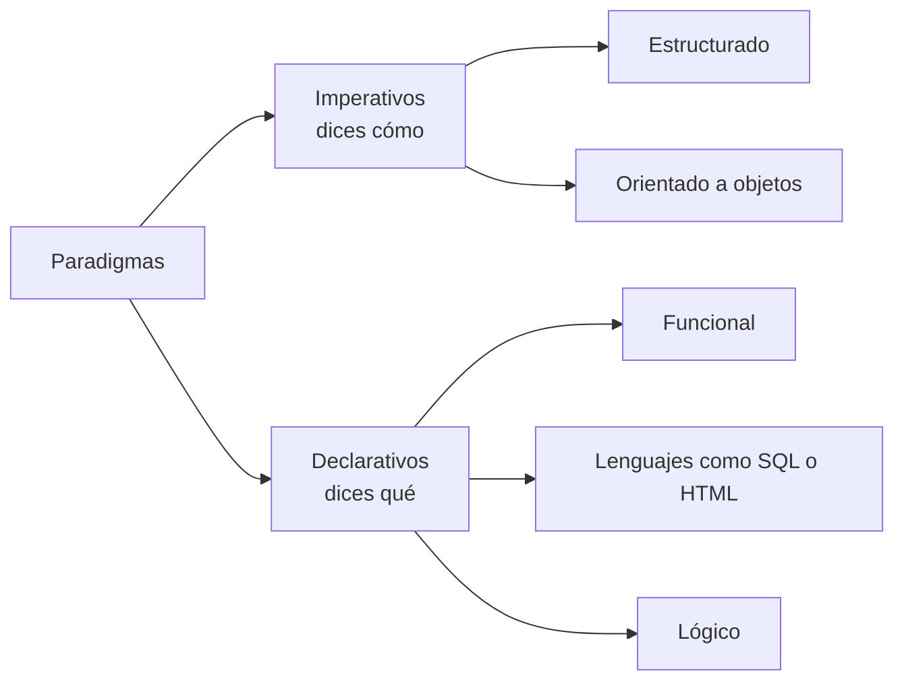
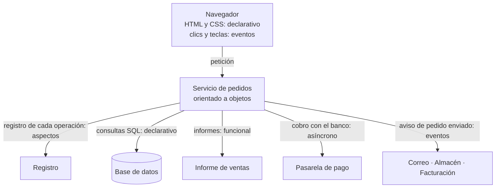
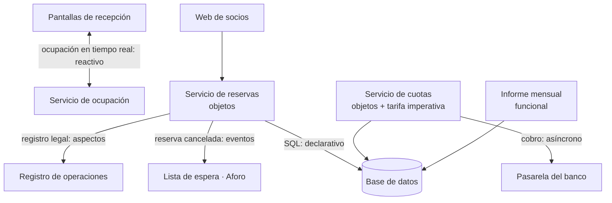

# 01.04 Paradigmas de programación

> **Versiones:** Los fragmentos de ejemplo se han comprobado con Python 3.14, Java 25, Node.js 24 y SQLite 3.46 (8 de noviembre de 2026)
> **Conviene saber antes:** [01.01 Qué es programar](01-que-es-programar.md) · [01.02 Algoritmos y pseudocódigo](02-algoritmos-y-pseudocodigo.md)
> **Tiempo estimado:** 1,5 horas
> **Nivel:** Básico · Ampliación

## Qué aprenderás

- Qué es un **paradigma de programación** y por qué existen varios.
- La gran división entre programar de forma **imperativa** (decir *cómo*) y **declarativa** (decir *qué*).
- Por qué casi todos los lenguajes modernos son **multiparadigma**.
- La idea principal de cada paradigma que te vas a encontrar: imperativo y estructurado, orientado a objetos, funcional, declarativo, concurrente y paralelo, asíncrono, orientado a eventos, reactivo y orientado a aspectos.
- A reconocer **el mismo problema resuelto en varios estilos**, en pseudocódigo y en fragmentos cortos de Python, Java, JavaScript y SQL.
- Cuándo conviene cada paradigma y cómo conviven todos en una aplicación real.

> **📌 Nota:** este módulo es de **Ampliación** y es un **mapa**. No pretende que domines ningún paradigma, sino que sepas que existen, qué idea hay detrás de cada uno y cómo reconocerlos cuando los veas. Si algo te parece abstracto, no te preocupes: puedes pasar a la fase siguiente y volver aquí más adelante. Cuando empieces el curso de un lenguaje concreto, este módulo te servirá para saber en qué estilo está escrito lo que lees.

## 1. Teoría

### 1.1. Qué es un paradigma

Un **paradigma de programación** es una **forma de pensar y de organizar** la solución de un problema. No es un lenguaje ni una herramienta: es un **estilo**, un conjunto de ideas sobre cómo conviene estructurar un programa.

Una analogía: imagina que tienes que explicarle a alguien cómo llegar a tu casa. Puedes hacerlo de varias maneras:

- Dándole **instrucciones paso a paso**: «sal del metro, gira a la derecha, sigue recto 200 metros, cruza en el segundo semáforo…».
- Dándole **la dirección** y dejando que su GPS calcule la ruta: «Calle Mayor 5».
- Diciéndole que **te avise cuando llegue** al portal y bajas a buscarle.

Las tres formas consiguen lo mismo, pero piensan el problema de manera distinta. Con los programas pasa igual: **el mismo problema se puede resolver con estilos diferentes**, y cada estilo encaja mejor en unas situaciones que en otras.

> **📌 Nota:** la palabra «paradigma» suena más complicada de lo que es. Cuando leas «paradigma funcional», puedes traducirlo mentalmente por «estilo funcional» o «forma funcional de programar». En este módulo usaremos «paradigma» y «estilo» como sinónimos.

¿Por qué hay varios y no uno solo? Porque los programas resuelven problemas muy distintos. No es lo mismo calcular la tarifa de un aparcamiento que gestionar los miles de clientes de un banco, responder a los clics de una página web o consultar millones de pedidos guardados. A lo largo de los años, los programadores han ido encontrando formas de pensar que hacen más fáciles ciertos tipos de problemas, y a esas formas se les ha dado un nombre.

### 1.2. La gran división: imperativo frente a declarativo

Antes de ver los paradigmas uno a uno, conviene conocer la diferencia más importante entre ellos:

- **Programación imperativa:** le dices al ordenador **cómo** hacer las cosas, paso a paso, en qué orden y qué variables cambiar. Es lo que has hecho en los algoritmos del [módulo de algoritmos y pseudocódigo](02-algoritmos-y-pseudocodigo.md): `LEER`, asignar con `←`, `SI`, `MIENTRAS`, `PARA`…
- **Programación declarativa:** le dices al ordenador **qué** resultado quieres, y es él quien decide cómo conseguirlo.

La analogía clásica es la del taxi:

| | Imperativo | Declarativo |
|---|---|---|
| En el taxi | «Siga recto, a la izquierda en la segunda, después a la derecha…» | «A la Plaza Mayor, por favor» |
| Quién decide el recorrido | Tú | El taxista |
| Qué necesitas saber | El camino exacto | Solo el destino |
| Si hay un atasco | Tienes que improvisar otra ruta | El taxista lo resuelve |

Ninguna de las dos es mejor siempre. Lo declarativo es más corto y más fácil de leer, pero necesitas que **alguien** (el taxista, el motor de una base de datos, el navegador, una hoja de cálculo) sepa resolver el «cómo» por ti. Lo imperativo da más control, a cambio de más trabajo y más detalles en los que equivocarse.

Ya usas cosas declarativas sin saberlo. Cuando en una hoja de cálculo escribes `=SUMA(B2:B10)`, no le dices que empiece por B2, que vaya bajando y que vaya sumando: le dices **qué** quieres (la suma de esas celdas), y la hoja se ocupa del resto.

Casi todos los paradigmas que vas a ver se pueden situar a un lado o a otro de esta división, o tienen un poco de los dos:



El diagrama dice que los paradigmas se reparten en dos familias: los **imperativos** (el estructurado y, en general, el orientado a objetos) y los **declarativos** (el funcional, lenguajes como SQL o HTML y el lógico). Los demás estilos del módulo (concurrente, asíncrono, eventos, reactivo, aspectos) no están en el diagrama porque responden a otra pregunta: no tanto *cómo describes el cálculo* como *cuándo y en qué orden pasan las cosas*. Se pueden combinar con cualquiera de las dos familias.

> **📌 Nota:** la frontera no es una línea perfecta. Un mismo programa orientado a objetos puede tener partes muy funcionales, y el estilo funcional se considera declarativo porque describe transformaciones en lugar de pasos. Lo importante es la pregunta de fondo: **¿estoy describiendo el camino o el destino?**

### 1.3. Casi todos los lenguajes son multiparadigma

Algunos lenguajes están pensados para un único paradigma. Por ejemplo, **Haskell** es casi puramente funcional, y **Prolog** es un lenguaje de programación lógica. Pero la mayoría de los lenguajes que se usan hoy en el trabajo permiten **combinar varios estilos** en el mismo programa: se llaman lenguajes **multiparadigma**.

| Lenguaje | Estilos que admite |
|---|---|
| **Python** | Imperativo, orientado a objetos y bastante funcional; también asíncrono |
| **JavaScript** | Imperativo, orientado a objetos, funcional, orientado a eventos (las páginas web reaccionan a clics y teclas) y asíncrono |
| **Java** | Nació orientado a objetos e imperativo; en 2014 (Java 8) incorporó el estilo funcional, y tiene concurrencia desde el principio |
| **C#**, **Kotlin**, **Swift** | Orientados a objetos y funcionales a la vez, con concurrencia y asincronía |
| **SQL** | Sobre todo declarativo |

Por eso, en un programa moderno es normal encontrar objetos, bucles, cadenas de transformaciones y tareas asíncronas **conviviendo**. Aprender un lenguaje no es aprender un paradigma: es aprender qué estilos permite ese lenguaje y cómo se escriben en él. Y saber **qué estilo conviene en cada parte** es una de las cosas que distinguen a un buen programador.

> **💡 Consejo:** cuando empieces el curso de un lenguaje, fíjate en qué estilos usa cada módulo. Muchas cosas que al principio parecen «trucos del lenguaje» son, en realidad, uno de los paradigmas de este módulo.

### 1.4. Imperativo y estructurado

**La idea:** el programa es una secuencia de instrucciones que van **cambiando el estado**, es decir, el valor de las variables en cada momento. Su forma ordenada es la [programación estructurada](02-algoritmos-y-pseudocodigo.md#16-las-tres-estructuras-de-control) que ya conoces: solo secuencia, selección y repetición.

Todo el pseudocódigo que has escrito hasta ahora es imperativo y estructurado: variables como `total` o `cajas` que van cambiando vuelta a vuelta. Ese «ir cambiando variables» es la marca del estilo imperativo.

**Un poco de historia:** en los primeros lenguajes era habitual saltar de cualquier punto del programa a cualquier otro con una instrucción llamada `GOTO` («ir a»). Los programas se volvían imposibles de seguir, y se les llamaba «código espagueti». En 1968, el informático Edsger Dijkstra publicó una carta famosa titulada «Go To Statement Considered Harmful» («La instrucción GOTO se considera perjudicial»). Aquello, junto con la demostración de Böhm y Jacopini de que bastan las tres estructuras, impulsó la programación estructurada que se usa desde entonces.

**Ventajas:** es la forma más directa de pensar; se parece a cómo funciona realmente el procesador, que ejecuta una instrucción detrás de otra; da control total.

**Inconvenientes:** en programas grandes, seguir qué variable cambia dónde se vuelve difícil.

**Dónde lo verás:** en todos los lenguajes. Es la base sobre la que se apoyan los demás estilos.

### 1.5. Orientado a objetos

**La idea:** el programa se organiza en **objetos** que juntan **datos** y el **comportamiento** que actúa sobre esos datos. Un objeto «pedido» no solo guarda el importe y el destino: también **sabe responder** a preguntas como «¿tienes envío gratis?».

**La analogía:** una empresa. En lugar de un único jefe que lo hace todo, hay empleados con responsabilidades claras: la persona de contabilidad sabe hacer facturas, la del almacén sabe preparar paquetes. Nadie necesita saber cómo trabaja el otro: basta con pedirle lo que necesitas.

En pseudocódigo no hay una forma estándar de escribir objetos. En este módulo ampliamos las [convenciones del curso](02-algoritmos-y-pseudocodigo.md#15-pseudocódigo) con esta, que se apoya en los subalgoritmos que ya conoces:

```text
OBJETO Pedido
    DATOS: codigo, importe, aIslas
    SUBALGORITMO TieneEnvioGratis()
        DEVOLVER NO aIslas Y importe ≥ 5000
    FIN SUBALGORITMO
FIN OBJETO
```

Se lee así: «cada pedido tiene un código, un importe y si va a las islas, y sabe decir si tiene envío gratis». Para usarlo, **se le pregunta al pedido**:

```text
SI pedido.TieneEnvioGratis() ENTONCES
    ESCRIBIR "Este pedido no paga envío"
FIN SI
```

La regla del envío gratis queda **en un único sitio**, junto a los datos a los que se refiere. Si mañana el límite pasa de 50 € a 60 €, se cambia solo ahí.

**Ventajas:** organiza muy bien los programas grandes; cada parte tiene una responsabilidad clara; se parece a cómo describimos el mundo real (clientes, pedidos, facturas, socios, préstamos).

**Inconvenientes:** es fácil pasarse y crear capas y piezas innecesarias para problemas sencillos.

**Dónde lo verás:** es el estilo principal de lenguajes como Java, C# o Kotlin, y se usa mucho en Python y JavaScript.

### 1.6. Funcional

**La idea:** el programa se construye combinando **funciones** que reciben datos y devuelven resultados **sin modificar nada** por el camino. En lugar de un bucle que va cambiando un contador, se describe una **cadena de transformaciones**: «de estos pedidos, quédate con los de envío gratis, toma su importe y súmalos».

**La analogía:** una cadena de montaje. Cada puesto recibe una pieza, hace una única operación y la pasa al siguiente. Ningún puesto toca lo que hacen los demás.

**Las tres operaciones estrella** del estilo funcional son:

| Operación | Nombre en inglés | Qué hace | Ejemplo |
|---|---|---|---|
| **Filtrar** | *filter* | Se queda con los elementos que cumplen una condición | Los pedidos con envío gratis |
| **Transformar** | *map* | Convierte cada elemento en otra cosa | De cada pedido, su importe |
| **Reducir** | *reduce* | Combina todos los elementos en un único resultado | Sumar todos los importes |

Para escribir cadenas así en pseudocódigo usaremos flechas, un paso por línea:

```text
total ← pedidos
    → FILTRAR los que cumplen TieneEnvioGratis
    → TRANSFORMAR cada pedido en su importe
    → REDUCIR sumándolos
```

Fíjate en lo que **no** hay: ni contador, ni acumulador que inicializar, ni vueltas de bucle que contar. Desaparecen de golpe varios de los errores típicos del módulo de algoritmos (olvidar inicializar el acumulador, dar una vuelta de más…).

Dos palabras que oirás mucho junto al estilo funcional:

- **Inmutable:** un dato que, una vez creado, no cambia. En lugar de modificar una lista, se crea una lista nueva con el resultado.
- **Efecto secundario:** cualquier cosa que una función hace además de devolver su resultado: cambiar una variable de fuera, escribir en pantalla, guardar en un fichero. El estilo funcional procura que las funciones no tengan efectos secundarios, porque así se pueden entender (y probar) cada una por separado.

**Ventajas:** el código es corto y se lee casi como una frase; al no modificar datos, hay muchos menos errores, sobre todo cuando varias tareas trabajan a la vez.

**Inconvenientes:** al principio cuesta cambiar el chip si estás acostumbrado a los bucles; mal usado (cadenas larguísimas), puede ser más difícil de leer y de depurar.

**Dónde lo verás:** en casi todos los lenguajes modernos. En JavaScript y Python, filtrar y transformar listas así es el pan de cada día; en Java se hace con lo que se llama *streams*.

### 1.7. Declarativo

**La idea:** como viste en el [apartado 1.2](#12-la-gran-división-imperativo-frente-a-declarativo), describir **qué** quieres, no **cómo** conseguirlo. Además de ser un rasgo de otros paradigmas (el funcional es bastante declarativo), hay **lenguajes enteros** que son declarativos, y los vas a usar mucho:

| Lenguaje | Qué declaras | Quién decide el «cómo» |
|---|---|---|
| **SQL** | Qué datos quieres de una base de datos | El motor de la base de datos |
| **HTML** | Qué contenido tiene una página web (un título, un párrafo, una tabla) | El navegador |
| **CSS** | Qué aspecto tiene ese contenido (colores, tamaños, márgenes) | El navegador |
| **Fórmulas de una hoja de cálculo** | Qué valor tiene una celda | La hoja de cálculo |

También es declarativa mucha **configuración**: en lugar de programar paso a paso cómo preparar algo, se escribe en un fichero qué se quiere y una herramienta se ocupa del resto. Lo verás con formatos como JSON y YAML en la fase 4 («Formatos y diagramas»).

**Ventajas:** lo más corto y legible; el motor suele saber hacerlo de forma mucho más eficiente que tú (una base de datos sabe buscar entre millones de filas).

**Inconvenientes:** necesitas un motor que sepa resolver ese problema; y si no entiendes un poco lo que hace por debajo, puedes pedirle cosas que le cuestan muchísimo (lo verás en los [errores típicos](#36-creer-que-lo-declarativo-es-magia)).

### 1.8. Concurrente y paralelo

**La idea:** hacer **varias cosas a la vez** en lugar de una detrás de otra. Por ejemplo, consultar tres almacenes al mismo tiempo en vez de esperar a que conteste el primero para preguntar al segundo.

Hay dos ideas relacionadas que conviene distinguir:

- **Concurrencia:** gestionar varias tareas **en el mismo periodo de tiempo**, aunque no avancen exactamente en el mismo instante. Es un camarero que atiende varias mesas: toma nota en una, lleva un plato a otra, cobra en la tercera. Ninguna mesa espera a que las demás hayan terminado de comer.
- **Paralelismo:** ejecutar varias tareas **literalmente al mismo tiempo**, en varios núcleos del procesador (un procesador moderno tiene varios «cerebros» que trabajan a la vez). Son varios camareros, cada uno atendiendo su mesa.

Cada una de esas líneas de trabajo independientes dentro de un programa se suele llamar **hilo** (*thread*).

**Ventajas:** los programas aprovechan mucho mejor el tiempo, sobre todo cuando hay **esperas** (la red, el disco, una base de datos), y aprovechan los procesadores de varios núcleos.

**Inconvenientes:** es uno de los temas más difíciles de la programación. Cuando varias tareas tocan **los mismos datos** a la vez, aparecen errores que solo ocurren algunas veces, según quién llegue antes, y que son muy difíciles de reproducir. Imagina dos cajeros vendiendo a la vez la última entrada de un concierto: si nadie coordina, la venden dos veces.

> **📌 Nota:** aquí basta con la idea. Cómo se programa la concurrencia depende mucho de cada lenguaje, y la verás en el curso del lenguaje que elijas.

### 1.9. Asíncrono

**La idea:** lanzar una tarea que tarda (cobrar con tarjeta, descargar un fichero, pedir datos a otro servidor) y **seguir haciendo otras cosas** mientras tanto, indicando qué hacer **cuando termine**.

**La analogía:** el avisador que te dan en algunos restaurantes de comida rápida. Pides, te dan el aparato y te vas a sentar. No te quedas plantado en el mostrador: cuando tu comida está lista, el aparato vibra.

Lo contrario es la forma **síncrona** o **bloqueante**: pides y esperas de pie, sin hacer nada más, hasta que te dan la comida.

Lo importante es que el orden en que **escribes** las instrucciones ya no es el orden en que **ocurren** las cosas: un mensaje escrito después del cobro puede salir antes que la confirmación del banco. Lo verás funcionando en el [ejemplo 2.7](#27-asíncrono-un-pago-que-no-bloquea-la-web).

**Dónde lo verás:** en todo lo que habla con la red. Las páginas web lo usan constantemente (por eso no se congelan mientras cargan datos), y casi todos los lenguajes modernos tienen palabras para ello (en JavaScript, Python, C# y otros verás `async` y `await`).

### 1.10. Orientado a eventos

**La idea:** el programa no sigue un camino fijo de principio a fin, sino que **reacciona a lo que ocurre**: un clic, una tecla, un mensaje que llega, un pedido que se envía. Cada una de esas cosas que ocurren es un **evento**. Cada parte del programa se **suscribe** a los eventos que le interesan y actúa cuando suceden.

**La analogía:** el timbre de casa. No te pasas el día mirando por la mirilla: sigues con tus cosas y, cuando alguien llama, reaccionas.

```text
// Una parte del programa se suscribe al evento
CUANDO OCURRA "pedido enviado" CON pedido HACER
    EnviarCorreoAlCliente(pedido)
FIN CUANDO

// Otra parte, la que envía el pedido, solo anuncia lo que ha pasado
AVISAR "pedido enviado" CON pedido
```

**Ventajas:** las partes del programa quedan muy **independientes**: quien provoca el evento no necesita saber quién reaccionará ni cómo. Si mañana hay que mandar también un SMS al enviar un pedido, se añade otra suscripción **sin tocar** la parte que avisa.

**Inconvenientes:** como nada sigue un camino fijo, a veces cuesta saber qué pasará cuando ocurra algo, y en qué orden.

**Dónde lo verás:** es la base de las páginas web y de las aplicaciones con ventanas y botones (nada pasa hasta que el usuario hace algo), y de los sistemas en los que varios programas se mandan mensajes.

### 1.11. Reactivo

**La idea:** trabajar con **flujos de datos que llegan a lo largo del tiempo** (mensajes de un chat, precios de la bolsa, lecturas de un sensor) y definir cómo se transforman y a quién llegan, de forma que todo se actualiza **automáticamente** cuando llega un dato nuevo.

**La analogía:** una hoja de cálculo. Si la celda C1 contiene `=A1+B1`, en cuanto cambias A1, C1 se recalcula sola. No tienes que ordenarle que lo haga: la relación está declarada y los cambios se propagan.

Combina ideas de otros estilos: del funcional (transformar flujos con filtrar y transformar), del asíncrono (no quedarse esperando) y del orientado a eventos (reaccionar a lo que llega).

**Dónde lo verás:** en aplicaciones con muchísimos usuarios a la vez y datos que llegan sin parar, y en las respuestas de los asistentes de inteligencia artificial que aparecen poco a poco, palabra a palabra. Es un estilo avanzado: aquí basta con que te suene.

### 1.12. Orientado a aspectos

**La idea:** hay tareas que se repiten en muchísimas partes de un programa sin ser su objetivo principal: **registrar lo que pasa** (lo que se llama *log*), medir tiempos, comprobar permisos. Se llaman **tareas transversales**, porque «atraviesan» todo el programa. La programación orientada a aspectos permite escribir esas tareas **una sola vez**, aparte, e indicar a qué partes del programa se aplican.

**La analogía:** el control de seguridad de un aeropuerto. Cada aerolínea se ocupa de sus vuelos, pero ninguna tiene que montar su propio arco detector: hay un único control que se aplica a todos los pasajeros, sea cual sea su vuelo.

Sin aspectos, si hay que registrar cuándo empieza y termina cada operación, cada uno de los cientos de subalgoritmos de una aplicación lleva sus dos líneas de registro, y basta con olvidarlas en uno para que el registro quede incompleto. Con aspectos, el registro se escribe **una sola vez**, con una regla que dice a qué operaciones se aplica.

**Dónde lo verás:** no se suele programar «en aspectos» desde cero, pero muchas herramientas profesionales lo usan por dentro. Cuando en un curso veas que basta con poner una marca encima de un trozo de código para que «se registre» o «se compruebe el permiso», casi siempre hay aspectos detrás.

### 1.13. Otros estilos que oirás nombrar

Para que tengas el mapa completo, dos más:

- **Genérico:** escribir código que funciona con **cualquier tipo de dato** sin repetirlo para cada uno. Por ejemplo, un único «ordenar una lista» que sirve para listas de números, de nombres o de fechas. La analogía es un **molde de repostería**: el mismo molde sirve para un bizcocho de chocolate o de limón; lo que cambia es la masa. Es muy importante en lenguajes como Java, C# o TypeScript, que comprueban los tipos de los datos antes de ejecutar.
- **Lógico:** se describen **hechos y reglas** («Ana es madre de Luis», «la madre de mi madre es mi abuela»), y el programa **deduce** las respuestas a las preguntas que le haces («¿quién es la abuela de Luis?»). El lenguaje más conocido es **Prolog**, usado en investigación y en la inteligencia artificial clásica. Es muy declarativo y poco frecuente en el trabajo diario.

### 1.14. Cómo conviven en una aplicación real

En un proyecto profesional no se elige **un** paradigma: se usan **varios a la vez**, cada uno donde encaja mejor. Esta es la estructura simplificada de una tienda online:



El diagrama dice esto: el navegador muestra la tienda con HTML y CSS (declarativos) y reacciona a los clics (eventos); el servicio de pedidos está organizado en objetos; consulta la base de datos con SQL (declarativo); calcula los informes con estilo funcional; cobra con el banco de forma asíncrona; avisa al correo, al almacén y a facturación con eventos, y cada operación queda registrada gracias a los aspectos.

Cada parte usa el estilo que mejor resuelve su problema:

- Los **objetos** organizan el programa en piezas con responsabilidades claras.
- **SQL** consulta los datos de forma declarativa.
- El estilo **funcional** calcula informes a partir de listas de pedidos.
- La llamada al banco es **asíncrona**, para no congelar la web mientras se cobra.
- Los **eventos** avisan al correo, al almacén y a facturación sin que el servicio de pedidos dependa de ellos.
- Los **aspectos** registran cada operación sin ensuciar el código de cada una.

Y **por debajo de todo**, dentro de cada pieza, sigue habiendo código **imperativo y estructurado**: condiciones, bucles y asignaciones. Los demás paradigmas no sustituyen esa base: se apoyan en ella.

### 1.15. Cuándo conviene cada uno

| Paradigma | Encaja bien cuando… | Ejemplo típico |
|---|---|---|
| **Imperativo** | El algoritmo es sencillo o necesitas control fino paso a paso | Un cálculo con varias condiciones, la tarifa de un aparcamiento |
| **Orientado a objetos** | Hay muchos conceptos del mundo real con datos y reglas propias | Clientes, pedidos, facturas, préstamos de una biblioteca |
| **Funcional** | Hay que procesar colecciones de datos: filtrar, transformar, agrupar, sumar | Informes, estadísticas, preparar datos para mostrarlos |
| **Declarativo** | Existe un motor que sabe resolver el «cómo» | Consultas a bases de datos, páginas web, configuración |
| **Concurrente / paralelo** | Hay tareas independientes con esperas, o cálculos muy pesados | Consultar varios servicios a la vez, procesar millones de registros |
| **Asíncrono** | Una tarea tarda y no quieres que todo se detenga mientras | Pagos, envío de correos, pedir datos a otro servidor |
| **Orientado a eventos** | Varias partes deben reaccionar a algo sin depender unas de otras | Botones de una web, avisos cuando cambia un pedido |
| **Reactivo** | Llegan flujos continuos de datos y hay muchísimos usuarios a la vez | Chats, cotizaciones en tiempo real, respuestas de una IA que llegan poco a poco |
| **Aspectos** | Una tarea se repite en muchos sitios sin ser el objetivo de ninguno | Registro de actividad, comprobar permisos |

## 2. Ejemplos de código

> **📌 Nota:** en este módulo vas a ver fragmentos cortos en **Python**, **Java**, **JavaScript** y **SQL**. Están aquí solo para que **compares estilos**: no hace falta que entiendas cada línea, ni que los ejecutes, ni que sepas esos lenguajes. Fíjate en la **forma** de cada solución. Cada fragmento y su salida se han comprobado ejecutándolos de verdad.

### 2.1. El problema común: pedidos con envío gratis

**Situación real:** una librería online quiere saber, a final del día, **cuántos pedidos han tenido envío gratis y cuánto suman**. La regla: el envío es gratis para los pedidos a la **península** de **50 € o más**; a las islas nunca es gratis. Los pedidos del día son:

| Pedido | Importe | Destino | ¿Envío gratis? |
|---|---|---|---|
| P-101 | 45,90 € | Península | No (menos de 50 €) |
| P-102 | 187,50 € | Península | **Sí** |
| P-103 | 150,00 € | Islas | No (a las islas nunca) |
| P-104 | 12,50 € | Islas | No |
| P-105 | 50,00 € | Península | **Sí** (50 € justos) |

**Resultado esperado:** 2 pedidos, que suman 237,50 €. Como en los módulos anteriores, los importes se manejan **en céntimos** (4590 en lugar de 45,90) para evitar errores de redondeo con los decimales; así que el total esperado es **23750 céntimos**.

Fíjate en que la tabla ya es un pequeño conjunto de **casos de prueba**, como los del [módulo «Probar un programa»](03-probar-un-programa.md#14-qué-casos-elegir-normales-límite-y-no-válidos): hay un caso normal (P-102), un caso justo en el límite (P-105, 50 € exactos), uno justo por debajo (P-101) y uno que falla por otra condición (P-103, mucho importe pero a las islas).

Vas a ver este mismo problema resuelto en **cuatro estilos**. Los cuatro dan exactamente el mismo resultado.

### 2.2. Estilo imperativo

Los datos están en dos listas paralelas (la posición 0 de cada lista corresponde al primer pedido, la 1 al segundo…), y un bucle recorre los pedidos uno a uno, con un **contador** y un **acumulador**, como en el módulo de algoritmos.

**Pseudocódigo:**

```text
ALGORITMO PedidosConEnvioGratis
    ENTRADA: importes de los pedidos (en céntimos) y si van a las islas
    SALIDA: cuántos tienen envío gratis y cuánto suman

    CONSTANTE MINIMO_GRATIS ← 5000          // 50 € en céntimos

INICIO
    cuantos ← 0                             // contador
    total ← 0                               // acumulador
    PARA i DESDE 0 HASTA número de pedidos - 1 HACER
        SI NO aIslas[i] Y importes[i] ≥ MINIMO_GRATIS ENTONCES
            cuantos ← cuantos + 1
            total ← total + importes[i]
        FIN SI
    FIN PARA
    ESCRIBIR "Pedidos con envío gratis: ", cuantos
    ESCRIBIR "Importe total: ", total, " céntimos"
FIN
```

`importes[i]` es el elemento de la posición `i` de la lista `importes`, con la notación de las [listas del módulo de algoritmos](02-algoritmos-y-pseudocodigo.md#listas-y-datos-con-partes): como la primera posición es la 0, el bucle va de 0 al número de pedidos menos uno.

**En Python.** No hace falta que entiendas cada línea: fíjate en que tiene la misma forma que el pseudocódigo (dos variables que empiezan en 0, un bucle, una condición y dos sumas).

```python
# Estilo imperativo: paso a paso, con un contador y un acumulador
importes = [4590, 18750, 15000, 1250, 5000]     # en céntimos
a_islas = [False, False, True, True, False]

cuantos = 0
total = 0
for i in range(len(importes)):
    if not a_islas[i] and importes[i] >= 5000:
        cuantos = cuantos + 1
        total = total + importes[i]

print("Pedidos con envío gratis:", cuantos)
print("Importe total:", total, "céntimos")
```

**Salida:**

```text
Pedidos con envío gratis: 2
Importe total: 23750 céntimos
```

**Fíjate en que:** el código dice exactamente **cómo** hacerlo: recorrer las posiciones una a una, mirar la condición, sumar uno al contador, ir acumulando. Funciona, pero los datos de un pedido están **desperdigados** en dos listas, y la regla del envío gratis está escrita **en medio del bucle**. Si mañana hiciera falta en otro sitio (en la factura, en la web…), habría que copiarla, y con ella el riesgo de cambiarla en un sitio y olvidarla en otro.

### 2.3. Estilo orientado a objetos

Ahora cada pedido es un **objeto** como el `OBJETO Pedido` del [apartado 1.5](#15-orientado-a-objetos): reúne sus datos (código, importe y destino) y además **sabe responder** si tiene envío gratis.

**Pseudocódigo**, con ese objeto:

```text
ALGORITMO PedidosConEnvioGratis
    ENTRADA: la lista de pedidos
    SALIDA: cuántos tienen envío gratis y cuánto suman

INICIO
    cuantos ← 0
    total ← 0
    PARA cada pedido DE pedidos HACER
        SI pedido.TieneEnvioGratis() ENTONCES       // se le pregunta al pedido
            cuantos ← cuantos + 1
            total ← total + pedido.importe
        FIN SI
    FIN PARA
    ESCRIBIR "Pedidos con envío gratis: ", cuantos
    ESCRIBIR "Importe total: ", total, " céntimos"
FIN
```

**En Java.** No hace falta que entiendas cada línea: fíjate en la parte de arriba (`record Pedido`), que es el «molde» de los pedidos con sus datos y su regla, y en la línea `pedido.tieneEnvioGratis()`, donde se le pregunta al pedido.

```java
// Estilo orientado a objetos: cada pedido sabe si tiene envío gratis
record Pedido(String codigo, int importe, boolean aIslas) {

    boolean tieneEnvioGratis() {
        return !aIslas && importe >= 5000;
    }
}

void main() {
    List<Pedido> pedidos = List.of(
            new Pedido("P-101", 4590, false),
            new Pedido("P-102", 18750, false),
            new Pedido("P-103", 15000, true),
            new Pedido("P-104", 1250, true),
            new Pedido("P-105", 5000, false));

    int cuantos = 0;
    int total = 0;
    for (Pedido pedido : pedidos) {
        if (pedido.tieneEnvioGratis()) {        // se le pregunta al pedido
            cuantos = cuantos + 1;
            total = total + pedido.importe();
        }
    }
    IO.println("Pedidos con envío gratis: " + cuantos);
    IO.println("Importe total: " + total + " céntimos");
}
```

**Salida:**

```text
Pedidos con envío gratis: 2
Importe total: 23750 céntimos
```

**Fíjate en que:** el bucle sigue siendo imperativo (contador y acumulador), pero ahora **se le pregunta al pedido** en lugar de comprobar la regla desde fuera. La regla vive en **un único sitio**, junto a los datos a los que se refiere: si cambia el límite de 50 €, se cambia solo ahí, y cualquier parte del programa que trabaje con pedidos la usará automáticamente. Además, los datos de cada pedido ya no están desperdigados: cada pedido es una pieza completa.

### 2.4. Estilo funcional

Con los mismos pedidos, el cálculo se escribe como una **cadena de transformaciones**, sin bucles escritos a mano ni variables que vayan cambiando.

**Pseudocódigo:**

```text
gratis ← pedidos
    → FILTRAR los que cumplen TieneEnvioGratis

total ← gratis
    → TRANSFORMAR cada pedido en su importe
    → REDUCIR sumándolos

ESCRIBIR "Pedidos con envío gratis: ", número de elementos de gratis
ESCRIBIR "Importe total: ", total, " céntimos"
```

**En JavaScript.** No hace falta que entiendas cada línea: fíjate en las tres palabras `filter` (filtrar), `map` (transformar) y `reduce` (reducir), una por paso de la cadena.

```javascript
// Estilo funcional: una cadena de transformaciones, sin variables que cambien
const pedidos = [
  { codigo: "P-101", importe: 4590, aIslas: false },
  { codigo: "P-102", importe: 18750, aIslas: false },
  { codigo: "P-103", importe: 15000, aIslas: true },
  { codigo: "P-104", importe: 1250, aIslas: true },
  { codigo: "P-105", importe: 5000, aIslas: false },
];

const tieneEnvioGratis = (p) => !p.aIslas && p.importe >= 5000;

const gratis = pedidos.filter(tieneEnvioGratis);          // filtrar
const total = gratis
  .map((p) => p.importe)                                  // transformar
  .reduce((suma, importe) => suma + importe, 0);          // reducir

console.log("Pedidos con envío gratis:", gratis.length);
console.log("Importe total:", total, "céntimos");
```

**Salida:**

```text
Pedidos con envío gratis: 2
Importe total: 23750 céntimos
```

**Fíjate en que:** el total se lee casi como una frase: «de los pedidos, **filtra** los de envío gratis, **transforma** cada uno en su importe y **redúcelos** sumándolos». No hay contador ni acumulador que inicializar a mano, ni ninguna vuelta de bucle que se pueda dar de más. Y todas las variables (`const`) se crean una vez y **no cambian**: la lista `pedidos` sigue intacta al final.

### 2.5. Estilo declarativo

En una aplicación real, los pedidos estarían guardados en una **base de datos** (un programa especializado en guardar y consultar datos de forma organizada), y la pregunta se haría en **SQL**, el lenguaje declarativo de las bases de datos. Supón una tabla `pedidos` con una fila por pedido y las columnas `codigo`, `importe` (en céntimos) y `destino` (`'peninsula'` o `'islas'`).

**En «pseudocódigo» declarativo** no hay pasos, solo la descripción del resultado:

```text
QUIERO: cuántos pedidos hay y la suma de sus importes,
        de los pedidos con destino península e importe de 5000 céntimos o más
```

**En SQL.** No hace falta que entiendas cada línea: fíjate en que la consulta es casi la frase de arriba, en inglés: «selecciona la cuenta y la suma de importes, de la tabla pedidos, donde el destino sea península y el importe sea de 5000 o más».

```sql
SELECT COUNT(*) AS pedidos_gratis, SUM(importe) AS total
FROM pedidos
WHERE destino = 'peninsula' AND importe >= 5000;
```

**Resultado:**

| pedidos_gratis | total |
|---|---|
| 2 | 23750 |

**Fíjate en que:** aquí no hay **ningún** paso. No dices cómo recorrer la tabla, ni en qué orden, ni dónde guardar el total: solo describes el resultado que quieres. El motor de la base de datos decide cómo obtenerlo, y puede hacerlo de forma muy eficiente aunque haya millones de pedidos.

> **📌 Nota:** esta consulta se ha comprobado con una base de datos SQLite real con los mismos cinco pedidos. Qué es una base de datos lo verás en el módulo «Qué es una base de datos» (fase 6).

### 2.6. Comparación de los cuatro estilos

| | Imperativo (Python) | Orientado a objetos (Java) | Funcional (JavaScript) | Declarativo (SQL) |
|---|---|---|---|---|
| Qué describes | Cómo, paso a paso | Objetos con datos y reglas | Una cadena de transformaciones | Solo el resultado |
| Dónde vive la regla del envío gratis | En el bucle | En el pedido | En una función aparte | En la consulta |
| Variables que cambian | Contador y acumulador | Contador y acumulador | Ninguna | Ninguna |
| Lo mejor | Control total, fácil de seguir | Organización, la regla en un solo sitio | Corto, menos errores | Lo más corto; el motor se encarga |

Los cuatro dan el mismo resultado. La diferencia está en lo fácil que es **leerlos**, **modificarlos** y **equivocarse** con ellos.

> **⚠️ Cuidado:** no saques la conclusión de que «Python es imperativo» o «JavaScript es funcional». Se ha elegido un lenguaje distinto para cada estilo solo para que veas variedad. Los cuatro estilos se pueden escribir en Python, en JavaScript y en Java (el SQL es otra cosa: es un lenguaje solo para bases de datos). Eso es justo lo que significa que sean [multiparadigma](#13-casi-todos-los-lenguajes-son-multiparadigma).

### 2.7. Asíncrono: un pago que no bloquea la web

**Situación real:** cuando el cliente pulsa «Pagar», la tienda tiene que llamar al banco, que tarda un poco en responder. Mientras tanto, la web no debe quedarse congelada.

**Pseudocódigo:**

```text
ESCRIBIR "1. El cliente pulsa «Pagar»"
LANZAR CobrarConTarjeta(4590)
    Y CUANDO TERMINE CON referencia: ESCRIBIR "3. Pago confirmado con referencia ", referencia
ESCRIBIR "2. Mientras tanto, la web muestra «Procesando el pago...»"
```

**En JavaScript.** No hace falta que entiendas cada línea: fíjate en que `cobrarConTarjeta` simula un banco que tarda 300 milisegundos, y en que `.then(...)` dice qué hacer **cuando** el banco responda.

```javascript
// Estilo asíncrono: lanzar una tarea lenta y decir qué hacer cuando termine
function cobrarConTarjeta(importe) {
  // Simula la llamada al banco, que tarda 300 milisegundos en responder
  return new Promise((responder) => setTimeout(() => responder("TX-" + importe), 300));
}

console.log("1. El cliente pulsa «Pagar»");
cobrarConTarjeta(4590)
  .then((referencia) => console.log("3. Pago confirmado con referencia " + referencia));
console.log("2. Mientras tanto, la web muestra «Procesando el pago...»");
```

**Salida:**

```text
1. El cliente pulsa «Pagar»
2. Mientras tanto, la web muestra «Procesando el pago...»
3. Pago confirmado con referencia TX-4590
```

**Fíjate en el orden de la salida:** el mensaje 2 aparece **antes** que el 3, aunque en el código el cobro se escribe antes. El programa lanza el cobro y **sigue adelante sin esperar**; el mensaje 3 se escribe cuando el banco responde, unas décimas de segundo después. Es el avisador del restaurante: pides, te sientas, y te avisan cuando está listo.

### 2.8. Concurrente: consultar tres almacenes a la vez

**Situación real:** antes de confirmar un pedido, la tienda consulta las existencias de un libro en sus tres almacenes (Madrid, Sevilla y Zaragoza). Cada consulta viaja por la red y tarda **medio segundo**.

**Una detrás de otra** (secuencial):

```text
stockMadrid ← ConsultarAlmacen("Madrid")        // medio segundo esperando
stockSevilla ← ConsultarAlmacen("Sevilla")      // otro medio segundo
stockZaragoza ← ConsultarAlmacen("Zaragoza")    // y otro más
```

**A la vez** (concurrente):

```text
A LA VEZ HACER
    stockMadrid ← ConsultarAlmacen("Madrid")
    stockSevilla ← ConsultarAlmacen("Sevilla")
    stockZaragoza ← ConsultarAlmacen("Zaragoza")
ESPERAR A QUE TERMINEN TODAS
```

| Forma | Tiempo aproximado | Por qué |
|---|---|---|
| Una detrás de otra | 1,5 segundos | Tres esperas de medio segundo, sumadas |
| A la vez | 0,5 segundos | Las tres esperas ocurren al mismo tiempo; manda la más lenta |

**Fíjate en que:** la ganancia sale de que las tres consultas son **independientes** (ninguna necesita el resultado de otra) y de que casi todo su tiempo es **esperar** a la red. Si una consulta necesitara el resultado de la anterior, no se podrían hacer a la vez. Lo practicarás en el [ejercicio 7](#ejercicio-7--qué-se-puede-hacer-a-la-vez).

> **📌 Nota:** `OBJETO`, las cadenas con `→`, `LANZAR`, `CUANDO OCURRA`, `AVISAR` y `A LA VEZ` amplían las [convenciones de pseudocódigo del curso](02-algoritmos-y-pseudocodigo.md#15-pseudocódigo) solo en este módulo, para que veas la idea de cada estilo. Cada lenguaje los escribe a su manera.

## 3. Errores típicos

### 3.1. Creer que hay un paradigma mejor que todos los demás

**Qué pasa:** después de aprender un estilo nuevo, se intenta usarlo para todo. Por ejemplo, se reescriben como cadenas funcionales algoritmos que con un bucle sencillo se entendían mucho mejor, o se crean objetos para un cálculo de tres líneas.

**Por qué ocurre:** cada paradigma tiene defensores entusiastas, y en internet abundan las opiniones del tipo «la orientación a objetos está muerta» o «los bucles son de otra época».

**Cómo evitarlo:** pregúntate siempre qué estilo hace el código **más fácil de leer y de mantener** para ese problema concreto. Como viste en el [apartado 1.14](#114-cómo-conviven-en-una-aplicación-real), en un proyecto real conviven varios.

### 3.2. Confundir el lenguaje con el paradigma

**Qué pasa:** se dice «Python es imperativo», «Java es orientado a objetos» o «JavaScript es funcional», como si cada lenguaje solo admitiera un estilo.

**Por qué ocurre:** cada lenguaje tiene un estilo **favorito** o con el que nació, y los cursos suelen empezar por él.

**Cómo evitarlo:** recuerda que casi todos los lenguajes modernos son [multiparadigma](#13-casi-todos-los-lenguajes-son-multiparadigma). El paradigma lo eliges tú al escribir **cada parte** del programa; el lenguaje solo pone más fácil o más difícil un estilo u otro.

### 3.3. Mezclar estilos sin entender sus reglas

**Qué pasa:** se combina un estilo con las costumbres de otro y el resultado es confuso o directamente no funciona. El caso más típico: dentro de una cadena funcional (que no debería cambiar nada de fuera) se va modificando un acumulador, como en un bucle imperativo.

```text
total ← 0
pedidos
    → FILTRAR los que cumplen TieneEnvioGratis
    → PARA CADA UNO: total ← total + pedido.importe     // ¡mezcla!
```

**Por qué ocurre:** al pasar de un estilo a otro, se arrastran las costumbres del primero.

**Por qué es un problema:** el estilo funcional da por hecho que cada paso no toca nada de fuera. Algunos lenguajes directamente lo prohíben y dan un error; otros lo permiten, pero el código ya no tiene las ventajas de ninguno de los dos estilos, y si esos pasos llegan a ejecutarse a la vez (concurrencia), el total puede salir mal.

**Cómo se arregla:** o el estilo funcional completo (`→ TRANSFORMAR en su importe → REDUCIR sumándolos`, como en el [ejemplo 2.4](#24-estilo-funcional)), o un bucle imperativo normal (como en el [ejemplo 2.2](#22-estilo-imperativo)). Lo que no conviene es la mezcla.

### 3.4. Usar concurrencia sin necesidad

**Qué pasa:** se lanzan tareas a la vez «para que vaya más rápido» y el programa no mejora, o empieza a fallar de vez en cuando sin motivo aparente.

**Por qué ocurre:** la concurrencia solo ayuda cuando hay tareas **independientes** que **esperan** algo (red, disco) o cálculos realmente pesados. Para tareas cortas, organizar las tareas cuesta más de lo que se gana. Y cuando varias tareas modifican los mismos datos a la vez, aparecen errores que solo se manifiestan algunas veces, los más difíciles de encontrar.

**Cómo evitarlo:** empieza siempre con código secuencial (una cosa detrás de otra). Introduce concurrencia solo cuando hayas comprobado que hay un problema de tiempo y que las tareas son independientes.

### 3.5. Crear objetos y capas para todo

**Qué pasa:** para un problema de diez líneas se crean cinco tipos de objetos, varias capas y relaciones entre ellos. El código resultante es más difícil de entender que el problema.

**Por qué ocurre:** la orientación a objetos invita a modelar, y es fácil confundir «más estructura» con «mejor diseño».

**Cómo evitarlo:** la estructura debe ser **proporcional** al problema. Hay un principio que lo resume, muy citado entre programadores: *YAGNI* (*You Aren't Gonna Need It*, «no lo vas a necesitar»). No añadas complejidad pensando en necesidades que quizá nunca lleguen.

### 3.6. Creer que lo declarativo es magia

**Qué pasa:** como en SQL basta con decir **qué** se quiere, se escribe sin pensar en lo que ocurre por debajo, y la aplicación se vuelve lentísima cuando crecen los datos.

**Por qué ocurre:** el «cómo» lo resuelve el motor, pero **sigue existiendo**. Una consulta mal planteada puede obligar a la base de datos a revisar millones de filas, una por una, cada vez que alguien abre una página.

**Cómo evitarlo:** aprende también, aunque sea por encima, qué hay debajo de las herramientas declarativas que uses. Que el taxista elija la ruta no quiere decir que todas las rutas tarden lo mismo.

### 3.7. Confundir concurrente, paralelo y asíncrono

**Qué pasa:** se usan como sinónimos, y en una conversación con otros programadores (o en una entrevista de trabajo) genera confusión.

**La diferencia, en una frase cada uno:**

- **Concurrente:** varias tareas en curso en el mismo periodo de tiempo (un camarero con varias mesas).
- **Paralelo:** varias tareas ejecutándose literalmente en el mismo instante, en varios núcleos (varios camareros).
- **Asíncrono:** lanzar una tarea y no quedarse esperando; te avisan al terminar (el avisador del restaurante).

Un programa asíncrono suele ser concurrente, pero no necesariamente paralelo: un solo camarero puede trabajar de forma asíncrona. De hecho, el [ejemplo 2.7](#27-asíncrono-un-pago-que-no-bloquea-la-web) es asíncrono y JavaScript lo ejecuta con un único hilo.

## 4. Buenas prácticas

- **Elige el estilo según el problema**, no según la moda ni la costumbre. La tabla del [apartado 1.15](#115-cuándo-conviene-cada-uno) es un buen punto de partida.
- **Dentro de una misma parte del programa, sé coherente.** Mezclar en el mismo trozo un bucle imperativo, una cadena funcional y una tarea asíncrona sin motivo hace el código difícil de seguir.
- **Usa objetos para organizar** el programa: qué conceptos hay y qué responsabilidades tiene cada uno. Pon cada regla **junto a los datos** a los que se refiere.
- **Usa el estilo funcional para procesar colecciones:** filtrar, transformar, agrupar y sumar.
- **Prefiere los datos que no cambian** (inmutables) siempre que puedas: evitan muchos errores, especialmente cuando hay varias tareas a la vez.
- **Empieza por lo sencillo y secuencial.** Añade concurrencia, asincronía o eventos cuando haya una razón concreta.
- **Conoce lo que hay debajo de lo declarativo:** que el motor resuelva el «cómo» no te exime de entenderlo un poco.
- **Piensa primero en pseudocódigo**, en el estilo que sea: los paradigmas son formas de pensar, y se pueden practicar sin saber ningún lenguaje.
- **Comprueba cualquier estilo con los mismos casos de prueba.** Si reescribes un algoritmo en otro estilo, los casos de la tabla de prueba deben seguir dando lo mismo (como los cuatro estilos del [ejemplo común](#21-el-problema-común-pedidos-con-envío-gratis)).

**Lo que conviene evitar:**

- Reescribir código que funciona y se entiende solo para usar un estilo «más moderno».
- Modificar variables de fuera desde dentro de una cadena funcional.
- Lanzar tareas a la vez o asíncronas sin necesidad, «por si acaso».

## 5. Ejercicios prácticos resueltos

> **💡 Consejo:** en este módulo, los ejercicios son de **reconocer**, **razonar** y **escribir pseudocódigo** en distintos estilos. Cuando aparezca un fragmento en un lenguaje real, no hace falta que entiendas cada línea: con la forma y los comentarios basta. Intenta cada ejercicio antes de abrir las pistas, y abre la solución solo cuando tengas la tuya.

### 🟢 Básico

#### Ejercicio 1 · Identifica el paradigma

Di qué paradigma predomina en cada caso:

1. `SELECT nombre FROM socios WHERE ciudad = 'Madrid';`
2. Un programa con un bucle que recorre las facturas y va sumando su importe en una variable `total`.
3. `facturas.filter((f) => f.pagada).length` (en JavaScript: de las facturas, quédate con las pagadas y cuéntalas).
4. Una aplicación de escritorio en la que, al pulsar el botón «Guardar», se ejecuta el código que guarda el documento.
5. Un programa con los objetos `Socio`, `Libro` y `Prestamo`, en el que cada préstamo sabe calcular sus días de retraso.
6. Una tarea que manda 10.000 correos de una campaña repartiéndolos entre 8 trabajadores que funcionan a la vez.
7. Una página web que, al pedir el tiempo que hace a otro servidor, sigue respondiendo a los clics mientras llega la respuesta.

<details>
<summary>Pista 1</summary>

Para cada caso, hazte estas preguntas: ¿se describe el resultado o los pasos? ¿Hay variables que van cambiando? ¿Hay objetos que saben hacer cosas? ¿Algo reacciona a lo que ocurre? ¿Hay cosas a la vez? ¿Hay una espera en la que no se bloquea nada?

</details>

<details>
<summary>Ver solución</summary>

**Razonamiento:** en cada caso se busca el rasgo que delata al estilo: si se describe el resultado o los pasos, si hay variables que cambian, objetos que saben hacer cosas, reacciones a algo que ocurre, tareas a la vez o una espera que no bloquea.

1. **Declarativo** (SQL): solo se describe qué datos se quieren («los nombres de los socios de Madrid»), no cómo buscarlos.
2. **Imperativo y estructurado**: un bucle y una variable que va cambiando (un acumulador).
3. **Funcional**: una cadena de operaciones (filtrar y contar) sin variables que cambien.
4. **Orientado a eventos**: el código se ejecuta como **reacción** a algo que ocurre (el clic).
5. **Orientado a objetos**: conceptos del mundo real con sus datos y su comportamiento (el préstamo «sabe» calcular su retraso).
6. **Concurrente** (y paralelo, si los 8 trabajadores funcionan en núcleos distintos): varias tareas a la vez.
7. **Asíncrono**: se lanza una petición que tarda y la página sigue funcionando; cuando llega la respuesta, se muestra.

**Fíjate en que** varios de estos casos podrían convivir en el mismo programa: es lo normal.

**Errores frecuentes al resolverlo:**

- Decir que el 3 es imperativo porque «hace algo». La clave es que no hay bucle escrito a mano ni variable que cambie: hay una cadena de operaciones con nombre.
- Confundir el 6 y el 7. En el 6 hay **varias tareas trabajando a la vez**; en el 7 hay **una espera que no bloquea**.

</details>

#### Ejercicio 2 · ¿Imperativo o declarativo?

Clasifica cada situación de la vida diaria como imperativa o declarativa y explica por qué:

1. Una receta de cocina con los pasos numerados.
2. Escribir en el GPS la dirección de destino.
3. Una fórmula de hoja de cálculo `=SUMA(B2:B10)`.
4. Un algoritmo en pseudocódigo con un bucle `MIENTRAS`.
5. Una página web que dice que hay un título y debajo una tabla.
6. Las instrucciones para montar un mueble.
7. Pedir en un restaurante «un menú del día sin gluten».

<details>
<summary>Pista 1</summary>

La pregunta clave del [apartado 1.2](#12-la-gran-división-imperativo-frente-a-declarativo): ¿se describe **el camino** o **el destino**?

</details>

<details>
<summary>Ver solución</summary>

**Razonamiento:** en cada situación se pregunta si se describe **el camino** (imperativo) o **el destino** (declarativo), y quién hace los pasos.

1. **Imperativa:** describe cómo hacerlo, paso a paso y en orden.
2. **Declarativa:** dices adónde quieres ir; el GPS decide la ruta.
3. **Declarativa:** dices qué quieres (la suma de esas celdas), no cómo recorrerlas. Además, si cambia una celda, el resultado se recalcula solo, como en el estilo reactivo.
4. **Imperativa:** un bucle describe exactamente cómo repetir los pasos.
5. **Declarativa:** describe qué contenido hay; el navegador decide cómo dibujarlo (es lo que hace HTML).
6. **Imperativa:** pasos concretos en un orden fijo.
7. **Declarativa:** dices qué quieres; la cocina sabe cómo prepararlo.

**Errores frecuentes al resolverlo:**

- Pensar que lo declarativo «no hace nada». Siempre hay alguien que hace los pasos (la cocina, el GPS, el navegador): simplemente no eres tú quien los describe.

</details>

#### Ejercicio 3 · Lee el programa y predice su salida

**Situación real:** una papelería revisa cada noche qué productos tiene que reponer. Este fragmento está en Python; no hace falta que entiendas cada línea: fíjate en las listas, el bucle, la condición y el contador.

```python
productos = ["Bolígrafos", "Folios", "Grapas", "Carpetas"]
existencias = [120, 8, 35, 3]
minimo = 10

avisos = 0
for i in range(len(productos)):
    if existencias[i] < minimo:
        print("Reponer:", productos[i], "- quedan", existencias[i])
        avisos = avisos + 1
print("Productos que reponer:", avisos)
```

1. ¿Qué paradigma usa?
2. ¿Qué escribe? Hazlo con una tabla de traza, como en el módulo de algoritmos.
3. Describe en una sola frase lo que hace, en estilo declarativo.

<details>
<summary>Pista 1</summary>

`for i in range(len(productos))` recorre las posiciones 0, 1, 2 y 3 de las listas. En cada vuelta, `productos[i]` y `existencias[i]` son el nombre y las existencias del mismo producto.

</details>

<details>
<summary>Pista 2</summary>

La tabla de traza puede tener estas columnas: `i`, producto, existencias, si las existencias son menos de 10, qué escribe y valor de `avisos` al final de la vuelta.

</details>

<details>
<summary>Ver solución</summary>

**Razonamiento:** se reconoce el estilo por sus piezas (bucle, condición y contador) y después se sigue el programa vuelta a vuelta, como en una [traza](02-algoritmos-y-pseudocodigo.md#la-traza), apuntando lo que escribe.

**1. Paradigma:** **imperativo y estructurado**. Hay un bucle que recorre las posiciones una a una, una condición y un contador (`avisos`) que va cambiando.

**2. Traza:**

| `i` | Producto | Existencias | ¿Menos de 10? | Escribe | `avisos` |
|---|---|---|---|---|---|
| 0 | Bolígrafos | 120 | No | — | 0 |
| 1 | Folios | 8 | Sí | Reponer: Folios - quedan 8 | 1 |
| 2 | Grapas | 35 | No | — | 1 |
| 3 | Carpetas | 3 | Sí | Reponer: Carpetas - quedan 3 | 2 |

**Salida** (comprobada ejecutándolo):

```text
Reponer: Folios - quedan 8
Reponer: Carpetas - quedan 3
Productos que reponer: 2
```

**3. En estilo declarativo:** «muéstrame los productos con menos de 10 unidades y cuántos son». La frase no menciona posiciones, contadores ni vueltas: solo el resultado.

**Errores frecuentes al resolverlo:**

- Empezar a contar las posiciones en 1. En Python (y en casi todos los lenguajes) la primera posición de una lista es la 0. Para la salida no cambia nada, pero en la traza sí.
- Olvidar la última línea, que se escribe **después** del bucle, una sola vez.

</details>

### 🟡 Intermedio

#### Ejercicio 4 · Piensa en cadena

**Situación real:** el departamento de marketing de la librería quiere enviar un cupón a sus **clientes VIP**: los que han gastado **más de 500 €** este año. Necesita sus **correos electrónicos**, **ordenados alfabéticamente** y **sin repetidos** (algunos clientes tienen dos cuentas con el mismo correo).

1. Describe la solución como una cadena de operaciones funcionales, con la notación de flechas del [apartado 1.6](#16-funcional).
2. Escribe la misma solución en pseudocódigo imperativo.
3. Compara las dos versiones: ¿cuál es más fácil de leer? ¿Y de cambiar si mañana piden excluir a los que no aceptan publicidad?

<details>
<summary>Pista 1</summary>

Busca en el enunciado los verbos y en qué orden se aplican: quedarse con unos clientes, pasar de cada cliente a su correo, quitar repetidos, ordenar.

</details>

<details>
<summary>Pista 2</summary>

En la versión imperativa necesitarás una lista vacía al principio, un bucle `PARA cada cliente DE clientes`, una condición para el gasto y otra para no añadir un correo que ya esté.

</details>

<details>
<summary>Ver solución</summary>

**Razonamiento:** se identifican las operaciones del enunciado en el orden en que se aplican: primero hay que quedarse con unos clientes (filtrar), después pasar de cada cliente a su correo (transformar), quitar duplicados y ordenar.

**1. Como cadena funcional:**

```text
correos ← clientes
    → FILTRAR los que tienen gasto > 500
    → TRANSFORMAR cada cliente en su correo
    → QUITAR REPETIDOS
    → ORDENAR alfabéticamente
```

Cada paso recibe el resultado del anterior y hace **una sola cosa**. Es la cadena de montaje de la teoría.

**2. En pseudocódigo imperativo:**

```text
correos ← []
PARA cada cliente DE clientes HACER
    SI cliente.gasto > 500 ENTONCES
        SI NO (correos contiene cliente.correo) ENTONCES
            añadir cliente.correo a correos
        FIN SI
    FIN SI
FIN PARA
ordenar correos alfabéticamente
```

**3. Comparación:**

| | Cadena funcional | Imperativo |
|---|---|---|
| Cómo se lee | Como una lista de pasos con nombre | Hay que seguir el bucle y los `SI` anidados |
| Quitar repetidos | Un paso propio | Mezclado dentro del bucle con un `SI` extra |
| Excluir a los que no aceptan publicidad | Se añade un `FILTRAR` más a la cadena | Hay que meter otra condición dentro del bucle |
| Riesgo de error | Bajo: cada paso es independiente | Mayor: olvidar los repetidos, ordenar dentro del bucle… |

Para este tipo de problemas (procesar una colección con varios pasos), el estilo funcional suele ser más claro.

**Errores frecuentes al resolverlo:**

- Ordenar antes de filtrar: funciona, pero se ordena trabajo que luego se descarta.
- Olvidar los repetidos, que el enunciado pedía expresamente.
- Escribir «gasto ≥ 500» en lugar de «gasto > 500»: el enunciado dice **más de** 500 €, así que un cliente con 500 € justos no es VIP. Es el error de límites que viste en el módulo de algoritmos.

</details>

#### Ejercicio 5 · Pregúntale al objeto

**Situación real:** una biblioteca municipal presta libros durante **15 días**. Si se devuelven tarde, la multa es de **20 céntimos por día de retraso**, con un **máximo de 5 €** (500 céntimos).

1. Escribe en pseudocódigo un `OBJETO Prestamo`, con la notación del [apartado 1.5](#15-orientado-a-objetos), que guarde el título del libro y los días que lleva prestado, y que sepa responder dos preguntas: sus días de retraso y su multa.
2. Haz una tabla de prueba con estos préstamos: «Matilda», 10 días; «Momo», 15 días; «Heidi», 16 días; «Platero y yo», 40 días; «Pinocho», 60 días.

<details>
<summary>Pista 1</summary>

Los días de retraso son los días prestado menos 15, pero nunca negativos: si lleva 10 días, el retraso es 0, no −5.

</details>

<details>
<summary>Pista 2</summary>

La multa puede usar la respuesta de la otra pregunta: `retraso ← DiasDeRetraso()`. Y el máximo se aplica como en la tarifa del aparcamiento del módulo de algoritmos: si sale más de 500, se queda en 500.

</details>

<details>
<summary>Ver solución</summary>

**Razonamiento:** las dos reglas (cuándo hay retraso y cuánto se paga) son del préstamo, así que viven **dentro** del objeto. Cualquier parte del programa que necesite la multa solo tiene que **preguntarla**: `prestamo.Multa()`.

**1. El objeto:**

```text
OBJETO Prestamo
    DATOS: titulo, diasPrestado
    CONSTANTE DIAS_PERMITIDOS ← 15
    CONSTANTE CENTIMOS_POR_DIA ← 20
    CONSTANTE MULTA_MAXIMA ← 500          // 5 € en céntimos

    SUBALGORITMO DiasDeRetraso()
        SI diasPrestado > DIAS_PERMITIDOS ENTONCES
            DEVOLVER diasPrestado - DIAS_PERMITIDOS
        SI NO
            DEVOLVER 0
        FIN SI
    FIN SUBALGORITMO

    SUBALGORITMO Multa()
        multa ← DiasDeRetraso() * CENTIMOS_POR_DIA
        SI multa > MULTA_MAXIMA ENTONCES
            multa ← MULTA_MAXIMA
        FIN SI
        DEVOLVER multa
    FIN SUBALGORITMO
FIN OBJETO
```

**2. Tabla de prueba:**

| Préstamo | Días prestado | `DiasDeRetraso()` | `Multa()` | ¿Qué comprueba? |
|---|---|---|---|---|
| Matilda | 10 | 0 | 0 | Devuelto a tiempo: no hay retraso negativo |
| Momo | 15 | 0 | 0 | Límite: el día 15 todavía no hay multa |
| Heidi | 16 | 1 | 20 | Límite: el primer día de retraso |
| Platero y yo | 40 | 25 | 500 | Límite: 25 × 20 = 500, justo el máximo |
| Pinocho | 60 | 45 | 500 | 45 × 20 = 900, pero se queda en el máximo |

**Errores frecuentes al resolverlo:**

- Dejar que `DiasDeRetraso` devuelva números negativos: «Matilda» tendría −5 días de retraso y una multa de −100 céntimos (¡la biblioteca le debería dinero!).
- Escribir la regla de la multa en el algoritmo principal, fuera del objeto. Funciona, pero se pierde la ventaja del estilo: si otra parte del programa necesita la multa, tendría que copiar la regla.
- Usar `≥ 15` en lugar de `> 15`: el préstamo de 15 días justos tendría multa.

</details>

#### Ejercicio 6 · Lee la cadena y predice la salida

**Situación real:** es la solución del ejercicio 4 escrita en JavaScript. No hace falta que entiendas cada línea: fíjate en la cadena `filter` → `map`, en `new Set(...)` (que **quita los repetidos**) y en `.sort()` (que **ordena**).

```javascript
const clientes = [
  { nombre: "Ana", correo: "ana@correo.es", gasto: 620 },
  { nombre: "Luis", correo: "luis@correo.es", gasto: 80 },
  { nombre: "Marta", correo: "marta@correo.es", gasto: 1150 },
  { nombre: "Ana (2.ª cuenta)", correo: "ana@correo.es", gasto: 540 },
  { nombre: "Bruno", correo: "bruno@correo.es", gasto: 500 },
];

const correos = [...new Set(
  clientes
    .filter((c) => c.gasto > 500)
    .map((c) => c.correo)
)].sort();

console.log(correos);
console.log("Cupones que enviar:", correos.length);
```

1. Escribe el resultado de cada paso de la cadena: después de filtrar, después de transformar, después de quitar repetidos y después de ordenar.
2. ¿Qué escribe el programa?
3. ¿Por qué no aparece Bruno?

<details>
<summary>Pista 1</summary>

Ve paso a paso, como en una cadena de montaje: cada paso recibe solo lo que ha dejado pasar el anterior. Empieza por quedarte con los clientes cuyo gasto sea **mayor que** 500.

</details>

<details>
<summary>Pista 2</summary>

`console.log` escribe una lista de textos entre corchetes, con cada texto entre comillas simples: `[ 'uno', 'dos' ]`.

</details>

<details>
<summary>Ver solución</summary>

**Razonamiento:** cada paso de la cadena recibe solo lo que ha dejado pasar el anterior, así que se sigue en orden: filtrar, transformar, quitar repetidos y ordenar.

**1. Paso a paso:**

| Paso | Resultado |
|---|---|
| Al principio | Ana (620), Luis (80), Marta (1150), Ana 2.ª cuenta (540), Bruno (500) |
| Filtrar `gasto > 500` | Ana (620), Marta (1150), Ana 2.ª cuenta (540) |
| Transformar en su correo | `ana@correo.es`, `marta@correo.es`, `ana@correo.es` |
| Quitar repetidos | `ana@correo.es`, `marta@correo.es` |
| Ordenar | `ana@correo.es`, `marta@correo.es` (ya estaban en orden) |

**2. Salida** (comprobada ejecutándolo con Node.js):

```text
[ 'ana@correo.es', 'marta@correo.es' ]
Cupones que enviar: 2
```

**3. Bruno** ha gastado **500 € justos**, y la condición es `gasto > 500` (más de 500). Es un caso límite puesto a propósito: si el enunciado hubiera dicho «500 € o más», la condición tendría que ser `>=` (`≥` en pseudocódigo), y Bruno sí recibiría cupón.

**Fíjate en que** Ana tiene dos cuentas con el mismo correo, pero solo recibirá **un** cupón gracias al paso de quitar repetidos. Ningún paso de la cadena modifica la lista `clientes`: cada uno crea un resultado nuevo.

**Errores frecuentes al resolverlo:**

- Incluir a Bruno por leer «≥» donde pone «>».
- Contar 3 cupones, olvidando que el correo de Ana se repite.

</details>

### 🔴 Avanzado

#### Ejercicio 7 · ¿Qué se puede hacer a la vez?

**Situación real:** en el almacén, preparar un pedido urgente implica estas tareas. Cada una la hace una persona distinta, y algunas necesitan que otras hayan terminado:

| Tarea | Duración | Necesita que antes termine… |
|---|---|---|
| A. Cobrar el pedido | 2 min | — |
| B. Comprobar las existencias | 1 min | — |
| C. Generar la factura | 1 min | A |
| D. Preparar el paquete | 3 min | A y B |
| E. Imprimir la etiqueta de envío | 1 min | — |
| F. Entregar al transportista | 1 min | D y E |

1. ¿Cuánto se tarda si se hacen todas una detrás de otra?
2. ¿Y si se hace a la vez todo lo que se pueda? Explica el plan minuto a minuto.
3. ¿Qué tareas habría que acelerar para terminar antes?

<details>
<summary>Pista 1</summary>

Dos tareas pueden hacerse a la vez si **ninguna necesita a la otra**. Empieza por las que no necesitan nada: esas pueden arrancar en el minuto 0.

</details>

<details>
<summary>Pista 2</summary>

Ve minuto a minuto: cada vez que termina una tarea, mira qué tareas tienen ya terminado **todo** lo que necesitan y pueden empezar.

</details>

<details>
<summary>Ver solución</summary>

**Razonamiento:** es la misma idea que el [ejemplo 2.8](#28-concurrente-consultar-tres-almacenes-a-la-vez): lo independiente se puede hacer a la vez; lo que depende de otra cosa tiene que esperar.

**1. Una detrás de otra:** 2 + 1 + 1 + 3 + 1 + 1 = **9 minutos**.

**2. A la vez lo que se pueda:**

- **Minuto 0:** A, B y E no necesitan nada, así que empiezan las tres.
- **Minuto 1:** terminan B y E. D todavía no puede empezar, porque necesita A.
- **Minuto 2:** termina A. Pueden empezar C (necesitaba A) y D (necesitaba A y B).
- **Minuto 3:** termina C.
- **Minuto 5:** termina D. F ya tiene D y E, así que empieza.
- **Minuto 6:** termina F.

**Total: 6 minutos**, frente a los 9 de hacerlo todo seguido.

**3. Qué acelerar:** la cadena **A → D → F** (2 + 3 + 1 = 6 minutos) es la que marca el tiempo total. Acelerar B, C o E **no sirve de nada**, porque ya terminan antes de que se las necesite; solo acortando A, D o F se termina antes.

**La lección para la programación:** hacer cosas a la vez ayuda, pero **las dependencias marcan el límite**. Por muchas tareas que lances a la vez, nunca bajarás de la cadena de dependencias más larga. Es lo que pasa con la concurrencia en un programa.

**Errores frecuentes al resolverlo:**

- Empezar D en el minuto 1, cuando termina B, olvidando que también necesita A.
- Pensar que con 6 personas se tardaría 3 minutos (lo que dura la tarea más larga): las dependencias lo impiden.

</details>

### 🏆 Caso real

#### Ejercicio 8 · Los paradigmas de una aplicación real

**Situación real:** vas a trabajar en la aplicación de una cadena de gimnasios. Estas son algunas de sus funciones. Para cada una, indica qué paradigma (o paradigmas) encaja mejor y por qué:

1. Guardar y consultar socios, cuotas y reservas de clases en una base de datos.
2. Representar socios, clases, monitores y reservas, con sus reglas (por ejemplo, «una clase no admite más de 20 reservas»).
3. Calcular cada mes un informe con los ingresos por centro y la clase más reservada.
4. Cobrar la cuota mensual con la tarjeta del socio, a través de la pasarela de un banco.
5. Cuando un socio cancela una reserva, avisar al primero de la lista de espera y actualizar el aforo.
6. Registrar quién hace cada operación (alta, baja, cambio de cuota) por motivos legales, en todas las operaciones.
7. Mostrar en las pantallas de la recepción, en tiempo real, cuántas personas hay en cada sala.
8. Calcular la tarifa de un socio según su edad, si es estudiante y cuántos meses lleva.

Después, dibuja (o describe) cómo encajan las piezas.

<details>
<summary>Pista 1</summary>

Para cada función, pregúntate qué la caracteriza: ¿hay un motor que resuelva el «cómo»? ¿Son conceptos con datos y reglas? ¿Es procesar una colección? ¿Hay una espera? ¿Hay que reaccionar a algo? ¿Se repite en todas partes? ¿Llegan datos sin parar?

</details>

<details>
<summary>Pista 2</summary>

Usa la tabla del [apartado 1.15](#115-cuándo-conviene-cada-uno). Y no busques un único paradigma para toda la aplicación: la respuesta correcta mezcla varios.

</details>

<details>
<summary>Ver solución</summary>

**Razonamiento:** cada función tiene un rasgo que la delata, y ese rasgo lleva al paradigma.

| # | Función | Paradigma | Por qué |
|---|---|---|---|
| 1 | Guardar y consultar datos | **Declarativo** (SQL) | La base de datos sabe cómo buscar y guardar de forma eficiente; basta con decir qué datos se quieren |
| 2 | Socios, clases, reservas y sus reglas | **Orientado a objetos** | Son conceptos del mundo real con datos y reglas propias. La regla de las 20 reservas vive dentro del objeto «clase» |
| 3 | Informe mensual | **Funcional** | Es procesar colecciones: agrupar los pagos por centro, sumarlos, contar las reservas por clase y quedarse con la mayor |
| 4 | Cobro con el banco | **Asíncrono** | La pasarela tarda y puede fallar; la aplicación no debe quedarse bloqueada esperando |
| 5 | Cancelación y lista de espera | **Orientado a eventos** | La cancelación es un hecho al que reaccionan varias partes (lista de espera, aforo) sin que la cancelación tenga que conocerlas |
| 6 | Registro legal de operaciones | **Orientado a aspectos** | Es una tarea transversal que se repite en todas las operaciones; con aspectos se escribe una vez y se aplica a todas |
| 7 | Ocupación en tiempo real | **Reactivo** | Es un flujo continuo de datos (entradas y salidas de las salas) que se propaga automáticamente a varias pantallas |
| 8 | Tarifa de un socio | **Imperativo** | Es un cálculo con varias condiciones encadenadas, como la tarifa del aparcamiento del módulo de algoritmos. No hace falta nada más |

**Y por debajo de todo:** el código de cada pieza sigue siendo, en buena parte, **imperativo y estructurado**: condiciones, bucles y asignaciones.

**Cómo encajan:**



El diagrama dice que el servicio de reservas (organizado en objetos) registra cada operación con aspectos, avisa de las cancelaciones con eventos y guarda en la base de datos con SQL; el servicio de cuotas calcula la tarifa de forma imperativa y cobra al banco de forma asíncrona; el informe mensual lee la base de datos con estilo funcional, y las pantallas de recepción reciben la ocupación en tiempo real con el estilo reactivo.

**Alternativas razonables:**

- La función 7 podría resolverse sin el estilo reactivo, consultando la ocupación cada pocos segundos desde cada pantalla. Para un gimnasio con pocas pantallas sería suficiente y más sencillo. El estilo reactivo compensa cuando hay muchísimos clientes conectados a la vez.
- La función 5 podría hacerse llamando directamente a la lista de espera desde la cancelación. Funcionaría, pero cada nueva reacción (avisar al monitor, liberar la plaza en la web…) obligaría a modificar el código de cancelación.
- La función 3 también podría hacerse en SQL (declarativo), pidiéndole a la base de datos que agrupe y sume. Es otra respuesta correcta: SQL y el estilo funcional se parecen mucho en cómo piensan.

**Errores frecuentes al resolverlo:**

- Elegir un único paradigma para toda la aplicación.
- Hacer asíncrono o reactivo todo «porque es más moderno»: añade complejidad donde no aporta nada (por ejemplo, en el cálculo de la tarifa).
- Olvidar que el imperativo también es una respuesta válida: para un cálculo sencillo, es la mejor.

</details>

## 6. Chuleta

### Los paradigmas de un vistazo

| Paradigma | Idea clave | Analogía |
|---|---|---|
| **Imperativo / estructurado** | Pasos que cambian variables; secuencia, selección y repetición | Una receta |
| **Orientado a objetos** | Objetos que juntan datos y comportamiento | Una empresa con empleados |
| **Funcional** | Funciones sin efectos secundarios; cadenas de transformaciones | Una cadena de montaje |
| **Declarativo** | Decir qué, no cómo | El taxi: «a la Plaza Mayor» |
| **Concurrente / paralelo** | Varias tareas a la vez | Uno o varios camareros |
| **Asíncrono** | Lanzar y seguir; aviso al terminar | El avisador del restaurante |
| **Orientado a eventos** | Reaccionar a lo que ocurre | El timbre de casa |
| **Reactivo** | Flujos de datos que se propagan solos | Una hoja de cálculo |
| **Orientado a aspectos** | Tareas transversales escritas una vez | El control de seguridad del aeropuerto |
| **Genérico** | Código válido para cualquier tipo de dato | Un molde de repostería |
| **Lógico** | Hechos y reglas; el programa deduce | Un detective que razona con pistas |

### Imperativo frente a declarativo

| | Imperativo | Declarativo |
|---|---|---|
| Describe | **Cómo** (el camino) | **Qué** (el destino) |
| Ejemplos | Bucles, pseudocódigo, recetas | SQL, HTML, CSS, fórmulas de hoja de cálculo |
| Ventaja | Control total | Más corto y legible; el motor se encarga |
| Inconveniente | Más detalles en los que equivocarse | Hay que entender lo que hace el motor por debajo |

### Concurrente, paralelo y asíncrono

| Término | Significa | Analogía |
|---|---|---|
| **Concurrente** | Varias tareas en curso en el mismo periodo | Un camarero atendiendo varias mesas |
| **Paralelo** | Varias tareas en el mismo instante, en varios núcleos | Varios camareros |
| **Asíncrono** | No esperar a que termine; te avisan | El avisador del restaurante |

### Las tres operaciones funcionales

| Operación | Qué hace | Nombre habitual en los lenguajes |
|---|---|---|
| Filtrar | Quedarse con los elementos que cumplen una condición | `filter` |
| Transformar | Convertir cada elemento en otra cosa | `map` |
| Reducir | Combinar todos en un único resultado | `reduce`, `sum`, `count` |

### Notaciones de este módulo

```text
OBJETO Nombre                          // orientado a objetos
    DATOS: dato1, dato2
    SUBALGORITMO Pregunta() ... DEVOLVER ... FIN SUBALGORITMO
FIN OBJETO
objeto.Pregunta()                      // se le pregunta al objeto

resultado ← lista                      // funcional
    → FILTRAR los que cumplen ...
    → TRANSFORMAR cada uno en ...
    → REDUCIR sumándolos

LANZAR Tarea() Y CUANDO TERMINE: ...   // asíncrono
CUANDO OCURRA "evento" HACER ... FIN CUANDO   // eventos
AVISAR "evento" CON datos
A LA VEZ HACER ... ESPERAR A QUE TERMINEN TODAS   // concurrente
```

### Para elegir

- ¿Un cálculo sencillo? → **Imperativo**, sin complicarlo.
- ¿Muchos conceptos con datos y reglas? → **Objetos**.
- ¿Procesar una colección? → **Funcional**.
- ¿Hay un motor que sepa resolver el «cómo»? → **Declarativo**.
- ¿Esperas de red o disco con tareas independientes? → **Concurrente** o **asíncrono**.
- ¿Varias partes reaccionan a un hecho? → **Eventos**.
- ¿Datos que llegan sin parar a muchos usuarios? → **Reactivo**.
- ¿Algo que se repite en todas las operaciones? → **Aspectos**.

## 7. Preguntas de repaso

1. ¿Qué es un paradigma de programación? ¿Es lo mismo que un lenguaje?

   <details>
   <summary>Ver respuesta</summary>

   Es una forma de pensar y de organizar la solución de un problema: un estilo. No es un lenguaje: un mismo lenguaje admite varios paradigmas, y un mismo paradigma se puede usar en muchos lenguajes. Lo tienes en [1.1. Qué es un paradigma](#11-qué-es-un-paradigma).

   </details>

2. ¿Qué diferencia hay entre programar de forma imperativa y de forma declarativa?

   <details>
   <summary>Ver respuesta</summary>

   En la imperativa dices **cómo** hacer las cosas, paso a paso (el camino); en la declarativa dices **qué** resultado quieres y un motor decide cómo conseguirlo (el destino). Es la diferencia entre dar indicaciones al taxista y decirle solo la dirección. Lo tienes en [1.2. La gran división: imperativo frente a declarativo](#12-la-gran-división-imperativo-frente-a-declarativo).

   </details>

3. ¿Qué quiere decir que un lenguaje es multiparadigma? Pon dos ejemplos.

   <details>
   <summary>Ver respuesta</summary>

   Que permite combinar varios estilos en el mismo programa. Por ejemplo, Python (imperativo, orientado a objetos y funcional) y JavaScript (además, orientado a eventos y asíncrono); también Java, C# o Kotlin. Lo tienes en [1.3. Casi todos los lenguajes son multiparadigma](#13-casi-todos-los-lenguajes-son-multiparadigma).

   </details>

4. ¿Qué es lo que caracteriza al estilo imperativo y estructurado?

   <details>
   <summary>Ver respuesta</summary>

   Una secuencia de instrucciones que van cambiando el estado (el valor de las variables), organizada solo con secuencia, selección y repetición, sin saltos de un sitio a otro. Lo tienes en [1.4. Imperativo y estructurado](#14-imperativo-y-estructurado).

   </details>

5. En el estilo orientado a objetos, ¿dónde conviene poner la regla del envío gratis, y por qué?

   <details>
   <summary>Ver respuesta</summary>

   Dentro del propio objeto pedido, junto a los datos a los que se refiere (importe y destino). Así la regla está en un único sitio: si cambia, se cambia solo ahí, y todas las partes del programa que trabajan con pedidos la usan. Lo tienes en [1.5. Orientado a objetos](#15-orientado-a-objetos) y en el [ejemplo 2.3](#23-estilo-orientado-a-objetos).

   </details>

6. ¿Cuáles son las tres operaciones estrella del estilo funcional y qué hace cada una?

   <details>
   <summary>Ver respuesta</summary>

   **Filtrar** (quedarse con los elementos que cumplen una condición), **transformar** (convertir cada elemento en otra cosa) y **reducir** (combinarlos todos en un único resultado, como una suma). Lo tienes en [1.6. Funcional](#16-funcional).

   </details>

7. ¿Por qué se dice que SQL es declarativo? ¿Quién decide el «cómo»?

   <details>
   <summary>Ver respuesta</summary>

   Porque en una consulta SQL solo describes qué datos quieres (por ejemplo, «cuántos pedidos a la península de 5000 céntimos o más»), sin decir cómo recorrer la tabla. El «cómo» lo decide el motor de la base de datos. Lo tienes en [1.7. Declarativo](#17-declarativo) y en el [ejemplo 2.5](#25-estilo-declarativo).

   </details>

8. ¿Qué diferencia hay entre concurrente, paralelo y asíncrono?

   <details>
   <summary>Ver respuesta</summary>

   **Concurrente:** varias tareas en curso en el mismo periodo de tiempo (un camarero con varias mesas). **Paralelo:** varias tareas en el mismo instante, en varios núcleos (varios camareros). **Asíncrono:** lanzar una tarea y no quedarse esperando; te avisan al terminar (el avisador del restaurante). Lo tienes en [3.7. Confundir concurrente, paralelo y asíncrono](#37-confundir-concurrente-paralelo-y-asíncrono).

   </details>

9. En el ejemplo del pago asíncrono, ¿por qué el mensaje 2 sale antes que el 3, si el cobro está escrito antes?

   <details>
   <summary>Ver respuesta</summary>

   Porque el cobro se lanza y el programa sigue adelante sin esperar: el mensaje 2 se escribe enseguida, y el 3 solo cuando el banco responde, unas décimas de segundo después. En lo asíncrono, el orden en que se escribe el código no es el orden en que ocurren las cosas. Lo tienes en [2.7. Asíncrono: un pago que no bloquea la web](#27-asíncrono-un-pago-que-no-bloquea-la-web).

   </details>

10. ¿Cuál es la gran ventaja del estilo orientado a eventos?

    <details>
    <summary>Ver respuesta</summary>

    Que quien provoca el evento no necesita saber quién reacciona ni cómo. Por eso se pueden añadir reacciones nuevas (por ejemplo, un SMS cuando se envía un pedido) sin tocar el código que ya funciona. Lo tienes en [1.10. Orientado a eventos](#110-orientado-a-eventos).

    </details>

11. ¿Qué es una tarea transversal y qué paradigma ayuda con ellas?

    <details>
    <summary>Ver respuesta</summary>

    Una tarea que se repite en muchísimas partes del programa sin ser el objetivo de ninguna, como registrar lo que pasa o comprobar permisos. La programación orientada a aspectos permite escribirla una sola vez y decir dónde se aplica. Lo tienes en [1.12. Orientado a aspectos](#112-orientado-a-aspectos).

    </details>

12. En una aplicación real, ¿se elige un único paradigma? ¿Qué queda siempre por debajo?

    <details>
    <summary>Ver respuesta</summary>

    No: se usan varios a la vez, cada uno donde encaja mejor (objetos para organizar, SQL para los datos, funcional para los informes, eventos para avisar…). Y por debajo, dentro de cada pieza, sigue habiendo código imperativo y estructurado: condiciones, bucles y asignaciones. Lo tienes en [1.14. Cómo conviven en una aplicación real](#114-cómo-conviven-en-una-aplicación-real).

    </details>

---
⬅️ [Anterior: ¿Cómo sé que funciona? Probar un programa](03-probar-un-programa.md) · 📚 [Índice](../00-indice.md) · ➡️ [Retos de la fase](retos.md)
