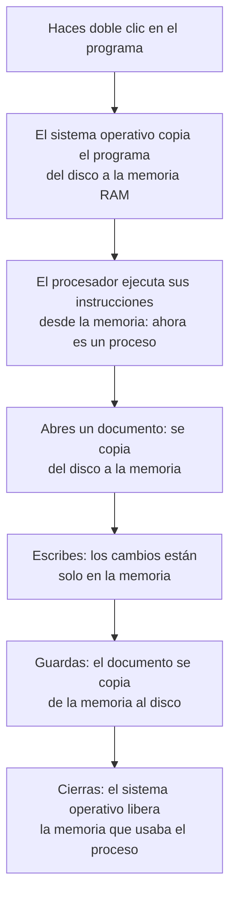

# 02.01 Cómo funciona un ordenador

> **Conviene saber antes:** [01.01 Qué es programar](../fase-01-que-es-programar/01-que-es-programar.md)
> **Tiempo estimado:** 2 horas
> **Nivel:** Básico · Núcleo

## Qué aprenderás

- Cómo colaboran el **procesador**, la **memoria RAM** y el **almacenamiento** cuando usas el ordenador, y por qué al apagar se pierde lo que no has guardado.
- Qué son los **bits** y los **bytes**, y cómo se leen sus múltiplos: **KB, MB, GB y TB** (incluida la diferencia entre 1000 y 1024, y por qué tu disco «tiene menos» de lo que pone en la caja).
- Qué es el **sistema operativo** y de qué se encarga: los programas, la memoria, los ficheros, los dispositivos, los usuarios y los permisos.
- La diferencia entre un **programa** y un **proceso**, y cómo mirar los programas que están en marcha.
- Qué son los **núcleos** de un procesador, qué quiere decir **32 o 64 bits** y qué es la **arquitectura** (x86-64 o ARM), para que sepas qué instalador descargar.
- Cómo leer la ficha técnica de un ordenador y compararlo con otro.

Este módulo es de **entender y de mirar**: no vas a instalar nada ni a teclear órdenes en la **terminal**, la ventana en la que se le dan instrucciones al ordenador escribiéndolas en lugar de usar el ratón (la abrirás por primera vez en [02.03](03-instalar-programas-y-path.md#16-instalar-git-en-windows-git-for-windows-y-git-bash) y la aprenderás en la fase 3). Lo que aprendas aquí lo usarás en los dos módulos siguientes, cuando trabajes con ficheros y cuando instales tus primeras herramientas.

## 1. Teoría

### 1.1. Las piezas que ya conoces

En el [módulo 01.01](../fase-01-que-es-programar/01-que-es-programar.md#11-un-ordenador-es-muy-rápido-y-muy-obediente) viste las tres piezas básicas de un ordenador con la analogía de la cocina: el **procesador** es el cocinero, la **memoria RAM** es la encimera y el **almacenamiento** es la despensa. Si no lo recuerdas, repásalo antes de seguir: este módulo parte de ahí y añade lo que te falta para entender tu ordenador.

Esas tres piezas van montadas en la **placa base**, la placa que las conecta entre sí y con todo lo demás. Alrededor están los **periféricos**, los aparatos por los que entran y salen los datos, que encajan con el esquema de [entrada, proceso y salida](../fase-01-que-es-programar/01-que-es-programar.md#12-qué-es-programar):

| Tipo | Ejemplos | Papel |
|---|---|---|
| **Entrada** | Teclado, ratón, panel táctil, micrófono, cámara | Le dan datos al ordenador |
| **Salida** | Pantalla, altavoces, impresora | Muestran el resultado |
| **Entrada y salida** | Pantalla táctil, red (wifi o cable), memoria USB | Las dos cosas |

Hay una pieza más que aparece en todas las fichas de los ordenadores: la **tarjeta gráfica** (GPU), un procesador especializado en dibujar la pantalla y en hacer muchísimos cálculos sencillos a la vez. Importa para videojuegos, edición de vídeo e inteligencia artificial; para empezar a programar, la que trae cualquier ordenador basta.

Y falta el personaje que lo organiza todo y que no se puede tocar: el **sistema operativo**, que verás en el [apartado 1.7](#17-el-sistema-operativo). Antes, una idea que necesitas para entender las cifras de cualquier ordenador: cómo se miden los datos.

### 1.2. Bits y bytes: todo son números

Dentro del ordenador todo se guarda como **números**, y esos números se escriben solo con **unos y ceros**, en **binario**. Ya lo viste al hablar del [código máquina](../fase-01-que-es-programar/01-que-es-programar.md#15-lenguajes-de-programación): las instrucciones del procesador son unos y ceros, y lo mismo pasa con un texto, una foto o una canción.

¿Por qué solo dos valores? Porque es muy fácil construir piezas electrónicas que distingan dos estados: hay corriente o no la hay, está magnetizado en un sentido o en el otro. Dos estados se distinguen sin errores aunque haya un poco de ruido; diez estados distintos, no.

- Un **bit** es la unidad más pequeña de información: un solo 0 o un solo 1. Como un interruptor: encendido o apagado.
- Un **byte** son **8 bits** seguidos, por ejemplo `01000001`. Es la unidad con la que se miden los ficheros, la memoria y los discos.

Con 8 bits se pueden formar **256 combinaciones distintas** (de `00000000` a `11111111`), porque cada bit dobla las posibilidades: 2 × 2 × 2 × 2 × 2 × 2 × 2 × 2 = 256. Eso basta, por ejemplo, para guardar una letra sin tilde: la `A` se guarda como el número 65, que en binario es `01000001`.

> **📌 Nota:** no necesitas saber pasar números a binario ni hacer cuentas con unos y ceros. Te basta con la idea: **un bit es un 0 o un 1, un byte son 8 bits, y todo lo que hay en el ordenador acaba siendo bytes**. Cómo se convierte un texto con tildes en bytes lo verás en [04.01 Texto, binario y codificación](../fase-04-formatos-y-diagramas/01-texto-binario-y-codificacion.md#17-utf-8-cómo-se-guardan-los-caracteres-de-unicode).

### 1.3. KB, MB, GB y TB

Un byte es muy poco: una sola letra. Por eso, como con los metros y los kilómetros, se usan **múltiplos**:

| Unidad | Símbolo | Equivale a | Para hacerte una idea |
|---|---|---|---|
| **Byte** | B | 8 bits | Una letra |
| **Kilobyte** | KB | 1000 bytes | Un mensaje de texto corto; un fichero de texto de una página ocupa unos pocos KB |
| **Megabyte** | MB | 1000 KB | Una foto del móvil o una canción (unos pocos MB cada una) |
| **Gigabyte** | GB | 1000 MB | Una película (de 1 a varios GB); la memoria RAM de un ordenador (8, 16, 32 GB) |
| **Terabyte** | TB | 1000 GB | Un disco grande; miles de películas |

Cada unidad es **mil veces** la anterior. Para pasar de una a otra, multiplicas o divides por 1000: 2 GB son 2000 MB; 3500 MB son 3,5 GB.

> **📌 Nota:** el kilobyte también se escribe **kB**, con la `k` minúscula, como en kilómetro. Las dos formas significan lo mismo.

**El lío de 1000 y 1024.** Aquí hay una trampa histórica que conviene conocer, porque te la vas a encontrar. Como los ordenadores trabajan en binario, durante décadas se usó **1024** (que es 2 multiplicado por sí mismo 10 veces) en lugar de 1000 para los múltiplos: «un kilobyte son 1024 bytes». Para distinguirlos, hoy existen nombres propios para los múltiplos de 1024:

| De 1000 en 1000 | De 1024 en 1024 |
|---|---|
| kilobyte (KB) = 1000 bytes | kibibyte (KiB) = 1024 bytes |
| megabyte (MB) = 1000 KB | mebibyte (MiB) = 1024 KiB |
| gigabyte (GB) = 1000 MB | gibibyte (GiB) = 1024 MiB |
| terabyte (TB) = 1000 GB | tebibyte (TiB) = 1024 GiB |

En la práctica, lo que te importa es esto:

- **Los fabricantes** de discos, memorias USB y móviles cuentan de 1000 en 1000.
- **Windows** cuenta de 1024 en 1024, pero lo llama «GB» igualmente. **macOS** cuenta de 1000 en 1000 desde 2009, igual que los fabricantes. En **Linux**, depende del programa.

Con unidades pequeñas la diferencia es mínima (un 2,4 % en el kilobyte), pero se acumula: en el terabyte llega casi al **10 %**. Por eso un disco de **1 TB** (un billón de bytes) aparece en Windows como unos **931 GB**. No falta nada: son los mismos bytes contados con otra regla. Lo verás en el [ejercicio 5](#ejercicio-5--el-disco-de-1-tb-que-marca-931-gb).

> **💡 Consejo:** para cuentas del día a día, usa siempre 1000: es más fácil y el error es pequeño. Acuérdate del 1024 solo cuando un número «no te cuadre» por poco.

**Bits por segundo: la velocidad de internet.** La velocidad de una conexión a internet no se mide en bytes, sino en **bits por segundo**: una fibra «de 600 megas» son **600 megabits por segundo** (600 Mb/s o 600 Mbps). Fíjate en la `b`:

- **b minúscula = bits** (Mb, megabit).
- **B mayúscula = bytes** (MB, megabyte).

Como un byte son 8 bits, para saber cuántos megabytes por segundo puedes descargar, **divide entre 8**: 600 Mb/s son, como mucho, 75 MB/s. Es la confusión más habitual con las unidades, y la tienes en el [error típico 3.3](#33-confundir-megabits-y-megabytes).

### 1.4. El procesador: velocidad y núcleos

El procesador (CPU) ejecuta las instrucciones, una detrás de otra. De su ficha te interesan dos cifras.

**La velocidad, en gigahercios (GHz).** El procesador trabaja al ritmo de un reloj interno que marca «pasos». Un **hercio** es un paso por segundo, y un gigahercio, mil millones. Un procesador a 3 GHz da unos tres mil millones de pasos por segundo. Esta cifra sirve para comparar procesadores de la **misma familia**, pero no entre familias distintas: uno moderno a 3 GHz hace mucho más trabajo en cada paso que uno de hace diez años a la misma velocidad.

**Los núcleos.** Un procesador actual no tiene un solo «cocinero», sino varios: cada **núcleo** es una unidad capaz de ejecutar instrucciones por su cuenta. Un procesador de 8 núcleos es como una cocina con 8 cocineros. Cuando haces varias cosas a la vez (escuchas música, el navegador carga una página y se descarga un fichero), cada tarea puede ir en un núcleo distinto, y el ordenador no se atasca.

> **⚠️ Cuidado:** más núcleos **no hacen más rápida una sola tarea**, salvo que el programa esté preparado para repartirla. Ocho cocineros no fríen un huevo ocho veces más deprisa. Repartir el trabajo entre varios núcleos es el [paralelismo](../fase-01-que-es-programar/04-paradigmas-de-programacion.md#18-otros-estilos-que-oirás-nombrar) que viste en «Paradigmas de programación», y es cosa de cada programa.

En las fichas verás también que algunos procesadores mezclan **núcleos de rendimiento** (rápidos, gastan más) y **núcleos de eficiencia** (más lentos, ahorran batería). No tienes que hacer nada con eso: el sistema operativo decide qué tarea va a cada uno.

### 1.5. La memoria RAM: rápida y olvidadiza

La memoria RAM guarda **lo que se está usando ahora mismo**: los programas abiertos y los datos con los que trabajan. Tiene dos rasgos que lo explican casi todo.

**Es muy rápida.** El procesador lee y escribe en la RAM constantemente, y lo hace muchísimo más deprisa que en el disco. Por eso los programas se ejecutan desde la memoria, no desde el disco (lo verás paso a paso en el [apartado 1.9](#19-qué-pasa-al-abrir-un-programa-y-al-guardar)).

**Es volátil: necesita corriente para recordar.** Al apagar el ordenador (o si se va la luz en un ordenador de sobremesa), todo lo que hay en la RAM **desaparece**. Por eso pierdes lo que no habías guardado: mientras escribes un documento, el texto está en la memoria; solo cuando **guardas** se copia al almacenamiento, que sí lo conserva sin corriente.

Hay tres formas de «dejar» el ordenador, y no son iguales:

| Qué haces | Qué pasa con la RAM | ¿Pierdes lo no guardado? |
|---|---|---|
| **Apagar** | Se queda sin corriente y se borra | Sí (los programas suelen preguntarte antes si quieres guardar) |
| **Suspender** (o «dormir») | Sigue con un poco de corriente y lo conserva todo; al volver, todo está como lo dejaste | No, mientras quede batería o corriente |
| **Hibernar** | El sistema copia la RAM entera al disco y apaga; al encender, la vuelve a cargar | No, aunque se quede sin batería |

**¿Y si la RAM se llena?** Cuando abres más cosas de las que caben, el sistema operativo no se rinde: aparta a un hueco del disco lo que se ha usado hace más rato, para dejar sitio. A eso se le llama **memoria virtual** (en Linux y macOS también **swap**, «intercambio»). Funciona, pero el disco es muchísimo más lento que la RAM: cada vez que vuelves a algo que se apartó, hay que traerlo de vuelta, y el ordenador **va a tirones**. Es la causa número uno de que un ordenador «vaya lento», y la tienes con un ejemplo en el [apartado 2.3](#23-por-qué-va-lento-con-40-pestañas).

Volviendo a la cocina: si la encimera se llena, el cocinero empieza a guardar cosas en la despensa para hacer hueco y a sacarlas otra vez cuando las necesita. Sigue cocinando, pero pasa más tiempo yendo y viniendo que cocinando.

### 1.6. El almacenamiento: SSD y disco duro

El almacenamiento guarda los datos **de forma permanente**: el sistema operativo, los programas instalados y tus ficheros. Sigue ahí al apagar. Hoy hay dos tipos:

| | **SSD** (unidad de estado sólido) | **Disco duro** (HDD) |
|---|---|---|
| Cómo funciona | Chips de memoria que no se borran sin corriente, sin piezas que se muevan | Discos magnéticos que giran y un brazo que lee y escribe |
| Velocidad | Rápido: el ordenador arranca en segundos y los programas se abren enseguida | Mucho más lento, sobre todo al buscar muchos ficheros pequeños |
| Golpes | Los aguanta bien | Delicado mientras funciona |
| Precio por GB | Más caro | Más barato |
| Uso habitual hoy | En casi todos los portátiles y ordenadores nuevos | Copias de seguridad y almacenamiento de mucha capacidad |

Ya ves que «disco» se dice por costumbre: un SSD no tiene ningún disco dentro, pero todo el mundo lo llama así, y en este curso también.

Además del interno, hay almacenamiento **externo**: memorias USB, discos externos y tarjetas de memoria. Y la **nube**, que es almacenamiento en el ordenador de otra empresa ([apartado 1.11](#111-la-nube-el-ordenador-de-otro)).

Ordenadas de más rápida a más lenta (y de menos a más capacidad), las piezas que guardan datos quedan así:


En texto: el procesador tiene un poquito de memoria propia, rapidísima; después viene la RAM, muy rápida pero que se borra al apagar; después el SSD, más lento pero permanente; y el disco duro, el más lento y el de más capacidad. Cuanto más rápida es una pieza, más cara es por cada GB, y por eso los ordenadores combinan las cuatro.

### 1.7. El sistema operativo

El **sistema operativo** es el programa que **administra el ordenador** y hace de intermediario entre el hardware (las piezas físicas) y el resto de los programas. Se pone en marcha al encender y no se para hasta que apagas. Sin él, cada programa tendría que saber manejar por su cuenta el disco, la pantalla o el teclado de cada modelo de ordenador.

En la cocina, si el procesador es el cocinero, el sistema operativo es el **jefe de cocina**: decide qué plato se prepara en cada momento, reparte el espacio de la encimera, lleva el inventario de la despensa y controla quién puede entrar.

Los tres sistemas operativos de ordenador que te vas a encontrar:

| Sistema | De quién | Dónde se usa |
|---|---|---|
| **Windows** | Microsoft | La mayoría de los ordenadores de casa y de oficina |
| **macOS** | Apple | Solo en los ordenadores de Apple (Mac) |
| **Linux** | Proyecto libre, con miles de colaboradores | Casi todos los servidores de internet, la nube y muchos ordenadores de programadores. Se distribuye en «sabores» llamados **distribuciones** (Ubuntu, Fedora, Debian…) |

En los móviles mandan **Android** (que está construido sobre Linux) e **iOS** (pariente de macOS). Los cursos de la academia funcionan en los tres sistemas de ordenador, y cuando algo cambie de uno a otro, te lo dirán.

De qué se encarga el sistema operativo:

| Tarea | Qué quiere decir | Dónde lo notas |
|---|---|---|
| **Programas** | Pone en marcha los programas, los para y reparte el tiempo del procesador entre todos los que están abiertos | Puedes tener abiertos a la vez el navegador, la música y un editor |
| **Memoria** | Decide qué parte de la RAM usa cada programa y que ninguno pise la de otro; si se llena, recurre a la memoria virtual | Un programa que falla no se lleva por delante a los demás |
| **Ficheros** | Organiza el almacenamiento en ficheros y carpetas, con nombre, tamaño y fecha | El Explorador de archivos de Windows, el Finder de macOS (lo verás en el [módulo siguiente](02-archivos-carpetas-y-rutas.md)) |
| **Dispositivos** | Habla con cada pieza de hardware a través de unos programas pequeños llamados **controladores** (*drivers*) | Conectas una impresora o un ratón y funciona |
| **Usuarios y permisos** | Cada persona tiene su **cuenta de usuario**, con sus ficheros, y el sistema decide qué puede hacer cada cuenta | Tu carpeta personal; el aviso que pide permiso o contraseña al instalar algo |

Los **permisos** merecen una explicación más. En un ordenador hay cuentas normales y cuentas de **administrador**, que pueden cambiar cosas que afectan a todo el sistema: instalar programas para todos, cambiar la configuración, tocar ficheros del propio sistema operativo. Cuando un programa intenta hacer algo así, el sistema te pide confirmación: en Windows aparece una ventana que pregunta si quieres permitir que la aplicación haga cambios en el dispositivo; en macOS y Linux te pide tu contraseña. Es una protección: **lee siempre qué estás autorizando** antes de aceptar. Lo verás al instalar tus herramientas en [02.03 Instalar programas, variables de entorno y PATH](03-instalar-programas-y-path.md#11-qué-es-instalar-un-programa), y cuándo no conviene trabajar como administrador, en la fase 3.

### 1.8. Programas y procesos

En la fase 1 viste que un [programa](../fase-01-que-es-programar/01-que-es-programar.md#14-qué-es-un-programa) es un algoritmo escrito en un lenguaje, guardado en ficheros. Mientras está en el disco, sin hacer nada, es como una receta en un libro. Cuando lo ejecutas, el sistema operativo lo carga en memoria y lo pone en marcha. Ese programa en marcha se llama **proceso**.

- **Programa:** los ficheros en el disco. Ocupan espacio de almacenamiento, pero no hacen nada.
- **Proceso:** un programa en ejecución. Ocupa memoria RAM y usa tiempo del procesador.

Un mismo programa puede tener **varios procesos** a la vez. Si abres dos ventanas de la calculadora, hay dos procesos del mismo programa. Y muchos programas modernos se dividen a propósito en varios procesos: los navegadores, por ejemplo, suelen usar procesos distintos para distintas pestañas, de modo que si una página se cuelga, no se lleva por delante a las demás.

Ahora mismo, en tu ordenador hay **cientos de procesos** en marcha, aunque tú solo veas unas pocas ventanas: los del sistema operativo, los que comprueban si hay actualizaciones, el antivirus, la sincronización de la nube… El sistema operativo los reparte entre los núcleos y les va dando turnos tan cortos que parece que todos avanzan a la vez (es la [concurrencia](../fase-01-que-es-programar/04-paradigmas-de-programacion.md#18-otros-estilos-que-oirás-nombrar) de «Paradigmas de programación»).

Para ver los procesos, cada sistema tiene una herramienta: el **Administrador de tareas** en Windows, el **Monitor de Actividad** en macOS y un monitor del sistema en Linux. Cómo abrirlos y qué mirar lo tienes en el [apartado 2.4](#24-mirar-los-programas-en-marcha). Manejar los procesos desde la terminal lo verás en la fase 3.

### 1.9. Qué pasa al abrir un programa y al guardar

Junta todas las piezas con algo que haces cada día: abrir un editor de textos, escribir y guardar.



Paso a paso:

1. **Abres el programa.** El sistema operativo busca sus ficheros en el almacenamiento y los **copia a la memoria RAM**. Esa espera de un par de segundos al abrir algo es, sobre todo, el tiempo de esa copia (por eso con un SSD se nota tanto).
2. **El procesador lo ejecuta** desde la memoria, instrucción a instrucción. Ya es un proceso.
3. **Abres un documento.** También se copia del disco a la memoria. Lo que ves en la pantalla es la copia de la memoria.
4. **Escribes.** Cada letra cambia la copia que está en la memoria. El fichero del disco **no se entera de nada**.
5. **Guardas.** El programa le pide al sistema operativo que escriba el contenido de la memoria en el fichero del disco. Desde ese momento, lo escrito sobrevive aunque se apague el ordenador.
6. **Cierras.** El proceso termina y el sistema operativo libera su memoria para otros programas.

> **📌 Nota:** muchos programas actuales tienen **autoguardado**: guardan solos cada poco tiempo, o guardan cada cambio en la nube. Es una gran ayuda, pero no todos lo tienen ni todos lo tienen activado. Hasta que sepas cómo se comporta un programa, **guarda tú** (<kbd>Ctrl</kbd>+<kbd>S</kbd> en Windows y Linux, <kbd>Cmd</kbd>+<kbd>S</kbd> en macOS).

### 1.10. 32 y 64 bits, x86-64 y ARM

En el módulo 01.01 viste que un programa compilado sirve para [un sistema y un procesador concretos](../fase-01-que-es-programar/01-que-es-programar.md#17-lenguajes-compilados-e-interpretados). Por eso, al descargar un programa, a menudo tienes que elegir entre varias versiones. Para elegir bien necesitas dos datos de tu ordenador.

**Los bits: 32 o 64.** Es el tamaño de los «trozos» con los que trabaja el procesador, y decide, entre otras cosas, cuánta memoria puede manejar. Con 32 bits se pueden numerar unos 4300 millones de posiciones de memoria, así que un sistema de 32 bits **no puede usar más de unos 4 GB de RAM**. Con 64 bits el límite es tan alto que en la práctica no existe. Hoy casi todo es de 64 bits: Windows 11, por ejemplo, solo existe en 64 bits, y muchos programas ya no publican versión de 32 bits. Si te ofrecen las dos, elige la de 64.

**La arquitectura: x86-64 o ARM.** Es la «familia» del procesador, y cada familia entiende un código máquina distinto. Un programa compilado para una no funciona directamente en la otra. Hoy hay dos grandes familias:

| Arquitectura | Cómo la verás escrita | Dónde está |
|---|---|---|
| **x86-64** | x64, x86_64, amd64, Intel, AMD | La mayoría de los PC con Windows o Linux (procesadores Intel y AMD) y los Mac antiguos con Intel |
| **ARM de 64 bits** | arm64, ARM64, aarch64, Apple Silicon | Todos los móviles, los Mac con chip de Apple (M1, M2, M3…), algunos portátiles con Windows (por ejemplo, con procesadores Snapdragon) y muchos servidores en la nube |

Fíjate en que la misma arquitectura tiene **varios nombres**: x64, x86_64 y amd64 son lo mismo; arm64 y aarch64, también. Y «x86» a secas, o «i386», suele referirse a los antiguos de **32 bits**.

¿Y si instalas la versión de la otra arquitectura? A veces funciona igualmente, porque el sistema operativo trae un **traductor** (un *emulador*) que convierte el código máquina de una familia al de la otra mientras se ejecuta: en los Mac con chip de Apple se llama **Rosetta 2**, y Windows en ARM también trae el suyo. Pero va más lento, gasta más batería y no siempre funciona. Además, no es para siempre: según la web de soporte de Apple, a partir de macOS 28 Rosetta 2 solo funcionará con algunos juegos antiguos (dato a 8 de noviembre de 2026). **Descarga siempre la versión nativa** de tu arquitectura si existe.

Hay una tercera opción que verás a menudo en macOS: la versión **Universal**, que lleva dentro las dos (Intel y Apple Silicon) y funciona en cualquier Mac. Ocupa más, pero no te puedes equivocar.

Cómo averiguar tus dos datos lo tienes en el [apartado 2.5](#25-averiguar-qué-ordenador-tienes), y cómo usarlos al descargar, en el [ejercicio 7](#ejercicio-7--qué-instalador-descargar).

### 1.11. La nube: el ordenador de otro

Oirás muchísimo «está en la nube» o «guárdalo en la nube». La nube no es nada misterioso: son **ordenadores de otra empresa**, en un centro de datos, a los que accedes por internet. Tienen las mismas piezas que el tuyo (procesador, memoria, almacenamiento, sistema operativo, casi siempre Linux), solo que son muchos más y los mantienen otros. Cuando guardas una foto «en la nube», se copia del almacenamiento de tu móvil al de esos ordenadores. Dónde encaja en una aplicación lo verás en [06.05 Las piezas de una aplicación](../fase-06-internet-y-aplicaciones/05-piezas-de-una-aplicacion.md#19-dónde-vive-cada-pieza-tu-ordenador-un-servidor-o-la-nube).

## 2. Ejemplos de código

> **📌 Nota:** este módulo no tiene código. Los ejemplos son situaciones reales de tu ordenador, explicadas con lo que acabas de aprender. Lo que se describe en los apartados 2.4 y 2.5 puedes mirarlo en tu ordenador si quieres: **solo se mira**, no se cambia nada.

### 2.1. Escribir un documento, guardarlo y que se vaya la luz

**Situación real:** Lucía escribe un trabajo en su ordenador de sobremesa. Lo guarda a las 10:00 y sigue escribiendo. A las 10:40 se va la luz.

Sigue lo que pasa en cada pieza:

| Hora | Qué hace Lucía | En la memoria RAM | En el disco |
|---|---|---|---|
| 9:30 | Abre el editor y el documento | El editor (ya es un proceso) y una copia del documento | El editor y el documento, como estaban |
| 9:30 a 10:00 | Escribe dos páginas | El documento con las dos páginas nuevas | El documento sin las dos páginas |
| 10:00 | Guarda | El documento con las dos páginas | **Se copia**: el documento con las dos páginas |
| 10:00 a 10:40 | Escribe una página más | El documento con tres páginas | El documento con dos páginas |
| 10:40 | Se va la luz | **Se borra todo** | El documento con dos páginas |

Al volver la luz, Lucía conserva las dos páginas que guardó, pero pierde la tercera: estaba solo en la memoria, que se borra sin corriente. Si el editor tiene autoguardado, quizá recupere parte de ella, pero solo lo que se hubiera guardado antes del apagón.

**¿Y en un portátil?** Si se va la luz, el portátil sigue funcionando con la batería y no se pierde nada. Pero el problema vuelve si la batería se agota sin que el sistema llegue a hibernar, o si el ordenador se cuelga y hay que apagarlo a la fuerza: en los dos casos, la RAM se pierde igual.

**La lección:** guardar es **copiar de la memoria al disco**. Lo que no se ha copiado todavía no existe para el disco.

### 2.2. Cuánto ocupa una foto, una canción y una película

**Situación real:** te preguntas por qué el móvil se queda sin espacio y cuánto tarda en bajarse una película.

Estos son tamaños **aproximados** y habituales (cambian mucho según la calidad y el formato):

| Contenido | Tamaño aproximado |
|---|---|
| Un fichero de texto de una página | Unos pocos KB |
| Un documento de texto con imágenes | De cientos de KB a unos pocos MB |
| Una foto hecha con el móvil | De 2 a 5 MB |
| Una canción de 4 minutos | De 3 a 10 MB |
| Un minuto de vídeo grabado con el móvil | De decenas a cientos de MB, según la calidad |
| Una película descargada | De 1 a 5 GB en calidad normal; bastante más en 4K |
| Un videojuego moderno | De decenas a más de 100 GB |

¿Por qué una foto de 12 megapíxeles (12 millones de puntos) ocupa solo unos 3 MB? Cada punto necesita 3 bytes para guardar su color (uno para el rojo, otro para el verde y otro para el azul). Sin más, la foto ocuparía:

```text
12 000 000 puntos × 3 bytes = 36 000 000 bytes = 36 MB
```

El formato de la foto (JPEG, HEIC…) la **comprime**: aprovecha que muchos puntos vecinos tienen colores parecidos para guardarla en mucho menos espacio, perdiendo detalles que el ojo casi no nota. Pasa lo mismo con la música y el vídeo: sin compresión, una película no cabría en ningún móvil.

**Y la descarga:** con una fibra de 300 Mb/s, una película de 4 GB tarda, como mínimo:

```text
4 GB = 4000 MB = 32 000 Mb      (× 8, de bytes a bits)
32 000 Mb ÷ 300 Mb/s ≈ 107 segundos, casi 2 minutos
```

En la realidad tarda algo más, porque la velocidad contratada es un máximo que rara vez se alcanza (el wifi, el servidor del que descargas y otros aparatos de casa también cuentan).

### 2.3. Por qué va lento con 40 pestañas

**Situación real:** Marcos tiene un portátil con 8 GB de RAM. Lleva toda la mañana abriendo pestañas en el navegador sin cerrar ninguna: ya van 40. Además tiene abiertos el correo, un editor de textos y una videollamada. El ordenador va a tirones: el ratón se mueve, pero cambiar de ventana tarda segundos.

¿Qué está pasando? Vamos pieza a pieza:

1. **Cada pestaña ocupa memoria.** Una página web moderna puede ocupar fácilmente de 100 a 300 MB (o más, si tiene vídeo o es una aplicación como un correo o un documento compartido). Con 40 pestañas a unos 200 MB, solo el navegador pide unos 8 GB.
2. **La RAM no da para todo.** Sumando el sistema operativo, la videollamada y lo demás, se pide bastante más memoria de la que hay.
3. **Entra en juego la memoria virtual** ([apartado 1.5](#15-la-memoria-ram-rápida-y-olvidadiza)). El sistema aparta al disco lo que se usa menos. Cada vez que Marcos vuelve a una ventana apartada, hay que traerla del disco, que es mucho más lento, y apartar otra cosa para hacerle sitio.
4. **El procesador no es el problema.** Probablemente está casi parado, esperando a que lleguen los datos del disco. Por eso comprar un procesador más rápido no lo arreglaría.

**Qué puede hacer Marcos:**

- Cerrar las pestañas que no necesita (o guardarlas como marcadores para leerlas después).
- Cerrar los programas que no está usando.
- Mirar en el administrador de tareas qué se come la memoria ([apartado 2.4](#24-mirar-los-programas-en-marcha)).
- Si le pasa a menudo con su forma de trabajar, la solución de fondo es **más RAM**, no un procesador más rápido.

> **📌 Nota:** que la RAM aparezca casi llena no es malo por sí mismo. Los sistemas modernos aprovechan la memoria libre para guardar cosas que quizá vuelvas a necesitar, y la sueltan cuando hace falta. El problema empieza cuando **no cabe** lo que estás usando y el sistema empieza a tirar del disco: eso es lo que se nota.

### 2.4. Mirar los programas en marcha

**Situación real:** quieres saber qué está ocupando la memoria o el procesador de tu ordenador. Cada sistema tiene una herramienta para verlo. Aquí solo vas a **mirar**.

| Sistema | Herramienta | Cómo se abre |
|---|---|---|
| **Windows** | Administrador de tareas | <kbd>Ctrl</kbd>+<kbd>Mayús</kbd>+<kbd>Esc</kbd>, o clic derecho en el botón de Inicio y «Administrador de tareas» |
| **macOS** | Monitor de Actividad | En la carpeta Aplicaciones, dentro de Utilidades, o buscándolo con <kbd>Cmd</kbd>+<kbd>Espacio</kbd> |
| **Linux** | Depende de la distribución: en Ubuntu 26.04 es la aplicación **Recursos**; en otras, **Monitor del sistema** | Desde el menú de aplicaciones, buscando «Recursos» o «Monitor» |

(Nombres comprobados a 8 de noviembre de 2026; pueden cambiar con las versiones.)

Las tres muestran lo mismo con distinto aspecto:

- **Una lista de procesos**, con cuánto procesador (CPU) y cuánta memoria usa cada uno. Puedes ordenarla pulsando en el título de una columna: ordénala por memoria y verás arriba lo que más ocupa.
- **Gráficas de uso** del procesador, la memoria, el disco y la red. En Windows están en la pestaña **Rendimiento**; en macOS, en las pestañas CPU, Memoria, Disco y Red.

Fíjate en que hay muchos más procesos que ventanas abiertas, y en que el navegador aparece varias veces (o agrupado con muchos subprocesos): es lo que viste en el [apartado 1.8](#18-programas-y-procesos).

> **⚠️ Cuidado:** estas herramientas tienen un botón para **cerrar un proceso a la fuerza** («Finalizar tarea» en Windows, «Forzar salida» en macOS). Úsalo solo con un programa tuyo que se ha quedado colgado, y sabiendo que **perderás lo que no hayas guardado en él**. No cierres procesos que no reconoces: muchos son del sistema operativo. Lo tienes en el [error típico 3.6](#36-finalizar-procesos-a-ciegas).

### 2.5. Averiguar qué ordenador tienes

**Situación real:** en [02.03 Instalar programas, variables de entorno y PATH](03-instalar-programas-y-path.md) vas a descargar Git y VS Code, y la página de descarga te preguntará por tu sistema y tu arquitectura. Conviene saberlos antes.

**En Windows 11:** abre **Configuración**, entra en **Sistema** y, al final, en **Información** (en algunas versiones se llama «Acerca de»). En «Especificaciones del dispositivo» verás:

- **Procesador:** la marca y el modelo (Intel, AMD, Snapdragon…).
- **RAM instalada:** por ejemplo, 16,0 GB.
- **Tipo de sistema:** algo como «Sistema operativo de 64 bits, procesador basado en x64». Si pone ARM en lugar de x64, tu ordenador es ARM.

**En macOS:** abre el menú Apple (la manzana de arriba a la izquierda) y elige **Acerca de este Mac**. Si aparece una línea **Chip** con un nombre como Apple M1, M2, M3…, tu Mac es **Apple Silicon** (ARM). Si aparece **Procesador** con un nombre de Intel, es un Mac con **Intel** (x86-64). También verás la memoria y la versión de macOS.

**En Linux:** depende de la distribución. En Ubuntu, en **Configuración**, apartado **Sistema** (o «Acerca de», según la versión), aparecen el procesador, la memoria y el disco. La arquitectura la comprobarás con una orden de la terminal cuando la aprendas.

(Rutas comprobadas en las páginas de ayuda de Microsoft y Apple, a 8 de noviembre de 2026.)

Apunta tus datos en algún sitio: sistema operativo y versión, arquitectura, RAM y espacio libre en el disco. Te harán falta en el módulo 02.03.

### 2.6. Leer la ficha de un portátil

**Situación real:** en una tienda online ves esta ficha. ¿Qué te dice cada línea?

```text
Portátil 15,6"
Procesador: 8 núcleos, hasta 4,4 GHz, x86-64
Memoria: 16 GB DDR5
Almacenamiento: SSD 512 GB
Gráfica: integrada
Pantalla: 15,6" 1920 × 1080
Sistema operativo: Windows 11 Home (64 bits)
```

| Línea | Qué te dice | Lo que te importa para programar |
|---|---|---|
| Procesador | 8 núcleos (8 cocineros); 4,4 GHz es la velocidad **máxima**, no la de siempre; arquitectura x86-64 | Sobrado para empezar. Compara con procesadores de la misma familia y año |
| Memoria: 16 GB DDR5 | La RAM. DDR5 es la generación de la memoria (la más reciente es más rápida) | **Muy importante**: el editor, el navegador y las herramientas de programación consumen mucha. 16 GB va holgado para empezar |
| Almacenamiento: SSD 512 GB | Un SSD (rápido) de 512 GB. En Windows verás unos 476 GB, y el sistema ya ocupa una parte | Que sea **SSD** es lo importante. Con 512 GB hay espacio de sobra para programar |
| Gráfica integrada | La tarjeta gráfica va dentro del procesador, sin una aparte | Basta para programar; solo importa para juegos, vídeo o IA |
| Pantalla | Tamaño en pulgadas y resolución (puntos de ancho × alto) | Más resolución, más código cabe a la vista |
| Sistema operativo | Windows 11 de 64 bits | Ya sabes qué instaladores descargar: Windows x64 |

> **💡 Consejo:** para programar, el orden de importancia suele ser **memoria RAM, SSD y después el procesador**. Un ordenador con un procesador modesto, 16 GB de RAM y un SSD va mejor para programar que uno con un procesador potentísimo y 8 GB con un disco duro. (Criterio a 8 de noviembre de 2026; las cifras de lo que es «suficiente» suben con los años.)

## 3. Errores típicos

### 3.1. Confundir memoria y almacenamiento

**Qué pasa:** alguien dice «mi móvil tiene 128 GB de memoria» cuando habla del espacio para fotos, o «necesito más memoria» cuando lo que le falta es espacio en el disco.

**Por qué ocurre:** en el lenguaje de la calle, «memoria» se usa para las dos cosas, y las dos se miden en GB.

**Cómo evitarlo:** recuerda la encimera y la despensa. La **memoria (RAM)** es lo que se usa ahora mismo: pocos GB (8, 16, 32), rápida, y se borra al apagar. El **almacenamiento** es lo que se guarda: muchos más GB o TB, y se conserva. Si el ordenador **va lento con muchas cosas abiertas**, suele faltar RAM; si **no te deja guardar más fotos**, falta almacenamiento.

### 3.2. Dar por guardado lo que no lo está

**Qué pasa:** trabajas una hora en un documento, el ordenador se cuelga y descubres que lo último que se guardó es de hace una hora.

**Por qué ocurre:** lo que ves en pantalla es la copia de la memoria. Hasta que guardas, el fichero del disco no cambia ([apartado 1.9](#19-qué-pasa-al-abrir-un-programa-y-al-guardar)), y mucha gente da por hecho que todos los programas guardan solos.

**Cómo evitarlo:** coge la costumbre de guardar a menudo (<kbd>Ctrl</kbd>+<kbd>S</kbd> o <kbd>Cmd</kbd>+<kbd>S</kbd>), sobre todo antes de algo arriesgado: cerrar la tapa del portátil con poca batería, instalar una actualización o dejar el ordenador un rato. Y averigua si tu programa tiene autoguardado.

### 3.3. Confundir megabits y megabytes

**Qué pasa:** contratas una fibra «de 600 megas», ves que una descarga va a 70 MB/s y crees que te están dando una octava parte de lo que pagas.

**Por qué ocurre:** la velocidad de la conexión se anuncia en **megabits** por segundo (Mb/s) y los programas de descarga suelen mostrarla en **megabytes** por segundo (MB/s). Solo cambia una letra, y en mayúscula o minúscula.

**Cómo evitarlo:** fíjate en la `b`. Si es minúscula son bits; si es mayúscula, bytes. Para pasar de una a otra, divide entre 8: 600 Mb/s son 75 MB/s como máximo, así que 70 MB/s es una velocidad excelente.

### 3.4. Creer que al disco le faltan gigas

**Qué pasa:** compras un disco de 1 TB, lo conectas a un ordenador con Windows y aparece como 931 GB. Piensas que es defectuoso o que te han engañado.

**Por qué ocurre:** el fabricante cuenta de 1000 en 1000 y Windows, de 1024 en 1024, aunque los dos lo llamen «GB» ([apartado 1.3](#13-kb-mb-gb-y-tb)). Además, en un ordenador nuevo, el sistema operativo y los programas que trae ya ocupan una parte.

**Cómo evitarlo:** cuenta con que la cifra que verás en Windows es más o menos un **7 % menor** que la anunciada si se mide en GB, y un **9 % menor** si se mide en TB, y que el sistema ocupa otro trozo.

### 3.5. Descargar el instalador equivocado

**Qué pasa:** descargas un programa, intentas instalarlo y te sale un mensaje del tipo «esta aplicación no se puede ejecutar en el equipo», o se instala pero va lentísimo.

**Por qué ocurre:** has bajado la versión de otra arquitectura (ARM en un PC con x64, o al revés), de otro sistema operativo (un instalador de Windows en un Mac) o de 32 bits cuando había de 64. Pasa a menudo porque las páginas de descarga ofrecen muchas variantes con nombres poco claros, y algunas eligen por ti y se equivocan.

**Cómo evitarlo:** averigua antes tu sistema y tu arquitectura ([apartado 2.5](#25-averiguar-qué-ordenador-tienes)), descarga siempre de la **página oficial** del programa (cómo reconocerla lo verás en [02.03](03-instalar-programas-y-path.md#13-descarga-siempre-de-la-web-oficial)) y lee el nombre del fichero antes de bajarlo: suele llevar el sistema y la arquitectura (`x64`, `arm64`, `Universal`…). En el [ejercicio 7](#ejercicio-7--qué-instalador-descargar) lo practicas.

### 3.6. Finalizar procesos a ciegas

**Qué pasa:** el ordenador va lento, abres el Administrador de tareas y empiezas a cerrar procesos con nombres raros para «liberar memoria». De repente se cierra algo que estabas usando, o se queda la pantalla en negro.

**Por qué ocurre:** muchos de esos procesos son del sistema operativo o de programas que necesitas, y cerrar uno a la fuerza no le da la oportunidad de guardar nada.

**Cómo evitarlo:** usa el administrador de tareas para **mirar**. Si un programa se ha colgado, intenta primero cerrarlo de forma normal; solo si no responde, fuerza su cierre, sabiendo que perderás lo que no se guardó. No toques procesos que no reconozcas. Si va lento por falta de memoria, cierra **tú** los programas y pestañas que no uses, desde sus propias ventanas.

### 3.7. Elegir ordenador por una sola cifra

**Qué pasa:** compras el portátil con más GHz o con más núcleos del rango de precio y resulta que va peor que el de un amigo con un procesador «inferior».

**Por qué ocurre:** ninguna cifra sola dice cómo va un ordenador. Los GHz no se pueden comparar entre familias de procesadores, más núcleos no aceleran una tarea que no se reparte, y un procesador excelente con poca RAM o con disco duro se atasca igualmente.

**Cómo evitarlo:** mira la ficha **entera** y pregúntate para qué lo vas a usar. Para programar, comprueba primero la RAM y que el almacenamiento sea SSD, como en el [apartado 2.6](#26-leer-la-ficha-de-un-portátil).

## 4. Buenas prácticas

- **Guarda a menudo** y averigua qué programas tienen autoguardado.
- **Conoce tu ordenador:** apunta tu sistema operativo, su versión, la arquitectura, la RAM y el espacio libre. Te lo preguntarán muchas veces.
- **Cierra lo que no uses**, sobre todo pestañas y programas que consumen mucha memoria.
- **Descarga de la página oficial** y elige la versión que corresponde a tu sistema y tu arquitectura; si hay versión de 64 bits, usa esa.
- **Lee lo que autorizas** cuando el sistema te pide permiso o contraseña.
- **Usa el administrador de tareas para entender**, no para cerrar procesos al azar.
- **Fíjate en las unidades**: B o b, 1000 o 1024. Casi todos los «no me cuadra» vienen de ahí.

**Lo que conviene evitar:**

- Apagar a la fuerza (manteniendo pulsado el botón) salvo que el ordenador no responda a nada.
- Dejar el disco lleno hasta el último GB: el sistema operativo necesita espacio libre para la memoria virtual y las actualizaciones.
- Instalar programas de páginas que no son la oficial porque «salen primero» en el buscador.

## 5. Ejercicios prácticos resueltos

> **💡 Consejo:** intenta resolver cada ejercicio **antes** de abrir las pistas y la solución. Son ejercicios de razonar y de hacer cuentas sencillas: hazlos en papel o en un documento. Si usas un asistente de IA, que sea para que te explique o te revise, no para que lo haga por ti.

### 🟢 Básico

#### Ejercicio 1 · Cada cosa en su pieza

Di qué pieza interviene sobre todo en cada situación: **procesador**, **memoria RAM**, **almacenamiento** o **sistema operativo**.

1. Las fotos de tus vacaciones de hace tres años, que siguen en el ordenador.
2. La hoja de cálculo que está sumando 10 000 filas ahora mismo.
3. El párrafo que acabas de escribir y que todavía no has guardado.
4. Conectas un ratón nuevo y funciona sin hacer nada.
5. Al encender, te pide tu contraseña para entrar en tu cuenta.
6. El programa de edición de vídeo que tienes instalado pero cerrado.

<details>
<summary>Pista 1</summary>

Pregúntate en cada caso: ¿se está **guardando** algo para siempre, se está **usando** ahora, se está **calculando**, o alguien está **organizando** el ordenador?

</details>

<details>
<summary>Ver solución</summary>

**Razonamiento:** se aplica a cada caso lo que hace cada pieza ([apartados 1.4 a 1.7](#14-el-procesador-velocidad-y-núcleos)): el almacenamiento guarda de forma permanente, la RAM guarda lo que se usa ahora, el procesador calcula y el sistema operativo organiza.

| # | Pieza | Por qué |
|---|---|---|
| 1 | Almacenamiento | Son ficheros guardados de forma permanente: llevan años ahí aunque se haya apagado el ordenador mil veces |
| 2 | Procesador (y RAM) | Sumar es ejecutar instrucciones: es trabajo del procesador. Los datos que suma están en la RAM mientras tanto |
| 3 | Memoria RAM | Lo no guardado está solo en la memoria; si se va la luz, se pierde |
| 4 | Sistema operativo | Reconoce el dispositivo y usa su controlador para hablar con él |
| 5 | Sistema operativo | Gestiona los usuarios y sus permisos |
| 6 | Almacenamiento | Un programa cerrado son ficheros en el disco: todavía no es un proceso, no ocupa RAM ni procesador |

**Errores frecuentes al resolverlo:**

- Contestar «memoria» en el caso 1 porque «se acuerda de las fotos». En el lenguaje de la calle se dice así, pero es almacenamiento ([error típico 3.1](#31-confundir-memoria-y-almacenamiento)).
- Pensar que un programa instalado ocupa memoria RAM aunque esté cerrado. Solo ocupa disco hasta que lo abres.

</details>

#### Ejercicio 2 · Bits, bytes y sus múltiplos

Contesta usando múltiplos de 1000:

1. ¿Cuántos bits hay en 3 bytes?
2. ¿Cuántos MB son 2 GB? ¿Y cuántos GB son 3500 MB?
3. ¿Cuántos GB son 1,5 TB?
4. Tu fibra es de 1000 Mb/s. ¿Cuántos MB por segundo puedes descargar como máximo?
5. ¿Qué es más grande: 64 Mb o 64 MB? ¿Cuántas veces más?

<details>
<summary>Pista 1</summary>

Un byte son 8 bits. Entre KB, MB, GB y TB, cada paso es × 1000 o ÷ 1000.

</details>

<details>
<summary>Pista 2</summary>

En las preguntas 4 y 5, fíjate en si la `b` es minúscula (bits) o mayúscula (bytes).

</details>

<details>
<summary>Ver solución</summary>

**Razonamiento:** se usan las equivalencias del [apartado 1.3](#13-kb-mb-gb-y-tb): 1 byte = 8 bits y cada múltiplo es 1000 veces el anterior.

1. 3 bytes × 8 = **24 bits**.
2. 2 GB × 1000 = **2000 MB**; 3500 MB ÷ 1000 = **3,5 GB**.
3. 1,5 TB × 1000 = **1500 GB**.
4. 1000 Mb/s ÷ 8 = **125 MB/s**. En la práctica, algo menos.
5. **64 MB es más grande**, 8 veces más: 64 Mb son 64 megabits, que son 8 megabytes (64 ÷ 8).

**Errores frecuentes al resolverlo:**

- Multiplicar por 8 en lugar de dividir al pasar de bits a bytes. Piénsalo así: hacen falta 8 bits para formar un byte, así que siempre hay **menos** bytes que bits.
- Leer igual «Mb» y «MB» ([error típico 3.3](#33-confundir-megabits-y-megabytes)).

</details>

#### Ejercicio 3 · Se va la luz

Pablo trabaja con un portátil enchufado. Abre una presentación a las 16:00, añade tres diapositivas, guarda a las 16:20 y añade dos más. Contesta qué conserva en cada caso:

1. A las 16:40 cierra la tapa del portátil, que se **suspende**, y a las 17:00 lo vuelve a abrir.
2. A las 16:40 se va la luz de la casa. La batería está al 80 %.
3. A las 16:40 el portátil se cuelga y Pablo lo **apaga a la fuerza** manteniendo pulsado el botón.
4. A las 16:40 elige **Apagar** en el menú, y el programa le pregunta si quiere guardar los cambios. Pulsa «No guardar».

<details>
<summary>Pista 1</summary>

En cada caso, pregúntate: ¿la memoria RAM sigue teniendo corriente? ¿Qué había en el disco a las 16:40?

</details>

<details>
<summary>Ver solución</summary>

**Razonamiento:** a las 16:40, la **RAM** tiene la presentación con las cinco diapositivas nuevas y el **disco**, con tres (lo guardado a las 16:20). Se conserva lo que hay en la RAM solo si no se queda sin corriente ([apartado 1.5](#15-la-memoria-ram-rápida-y-olvidadiza)).

1. **Las cinco.** Al suspender, la RAM sigue con corriente y lo conserva todo. Al abrir la tapa, el programa está como lo dejó, todavía sin guardar las dos últimas.
2. **Las cinco.** Al irse la luz, el portátil sigue con la batería: la RAM no se entera. (En un ordenador de sobremesa, sin batería, perdería las dos últimas.)
3. **Tres.** Apagar a la fuerza corta la corriente: se borra la RAM y solo queda lo que había en el disco.
4. **Tres.** Ha decidido él no copiar al disco lo de la memoria. Al apagar, la RAM se borra.

**La lección:** en los casos 1 y 2 no ha perdido nada, pero las dos últimas diapositivas siguen **sin guardar**: si después pasa algo como en el caso 3, las pierde. Lo prudente es guardar en cuanto vuelve.

**Errores frecuentes al resolverlo:**

- Pensar que suspender es lo mismo que apagar.
- Creer que en el caso 3 «algo se habrá guardado solo». Solo si el programa tiene autoguardado, y únicamente hasta su último guardado.

</details>

### 🟡 Intermedio

#### Ejercicio 4 · Cuántas fotos caben en el móvil

**Situación real:** Elena tiene un móvil de **128 GB**. El sistema operativo ocupa **20 GB** y sus aplicaciones, **30 GB**. Sus fotos ocupan unos **3 MB** cada una. Usa múltiplos de 1000.

1. ¿Cuánto espacio libre le queda?
2. ¿Cuántas fotos caben en ese espacio, más o menos?
3. Antes de un viaje quiere descargar series para el avión. Cada episodio ocupa unos **500 MB** y quiere dejar libre al menos la mitad del espacio para fotos. ¿Cuántos episodios puede descargar?

<details>
<summary>Pista 1</summary>

Para dividir el espacio libre entre el tamaño de una foto, los dos tienen que estar en la **misma unidad**. Pasa los GB a MB.

</details>

<details>
<summary>Ver solución</summary>

**Razonamiento:** primero se resta lo que ya está ocupado; después se pasa todo a la misma unidad (MB) para poder dividir ([apartado 1.3](#13-kb-mb-gb-y-tb)).

1. **Espacio libre:** 128 − 20 − 30 = **78 GB**.
2. **Fotos:** 78 GB = 78 000 MB; 78 000 ÷ 3 = **26 000 fotos**, más o menos.
3. **Episodios:** la mitad del espacio libre son 39 GB = 39 000 MB, que es lo que puede dedicar a series. 39 000 ÷ 500 = **78 episodios**. Y le quedan otros 39 GB para unas 13 000 fotos.

**Por qué es «más o menos»:** el tamaño de una foto cambia según lo que haya en ella (un cielo azul se comprime mucho mejor que un bosque lleno de hojas), y el sistema necesita algo de espacio libre para trabajar ([buenas prácticas](#4-buenas-prácticas)). Además, si cuentas con el 1024 en vez del 1000, el resultado cambia un poco. Para una estimación, sobra.

**Errores frecuentes al resolverlo:**

- Dividir 78 entre 3 sin cambiar de unidad: saldrían 26 «fotos», un resultado absurdo que debería hacerte sospechar.
- Olvidar restar lo que ocupan el sistema y las aplicaciones. En un móvil nuevo, el espacio «de fábrica» nunca está entero libre.

</details>

#### Ejercicio 5 · El disco de 1 TB que marca 931 GB

**Situación real:** Javier compra un disco externo anunciado como **1 TB**. Lo conecta a su PC con Windows, que dice que tiene **931 GB**. Lo conecta después al Mac de su hermana, que dice **1 TB**. Javier cree que el disco está mal.

1. Explica a Javier por qué ve dos cifras distintas.
2. Comprueba con una cuenta de dónde sale el 931.
3. Su portátil tiene un SSD de 512 GB. ¿Cuánto le dirá Windows que tiene, aproximadamente?

<details>
<summary>Pista 1</summary>

¿Quién cuenta de 1000 en 1000 y quién de 1024 en 1024? Repasa el [apartado 1.3](#13-kb-mb-gb-y-tb).

</details>

<details>
<summary>Pista 2</summary>

Un TB del fabricante son 1 000 000 000 000 de bytes. Un «GB» de Windows son 1024 × 1024 × 1024 = 1 073 741 824 bytes. Divide.

</details>

<details>
<summary>Ver solución</summary>

**Razonamiento:** el disco tiene siempre los mismos bytes; lo que cambia es la regla con que se cuentan.

1. **El fabricante y macOS cuentan de 1000 en 1000**; **Windows cuenta de 1024 en 1024**, aunque lo siga llamando «GB». Los dos dicen la verdad con reglas distintas. No falta ni un byte.
2. **La cuenta:**

   ```text
   1 TB del fabricante        = 1 000 000 000 000 bytes
   1 «GB» de Windows          = 1024 × 1024 × 1024 = 1 073 741 824 bytes
   1 000 000 000 000 ÷ 1 073 741 824 ≈ 931,3
   ```

   Windows lo muestra como unos 931 GB.
3. **512 GB del fabricante** son 512 000 000 000 bytes; entre 1 073 741 824 da unos **476,8 GB**. Y Windows ya ocupa una parte de ese espacio, así que el libre será bastante menos.

**Una regla rápida:** en Windows verás alrededor de un 7 % menos de los GB anunciados (un 9 % menos si la cifra está en TB: 1 TB aparece como 0,91 TB).

**Errores frecuentes al resolverlo:**

- Pensar que el disco «trae» ficheros ocultos que ocupan 69 GB. Puede traer algo, pero la diferencia principal es la forma de contar.
- Dividir solo entre 1024 una vez (1 000 000 000 000 ÷ 1024): hay que pasar por KB, MB y GB, así que se divide entre 1024 **tres veces**.

</details>

#### Ejercicio 6 · El ordenador va lento

**Situación real:** el portátil de Sara va lentísimo. Tiene **8 GB de RAM** y abre el Administrador de tareas, que muestra esto (ordenado por memoria):

| Proceso | CPU | Memoria |
|---|---|---|
| Navegador (52 procesos) | 6 % | 5,1 GB |
| Videollamada | 9 % | 0,9 GB |
| Editor de textos | 0 % | 0,4 GB |
| Programa de música | 1 % | 0,3 GB |
| Procesos del sistema (varios) | 3 % | 1,0 GB |

En la pestaña Rendimiento ve: **CPU, 19 %**; **Memoria, 7,6 de 7,8 GB en uso (97 %)**; **Disco, 100 %**.

1. ¿Qué pieza es el cuello de botella? ¿Cuál no?
2. ¿Por qué el disco está al 100 % si Sara no está copiando ningún fichero?
3. ¿Por qué aparece el navegador con 52 procesos?
4. ¿Qué le recomendarías hacer ahora? ¿Y si le pasa todos los días?
5. Un amigo le aconseja cambiar el portátil por uno con un procesador más rápido y la misma RAM. ¿Qué le dirías?

<details>
<summary>Pista 1</summary>

Fíjate en qué cifra está cerca del máximo y en cuál está lejos. ¿Qué hace el sistema operativo cuando la memoria se llena?

</details>

<details>
<summary>Ver solución</summary>

**Razonamiento:** se busca la pieza que está al límite y se explica la consecuencia con lo visto en el [apartado 1.5](#15-la-memoria-ram-rápida-y-olvidadiza) y el [ejemplo 2.3](#23-por-qué-va-lento-con-40-pestañas).

1. **La memoria RAM es el cuello de botella**: está al 97 %. **El procesador no**: está al 19 %, casi parado.
2. **Por la memoria virtual.** Como la RAM no da para todo, el sistema aparta al disco lo que se usa menos y lo vuelve a traer cuando hace falta. Ese ir y venir tiene al disco ocupado todo el rato, y como el disco es mucho más lento que la RAM, todo va a tirones.
3. **Porque el navegador reparte su trabajo en muchos procesos**, normalmente uno o varios por pestaña o por extensión ([apartado 1.8](#18-programas-y-procesos)). Las 52 líneas son del mismo programa. Sumados, se comen 5,1 GB: es el que más ocupa con diferencia.
4. **Ahora:** guardar lo que tenga abierto, cerrar las pestañas que no necesite y los programas que no use (la música, por ejemplo). Desde sus propias ventanas, no a la fuerza desde el Administrador de tareas. **Si le pasa a diario:** su forma de trabajar necesita más RAM. Puede ampliarla, si su portátil lo permite (en muchos portátiles la memoria va soldada y no se puede), o tenerlo en cuenta en el próximo ordenador: 16 GB.
5. **Que no lo arreglaría.** El procesador está al 19 %: no es lo que falla. Con la misma RAM, el ordenador nuevo se atascaría igual en cuanto abriera lo mismo.

**Por si te preguntas por qué pone 7,8 GB y no 8:** una parte de la RAM se reserva para otras piezas, como la gráfica integrada, y el sistema no la cuenta como disponible. No es un fallo.

**Errores frecuentes al resolverlo:**

- Culpar al procesador porque «es lo que hace los cálculos». Mira siempre las cifras antes de decidir.
- Ponerse a finalizar procesos del sistema para «liberar memoria» ([error típico 3.6](#36-finalizar-procesos-a-ciegas)).

</details>

### 🔴 Avanzado

#### Ejercicio 7 · Qué instalador descargar

**Situación real:** cuatro personas quieren instalar el mismo editor de código. Esta es su página de descarga (las opciones son las que ofrecía la página oficial de VS Code el 8 de noviembre de 2026):

```text
Windows:  User Installer x64 · User Installer Arm64 · System Installer x64 · System Installer Arm64
macOS:    .dmg Universal · .dmg Apple silicon · .dmg Intel
Linux:    .deb x64 · .deb Arm64 · .rpm x64 · .rpm Arm64
```

Y estos son sus ordenadores:

1. **Ana:** en Windows, «Información» dice «Sistema operativo de 64 bits, procesador basado en x64».
2. **Bruno:** en el Mac, «Acerca de este Mac» muestra «Chip: Apple M2».
3. **Carmen:** un portátil con Windows 11 y procesador Snapdragon.
4. **David:** un Mac de 2018. «Acerca de este Mac» muestra «Procesador: Intel Core i5».

¿Qué fichero debe descargar cada uno? ¿Hay alguno que sirva para dos de ellos?

<details>
<summary>Pista 1</summary>

Primero el sistema operativo, después la arquitectura. Repasa la tabla de nombres del [apartado 1.10](#110-32-y-64-bits-x86-64-y-arm): ¿qué arquitectura es un Snapdragon? ¿Y un chip M2?

</details>

<details>
<summary>Pista 2</summary>

No te preocupes por «User» o «System»: es si se instala solo para tu cuenta o para todas las del ordenador. Lo verás en [02.03](03-instalar-programas-y-path.md#14-el-instalador-que-le-toca-a-tu-ordenador). Para este ejercicio, elige el «User Installer».

</details>

<details>
<summary>Ver solución</summary>

**Razonamiento:** se elige en dos pasos: el sistema operativo decide la fila, y la arquitectura, la columna ([apartado 1.10](#110-32-y-64-bits-x86-64-y-arm)).

| Persona | Sistema | Arquitectura | Fichero |
|---|---|---|---|
| Ana | Windows | x64 (x86-64) | **User Installer x64** |
| Bruno | macOS | ARM (Apple Silicon, M2) | **.dmg Apple Silicon** (o el Universal) |
| Carmen | Windows | ARM (Snapdragon) | **User Installer Arm64** |
| David | macOS | x86-64 (Intel) | **.dmg Intel** (o el Universal) |

**El que sirve para dos:** el **.dmg Universal** vale para Bruno y para David, porque lleva dentro las dos versiones de macOS. Ocupa más, pero no hay forma de equivocarse.

**Fíjate en Carmen:** es el caso traicionero. Muchas páginas dan por hecho que «Windows» significa x64 y le ofrecen esa versión en el botón grande. Funcionaría gracias al traductor de Windows para ARM, pero más lento y gastando más batería. Su versión es la **Arm64**.

**Errores frecuentes al resolverlo:**

- Pensar que «x64» es para cualquier ordenador de 64 bits. Carmen y Bruno también tienen 64 bits, pero son **ARM**.
- Elegir para David la versión Apple Silicon porque «es la más moderna». En un Mac con Intel no funciona: no hay traductor en ese sentido.
- Pulsar el botón grande de la página sin leer qué fichero descarga ([error típico 3.5](#35-descargar-el-instalador-equivocado)).

</details>

#### Ejercicio 8 · El límite de los 32 bits

**Situación real:** en una oficina hay un ordenador antiguo con **Windows de 32 bits** al que alguien le ha puesto **8 GB de RAM**. El sistema dice que solo puede usar unos 3 GB y pico.

1. Calcula cuántas posiciones de memoria se pueden numerar con 32 bits y a cuánta memoria corresponde (cada posición es un byte; usa 1024).
2. Explica por qué sobran memoria y dinero en ese ordenador.
3. ¿Qué tendría que cambiar para aprovechar los 8 GB?
4. ¿Por qué hoy apenas se publican programas de 32 bits?

<details>
<summary>Pista 1</summary>

Con 8 bits salían 256 combinaciones (2 multiplicado por sí mismo 8 veces). Con 32 bits es 2 multiplicado por sí mismo 32 veces. Puedes hacerlo con la calculadora: 2³² = 2¹⁰ × 2¹⁰ × 2¹⁰ × 2² = 1024 × 1024 × 1024 × 4.

</details>

<details>
<summary>Ver solución</summary>

**Razonamiento:** cada bit dobla las combinaciones ([apartado 1.2](#12-bits-y-bytes-todo-son-números)), y el sistema necesita una combinación distinta, un «número de casa», para cada byte de memoria que quiera usar ([apartado 1.10](#110-32-y-64-bits-x86-64-y-arm)).

1. **La cuenta:**

   ```text
   2³² = 1024 × 1024 × 1024 × 4 = 4 294 967 296 posiciones
   4 294 967 296 bytes = 4 × (1024 × 1024 × 1024 bytes) = 4 GB (contando de 1024 en 1024)
   ```

   Con 32 bits solo se pueden numerar **4 GB** de memoria.
2. **El sistema no tiene «números de casa» para el resto.** Los otros 4 GB están instalados, pero no se pueden usar. Y ni siquiera llega a los 4 GB: una parte de esas direcciones se reserva para hablar con otras piezas (la gráfica, por ejemplo). Por eso ve unos 3 GB y pico.
3. **Instalar un sistema operativo de 64 bits.** Para eso, el procesador también tiene que ser de 64 bits (casi todos los fabricados desde hace más de quince años lo son). Con 64 bits se pueden numerar 2⁶⁴ posiciones: más de 18 trillones de bytes, muchísimo más de lo que cabe en cualquier ordenador.
4. **Porque casi no quedan sistemas de 32 bits.** Windows 11 solo existe en 64 bits, los Mac llevan años sin ejecutar programas de 32 bits y las distribuciones de Linux principales también los han ido abandonando. Publicar y probar una versión que casi nadie puede usar no compensa.

**Errores frecuentes al resolverlo:**

- Pensar que 32 bits permiten 32 GB, o «el doble que 16 bits». Cada bit de más **dobla** el número: 33 bits ya serían 8 GB.
- Creer que basta con instalar programas de 64 bits en un Windows de 32 bits. No funcionan: un sistema de 32 bits solo ejecuta programas de 32 bits.

</details>

### 🏆 Caso real

#### Ejercicio 9 · Comparar dos portátiles

**Situación real:** Irene va a empezar a estudiar programación y duda entre dos portátiles que cuestan lo mismo. Quiere usar un editor de código, el navegador con la documentación abierta, Git y, más adelante, alguna herramienta que ejecute programas en segundo plano.

```text
Portátil A                                  Portátil B
Procesador: 12 núcleos, hasta 5,0 GHz       Procesador: 8 núcleos, hasta 4,4 GHz
Memoria: 8 GB (soldada, no ampliable)       Memoria: 16 GB (ampliable hasta 32 GB)
Almacenamiento: disco duro 1 TB             Almacenamiento: SSD 512 GB
Gráfica: dedicada para juegos               Gráfica: integrada
Sistema: Windows 11 Home (64 bits), x64     Sistema: Windows 11 Home (64 bits), x64
```

1. Para cada línea, di cuál es mejor **para lo que quiere Irene** y por qué.
2. ¿Cuál le recomiendas? Justifícalo.
3. ¿Hay alguna situación en la que el A fuera mejor elección?
4. Cuando lo tenga, ¿qué instaladores tendrá que descargar: x64 o Arm64?

<details>
<summary>Pista 1</summary>

Vuelve al consejo del [apartado 2.6](#26-leer-la-ficha-de-un-portátil): para programar, ¿qué tres cosas importan más y en qué orden?

</details>

<details>
<summary>Pista 2</summary>

Fíjate en las palabras pequeñas: «soldada, no ampliable», «disco duro», «hasta». Suelen ser las que deciden.

</details>

<details>
<summary>Ver solución</summary>

**Razonamiento:** no se cuenta quién tiene «más números», sino qué necesita Irene: muchos programas abiertos a la vez (memoria), que todo abra deprisa (SSD) y un procesador suficiente. Se revisa la ficha línea a línea con lo visto en los apartados [1.4](#14-el-procesador-velocidad-y-núcleos), [1.5](#15-la-memoria-ram-rápida-y-olvidadiza) y [1.6](#16-el-almacenamiento-ssd-y-disco-duro).

**1. Línea a línea:**

| Línea | Mejor | Por qué |
|---|---|---|
| Procesador | A, pero da igual | El A es más potente, pero los dos sobran para programar al empezar. «Hasta 5,0 GHz» es la velocidad máxima, no la habitual |
| Memoria | **B, con mucha diferencia** | Editor, navegador con documentación y herramientas en segundo plano llenan 8 GB enseguida, y el A **no se puede ampliar**. El B tiene el doble y se puede ampliar más adelante |
| Almacenamiento | **B** | Un SSD hace que el sistema arranque y los programas abran mucho más rápido. 512 GB sobran para programar; el terabyte del A es más espacio, pero en un disco duro lento. Y cuando la memoria se llene, la memoria virtual irá a un disco lento, lo peor de los dos mundos |
| Gráfica | A, pero no importa | Una gráfica dedicada sirve para juegos, vídeo o IA, no para empezar a programar |
| Sistema | Iguales | Windows 11 de 64 bits en x64 en los dos |

**2. Recomendación: el B.** Gana en las dos cosas que más se notan al programar: la memoria (el doble, y ampliable) y el SSD. El A tiene mejor procesador y gráfica, pero con 8 GB fijos y un disco duro se atascará en cuanto Irene tenga abiertos su editor, el navegador y alguna herramienta, como le pasaba a Sara en el [ejercicio 6](#ejercicio-6--el-ordenador-va-lento). Además, el precio de la gráfica dedicada del A lo paga sin usarla.

**3. Cuándo sería mejor el A:** si el uso principal fueran **videojuegos** o edición de vídeo, donde la gráfica dedicada y el procesador pesan mucho. Aun así, los 8 GB no ampliables y el disco duro serían una pega. Para programar, no.

**4. Instaladores: x64.** Los dos son Windows de 64 bits sobre procesador x64, así que la versión que necesita es la x64 ([ejercicio 7](#ejercicio-7--qué-instalador-descargar)).

**Errores frecuentes al resolverlo:**

- Elegir por la cifra más llamativa: 12 núcleos y 5,0 GHz ([error típico 3.7](#37-elegir-ordenador-por-una-sola-cifra)).
- Pensar que el A es mejor porque tiene «el doble de disco». Para programar importa más que sea rápido que enorme.
- No fijarse en «soldada, no ampliable»: significa que los 8 GB serán 8 GB durante toda la vida del portátil.

</details>

## 6. Chuleta

### Las piezas y lo que hacen

| Pieza | Qué hace | Se mide en | Al apagar |
|---|---|---|---|
| **Procesador (CPU)** | Ejecuta las instrucciones | Núcleos y GHz | — |
| **Memoria RAM** | Guarda lo que se usa ahora | GB (8, 16, 32…) | Se borra |
| **Almacenamiento** (SSD o disco duro) | Guarda ficheros y programas | GB o TB | Se conserva |
| **Tarjeta gráfica (GPU)** | Dibuja la pantalla; cálculos en paralelo | — | — |
| **Sistema operativo** | Administra todo lo anterior | — | — |

### Unidades

| Unidad | Qué es |
|---|---|
| 1 bit | Un 0 o un 1 |
| 1 byte (B) | 8 bits: 256 combinaciones |
| KB, MB, GB, TB | Cada uno, 1000 veces el anterior |
| KiB, MiB, GiB, TiB | Cada uno, 1024 veces el anterior (Windows los muestra como «KB», «MB», «GB», «TB») |
| Mb/s (b minúscula) | Megabits por segundo: velocidad de internet. Entre 8 → MB/s |
| 1 TB del fabricante | Unos 931 GB en Windows |

### Qué hace el sistema operativo

Programas (los pone en marcha y reparte el procesador) · memoria (y la memoria virtual si se llena) · ficheros y carpetas · dispositivos (con controladores) · usuarios y permisos.

### Programa y proceso

| Programa | Proceso |
|---|---|
| Ficheros en el disco | Un programa en marcha |
| Ocupa almacenamiento | Ocupa RAM y procesador |
| Uno | Puede haber varios del mismo programa |

**Ver los procesos:** Administrador de tareas (Windows, <kbd>Ctrl</kbd>+<kbd>Mayús</kbd>+<kbd>Esc</kbd>) · Monitor de Actividad (macOS) · Recursos o Monitor del sistema (Linux). **Solo para mirar.**

### Abrir, guardar y apagar

1. Abrir: del disco a la RAM.
2. Trabajar: los cambios están solo en la RAM.
3. Guardar: de la RAM al disco.
4. Apagar o cortar la corriente: se borra la RAM. Suspender: la RAM se conserva. Hibernar: la RAM se copia al disco.

### Qué instalador descargar

| Si tu ordenador dice… | Arquitectura | Busca |
|---|---|---|
| x64, x86_64, amd64, Intel, AMD | x86-64 | `x64` |
| ARM, arm64, aarch64, Snapdragon | ARM | `arm64` |
| Mac con «Chip: Apple M…» | ARM (Apple Silicon) | `Apple Silicon` o `Universal` |
| Mac con «Procesador: Intel…» | x86-64 | `Intel` o `Universal` |

Siempre de 64 bits si hay elección, y siempre desde la página oficial.

### Dónde mirar tus datos

- **Windows 11:** Configuración → Sistema → Información → Tipo de sistema.
- **macOS:** menú Apple → Acerca de este Mac → Chip o Procesador.
- **Linux (Ubuntu):** Configuración → Sistema.

### Para elegir un ordenador para programar

1. **RAM** suficiente (16 GB va holgado, a 8 de noviembre de 2026), mejor si es ampliable.
2. **SSD**, no disco duro.
3. Procesador: cualquiera actual sirve para empezar.

## 7. Preguntas de repaso

1. ¿Por qué se pierde lo que no has guardado cuando se va la luz en un ordenador de sobremesa?

   <details>
   <summary>Ver respuesta</summary>

   Porque mientras trabajas, los cambios están solo en la memoria RAM, que es volátil: necesita corriente para conservar los datos. Guardar es copiarlos al almacenamiento, que los conserva sin corriente. Lo tienes en [1.5. La memoria RAM: rápida y olvidadiza](#15-la-memoria-ram-rápida-y-olvidadiza).

   </details>

2. ¿Qué es un bit? ¿Y un byte? ¿Cuántas combinaciones distintas caben en un byte?

   <details>
   <summary>Ver respuesta</summary>

   Un bit es la unidad mínima de información: un 0 o un 1. Un byte son 8 bits, y caben 256 combinaciones distintas (2 multiplicado por sí mismo 8 veces). Lo tienes en [1.2. Bits y bytes: todo son números](#12-bits-y-bytes-todo-son-números).

   </details>

3. ¿Por qué un disco de 1 TB aparece en Windows como unos 931 GB?

   <details>
   <summary>Ver respuesta</summary>

   Porque el fabricante cuenta de 1000 en 1000 y Windows de 1024 en 1024, aunque los dos lo llamen GB. Son los mismos bytes contados con otra regla. Lo tienes en [1.3. KB, MB, GB y TB](#13-kb-mb-gb-y-tb).

   </details>

4. Tu conexión es de 600 Mb/s. ¿A cuántos MB/s puedes descargar como máximo? ¿Por qué?

   <details>
   <summary>Ver respuesta</summary>

   A 75 MB/s: la velocidad de internet se mide en megabits (b minúscula) y los ficheros en megabytes (B mayúscula); como un byte son 8 bits, se divide entre 8. Lo tienes en [1.3. KB, MB, GB y TB](#13-kb-mb-gb-y-tb) y en [3.3. Confundir megabits y megabytes](#33-confundir-megabits-y-megabytes).

   </details>

5. ¿Un procesador de 8 núcleos hace cualquier tarea el doble de rápido que uno de 4?

   <details>
   <summary>Ver respuesta</summary>

   No. Más núcleos permiten hacer más tareas a la vez, pero una sola tarea solo va más rápida si el programa está preparado para repartirla entre varios núcleos. Lo tienes en [1.4. El procesador: velocidad y núcleos](#14-el-procesador-velocidad-y-núcleos).

   </details>

6. ¿Qué es la memoria virtual y por qué hace que el ordenador vaya lento?

   <details>
   <summary>Ver respuesta</summary>

   Es el recurso del sistema operativo cuando la RAM se llena: aparta al disco lo que se usa menos y lo trae de vuelta cuando hace falta. Como el disco es mucho más lento que la RAM, ese ir y venir hace que todo vaya a tirones. Lo tienes en [1.5. La memoria RAM: rápida y olvidadiza](#15-la-memoria-ram-rápida-y-olvidadiza) y en [2.3. Por qué va lento con 40 pestañas](#23-por-qué-va-lento-con-40-pestañas).

   </details>

7. Nombra cuatro cosas de las que se encarga el sistema operativo.

   <details>
   <summary>Ver respuesta</summary>

   De poner en marcha los programas y repartir entre ellos el procesador, de repartir la memoria, de organizar los ficheros y carpetas, de hablar con los dispositivos mediante controladores y de gestionar los usuarios y sus permisos. Lo tienes en [1.7. El sistema operativo](#17-el-sistema-operativo).

   </details>

8. ¿Qué diferencia hay entre un programa y un proceso?

   <details>
   <summary>Ver respuesta</summary>

   El programa son los ficheros guardados en el disco, sin hacer nada; el proceso es ese programa en ejecución, cargado en memoria y usando el procesador. Un mismo programa puede tener varios procesos. Lo tienes en [1.8. Programas y procesos](#18-programas-y-procesos).

   </details>

9. Describe qué pasa, pieza a pieza, desde que abres un documento hasta que lo guardas.

   <details>
   <summary>Ver respuesta</summary>

   El sistema operativo copia el programa del disco a la memoria y el procesador lo ejecuta (ya es un proceso); el documento también se copia a la memoria; lo que escribes cambia solo la copia de la memoria; al guardar, esa copia se escribe en el disco. Lo tienes en [1.9. Qué pasa al abrir un programa y al guardar](#19-qué-pasa-al-abrir-un-programa-y-al-guardar).

   </details>

10. ¿Por qué un sistema de 32 bits no puede usar 8 GB de RAM?

    <details>
    <summary>Ver respuesta</summary>

    Porque con 32 bits solo se pueden numerar unos 4300 millones de posiciones de memoria, es decir, unos 4 GB. El resto no tiene «número» y no se puede usar. Con 64 bits el límite desaparece en la práctica. Lo tienes en [1.10. 32 y 64 bits, x86-64 y ARM](#110-32-y-64-bits-x86-64-y-arm).

    </details>

11. Tienes un Mac que en «Acerca de este Mac» muestra «Chip: Apple M3». ¿Qué versión de un programa descargas?

    <details>
    <summary>Ver respuesta</summary>

    La de Apple Silicon (ARM de 64 bits, a veces llamada arm64 o aarch64) o la Universal, que lleva las dos. La de Intel podría funcionar con el traductor Rosetta 2, pero más lenta, y Apple ha anunciado que dejará de funcionar para casi todos los programas. Lo tienes en [1.10. 32 y 64 bits, x86-64 y ARM](#110-32-y-64-bits-x86-64-y-arm) y en [2.5. Averiguar qué ordenador tienes](#25-averiguar-qué-ordenador-tienes).

    </details>

12. ¿Qué es la nube, dicho en una frase?

    <details>
    <summary>Ver respuesta</summary>

    Ordenadores de otra empresa, en un centro de datos, a los que accedes por internet: tienen las mismas piezas que el tuyo, pero los mantienen otros. Lo tienes en [1.11. La nube: el ordenador de otro](#111-la-nube-el-ordenador-de-otro).

    </details>

---
⬅️ [Anterior: Retos de la fase 1](../fase-01-que-es-programar/retos.md) · 📚 [Índice](../00-indice.md) · ➡️ [Siguiente: Archivos, carpetas y rutas](02-archivos-carpetas-y-rutas.md)
