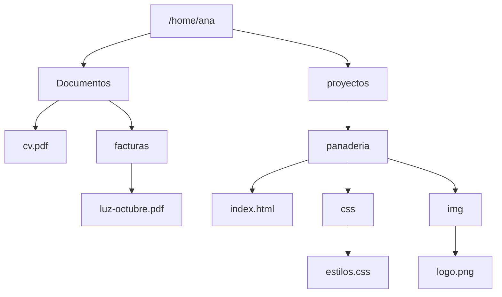

# 02.02 Archivos, carpetas y rutas

> **Versiones:** El fragmento de ejemplo se ha comprobado con Python 3.14; los menús son los de Windows 11, macOS y Archivos de GNOME (8 de noviembre de 2026)
> **Conviene saber antes:** [02.01 Cómo funciona un ordenador](01-como-funciona-un-ordenador.md)
> **Tiempo estimado:** 2,5 horas
> **Nivel:** Básico · Núcleo

## Qué aprenderás

- Qué son un **fichero** y una **carpeta**, y cómo se organizan en un **árbol**.
- Dónde empieza ese árbol en Windows, en macOS y en Linux, y qué es tu **carpeta personal**.
- Cómo ver dónde está un fichero con el **explorador de archivos** de tu sistema.
- Qué es una **ruta** y la diferencia entre una ruta **absoluta** y una **relativa**.
- Qué significan `.` y `..` en una ruta, y qué es la **carpeta actual**.
- Cómo se escribe la misma ruta en **Windows**, **macOS**, **Linux** y **Git Bash**, y qué es `~`.
- Por qué importan las **mayúsculas**, los **espacios** y las **tildes** en los nombres.
- Qué es la **extensión** de un fichero, qué son los **ficheros ocultos** y por qué borrar no siempre es definitivo.

En este módulo **no vas a teclear órdenes**: la terminal la abrirás por primera vez en el [módulo siguiente](03-instalar-programas-y-path.md#16-instalar-git-en-windows-git-for-windows-y-git-bash) y la aprenderás en la fase 3. Las rutas se razonan sobre un dibujo del árbol de carpetas, igual que en la fase 1 seguías un algoritmo con una tabla, y se buscan con el explorador de archivos que ya usas.

## 1. Teoría

### 1.1. Ficheros: donde se guardan los datos

En el [módulo anterior](01-como-funciona-un-ordenador.md) viste que la memoria se borra al apagar y que lo que tiene que durar se guarda en el disco. Pero un disco guarda miles de millones de datos: hace falta alguna forma de ponerles nombre y encontrarlos. Esa forma son los ficheros.

Un **fichero** (también se dice **archivo**: son lo mismo) es un conjunto de datos guardado en el disco con un **nombre**. Una foto, una canción, un documento de texto, una hoja de cálculo o un programa instalado son ficheros.

Cada fichero tiene, sobre todo, dos cosas:

- **Un nombre**, como `factura-octubre.pdf` o `logo.png`, para que tú y los programas lo encontréis.
- **Un contenido**: los datos que guarda.

> **📌 Nota:** este curso dice siempre «fichero», que es lo habitual en los textos de programación en España. Pero las pantallas de Windows y macOS en español dicen «archivo» («Explorador de archivos», el menú «Archivo»), y por eso el título de este módulo usa esa palabra: es la que verás en tu ordenador. Cuando leas una u otra, piensa en lo mismo.

Lo que escribe un programador también son ficheros. El [código fuente](../fase-01-que-es-programar/01-que-es-programar.md#14-qué-es-un-programa) que viste en la fase 1 se guarda en ficheros de texto normales, y un proyecto de programación no es más que un montón de ficheros bien ordenados. Por eso este módulo es imprescindible: **programar es, entre otras cosas, decirle a un programa dónde están sus ficheros**.

### 1.2. Carpetas: cajas para ordenar los ficheros

Si todos los ficheros de un ordenador estuvieran juntos, encontrar uno sería imposible: un ordenador normal tiene cientos de miles. Por eso se agrupan en **carpetas** (también llamadas **directorios**, sobre todo en la terminal y en programación).

Una carpeta es como una **caja con una etiqueta**: dentro puedes meter ficheros y también **otras carpetas**, que a su vez tienen dentro ficheros y carpetas, y así sucesivamente.

Piensa en un archivador de oficina: un cajón «Clientes»; dentro, una carpeta por cliente; dentro de cada una, una subcarpeta por año, y dentro, las facturas. Para encontrar una factura no miras todas: vas al cajón, al cliente, al año, y allí está.

Unas palabras que usarás mucho:

| Palabra | Qué significa | Ejemplo |
|---|---|---|
| **Subcarpeta** | Una carpeta que está dentro de otra | `facturas` dentro de `Documentos` |
| **Carpeta padre** | La carpeta que contiene a otra (o a un fichero) | `Documentos` es la carpeta padre de `facturas` |
| **Contenido de una carpeta** | Los ficheros y subcarpetas que tiene **directamente** dentro | |

> **📌 Nota:** cada fichero y cada carpeta están **exactamente en una** carpeta padre. Por eso dos ficheros pueden llamarse igual (`notas.txt`) si están en carpetas distintas, pero no dentro de la misma carpeta: ahí el nombre tiene que ser único.

### 1.3. El árbol de carpetas

Como las carpetas se meten unas dentro de otras, todas juntas forman una estructura que se dibuja como un **árbol** puesto del revés: arriba, una carpeta de la que sale todo; de ella cuelgan otras, de esas otras, y así hasta llegar a los ficheros, que son como las hojas.

Este es un trozo del árbol de Ana, una alumna que usa Linux:



En texto: la carpeta de Ana tiene dentro `Documentos` y `proyectos`. En `Documentos` hay un fichero, `cv.pdf`, y una carpeta, `facturas`, con `luz-octubre.pdf`. En `proyectos` está la carpeta `panaderia`, que contiene `index.html` y las carpetas `css` (con `estilos.css`) e `img` (con `logo.png`).

Los diagramas son bonitos, pero ocupan mucho. En la documentación y en este curso verás muy a menudo el mismo árbol dibujado así, con texto:

```text
/home/ana
├── Documentos
│   ├── cv.pdf
│   └── facturas
│       └── luz-octubre.pdf
└── proyectos
    └── panaderia
        ├── index.html
        ├── css
        │   └── estilos.css
        └── img
            └── logo.png
```

Cómo se lee:

- Cada línea es **un fichero o una carpeta**.
- Lo que está **más a la derecha** está **dentro** de lo que tiene encima con un nivel menos de sangría.
- Las líneas `├──`, `└──` y `│` solo unen cada elemento con su carpeta padre: `├──` quiere decir «hay más debajo en esta carpeta» y `└──`, «este es el último».

> **💡 Consejo:** en estos dibujos, ¿cómo sabes si algo es un fichero o una carpeta? Por costumbre, los ficheros llevan un punto y una terminación (`cv.pdf`, `estilos.css`) y las carpetas no. Pero es solo una costumbre: lo seguro es mirar si tiene algo colgando. En el [apartado 1.14](#114-la-extensión) verás qué es esa terminación.

### 1.4. Dónde empieza el árbol: la raíz

El árbol entero de un ordenador empieza en una carpeta que no está dentro de ninguna otra: la **raíz**. Aquí está la primera gran diferencia entre sistemas operativos:

| Sistema | Dónde empieza el árbol | Cómo se escribe |
|---|---|---|
| **Linux** y **macOS** | Una sola raíz para todo el ordenador | `/` (una barra, sin más) |
| **Windows** | Un árbol por cada **unidad** (cada disco o parte de disco), con una letra | `C:\` para el disco principal; `D:\`, `E:\`… para otros discos o memorias USB |

- En **Linux y macOS**, todo cuelga de `/`. Si conectas una memoria USB, no aparece como un árbol aparte, sino como una carpeta más dentro del árbol (en macOS, dentro de `/Volumes`; en Linux, normalmente dentro de `/media`).
- En **Windows**, cada unidad tiene su propio árbol. El sistema y tus ficheros suelen estar en la `C:`.

No tienes que tocar nada de la raíz: está llena de carpetas del sistema operativo y de los programas instalados. Tú vas a trabajar casi siempre dentro de tu carpeta personal.

### 1.5. Tu carpeta personal

Cada persona que usa un ordenador tiene una **carpeta personal** (en inglés, *home*), donde están sus documentos, sus descargas, su escritorio y, a partir de ahora, sus proyectos. Si en el ordenador hay varios usuarios, cada uno tiene la suya.

Para una usuaria llamada `ana`, la carpeta personal está en:

| Sistema | Carpeta personal de `ana` |
|---|---|
| Windows | `C:\Users\ana` |
| macOS | `/Users/ana` |
| Linux | `/home/ana` |

Dentro hay unas cuantas carpetas que crea el sistema: Escritorio, Documentos, Descargas, Imágenes, Música…

> **⚠️ Cuidado:** en **Windows y macOS en español**, el explorador te **enseña** los nombres traducidos («Usuarios», «Documentos», «Descargas», «Escritorio»), pero **los nombres de verdad** de esas carpetas están en inglés: `Users`, `Documents`, `Downloads`, `Desktop`. Cuando veas la ruta escrita (en el [apartado 1.6](#16-el-explorador-de-archivos) aprenderás a verla), aparecerá `C:\Users\ana\Documents`, no `C:\Usuarios\ana\Documentos`. En **Linux en español** es al revés: las carpetas se llaman de verdad `Documentos`, `Descargas` y `Escritorio`. Lo verás en el [error típico 3.5](#35-buscar-documentos-y-encontrar-documents).

> **📌 Nota:** si usas Windows con OneDrive (o macOS con iCloud Drive), puede que tu Escritorio y tus Documentos estén **dentro** de la carpeta que se sincroniza con la nube, y su ruta sea más larga de lo que esperas. No pasa nada: la forma de averiguar la ruta exacta es la misma, y la tienes en el apartado siguiente.

### 1.6. El explorador de archivos

El programa con el que ves y ordenas tus carpetas es el **explorador de archivos**. Cada sistema tiene el suyo:

| Sistema | Explorador de archivos |
|---|---|
| Windows | **Explorador de archivos** (el icono de la carpeta amarilla de la barra de tareas) |
| macOS | **Finder** (la cara sonriente del Dock) |
| Linux | Depende del escritorio: **Archivos** en GNOME (el de Ubuntu), **Dolphin** en KDE… |

Con él ya sabes hacer muchas cosas: entrar en una carpeta con doble clic, volver atrás, crear carpetas, cambiar nombres, mover ficheros arrastrándolos. Lo que quizá no has mirado nunca es **dónde está** exactamente lo que ves. Cada explorador lo enseña a su manera (Windows 11, macOS y GNOME a 8 de noviembre de 2026; los nombres pueden cambiar un poco entre versiones):

- **Explorador de archivos (Windows).** Arriba hay una **barra de direcciones** que muestra la carpeta como una serie de nombres separados por flechitas (algo como «Este equipo › Disco local (C:) › Usuarios › ana › Descargas»). Si haces clic en un **hueco vacío** de esa barra, se convierte en texto y te enseña la ruta de verdad: `C:\Users\ana\Downloads`. Además, el menú que sale al hacer clic derecho sobre un fichero tiene una opción para **copiar su ruta** completa como texto, entre comillas.
- **Finder de macOS.** En el menú **Visualización**, la opción **Mostrar barra de ruta** añade abajo una barra con las carpetas que hay hasta la que estás viendo. El menú del clic derecho sobre un fichero también tiene una opción para copiar su ruta, que aparece al mantener pulsada la tecla <kbd>Opción</kbd>.
- **Archivos de GNOME (Linux).** Encima de la lista de ficheros hay una **barra de rutas** que muestra la carpeta que estás viendo. Si haces clic derecho sobre un fichero y eliges **Propiedades**, la ventana muestra su **Carpeta padre**, por ejemplo `/home/ana/Descargas`; la ruta del fichero es esa carpeta, una `/` y su nombre: `/home/ana/Descargas/factura-octubre.pdf`.

Compara lo que te enseña el explorador con la ruta real: en Windows y macOS en español, la carpeta se **ve** como «Descargas», pero en la ruta pone `Downloads` ([apartado 1.5](#15-tu-carpeta-personal)).

> **💡 Consejo:** si alguna vez no sabes dónde está un fichero, **no adivines**: copia su ruta con el explorador y pégala en un documento. Es la forma más rápida de ver la ruta exacta, sin errores al copiarla a mano. En la fase 3 verás otro truco: arrastrar un fichero a la ventana de la terminal escribe su ruta.

### 1.7. Qué es una ruta

Una **ruta** es la **dirección** de un fichero o de una carpeta dentro del árbol: la lista de carpetas que hay que recorrer para llegar hasta él, separadas por un carácter especial, el **separador**.

Funciona como una dirección postal, pero escrita de lo general a lo concreto: país, ciudad, calle, número, piso. Para el `logo.png` de Ana, en Linux:

```text
/home/ana/proyectos/panaderia/img/logo.png
```

Léela de izquierda a derecha: empieza en la raíz (`/`), entra en `home`, después en `ana`, en `proyectos`, en `panaderia`, en `img`, y allí está `logo.png`. Cada `/` separa un paso del siguiente.

Los programas necesitan rutas para todo: para abrir un fichero de datos, para cargar una imagen en una página web, para saber dónde está instalado otro programa (lo verás en el módulo siguiente). Y, como ya sabes de la fase 1, el ordenador [hace exactamente lo que le dices](../fase-01-que-es-programar/01-que-es-programar.md#11-un-ordenador-es-muy-rápido-y-muy-obediente): si la ruta tiene una letra mal, no busca «algo parecido», sino que dice que el fichero no existe.

Hay dos formas de escribir una ruta: **absoluta** y **relativa**.

### 1.8. Rutas absolutas

Una **ruta absoluta** empieza **en la raíz** y lleva todos los pasos hasta el fichero. Es como una dirección postal completa: sirve desde cualquier sitio, porque no depende de dónde estés tú.

Se reconocen por cómo empiezan:

| Sistema | Una ruta absoluta empieza por… | Ejemplo |
|---|---|---|
| Linux y macOS | `/` | `/home/ana/proyectos/panaderia/img/logo.png` |
| Windows | La letra de la unidad, dos puntos y `\` | `C:\Users\ana\proyectos\panaderia\img\logo.png` |

Su ventaja: no hay duda posible, siempre señalan el mismo fichero **en ese ordenador**. Su inconveniente: dependen de ese ordenador. La ruta `/home/ana/...` no existe en el ordenador de Luis, que tiene su carpeta en `/home/luis`, ni en el servidor donde se publique la web.

### 1.9. La carpeta actual y las rutas relativas

Si preguntas en la calle por una cafetería, nadie te da la dirección completa con el país y la ciudad. Te dicen: «sigue recto y es la segunda a la derecha». Esa indicación **solo funciona desde donde estás**: si la sigues desde otra calle, acabas en otro sitio.

Una **ruta relativa** es eso: una ruta que **no empieza en la raíz**, sino en una carpeta de partida, la **carpeta actual** (también llamada **carpeta de trabajo** o **directorio de trabajo**). Todo programa en marcha tiene una carpeta actual, y las rutas relativas que use se cuentan desde ella.

Si la carpeta actual es `/home/ana/proyectos/panaderia`, estas dos rutas señalan el mismo fichero:

| Tipo | Ruta |
|---|---|
| Absoluta | `/home/ana/proyectos/panaderia/img/logo.png` |
| Relativa (desde `panaderia`) | `img/logo.png` |

La relativa es la absoluta **sin la parte que ya tienes**: como ya estás en `panaderia`, solo te falta entrar en `img` y coger `logo.png`.

Se reconocen porque **no empiezan** por `/` ni por una letra de unidad: `img/logo.png`, `css/estilos.css`, `datos/ventas.csv`.

> **📌 Nota:** la misma ruta relativa señala ficheros distintos según la carpeta actual. `img/logo.png` desde `panaderia` es el logo de la panadería; desde otra carpeta, es otro fichero o ninguno. Este es el origen de uno de los errores más frecuentes de los programadores principiantes: **«mi programa no encuentra el fichero»**. Lo verás en el [apartado 2.3](#23-el-programa-que-no-encuentra-su-fichero).

¿Por qué usar rutas relativas, si las absolutas no tienen dudas? Porque **un proyecto se mueve**: lo copias a otra carpeta, se lo pasas a un compañero, lo subes a GitHub, lo publicas en un servidor. Si dentro del proyecto todo se señala con rutas relativas (desde la carpeta del proyecto), el proyecto funciona igual esté donde esté. Con rutas absolutas, solo funcionaría en tu ordenador y en tu carpeta.

### 1.10. Las carpetas especiales punto y punto punto

Para moverse con rutas relativas hacen falta dos nombres especiales, que existen dentro de **todas** las carpetas:

| Nombre | Significa | Analogía |
|---|---|---|
| `.` (un punto) | **Esta misma** carpeta | «Aquí» |
| `..` (dos puntos) | La **carpeta padre**: un nivel hacia arriba | «Sal de esta habitación al pasillo» |

`..` es el que más vas a usar, porque permite **subir** en el árbol. Con el árbol de Ana, si la carpeta actual es `/home/ana/proyectos/panaderia/css`:

| Ruta relativa | Cómo se recorre | Llega a |
|---|---|---|
| `estilos.css` | Aquí mismo está `estilos.css` | `/home/ana/proyectos/panaderia/css/estilos.css` |
| `./estilos.css` | `.` es aquí; lo mismo que la anterior | `/home/ana/proyectos/panaderia/css/estilos.css` |
| `..` | Sube a la carpeta padre | `/home/ana/proyectos/panaderia` |
| `../img/logo.png` | Sube a `panaderia`, entra en `img` | `/home/ana/proyectos/panaderia/img/logo.png` |
| `../..` | Sube dos niveles | `/home/ana/proyectos` |
| `../../../Documentos/cv.pdf` | Sube tres niveles (a `/home/ana`), entra en `Documentos` | `/home/ana/Documentos/cv.pdf` |

Para resolver una ruta relativa no hace falta memorizar nada: **empieza en la carpeta actual y sigue la ruta paso a paso**, de izquierda a derecha, como seguías un algoritmo en la fase 1. Cada nombre es «entra en esta carpeta»; cada `..` es «sube un nivel»; cada `.` es «quédate donde estás». Puedes apuntar en qué carpeta estás después de cada paso, igual que en una [traza](../fase-01-que-es-programar/02-algoritmos-y-pseudocodigo.md#la-traza):

| Paso | Parte de la ruta | Dónde estás después |
|---|---|---|
| Inicio | | `/home/ana/proyectos/panaderia/css` |
| 1 | `..` | `/home/ana/proyectos/panaderia` |
| 2 | `img` | `/home/ana/proyectos/panaderia/img` |
| 3 | `logo.png` | Es el fichero `/home/ana/proyectos/panaderia/img/logo.png` |

> **📌 Nota:** ¿para qué sirve `.`, si «aquí» ya es el punto de partida? En casi todas las rutas sobra. Te lo encontrarás sobre todo en la terminal, para decir «esta carpeta» o «el programa que está aquí» (`./programa`), y lo verás en la fase 3. Por ahora basta con que sepas leerlo.

### 1.11. Cómo se escribe una ruta en cada sistema

La idea de ruta es la misma en todos los sistemas, pero cada uno la escribe a su manera. Esta es la ruta del `logo.png` de Ana en cada uno:

| Sistema | Carpeta personal | Ruta absoluta del logo | Separador |
|---|---|---|---|
| Windows (Explorador) | `C:\Users\ana` | `C:\Users\ana\proyectos\panaderia\img\logo.png` | `\` (barra invertida) |
| macOS | `/Users/ana` | `/Users/ana/proyectos/panaderia/img/logo.png` | `/` (barra) |
| Linux | `/home/ana` | `/home/ana/proyectos/panaderia/img/logo.png` | `/` |
| Git Bash (en Windows) | `/c/Users/ana` | `/c/Users/ana/proyectos/panaderia/img/logo.png` | `/` |

Las diferencias, una a una:

- **El separador.** Windows usa la **barra invertida** `\`; macOS, Linux y Git Bash, la **barra** `/`. Es la diferencia que más se nota. (Muchos programas de Windows aceptan también `/`, pero lo que Windows te enseña es siempre `\`.)
- **El principio.** Windows empieza por la unidad (`C:`); los demás, por `/`.
- **La carpeta personal.** `Users` en Windows y macOS, `home` en Linux.
- **Git Bash.** Es la terminal que instalarás en Windows en el [módulo siguiente](03-instalar-programas-y-path.md#16-instalar-git-en-windows-git-for-windows-y-git-bash) (y la que usarás en todo el curso). Funciona como la de Linux, así que escribe las rutas de Windows **a la manera de Linux**: la unidad `C:` se convierte en una carpeta llamada `/c` y las barras pasan a ser `/`. `C:\Users\ana` es `/c/Users/ana` en Git Bash.

Para traducir una ruta de Windows a Git Bash: cambia `C:` por `/c` (en minúscula), y cada `\` por `/`. Para traducirla al revés, lo contrario.

Y una abreviatura que verás constantemente: **`~` (la virgulilla) significa «mi carpeta personal»** en macOS, en Linux y en Git Bash. Así, `~/proyectos/panaderia` es:

| Sistema | `~/proyectos/panaderia` es… |
|---|---|
| macOS | `/Users/ana/proyectos/panaderia` |
| Linux | `/home/ana/proyectos/panaderia` |
| Git Bash | `/c/Users/ana/proyectos/panaderia` |

`~` es muy útil en documentación, porque vale para cualquier persona: cada una la lee como su propia carpeta personal. Pero **el Explorador de archivos de Windows no la entiende**: es una costumbre de las terminales de tipo Unix (Linux, macOS, Git Bash).

> **💡 Consejo:** en el teclado español, `~` se escribe con <kbd>AltGr</kbd>+<kbd>4</kbd> en Windows y Linux (a veces hay que pulsar después la barra espaciadora para que aparezca), y con <kbd>Opción</kbd>+<kbd>ñ</kbd> en macOS. La barra invertida `\`, con <kbd>AltGr</kbd>+<kbd>º</kbd> en Windows y Linux.

### 1.12. Mayúsculas y minúsculas

¿Son el mismo fichero `Logo.png` y `logo.png`? Depende del sistema:

| Sistema | ¿Distingue mayúsculas y minúsculas en los nombres? |
|---|---|
| **Linux** | **Sí.** `Logo.png` y `logo.png` son dos ficheros distintos, y pueden estar en la misma carpeta |
| **Windows** | Normalmente **no.** Respeta cómo lo escribiste, pero `LOGO.PNG` encuentra `logo.png` |
| **macOS** | Normalmente **no**, como Windows |

Esto parece un detalle, pero es una fuente de errores muy real: **los servidores donde se publican las webs y las aplicaciones casi siempre usan Linux**. Si en tu ordenador con Windows escribes `img/Logo.png` y el fichero se llama `logo.png`, a ti te funciona; cuando lo publiques, la imagen no aparecerá. Lo tienes en el [error típico 3.3](#33-funciona-en-windows-y-falla-en-el-servidor-las-mayúsculas).

La regla que te evita el problema es muy sencilla: **escribe las rutas exactamente como se llaman los ficheros, letra a letra**, aunque tu sistema te perdone.

### 1.13. Cómo nombrar ficheros y carpetas

Para tus fotos y tus documentos personales puedes usar los nombres que quieras: `Fotos de la boda de Nuria (2026)` es un nombre perfectamente válido. Pero en las **carpetas de programación** conviene seguir unas reglas, porque esos nombres los van a leer programas, terminales y servidores, no solo personas:

| Evita | Por qué | Mejor |
|---|---|---|
| **Espacios**: `mi proyecto` | En la terminal, el espacio separa una cosa de otra: `mi proyecto` se entiende como dos nombres, `mi` y `proyecto`. Hay que escribir la ruta entre comillas (`"mi proyecto"`), y es muy fácil olvidarlo | `mi-proyecto` o `mi_proyecto` |
| **Tildes y eñes**: `diseño`, `canción` | Algunos programas, servidores y sistemas las guardan o las comparan de forma distinta, y aparecen fallos difíciles de ver. La causa está en la [codificación de caracteres](../fase-01-que-es-programar/01-que-es-programar.md#35-las-tildes-y-las-eñes-salen-mal-en-la-consola), que verás en la fase 4 | `diseno`, `cancion` |
| **Mayúsculas mezcladas**: `MiProyecto`, `Logo.PNG` | Por lo que acabas de ver en el [apartado 1.12](#112-mayúsculas-y-minúsculas): basta con escribir una letra en mayúscula donde no toca para que en Linux falle | Todo en minúsculas: `mi-proyecto`, `logo.png` |
| **Símbolos raros**: `¿final?`, `datos:2026`, `informe*` | Windows **no permite** usar `\ / : * ? " < > \|` en un nombre; y otros símbolos (`&`, `#`, `%`, `!`) tienen significado especial en la terminal o en las direcciones web | Letras, números, guiones (`-`) y guiones bajos (`_`) |
| **Nombres que no dicen nada**: `nuevo`, `final2`, `prueba-definitiva-ahora-si` | Dentro de un mes no sabrás qué es | `facturas-2026`, `web-panaderia` |

Es exactamente lo que hacen los cursos de esta academia: carpetas y ficheros en **minúsculas, sin tildes, sin eñes y sin espacios**, con guiones (`fase-02-tu-ordenador`, `02-archivos-carpetas-y-rutas.md`). Es la misma costumbre que viste en el pseudocódigo de la fase 1, donde se escribía `anio` en lugar de `año`.

> **📌 Nota:** si alguna vez tienes que escribir una ruta con espacios (porque la carpeta no es tuya y no puedes cambiarle el nombre), la solución habitual es escribirla **entre comillas**: `"C:\Users\ana\Mis proyectos\web"`. Por eso, al copiar una ruta con el Explorador de archivos de Windows, la copia viene entre comillas. Lo practicarás en la terminal, en la fase 3.

### 1.14. La extensión

Fíjate en el final de muchos nombres: `cv.pdf`, `logo.png`, `estilos.css`, `ventas.csv`. Lo que va **después del último punto** se llama **extensión**, y es una pista sobre **qué tipo de contenido** tiene el fichero y **con qué programa** se abre: `.pdf` es un documento PDF, `.png` y `.jpg` son imágenes, `.txt` es texto, `.html` es una página web…

Dos ideas para quedarte por ahora:

- **La extensión es parte del nombre**, nada más. Cambiar `foto.png` por `foto.txt` no convierte la imagen en texto: solo engaña al sistema sobre qué programa debe abrirla.
- **Windows y macOS a menudo la esconden.** El explorador puede enseñarte `cv` donde en realidad hay `cv.pdf`. A quien programa le conviene verla siempre (comprobado el 8 de noviembre de 2026):
  - **Windows 11:** en el menú **Ver** del Explorador de archivos, dentro de las opciones para mostrar, activa **Extensiones de nombre de archivo**.
  - **macOS:** en el Finder, menú **Finder** › **Ajustes** › **Avanzado** › **Mostrar todas las extensiones de los archivos**.
  - **Linux:** los exploradores la enseñan siempre.

Qué tipos de fichero hay, y qué diferencia un fichero de texto de uno binario, lo verás en [04.01 Texto, binario y codificación](../fase-04-formatos-y-diagramas/01-texto-binario-y-codificacion.md#12-ficheros-de-texto-y-ficheros-binarios).

### 1.15. Ficheros ocultos

Algunos ficheros y carpetas **no aparecen** en el explorador aunque estén ahí. Son los **ficheros ocultos**, y suelen guardar configuración que no conviene tocar por accidente.

En **Linux y macOS**, la regla es muy sencilla: **un fichero o carpeta cuyo nombre empieza por punto está oculto**. Por ejemplo, `.gitignore` o `.git`, que verás en la fase 5, o `.bashrc`, la configuración de la terminal, que verás en la fase 3. En **Windows**, ocultar es una propiedad que se le pone al fichero, y el punto no importa; pero los ficheros de programación con punto que usarás (`.gitignore`, `.env`…) funcionan igual en Windows.

Para verlos (a 8 de noviembre de 2026):

- **Windows 11:** en el menú **Ver** del Explorador, dentro de las opciones para mostrar, activa **Elementos ocultos**.
- **macOS:** el Finder los esconde siempre, aunque tiene un atajo de teclado para mostrarlos. No te hará falta por ahora: en la fase 3 verás cómo los enseña la terminal.
- **Linux (Archivos de GNOME):** <kbd>Ctrl</kbd>+<kbd>H</kbd>, o la opción «Mostrar archivos ocultos» de su menú.

> **⚠️ Cuidado:** que se vean no quiere decir que haya que tocarlos. Muchos de los ficheros ocultos de tu carpeta personal son la configuración de tus programas. Míralos, pero no borres ni cambies nada que no sepas qué es.

### 1.16. Borrar: la papelera y lo definitivo

Cuando borras un fichero desde el explorador, normalmente **no desaparece**: va a la **Papelera** (en Windows, la Papelera de reciclaje), de donde puedes recuperarlo hasta que la vacíes. Es una red de seguridad.

Pero no todas las formas de borrar pasan por la papelera:

- **En la terminal, borrar es definitivo.** La orden de borrar de la terminal no usa la papelera: lo que borras no se puede recuperar desde ahí. Lo verás, con el cuidado que merece, en «La terminal: lo básico» (fase 3).
- **Muchos programas** borran ficheros directamente, sin papelera (al guardar encima de un fichero, por ejemplo, el contenido anterior se pierde).
- **En memorias USB y discos de red**, la papelera puede no existir.

Por eso, en programación, la verdadera red de seguridad no es la papelera, sino tener **copias** y un **historial** de los cambios. Para tu código, eso lo hace Git, que verás en la fase 5.

## 2. Ejemplos de código

> **📌 Nota:** en esta sección no tienes que instalar ni teclear nada. Los ejemplos se resuelven con lápiz y papel, mirando el árbol. Solo el apartado 2.3 muestra un fragmento en un lenguaje real, para que veas qué pasa cuando una ruta falla.

### 2.1. Un árbol real: la web de una panadería

**Situación real:** Ana está haciendo la web de la panadería de su barrio. Es una web sencilla: dos páginas, una hoja de estilos (el fichero que dice los colores y las letras de la página), un programa pequeño para el carrito y unas cuantas imágenes. La tiene en su carpeta de proyectos, así:

```text
panaderia
├── index.html
├── carta.html
├── css
│   └── estilos.css
├── img
│   ├── logo.png
│   └── productos
│       ├── barra.jpg
│       └── croissant.jpg
└── js
    └── carrito.js
```

Fíjate en cómo está ordenada: las páginas (`index.html`, que es la portada, y `carta.html`) en la carpeta principal del proyecto, y cada tipo de fichero en su subcarpeta (`css`, `img`, `js`). Los nombres siguen las reglas del [apartado 1.13](#113-cómo-nombrar-ficheros-y-carpetas): minúsculas, sin tildes ni espacios.

La carpeta `panaderia` está dentro de `proyectos`, en la carpeta personal de Ana. Esta es la ruta absoluta de `croissant.jpg` según el ordenador donde esté el proyecto:

| Sistema | Ruta absoluta de `croissant.jpg` |
|---|---|
| Windows | `C:\Users\ana\proyectos\panaderia\img\productos\croissant.jpg` |
| macOS | `/Users/ana/proyectos/panaderia/img/productos/croissant.jpg` |
| Linux | `/home/ana/proyectos/panaderia/img/productos/croissant.jpg` |
| Git Bash | `/c/Users/ana/proyectos/panaderia/img/productos/croissant.jpg` |

Y esta es la ruta **relativa** desde la carpeta del proyecto, `panaderia`:

```text
img/productos/croissant.jpg
```

Fíjate en que la ruta relativa es **la misma en los cuatro casos**: lo que cambia de un ordenador a otro es la parte que va **hasta** `panaderia`, y la relativa no la lleva. Por eso las páginas de la web usan rutas relativas: así funciona en el ordenador de Ana, en el de quien la ayude y en el servidor donde se publique.

> **📌 Nota:** en las páginas web y en casi todos los proyectos de programación las rutas relativas se escriben **siempre con `/`**, también en Windows. Es la costumbre de internet y la que entienden todos los sistemas. La barra invertida `\` queda para lo que te enseña el Explorador de archivos de Windows.

### 2.2. Las rutas relativas de una página web

**Situación real:** la portada, `index.html`, tiene que mostrar el logo y usar la hoja de estilos. Dentro de una página web, una ruta relativa se cuenta **desde la carpeta donde está esa página**. Y la hoja de estilos, a su vez, quiere poner la foto de la barra de pan como fondo de la cabecera: sus rutas se cuentan **desde la carpeta de la hoja de estilos**.

Ana tiene que escribir tres rutas. Las razona sobre el árbol del [apartado 2.1](#21-un-árbol-real-la-web-de-una-panadería):

**1. Desde `index.html` hasta `logo.png`.** `index.html` está en `panaderia`. Desde ahí, hay que entrar en `img` y coger `logo.png`:

```text
img/logo.png
```

**2. Desde `index.html` hasta `estilos.css`.** Igual: desde `panaderia`, entrar en `css`:

```text
css/estilos.css
```

**3. Desde `estilos.css` hasta `barra.jpg`.** Aquí está la trampa: la ruta se cuenta desde la carpeta de `estilos.css`, que es `css`, no desde `panaderia`. Desde `css` hay que **subir** a `panaderia` y después bajar por `img` y `productos`:

| Paso | Parte de la ruta | Dónde estás después |
|---|---|---|
| Inicio | | `panaderia/css` |
| 1 | `..` | `panaderia` |
| 2 | `img` | `panaderia/img` |
| 3 | `productos` | `panaderia/img/productos` |
| 4 | `barra.jpg` | Es el fichero `panaderia/img/productos/barra.jpg` |

```text
../img/productos/barra.jpg
```

Si Ana hubiera escrito `img/productos/barra.jpg` en la hoja de estilos (la misma ruta que funcionaría desde `index.html`), el navegador habría buscado `panaderia/css/img/productos/barra.jpg`, que no existe, y la cabecera se quedaría sin fondo. **Sin ningún mensaje de error en la página**: la imagen, simplemente, no sale. El ordenador hizo exactamente lo que le dijeron.

> **💡 Consejo:** antes de escribir una ruta relativa, pregúntate siempre **«¿desde dónde se cuenta?»**. La respuesta cambia según quién use la ruta: una página web, una hoja de estilos, un programa en marcha… Esa pregunta te ahorrará muchísimos errores.

### 2.3. El programa que no encuentra su fichero

**Situación real:** Luis lleva la contabilidad de una papelería. Tiene un programa pequeño en Python que lee el fichero de ventas y cuenta cuántas líneas tiene. Su carpeta está así:

```text
/home/luis/tienda
├── informe.py
└── datos
    └── ventas.csv
```

Este es el programa, `informe.py`. No hace falta que entiendas cada línea: fíjate en la ruta que hay entre comillas en la segunda línea, `datos/ventas.csv`, que es **relativa**.

```python
# Lee el fichero de ventas y cuenta cuántas líneas tiene
with open("datos/ventas.csv", encoding="utf-8") as fichero:
    lineas = fichero.readlines()

print("Líneas leídas:", len(lineas))
```

Cuando Luis pone en marcha el programa **con la carpeta `tienda` como carpeta actual**, funciona:

```text
Líneas leídas: 4
```

Un día lo pone en marcha **desde su carpeta personal**, `/home/luis` (es lo que pasa, por ejemplo, si abre en el editor la carpeta de arriba y pulsa el botón de ejecutar, porque muchos editores usan como carpeta actual la carpeta que tienen abierta). El programa es el mismo y el fichero sigue en su sitio, pero ahora sale esto:

```text
Traceback (most recent call last):
  File "/home/luis/tienda/informe.py", line 2, in <module>
    with open("datos/ventas.csv", encoding="utf-8") as fichero:
         ~~~~^^^^^^^^^^^^^^^^^^^^^^^^^^^^^^^^^^^^^^^^^^
FileNotFoundError: [Errno 2] No such file or directory: 'datos/ventas.csv'
```

(La ruta que aparece tras `File` es la del programa en el ordenador donde se comprobó; aquí se ha cambiado por la de Luis.)

La última línea es la importante: `FileNotFoundError`, «error de fichero no encontrado», y `No such file or directory: 'datos/ventas.csv'`, «no existe ese fichero o directorio». Es un [error de ejecución](../fase-01-que-es-programar/01-que-es-programar.md#18-tres-tipos-de-errores): el programa está bien escrito, pero falla al ponerse en marcha.

¿Por qué? Porque una ruta relativa **se cuenta desde la carpeta actual del programa en marcha**, no desde la carpeta donde está guardado el programa:

| Carpeta actual | `datos/ventas.csv` se convierte en… | ¿Existe? |
|---|---|---|
| `/home/luis/tienda` | `/home/luis/tienda/datos/ventas.csv` | Sí |
| `/home/luis` | `/home/luis/datos/ventas.csv` | **No** |

El ordenador no piensa «seguro que se refiere al `datos` que hay junto al programa»: hace exactamente lo que dice la ruta, desde donde está. Hay dos formas de arreglarlo:

- **Poner en marcha el programa desde la carpeta correcta**, `tienda`. Es lo más habitual, y por eso los proyectos explican en su documentación desde dónde se ejecutan.
- **Que el programa calcule la ruta a partir de su propia ubicación.** Todos los lenguajes tienen forma de hacerlo, y lo verás en el curso de cada uno.

Lo que **no** conviene es escribir la ruta absoluta (`/home/luis/tienda/datos/ventas.csv`) dentro del programa: funcionaría en el ordenador de Luis y fallaría en cualquier otro.

> **📌 Nota:** el mensaje sale en inglés aunque el ordenador esté en español, como los de la fase 1. Te lo vas a encontrar en muchas formas según el lenguaje y la herramienta, pero casi siempre con las mismas palabras: *not found*, *no such file or directory*, *cannot find*. Cuando las veas, comprueba tres cosas: **la ruta** (letra a letra, mayúsculas incluidas), **si es relativa** y **cuál era la carpeta actual**.

## 3. Errores típicos

### 3.1. Contar la ruta relativa desde la carpeta equivocada

**Qué pasa:** escribes una ruta relativa que «está bien» y el programa (o la página web) no encuentra el fichero.

**Por qué ocurre:** la ruta relativa se cuenta desde un sitio distinto del que tú pensabas. Los dos casos más frecuentes son los del [apartado 2.2](#22-las-rutas-relativas-de-una-página-web) (una hoja de estilos cuenta desde su propia carpeta, no desde la de la página) y el del [apartado 2.3](#23-el-programa-que-no-encuentra-su-fichero) (un programa cuenta desde su carpeta actual, no desde donde está guardado).

**Cómo evitarlo:** antes de escribir la ruta, responde a la pregunta «¿desde qué carpeta se cuenta?». Después síguela paso a paso sobre el árbol, como en una traza. Si un programa dice que no encuentra un fichero, une la carpeta actual con la ruta relativa y comprueba si esa ruta absoluta existe.

### 3.2. Usar la barra que no toca

**Qué pasa:** copias una ruta del Explorador de archivos de Windows, `C:\Users\ana\proyectos\panaderia`, y la pegas en Git Bash, en una página web o en un fichero de configuración, y no funciona.

**Por qué ocurre:** cada sitio espera su forma de escribir rutas. Git Bash, las páginas web y la mayoría de las herramientas de programación esperan `/`. Y, en las terminales de tipo Unix, la barra invertida `\` tiene un significado especial (lo verás en la fase 3), así que no se lee como un separador.

**Cómo evitarlo:** traduce la ruta. En Git Bash: `/c/Users/ana/proyectos/panaderia`. Dentro de un proyecto, rutas relativas con `/`: `img/logo.png`. Usa la tabla del [apartado 1.11](#111-cómo-se-escribe-una-ruta-en-cada-sistema).

### 3.3. Funciona en Windows y falla en el servidor: las mayúsculas

**Qué pasa:** la web se ve perfectamente en tu ordenador, la publicas y faltan imágenes. O un compañero con Linux descarga tu proyecto y le falla.

**Por qué ocurre:** en algún sitio has escrito `img/Logo.png` y el fichero se llama `logo.png`. Windows y macOS normalmente no distinguen mayúsculas de minúsculas y lo encuentran igual; Linux, que es lo que usan casi todos los servidores, sí las distingue y no lo encuentra. Lo mismo ocurre con las extensiones: `foto.JPG` y `foto.jpg` son nombres distintos en Linux.

**Cómo evitarlo:** nombres siempre en minúsculas, también la extensión ([apartado 1.13](#113-cómo-nombrar-ficheros-y-carpetas)), y rutas escritas letra a letra igual que el nombre del fichero. Lo practicarás en el [ejercicio 7](#ejercicio-7--funciona-en-mi-ordenador-y-no-en-el-servidor).

### 3.4. Espacios, tildes y eñes en las carpetas de programación

**Qué pasa:** creas tu proyecto en `C:\Users\ana\Mis Documentos\Diseño web\` y, más adelante, una herramienta falla con un mensaje raro, o la terminal dice que no encuentra `Mis` ni `Documentos`.

**Por qué ocurre:** el espacio separa palabras en la terminal, así que una ruta con espacios hay que escribirla entre comillas; y las tildes y las eñes pueden dar problemas de codificación en algunas herramientas. Lo malo es que estos fallos aparecen **lejos** del problema: un mensaje confuso días después, no un aviso claro al crear la carpeta.

**Cómo evitarlo:** crea **una carpeta para tus proyectos** con un nombre sencillo, como `proyectos` en tu carpeta personal, y nombra todo lo que haya dentro sin espacios, sin tildes y sin eñes: `~/proyectos/diseno-web`.

### 3.5. Buscar Documentos y encontrar Documents

**Qué pasa:** en Windows o macOS en español, escribes a mano la ruta `C:\Usuarios\ana\Documentos\notas.txt` (o `/Usuarios/ana/Documentos/notas.txt`) y el sistema dice que no existe, aunque en el explorador lo ves ahí.

**Por qué ocurre:** el explorador te **enseña** los nombres traducidos, pero las carpetas se llaman de verdad `Users` y `Documents` ([apartado 1.5](#15-tu-carpeta-personal)). Y si usas OneDrive o iCloud Drive, puede que la carpeta Documentos esté además dentro de la carpeta de la nube.

**Cómo evitarlo:** no escribas a mano las rutas de las carpetas del sistema: **cópialas** con el explorador ([apartado 1.6](#16-el-explorador-de-archivos)). Y tus proyectos, mejor en una carpeta tuya (`proyectos`) directamente en tu carpeta personal, fuera de las carpetas que sincroniza la nube.

### 3.6. La extensión escondida

**Qué pasa:** creas un fichero `notas.txt` con el Bloc de notas, le cambias el nombre a `notas.md` para usarlo en un proyecto, y el programa no lo reconoce. O ves un fichero llamado `factura.pdf` que, al abrirlo, ejecuta un programa.

**Por qué ocurre:** el explorador esconde las extensiones. El fichero que ves como `notas.md` se llama en realidad `notas.md.txt` (le cambiaste el nombre a la parte visible, y la extensión escondida seguía ahí). Y el falso `factura.pdf` es en realidad `factura.pdf.exe`, un programa: es un truco clásico de los virus que llegan por correo.

**Cómo evitarlo:** activa **la visualización de las extensiones** ([apartado 1.14](#114-la-extensión)) en cuanto empieces a programar, y déjala siempre activada.

### 3.7. Escribir rutas absolutas dentro de un proyecto

**Qué pasa:** tu proyecto funciona perfectamente en tu ordenador, se lo pasas a un compañero (o lo subes a GitHub, o lo publicas) y no funciona nada.

**Por qué ocurre:** dentro del proyecto hay rutas como `C:\Users\ana\proyectos\panaderia\img\logo.png`. Esa ruta solo existe en tu ordenador: el de tu compañero tiene otro nombre de usuario, otra carpeta u otro sistema.

**Cómo evitarlo:** dentro de un proyecto, señala sus ficheros **siempre con rutas relativas**, contadas desde la carpeta del proyecto (o desde el fichero que las usa), y escritas con `/`. Así el proyecto funciona esté donde esté.

## 4. Buenas prácticas

- **Ten una carpeta para todos tus proyectos**, con un nombre sencillo y directamente en tu carpeta personal: `~/proyectos`. Fuera del Escritorio, de Descargas y de las carpetas que sincroniza la nube.
- **Una carpeta por proyecto**, y dentro, todo lo que el proyecto necesita, ordenado en subcarpetas por tipo o por función (`css`, `img`, `datos`…).
- **Nombres en minúsculas, sin espacios, sin tildes y sin eñes**, con guiones o guiones bajos: `web-panaderia`, `ventas-2026.csv`. Que digan qué hay dentro.
- **Rutas relativas dentro de los proyectos**, escritas con `/`. Las absolutas, solo para cosas que de verdad dependen de tu ordenador (y, aun así, mejor fuera del código; lo verás con las variables de entorno en el módulo siguiente).
- **Antes de escribir una ruta relativa, pregúntate desde dónde se cuenta.** Y síguela paso a paso sobre el árbol.
- **Escribe los nombres letra a letra**, con sus mayúsculas y minúsculas exactas, aunque tu sistema te perdone.
- **Copia las rutas en vez de escribirlas a mano** cuando sean largas o de carpetas del sistema, con la opción de copiar la ruta del explorador.
- **Activa la visualización de las extensiones** en tu explorador.
- **No toques los ficheros ocultos** que no sepas qué son, ni las carpetas del sistema fuera de tu carpeta personal.

**Lo que conviene evitar:**

- Guardar los proyectos en Descargas o en el Escritorio, o en carpetas con nombres como `Nueva carpeta (3)`.
- Tener varias copias del mismo proyecto (`web`, `web-final`, `web-final-bueno`): para eso está Git (fase 5).
- Fiarte de la papelera como copia de seguridad.

## 5. Ejercicios prácticos resueltos

> **💡 Consejo:** intenta resolver cada ejercicio **antes** de abrir las pistas y la solución. Son ejercicios de razonar sobre un árbol, con lápiz y papel; no hace falta que crees carpetas ni que teclees nada. Si quieres, dibuja el árbol y señala con el dedo cada paso de la ruta. Si usas un asistente de IA, que sea para que te explique o te revise, no para que lo haga por ti.

Los ejercicios 1, 2, 4, 5 y 6 usan este árbol, el de la carpeta personal de Marta, que usa Linux:

```text
/home/marta
├── Descargas
│   └── billete-tren.pdf
├── Documentos
│   ├── contrato-alquiler.pdf
│   └── recetas
│       ├── postres
│       │   └── flan.txt
│       └── tortilla.txt
└── proyectos
    └── club-lectura
        ├── index.html
        ├── socios.html
        ├── css
        │   └── estilos.css
        ├── img
        │   ├── portada.jpg
        │   └── libros
        │       └── quijote.jpg
        └── datos
            └── socios.csv
```

### 🟢 Básico

#### Ejercicio 1 · Lee un árbol de carpetas

Con el árbol de Marta, contesta:

1. ¿Cuál es la carpeta padre de `flan.txt`? ¿Y la de `recetas`?
2. ¿Qué hay **directamente** dentro de `club-lectura`? Separa los ficheros de las carpetas.
3. Escribe la ruta absoluta de `quijote.jpg`.
4. ¿Cuántas carpetas hay que atravesar desde la raíz `/` hasta llegar a `flan.txt` (sin contar la raíz)?

<details>
<summary>Pista 1</summary>

La carpeta padre es la que aparece justo encima con **un nivel menos** de sangría. «Directamente dentro» quiere decir un nivel más a la derecha, sin contar lo que hay dentro de las subcarpetas.

</details>

<details>
<summary>Pista 2</summary>

Para la ruta absoluta, empieza por `/home/marta` y ve añadiendo, con `/`, cada carpeta que hay que abrir hasta llegar al fichero.

</details>

<details>
<summary>Ver solución</summary>

**Razonamiento:** se lee el árbol como en el [apartado 1.3](#13-el-árbol-de-carpetas): lo que tiene más sangría está dentro de lo que tiene encima con un nivel menos.

1. La carpeta padre de `flan.txt` es **`postres`**. La de `recetas` es **`Documentos`**.
2. Directamente dentro de `club-lectura` hay:
   - **Ficheros:** `index.html` y `socios.html`.
   - **Carpetas:** `css`, `img` y `datos`.
   (`estilos.css`, `portada.jpg` y los demás están **dentro de esas subcarpetas**, no directamente en `club-lectura`.)
3. `/home/marta/proyectos/club-lectura/img/libros/quijote.jpg`
4. **Cinco carpetas:** `home`, `marta`, `Documentos`, `recetas` y `postres`. La ruta es `/home/marta/Documentos/recetas/postres/flan.txt`.

**Errores frecuentes al resolverlo:**

- Contar `portada.jpg` entre lo que hay «directamente» en `club-lectura`: está dentro de `img`.
- Olvidar `home` en la ruta absoluta y empezar por `/marta`. En Linux, las carpetas personales están dentro de `/home`.
- Decir que la carpeta padre de `flan.txt` es `recetas`: esa es la «abuela».

</details>

#### Ejercicio 2 · ¿Absoluta o relativa?

Di si cada ruta es absoluta o relativa, y en qué sistema o herramienta la escribirías así:

1. `/home/marta/Documentos/contrato-alquiler.pdf`
2. `css/estilos.css`
3. `C:\Users\marta\Documents\contrato-alquiler.pdf`
4. `../img/portada.jpg`
5. `/c/Users/marta/proyectos/club-lectura`
6. `~/proyectos/club-lectura`
7. `datos\socios.csv`

<details>
<summary>Pista 1</summary>

Mira **cómo empieza** cada ruta: por `/`, por una letra de unidad, por `~` o por un nombre de carpeta o `..`. Y fíjate en el separador: `/` o `\`.

</details>

<details>
<summary>Ver solución</summary>

**Razonamiento:** una ruta absoluta empieza en la raíz (`/` o una letra de unidad); una relativa empieza en un nombre, en `.` o en `..` ([apartados 1.8](#18-rutas-absolutas) y [1.9](#19-la-carpeta-actual-y-las-rutas-relativas)). El separador dice el sistema: `\` es Windows; `/`, los demás.

| # | Ruta | Tipo | Sistema |
|---|---|---|---|
| 1 | `/home/marta/Documentos/contrato-alquiler.pdf` | Absoluta | Linux (la carpeta personal está en `/home`) |
| 2 | `css/estilos.css` | Relativa | Cualquiera que use `/`: Linux, macOS, Git Bash, y dentro de una página web o un proyecto también en Windows |
| 3 | `C:\Users\marta\Documents\contrato-alquiler.pdf` | Absoluta | Windows (Explorador) |
| 4 | `../img/portada.jpg` | Relativa | Como la 2 |
| 5 | `/c/Users/marta/proyectos/club-lectura` | Absoluta | Git Bash en Windows (`/c` es la unidad `C:`) |
| 6 | `~/proyectos/club-lectura` | **Absoluta, en la práctica** | macOS, Linux o Git Bash: `~` se sustituye por la carpeta personal, así que siempre señala lo mismo, esté donde esté la carpeta actual |
| 7 | `datos\socios.csv` | Relativa | Windows (Explorador) |

**El caso dudoso es el 6.** `~` no es la raíz, pero tampoco depende de la carpeta actual: es una abreviatura de la carpeta personal (`/home/marta/proyectos/club-lectura` en Linux). Por eso se comporta como una absoluta. Lo que sí depende es de **quién** la use: para Luis sería su propia carpeta personal.

**Errores frecuentes al resolverlo:**

- Pensar que la 5 es relativa porque no empieza por `C:`. Empieza por `/`: en Git Bash es absoluta.
- Clasificar la 6 como relativa porque no empieza por `/`.

</details>

#### Ejercicio 3 · La misma ruta en cuatro sistemas

**Situación real:** en un tutorial de un curso pone que guardes el proyecto en `~/proyectos/tienda-online/datos`. Dos compañeros de clase te preguntan cómo queda esa ruta en su ordenador. Su nombre de usuario es `jorge`.

1. Escribe la ruta absoluta para Jorge en Windows (como la enseña el Explorador), en macOS, en Linux y en Git Bash.
2. Otra compañera te pasa esta ruta, copiada del Explorador de archivos de Windows: `C:\Users\lucia\proyectos\tienda-online\README.md`. ¿Cómo la escribiría ella en Git Bash?

<details>
<summary>Pista 1</summary>

Primero sustituye `~` por la carpeta personal de Jorge en cada sistema ([apartado 1.5](#15-tu-carpeta-personal)). Después cambia el separador donde haga falta.

</details>

<details>
<summary>Pista 2</summary>

Para pasar de Windows a Git Bash: `C:` se convierte en `/c` y cada `\` en `/`.

</details>

<details>
<summary>Ver solución</summary>

**Razonamiento:** `~` es la carpeta personal, que en cada sistema está en un sitio ([apartado 1.5](#15-tu-carpeta-personal)); el resto de la ruta es igual, cambiando el separador ([apartado 1.11](#111-cómo-se-escribe-una-ruta-en-cada-sistema)).

1. Para Jorge:

   | Sistema | Ruta |
   |---|---|
   | Windows | `C:\Users\jorge\proyectos\tienda-online\datos` |
   | macOS | `/Users/jorge/proyectos/tienda-online/datos` |
   | Linux | `/home/jorge/proyectos/tienda-online/datos` |
   | Git Bash | `/c/Users/jorge/proyectos/tienda-online/datos` |

2. En Git Bash: `/c/Users/lucia/proyectos/tienda-online/README.md`. Y, como es su carpeta personal, también puede escribirla `~/proyectos/tienda-online/README.md`.

**Fíjate en que** la parte `proyectos/tienda-online/datos` no cambia en ningún sistema: solo cambia el principio (dónde está la carpeta personal) y el separador. Por eso los tutoriales usan `~`: cada persona la lee como su propia carpeta.

**Errores frecuentes al resolverlo:**

- Escribir `C:\Usuarios\jorge\…` porque el Explorador lo enseña así en español. La carpeta se llama de verdad `Users`.
- En Git Bash, escribir `/C/…` o `C:/…`. La forma de Git Bash es `/c/…`.
- Dejar alguna `\` sin cambiar al pasar a Git Bash.

</details>

### 🟡 Intermedio

#### Ejercicio 4 · Las rutas de la web del club de lectura

**Situación real:** Marta está haciendo la web del club de lectura de su barrio (la carpeta `club-lectura` del árbol). Necesita escribir estas rutas relativas, siempre con `/`:

1. Desde `index.html` hasta `portada.jpg`.
2. Desde `index.html` hasta `quijote.jpg`.
3. Desde `socios.html` hasta `estilos.css`.
4. Desde `estilos.css` hasta `portada.jpg` (la hoja de estilos la usa como fondo).
5. Un programa que se pone en marcha con `club-lectura` como carpeta actual tiene que leer `socios.csv`.
6. Escribe también la ruta **absoluta** de `socios.csv`, y explica por qué Marta no debería usarla dentro de su web.

<details>
<summary>Pista 1</summary>

Para cada ruta, pregúntate primero **desde qué carpeta se cuenta**. Una página web o una hoja de estilos cuentan desde la carpeta donde están; un programa, desde su carpeta actual.

</details>

<details>
<summary>Pista 2</summary>

`estilos.css` está en `css`. Para llegar a `img` desde ahí, primero tienes que salir de `css`.

</details>

<details>
<summary>Ver solución</summary>

**Razonamiento:** se identifica la carpeta de partida y se sigue el árbol paso a paso, como en el [apartado 2.2](#22-las-rutas-relativas-de-una-página-web).

| # | Se cuenta desde | Ruta relativa |
|---|---|---|
| 1 | `club-lectura` (donde está `index.html`) | `img/portada.jpg` |
| 2 | `club-lectura` | `img/libros/quijote.jpg` |
| 3 | `club-lectura` (donde está `socios.html`) | `css/estilos.css` |
| 4 | `club-lectura/css` (donde está `estilos.css`) | `../img/portada.jpg` |
| 5 | `club-lectura` (la carpeta actual del programa) | `datos/socios.csv` |

La 4, paso a paso:

| Paso | Parte de la ruta | Dónde estás después |
|---|---|---|
| Inicio | | `club-lectura/css` |
| 1 | `..` | `club-lectura` |
| 2 | `img` | `club-lectura/img` |
| 3 | `portada.jpg` | Es el fichero `club-lectura/img/portada.jpg` |

6. La ruta absoluta es `/home/marta/proyectos/club-lectura/datos/socios.csv`. **No debe usarla dentro de la web** porque solo existe en su ordenador: cuando publique la web en un servidor, o cuando otra persona del club descargue el proyecto, la carpeta será otra y esa ruta no llevará a ningún sitio. Con rutas relativas, el proyecto funciona esté donde esté ([apartado 1.9](#19-la-carpeta-actual-y-las-rutas-relativas)).

**Errores frecuentes al resolverlo:**

- En la 4, escribir `img/portada.jpg`, como desde `index.html`. Desde `css` eso busca `css/img/portada.jpg`, que no existe.
- En la 2, olvidar la carpeta `libros`.
- Escribir las rutas de la web con `\` porque Marta «podría estar en Windows». Dentro de un proyecto, las rutas van con `/` en todos los sistemas.

</details>

#### Ejercicio 5 · Encuentra el error en la ruta relativa

**Situación real:** Marta revisa su web y algunas cosas no se ven. Cada una de estas rutas tiene **un** error. Encuéntralo, explica qué fichero (o carpeta) busca en realidad el navegador y escribe la ruta correcta.

| # | Está en… | Ruta escrita | Quería llegar a… |
|---|---|---|---|
| 1 | `index.html` | `../img/portada.jpg` | `portada.jpg` |
| 2 | `css/estilos.css` | `img/libros/quijote.jpg` | `quijote.jpg` |
| 3 | `socios.html` | `img/Portada.jpg` | `portada.jpg` |
| 4 | `index.html` | `img/quijote.jpg` | `quijote.jpg` |
| 5 | `css/estilos.css` | `../../img/portada.jpg` | `portada.jpg` |

<details>
<summary>Pista 1</summary>

Para cada ruta, parte de la carpeta donde está el fichero que la usa y síguela **tal y como está escrita**, paso a paso. ¿Dónde acabas? Compara con dónde querías llegar.

</details>

<details>
<summary>Pista 2</summary>

Una de ellas falla solo en algunos sistemas. ¿Cuál, y en cuáles?

</details>

<details>
<summary>Ver solución</summary>

**Razonamiento:** cada ruta se sigue desde su carpeta de partida, como haría el navegador, que [hace exactamente lo que le dices](../fase-01-que-es-programar/01-que-es-programar.md#11-un-ordenador-es-muy-rápido-y-muy-obediente); después se compara con el destino.

| # | Partida | Lo que busca en realidad | Error | Correcta |
|---|---|---|---|---|
| 1 | `club-lectura` | `proyectos/img/portada.jpg` | **Sobra el `..`**: `index.html` ya está en `club-lectura`, y `..` sube a `proyectos` | `img/portada.jpg` |
| 2 | `club-lectura/css` | `club-lectura/css/img/libros/quijote.jpg` | **Falta el `..`**: se cuenta desde `css` | `../img/libros/quijote.jpg` |
| 3 | `club-lectura` | `club-lectura/img/Portada.jpg` | **Mayúscula**: el fichero es `portada.jpg`. En Windows y macOS funcionaría; en un servidor Linux, no | `img/portada.jpg` |
| 4 | `club-lectura` | `club-lectura/img/quijote.jpg` | **Falta una carpeta**: `quijote.jpg` está dentro de `libros` | `img/libros/quijote.jpg` |
| 5 | `club-lectura/css` | `proyectos/img/portada.jpg` | **Sobra un `..`**: el primero sube a `club-lectura` y el segundo, a `proyectos` | `../img/portada.jpg` |

**Fíjate en** el error 3: es el más traicionero, porque en el ordenador de Marta (si usa Windows o macOS) **funciona**. Es justo el [error típico 3.3](#33-funciona-en-windows-y-falla-en-el-servidor-las-mayúsculas).

**Errores frecuentes al resolverlo:**

- En la 1, pensar que `..` «no hace nada» si no hace falta. Hace siempre lo mismo: subir un nivel.
- No ver el error de la 3 porque «es la misma palabra».

</details>

#### Ejercicio 6 · Resuelve una ruta paso a paso

Con el árbol de Marta, y **sin adivinar**, sigue cada ruta paso a paso con una tabla (como en el [apartado 1.10](#110-las-carpetas-especiales-punto-y-punto-punto)) y di a qué fichero o carpeta llega, o si no llega a nada.

1. Carpeta actual: `/home/marta/Documentos/recetas/postres`. Ruta: `../tortilla.txt`
2. Carpeta actual: `/home/marta/proyectos/club-lectura/img/libros`. Ruta: `../../datos/./socios.csv`
3. Carpeta actual: `/home/marta/Descargas`. Ruta: `../Documentos/recetas/postres/../tortilla.txt`
4. Carpeta actual: `/home/marta/proyectos/club-lectura`. Ruta: `../../Descargas/billete-tren.pdf`
5. Carpeta actual: `/home/marta/Documentos`. Ruta: `recetas/tortilla.txt/flan.txt`

<details>
<summary>Pista 1</summary>

Haz una tabla con dos columnas: «parte de la ruta» y «dónde estás después». Cada nombre es entrar; cada `..` es subir un nivel; cada `.` es quedarte donde estás.

</details>

<details>
<summary>Pista 2</summary>

En la 5, fíjate en qué es `tortilla.txt`. ¿Se puede «entrar» en él?

</details>

<details>
<summary>Ver solución</summary>

**Razonamiento:** se hace una traza de cada ruta, una parte cada vez, empezando en la carpeta actual.

**1.** Llega a `/home/marta/Documentos/recetas/tortilla.txt`.

| Parte | Dónde estás después |
|---|---|
| (inicio) | `/home/marta/Documentos/recetas/postres` |
| `..` | `/home/marta/Documentos/recetas` |
| `tortilla.txt` | El fichero `/home/marta/Documentos/recetas/tortilla.txt` |

**2.** Llega a `/home/marta/proyectos/club-lectura/datos/socios.csv`.

| Parte | Dónde estás después |
|---|---|
| (inicio) | `/home/marta/proyectos/club-lectura/img/libros` |
| `..` | `/home/marta/proyectos/club-lectura/img` |
| `..` | `/home/marta/proyectos/club-lectura` |
| `datos` | `/home/marta/proyectos/club-lectura/datos` |
| `.` | `/home/marta/proyectos/club-lectura/datos` (sigues aquí) |
| `socios.csv` | El fichero `/home/marta/proyectos/club-lectura/datos/socios.csv` |

**3.** Llega a `/home/marta/Documentos/recetas/tortilla.txt`.

| Parte | Dónde estás después |
|---|---|
| (inicio) | `/home/marta/Descargas` |
| `..` | `/home/marta` |
| `Documentos` | `/home/marta/Documentos` |
| `recetas` | `/home/marta/Documentos/recetas` |
| `postres` | `/home/marta/Documentos/recetas/postres` |
| `..` | `/home/marta/Documentos/recetas` |
| `tortilla.txt` | El fichero `/home/marta/Documentos/recetas/tortilla.txt` |

Entra en `postres` para volver a salir: es un rodeo, pero llega. Las rutas con rodeos funcionan; solo son más difíciles de leer.

**4.** Llega a `/home/marta/Descargas/billete-tren.pdf`.

| Parte | Dónde estás después |
|---|---|
| (inicio) | `/home/marta/proyectos/club-lectura` |
| `..` | `/home/marta/proyectos` |
| `..` | `/home/marta` |
| `Descargas` | `/home/marta/Descargas` |
| `billete-tren.pdf` | El fichero `/home/marta/Descargas/billete-tren.pdf` |

**5.** **No llega a nada.**

| Parte | Dónde estás después |
|---|---|
| (inicio) | `/home/marta/Documentos` |
| `recetas` | `/home/marta/Documentos/recetas` |
| `tortilla.txt` | Es un **fichero**, no una carpeta |
| `flan.txt` | No se puede seguir: dentro de un fichero no hay nada en lo que entrar |

`flan.txt` está en `postres`, no «dentro» de `tortilla.txt`. Un programa que intentara usar esta ruta recibiría un error del tipo «no existe» o «no es un directorio».

**Errores frecuentes al resolverlo:**

- Saltarse pasos y «ver» el resultado de golpe: en la 3 es fácil acabar en `postres/tortilla.txt`, que no existe.
- En la 2, creer que `.` sube o baja algo. No hace nada: te quedas donde estás.

</details>

### 🔴 Avanzado

#### Ejercicio 7 · Funciona en mi ordenador y no en el servidor

**Situación real:** Pablo ha hecho, con su portátil Windows, la web de su grupo de música y la ha publicado en un servidor (que usa Linux). En su ordenador se ve todo; en internet faltan tres imágenes y no se aplican los estilos. Esta es la carpeta del proyecto, copiada tal cual:

```text
grupo-musica
├── index.html
├── Estilos
│   └── principal.css
└── imagenes
    ├── cartel.JPG
    ├── foto-grupo.jpg
    └── logo.png
```

Y estas son las rutas que ha escrito en `index.html`:

```text
estilos/principal.css
imagenes/cartel.jpg
imagenes/Foto-Grupo.jpg
imagenes/logo.png
Imagenes/logo.png
```

(La última la usa en el pie de página, para repetir el logo.)

1. ¿Qué rutas fallan en el servidor y por qué? ¿Por qué en el portátil de Pablo funcionan todas?
2. Pablo tiene dos opciones: cambiar las rutas para que coincidan con los nombres, o cambiar los nombres de los ficheros y carpetas. ¿Qué le recomiendas y por qué?
3. Escribe el árbol y las rutas tal y como quedarían con tu recomendación.

<details>
<summary>Pista 1</summary>

Compara cada ruta con los nombres reales **letra a letra**, mayúsculas incluidas, también las de la extensión y las de las carpetas.

</details>

<details>
<summary>Pista 2</summary>

Piensa en lo que pasará la próxima vez que Pablo añada una imagen o escriba una ruta nueva. ¿Qué regla le evitaría tener que acordarse de cómo se escribía cada nombre?

</details>

<details>
<summary>Ver solución</summary>

**Razonamiento:** se compara cada ruta con el nombre real, letra a letra. En Linux, una sola letra distinta en mayúscula o minúscula es otro nombre ([apartado 1.12](#112-mayúsculas-y-minúsculas)).

1. Fallan **cuatro** rutas de las cinco:

   | Ruta escrita | Nombre real | ¿Falla en Linux? |
   |---|---|---|
   | `estilos/principal.css` | `Estilos/principal.css` | **Sí**: la carpeta empieza por mayúscula. Por eso no se aplican los estilos |
   | `imagenes/cartel.jpg` | `imagenes/cartel.JPG` | **Sí**: la extensión está en mayúsculas |
   | `imagenes/Foto-Grupo.jpg` | `imagenes/foto-grupo.jpg` | **Sí** |
   | `imagenes/logo.png` | `imagenes/logo.png` | No: coincide |
   | `Imagenes/logo.png` | `imagenes/logo.png` | **Sí**: el logo del pie no sale, aunque el de arriba sí |

   Las «tres imágenes» que faltan son el cartel, la foto del grupo y el logo del pie. En el portátil funcionan todas porque **Windows normalmente no distingue mayúsculas de minúsculas**: para él `Estilos` y `estilos` son la misma carpeta. El servidor, con Linux, sí las distingue.

2. **Cambiar los nombres** para que todo esté en minúsculas, y escribir las rutas igual. Cambiar solo las rutas arreglaría el problema hoy, pero Pablo tendría que recordar que `Estilos` va con mayúscula y que `cartel` tiene la extensión en mayúsculas, y volvería a equivocarse. Con la regla «todo en minúsculas» ([apartado 1.13](#113-cómo-nombrar-ficheros-y-carpetas)) no hay nada que recordar.

3. Con la recomendación:

   ```text
   grupo-musica
   ├── index.html
   ├── estilos
   │   └── principal.css
   └── imagenes
       ├── cartel.jpg
       ├── foto-grupo.jpg
       └── logo.png
   ```

   ```text
   estilos/principal.css
   imagenes/cartel.jpg
   imagenes/foto-grupo.jpg
   imagenes/logo.png
   imagenes/logo.png
   ```

**Lo importante:** «en mi ordenador funciona» no basta. Este error no lo descubres probando en tu ordenador, sino probando **donde se va a usar**, que es lo que aprendiste en [«¿Cómo sé que funciona? Probar un programa»](../fase-01-que-es-programar/03-probar-un-programa.md). Y la forma de evitarlo es una regla de nombres sencilla.

**Errores frecuentes al resolverlo:**

- No ver la extensión `.JPG` como parte del nombre.
- Arreglar `Imagenes/logo.png` y no darse cuenta de que el problema de `Estilos` es el mismo, pero en una carpeta.
- Recomendar cambiar las rutas a `Estilos/…` y `cartel.JPG`: funciona, pero deja la trampa puesta para la próxima vez.

</details>

#### Ejercicio 8 · Por qué el programa no encuentra el fichero

**Situación real:** Irene es profesora y tiene un programa pequeño que calcula las notas medias de sus alumnos leyendo un fichero de datos. Esta es su carpeta:

```text
/home/irene/proyectos
├── horario
│   └── horario.txt
└── notas
    ├── calcular.py
    └── datos
        └── alumnos.csv
```

Dentro de `calcular.py`, el programa abre el fichero con la ruta `datos/alumnos.csv`. Irene abre la carpeta `proyectos` en su editor, selecciona `calcular.py` y pulsa el botón de ejecutar. El editor pone en marcha el programa usando como carpeta actual la carpeta que tiene abierta, y sale esto:

```text
FileNotFoundError: [Errno 2] No such file or directory: 'datos/alumnos.csv'
```

1. ¿Qué ruta absoluta ha buscado el programa? ¿Existe?
2. ¿Desde qué carpeta habría que ponerlo en marcha para que funcione? Compruébalo resolviendo la ruta.
3. Si Irene quiere seguir poniéndolo en marcha desde `proyectos`, ¿qué ruta relativa tendría que escribir en el programa? ¿Qué inconveniente tiene?
4. Un compañero le dice: «pon la ruta completa, `/home/irene/proyectos/notas/datos/alumnos.csv`, y te olvidas». ¿Qué le contestarías?

<details>
<summary>Pista 1</summary>

Una ruta relativa se cuenta desde la **carpeta actual del programa en marcha**, no desde la carpeta donde está guardado el programa. ¿Cuál es aquí la carpeta actual?

</details>

<details>
<summary>Pista 2</summary>

Une la carpeta actual y la ruta relativa con una `/`, y busca el resultado en el árbol.

</details>

<details>
<summary>Ver solución</summary>

**Razonamiento:** como en el [apartado 2.3](#23-el-programa-que-no-encuentra-su-fichero), se une la carpeta actual con la ruta relativa y se busca en el árbol si esa ruta absoluta existe.

1. La carpeta actual es `/home/irene/proyectos` (la que tiene abierta el editor). El programa ha buscado:

   ```text
   /home/irene/proyectos/datos/alumnos.csv
   ```

   **No existe**: en `proyectos` no hay ninguna carpeta `datos`. La carpeta `datos` está dentro de `notas`. El mensaje lo dice exactamente así: *No such file or directory*.

2. Desde **`/home/irene/proyectos/notas`**:

   | Carpeta actual | `datos/alumnos.csv` se convierte en… | ¿Existe? |
   |---|---|---|
   | `/home/irene/proyectos` | `/home/irene/proyectos/datos/alumnos.csv` | No |
   | `/home/irene/proyectos/notas` | `/home/irene/proyectos/notas/datos/alumnos.csv` | **Sí** |

   En la práctica: abrir en el editor la carpeta `notas` (la del proyecto), y no la de arriba.

3. Tendría que escribir `notas/datos/alumnos.csv`. **Inconveniente:** el programa funcionaría desde `proyectos`, pero dejaría de funcionar desde `notas`, que es la carpeta del propio proyecto. Y si un día mueve la carpeta `notas` a otro sitio o se la pasa a otra profesora, habría que volver a cambiarlo. Lo natural es que un proyecto se ponga en marcha desde **su propia carpeta**.

4. Que funcionaría **solo en su ordenador, y solo mientras no mueva la carpeta**. En el ordenador de otra profesora (`/home/carmen/…`), en un Mac (`/Users/irene/…`) o en Windows (`C:\Users\irene\…`), esa ruta no existe. Es el [error típico 3.7](#37-escribir-rutas-absolutas-dentro-de-un-proyecto). La solución buena es la de la respuesta 2, o que el programa calcule la ruta a partir de su propia ubicación, algo que se aprende en el curso de cada lenguaje.

**Fíjate en que** el programa no estaba mal escrito y el fichero estaba en su sitio. El ordenador hizo exactamente lo que se le dijo: buscar `datos/alumnos.csv` desde la carpeta actual. El fallo estaba en **desde dónde** se contaba la ruta.

**Errores frecuentes al resolverlo:**

- Pensar que la ruta se cuenta desde la carpeta donde está `calcular.py`. Se cuenta desde la carpeta actual.
- Dar por buena la ruta absoluta porque «funciona». Funciona en un solo ordenador.

</details>

### 🏆 Caso real

#### Ejercicio 9 · Organiza las carpetas de un proyecto

**Situación real:** Sergio da clases de guitarra y quiere una web sencilla para anunciarlas. Un amigo le ha empezado a hacer la web, y todos los ficheros están mezclados en una carpeta de su Escritorio de Windows llamada `Web Clases Guitarra FINAL (2)`:

```text
Web Clases Guitarra FINAL (2)
├── Index.html
├── precios y horarios.html
├── Estilos Nuevos.css
├── estilos viejos NO USAR.css
├── foto portada.JPG
├── Logo Guitarra Ñ.png
├── alumno tocando.jpg
├── menu.js
├── horarios.json
└── notas para mí.txt
```

Sergio quiere publicarla en internet (en un servidor con Linux) y quiere que, más adelante, cualquiera que le ayude entienda la carpeta a la primera. Hazle una propuesta:

1. ¿Dónde guardarías la carpeta del proyecto, y con qué nombre?
2. Dibuja el árbol nuevo: subcarpetas y nombres de todos los ficheros que deben estar en la web.
3. ¿Qué harías con `estilos viejos NO USAR.css` y con `notas para mí.txt`?
4. Escribe las rutas relativas que habría que poner en la portada para usar la hoja de estilos, el logo, la foto de la portada y el programa `menu.js`; y la que usaría la hoja de estilos para poner la foto del alumno como fondo.
5. Explica en dos o tres frases por qué tu propuesta funcionará igual en el portátil de Sergio y en el servidor.

<details>
<summary>Pista 1</summary>

Repasa las reglas de nombres del [apartado 1.13](#113-cómo-nombrar-ficheros-y-carpetas) y aplícalas a cada nombre, uno por uno. Fíjate también en la extensión de la foto de la portada y en el nombre de la portada: en casi todos los servidores la portada se tiene que llamar `index.html`, en minúsculas.

</details>

<details>
<summary>Pista 2</summary>

Agrupa los ficheros por tipo, como en la web de la panadería del [apartado 2.1](#21-un-árbol-real-la-web-de-una-panadería): páginas en la carpeta principal, y una subcarpeta para los estilos, otra para las imágenes, otra para los programas y otra para los datos.

</details>

<details>
<summary>Pista 3</summary>

Para la ruta de la hoja de estilos, recuerda desde dónde se cuenta: desde la carpeta donde está la propia hoja de estilos.

</details>

<details>
<summary>Ver solución</summary>

**Razonamiento:** se aplican, una a una, las ideas del módulo: una carpeta de proyectos fuera del Escritorio, nombres sin espacios, sin tildes, sin eñes y en minúsculas, ficheros agrupados por tipo y rutas relativas con `/` contadas desde el fichero que las usa.

**1. Dónde y cómo se llama.** En una carpeta para proyectos dentro de la carpeta personal, no en el Escritorio: `C:\Users\sergio\proyectos\web-clases-guitarra` (en Git Bash, `~/proyectos/web-clases-guitarra`). El nombre dice qué es, y no lleva «FINAL», «(2)», espacios ni mayúsculas.

**2. El árbol nuevo:**

```text
web-clases-guitarra
├── index.html
├── precios-y-horarios.html
├── css
│   └── estilos.css
├── img
│   ├── logo.png
│   ├── portada.jpg
│   └── alumno-tocando.jpg
├── js
│   └── menu.js
└── datos
    └── horarios.json
```

Los cambios, uno a uno:

| Antes | Después | Por qué |
|---|---|---|
| `Index.html` | `index.html` | La portada de una web se busca como `index.html`, en minúsculas; en un servidor Linux, `Index.html` no vale |
| `precios y horarios.html` | `precios-y-horarios.html` | Sin espacios |
| `Estilos Nuevos.css` | `css/estilos.css` | Sin espacios ni mayúsculas. «Nuevos» sobra si solo hay unos estilos |
| `foto portada.JPG` | `img/portada.jpg` | Sin espacios, y la extensión en minúsculas |
| `Logo Guitarra Ñ.png` | `img/logo.png` | Sin espacios, sin eñe, sin mayúsculas. Dentro de `img`, «logo» ya se entiende |
| `alumno tocando.jpg` | `img/alumno-tocando.jpg` | Sin espacios |
| `menu.js` | `js/menu.js` | Ya estaba bien; solo se ordena en su carpeta |
| `horarios.json` | `datos/horarios.json` | Ídem |

**3. Los dos ficheros que sobran.** `estilos viejos NO USAR.css` **no se publica**: si no se usa, sobra. Si da miedo borrarlo, se guarda fuera del proyecto, y en cuanto Sergio use Git (fase 5), el historial guardará las versiones antiguas sin tener que conservar copias. `notas para mí.txt` tampoco debe ir en la web, porque se publicaría y cualquiera podría leerlo: se guarda fuera de la carpeta del proyecto (o, si son notas sobre el proyecto, en un fichero de documentación, algo que verás en la fase 4 con Markdown).

**4. Las rutas relativas:**

| Desde | Hasta | Ruta |
|---|---|---|
| `index.html` | Hoja de estilos | `css/estilos.css` |
| `index.html` | Logo | `img/logo.png` |
| `index.html` | Foto de la portada | `img/portada.jpg` |
| `index.html` | Programa del menú | `js/menu.js` |
| `css/estilos.css` | Foto del alumno | `../img/alumno-tocando.jpg` |

La última sube de `css` a la carpeta del proyecto (`..`) y baja a `img`.

**5. Por qué funcionará igual en los dos sitios.** Todas las rutas son **relativas** y van con `/`, así que no dependen de dónde esté la carpeta del proyecto: valen igual en `C:\Users\sergio\proyectos\` que en el servidor. Y todos los nombres están en **minúsculas y escritos igual en las rutas**, así que el servidor Linux, que distingue mayúsculas de minúsculas, los encuentra. Sin espacios, tildes ni eñes, ninguna herramienta tendrá problemas con ellos.

**Alternativas válidas:** hay otras organizaciones correctas, por ejemplo `estilos` e `imagenes` en lugar de `css` e `img`, o meter `horarios.json` en `js`. Lo importante es que sea coherente, que los nombres sigan las reglas y que las rutas coincidan letra a letra con los nombres. Esta misma forma de organizar un proyecto es la que usarás en el proyecto final del curso, «Tu primer repositorio» (fase 8), que también se publica en internet.

**Errores frecuentes al resolverlo:**

- Mantener `Index.html` con mayúscula: en un servidor Linux la portada no se encontraría.
- Cambiar los nombres de los ficheros y olvidar cambiar las rutas que los usan (o al revés).
- Publicar las notas personales o los estilos viejos «por si acaso».
- Escribir la ruta de la foto del alumno desde la hoja de estilos como `img/alumno-tocando.jpg`, contando desde la carpeta del proyecto.

</details>

## 6. Chuleta

### Conceptos clave

| Concepto | En una línea |
|---|---|
| **Fichero (archivo)** | Datos guardados en el disco con un nombre |
| **Carpeta (directorio)** | Contenedor de ficheros y de otras carpetas |
| **Carpeta padre** | La carpeta que contiene a otra o a un fichero |
| **Árbol de carpetas** | Las carpetas unas dentro de otras, desde la raíz |
| **Raíz** | La carpeta de la que cuelga todo: `/` en Linux y macOS, `C:\` (una por unidad) en Windows |
| **Carpeta personal** | Tu carpeta: documentos, descargas, proyectos. Se abrevia `~` |
| **Ruta** | La dirección de un fichero o carpeta en el árbol |
| **Ruta absoluta** | Empieza en la raíz; sirve desde cualquier sitio, pero solo en ese ordenador |
| **Ruta relativa** | Empieza en la carpeta actual; sirve en cualquier ordenador si el proyecto viaja entero |
| **Carpeta actual (de trabajo)** | La carpeta desde la que se cuentan las rutas relativas de un programa en marcha |
| **Extensión** | Lo que va tras el último punto del nombre: pista del tipo de fichero |
| **Fichero oculto** | No se ve en el explorador; en Linux y macOS, los que empiezan por `.` |

### La misma ruta en cada sistema

| Sistema | Carpeta personal | Ejemplo | Separador |
|---|---|---|---|
| Windows | `C:\Users\ana` | `C:\Users\ana\proyectos\web\index.html` | `\` |
| macOS | `/Users/ana` | `/Users/ana/proyectos/web/index.html` | `/` |
| Linux | `/home/ana` | `/home/ana/proyectos/web/index.html` | `/` |
| Git Bash | `/c/Users/ana` | `/c/Users/ana/proyectos/web/index.html` | `/` |

De Windows a Git Bash: `C:` → `/c` y cada `\` → `/`. `~` es la carpeta personal en macOS, Linux y Git Bash (no en el Explorador de archivos de Windows).

### Moverse con rutas relativas

| Escribes | Significa |
|---|---|
| `nombre` | Entra en esa carpeta (o es ese fichero) |
| `.` | Esta misma carpeta |
| `..` | La carpeta padre: sube un nivel |
| `../..` | Sube dos niveles |
| `../img/logo.png` | Sube uno, entra en `img`, coge `logo.png` |

Para resolverla: empieza en la carpeta actual y sigue la ruta parte a parte, apuntando dónde estás.

### ¿Desde dónde se cuenta una ruta relativa?

| Quién la usa | Se cuenta desde |
|---|---|
| Una página web | La carpeta donde está la página |
| Una hoja de estilos | La carpeta donde está la hoja de estilos |
| Un programa en marcha | Su **carpeta actual**, no la carpeta donde está guardado |

### Ver rutas, extensiones y ocultos (8 de noviembre de 2026)

| | Windows 11 | macOS | Linux (GNOME) |
|---|---|---|---|
| Ver la ruta de la carpeta | Clic en un hueco de la barra de direcciones | Visualización › Mostrar barra de ruta | Barra de rutas; Propiedades › Carpeta padre |
| Copiar la ruta de un fichero | Clic derecho › opción de copiar la ruta | Clic derecho con <kbd>Opción</kbd> pulsada › opción de copiar la ruta | Propiedades › Carpeta padre, más el nombre |
| Ver las extensiones | Menú Ver › Extensiones de nombre de archivo | Finder › Ajustes › Avanzado › Mostrar todas las extensiones de los archivos | Siempre visibles |
| Ver los ocultos | Menú Ver › Elementos ocultos | Un atajo del Finder (o la terminal, fase 3) | <kbd>Ctrl</kbd>+<kbd>H</kbd> |

### Nombres en las carpetas de programación

- Minúsculas, sin espacios, sin tildes, sin eñes: `web-panaderia`, `ventas-2026.csv`.
- Solo letras, números, `-` y `_`.
- Linux distingue mayúsculas (`Logo.png` ≠ `logo.png`); Windows y macOS normalmente no. Escribe las rutas letra a letra.
- Ruta con espacios: entre comillas, `"C:\Users\ana\Mis proyectos"`.

### Si un programa no encuentra un fichero

1. Lee la ruta del mensaje **letra a letra**, mayúsculas incluidas.
2. ¿Es **relativa**? Averigua la **carpeta actual**.
3. Une las dos y comprueba en el explorador si esa ruta absoluta existe.

## 7. Preguntas de repaso

1. ¿Qué diferencia hay entre un fichero y una carpeta? ¿Pueden dos ficheros llamarse igual?

   <details>
   <summary>Ver respuesta</summary>

   Un fichero guarda datos con un nombre; una carpeta agrupa ficheros y otras carpetas. Dos ficheros pueden llamarse igual si están en carpetas distintas, pero no dentro de la misma carpeta. Lo tienes en [1.1. Ficheros: donde se guardan los datos](#11-ficheros-donde-se-guardan-los-datos) y en [1.2. Carpetas: cajas para ordenar los ficheros](#12-carpetas-cajas-para-ordenar-los-ficheros).

   </details>

2. ¿Dónde empieza el árbol de carpetas en Linux y macOS? ¿Y en Windows?

   <details>
   <summary>Ver respuesta</summary>

   En Linux y macOS hay una sola raíz, `/`, de la que cuelga todo, también los discos externos. En Windows hay un árbol por cada unidad, con una letra: `C:\`, `D:\`… Lo tienes en [1.4. Dónde empieza el árbol: la raíz](#14-dónde-empieza-el-árbol-la-raíz).

   </details>

3. ¿Dónde está la carpeta personal de una usuaria llamada `ana` en Windows, macOS y Linux? ¿Por qué en Windows no es `C:\Usuarios\ana`, si el Explorador enseña «Usuarios»?

   <details>
   <summary>Ver respuesta</summary>

   En `C:\Users\ana`, `/Users/ana` y `/home/ana`. En Windows y macOS en español, el explorador enseña los nombres traducidos, pero las carpetas se llaman de verdad en inglés (`Users`, `Documents`, `Downloads`). Lo tienes en [1.5. Tu carpeta personal](#15-tu-carpeta-personal).

   </details>

4. ¿Cómo puedes saber la ruta exacta de un fichero sin escribirla a mano?

   <details>
   <summary>Ver respuesta</summary>

   Con el explorador de archivos: en Windows y en macOS, con la opción de copiar la ruta del menú del clic derecho (en macOS, con <kbd>Opción</kbd> pulsada); en Linux (Archivos de GNOME), con Propiedades y su «Carpeta padre». Lo tienes en [1.6. El explorador de archivos](#16-el-explorador-de-archivos).

   </details>

5. ¿Qué diferencia hay entre una ruta absoluta y una relativa? ¿Cómo se reconoce cada una?

   <details>
   <summary>Ver respuesta</summary>

   La absoluta empieza en la raíz y sirve desde cualquier sitio, pero solo en ese ordenador; empieza por `/` o por una letra de unidad (`C:\`). La relativa se cuenta desde la carpeta actual y no empieza por ninguna de las dos: `img/logo.png`, `../datos/ventas.csv`. Lo tienes en [1.8. Rutas absolutas](#18-rutas-absolutas) y en [1.9. La carpeta actual y las rutas relativas](#19-la-carpeta-actual-y-las-rutas-relativas).

   </details>

6. ¿Por qué dentro de un proyecto conviene usar rutas relativas?

   <details>
   <summary>Ver respuesta</summary>

   Porque el proyecto se mueve: a otra carpeta, al ordenador de un compañero, a GitHub, a un servidor. Las rutas relativas no dependen de dónde esté la carpeta del proyecto, así que siguen funcionando; las absolutas solo valen en tu ordenador. Lo tienes en [1.9. La carpeta actual y las rutas relativas](#19-la-carpeta-actual-y-las-rutas-relativas) y en [3.7. Escribir rutas absolutas dentro de un proyecto](#37-escribir-rutas-absolutas-dentro-de-un-proyecto).

   </details>

7. ¿Qué significan `.` y `..`? Si estás en `/home/ana/web/css`, ¿adónde lleva `../img/logo.png`?

   <details>
   <summary>Ver respuesta</summary>

   `.` es esta misma carpeta y `..` es la carpeta padre (sube un nivel). Desde `/home/ana/web/css`, `..` sube a `/home/ana/web`, después entra en `img` y coge `logo.png`: `/home/ana/web/img/logo.png`. Lo tienes en [1.10. Las carpetas especiales punto y punto punto](#110-las-carpetas-especiales-punto-y-punto-punto).

   </details>

8. ¿Cómo se escribe `C:\Users\ana\proyectos` en Git Bash? ¿Y qué es `~`?

   <details>
   <summary>Ver respuesta</summary>

   `/c/Users/ana/proyectos`: la unidad `C:` pasa a ser `/c` y las `\` se cambian por `/`. `~` es la abreviatura de la carpeta personal en macOS, Linux y Git Bash; en Git Bash, `~/proyectos` es esa misma ruta. Lo tienes en [1.11. Cómo se escribe una ruta en cada sistema](#111-cómo-se-escribe-una-ruta-en-cada-sistema).

   </details>

9. Tu web enseña bien `img/Logo.png` en tu portátil con Windows, pero al publicarla no sale la imagen. El fichero se llama `logo.png`. ¿Qué pasa?

   <details>
   <summary>Ver respuesta</summary>

   Windows normalmente no distingue mayúsculas de minúsculas y encuentra el fichero; el servidor usa Linux, que sí las distingue, y para él `Logo.png` y `logo.png` son nombres distintos. Hay que escribir la ruta exactamente como el nombre, y mejor todo en minúsculas. Lo tienes en [1.12. Mayúsculas y minúsculas](#112-mayúsculas-y-minúsculas) y en [3.3. Funciona en Windows y falla en el servidor: las mayúsculas](#33-funciona-en-windows-y-falla-en-el-servidor-las-mayúsculas).

   </details>

10. ¿Por qué conviene evitar espacios, tildes y eñes en las carpetas de programación?

    <details>
    <summary>Ver respuesta</summary>

    Porque en la terminal el espacio separa una cosa de otra (una ruta con espacios hay que escribirla entre comillas) y porque las tildes y las eñes pueden dar problemas de codificación en algunas herramientas y servidores. Los fallos aparecen lejos del problema y son difíciles de entender. Lo tienes en [1.13. Cómo nombrar ficheros y carpetas](#113-cómo-nombrar-ficheros-y-carpetas).

    </details>

11. Ves un fichero llamado `factura.pdf` y, al abrirlo, se ejecuta un programa. ¿Qué puede estar pasando? ¿Cómo lo evitas?

    <details>
    <summary>Ver respuesta</summary>

    El explorador esconde las extensiones y el fichero se llama en realidad `factura.pdf.exe`: es un programa disfrazado. Se evita activando la visualización de las extensiones en el explorador. Lo tienes en [1.14. La extensión](#114-la-extensión) y en [3.6. La extensión escondida](#36-la-extensión-escondida).

    </details>

12. Un programa en `/home/luis/tienda/informe.py` abre `datos/ventas.csv` y funciona desde `tienda`, pero desde `/home/luis` dice *No such file or directory*. ¿Por qué?

    <details>
    <summary>Ver respuesta</summary>

    Porque la ruta relativa se cuenta desde la carpeta actual del programa en marcha, no desde la carpeta donde está guardado. Desde `/home/luis`, busca `/home/luis/datos/ventas.csv`, que no existe. Lo tienes en [2.3. El programa que no encuentra su fichero](#23-el-programa-que-no-encuentra-su-fichero).

    </details>

13. Si borras un fichero desde el explorador, ¿se pierde para siempre? ¿Y desde la terminal?

    <details>
    <summary>Ver respuesta</summary>

    Desde el explorador, normalmente va a la papelera y se puede recuperar hasta que la vacíes. Desde la terminal, no hay papelera: es definitivo. Lo tienes en [1.16. Borrar: la papelera y lo definitivo](#116-borrar-la-papelera-y-lo-definitivo).

    </details>

---
⬅️ [Anterior: Cómo funciona un ordenador](01-como-funciona-un-ordenador.md) · 📚 [Índice](../00-indice.md) · ➡️ [Siguiente: Instalar programas, variables de entorno y PATH](03-instalar-programas-y-path.md)
