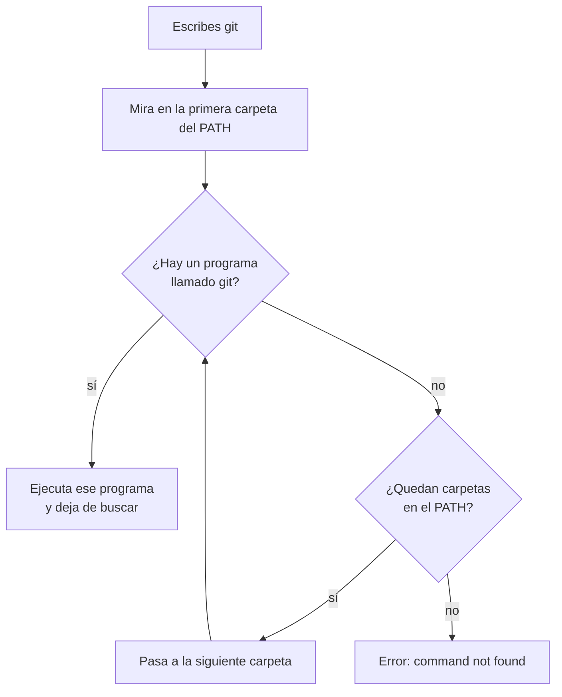

# 02.03 Instalar programas, variables de entorno y PATH

> **Versiones:** Git 2.56.0, Git for Windows 2.56.0(4) y Visual Studio Code 1.145, verificadas el 8 de noviembre de 2026
> **Conviene saber antes:** [02.01 Cómo funciona un ordenador](01-como-funciona-un-ordenador.md) · [02.02 Archivos, carpetas y rutas](02-archivos-carpetas-y-rutas.md)
> **Tiempo estimado:** 2,5 horas
> **Nivel:** Básico · Núcleo

## Qué aprenderás

- Qué pasa de verdad cuando **instalas un programa** y las tres formas habituales de hacerlo: **instaladores**, **tiendas de aplicaciones** y **gestores de paquetes**.
- Por qué hay que descargar siempre de la **web oficial** y cómo elegir el instalador que le toca a tu ordenador.
- Cómo instalar las dos herramientas que vas a usar en el resto del curso: **Visual Studio Code** y **Git** (en Windows, con **Git Bash**, la terminal del curso).
- Qué son las **variables de entorno** y, sobre todo, el **PATH**: la lista de carpetas donde el sistema busca los programas.
- Por qué aparece «command not found» o «no se reconoce como un comando» y cómo averiguar la causa.
- Tu **primer contacto con la terminal**: abrirla y comprobar lo instalado con `git --version`, `echo $PATH` y `command -v git`.
- Cómo leer las salidas de la terminal del curso cuando las tuyas no son idénticas.

Al terminar este módulo tendrás tu ordenador preparado para el resto del curso. La terminal la aprenderás a fondo en la fase 3; aquí solo la abrirás para comprobar que todo está en su sitio.

## 1. Teoría

### 1.1. Qué es instalar un programa

Ya sabes que un [programa](../fase-01-que-es-programar/01-que-es-programar.md#14-qué-es-un-programa) es un algoritmo escrito para que el ordenador lo ejecute, y que el ordenador guarda los programas en el disco, como cualquier otro fichero (lo viste en [02.01, apartado 1.8](01-como-funciona-un-ordenador.md#18-programas-y-procesos)). Entonces, ¿por qué no basta con copiar el fichero del programa y ya está?

Porque un programa casi nunca es **un solo fichero**. Un editor de código, por ejemplo, son cientos o miles de ficheros: el programa principal, piezas que comparte con otros programas, iconos, traducciones, configuración… **Instalar** un programa es dejar todo eso **colocado y conectado** para que funcione:

1. **Copiar los ficheros** del programa a una carpeta pensada para ello (en Windows, normalmente dentro de `C:\Program Files` o de tu carpeta personal; en macOS, en `Aplicaciones`; en Linux, repartidos por carpetas del sistema como `/usr/bin`).
2. **Avisar al sistema operativo** de que el programa existe: crear el acceso directo del menú de inicio o el icono del Dock, asociarle los tipos de fichero que sabe abrir, apuntarlo en la lista de programas instalados para poder desinstalarlo después.
3. **Prepararlo para que lo encuentren** otros programas y la terminal. Esto último es el **PATH**, y es la idea más importante de este módulo: la verás en el [apartado 1.10](#110-el-path-dónde-busca-el-sistema-los-programas).

Una analogía: instalar un programa es como mudarse a un piso. No basta con dejar las cajas en el portal (copiar los ficheros): hay que colocar cada cosa en su habitación, poner tu nombre en el buzón y avisar a Correos de tu nueva dirección para que te lleguen las cartas. Si te saltas ese último paso, vives allí, pero nadie te encuentra.

> **📌 Nota:** para instalar algo que afecta a todo el ordenador, el sistema te pedirá permiso de [administrador](01-como-funciona-un-ordenador.md#17-el-sistema-operativo). Lee qué estás autorizando antes de aceptar.

### 1.2. Tres formas de instalar

Hay tres caminos habituales para instalar un programa. Los tres hacen lo mismo por dentro (los pasos del apartado anterior); cambia quién se encarga y de dónde sale el programa.

**1. Un instalador descargado de la web del programa.** Descargas un fichero de la web oficial, lo abres y te va guiando con varias pantallas («Siguiente», «Siguiente», «Instalar»). Es la forma más conocida.

| Sistema | Cómo suele ser el instalador |
|---|---|
| Windows | Un fichero `.exe` o `.msi` que abres con doble clic |
| macOS | Un fichero `.dmg` (una especie de disco virtual) del que arrastras la aplicación a `Aplicaciones`, o un `.pkg` con pantallas como en Windows |
| Linux | Un paquete `.deb` (Debian, Ubuntu y derivados) o `.rpm` (Fedora y derivados) |

**2. Una tienda de aplicaciones.** La Microsoft Store en Windows, la App Store en macOS o el centro de software de tu distribución de Linux. Buscas el programa, pulsas «Instalar» y la tienda hace el resto, incluidas las actualizaciones. Es lo más cómodo, pero no todas las herramientas de programación están en las tiendas, o no en su última versión.

**3. Un gestor de paquetes.** Es un programa que **instala otros programas** a partir de una orden escrita en la terminal. Funciona como una tienda de aplicaciones sin ventanas: tiene un catálogo de programas (los **paquetes**), sabe de dónde descargarlos, comprueba que no se han alterado por el camino, los instala, instala también lo que necesitan para funcionar y sabe actualizarlos todos de una vez. Es la forma favorita de los programadores, porque una sola línea sustituye a todas las pantallas del instalador y se puede repetir igual en cualquier ordenador.

Cada sistema tiene el suyo. Esta es la orden que instala Git con cada uno, tal como la da la documentación oficial (a 8 de noviembre de 2026):

| Sistema | Gestor de paquetes | Orden para instalar Git | Fuente |
|---|---|---|---|
| Windows 10 y 11 | **winget** (viene con Windows, dentro de «Instalador de aplicación») | `winget install --id Git.Git -e --source winget` | git-scm.com/install/windows |
| macOS | **Homebrew** (no viene con macOS: se instala aparte, desde brew.sh) | `brew install git` | git-scm.com/install/mac |
| Linux (Debian, Ubuntu…) | **apt** (viene con el sistema) | `sudo apt install git` | git-scm.com/install/linux |
| Linux (Fedora) | **dnf** (viene con el sistema) | `sudo dnf install git` | git-scm.com/install/linux |

No tienes que entender cada parte de esas órdenes, ni teclearlas ahora: aprenderás a moverte por la terminal en la fase 3. Fíjate solo en la idea: **nombre del gestor, la palabra `install` y el nombre del paquete**. En Linux, `sudo` delante significa «haz esto como administrador»: te pedirá tu contraseña (al escribirla no se ve nada en pantalla, ni asteriscos; es normal).

> **📌 Nota:** la web de Git avisa de que el paquete `Git.Git` de winget **no lo mantiene el proyecto Git for Windows** y puede ir algo por detrás de la última versión oficial; y que, en general, los paquetes de los gestores los preparan terceros. Es normal: los gestores de paquetes publican las versiones nuevas con un poco de retraso. Por ejemplo, el Git que instala apt en Ubuntu 26.04 es el 2.53.0 (comprobado el 8 de noviembre de 2026), cuando la última versión de Git es la 2.56.0. Para este curso, cualquiera de las dos te sirve.

### 1.3. Descarga siempre de la web oficial

Un instalador es un programa al que, durante la instalación, das permiso de administrador. Si ese instalador no es el de verdad, le estás dando las llaves de tu ordenador a un desconocido. Por eso, la primera regla de instalar programas es:

> **⚠️ Cuidado:** descarga cada programa **solo de su web oficial** (o de la tienda de aplicaciones o el gestor de paquetes de tu sistema). Nunca de webs de descargas que «empaquetan» programas ajenos, de enlaces que te llegan por correo o mensajería, ni del primer anuncio que aparece en el buscador.

Cómo saber que estás en la web oficial:

- **Fíjate en el dominio** (la parte de la dirección que va antes de la primera `/`). Las webs oficiales de las herramientas del curso, a 8 de noviembre de 2026:

  | Programa | Web oficial |
  |---|---|
  | Git (todos los sistemas) | `git-scm.com` |
  | Git for Windows | `gitforwindows.org` (la descarga de `git-scm.com` lleva a sus ficheros en `github.com/git-for-windows`) |
  | Visual Studio Code | `code.visualstudio.com` |
  | Homebrew | `brew.sh` |

- **Desconfía de los anuncios.** En los buscadores, los primeros resultados pueden ser anuncios pagados, y a veces son de webs que imitan a la oficial. Mira la dirección antes de pulsar.
- **Desconfía de los parecidos**: `git-scm.com.descargas-gratis.net` **no** es `git-scm.com`. Lo que cuenta es el final del dominio, justo antes de la primera `/`.
- **Si dudas, entra por la documentación**: la web oficial suele ser la que enlaza la página del proyecto en Wikipedia o en su repositorio de código.

Esta costumbre te va a acompañar siempre: es una de las bases de la seguridad de quien programa, y la ampliarás en el módulo «Seguridad básica» (fase 7).

### 1.4. El instalador que le toca a tu ordenador

En la página de descarga de casi cualquier herramienta verás varias opciones. Para elegir bien necesitas los dos datos de tu ordenador que averiguaste en [02.01, apartado 2.5](01-como-funciona-un-ordenador.md#25-averiguar-qué-ordenador-tienes): el sistema operativo y la [arquitectura](01-como-funciona-un-ordenador.md#110-32-y-64-bits-x86-64-y-arm) del procesador (x64 o ARM64). Allí viste también qué pasa si descargas la versión de otra arquitectura.

Así lo ofrecen las dos herramientas de este módulo (a 8 de noviembre de 2026):

| Herramienta | Windows | macOS | Linux |
|---|---|---|---|
| Git | Git for Windows: instalador (*Setup*) **x64** o **ARM64**, y versiones *Portable* que no se instalan | Viene con las herramientas de desarrollo de Apple, o con Homebrew | Con el gestor de paquetes de tu distribución |
| Visual Studio Code | Instalador de usuario (*User Installer*, el recomendado), instalador de sistema (*System Installer*) o un `.zip`, cada uno en x64 o Arm64 | Versión **Universal** (vale para cualquier Mac), **Apple silicon** o **Intel** | `.deb`, `.rpm`, Snap o un `.tar.gz` |

Fíjate en dos cosas de la tabla:

- **En macOS y Linux, Git no se descarga de una web**: lo instala el sistema o el gestor de paquetes, que ya eligen la versión de tu arquitectura.
- **«De usuario» o «de sistema»** quiere decir para quién se instala. El **instalador de usuario** instala el programa solo para tu cuenta, dentro de tu carpeta personal, y por eso **no pide permisos de administrador**. El **de sistema** lo instala para todas las cuentas del ordenador, en `C:\Program Files`, y sí los pide. Si el ordenador es solo tuyo, el de usuario es el más sencillo.

### 1.5. Instalar Visual Studio Code

**Visual Studio Code** (VS Code, para los amigos) es un **editor de código**: un programa para escribir y leer código fuente, con colores, ayudas y atajos pensados para programar. Es gratuito, lo hace Microsoft, funciona en los tres sistemas y es el que usa este curso. Aquí **solo lo instalas**; aprenderás a usarlo en el módulo «El editor de código» (fase 3).

Lo instalas antes que Git por un motivo práctico: así, en Windows, el instalador de Git ya lo encuentra y puedes elegirlo como editor de Git (lo verás en el [apartado 1.6](#16-instalar-git-en-windows-git-for-windows-y-git-bash)).

Saca versión nueva cada mes. La de noviembre de 2026 es la **1.145** (verificada el 8 de noviembre de 2026), y se **actualiza sola**: no te preocupes si cuando lo instales la versión es otra.

Los pasos, según la documentación oficial (`code.visualstudio.com/docs/setup`, a 8 de noviembre de 2026):

**En Windows:**

1. Entra en `code.visualstudio.com` y descarga el instalador para Windows. Elige el **instalador de usuario** (*User Installer*) de tu arquitectura, que es el que la documentación recomienda para la mayoría: no necesita permisos de administrador y es el que mejor se actualiza.
2. Ábrelo y acepta las opciones que trae marcadas. Entre ellas está la de **añadir VS Code al PATH** (*Add to PATH*), que permite abrirlo desde la terminal con la orden `code`. Déjala marcada.
3. Al terminar, ábrelo desde el menú de inicio para comprobar que arranca.

**En macOS:**

1. Descarga la versión para macOS (la **Universal** sirve para cualquier Mac).
2. Abre el fichero `.dmg` descargado y **arrastra Visual Studio Code a la carpeta `Aplicaciones`**. Si lo abres desde la carpeta de descargas sin moverlo, funcionará, pero no se actualizará bien.
3. Ábrelo desde `Aplicaciones` (o desde Launchpad). La primera vez, macOS te preguntará si quieres abrir una aplicación descargada de internet: confirma.

En macOS, la orden `code` de la terminal **no** se instala sola: se añade desde el propio VS Code con una orden que se llama *Shell Command: Install 'code' command in PATH*. No la necesitas todavía: la verás en «El editor de código».

**En Linux (Ubuntu, Debian…):**

1. Descarga el paquete `.deb` desde `code.visualstudio.com`.
2. Ábrelo con el centro de software de tu sistema (doble clic) y pulsa «Instalar». Durante la instalación te preguntará si quieres añadir el repositorio de Microsoft: acepta, y así VS Code se actualizará con el resto del sistema.

En Linux, el `.deb` deja la orden `code` lista en la terminal.

> **📌 Nota:** también se puede instalar con un gestor de paquetes (por ejemplo, con winget su paquete se llama `Microsoft.VisualStudioCode`). El resultado es el mismo; si es tu primera vez, el instalador de la web es más fácil de seguir.

### 1.6. Instalar Git en Windows: Git for Windows y Git Bash

**Git** es la herramienta que guarda el historial de los cambios de un proyecto. La aprenderás en la fase 5; ahora solo la instalas. Pero en Windows, instalarla trae un regalo que vas a usar desde ya: **Git Bash**.

En Windows, Git se instala con **Git for Windows**, que incluye dos cosas:

- **Git**, la herramienta.
- **Git Bash**, una **terminal**: una ventana en la que, en lugar de usar el ratón, escribes **órdenes** (también se llaman **comandos**) y el ordenador te contesta con texto. Git Bash usa **bash**, el mismo «idioma» de órdenes que la terminal de Linux y que la de casi todos los servidores del mundo.

Por eso este curso usa Git Bash como terminal en Windows: con ella, las órdenes son las mismas en Windows, macOS y Linux. Windows trae sus propias terminales (**PowerShell** y el **símbolo del sistema**), pero usan otras órdenes; las reconocerás en «La terminal: lo básico» (fase 3).

> **📌 Nota:** existe otra forma de tener bash en Windows, **WSL** (el subsistema de Windows para Linux), que mete un Linux completo dentro de Windows. Es muy útil para cursos más avanzados; para este curso, Git Bash es más sencillo y suficiente.

**Los pasos** (con Git for Windows **2.56.0(4)**, publicada el 26 de octubre de 2026; necesita Windows 10 o posterior):

1. Entra en `git-scm.com`, ve a la descarga para Windows y elige el instalador (*Setup*) de tu arquitectura: **x64** en la mayoría de los ordenadores, **ARM64** si tu procesador es ARM. El fichero se llama algo como `Git-2.56.0.4-64-bit.exe`.
2. Ábrelo. Windows te preguntará si permites que haga cambios: di que sí.
3. El instalador está **en inglés** y tiene muchas pantallas. Casi todas se dejan **como vienen**: quien hace Git for Windows ha elegido valores pensados para la mayoría. Solo hay **dos** que conviene cambiar, y te las marcamos abajo.

Estas son las pantallas, en orden, según el instalador de la versión 2.56.0(4) (comprobado en su código el 8 de noviembre de 2026; algunas solo aparecen en ciertos ordenadores, y en otras versiones pueden cambiar de nombre o de orden):

| Pantalla (en inglés) | Qué pregunta | Qué haces |
|---|---|---|
| *Information* | La licencia (GNU GPL) | Lee y pulsa *Next* |
| *Select Destination Location* | En qué carpeta se instala | Deja la que trae (`C:\Program Files\Git`) |
| *Select Components* | Qué piezas instalar | Deja las que vienen marcadas |
| *Select Start Menu Folder* | La carpeta del menú de inicio | Deja la que trae |
| *Choosing the default editor used by Git* | Qué editor abre Git cuando necesita que escribas un texto | **Cámbiala**: elige *Use Visual Studio Code as Git's default editor* |
| *Adjusting the name of the initial branch in new repositories* | Cómo se llama la rama inicial de un proyecto nuevo | **Cámbiala**: elige *Override the default branch name for new repositories* y deja escrito `main` |
| *Adjusting your PATH environment* | Desde dónde podrás usar Git | Deja la marcada como *(Recommended)*: *Git from the command line and also from 3rd-party software* |
| *Choosing the SSH executable* | Qué programa usa Git para conexiones SSH | Si aparece, deja la que trae |
| *Choosing HTTPS transport backend* | Cómo comprueba Git las conexiones seguras | Deja la que trae |
| *Configuring the line ending conversions* | Cómo trata Git los saltos de línea | Deja la que trae (*Checkout Windows-style, commit Unix-style line endings*) |
| *Configuring the terminal emulator to use with Git Bash* | En qué ventana se abre Git Bash | Deja la que trae (*Use MinTTY*) |
| *Choose the default behavior of `git pull`* | Qué hace Git al traer cambios | Deja la que trae |
| *Choose a credential helper* | Cómo guarda Git tus credenciales | Deja la que trae (*Git Credential Manager*) |
| *Configuring extra options* | Opciones de rendimiento | Deja las que vienen marcadas |

Al terminar, pulsa *Install*, espera y, en la última pantalla, pulsa *Finish*.

**Por qué cambiar esas dos:**

- **El editor.** Git, a veces, abre un editor para que escribas un mensaje. El que viene elegido es **Vim**, un editor muy potente que funciona dentro de la terminal, pero difícil para empezar (salir de él es un clásico de los principiantes). El propio instalador lo dice: Vim es el editor por defecto «solo por razones históricas» y recomienda cambiarlo por uno moderno. Como ya tienes VS Code, elige ese. Si no te aparece la opción de VS Code (por ejemplo, porque lo instalaste después), elige *Use Notepad as Git's default editor* (el Bloc de notas): se puede cambiar más adelante.
- **La rama `main`.** Lo entenderás en la fase 5: una rama es una línea de trabajo dentro de un proyecto, y la primera se llama, según como esté configurado Git, `master` o `main`. Hoy casi todos los proyectos nuevos, GitHub incluido, usan `main`, y es lo que usa este curso. Si lo eliges aquí, tu Git ya lo hará así; si no, no pasa nada: en el módulo «Git: fundamentos» (fase 5) verás cómo configurarlo.

> **⚠️ Cuidado:** en la pantalla del PATH, **no** elijas *Use Git from Git Bash only*. Con esa opción, Git solo funcionaría dentro de Git Bash: VS Code y otros programas no lo encontrarían. Por qué pasa esto lo entenderás en el [apartado 1.10](#110-el-path-dónde-busca-el-sistema-los-programas).

Después de instalarlo, en el menú de inicio tendrás **Git Bash**. La abrirás en el [apartado 2.1](#21-abrir-la-terminal-por-primera-vez).

### 1.7. Instalar Git en macOS

En macOS no hace falta descargar nada de una web: Apple ofrece Git dentro de sus **herramientas de línea de órdenes** (*Command Line Tools*), y hay dos formas sencillas de conseguirlo.

**La más fácil: dejar que macOS te lo ofrezca.** Abre la Terminal (verás cómo en el [apartado 2.1](#21-abrir-la-terminal-por-primera-vez)) y escribe `git --version`. Si Git no está instalado, macOS abre una ventana que te dice que esa orden necesita las herramientas de desarrollo y te ofrece instalarlas. Acepta, espera a que termine (son unos cuantos cientos de megas) y vuelve a escribir `git --version`.

Esa misma instalación se puede pedir directamente con la orden `xcode-select --install`, que es la que da la web de Git (`git-scm.com/install/mac`, a 8 de noviembre de 2026).

**Con Homebrew.** Si ya usas Homebrew, el gestor de paquetes más extendido en macOS, basta con `brew install git`. Así tendrás una versión más reciente que la de Apple. Si no lo usas, no lo instales solo por esto: la versión de Apple te sirve para todo el curso.

> **📌 Nota:** la versión de Git que trae Apple suele ir algo por detrás de la última, y en su número aparece la palabra «Apple» (lo verás en el [apartado 2.3](#23-comprobar-que-git-está-instalado)). Es Git de verdad, y para este curso funciona igual.

**La terminal de macOS usa zsh.** Desde macOS 10.15 (Catalina), la terminal de macOS no usa bash, sino **zsh**, otro «idioma» de órdenes muy parecido (lo dice Apple en su web de soporte). Las órdenes que usa este curso se escriben igual y hacen lo mismo en zsh y en bash, así que no tienes que cambiar nada. Cuando haya alguna diferencia, el módulo te avisará.

### 1.8. Instalar Git en Linux

En Linux, Git se instala con el **gestor de paquetes** de tu distribución, y en muchas ya viene instalado. En Ubuntu, Debian y sus derivadas:

```bash
sudo apt install git
```

En Fedora:

```bash
sudo dnf install git
```

Te pedirá tu contraseña y, después, que confirmes la instalación (pulsa <kbd>S</kbd> o <kbd>Y</kbd>, según el idioma, y luego <kbd>Intro</kbd>). Son las órdenes que da la web de Git (`git-scm.com/install/linux`, a 8 de noviembre de 2026; allí verás `apt-get`, la forma más antigua de la misma orden, que hace lo mismo). Si prefieres no usar la terminal todavía, también puedes buscar «git» en el centro de software de tu distribución.

> **📌 Nota:** en Linux, la terminal suele usar **bash** directamente, así que es la misma que la del curso.

### 1.9. Variables de entorno

Has instalado tus herramientas. Antes de comprobarlas, falta entender **cómo las encuentra el sistema**. Para eso necesitas dos ideas: las variables de entorno y el PATH.

En [Algoritmos y pseudocódigo](../fase-01-que-es-programar/02-algoritmos-y-pseudocodigo.md#variables) viste que una variable es un dato con nombre. Una **variable de entorno** es lo mismo, pero a nivel de todo el sistema: un **dato con nombre que el sistema operativo guarda y que pueden consultar todos los programas** que se ejecutan. Sirven para que los programas sepan cosas de su «entorno» sin tener que preguntártelas cada vez.

Algunas variables de entorno que existen en casi todos los ordenadores:

| Variable | Qué guarda | Ejemplo de valor |
|---|---|---|
| `HOME` (en Windows, `USERPROFILE`) | Tu carpeta personal | `/home/ana` |
| `LANG` (en Linux y macOS) | El idioma en el que deben hablarte los programas | `es_ES.UTF-8` |
| `PATH` | Las carpetas donde buscar los programas | Lo ves en el apartado siguiente |

Por convención, sus nombres se escriben en **mayúsculas**.

Un ejemplo de para qué sirven: muchos programas (Git, entre ellos) miran la variable del idioma para decidir si te contestan en español o en inglés. Nadie se lo dice al programa: lo encuentra en su entorno.

> **📌 Nota:** en bash, para usar el **valor** de una variable se escribe un `$` delante de su nombre: `$HOME`, `$PATH`. Lo usarás en el [apartado 2.3](#23-comprobar-que-git-está-instalado) con `echo $PATH`, que significa «escribe en pantalla el valor de `PATH`». Crear y cambiar variables lo verás en «La terminal: sacarle partido» (fase 3).

### 1.10. El PATH: dónde busca el sistema los programas

Cuando escribes `git` en la terminal, el sistema tiene que encontrar el fichero del programa Git entre los cientos de miles de ficheros del disco. No los revisa todos: sería lentísimo. Mira solo en una **lista corta de carpetas**, y esa lista es la variable de entorno **`PATH`** (en inglés, *path* significa «camino»).

El **PATH** es una variable de entorno que guarda una **lista ordenada de carpetas**. Cuando escribes el nombre de un programa sin decir dónde está, el sistema:

1. Mira en la **primera** carpeta de la lista si hay un programa con ese nombre.
2. Si lo hay, **ejecuta ese** y deja de buscar.
3. Si no, pasa a la **siguiente** carpeta, y así sucesivamente.
4. Si llega al final de la lista sin encontrarlo, se rinde y te dice que **no existe esa orden**.



En texto: el sistema recorre las carpetas del PATH en orden; en cuanto encuentra un programa con ese nombre, lo ejecuta y deja de buscar, y si las recorre todas sin encontrarlo, da el error de «orden no encontrada».

En Linux, macOS y Git Bash, el PATH es un texto con las carpetas separadas por **dos puntos** (`:`). Por ejemplo:

```text
/usr/local/bin:/usr/bin:/bin
```

Son tres carpetas, en este orden: `/usr/local/bin`, `/usr/bin` y `/bin`. Son [rutas absolutas](02-archivos-carpetas-y-rutas.md#18-rutas-absolutas), como las que viste en el módulo anterior.

> **📌 Nota:** en Windows, el PATH «de Windows» separa las carpetas con **punto y coma** (`;`) y las escribe con el estilo de Windows (`C:\Program Files\Git\cmd`). Git Bash las traduce a su estilo al abrirse, así que dentro de Git Bash verás `:` y rutas como `/c/Users/ana` (la forma de escribir las rutas de Windows en Git Bash, que viste en [02.02, apartado 1.11](02-archivos-carpetas-y-rutas.md#111-cómo-se-escribe-una-ruta-en-cada-sistema)).

**Tres consecuencias** que explican casi todos los problemas que te vas a encontrar:

- **Si la carpeta de un programa no está en el PATH, el programa «no existe»** para la terminal, aunque esté instalado y funcione perfectamente con doble clic. Por eso los instaladores de herramientas de programación tienen una opción para «añadir al PATH» (la viste en [Git](#16-instalar-git-en-windows-git-for-windows-y-git-bash) y en [VS Code](#15-instalar-visual-studio-code)): lo que hacen es añadir su carpeta a la lista.
- **El orden importa.** Si dos carpetas del PATH tienen un programa con el mismo nombre, se ejecuta el de la que está **antes**. Así puedes tener dos versiones de un programa y que se use la que no esperabas (lo verás en el [error típico 3.6](#36-tener-dos-versiones-y-que-se-ejecute-la-que-no-esperas)).
- **El PATH se lee al abrir la terminal.** Cada terminal copia el PATH en el momento en que se abre. Si instalas un programa con una terminal abierta, esa terminal **no se entera** del cambio: tienes que cerrarla y abrir otra. Es el error más frecuente de todos ([error típico 3.1](#31-command-not-found-justo-después-de-instalar)).

### 1.11. Cuando el sistema no encuentra un programa

Cuando el sistema recorre todo el PATH sin encontrar lo que has escrito, te lo dice. El mensaje depende de la terminal, pero significa lo mismo: **«no conozco ninguna orden que se llame así»**.

| Terminal | Mensaje (algo parecido a esto) |
|---|---|
| Git Bash (Windows) | `bash: gti: command not found` |
| Terminal de macOS (zsh) | `zsh: command not found: gti` |
| Terminal de Linux en español | `bash: gti: orden no encontrada` (lo verás en el [apartado 2.4](#24-un-programa-que-no-está-en-el-path); en Ubuntu, a veces, con una lista de órdenes parecidas: «Quizá quiso decir…») |
| Símbolo del sistema de Windows | `"gti" no se reconoce como un comando interno o externo, programa o archivo por lotes ejecutable.` |
| PowerShell de Windows | Un mensaje que dice que el término `gti` no se reconoce como nombre de un cmdlet, función, archivo de script o programa ejecutable |

Fíjate en que el mensaje **repite lo que has escrito** (`gti`). Es lo primero que hay que mirar, porque las causas, de más a menos frecuente, son:

1. **Lo has escrito mal**: `gti` en lugar de `git`, una letra cambiada, una mayúscula de más (en Linux, `Git` y `git` son [nombres distintos](02-archivos-carpetas-y-rutas.md#112-mayúsculas-y-minúsculas)).
2. **El programa no está instalado** (o la instalación falló).
3. **Está instalado, pero la terminal se abrió antes** de instalarlo y no conoce el PATH nuevo.
4. **Está instalado, pero su carpeta no está en el PATH**: el instalador no la añadió, o elegiste una opción que no lo hace.

Para distinguir unas causas de otras tienes una orden muy útil: **`command -v`**. Escribes `command -v git` y la terminal te dice **en qué carpeta del PATH ha encontrado `git`**; si no lo encuentra, **no escribe nada**. Funciona igual en bash y en zsh. La usarás en el [apartado 2.3](#23-comprobar-que-git-está-instalado).

> **💡 Consejo:** ante un «command not found», sigue siempre este orden: **1)** ¿lo he escrito bien? **2)** ¿he cerrado y vuelto a abrir la terminal después de instalar? **3)** ¿qué dice `command -v`? **4)** ¿está la carpeta del programa en el PATH? Casi siempre se resuelve en el primer o el segundo paso.

### 1.12. Ver el PATH en Windows sin la terminal

En Windows, el PATH también se puede ver (y cambiar) desde la configuración del sistema, con ventanas. No hace falta que lo cambies: basta con que sepas que existe y dónde está, por si alguna vez un tutorial te pide «comprobar el PATH».

En Windows 11, busca «variables de entorno» en el menú de inicio: te llevará a la ventana de configuración avanzada del sistema, que tiene un botón para ver las variables de entorno (los nombres exactos pueden cambiar algo según la versión de Windows). Allí verás dos listas: las **variables de usuario** (solo para ti) y las **variables del sistema** (para todos los usuarios del ordenador). En las dos hay una que se llama **`Path`**, y al editarla verás sus carpetas, una por línea.

El PATH que usan los programas es **la unión de las dos**: primero las carpetas del sistema y después las tuyas. Ahí verás, por ejemplo, `C:\Program Files\Git\cmd` (la que añadió el instalador de Git) o la carpeta `bin` de VS Code.

> **⚠️ Cuidado:** no borres ni cambies nada de esa lista si no sabes para qué sirve. Si quitas una carpeta, todos los programas que estaban en ella dejarán de encontrarse desde la terminal. **Modificar el PATH** a propósito lo aprenderás en «La terminal: sacarle partido» (fase 3).

## 2. Ejemplos de código

En esta sección vas a abrir la terminal por primera vez y a escribir tres órdenes para comprobar que todo está bien instalado. Son las únicas que necesitas en este módulo.

### 2.1. Abrir la terminal por primera vez

**Situación real:** acabas de instalar Git y VS Code y quieres comprobar que todo está bien. Para eso, abres la terminal.

| Sistema | Cómo abrir la terminal del curso |
|---|---|
| Windows | Busca **Git Bash** en el menú de inicio y ábrelo. (No uses PowerShell ni el símbolo del sistema: ver el [error típico 3.3](#33-usar-otra-terminal-en-windows)) |
| macOS | Abre **Terminal**: está en `Aplicaciones` → `Utilidades`, o búscala con Spotlight (<kbd>Cmd</kbd>+<kbd>Espacio</kbd> y escribe «Terminal») |
| Linux | Abre **Terminal** desde el menú de aplicaciones. En Ubuntu y muchas otras, también con <kbd>Ctrl</kbd>+<kbd>Alt</kbd>+<kbd>T</kbd> |

Verás una ventana con poco más que un texto y un cursor parpadeando. Ese texto es el **indicador** (en inglés, *prompt*): la terminal te dice que está esperando una orden. Suele incluir tu nombre de usuario y el del ordenador, y termina en un símbolo:

| Terminal | El indicador termina en | Algo parecido a esto |
|---|---|---|
| Git Bash | `$` (en la línea de abajo; arriba, tu usuario, el ordenador y la carpeta) | `ana@PORTATIL-ANA … ~`, y debajo `$` |
| Terminal de macOS (zsh) | `%` | `ana@MacBook-de-Ana ~ %` |
| Terminal de Linux (bash) | `$` | `ana@portatil:~$` |

La terminal se abre en tu carpeta personal, que aparece abreviada como [`~`](02-archivos-carpetas-y-rutas.md#111-cómo-se-escribe-una-ruta-en-cada-sistema).

**Cómo se usa:** escribes la orden y pulsas <kbd>Intro</kbd>. La terminal la ejecuta, escribe la respuesta (la **salida**) y vuelve a mostrar el indicador, lista para la siguiente.

> **📌 Nota:** en este curso, cuando se muestra una sesión de terminal, cada orden aparece detrás de un `$ `, como en `$ git --version`. **El `$` no se escribe**: representa el indicador. Tú escribes solo `git --version`. Las líneas que no empiezan por `$ ` son la respuesta del ordenador.

### 2.2. Un aviso sobre las salidas de la terminal

Antes de la primera orden, un aviso que vale **para todo el curso**.

Las salidas que vas a ver en el curso se han obtenido en una terminal concreta: un Linux en español en el que la persona usuaria se llama `alumno` y el ordenador, `ordenador`. Se han ejecutado de verdad, y así sabes que son correctas. Pero **tu terminal no es esa**, así que en tu pantalla cambiarán algunas cosas:

- **El nombre de usuario** y el del ordenador: verás los tuyos.
- **Las rutas**: tu carpeta personal no se llamará `/home/alumno`. En Windows, con Git Bash, verás rutas como `/c/Users/tu-nombre/…`.
- **Las fechas y las horas**: las de cuando tú lo hagas.
- **Algún detalle en macOS**: unas pocas órdenes dan salidas algo distintas en macOS que en Linux; cuando importe, el módulo te avisará.
- **Las versiones** de los programas, si tienes otras.
- **Y cuando llegues a Git** (fase 5): los identificadores de los *commits* (unos códigos largos de letras y números que identifican cada versión guardada), sus fechas, y el nombre y el correo de quien los hace serán distintos de los del curso. Será lo primero que notes al comparar tu historial con el del curso, y es lo normal: dependen de quién, cuándo y dónde.

Lo importante es que **te fijes en lo importante de cada salida**, no en que sea idéntica letra a letra. En cada ejemplo, el texto te dirá en qué tienes que fijarte. Si tu salida dice lo mismo con otros nombres, otras rutas u otras fechas, lo has hecho bien.

### 2.3. Comprobar que Git está instalado

**Situación real:** tienes Git instalado y quieres comprobar tres cosas: que la terminal lo encuentra, qué versión tienes y en qué carpeta está. Escribe estas tres órdenes, una a una, pulsando <kbd>Intro</kbd> después de cada una:

| Orden | Qué pregunta |
|---|---|
| `git --version` | «Git, ¿qué versión eres?» |
| `echo $PATH` | «Escribe el valor de la variable `PATH`», es decir, la lista de carpetas donde se buscan los programas |
| `command -v git` | «¿En qué carpeta encuentras el programa `git`?» |

Esto es lo que contestan en la terminal donde se ha comprobado el curso, un Linux:

**En tu terminal** (`sesion.txt`):

```text
$ git --version
git version 2.56.0
$ echo $PATH
/usr/local/sbin:/usr/local/bin:/usr/sbin:/usr/bin:/sbin:/bin
$ command -v git
/usr/bin/git
```

📁 **Código:** [`codigo/03-instalar-programas-y-path/ejemplos/2.3-comprobar-git/`](codigo/03-instalar-programas-y-path/ejemplos/2.3-comprobar-git/)

**En qué fijarte de cada salida:**

1. **`git --version`** contesta con una **versión**. Si sale `git version` seguido de un número, Git está instalado y la terminal lo encuentra: es lo único que necesitas saber. El número puede ser otro (más antiguo o más nuevo): no pasa nada.
2. **`echo $PATH`** escribe la lista de carpetas, separadas por `:`. Aquí hay seis: `/usr/local/sbin`, `/usr/local/bin`, `/usr/sbin`, `/usr/bin`, `/sbin` y `/bin`. La tuya será más larga y con otras carpetas: es normal.
3. **`command -v git`** escribe la **ruta completa** del programa que se ejecuta al escribir `git`. Fíjate en que su carpeta, `/usr/bin`, **está en el PATH** (es la cuarta de la lista), y por eso la terminal lo encuentra.

En **Windows, con Git Bash**, verás algo parecido a esto (las partes que cambian se explican debajo):

```text
$ git --version
git version 2.56.0.windows.4
$ echo $PATH
/c/Users/ana/bin:/ucrt64/bin:/usr/local/bin:/usr/bin:/bin:…:/c/WINDOWS/system32:/c/WINDOWS:…:/cmd:…:/c/Users/ana/AppData/Local/Programs/Microsoft VS Code/bin:…
$ command -v git
/ucrt64/bin/git
```

- La versión lleva `.windows.` y un número detrás: es la forma en que Git for Windows numera sus versiones (la 2.56.0(4) de su web se escribe `2.56.0.windows.4`).
- El PATH es **mucho más largo** (aquí se ha acortado con `…`): incluye las carpetas de Git Bash, las de Windows (`/c/WINDOWS/system32`) y las de los programas que has instalado, como VS Code. Tu nombre de usuario estará donde pone `ana`.
- `/cmd` es la carpeta `C:\Program Files\Git\cmd` vista desde dentro de Git Bash: la que el instalador añadió al PATH de Windows.
- `command -v git` muestra una carpeta interna de Git for Windows. Desde la versión 2.56.0 es `/ucrt64/bin`; en versiones anteriores era `/mingw64/bin`, y en ordenadores ARM64 será otra. Lo importante es que **sale una ruta**.

En **macOS**, algo parecido a esto:

```text
$ git --version
git version 2.x.x (Apple Git-xxx)
$ echo $PATH
/usr/local/bin:/usr/bin:/bin:/usr/sbin:/sbin:…
$ command -v git
/usr/bin/git
```

- Si Git viene de Apple, la versión termina en `(Apple Git-` y un número; donde aquí hay `x`, verás números.
- Si lo instalaste con Homebrew, el PATH empezará por `/opt/homebrew/bin` (en los Mac con chip de Apple) y `command -v git` dirá `/opt/homebrew/bin/git`.
- Recuerda que en macOS el indicador termina en `%`, no en `$`.

> **💡 Consejo:** si alguna de las tres órdenes contesta con un mensaje de error en lugar de lo que esperabas, no sigas adelante: ve al [apartado 1.11](#111-cuando-el-sistema-no-encuentra-un-programa) y a los [errores típicos](#3-errores-típicos). Lo más probable es que la solución sea cerrar la terminal y abrir otra.

### 2.4. Un programa que no está en el PATH

**Situación real:** quieres ver qué hace `command -v` cuando el programa **no** está. Escribe a propósito `gti` (con las letras cambiadas) y compara con `git`:

**En tu terminal** (`sesion.txt`):

```text
$ command -v gti
$ command -v git
/usr/bin/git
$ gti --version
bash: gti: orden no encontrada
```

📁 **Código:** [`codigo/03-instalar-programas-y-path/ejemplos/2.4-programa-que-no-esta/`](codigo/03-instalar-programas-y-path/ejemplos/2.4-programa-que-no-esta/)

**En qué fijarte:** con `gti`, `command -v` **no escribe nada** y la terminal vuelve directamente al indicador. Ese silencio es la respuesta: «he buscado `gti` en todas las carpetas del PATH y no está». Con `git`, en cambio, escribe su ruta.

Esta es la forma más rápida de saber si un programa está en el PATH **sin ejecutarlo**. Si lo ejecutas, como en la última orden (`gti --version`), es bash quien contesta, con el mensaje de «orden no encontrada» del [apartado 1.11](#111-cuando-el-sistema-no-encuentra-un-programa): repite lo que has escrito (`gti`). En inglés o en otras terminales, el mensaje cambia (`command not found`), pero significa lo mismo.

## 3. Errores típicos

### 3.1. «command not found» justo después de instalar

**Qué pasa:** instalas un programa, vuelves a la terminal que tenías abierta, escribes su nombre… y te dice que no existe.

**Por qué ocurre:** la terminal copió el PATH **al abrirse**, antes de la instalación. El instalador cambió el PATH del sistema, pero tu terminal sigue con la copia vieja ([apartado 1.10](#110-el-path-dónde-busca-el-sistema-los-programas)).

**Cómo se arregla:** **cierra la terminal y abre una nueva**. Si usas la terminal integrada de VS Code (la verás en la fase 3), cierra VS Code entero y vuelve a abrirlo. En Windows, si ni así funciona, cierra la sesión o reinicia el ordenador. La documentación de VS Code lo dice así: «reinicia la consola después de la instalación».

### 3.2. Escribir mal la orden

**Qué pasa:** escribes `gti --version`, `Git --version` o `git --versión`, y la terminal se queja.

**Por qué ocurre:** el ordenador no adivina lo que querías decir ([apartado 1.1 de «Qué es programar»](../fase-01-que-es-programar/01-que-es-programar.md#11-un-ordenador-es-muy-rápido-y-muy-obediente)): busca **exactamente** lo que has escrito. Según dónde esté la errata, el error es distinto:

- Si está en **el nombre del programa** (`gti`, `Git`), el sistema no lo encuentra en el PATH y da «command not found» ([apartado 1.11](#111-cuando-el-sistema-no-encuentra-un-programa)). En Linux, además, las mayúsculas cuentan: `Git` no es `git`.
- Si el nombre está bien pero la errata va **en lo que viene detrás**, el programa sí se ejecuta, y es **él** quien se queja. Por ejemplo, con una tilde de más en `--versión`:

**En tu terminal** (`sesion.txt`):

```text
$ git --versión
opción --versión desconocida
uso: git [-v | --version] [-h | --help] [-C <path>] [-c <name>=<value>]
           [--exec-path[=<path>]] [--html-path] [--man-path] [--info-path]
           [-p | --paginate | -P | --no-pager] [--no-replace-objects] [--no-lazy-fetch]
           [--no-optional-locks] [--no-advice] [--bare] [--git-dir=<path>]
           [--work-tree=<path>] [--namespace=<name>] [--config-env=<name>=<envvar>]
           <command> [<args>]
```

📁 **Código:** [`codigo/03-instalar-programas-y-path/ejemplos/3.2-version-con-tilde/`](codigo/03-instalar-programas-y-path/ejemplos/3.2-version-con-tilde/)

**En qué fijarte:** esta vez **no** dice «command not found». Git se ha ejecutado (así que está instalado y en el PATH), y te dice que no conoce la opción `--versión` y te recuerda cómo se usa. En la primera línea de ese recordatorio aparece `--version`, sin tilde: esa es la buena. No te preocupes por el resto de la ayuda: no hace falta entenderla. (Si tu Git está en inglés, verás `unknown option: --versión`; y si tu versión de Git es otra, la ayuda puede cambiar algo.)

**Cómo se arregla:** lee el mensaje con calma, como aprendiste en [«Qué es programar»](../fase-01-que-es-programar/01-que-es-programar.md#33-asustarse-con-el-primer-mensaje-de-error), y compara letra a letra lo que has escrito con lo que querías escribir. Las órdenes de la terminal no llevan tildes ni eñes.

### 3.3. Usar otra terminal en Windows

**Qué pasa:** en Windows, abres **PowerShell** o el **símbolo del sistema** en lugar de Git Bash y escribes las órdenes del curso. `git --version` funciona (si elegiste la opción recomendada del PATH), pero `echo $PATH` no muestra la lista de carpetas y `command -v git` da error.

**Por qué ocurre:** son terminales distintas, con su propio «idioma» de órdenes. `$PATH` y `command -v` son de bash (y zsh); PowerShell y el símbolo del sistema tienen sus equivalentes, con otra forma de escribirlos.

**Cómo se arregla:** en Windows, abre siempre **Git Bash** para seguir el curso. Si ves un indicador que termina en `>` (como `C:\Users\ana>` o `PS C:\Users\ana>`), estás en otra terminal. Las equivalencias con PowerShell las verás en «La terminal: lo básico» (fase 3), solo para reconocerlas.

### 3.4. Descargar de una web que no es la oficial

**Qué pasa:** buscas «descargar git» o «descargar visual studio code», pulsas el primer resultado y acabas en una web que no es la oficial. A veces el programa viene con publicidad o con otros programas «de regalo»; en el peor caso, con un programa malicioso.

**Por qué ocurre:** los primeros resultados de un buscador pueden ser anuncios, y hay webs que se dedican a imitar las oficiales.

**Cómo se evita:** comprueba el dominio antes de descargar ([apartado 1.3](#13-descarga-siempre-de-la-web-oficial)), o usa el gestor de paquetes o la tienda de tu sistema. Si ya instalaste algo de una web dudosa, desinstálalo y pasa un antivirus.

### 3.5. Cambiar opciones del instalador sin saber qué hacen

**Qué pasa:** en el instalador de Git for Windows, marcas opciones distintas de las que venían «para probar» o porque te suenan mejor. Por ejemplo, eliges *Use Git from Git Bash only* en la pantalla del PATH, y después VS Code no encuentra Git.

**Por qué ocurre:** cada opción cambia cómo funciona Git después. Esa, en concreto, **no añade Git al PATH de Windows**: Git Bash lo encuentra porque lo busca en sus propias carpetas, pero los demás programas, no.

**Cómo se evita:** deja las opciones que vienen marcadas salvo las dos que explica el [apartado 1.6](#16-instalar-git-en-windows-git-for-windows-y-git-bash) (el editor y la rama `main`). Si ya lo instalaste con otras opciones, vuelve a ejecutar el instalador: recuerda lo que elegiste la otra vez y te deja cambiarlo.

### 3.6. Tener dos versiones y que se ejecute la que no esperas

**Qué pasa:** instalas una versión nueva de un programa, pero `--version` sigue diciendo la vieja.

**Por qué ocurre:** tienes **dos** copias del programa en carpetas distintas del PATH, y se ejecuta la que está en la carpeta que aparece **antes** en la lista ([apartado 1.10](#110-el-path-dónde-busca-el-sistema-los-programas)). Pasa a menudo en macOS con Git: la versión de Apple está en `/usr/bin` y la de Homebrew en `/opt/homebrew/bin`; si Homebrew no está bien configurado, `/usr/bin` va antes y se usa la de Apple.

**Cómo se averigua:** `command -v` te dice **cuál** se está usando (su ruta), y `echo $PATH`, en qué orden están las carpetas. Con esas dos salidas puedes razonar qué pasa. Cómo cambiar el orden del PATH lo verás en «La terminal: sacarle partido» (fase 3).

## 4. Buenas prácticas

- **Descarga solo de la web oficial**, de la tienda de tu sistema o con su gestor de paquetes. Mira el dominio antes de pulsar.
- **Elige el instalador de tu sistema y tu arquitectura.** Si no la sabes, compruébala antes de descargar.
- **Deja las opciones que vienen por defecto** en los instaladores, salvo que tengas una razón para cambiarlas (como el editor y la rama `main` de Git for Windows).
- **Lee cada pantalla del instalador**, aunque acabes pulsando *Next*: así sabrás qué has instalado y dónde, y no aceptarás programas «de regalo».
- **Cierra y vuelve a abrir la terminal después de instalar** cualquier cosa que vayas a usar desde ella.
- **Comprueba siempre lo que instalas**: `--version` para saber que funciona y qué versión tienes, `command -v` para saber dónde está.
- **No toques el PATH a ciegas.** Míralo cuanto quieras; cámbialo solo cuando sepas lo que haces (fase 3).
- **Mantén tus herramientas actualizadas**: las versiones nuevas corrigen errores y fallos de seguridad. VS Code se actualiza solo; Git, con su instalador o su gestor de paquetes.

**Lo que conviene evitar:**

- Descargar programas de webs de descargas genéricas o de enlaces que te llegan por mensaje.
- Instalar varias veces lo mismo «por si acaso»: acabarás con dos versiones y no sabrás cuál se usa.
- Copiar y pegar en la terminal órdenes de instalación de una web que no conoces: una orden de instalación tiene los mismos permisos que un instalador.

## 5. Ejercicios prácticos resueltos

> **💡 Consejo:** intenta resolver cada ejercicio **antes** de abrir las pistas y la solución. Son ejercicios de **razonar**: no tienes que instalar nada nuevo ni ejecutar más órdenes que las tres de este módulo (`git --version`, `echo $PATH` y `command -v`). Hazlos por escrito, en papel o en un documento.

### 🟢 Básico

#### Ejercicio 1 · Instalador, tienda o gestor de paquetes

Seis personas instalan un programa, cada una a su manera. Para cada caso, di **cuál de las tres formas** del [apartado 1.2](#12-tres-formas-de-instalar) está usando y **en qué sistema operativo** está:

1. Raquel escribe `brew install git` en la terminal.
2. Tomás descarga de `code.visualstudio.com` un fichero que se llama `VSCodeUserSetup-` seguido de la versión y `.exe`, lo abre y va pulsando «Siguiente».
3. Hugo escribe `sudo apt install git` y teclea su contraseña.
4. Elisa abre un fichero `.dmg` y arrastra la aplicación que hay dentro a la carpeta `Aplicaciones`.
5. Óscar escribe `winget install --id Git.Git -e --source winget`.
6. Inés abre la tienda de aplicaciones de su ordenador, busca un programa de dibujo y pulsa «Instalar».

Y una pregunta más: un profesor tiene que preparar Git en los 20 ordenadores Windows de un aula. ¿Cuál de estas formas le ahorra más trabajo y por qué?

<details>
<summary>Pista 1</summary>

Fíjate en si la persona **escribe una orden** (gestor de paquetes), **abre un fichero descargado** (instalador) o **busca en un catálogo con ventanas** (tienda). El nombre del gestor o la extensión del fichero te dicen el sistema.

</details>

<details>
<summary>Ver solución</summary>

**Razonamiento:** primero se mira cómo se instala (una orden, un fichero descargado o una tienda); después, el nombre del gestor o la extensión del fichero delatan el sistema, con las tablas del [apartado 1.2](#12-tres-formas-de-instalar).

| # | Forma | Sistema | Pista que lo delata |
|---|---|---|---|
| 1 | Gestor de paquetes (Homebrew) | macOS | `brew` es la orden de Homebrew |
| 2 | Instalador descargado de la web | Windows | Un `.exe` que se abre con doble clic y se sigue con «Siguiente» |
| 3 | Gestor de paquetes (apt) | Linux (Ubuntu, Debian…) | `apt`, y `sudo` para hacerlo como administrador |
| 4 | Instalador descargado de la web | macOS | Un `.dmg` del que se arrastra la aplicación a `Aplicaciones` |
| 5 | Gestor de paquetes (winget) | Windows | `winget` es el gestor de Windows |
| 6 | Tienda de aplicaciones | No se puede saber | Las tres familias de sistemas tienen tienda; haría falta saber cuál es |

**El aula de 20 ordenadores:** el **gestor de paquetes**, winget. Una sola orden, siempre la misma, sustituye a todas las pantallas del instalador, y se puede repetir igual (o automatizar) en los 20 ordenadores. Con el instalador, tendría que pulsar las mismas pantallas veinte veces y acertar con las mismas opciones en todas.

**Errores frecuentes al resolverlo:**

- Pensar que el caso 2 es una tienda porque se descarga «de la web de Microsoft»: una tienda es un catálogo dentro del sistema, no una página web.
- Decir un sistema concreto en el caso 6: con lo que cuenta el enunciado, no se puede saber.

</details>

#### Ejercicio 2 · ¿Es la web oficial?

Ana busca en internet cómo descargar las herramientas del curso y encuentra estos enlaces. Di cuáles son seguros para descargar y por qué:

1. `https://git-scm.com/install/windows`
2. `https://code.visualstudio.com/download`
3. `https://descargas-gratis-programas.net/visual-studio-code`
4. `https://git-scm.com.instalador-rapido.com/windows`
5. `https://github.com/git-for-windows/git/releases`
6. Un enlace que le llega por un grupo de mensajería: «Descarga aquí Git ya configurado para el curso».

<details>
<summary>Pista 1</summary>

Fíjate en el **dominio**: la parte que va justo antes de la primera `/` después de `https://`. Lo que cuenta es cómo **termina**.

</details>

<details>
<summary>Ver solución</summary>

**Razonamiento:** para cada enlace se aísla el dominio (lo que va entre `https://` y la siguiente `/`) y se compara con la lista de webs oficiales del [apartado 1.3](#13-descarga-siempre-de-la-web-oficial).

| # | Dominio | ¿Seguro? | Por qué |
|---|---|---|---|
| 1 | `git-scm.com` | **Sí** | Es la web oficial de Git |
| 2 | `code.visualstudio.com` | **Sí** | Es la web oficial de VS Code |
| 3 | `descargas-gratis-programas.net` | **No** | Una web de descargas genérica, que no es de quien hace el programa |
| 4 | `git-scm.com.instalador-rapido.com` | **No** | Empieza como la oficial, pero el dominio termina en `instalador-rapido.com`: es otra web que imita a la de verdad |
| 5 | `github.com` (en `/git-for-windows/`) | **Sí** | Es donde publica sus versiones el proyecto Git for Windows; la descarga de `git-scm.com` lleva justo ahí |
| 6 | No se sabe | **No** | Un enlace que llega por mensaje, con un programa «ya configurado» por alguien: no sabes qué lleva dentro. Descárgalo tú de la web oficial |

**Lo importante:** el caso 4 es el más traicionero, porque contiene `git-scm.com`. Pero un dominio se lee **desde el final**: lo que manda es `instalador-rapido.com`.

**Errores frecuentes al resolverlo:**

- Dar por bueno el caso 4 porque «pone git-scm.com».
- Desconfiar del caso 5 por ser `github.com` y no `git-scm.com`: es legítimo porque es el sitio donde el propio proyecto publica sus ficheros, y la web oficial enlaza ahí.

</details>

#### Ejercicio 3 · Lee la salida de git --version

Cuatro personas escriben `git --version` en su terminal y obtienen estas respuestas. Para cada una, di si Git está instalado y lo encuentra la terminal, qué versión tiene y, si puedes, en qué sistema está:

```text
git version 2.56.0.windows.4
```

```text
git version 2.53.0
```

```text
bash: git: command not found
```

```text
opción --versión desconocida
```

(La última persona, además, te dice que ha escrito «git --versión».)

<details>
<summary>Pista 1</summary>

Repasa el [apartado 2.3](#23-comprobar-que-git-está-instalado): qué forma tiene la versión en cada sistema. Y el [error típico 3.2](#32-escribir-mal-la-orden): ¿quién da el mensaje, el sistema o Git?

</details>

<details>
<summary>Ver solución</summary>

**Razonamiento:** se busca en cada salida si aparece `git version` seguido de un número (Git funciona) o un mensaje de error; y, en ese caso, quién lo da.

1. **`git version 2.56.0.windows.4`**: Git está instalado y la terminal lo encuentra. Versión 2.56.0, en concreto la 2.56.0(4) de **Git for Windows**: el `.windows.` delata que es **Windows**.
2. **`git version 2.53.0`**: Git está instalado y funciona. Versión 2.53.0, sin marcas de Windows ni de Apple: probablemente **Linux** (es justo la que instala apt en Ubuntu 26.04). Es algo más antigua que la última, pero sirve para el curso.
3. **`bash: git: command not found`**: la terminal **no encuentra** Git. Puede que no esté instalado, que la terminal se abriera antes de instalarlo o que su carpeta no esté en el PATH (las causas del [apartado 1.11](#111-cuando-el-sistema-no-encuentra-un-programa)). El mensaje es de **bash** en inglés, así que no es la terminal de macOS (diría `zsh:`); puede ser un Linux o Git Bash. En Git Bash sería muy raro, porque Git Bash viene con Git: si te pasa ahí, comprueba que la ventana es de verdad Git Bash. La versión no se sabe, porque Git no ha llegado a ejecutarse.
4. **`opción --versión desconocida`**: **Git sí está instalado** y la terminal lo encuentra (si no, el mensaje sería «command not found»). El problema es la tilde: la opción es `--version`, sin tilde. La versión no se sabe hasta que lo escriba bien.

**Lo importante:** un mensaje de error no siempre significa que falte el programa. En el caso 4, el que contesta es Git, y eso ya demuestra que está instalado.

**Errores frecuentes al resolverlo:**

- Decir en el caso 4 que Git no está instalado.
- Preocuparse en el caso 2 porque la versión no es la última: no hace falta tener la última para seguir el curso.

</details>

### 🟡 Intermedio

#### Ejercicio 4 · Lee la salida de echo $PATH

Pablo escribe `echo $PATH` en la terminal de su Linux y obtiene:

```text
/home/pablo/bin:/usr/local/bin:/usr/bin:/bin:/snap/bin
```

1. ¿Cuántas carpetas hay en su PATH? Escríbelas una por línea, en orden.
2. ¿En qué carpeta mirará **primero** el sistema cuando Pablo escriba una orden? ¿Y en cuál la última?
3. Pablo ha descargado un programa llamado `notas` y lo ha guardado en `/home/pablo/Descargas`. ¿Lo encontrará la terminal si escribe `notas`? ¿Por qué?
4. ¿Qué crees que pasaría si lo moviera a `/home/pablo/bin`?

<details>
<summary>Pista 1</summary>

Las carpetas se separan con `:` ([apartado 1.10](#110-el-path-dónde-busca-el-sistema-los-programas)). Cuenta los trozos.

</details>

<details>
<summary>Pista 2</summary>

El sistema solo busca en las carpetas que están en la lista, exactamente esas. ¿Está `/home/pablo/Descargas` en la lista?

</details>

<details>
<summary>Ver solución</summary>

**Razonamiento:** se parte el texto por los `:` para obtener la lista; después se aplica la regla del [apartado 1.10](#110-el-path-dónde-busca-el-sistema-los-programas): el sistema mira esas carpetas, en ese orden, y ninguna más.

1. **Cinco carpetas**, en este orden:

   ```text
   /home/pablo/bin
   /usr/local/bin
   /usr/bin
   /bin
   /snap/bin
   ```

2. **Primero** en `/home/pablo/bin`; **la última**, `/snap/bin`.
3. **No.** `/home/pablo/Descargas` no está en la lista, así que el sistema no mira ahí: recorrerá las cinco carpetas, no encontrará `notas` y dirá «orden no encontrada». El programa existe, pero para la terminal es como si no existiera.
4. **Lo encontraría**, porque `/home/pablo/bin` **sí** está en el PATH (y además es la primera). Es lo que hacen muchos programadores con sus pequeños programas: guardarlos en una carpeta suya que está en el PATH. Cómo se hace bien, y por qué hacen falta permisos para que un fichero se pueda ejecutar, lo verás en «La terminal: sacarle partido» (fase 3).

**Errores frecuentes al resolverlo:**

- Pensar que el sistema busca en todas las carpetas de tu carpeta personal: solo en las de la lista.
- Contar mal las carpetas por no fijarse en que la primera y la última no tienen `:` a un lado.

</details>

#### Ejercicio 5 · Qué programa se ejecutará

En el ordenador de Sara, el PATH es:

```text
/home/sara/bin:/usr/local/bin:/usr/bin:/bin
```

Y estas carpetas contienen, entre otros, estos programas:

| Carpeta | Programas que hay dentro |
|---|---|
| `/home/sara/bin` | `copia-fotos` |
| `/usr/local/bin` | `git`, `node` |
| `/usr/bin` | `git`, `python3`, `ls` |
| `/bin` | `ls` |
| `/opt/editor` | `editor` |

Para cada orden, di **qué fichero exacto** se ejecuta (su ruta completa) o si da «orden no encontrada», y qué escribiría `command -v` en cada caso:

1. `python3`
2. `git`
3. `ls`
4. `copia-fotos`
5. `editor`
6. `Python3`

<details>
<summary>Pista 1</summary>

Para cada orden, recorre las carpetas **en el orden del PATH** y párate en la primera que tenga un programa con ese nombre exacto.

</details>

<details>
<summary>Pista 2</summary>

Fíjate bien en qué carpetas aparecen en el PATH y en cuáles no. Y en el último caso, en las mayúsculas.

</details>

<details>
<summary>Ver solución</summary>

**Razonamiento:** para cada orden se hace lo mismo que el sistema ([apartado 1.10](#110-el-path-dónde-busca-el-sistema-los-programas)): mirar las carpetas del PATH en orden y quedarse con la primera que tenga el programa. `command -v` escribe justo esa ruta, o nada.

| Orden | Se ejecuta | `command -v` escribe | Por qué |
|---|---|---|---|
| `python3` | `/usr/bin/python3` | `/usr/bin/python3` | No está en las dos primeras carpetas; está en la tercera |
| `git` | `/usr/local/bin/git` | `/usr/local/bin/git` | Hay dos `git`, pero `/usr/local/bin` va **antes** que `/usr/bin` |
| `ls` | `/usr/bin/ls` | `/usr/bin/ls` | Hay dos `ls`; `/usr/bin` va antes que `/bin` |
| `copia-fotos` | `/home/sara/bin/copia-fotos` | `/home/sara/bin/copia-fotos` | Está en la primera carpeta |
| `editor` | Nada: «orden no encontrada» | Nada | `/opt/editor` **no está en el PATH**, aunque el programa exista |
| `Python3` | Nada: «orden no encontrada» | Nada | En Linux las mayúsculas cuentan: `Python3` no es `python3` |

**Lo importante:** los casos de `git` y `ls` muestran que **el orden decide** cuál de dos copias se usa; el de `editor`, que un programa instalado fuera del PATH no se encuentra.

**Errores frecuentes al resolverlo:**

- Elegir `/usr/bin/git` en el caso 2 por ser «el normal». El sistema no sabe cuál es el normal: usa el primero que encuentra.
- Pensar que `editor` se encontrará porque «está instalado en el ordenador».

</details>

#### Ejercicio 6 · Lee la salida de command -v

Tres personas han escrito, cada una en su terminal, `command -v git` y después `command -v code`. Estas son sus salidas. Para cada persona, di qué está en el PATH, qué no, y qué sistema usa probablemente:

**Persona A:**

```text
$ command -v git
/usr/bin/git
$ command -v code
/usr/bin/code
```

**Persona B:**

```text
$ command -v git
/ucrt64/bin/git
$ command -v code
/c/Users/irene/AppData/Local/Programs/Microsoft VS Code/bin/code
```

**Persona C:**

```text
$ command -v git
/usr/bin/git
$ command -v code
```

<details>
<summary>Pista 1</summary>

Si `command -v` no escribe nada, el programa no está en el PATH ([apartado 2.4](#24-un-programa-que-no-está-en-el-path)). Las rutas con `/c/Users/` son de Git Bash.

</details>

<details>
<summary>Pista 2</summary>

Para la persona C: ¿en qué sistema la orden `code` **no** se instala sola al instalar VS Code? Repasa el [apartado 1.5](#15-instalar-visual-studio-code).

</details>

<details>
<summary>Ver solución</summary>

**Razonamiento:** cada ruta dice en qué carpeta está el programa, y eso da pistas del sistema; una salida vacía significa que el programa no está en el PATH.

- **Persona A:** Git y la orden `code` están en el PATH, los dos en `/usr/bin`. Rutas de estilo Linux sin nada de Windows ni de Homebrew: probablemente **Linux**, con Git instalado con apt y VS Code con su `.deb`, que deja `code` lista.
- **Persona B:** los dos en el PATH. `/ucrt64/bin/git` es la carpeta interna de Git for Windows 2.56.0, y `/c/Users/irene/…` es una ruta de Windows vista desde Git Bash: **Windows con Git Bash**. La carpeta de VS Code (`AppData\Local\Programs`) es la del instalador de usuario, con su opción de añadirse al PATH.
- **Persona C:** Git está en `/usr/bin`, pero `code` **no está en el PATH** (no escribe nada). Lo más probable es que sea **macOS**: Git de Apple en `/usr/bin` y VS Code instalado, pero sin haber añadido todavía la orden `code` desde el propio VS Code. No es un problema: se hace en «El editor de código» (fase 3). (También podría ser un Linux sin VS Code instalado: para saberlo, habría que preguntar.)

**Errores frecuentes al resolverlo:**

- Pensar que la persona C no tiene VS Code instalado. Puede tenerlo y abrirlo con normalidad: lo que no tiene es la orden `code` en el PATH.
- Creer que la ruta de Git de la persona B está mal por no parecerse a `C:\Program Files\Git`: Git Bash muestra sus propias carpetas internas a su manera.

</details>

### 🔴 Avanzado

#### Ejercicio 7 · Instalado pero no encontrado

Cuatro compañeros te escriben con el mismo problema: han instalado algo y la terminal no lo encuentra. Para cada uno, di **la causa más probable** y **qué le dirías que haga**, razonando con lo que cuenta:

1. **Elena** (Windows): «Tenía Git Bash abierto para ver cómo era. Después instalé VS Code y escribí `command -v code` en esa misma ventana, y no sale nada.»
2. **Raúl** (Windows): «En Git Bash, `git --version` funciona. Pero VS Code me dice que no encuentra Git, y en el símbolo del sistema me sale "git" no se reconoce como un comando interno o externo.» Al preguntarle, recuerda que en una pantalla del instalador eligió «la opción más prudente».
3. **Nuria** (Windows): «Descargué VS Code en `.zip`, lo descomprimí en Descargas y lo abro desde ahí sin problemas. Pero `command -v code` no escribe nada, aunque he cerrado y abierto Git Bash.»
4. **Diego** (macOS, con chip de Apple): «He instalado Homebrew con la orden de su web, ha terminado bien, pero si escribo `brew` me dice `zsh: command not found: brew`.» Te cuenta que, al terminar, la instalación escribió unas «Next steps» que no leyó.

<details>
<summary>Pista 1</summary>

Para cada caso, recorre las cuatro causas del [apartado 1.11](#111-cuando-el-sistema-no-encuentra-un-programa): mal escrito, no instalado, terminal abierta antes, carpeta fuera del PATH.

</details>

<details>
<summary>Pista 2</summary>

Para Raúl, repasa la pantalla *Adjusting your PATH environment* del [apartado 1.6](#16-instalar-git-en-windows-git-for-windows-y-git-bash). Para Diego: la documentación de Homebrew dice que, después de instalarlo, hay que hacer unos pasos más para que la terminal lo encuentre; en los Mac con chip de Apple, Homebrew vive en `/opt/homebrew`.

</details>

<details>
<summary>Ver solución</summary>

**Razonamiento:** en todos los casos el programa está instalado (cada uno lo dice o lo demuestra), así que se descartan «mal escrito» y «no instalado» y quedan dos causas: la terminal se abrió antes, o la carpeta no está en el PATH. Lo que cuenta cada uno decide cuál.

1. **Elena: terminal abierta antes de instalar.** Git Bash copió el PATH al abrirse, y la carpeta de VS Code se añadió después ([error típico 3.1](#31-command-not-found-justo-después-de-instalar)). **Qué hacer:** cerrar Git Bash, abrir uno nuevo y repetir `command -v code`.
2. **Raúl: eligió *Use Git from Git Bash only*.** Es la que el instalador llama «la más prudente», porque no toca el PATH de Windows. Git Bash encuentra Git porque lo busca en sus carpetas, pero VS Code y el símbolo del sistema usan el PATH de Windows, donde Git no está ([error típico 3.5](#35-cambiar-opciones-del-instalador-sin-saber-qué-hacen)). **Qué hacer:** volver a ejecutar el instalador de Git for Windows y, en esa pantalla, elegir la recomendada (*Git from the command line and also from 3rd-party software*); después, cerrar y abrir VS Code.
3. **Nuria: la carpeta de VS Code no está en el PATH.** Un `.zip` no se instala: solo se descomprime. Nadie ha añadido su carpeta al PATH, y además `Descargas` no es un buen sitio para un programa. **Qué hacer:** borrar esa copia e instalar VS Code con el **instalador de usuario**, que deja marcada la opción de añadirlo al PATH ([apartado 1.5](#15-instalar-visual-studio-code)); después, abrir una terminal nueva.
4. **Diego: Homebrew está en `/opt/homebrew/bin`, que no está en su PATH.** Homebrew se instala en una carpeta que macOS no tiene en su PATH, y la documentación de Homebrew dice que, después de instalarlo, hay que configurar la terminal para que lo encuentre («si no sigues esas instrucciones, Homebrew no funcionará»). Esas son las «Next steps» que no leyó. **Qué hacer:** volver a la ventana de la instalación (o a la documentación de Homebrew, en `docs.brew.sh`), seguir esos pasos tal como vienen y abrir una terminal nueva. Que sea un paso del PATH lo entenderás del todo en la fase 3.

**Lo importante:** «instalado» y «en el PATH» son cosas distintas. Los cuatro tienen el programa instalado; a ninguno lo encuentra la terminal.

**Errores frecuentes al resolverlo:**

- Recomendar a todos «reinstala el programa»: solo arreglaría el caso de Raúl (y porque cambiaría la opción), y en el de Elena bastaba con abrir otra terminal.
- Pensar que en el caso de Nuria el problema es el `.zip` en sí: el problema es que su carpeta no está en el PATH.

</details>

#### Ejercicio 8 · Dos versiones de Git en el mismo ordenador

Marcos tiene un Mac con chip de Apple. Tenía el Git de Apple y ha instalado otro con Homebrew para tener uno más nuevo. En su terminal:

```text
% command -v git
/usr/bin/git
% echo $PATH
/usr/local/bin:/usr/bin:/bin:/usr/sbin:/sbin:/opt/homebrew/bin
```

1. ¿Qué Git se ejecuta cuando Marcos escribe `git`: el de Apple o el de Homebrew? ¿Cómo lo sabes?
2. ¿Por qué no se usa el nuevo, si está en el PATH?
3. ¿Cómo debería quedar el PATH para que se usara el de Homebrew? Escríbelo.
4. Con el PATH corregido, ¿qué escribirían `command -v git` y `git --version`? Para la versión, describe solo cómo sería, sin inventarte un número.

<details>
<summary>Pista 1</summary>

¿En qué carpeta está cada Git? Repasa el [error típico 3.6](#36-tener-dos-versiones-y-que-se-ejecute-la-que-no-esperas).

</details>

<details>
<summary>Pista 2</summary>

Recorre el PATH en orden. ¿Qué carpeta aparece antes, `/usr/bin` o `/opt/homebrew/bin`?

</details>

<details>
<summary>Ver solución</summary>

**Razonamiento:** se identifica dónde está cada Git (el de Apple en `/usr/bin`, el de Homebrew en `/opt/homebrew/bin`) y se aplica la regla del orden del PATH ([apartado 1.10](#110-el-path-dónde-busca-el-sistema-los-programas)).

1. **El de Apple.** `command -v git` dice `/usr/bin/git`, que es donde está el de Apple. `command -v` muestra siempre el que se va a ejecutar.
2. **Porque su carpeta va al final.** El sistema mira `/usr/local/bin` (no hay `git`), después `/usr/bin` (hay `git`: el de Apple) y **deja de buscar**. Nunca llega a `/opt/homebrew/bin`, la última.
3. `/opt/homebrew/bin` tiene que ir **antes** que `/usr/bin`. Por ejemplo, al principio:

   ```text
   /opt/homebrew/bin:/usr/local/bin:/usr/bin:/bin:/usr/sbin:/sbin
   ```

   (Es lo que hacen los pasos de configuración que da Homebrew al instalarse: ponen su carpeta delante.)
4. `command -v git` escribiría `/opt/homebrew/bin/git`, y `git --version` mostraría `git version` seguido del número de la versión de Homebrew, **sin** la marca `(Apple Git-…)`.

**Lo importante:** los dos Gits están instalados y los dos están en el PATH, pero solo se usa uno: **el de la carpeta que va antes**. Con `command -v` y `echo $PATH` puedes averiguar siempre cuál es.

**Errores frecuentes al resolverlo:**

- Pensar que se usa el más nuevo, o el último que se instaló. El sistema no mira versiones ni fechas: mira el orden del PATH.
- Proponer borrar el Git de Apple. No hace falta (y no conviene tocar lo que instala el sistema): basta con el orden del PATH.

</details>

### 🏆 Caso real

#### Ejercicio 9 · La guía de instalación de un grupo de estudio

**Situación real:** vas a empezar este curso con tres amigos, y te ofreces a preparar una guía para que todos tengan el ordenador listo antes de la primera sesión. Estos son sus ordenadores:

- **Sofía:** portátil con Windows 11, procesador Intel.
- **Iván:** MacBook Pro con chip M2, sin Homebrew.
- **Laura:** portátil con Ubuntu, procesador AMD.

Escribe la guía. Para cada persona debe decir:

1. Qué instalar, en qué orden y de dónde (con la web oficial o la orden del gestor de paquetes).
2. Las opciones del instalador que tiene que vigilar, si las hay.
3. Cómo comprobar que todo ha ido bien: qué órdenes escribir y **qué tiene que ver** en cada salida para saber que está bien.
4. Qué hacer si algo sale mal.

<details>
<summary>Pista 1</summary>

Para el orden, recuerda por qué VS Code se instala antes que Git en Windows ([apartado 1.5](#15-instalar-visual-studio-code)).

</details>

<details>
<summary>Pista 2</summary>

Para la comprobación, usa las tres órdenes del [apartado 2.3](#23-comprobar-que-git-está-instalado) y lo que dice cada una. Piensa en qué debe salir en cada sistema y qué cambia de uno a otro.

</details>

<details>
<summary>Pista 3</summary>

Para «si algo sale mal», el [consejo del apartado 1.11](#111-cuando-el-sistema-no-encuentra-un-programa) ya te da los pasos en orden.

</details>

<details>
<summary>Ver solución</summary>

**Razonamiento:** se parte de lo común (las mismas dos herramientas y las mismas tres órdenes de comprobación) y se adapta a cada sistema lo que cambia: de dónde se instala, qué opciones vigilar y cómo serán las salidas. Una buena guía dice también **qué tiene que ver** cada uno, porque las salidas no serán idénticas ([apartado 2.2](#22-un-aviso-sobre-las-salidas-de-la-terminal)).

**Guía de instalación del grupo** (datos a 8 de noviembre de 2026):

**Sofía (Windows 11, x64):**

1. **VS Code primero:** de `code.visualstudio.com`, el instalador de usuario para Windows x64. Deja marcadas las opciones que trae, incluida la de añadirlo al PATH.
2. **Git después:** de `git-scm.com`, Git for Windows, instalador x64. Todas las pantallas como vienen, salvo dos: en el editor, **Visual Studio Code**; en la rama inicial, **`main`**. En la del PATH, la recomendada.
3. **Comprobar:** abre **Git Bash** (no PowerShell) y escribe `git --version`, `echo $PATH` y `command -v git`. Tienes que ver: una versión con `.windows.` en la primera; una lista larga de carpetas separadas por `:` en la segunda; y una ruta (algo como `/ucrt64/bin/git`) en la tercera.

**Iván (macOS, Apple silicon):**

1. **VS Code:** de `code.visualstudio.com`, la versión Universal o Apple silicon. Abre el `.dmg` y arrástralo a `Aplicaciones`.
2. **Git:** abre la Terminal y escribe `git --version`. Si no está, macOS te ofrecerá instalar las herramientas de línea de órdenes: acepta y espera. (No hace falta Homebrew.)
3. **Comprobar:** en la Terminal (el indicador termina en `%`, es normal: usa zsh), las mismas tres órdenes. Tienes que ver: una versión con `(Apple Git-…)`; una lista de carpetas con `/usr/bin` entre ellas; y `/usr/bin/git`.

**Laura (Ubuntu, x64):**

1. **VS Code:** de `code.visualstudio.com`, el paquete `.deb`; ábrelo con el centro de software y acepta añadir el repositorio de Microsoft.
2. **Git:** en la terminal, `sudo apt install git` (te pedirá tu contraseña, que no se ve al escribirla).
3. **Comprobar:** las mismas tres órdenes. Tienes que ver: una versión (la de apt, que puede ser algo más antigua que la última, y no pasa nada); una lista de carpetas con `/usr/bin`; y `/usr/bin/git`.

**Para todos, si algo sale mal:**

1. ¿Lo has escrito bien? (sin tildes, en minúsculas).
2. Cierra la terminal y abre una nueva.
3. Escribe `command -v git`: si no sale nada, Git no está en el PATH.
4. Si sigue sin funcionar, vuelve a ejecutar el instalador (en Windows, revisa la pantalla del PATH) y escribe al grupo **copiando el mensaje exacto** que sale.

**Por qué esta forma:** la guía da a cada persona solo lo suyo, en orden, y **les dice qué tienen que ver**, no qué tiene que salir letra a letra: así nadie se asusta porque su versión o sus carpetas sean otras. Y pedir el mensaje exacto ahorra muchas idas y venidas cuando algo falla.

**Errores frecuentes al resolverlo:**

- Dar a todos la misma guía, con instrucciones de Windows para Iván y Laura.
- Pedir que la salida sea «igual que la del curso»: las versiones, las rutas y los usuarios serán otros.
- Olvidar en la guía de Sofía que debe abrir **Git Bash**: con PowerShell, `echo $PATH` y `command -v` no funcionan.
- No decir nada del orden en Windows, y que Sofía no pueda elegir VS Code como editor de Git.

</details>

## 6. Chuleta

### Conceptos clave

| Concepto | Definición en una línea |
|---|---|
| **Instalar** | Copiar los ficheros de un programa, avisar al sistema de que existe y prepararlo para que lo encuentren |
| **Instalador** | Programa que te guía, pantalla a pantalla, para instalar otro programa |
| **Gestor de paquetes** | Programa que instala, actualiza y desinstala otros programas con una orden: winget, Homebrew, apt, dnf |
| **Paquete** | Un programa preparado para instalarse con un gestor de paquetes |
| **Terminal** | Ventana en la que escribes órdenes y el ordenador te contesta con texto |
| **Git Bash** | La terminal con bash que trae Git for Windows; la del curso en Windows |
| **bash / zsh** | Los «idiomas» de órdenes de la terminal de Linux (y Git Bash) y de macOS; las órdenes del curso funcionan en los dos |
| **Indicador** (*prompt*) | El texto con el que la terminal espera una orden; termina en `$` (bash) o `%` (zsh) |
| **Variable de entorno** | Dato con nombre que guarda el sistema y pueden leer todos los programas |
| **PATH** | Variable de entorno con la lista ordenada de carpetas donde se buscan los programas |

### Instalar Git y VS Code (a 8 de noviembre de 2026)

| Sistema | VS Code | Git |
|---|---|---|
| Windows | `code.visualstudio.com`, instalador de usuario (con *Add to PATH*) | `git-scm.com`, Git for Windows (x64 o ARM64): editor VS Code y rama `main`; el resto, como viene |
| macOS | `.dmg`, arrastrar a `Aplicaciones` (Universal) | Escribir `git --version` y aceptar las herramientas de Apple, o `brew install git` |
| Linux | `.deb` (o `.rpm`) de `code.visualstudio.com` | `sudo apt install git` o `sudo dnf install git` |

### Las tres órdenes de comprobación

| Orden | Qué dice | Qué tienes que ver |
|---|---|---|
| `git --version` | La versión de Git | `git version` y un número |
| `echo $PATH` | Las carpetas donde se buscan los programas | Una lista separada por `:` |
| `command -v git` | En qué carpeta está el `git` que se ejecuta | Una ruta; si no sale nada, no está en el PATH |

### Cómo busca el sistema un programa

1. Mira las carpetas del PATH **en orden**.
2. Ejecuta el **primero** que encuentra con ese nombre exacto.
3. Si no está en ninguna: «command not found», «orden no encontrada» o «no se reconoce como un comando».

### Ante un «command not found»

1. ¿Lo has escrito bien? (minúsculas, sin tildes).
2. ¿Has abierto una terminal **nueva** después de instalar?
3. ¿Qué dice `command -v`?
4. ¿Está la carpeta del programa en el PATH (`echo $PATH`)?

### Reglas de oro

- Descarga solo de la **web oficial** (mira el dominio desde el final).
- Elige el instalador de tu **sistema** y tu **arquitectura**.
- En Windows, usa **Git Bash** para seguir el curso.
- El `$` (o `%`) de las sesiones del curso **no se escribe**.
- Tu salida no será idéntica a la del curso: fíjate en **lo importante**.

## 7. Preguntas de repaso

1. ¿Por qué instalar un programa es algo más que copiar su fichero?

   <details>
   <summary>Ver respuesta</summary>

   Porque un programa suele estar formado por muchos ficheros que hay que colocar en su sitio, y además hay que avisar al sistema de que existe (menú de inicio, tipos de fichero, lista de programas para desinstalarlo) y prepararlo para que lo encuentren la terminal y otros programas, añadiendo su carpeta al PATH. Lo tienes en [1.1. Qué es instalar un programa](#11-qué-es-instalar-un-programa).

   </details>

2. ¿Qué es un gestor de paquetes? Di cuál se usa en Windows, en macOS y en Ubuntu.

   <details>
   <summary>Ver respuesta</summary>

   Un programa que instala, actualiza y desinstala otros programas a partir de una orden escrita en la terminal, como una tienda de aplicaciones sin ventanas. En Windows, winget; en macOS, Homebrew (que se instala aparte); en Ubuntu, apt. Lo tienes en [1.2. Tres formas de instalar](#12-tres-formas-de-instalar).

   </details>

3. ¿Cómo sabes si una dirección es la de la web oficial de un programa?

   <details>
   <summary>Ver respuesta</summary>

   Mirando el dominio, la parte que va justo antes de la primera `/`, y leyéndolo desde el final: `git-scm.com.instalador-rapido.com` no es `git-scm.com`. Y desconfiando de los anuncios del buscador y de los enlaces que llegan por mensaje. Lo tienes en [1.3. Descarga siempre de la web oficial](#13-descarga-siempre-de-la-web-oficial).

   </details>

4. ¿Qué dos datos de tu ordenador necesitas para elegir el instalador correcto?

   <details>
   <summary>Ver respuesta</summary>

   El sistema operativo (Windows, macOS o Linux) y la arquitectura del procesador (x64 o ARM64). Lo tienes en [1.4. El instalador que le toca a tu ordenador](#14-el-instalador-que-le-toca-a-tu-ordenador).

   </details>

5. ¿Qué es Git Bash y por qué lo usa este curso en Windows?

   <details>
   <summary>Ver respuesta</summary>

   Es la terminal con bash que trae Git for Windows. El curso la usa para que las órdenes sean las mismas en Windows, macOS y Linux (y en los servidores), en lugar de las de PowerShell o el símbolo del sistema. Lo tienes en [1.6. Instalar Git en Windows: Git for Windows y Git Bash](#16-instalar-git-en-windows-git-for-windows-y-git-bash).

   </details>

6. ¿Qué dos opciones del instalador de Git for Windows conviene cambiar y por qué? ¿Cuál no debes elegir en la pantalla del PATH?

   <details>
   <summary>Ver respuesta</summary>

   El editor (elegir VS Code en lugar de Vim, que es difícil para empezar) y el nombre de la rama inicial (`main`, la que usan hoy casi todos los proyectos y este curso). En la pantalla del PATH no debes elegir *Use Git from Git Bash only*, porque entonces solo funcionaría dentro de Git Bash. Lo tienes en [1.6. Instalar Git en Windows: Git for Windows y Git Bash](#16-instalar-git-en-windows-git-for-windows-y-git-bash).

   </details>

7. ¿Qué es una variable de entorno? Pon un ejemplo.

   <details>
   <summary>Ver respuesta</summary>

   Un dato con nombre que guarda el sistema operativo y que pueden consultar todos los programas. Por ejemplo, `HOME` (tu carpeta personal), `LANG` (el idioma) o `PATH` (las carpetas donde se buscan los programas). Lo tienes en [1.9. Variables de entorno](#19-variables-de-entorno).

   </details>

8. Explica con tus palabras qué hace el sistema con el PATH cuando escribes `git`.

   <details>
   <summary>Ver respuesta</summary>

   Recorre las carpetas del PATH en orden; en la primera que tenga un programa llamado `git`, lo ejecuta y deja de buscar. Si las recorre todas sin encontrarlo, dice que la orden no existe. Lo tienes en [1.10. El PATH: dónde busca el sistema los programas](#110-el-path-dónde-busca-el-sistema-los-programas).

   </details>

9. Has instalado un programa y la terminal dice «command not found». ¿Qué compruebas, y en qué orden?

   <details>
   <summary>Ver respuesta</summary>

   Primero, que lo has escrito bien; segundo, que has abierto una terminal nueva después de instalar; tercero, qué dice `command -v`; y cuarto, si la carpeta del programa está en el PATH. Lo tienes en [1.11. Cuando el sistema no encuentra un programa](#111-cuando-el-sistema-no-encuentra-un-programa) y en [3.1. «command not found» justo después de instalar](#31-command-not-found-justo-después-de-instalar).

   </details>

10. ¿Qué te dice `command -v git`? ¿Y si no escribe nada?

    <details>
    <summary>Ver respuesta</summary>

    La ruta completa del programa `git` que se ejecuta al escribir `git`, es decir, en qué carpeta del PATH lo ha encontrado. Si no escribe nada, es que `git` no está en ninguna carpeta del PATH. Lo tienes en [2.3. Comprobar que Git está instalado](#23-comprobar-que-git-está-instalado) y en [2.4. Un programa que no está en el PATH](#24-un-programa-que-no-está-en-el-path).

    </details>

11. Tu `git --version` dice otra versión que la del curso, y tu `echo $PATH` tiene otras carpetas. ¿Lo has hecho mal?

    <details>
    <summary>Ver respuesta</summary>

    No. Las salidas del curso salen de una terminal concreta, y en la tuya cambian el usuario, las rutas, las fechas, las versiones y algún detalle en macOS (y, en Git, los identificadores, las fechas, el nombre y el correo de los commits). Lo que importa es lo importante de cada salida: que sale una versión, que hay una lista de carpetas. Lo tienes en [2.2. Un aviso sobre las salidas de la terminal](#22-un-aviso-sobre-las-salidas-de-la-terminal).

    </details>

12. Tienes dos copias de un programa en dos carpetas del PATH. ¿Cuál se ejecuta? ¿Cómo lo averiguas?

    <details>
    <summary>Ver respuesta</summary>

    La de la carpeta que aparece antes en el PATH, aunque sea la más antigua. Lo averiguas con `command -v`, que te da la ruta de la que se usa, y con `echo $PATH`, que te enseña el orden de las carpetas. Lo tienes en [3.6. Tener dos versiones y que se ejecute la que no esperas](#36-tener-dos-versiones-y-que-se-ejecute-la-que-no-esperas).

    </details>

---
⬅️ [Anterior: Archivos, carpetas y rutas](02-archivos-carpetas-y-rutas.md) · 📚 [Índice](../00-indice.md) · ➡️ [Retos de la fase](retos.md)
