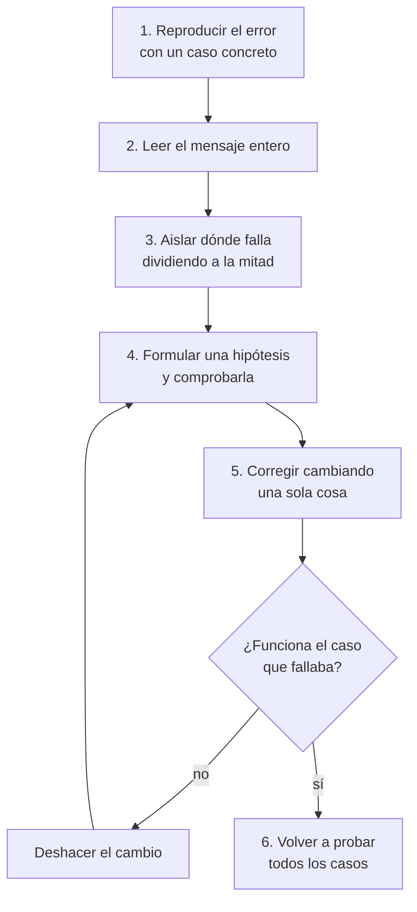

# 03.04 Errores y depuración

> **Versiones:** los scripts se han comprobado con bash 5.3 y con bash 3.2, la de macOS (8 de noviembre de 2026)
> **Conviene saber antes:** [01.03 ¿Cómo sé que funciona? Probar un programa](../fase-01-que-es-programar/03-probar-un-programa.md) · [03.02 La terminal: sacarle partido](02-terminal-sacarle-partido.md)
> **Tiempo estimado:** 2 horas
> **Nivel:** Básico · Núcleo

## Qué aprenderás

- Un **método para depurar** que sirve para cualquier error: reproducirlo, leer el mensaje, aislar dónde falla, formular una hipótesis, cambiar una sola cosa cada vez y volver a probarlo todo.
- A **leer los mensajes de error de la terminal y de los scripts**: quién se queja, de qué, en qué línea y por qué.
- A **aislar un problema dividiéndolo a la mitad**, también en una tubería de órdenes.
- El truco del **patito de goma**.
- A **mostrar valores** con `echo` para ver qué pasa dentro de un script.
- A ver la **traza** de un script con `bash -x`, la misma traza que hacías a mano en la fase 1, pero hecha por el ordenador.
- Dos seguros para tus scripts: **`set -u`** y **`set -e`**.
- Qué es un **depurador** con **puntos de parada** y para qué sirve, aunque cada lenguaje tenga el suyo.
- Los **errores más típicos** de la terminal y de los scripts de quien empieza, y cómo reconocerlos.
- Cómo **buscar un mensaje de error** en internet y cómo puede ayudarte la IA a entenderlo.

Equivocarse es lo normal: lo que te hace avanzar es saber encontrar el error. En este módulo no aprendes ninguna orden complicada; aprendes una **forma de trabajar** que vas a usar en todos los cursos.

## 1. Teoría

### 1.1. Equivocarse es parte del trabajo

Ya sabes que hay [tres tipos de errores](../fase-01-que-es-programar/01-que-es-programar.md#18-tres-tipos-de-errores) (de escritura, de ejecución y de lógica) y que **depurar** es [encontrar dónde está un error y corregirlo](../fase-01-que-es-programar/03-probar-un-programa.md#12-qué-es-probar-un-programa), después de que una prueba te haya avisado de que existe. Este módulo va de eso: de **cómo** se encuentra un error.

En la jerga de la programación, un error de un programa se llama ***bug*** (en inglés, «bicho»). La palabra ya se usaba en la ingeniería del siglo XIX para los fallos de las máquinas, y se hizo famosa en 1947, cuando el equipo de Grace Hopper encontró una polilla atrapada en un relé del ordenador Mark II, en la Universidad de Harvard, y la pegó en el cuaderno de registro con la nota «primer caso real de *bug* encontrado». Por eso depurar se dice en inglés ***debug***: «quitar bichos».

Quien empieza suele pensar que los buenos programadores no se equivocan. No es así: se equivocan igual, pero **encuentran los errores antes**, porque no los buscan al azar. Siguen un método.

> **📌 Nota:** cada tipo de error se descubre de una forma, y eso cambia por dónde empiezas a depurar:
>
> - Un **error de escritura** o **de ejecución** viene con un **mensaje**: empiezas por leerlo.
> - Un **error de lógica** no avisa: el programa termina con normalidad y da un resultado equivocado. Lo descubre una [prueba](../fase-01-que-es-programar/03-probar-un-programa.md#13-el-caso-de-prueba) que falla, y empiezas por el caso que no da lo esperado.

### 1.2. Un método para depurar

Depurar no es cambiar cosas hasta que funcione. Es un trabajo de detective, con seis pasos que sirven para cualquier error: el de un script de tres líneas, el de un ejercicio de tu curso o el de una aplicación con millones de usuarios.

1. **Reproducir el error** con un caso concreto.
2. **Leer el mensaje entero**, con calma.
3. **Aislar dónde falla**, dividiendo el problema a la mitad.
4. **Formular una hipótesis** («creo que falla porque…») **y comprobarla**.
5. **Corregir cambiando una sola cosa** cada vez.
6. **Volver a probar todos los casos**, no solo el que fallaba.



En texto: reproduces el error, lees el mensaje y aíslas dónde falla; después formulas una hipótesis, la compruebas y corriges una sola cosa. Si el caso sigue fallando, deshaces el cambio y vuelves a la hipótesis; si ya funciona, vuelves a probar todos los casos.

Los apartados siguientes explican cada paso. Después verás las herramientas que te ayudan a darlos: mostrar valores, la traza de bash y el depurador.

### 1.3. Reproducir el error

**Reproducir** un error es conseguir que ocurra **cuando tú quieras**, con unos datos y unos pasos concretos. No vale «a veces falla»: vale «si ejecuto el script con el fichero de noviembre, dice 5 clientes y son 4».

Es el primer paso por dos razones:

- **Un error que no sabes provocar no lo puedes estudiar.** Necesitas verlo fallar delante de ti, todas las veces que haga falta.
- **Sin él no sabrás si lo has arreglado.** Cuando corrijas, repetirás exactamente esos pasos y comprobarás que ya no falla.

Lo que apuntas al reproducir un error es, en realidad, un [caso de prueba](../fase-01-que-es-programar/03-probar-un-programa.md#13-el-caso-de-prueba): una entrada, la salida esperada y la que has obtenido. Apúntalo así, por escrito:

| Qué hago | Qué esperaba | Qué ha pasado |
|---|---|---|
| `bash contar-clientes.sh` con el `clientes.csv` de noviembre | `Hay 4 clientes` | `Hay 5 clientes` |

Cuanto **más sencillo** sea el caso que reproduce el error, más fácil será encontrarlo. Si falla con un fichero de 10 000 líneas, intenta que falle con uno de 5.

> **💡 Consejo:** si el error solo pasa «a veces», busca qué cambia entre las veces que falla y las que no: la carpeta desde la que lo ejecutas, el fichero de datos, el ordenador, el día. Esa diferencia suele ser la pista.

### 1.4. Leer el mensaje entero

En [«Qué es programar»](../fase-01-que-es-programar/01-que-es-programar.md#33-asustarse-con-el-primer-mensaje-de-error) aprendiste a leer un mensaje de error por partes y a arreglar **primero el primero**. En la terminal se hace igual, y los mensajes son más cortos. Casi todos tienen esta forma:

```text
quién: dónde: qué ha pasado
```

| Mensaje | Quién se queja | De qué | Qué ha pasado |
|---|---|---|---|
| `bash: gti: orden no encontrada` | bash, la terminal | De la orden `gti` | No la encuentra en el PATH (la causa la viste en [02.03](../fase-02-tu-ordenador/03-instalar-programas-y-path.md#111-cuando-el-sistema-no-encuentra-un-programa)) |
| `grep: informe.txt: No existe el archivo o el directorio` | El programa `grep` | Del fichero `informe.txt` | No lo encuentra en la ruta que le has dado |
| `resumen-pedidos.sh: línea 5: ehco: orden no encontrada` | bash, ejecutando un script | De la línea 5 del script `resumen-pedidos.sh`, de `ehco` | No existe ninguna orden con ese nombre |

Fíjate en tres cosas:

- **Quién habla.** Si empieza por `bash:` o por el nombre de tu script, es bash quien se queja (no encuentra la orden, la carpeta no existe, la escritura del script está mal). Si empieza por el nombre de un programa (`grep:`, `cp:`, `ls:`), **el programa sí se ha ejecutado**, y es él quien no puede hacer lo que le pides. Lo viste ya con `git --versión` en el [error típico 3.2 de 02.03](../fase-02-tu-ordenador/03-instalar-programas-y-path.md#32-escribir-mal-la-orden).
- **El mensaje repite lo que has escrito** (`gti`, `informe.txt`). Compáralo letra a letra con lo que querías escribir: muchos errores se acaban aquí.
- **En un script, bash dice la línea.** `línea 5` te lleva directo al sitio. En el editor de código, el número de cada línea está a la izquierda (lo viste en [«El editor de código»](03-editor-de-codigo.md#15-las-partes-de-la-ventana)).

**Lee también lo que no parece un error.** La [salida estándar y la de error](02-terminal-sacarle-partido.md#11-los-tres-canales-de-una-orden) salen mezcladas en la pantalla, así que un error de la línea 3 puede quedar enterrado entre veinte líneas de resultados. Y si rediriges la salida a un fichero con `>`, los errores siguen saliendo en la pantalla: no los ignores.

> **📌 Nota:** en tu ordenador, los mensajes pueden salir en inglés (`command not found`, `No such file or directory`, `line 5`), sobre todo en macOS y en Git Bash, o mezclando los dos idiomas ([nota de 03.01](01-terminal-lo-basico.md#14-qué-hay-aquí-ls)). Lo que importa no es el idioma, sino leer **qué orden, qué fichero y qué problema** dicen. La tabla de la [chuleta](#6-chuleta) tiene los más frecuentes en los dos idiomas.

**Cuando el mensaje no está donde está el error.** A veces bash solo descubre el problema más adelante. Si te dejas sin cerrar un `if` o unas comillas, bash sigue leyendo hasta el final del fichero buscando el cierre, y se queja **al llegar al final**: el mensaje señala la última línea, pero el error está antes. Lo verás en el [ejemplo 2.2](#22-un-error-de-escritura-falta-el-fi). Regla práctica: si en la línea que dice el mensaje no ves nada raro, **mira hacia arriba**.

### 1.5. Aislar el problema: dividir a la mitad

Cuando el mensaje no basta (o cuando no hay mensaje, como en los errores de lógica), hay que **acotar** dónde está el error. La forma más rápida es **dividir el problema a la mitad**.

Es el juego de adivinar un número del 1 al 100 con preguntas de «¿es mayor que…?». Si preguntas «¿es mayor que 50?», con una sola respuesta descartas la mitad de los números. Con siete preguntas encuentras cualquiera. Preguntando número a número («¿es el 1?, ¿es el 2?…») podrías necesitar cien.

Con un script o una serie de órdenes se hace lo mismo:

1. Mira el valor **a mitad de camino**: después de la mitad de las líneas del script o de la mitad de las órdenes de una tubería.
2. Si **ahí ya está mal**, el error está en la primera mitad. Si **ahí está bien**, está en la segunda.
3. Repite con la mitad sospechosa, hasta llegar a una sola línea u orden.

En una **tubería** (las órdenes unidas con `|` de [«La terminal: sacarle partido»](02-terminal-sacarle-partido.md#15-tuberías-la-salida-de-una-orden-es-la-entrada-de-otra)) es especialmente fácil, porque puedes ejecutar solo el principio. Si esto da un resultado raro:

```bash
grep "Madrid" pedidos.txt | grep "pagado" | wc -l
```

ejecuta solo el primer trozo, `grep "Madrid" pedidos.txt`, y mira qué sale. Si ya sale mal, el problema está en el primer `grep`; si sale bien, añade el segundo trozo y vuelve a mirar.

La idea es siempre la misma: **cada comprobación descarta un trozo** del programa, y no pierdes el tiempo mirando lo que funciona.

### 1.6. Una hipótesis y un solo cambio cada vez

Cuando ya sabes **dónde** falla, falta saber **por qué**. Ahí se trabaja como en ciencias:

1. **Formula una hipótesis**, una explicación concreta que se pueda comprobar: «creo que cuenta un cliente de más porque cuenta también la primera línea, la de los títulos».
2. **Compruébala antes de cambiar nada.** Si tu hipótesis es cierta, ¿qué deberías ver? «Si cuenta la línea de títulos, el fichero tiene 5 líneas en total». Míralo. Si no se cumple, la hipótesis es falsa: busca otra.
3. **Corrige cambiando una sola cosa** y vuelve a ejecutar el caso que fallaba.

¿Por qué **una sola** cosa? Porque si cambias tres a la vez y el error desaparece, no sabes cuál de las tres lo arregló, ni si las otras dos han estropeado algo. Y si el error sigue, tampoco sabes si alguna lo empeoró. Un cambio, una prueba. Si el cambio no arregla nada, **deshazlo** antes de probar el siguiente: no acumules intentos.

> **⚠️ Cuidado:** corrige **la causa**, no el síntoma. Si el script dice «5 clientes» y son 4, no lo arregles restando 1 al final «porque así sale bien»: el día que el fichero no tenga línea de títulos, dirá 3. Arregla lo que de verdad está mal (que cuenta la línea de títulos).

### 1.7. Volver a probarlo todo

Has corregido el error y el caso que fallaba ya funciona. Todavía no has terminado: **vuelve a probar todos los casos**, también los que ya funcionaban, porque una corrección puede estropear algo que iba bien (una [regresión](../fase-01-que-es-programar/03-probar-un-programa.md#19-las-pruebas-automáticas), como viste en el [error típico 3.7 de 01.03](../fase-01-que-es-programar/03-probar-un-programa.md#37-arreglar-un-error-y-no-volver-a-probarlo-todo)). Y apunta el caso que fallaba en tu lista de casos de prueba: se queda para siempre.

### 1.8. El patito de goma

Llevas media hora mirando un script de diez líneas y no ves nada raro. Prueba esto: **explícale el script, línea a línea y en voz alta, a otra persona**. Qué hace cada línea, qué valor tiene cada variable, qué esperas que salga. Muy a menudo descubrirás el error a mitad de la explicación, antes de que la otra persona diga nada.

Funciona porque, al explicar, no puedes saltarte pasos: tienes que decir lo que **hace** el código, no lo que **crees** que hace. Y ahí es donde aparece la diferencia.

No hace falta que la otra persona sepa programar. Ni siquiera que sea una persona: el truco se llama **depuración del patito de goma** (*rubber duck debugging*) porque el libro *The Pragmatic Programmer* (1999) contaba el caso de un programador que llevaba siempre un patito de goma y le explicaba su código. Un peluche, una planta o una nota escrita como si se la contaras a alguien sirven igual.

> **💡 Consejo:** escribir la pregunta para pedir ayuda (a un compañero, en un foro) tiene el mismo efecto. Muchas veces, al redactarla con todo detalle, encuentras la respuesta y ya no necesitas enviarla.

### 1.9. Mostrar valores con echo

Un script no enseña lo que pasa por dentro: solo ves el resultado final. Si el resultado está mal, la forma más sencilla de mirar dentro es **añadir órdenes `echo` temporales** que escriban los valores en los puntos sospechosos:

```bash
echo "DEPURACIÓN total: $total"
```

Es dividir a la mitad con la vista: pones un `echo` a mitad del script y ves si el valor ya está mal ahí. Lo verás en el [ejemplo 2.4](#24-mostrar-valores-con-echo-los-pedidos-de-madrid).

Dos costumbres que te ahorrarán disgustos:

- **Márcalos con una palabra fácil de buscar**, siempre la misma (`DEPURACIÓN`), para encontrarlos y **borrarlos todos** al terminar. Un mensaje de depuración olvidado acaba saliendo en el resultado final.
- **Si el script escribe un resultado que otro programa va a leer**, manda los mensajes de depuración a la salida de error con `>&2`, como aprendiste en [«La terminal: sacarle partido»](02-terminal-sacarle-partido.md#13-mandar-los-errores-a-otro-sitio-2-y-devnull): `echo "DEPURACIÓN total: $total" >&2`. Así se ven en pantalla, pero no se mezclan con el resultado si lo rediriges a un fichero.

### 1.10. Ver la traza de un script

En [Algoritmos y pseudocódigo](../fase-01-que-es-programar/02-algoritmos-y-pseudocodigo.md#la-traza) hacías **trazas a mano**: ibas instrucción a instrucción, apuntando en una tabla el valor de cada variable. bash puede hacer esa traza por ti. Basta con ejecutar el script así:

```bash
bash -x contar-clientes.sh
```

Con `-x`, antes de ejecutar cada orden, bash la escribe en pantalla **con los valores ya puestos** en lugar de los nombres de las variables, precedida de un `+`. Por ejemplo, si el script tiene la línea `echo "Hay $total clientes"` y `total` vale 5, la traza muestra:

```text
+ echo 'Hay 5 clientes'
```

Así ves, sin cambiar ni una letra del script, **qué se ejecuta de verdad**, en qué orden y con qué valores. Lo que te ahorra:

- **Ver qué vale cada variable** en cada momento, como en la tabla de la traza a mano.
- **Ver qué líneas no se ejecutan.** Si una orden no aparece en la traza, no se ha ejecutado: un `if` cuya condición no se cumplió, un bucle que no dio ninguna vuelta.
- **Ver cómo entiende bash cada línea**: si una ruta con espacios se parte en dos, o si una variable está vacía, lo ves en la orden tal como se ejecuta.

Tres detalles para leerla:

- Las líneas con `+` son la traza; las demás son la salida normal del script y sus errores, en el orden en que salen.
- `++` (dos signos) es una orden que se ejecuta **dentro** de otra, como la que va entre `$(` y `)`.
- bash escribe las órdenes a su manera: quita las comillas que sobran y pone comillas simples (`'Hay 5 clientes'`) donde hay espacios, para que veas dónde empieza y termina cada parte.

> **📌 Nota:** la traza sale por la salida de error, así que se ve en pantalla aunque redirijas el resultado a un fichero. Y si solo te interesa un trozo del script, puedes escribir `set -x` justo antes de ese trozo y `set +x` justo después: la traza se activa y se desactiva ahí. La última línea de la traza será `+ set +x`: es la propia orden que la apaga, que también sale. Recuerda quitar las dos líneas al terminar.

### 1.11. Dos seguros para tus scripts

Por defecto, bash es muy tolerante: si una orden de un script falla, escribe el error y **sigue con la siguiente** como si nada; y si usas una variable que no existe (o que has escrito mal), la trata como si estuviera vacía, **sin avisar**. Eso hace que un script pueda fallar a medias y terminar diciendo «todo bien». Dos opciones lo cambian:

| Opción | Qué hace |
|---|---|
| `set -u` | Si el script usa una variable que no tiene valor, **se detiene** con un error que dice su nombre, en lugar de tratarla como vacía. Caza las variables mal escritas |
| `set -e` | Si una orden **falla** (termina con un código de salida distinto de 0, los que viste en [«La terminal: sacarle partido»](02-terminal-sacarle-partido.md#113-códigos-de-salida)), el script **se detiene** ahí, en lugar de seguir con las demás |

Se pueden poner juntas, como `set -eu`, en una línea al principio del script, justo después del comentario que dice qué hace. Lo verás en el [ejemplo 2.6](#26-caso-real-un-permiso-denegado-que-no-es-de-permisos).

> **⚠️ Cuidado:** `set -e` no es perfecto: hay casos en los que una orden falla y el script sigue igual (por ejemplo, dentro de la condición de un `if` o en una tubería, donde solo cuenta la última orden). Es un seguro, no una garantía: sigue probando tus scripts.

### 1.12. El depurador: puntos de parada y paso a paso

`echo` y `bash -x` funcionan, pero tienen límites: con `echo` hay que tocar el código cada vez que quieres mirar otra cosa, y una traza de miles de líneas es imposible de leer. Para los programas grandes existe una herramienta pensada solo para esto: el **depurador** (en inglés, *debugger*).

Un depurador ejecuta tu programa **bajo su control**, y te deja:

- **Ponerle puntos de parada** (también se llaman **puntos de ruptura**; en inglés, *breakpoints*): marcas en las líneas que te interesan. El programa se ejecuta con normalidad hasta llegar a una de ellas y ahí **se detiene**, justo antes de ejecutar esa línea.
- **Ver el valor de todas las variables** en ese momento, sin haber escrito ningún `echo`.
- **Avanzar paso a paso**, línea a línea, viendo cómo cambian los valores después de cada una.
- **Seguir** hasta el siguiente punto de parada, o hasta el final.

Es una traza como la de la fase 1, pero la hace el ordenador y tú decides dónde mirar y a qué velocidad. Cada lenguaje tiene su depurador y **cada curso de lenguaje te enseñará a usar el suyo**. Muchos editores lo traen integrado: Visual Studio Code tiene uno, que se pone en marcha con <kbd>F5</kbd> y que se adapta a cada lenguaje con extensiones. Lo que aprendes aquí (el método, mirar los valores, la traza) es lo mismo que harás allí con mejores herramientas.

### 1.13. Buscar ayuda: internet y la IA

Si después de leer el mensaje y aislar el problema sigues sin entenderlo, no eres el primero: casi seguro que alguien ha tenido ese mismo error antes y lo ha preguntado en internet. Para encontrarlo:

- **Copia el mensaje exacto**, sin lo que es solo tuyo: tu nombre de usuario, tus rutas, los nombres de tus ficheros. De `grep: /home/ana/curso/datos.csv: No existe el archivo o el directorio` busca `grep "No existe el archivo o el directorio"`. Las comillas piden que salga esa frase exacta.
- **Añade la herramienta** (`bash`, `git`, `grep`) y, si importa, el sistema (`macOS`, `Git Bash`).
- **Prueba en inglés** si en español no sale nada: hay muchas más respuestas. Busca el mensaje que verías en inglés (`No such file or directory`).
- **Comprueba la fecha y la versión** de las respuestas: una de hace diez años puede no servir para tu versión.

Cómo buscar bien, leer documentación y preguntar en foros lo verás a fondo en el módulo «Buscar ayuda» (fase 7).

Un **asistente de IA** también puede ayudarte mucho: le pegas el mensaje y le pides que te lo **explique** («¿qué significa este error y qué puede causarlo?»). Úsalo como profesor, no como quien lo arregla por ti, y **comprueba siempre** lo que te diga con tus casos de prueba: puede equivocarse con total seguridad. Y **nunca pegues** contraseñas, claves ni datos personales: revisa el mensaje y el código antes de enviarlos. Cómo trabajar bien con estos asistentes lo verás en el módulo «Programar con asistentes de IA» (fase 7).

## 2. Ejemplos de código

Recuerda que las salidas de la terminal del curso pueden ser algo distintas de las tuyas ([el aviso de 02.03](../fase-02-tu-ordenador/03-instalar-programas-y-path.md#22-un-aviso-sobre-las-salidas-de-la-terminal)); en este módulo, sobre todo, el idioma de los mensajes de error.

### 2.1. Un script que falla: leer sus mensajes

**Situación real:** tienes un script que enseña los pedidos de un día de la tienda y cuántos hay. Lo ejecutas y salen errores.

```bash
#!/usr/bin/env bash
# Resumen de los pedidos de un día: los muestra y dice cuántos hay
echo "Pedidos del 9 de noviembre:"
grep "2026-11-09" pedidos.txt
ehco "Número de pedidos:"
grep -c "2026-11-09" pedidos.txt
```

📁 **Código:** [`codigo/04-errores-y-depuracion/ejemplos/2.1-un-script-que-falla/`](codigo/04-errores-y-depuracion/ejemplos/2.1-un-script-que-falla/)

**Salida:**

```text
Pedidos del 9 de noviembre:
```

**Salida de error:**

```text
grep: pedidos.txt: No existe el archivo o el directorio
resumen-pedidos.sh: línea 5: ehco: orden no encontrada
grep: pedidos.txt: No existe el archivo o el directorio
```

Aquí ves por separado las dos salidas del script. En tu terminal salen mezcladas, en este orden: el título, el primer error de `grep`, el de `ehco` y el segundo de `grep`.

**Cómo leerlo**, mensaje a mensaje y empezando por el primero:

| Mensaje | Quién | Qué te dice | Dónde mirar |
|---|---|---|---|
| `grep: pedidos.txt: No existe…` | `grep`: se ha ejecutado | No encuentra el fichero `pedidos.txt` en la carpeta actual | La línea 4, la del primer `grep` |
| `resumen-pedidos.sh: línea 5: ehco: orden no encontrada` | bash | En la línea 5 hay una orden `ehco`, que no existe | La línea 5: `ehco` debería ser `echo` |
| `grep: pedidos.txt: No existe…` | `grep` otra vez | Lo mismo que el primero | La línea 6: es la misma causa |

**Cómo se arregla:** el primero. Un `ls` en la carpeta del script te dice cómo se llama de verdad el fichero: `pedidos-noviembre.txt`. Cambiando el nombre en las dos líneas de `grep`, desaparecen el primer mensaje y el tercero, porque eran **el mismo error repetido**. Después queda el de la línea 5: `ehco` es una errata de `echo`.

**En qué fijarte:**

- El mensaje de `grep` **no dice la línea** del script: lo dice `grep`, que no sabe nada de tu script. La línea la encuentras tú buscando qué orden usa ese fichero.
- El de bash **sí la dice**, porque es bash quien está leyendo el script.
- El script **no se detiene** al primer error: sigue con la línea siguiente. Por eso salen tres mensajes. Cómo hacer que se detenga lo verás en el [ejemplo 2.6](#26-caso-real-un-permiso-denegado-que-no-es-de-permisos).

### 2.2. Un error de escritura: falta el fi

**Situación real:** escribes un script con un `if` (que aprendiste en [«La terminal: sacarle partido»](02-terminal-sacarle-partido.md#116-decidir-y-repetir-en-un-script-if-y-for)) y se te olvida cerrarlo con `fi`.

```bash
#!/usr/bin/env bash
# Avisa de si ya existe la carpeta de fotos
if [ -d fotos ]; then
    echo "Ya tienes la carpeta fotos"
else
    echo "Todavía no tienes la carpeta fotos"
echo "Revisión terminada"
```

📁 **Código:** [`codigo/04-errores-y-depuracion/ejemplos/2.2-falta-el-fi/`](codigo/04-errores-y-depuracion/ejemplos/2.2-falta-el-fi/)

**Salida de error:**

```text
revisar-fotos.sh: línea 8: error de sintaxis: no se esperaba el final del fichero desde la orden «if» en la línea 3
```

**En qué fijarte:**

- Es un **error de escritura** (de sintaxis): el script no está bien escrito según las reglas de bash. Por eso **no se ejecuta nada** del `if`: bash necesita leer el `if` entero, hasta su `fi`, antes de ejecutarlo, y no lo encuentra.
- El mensaje dice **línea 8**, pero el script solo tiene 7. La línea 8 es «el final del fichero»: bash ha llegado al final buscando el `fi` y se queja ahí. **El error no está en la línea 8**: está en que al `if` de la línea 3 le falta su `fi`, que debería ir después de la línea 6.
- Esta bash, la 5.3, te da además la pista: «desde la orden «if» en la línea 3». Las anteriores, que son las que traen muchos sistemas, dan un mensaje más corto, que solo dice que el fichero se ha acabado antes de tiempo: en macOS, `line 8: syntax error: unexpected end of file`, y en otros sistemas, algo parecido. Allí tendrás que buscar tú el bloque sin cerrar, mirando hacia arriba.

**Cómo se arregla:** añadiendo `fi` en una línea después de la 6, a la altura del `if`. Con el `if` cerrado, el script escribe «Todavía no tienes la carpeta fotos» y «Revisión terminada».

> **💡 Consejo:** `bash -n script.sh` comprueba la escritura de un script **sin ejecutarlo** (*n* de *no ejecutes*): si está bien, no dice nada; si no, te da el mismo mensaje. Es útil antes de ejecutar un script que borra o mueve ficheros.

### 2.3. La traza de bash -x: los clientes que sobran

**Situación real:** un script cuenta los clientes de un fichero [CSV](01-terminal-lo-basico.md#19-ver-qué-hay-dentro-de-un-fichero-cat-less-head-y-tail). Dice que hay 5, pero tú cuentas 4.

```bash
#!/usr/bin/env bash
# Cuenta los clientes que hay en clientes.csv
fichero="clientes.csv"
total=$(wc -l < "$fichero")
echo "Hay $total clientes"
```

📁 **Código:** [`codigo/04-errores-y-depuracion/ejemplos/2.3-traza-con-bash-x/`](codigo/04-errores-y-depuracion/ejemplos/2.3-traza-con-bash-x/)

Primero lo **reproduces** y miras los datos; después ves su traza:

**En tu terminal** (`sesion.txt`):

```text
$ bash contar-clientes.sh
Hay 5 clientes
$ cat clientes.csv
nombre,ciudad,telefono
Ana Ruiz,Madrid,600111222
Luis Gil,Sevilla,600333444
Marta Sanz,Valencia,600555666
Pablo Díaz,Bilbao,600777888
$ bash -x contar-clientes.sh
+ fichero=clientes.csv
++ wc -l
+ total=5
+ echo 'Hay 5 clientes'
Hay 5 clientes
```

📁 **Código:** [`codigo/04-errores-y-depuracion/ejemplos/2.3-traza-con-bash-x/`](codigo/04-errores-y-depuracion/ejemplos/2.3-traza-con-bash-x/)

**Cómo leer la traza.** Es la misma tabla que hacías a mano en la fase 1, pero escrita por bash:

| Paso | Línea de la traza | Qué ha pasado | `fichero` | `total` |
|---|---|---|---|---|
| 1 | `+ fichero=clientes.csv` | Guarda el nombre del fichero | `clientes.csv` | — |
| 2 | `++ wc -l` | Cuenta las líneas (es la orden de dentro de `$(` `)`; por eso lleva `++`) | `clientes.csv` | — |
| 3 | `+ total=5` | Guarda el resultado: **5** | `clientes.csv` | 5 |
| 4 | `+ echo 'Hay 5 clientes'` | Escribe el mensaje con el valor ya puesto | `clientes.csv` | 5 |

**El método, paso a paso:**

1. **Reproducir:** `bash contar-clientes.sh` dice 5; esperabas 4.
2. **Leer el mensaje:** no hay ninguno. Es un **error de lógica**.
3. **Aislar:** la traza dice que `total` ya vale 5 justo después de `wc -l`. El error está en el recuento, no en el `echo`.
4. **Hipótesis:** `wc -l` cuenta **líneas**, y el fichero tiene 5: la primera es la de los títulos de las columnas (`nombre,ciudad,telefono`), que no es un cliente. Se comprueba mirando el fichero: tiene 5 líneas y 4 clientes. Confirmada.
5. **Corregir una sola cosa:** contar a partir de la segunda línea. La orden `tail -n +2 clientes.csv` escribe el fichero **desde la línea 2**, así que la línea 4 del script pasa a ser `total=$(tail -n +2 "$fichero" | wc -l)`, y el script dice `Hay 4 clientes`.
6. **Volver a probar:** con otro fichero de clientes, y con uno que solo tenga la línea de títulos (debe decir 0).

> **📌 Nota:** en macOS, `wc` escribe unos espacios delante del número, así que allí verás algo como `Hay        5 clientes`. El número es el mismo.

### 2.4. Mostrar valores con echo: los pedidos de Madrid

**Situación real:** la tienda quiere saber cuántos pedidos de Madrid están ya pagados. El script dice 3, pero mirando el fichero tú solo cuentas 2.

```bash
#!/usr/bin/env bash
# Cuenta los pedidos de Madrid que ya están pagados
de_madrid=$(grep "Madrid" pedidos.txt)
pagados=$(echo "$de_madrid" | grep -c "pagado")
echo "Pedidos pagados de Madrid: $pagados"
```

📁 **Código:** [`codigo/04-errores-y-depuracion/ejemplos/2.4-mostrar-valores/`](codigo/04-errores-y-depuracion/ejemplos/2.4-mostrar-valores/)

**Salida:**

```text
Pedidos pagados de Madrid: 3
```

El script tiene dos pasos: primero se queda con las líneas de Madrid y después cuenta las pagadas. **Dividir a la mitad** es mirar el valor entre los dos pasos. Para eso, añades dos `echo` de depuración, marcados con `DEPURACIÓN`:

```bash
#!/usr/bin/env bash
# Cuenta los pedidos de Madrid que ya están pagados
de_madrid=$(grep "Madrid" pedidos.txt)
echo "DEPURACIÓN de_madrid:"
echo "$de_madrid"
pagados=$(echo "$de_madrid" | grep -c "pagado")
echo "DEPURACIÓN pagados: $pagados"
echo "Pedidos pagados de Madrid: $pagados"
```

📁 **Código:** [`codigo/04-errores-y-depuracion/ejemplos/2.4-mostrar-valores/`](codigo/04-errores-y-depuracion/ejemplos/2.4-mostrar-valores/)

**Salida:**

```text
DEPURACIÓN de_madrid:
2026-11-09;09:05;Madrid;mochila;pagado
2026-11-09;11:20;Madridejos;agenda;pagado
2026-11-09;12:03;Madrid;cuaderno;pendiente
2026-11-09;13:58;Madrid;estuche;pagado
DEPURACIÓN pagados: 3
Pedidos pagados de Madrid: 3
```

**En qué fijarte:**

- A mitad de camino, `de_madrid` **ya está mal**: tiene una línea de **Madridejos**, un pueblo de Toledo. El segundo paso cuenta bien (de esas cuatro líneas, tres dicen `pagado`); el error está en el primero.
- **Hipótesis:** `grep "Madrid"` busca el texto `Madrid` en cualquier parte de la línea, y `Madridejos` lo contiene.
- **Corrección:** buscar la ciudad **entera**, con los `;` que la rodean: `grep ";Madrid;" pedidos.txt`. Con ese cambio, el script dice `Pedidos pagados de Madrid: 2`.
- **Antes de dar el trabajo por terminado**, borra las líneas `DEPURACIÓN`: búscalas con el editor o con `grep -n "DEPURACIÓN" pagados-madrid.sh`.

> **💡 Consejo:** antes de depurar, mira si el resultado equivocado **se parece a algo**: uno de más, el doble, cero, el último valor. Un «uno de más» suele ser una línea o un elemento que no debería contar, como aquí o en el ejemplo anterior.

### 2.5. Una ruta con espacios que se rompe

**Situación real:** un script copia tu lista de tareas, que está en la carpeta `Mis notas`, a una carpeta de copias. Dice «Copia hecha», pero la carpeta de copias está vacía.

```bash
#!/usr/bin/env bash
# Copia la lista de tareas a la carpeta de copias
origen="Mis notas/tareas.txt"
mkdir -p copias
cp $origen copias/
echo "Copia hecha"
```

📁 **Código:** [`codigo/04-errores-y-depuracion/ejemplos/2.5-ruta-con-espacios/`](codigo/04-errores-y-depuracion/ejemplos/2.5-ruta-con-espacios/)

**En tu terminal** (`sesion.txt`):

```text
$ bash copiar-tareas.sh
cp: no se puede efectuar `stat' sobre 'Mis': No existe el archivo o el directorio
cp: no se puede efectuar `stat' sobre 'notas/tareas.txt': No existe el archivo o el directorio
Copia hecha
$ ls copias
$ bash -x copiar-tareas.sh
+ origen='Mis notas/tareas.txt'
+ mkdir -p copias
+ cp Mis notas/tareas.txt copias/
cp: no se puede efectuar `stat' sobre 'Mis': No existe el archivo o el directorio
cp: no se puede efectuar `stat' sobre 'notas/tareas.txt': No existe el archivo o el directorio
+ echo 'Copia hecha'
Copia hecha
```

📁 **Código:** [`codigo/04-errores-y-depuracion/ejemplos/2.5-ruta-con-espacios/`](codigo/04-errores-y-depuracion/ejemplos/2.5-ruta-con-espacios/)

**Cómo leerlo:**

- `cp` se queja de **dos** ficheros, `Mis` y `notas/tareas.txt`, que no existen. Pero tú solo le has dado uno. («Efectuar `stat` sobre» un fichero es consultar sus datos; aquí quiere decir que lo ha buscado y no está.)
- La traza lo explica. Cuando `origen` tiene su valor, bash escribe comillas alrededor (`'Mis notas/tareas.txt'`): es **un** dato. Pero en la orden `cp` aparece **sin comillas**: `cp Mis notas/tareas.txt copias/`. bash ha **partido la ruta por el espacio** y le ha pasado a `cp` tres datos, `Mis`, `notas/tareas.txt` y `copias/`.
- Y el script dice «Copia hecha» porque el `echo` se ejecuta igual: escribe lo que le dices, no comprueba nada.

**Cómo se arregla:** con comillas dobles alrededor de la variable, `"$origen"`. Así bash la pasa entera, con su espacio, como un solo dato:

```bash
#!/usr/bin/env bash
# Copia la lista de tareas a la carpeta de copias
origen="Mis notas/tareas.txt"
mkdir -p copias
cp "$origen" copias/
echo "Copia hecha"
```

📁 **Código:** [`codigo/04-errores-y-depuracion/ejemplos/2.5-ruta-con-espacios/`](codigo/04-errores-y-depuracion/ejemplos/2.5-ruta-con-espacios/)

**En tu terminal** (`sesion-corregido.txt`):

```text
$ bash copiar-tareas-corregido.sh
Copia hecha
$ ls copias
tareas.txt
```

📁 **Código:** [`codigo/04-errores-y-depuracion/ejemplos/2.5-ruta-con-espacios/`](codigo/04-errores-y-depuracion/ejemplos/2.5-ruta-con-espacios/)

> **💡 Consejo:** escribe **siempre** las variables entre comillas dobles (`"$origen"`), aunque creas que su valor nunca tendrá espacios. Hoy no los tiene; el día que alguien cree una carpeta «Mis notas», sí.

### 2.6. Caso real: un «Permiso denegado» que no es de permisos

**Situación real:** un script prepara la carpeta de un proyecto nuevo y le copia una plantilla para su `README.md`. Dice «Proyecto tienda-online creado», pero hay un error de permisos y el `README.md` no aparece.

```bash
#!/usr/bin/env bash
# Crea la carpeta de un proyecto nuevo y le copia la plantilla del README
proyecto="tienda-online"
mkdir -p "$proyecto"
cp plantilla-readme.md "$proyeto/README.md"
echo "Proyecto $proyecto creado"
```

📁 **Código:** [`codigo/04-errores-y-depuracion/ejemplos/2.6-permiso-denegado/`](codigo/04-errores-y-depuracion/ejemplos/2.6-permiso-denegado/)

**En tu terminal** (`sesion.txt`):

```text
$ bash crear-proyecto.sh
cp: no se puede crear el fichero regular '/README.md': Permiso denegado
Proyecto tienda-online creado
$ ls tienda-online
$ bash -x crear-proyecto.sh
+ proyecto=tienda-online
+ mkdir -p tienda-online
+ cp plantilla-readme.md /README.md
cp: no se puede crear el fichero regular '/README.md': Permiso denegado
+ echo 'Proyecto tienda-online creado'
Proyecto tienda-online creado
```

📁 **Código:** [`codigo/04-errores-y-depuracion/ejemplos/2.6-permiso-denegado/`](codigo/04-errores-y-depuracion/ejemplos/2.6-permiso-denegado/)

**El método:**

1. **Reproducir:** el script termina diciendo que todo ha ido bien, pero `ls tienda-online` no muestra nada: la carpeta está vacía.
2. **Leer el mensaje entero:** «Permiso denegado» invita a pensar en permisos. Pero lee la ruta: `cp` intenta crear `/README.md`, **en la raíz del disco** (la carpeta `/` que viste en [02.02](../fase-02-tu-ordenador/02-archivos-carpetas-y-rutas.md#14-dónde-empieza-el-árbol-la-raíz)), donde una persona normal no puede escribir. Lo raro no es el permiso: es **la ruta**. Tú querías `tienda-online/README.md`.
3. **Aislar:** la traza muestra la orden tal como se ejecuta: `cp plantilla-readme.md /README.md`. Delante de `/README.md` debería estar el nombre del proyecto, y no hay nada.
4. **Hipótesis:** la variable que va delante está vacía. Mirando la línea 5 con calma: dice `$proyeto`, sin la `c`. Esa variable no existe, y bash la ha tratado como vacía sin avisar.
5. **Corregir una sola cosa:** escribir `$proyecto`.
6. **Volver a probar:** el script, y `ls tienda-online` para ver que el `README.md` está ahí.

> **⚠️ Cuidado:** ante un «Permiso denegado», **no** lo «arregles» ejecutándolo como administrador (con `sudo`). Aquí habría funcionado… y habría creado un `README.md` en la raíz del disco. Primero entiende **qué** intenta hacer la orden y **dónde**; los permisos los viste en [«La terminal: sacarle partido»](02-terminal-sacarle-partido.md#110-permisos-quién-puede-leer-escribir-y-ejecutar).

> **📌 Nota:** la raíz no es igual en todos los sistemas. En macOS y en Git Bash, el mensaje puede ser otro y, en Git Bash, según dónde esté instalado, incluso puede que el fichero se cree en su carpeta de instalación. La pista que importa es la misma en todos: la ruta `/README.md`, que no es donde querías escribir.

**Que no vuelva a pasar: `set -eu`.** Si el script hubiera empezado con `set -eu` ([apartado 1.11](#111-dos-seguros-para-tus-scripts)), bash habría detenido el script en la variable mal escrita, diciendo su nombre, en lugar de tratarla como vacía y seguir:

```bash
#!/usr/bin/env bash
# Crea la carpeta de un proyecto nuevo y le copia la plantilla del README
set -eu
proyecto="tienda-online"
mkdir -p "$proyecto"
cp plantilla-readme.md "$proyeto/README.md"
echo "Proyecto $proyecto creado"
```

📁 **Código:** [`codigo/04-errores-y-depuracion/ejemplos/2.6-con-set-eu/`](codigo/04-errores-y-depuracion/ejemplos/2.6-con-set-eu/)

**Salida de error:**

```text
crear-proyecto.sh: línea 6: proyeto: variable sin asignar
```

**En qué fijarte:**

- El mensaje dice **la línea** y **el nombre exacto** de la variable mal escrita: el error está encontrado sin hacer nada más. En macOS dirá `line 6: proyeto: unbound variable`.
- El script se detiene: **no** dice «Proyecto tienda-online creado». Un script que se para con un error claro es mucho mejor que uno que miente diciendo que ha terminado bien.

## 3. Errores típicos

Los tres primeros son los tropiezos que más vas a ver al usar la terminal y escribir scripts. Los dos últimos son errores **al depurar**.

### 3.1. Los tres mensajes de siempre

Casi todos los tropiezos de quien empieza con la terminal acaban en uno de estos tres mensajes (o en su versión en inglés). Ya los conoces de los módulos anteriores; aquí los tienes juntos, con sus causas, de más a menos frecuente:

| Mensaje | Causas más probables | Qué miras |
|---|---|---|
| `orden no encontrada` (`command not found`) | La orden mal escrita (`gti`, `ehco`); o un programa que no está instalado o cuya carpeta no está en el PATH ([02.03](../fase-02-tu-ordenador/03-instalar-programas-y-path.md#111-cuando-el-sistema-no-encuentra-un-programa)) | El nombre que repite el mensaje, letra a letra; después, `command -v` |
| `No existe el archivo o el directorio` (`No such file or directory`) | Una ruta relativa desde una carpeta actual que no es la que crees ([03.01](01-terminal-lo-basico.md#31-estar-en-la-carpeta-equivocada)); las mayúsculas ([02.02](../fase-02-tu-ordenador/02-archivos-carpetas-y-rutas.md#112-mayúsculas-y-minúsculas)); una tilde; una ruta con espacios sin comillas ([ejemplo 2.5](#25-una-ruta-con-espacios-que-se-rompe)) | `pwd` y `ls`, y el nombre letra a letra. O deja que <kbd>Tab</kbd> lo complete: si no lo completa, no está ahí |
| `Permiso denegado` (`Permission denied`) | Un script sin permiso de ejecución ([03.02](02-terminal-sacarle-partido.md#35-permiso-denegado-u-orden-no-encontrada-al-ejecutar-tu-script)); o escribir donde no puedes, muchas veces sin querer, por una variable vacía o mal escrita ([ejemplo 2.6](#26-caso-real-un-permiso-denegado-que-no-es-de-permisos)) | **La ruta del mensaje**: si no es donde querías escribir, el problema es la ruta, no el permiso. Y nada de `sudo` para quitarte el error sin entenderlo |

Dos de esas causas son difíciles de ver a simple vista:

- **Las mayúsculas.** En Linux, `Presupuestos` y `presupuestos` son nombres distintos; en Windows y macOS, normalmente, no. Por eso hay scripts que funcionan en tu ordenador y fallan en el servidor, que casi siempre es Linux. Ojo: los comodines como `*.JPG` distinguen mayúsculas también en macOS, porque los compara bash, no el sistema ([ejercicio 4](#ejercicio-4--el-álbum-de-fotos-vacío)).
- **Las tildes.** Para el ordenador, `ó` y `o` son letras distintas: `presupuesto-reunión.txt` no es `presupuesto-reunion.txt`. Pasa mucho con nombres escritos a mano y con ficheros que vienen de otro sistema (a veces, incluso, dos nombres que se ven idénticos se guardan con letras distintas por dentro; lo entenderás en «Texto, binario y codificación», fase 4). Por eso, en los ficheros de programación, [nombres sin tildes, sin eñes y sin espacios](../fase-02-tu-ordenador/02-archivos-carpetas-y-rutas.md#113-cómo-nombrar-ficheros-y-carpetas).

### 3.2. Un script con los saltos de línea de Windows

**Qué pasa:** escribes un script en Windows, lo ejecutas en Git Bash y fallan órdenes que están bien escritas, con mensajes raros: `$'\r': orden no encontrada`, o el nombre de una carpeta que sí existe con un `\r` pegado al final (`$'notas\r'`). Con la bash de macOS, el mensaje sale en inglés (`command not found`) y puede que sin el `$'\r'` a la vista ([nota de 03.01](01-terminal-lo-basico.md#14-qué-hay-aquí-ls)).

**Por qué ocurre:** cada línea de un fichero de texto termina con una marca invisible, el **salto de línea**. Windows usa dos caracteres, el retorno de carro y el salto (lo que VS Code llama **CRLF**), y Linux y macOS, uno solo (**LF**). bash solo entiende LF: el retorno de carro, que bash escribe `\r` en sus mensajes, se queda pegado al final de cada línea como una letra más, y `ls` pasa a ser `ls\r`, una orden que no existe. La línea en blanco es la que da el mensaje más raro: con CRLF no está vacía, sino que tiene un `\r` solo, y bash lo toma por el nombre de una orden. Y VS Code, en Windows, crea los ficheros nuevos con CRLF si no le dices otra cosa. (Los saltos de línea se explican a fondo en «Texto, binario y codificación», fase 4.)

Para verlo sin necesidad de Windows, la primera orden de esta sesión crea a propósito un script pequeño con CRLF (`\r\n` es el salto de Windows), con una línea en blanco, como tienen casi todos. `cat -e` enseña lo invisible: un `$` donde termina cada línea y un `^M` por cada retorno de carro que sobra:

**En tu terminal** (`sesion.txt`):

```text
$ printf '#!/bin/bash\r\n\r\ncd notas\r\nls\r\n' > roto.sh
$ cat -e roto.sh
#!/bin/bash^M$
^M$
cd notas^M$
ls^M$
$ bash roto.sh
roto.sh: línea 2: $'\r': orden no encontrada
roto.sh: línea 3: cd: $'notas\r': No existe el archivo o el directorio
roto.sh: línea 4: $'ls\r': orden no encontrada
$ tr -d '\r' < roto.sh > bien.sh
$ cat -e bien.sh
#!/bin/bash$
$
cd notas$
ls$
$ bash bien.sh
compras.txt
```

📁 **Código:** [`codigo/04-errores-y-depuracion/ejemplos/3.2-saltos-de-linea-de-windows/`](codigo/04-errores-y-depuracion/ejemplos/3.2-saltos-de-linea-de-windows/)

**Cómo se arregla:**

- **En VS Code**, mira la barra de estado, abajo a la derecha: si dice `CRLF`, haz clic, elige `LF` (es la orden **Change End of Line Sequence**, **Cambiar secuencia de fin de línea**) y guarda.
- **Para que no vuelva a pasar**, abre la configuración (<kbd>Ctrl</kbd>+<kbd>,</kbd>; en macOS, <kbd>Cmd</kbd>+<kbd>,</kbd>), busca `files.eol` y elige `\n`, que es LF. Desde entonces, los ficheros **nuevos** se crean con LF; los que ya tenías, cámbialos uno a uno en la barra de estado. Es uno de los pasos de [preparar VS Code para el curso](03-editor-de-codigo.md#21-preparar-vs-code-para-el-curso).
- **Para comprobarlo en la terminal**, `cat -e`, que funciona igual en Linux, macOS y Git Bash: con CRLF verás `ls^M$`; con LF, `ls$`. Y para arreglar un fichero desde la terminal, `tr -d '\r' < roto.sh > bien.sh` quita los retornos de carro y deja el resultado en otro fichero, como en la sesión; funciona igual en los tres sistemas.
- Si usas Git (lo verás en la fase 5), un fichero `.gitattributes` puede hacer que los scripts se guarden siempre con LF; el repositorio de este curso lo tiene.

### 3.3. El script que funciona en un sitio y no en otro

**Qué pasa:** el script funciona cuando lo ejecutas desde su carpeta y falla desde otra; o funciona en tu ordenador y falla en el de un compañero.

**Por qué ocurre:** algo cambia entre los dos sitios. Las causas más frecuentes:

- **La carpeta actual**: el script usa rutas relativas, y una ruta relativa se cuenta desde la carpeta **desde la que ejecutas el script**, no desde la carpeta donde está guardado.
- **Las mayúsculas**: en tu Windows o tu Mac da igual y en Linux no ([error típico 3.1](#31-los-tres-mensajes-de-siempre)).
- **Las versiones**: en macOS, bash es la 3.2, y algunas órdenes (`sed`, `date`, `wc`, `ls`) tienen opciones o salidas distintas que en Linux, como los espacios de `wc` del [ejemplo 2.3](#23-la-traza-de-bash--x-los-clientes-que-sobran). Por eso los módulos te avisan cuando una orden cambia.
- **zsh en lugar de bash**: en macOS, la terminal usa zsh. Si ejecutas un script con `bash script.sh`, lo ejecuta bash, sea cual sea tu terminal.
- **Lo que hay instalado**: un programa que tú tienes y el otro no, o que está en otra carpeta del PATH.

**Cómo se arregla:** busca **la diferencia** entre los dos sitios, una cosa cada vez. Es reproducir el error ([apartado 1.3](#13-reproducir-el-error)): si sabes qué lo hace fallar, sabes qué buscar.

### 3.4. Esconder los errores

**Qué pasa:** para que «no salgan mensajes feos», alguien añade `2> /dev/null` a las órdenes del script. El script ya no muestra errores… y no hace lo que debe, sin que nadie se entere.

**Por qué ocurre:** un mensaje de error molesto parece el problema, pero es **la pista**. Si lo tiras a `/dev/null`, el error sigue ahí, pero ya no te avisa.

**Cómo se evita:** no escondas errores que no entiendes. Si un error es **esperado** y sabes por qué sale, trátalo de forma explícita (comprueba antes que el fichero existe, por ejemplo) en lugar de silenciarlo.

### 3.5. Cambiar cosas al azar

**Qué pasa:** pruebas a añadir comillas, quitar una barra, cambiar un `-c` por un `-l`… hasta que «funciona» con el caso que probabas. Y falla con el siguiente.

**Por qué es un error:** sin entender la causa, una corrección que funciona con un dato puede romper otros, o tapar el síntoma dejando el error dentro. Y si cambias varias cosas a la vez, no sabrás cuál lo arregló.

**Cómo se evita:** sigue el método ([apartado 1.2](#12-un-método-para-depurar)): hipótesis, comprobación, **un solo cambio** y prueba con todos los casos.

## 4. Buenas prácticas

- **Lee el mensaje entero**, con calma, antes de tocar nada: quién se queja, de qué, en qué línea. Y empieza por el **primero**.
- **Reproduce el error** con el caso más sencillo posible, y apúntalo: qué haces, qué esperabas y qué pasa.
- **Sabe qué debería pasar** antes de buscar dónde falla. Sin el resultado esperado no hay error que encontrar.
- **Divide a la mitad**: mira el valor a mitad de camino y descarta la mitad del programa con cada comprobación.
- **Una hipótesis, un cambio, una prueba.** Si el cambio no arregla nada, deshazlo.
- **Corrige la causa, no el síntoma**, y vuelve a probar **todos** los casos.
- **Usa `bash -x`** para ver qué ejecuta de verdad un script, y `echo` marcados con `DEPURACIÓN` cuando solo te interese un valor.
- **Empieza tus scripts con `set -eu`** cuando no tengas una razón para no hacerlo.
- **Escribe las variables entre comillas dobles** (`"$fichero"`).
- **Si llevas un rato atascado, explícaselo al patito** (o escribe la pregunta para pedir ayuda): a menudo, la respuesta aparece al explicarlo.
- **Haz una pausa.** Después de diez minutos fuera de la pantalla, muchas veces ves en un segundo lo que no veías en media hora.

## 5. Ejercicios prácticos resueltos

> **💡 Consejo:** intenta resolver cada ejercicio **antes** de abrir las pistas y la solución. Los que tienen «📁 Código» los puedes hacer en tu terminal: descarga la carpeta, ejecuta los scripts y depúralos tú.

### 🟢 Básico

#### Ejercicio 1 · Quién se queja y de qué

Para cada mensaje de error, di **quién se queja** (bash o qué programa), **de qué** (qué orden, fichero o carpeta), **en qué línea** (si lo dice) y **cuál es la causa más probable**:

```text
bash: gti: orden no encontrada
```

```text
bash: cd: Proyecto: No existe el archivo o el directorio
```

```text
bash: ./copia.sh: Permiso denegado
```

```text
preparar-curso.sh: línea 5: ehco: orden no encontrada
```

```text
grep: informe.txt: No existe el archivo o el directorio
```

```text
cp: no se puede efectuar `stat' sobre 'Mis': No existe el archivo o el directorio
```

<details>
<summary>Pista 1</summary>

Lo que va antes de los primeros dos puntos es quien habla. Repasa la tabla del [apartado 1.4](#14-leer-el-mensaje-entero).

</details>

<details>
<summary>Pista 2</summary>

En el último, ¿existe de verdad un fichero que se llame `Mis`? ¿O es un trozo de algo más largo?

</details>

<details>
<summary>Ver solución</summary>

**Razonamiento:** se separa cada mensaje en sus partes: quién (lo primero), de qué (lo que repite de lo que escribiste) y qué ha pasado (lo último). Después se piensa la causa más probable, con los [errores típicos](#3-errores-típicos).

| # | Quién | De qué | Línea | Causa más probable |
|---|---|---|---|---|
| 1 | bash | La orden `gti` | — | Errata de `git` ([3.1](#31-los-tres-mensajes-de-siempre)) |
| 2 | bash (su orden `cd`) | La carpeta `Proyecto` | — | No está en la carpeta actual: otra carpeta, o se llama distinto (`Proyectos`, `proyecto`) ([3.1](#31-los-tres-mensajes-de-siempre)) |
| 3 | bash | El script `./copia.sh` | — | El script no tiene permiso de ejecución: `chmod +x copia.sh` o `bash copia.sh` ([3.1](#31-los-tres-mensajes-de-siempre)) |
| 4 | bash, leyendo el script `preparar-curso.sh` | La orden `ehco` | 5 | Errata de `echo` en la línea 5 del script |
| 5 | El programa `grep` | El fichero `informe.txt` | — | No está en la carpeta actual o se llama distinto |
| 6 | El programa `cp` | Un fichero `Mis` | — | Una ruta con un espacio sin comillas (`Mis documentos/…`, `Mis notas/…`) partida en dos ([ejemplo 2.5](#25-una-ruta-con-espacios-que-se-rompe)) |

**Lo importante:**

- En el 2, quien habla es bash, porque `cd` es una orden de la propia bash; en el 5 y el 6, `grep` y `cp` son programas que **sí se han ejecutado**: el problema no es la orden, sino el fichero que les das.
- Solo el 4 dice la línea: es el único que sale de un script, y lo dice bash.

**Errores frecuentes al resolverlo:**

- Pensar en el 3 que falta el fichero: si no existiera, el mensaje diría «No existe el archivo o el directorio».
- Buscar en el 6 un fichero llamado `Mis`: ese nombre tan raro es la pista de que algo ha partido la ruta.

</details>

#### Ejercicio 2 · Un script con dos erratas

Este script tiene que crear las carpetas `curso/apuntes` y `curso/ejercicios`, escribir «Carpetas preparadas:» y mostrar las dos carpetas:

```bash
#!/usr/bin/env bash
# Prepara las carpetas para seguir el curso
mkdir -p curso/apuntes
mkdri -p curso/ejercicios
ehco "Carpetas preparadas:"
ls curso
```

📁 **Código:** [`codigo/04-errores-y-depuracion/ejercicios/ej02-dos-erratas/`](codigo/04-errores-y-depuracion/ejercicios/ej02-dos-erratas/)

Al ejecutarlo pasa esto:

**En tu terminal** (`sesion.txt`):

```text
$ bash preparar-curso.sh
preparar-curso.sh: línea 4: mkdri: orden no encontrada
preparar-curso.sh: línea 5: ehco: orden no encontrada
apuntes
```

📁 **Código:** [`codigo/04-errores-y-depuracion/ejercicios/ej02-dos-erratas/`](codigo/04-errores-y-depuracion/ejercicios/ej02-dos-erratas/)

Lee los mensajes, encuentra las dos líneas, corrígelas y di qué escribirá el script corregido.

<details>
<summary>Pista 1</summary>

Cada mensaje dice el número de línea. Cuenta las líneas del script desde la primera, la de `#!/usr/bin/env bash` (o ábrelo en el editor, que las numera).

</details>

<details>
<summary>Ver solución</summary>

**Razonamiento:** cada mensaje dice la línea y la orden que bash no encuentra. La línea 4 es `mkdri -p curso/ejercicios`: `mkdri` es `mkdir` con dos letras cambiadas. La línea 5 es `ehco "Carpetas preparadas:"`: `ehco` es `echo`. Las demás líneas funcionan: por eso `ls curso` muestra `apuntes`, la única carpeta que se llegó a crear.

El script corregido (en la carpeta de la solución se llama `preparar-curso-corregido.sh`, para no pisar el original):

```bash
#!/usr/bin/env bash
# Prepara las carpetas para seguir el curso
mkdir -p curso/apuntes
mkdir -p curso/ejercicios
echo "Carpetas preparadas:"
ls curso
```

📁 **Código:** [`codigo/04-errores-y-depuracion/ejercicios/ej02-dos-erratas/`](codigo/04-errores-y-depuracion/ejercicios/ej02-dos-erratas/)

**Salida:**

```text
Carpetas preparadas:
apuntes
ejercicios
```

**Lo importante:** la salida del script con errores ya te daba una pista más: solo salía `apuntes`. Al leer la salida entera, el error de la línea 4 se confirma solo: la carpeta `ejercicios` no se había creado.

**Errores frecuentes al resolverlo:**

- Contar las líneas sin la primera (`#!/usr/bin/env bash`) o sin el comentario: también son líneas.
- Corregir solo `ehco` porque es el último mensaje que se ve: hay que leerlos **todos**, empezando por el primero.

</details>

### 🟡 Intermedio

#### Ejercicio 3 · El informe que se llama solo con la fecha

Este script tiene que crear un fichero llamado `informe_2026-11-09.txt`:

```bash
#!/usr/bin/env bash
# Crea el fichero del informe de un día, con su nombre y su fecha
nombre="informe"
fecha="2026-11-09"
fichero="$nombre_$fecha.txt"
echo "Ventas del día $fecha" > "$fichero"
echo "Creado: $fichero"
```

📁 **Código:** [`codigo/04-errores-y-depuracion/ejercicios/ej03-informe-solo-con-la-fecha/`](codigo/04-errores-y-depuracion/ejercicios/ej03-informe-solo-con-la-fecha/)

Pero crea otro:

**En tu terminal** (`sesion.txt`):

```text
$ bash informe-del-dia.sh
Creado: 2026-11-09.txt
```

📁 **Código:** [`codigo/04-errores-y-depuracion/ejercicios/ej03-informe-solo-con-la-fecha/`](codigo/04-errores-y-depuracion/ejercicios/ej03-informe-solo-con-la-fecha/)

1. ¿Qué tipo de error es?
2. Ejecútalo con `bash -x` (o predice qué saldrá). ¿En qué línea de la traza se ve el error?
3. Formula una hipótesis de por qué falta `informe_` y corrígelo.
4. ¿Qué habría pasado si el script empezara con `set -u`?

<details>
<summary>Pista 1</summary>

En la traza, mira el valor que recibe `fichero`. ¿Qué parte del texto `$nombre_$fecha.txt` ha desaparecido?

</details>

<details>
<summary>Pista 2</summary>

Los nombres de variable pueden llevar letras, números y guiones bajos (`_`). ¿Dónde cree bash que termina el nombre de la primera variable?

</details>

<details>
<summary>Ver solución</summary>

**1. Tipo de error.** Es un **error de lógica**: el script termina sin ningún mensaje, pero el resultado está mal.

**2. La traza:**

**En tu terminal** (`sesion-traza.txt`):

```text
$ bash -x informe-del-dia.sh
+ nombre=informe
+ fecha=2026-11-09
+ fichero=2026-11-09.txt
+ echo 'Ventas del día 2026-11-09'
+ echo 'Creado: 2026-11-09.txt'
Creado: 2026-11-09.txt
```

📁 **Código:** [`codigo/04-errores-y-depuracion/ejercicios/ej03-informe-solo-con-la-fecha/`](codigo/04-errores-y-depuracion/ejercicios/ej03-informe-solo-con-la-fecha/)

`nombre` y `fecha` tienen el valor correcto; el error aparece en la tercera línea de la traza, `fichero=2026-11-09.txt`: ahí ya falta `informe_`. (La traza no muestra la redirección `>` del primer `echo`: bash no escribe en la traza a dónde va la salida.)

**3. Hipótesis y corrección.** El `_` puede formar parte de un nombre de variable, así que bash lee `$nombre_` como la variable `nombre_` (con guion bajo), que no existe y vale vacío. Lo que queda es `$fecha.txt` (el punto no puede formar parte de un nombre, así que ahí sí termina `fecha`). **Corrección:** encerrar el nombre de la variable entre llaves, `${nombre}`, que le dice a bash exactamente dónde termina:

```bash
#!/usr/bin/env bash
# Crea el fichero del informe de un día, con su nombre y su fecha
nombre="informe"
fecha="2026-11-09"
fichero="${nombre}_$fecha.txt"
echo "Ventas del día $fecha" > "$fichero"
echo "Creado: $fichero"
```

📁 **Código:** [`codigo/04-errores-y-depuracion/ejercicios/ej03-informe-solo-con-la-fecha/`](codigo/04-errores-y-depuracion/ejercicios/ej03-informe-solo-con-la-fecha/)

**Salida:**

```text
Creado: informe_2026-11-09.txt
```

**4. Con `set -u`**, el script se habría detenido en la línea 5 con el mensaje `nombre_: variable sin asignar`. Ese nombre, con el guion bajo pegado, te habría dado la respuesta directamente.

**Errores frecuentes al resolverlo:**

- Buscar el error en el `echo` porque es donde se ve el nombre: la traza demuestra que `fichero` ya está mal antes.
- Arreglarlo cambiando el `_` por un `-` (`$nombre-$fecha`): funciona porque el guion no puede ir en un nombre de variable, pero el fichero ya no se llama como pedía el enunciado. Corrige la causa sin cambiar lo que se pide.

</details>

### 🔴 Avanzado

#### Ejercicio 4 · El álbum de fotos vacío

Alberto vuelve de vacaciones con sus fotos en la carpeta `vacaciones` (`IMG_001.jpg`, `IMG_002.jpg` y `IMG_003.jpg`). Este script tiene que copiarlas a la carpeta `album`, con `menorca-` delante del nombre. Usa un bucle `for` como los de [«La terminal: sacarle partido»](02-terminal-sacarle-partido.md#116-decidir-y-repetir-en-un-script-if-y-for), y una orden nueva: `basename`, que se queda con el último tramo de una ruta (`basename vacaciones/IMG_001.jpg` escribe `IMG_001.jpg`).

```bash
#!/usr/bin/env bash
# Prepara el álbum: copia cada foto de vacaciones a la carpeta album, con «menorca-» delante del nombre
mkdir -p album
for foto in vacaciones/*.JPG; do
    nombre=$(basename "$foto")
    cp "$foto" "album/menorca-$nombre"
done
echo "Fotos del álbum:"
ls album
```

📁 **Código:** [`codigo/04-errores-y-depuracion/ejercicios/ej04-el-album-de-fotos-vacio/`](codigo/04-errores-y-depuracion/ejercicios/ej04-el-album-de-fotos-vacio/)

**En tu terminal** (`sesion.txt`):

```text
$ bash album.sh
cp: no se puede efectuar `stat' sobre 'vacaciones/*.JPG': No existe el archivo o el directorio
Fotos del álbum:
```

📁 **Código:** [`codigo/04-errores-y-depuracion/ejercicios/ej04-el-album-de-fotos-vacio/`](codigo/04-errores-y-depuracion/ejercicios/ej04-el-album-de-fotos-vacio/)

El álbum está vacío. Usa `bash -x` para ver cuántas vueltas da el bucle y con qué valor, explica qué ha pasado y corrígelo.

<details>
<summary>Pista 1</summary>

El mensaje de `cp` habla de un fichero que se llama, literalmente, `vacaciones/*.JPG`, con el asterisco. ¿Qué hace bash con un comodín que no encaja con ningún fichero? Lo viste en [«La terminal: lo básico»](01-terminal-lo-basico.md#114-comodines-y-comillas).

</details>

<details>
<summary>Pista 2</summary>

Compara, letra a letra, el final del patrón del script con el de los nombres de las fotos.

</details>

<details>
<summary>Ver solución</summary>

**Razonamiento:** la traza enseña el bucle por dentro:

**En tu terminal** (`sesion-traza.txt`):

```text
$ bash -x album.sh
+ mkdir -p album
+ for foto in vacaciones/*.JPG
++ basename 'vacaciones/*.JPG'
+ nombre='*.JPG'
+ cp 'vacaciones/*.JPG' 'album/menorca-*.JPG'
cp: no se puede efectuar `stat' sobre 'vacaciones/*.JPG': No existe el archivo o el directorio
+ echo 'Fotos del álbum:'
Fotos del álbum:
+ ls album
```

📁 **Código:** [`codigo/04-errores-y-depuracion/ejercicios/ej04-el-album-de-fotos-vacio/`](codigo/04-errores-y-depuracion/ejercicios/ej04-el-album-de-fotos-vacio/)

1. **Aislar:** el bucle da **una sola vuelta**, y en ella `foto` vale literalmente `vacaciones/*.JPG`, con el asterisco. `cp` busca un fichero con ese nombre tan raro, que no existe.
2. **Hipótesis:** como viste en [«La terminal: lo básico»](01-terminal-lo-basico.md#114-comodines-y-comillas), cuando un comodín **no encaja con ningún fichero**, bash lo deja tal cual, como texto. Y no encaja porque las fotos terminan en `.jpg`, en minúsculas, y el patrón pide `.JPG`. bash distingue mayúsculas al comparar los comodines, también en macOS.
3. **Corrección:** `*.jpg`, en minúsculas (en la carpeta de la solución, `album-corregido.sh`):

```bash
#!/usr/bin/env bash
# Prepara el álbum: copia cada foto de vacaciones a la carpeta album, con «menorca-» delante del nombre
mkdir -p album
for foto in vacaciones/*.jpg; do
    nombre=$(basename "$foto")
    cp "$foto" "album/menorca-$nombre"
done
echo "Fotos del álbum:"
ls album
```

📁 **Código:** [`codigo/04-errores-y-depuracion/ejercicios/ej04-el-album-de-fotos-vacio/`](codigo/04-errores-y-depuracion/ejercicios/ej04-el-album-de-fotos-vacio/)

**Salida:**

```text
Fotos del álbum:
menorca-IMG_001.jpg
menorca-IMG_002.jpg
menorca-IMG_003.jpg
```

**Lo importante:** el nombre `vacaciones/*.JPG` en el mensaje de error ya era la pista. Cuando un mensaje te enseña un asterisco o una variable sin sustituir, el patrón no ha encontrado nada o la variable está vacía.

> **📌 Nota:** este error es muy real: muchas cámaras guardan las fotos con la extensión en mayúsculas (`.JPG`) y muchos móviles, en minúsculas (`.jpg`). Un script hecho para las fotos de la cámara falla con las del móvil. Si quieres que valga para las dos, el bucle puede recorrer los dos patrones: `for foto in vacaciones/*.jpg vacaciones/*.JPG`, comprobando dentro que el fichero existe.

**Errores frecuentes al resolverlo:**

- Pensar que el bucle no da ninguna vuelta: da una, con el patrón sin sustituir. La traza lo demuestra.
- Buscar el error en `cp` o en `basename`: los dos hacen bien su trabajo con lo que les llega. El problema está antes, en el patrón.

</details>

### 🏆 Caso real

#### Ejercicio 5 · La copia de seguridad que no copia nada

Rosa tiene un script que hace la copia de seguridad de su carpeta `Documentos` cada viernes:

```bash
#!/usr/bin/env bash
# Copia de seguridad: copia los documentos a la carpeta copia-seguridad
origen="Documetos"
destino="copia-seguridad"
mkdir -p "$destino"
if [ -d "$origen" ]; then
    cp "$origen"/* "$destino"/
fi
echo "Copia de seguridad terminada"
```

📁 **Código:** [`codigo/04-errores-y-depuracion/ejercicios/ej05-copia-que-no-copia/`](codigo/04-errores-y-depuracion/ejercicios/ej05-copia-que-no-copia/)

Un día necesita recuperar un fichero y descubre que la copia está vacía. Lleva semanas así, y el script nunca ha dado ningún error:

**En tu terminal** (`sesion.txt`):

```text
$ bash copia-seguridad.sh
Copia de seguridad terminada
$ ls copia-seguridad
```

📁 **Código:** [`codigo/04-errores-y-depuracion/ejercicios/ej05-copia-que-no-copia/`](codigo/04-errores-y-depuracion/ejercicios/ej05-copia-que-no-copia/)

Aplica el método completo del [apartado 1.2](#12-un-método-para-depurar): reprodúcelo, lee lo que haya que leer, aísla el problema con `bash -x`, formula una hipótesis, corrígelo y vuelve a probarlo. Además, cambia el script para que, si vuelve a pasar algo así, **avise** en lugar de callarse.

<details>
<summary>Pista 1</summary>

En la traza, busca qué líneas del script **no** aparecen. ¿Se ha ejecutado alguna vez el `cp`?

</details>

<details>
<summary>Pista 2</summary>

Si el `cp` no se ejecuta, es que la condición del `if` no se cumple. Compara la carpeta de la condición con las que hay de verdad (`ls -d */` muestra solo las carpetas).

</details>

<details>
<summary>Pista 3</summary>

Para que avise: ¿qué debería pasar si la carpeta de origen **no** existe? Escribir un error (a la salida de error) y terminar con un código distinto de 0, con `exit 1`.

</details>

<details>
<summary>Ver solución</summary>

**1. Reproducir.** El caso ya está claro y se repite siempre: con la carpeta `Documentos` llena, el script dice «terminada» y `copia-seguridad` queda vacía.

**2. Leer el mensaje.** No hay ninguno: es un **error de lógica**, y además el script dice que todo ha ido bien.

**3. Aislar** con la traza, y mirando antes qué carpetas hay. Aquí va desde el principio, con la ejecución del paso 1, para que veas lo mismo que en tu terminal:

**En tu terminal** (`sesion-traza.txt`):

```text
$ bash copia-seguridad.sh
Copia de seguridad terminada
$ ls -d */
copia-seguridad/  Documentos/
$ bash -x copia-seguridad.sh
+ origen=Documetos
+ destino=copia-seguridad
+ mkdir -p copia-seguridad
+ '[' -d Documetos ']'
+ echo 'Copia de seguridad terminada'
Copia de seguridad terminada
```

📁 **Código:** [`codigo/04-errores-y-depuracion/ejercicios/ej05-copia-que-no-copia/`](codigo/04-errores-y-depuracion/ejercicios/ej05-copia-que-no-copia/)

`ls -d */` enseña dos carpetas: `Documentos`, la de Rosa, y `copia-seguridad`, que ha creado el propio script con su `mkdir -p`. En la traza, después de la condición `'[' -d Documetos ']'` («¿existe la carpeta `Documetos`?») no aparece ningún `cp`: **la condición no se cumple** y el `cp` no se ejecuta nunca.

**4. Hipótesis.** La carpeta de la condición es `Documetos`, sin la `n`, y la que existe es `Documentos`. Se comprueba comparando las dos líneas de arriba: confirmada.

**5. Corregir.** Primero, la causa: `origen="Documentos"`. Pero el caso real enseña algo más grave: **el script callaba**. El `if` estaba pensado para «no copiar si no hay nada que copiar», y ese silencio es el que ha escondido el error durante semanas (como el [error típico 3.4](#34-esconder-los-errores)). La versión corregida, si la carpeta no existe, **lo dice y termina con error**:

```bash
#!/usr/bin/env bash
# Copia de seguridad: copia los documentos a la carpeta copia-seguridad
origen="Documentos"
destino="copia-seguridad"
mkdir -p "$destino"
if [ ! -d "$origen" ]; then
    echo "Error: no existe la carpeta $origen" >&2
    exit 1
fi
cp "$origen"/* "$destino"/
echo "Copia de seguridad terminada"
```

📁 **Código:** [`codigo/04-errores-y-depuracion/ejercicios/ej05-copia-que-no-copia/`](codigo/04-errores-y-depuracion/ejercicios/ej05-copia-que-no-copia/)

`[ ! -d "$origen" ]` es la condición contraria: «si **no** existe la carpeta». En ese caso escribe el error en la salida de error (`>&2`) y termina con `exit 1`, un código de salida que indica que algo ha fallado.

**6. Volver a probar**, comprobando también lo que de verdad importa, que la copia tiene los ficheros:

**En tu terminal** (`sesion-solucion.txt`):

```text
$ bash copia-seguridad-corregido.sh
Copia de seguridad terminada
$ ls copia-seguridad
gastos.txt  notas.txt
```

📁 **Código:** [`codigo/04-errores-y-depuracion/ejercicios/ej05-copia-que-no-copia/`](codigo/04-errores-y-depuracion/ejercicios/ej05-copia-que-no-copia/)

Y el caso contrario: si alguien vuelve a escribir mal el nombre (o la carpeta desaparece), ahora el script dirá `Error: no existe la carpeta Documetos` y terminará con error, en lugar de decir «terminada». Pruébalo cambiando el nombre a propósito y deshaciendo el cambio después.

**Lo importante:**

- Un script de copias de seguridad que dice «terminada» sin comprobar nada es peor que no tenerlo: te da una **falsa seguridad**. Por eso, al terminar, conviene comprobar el resultado (que la copia tiene ficheros), no solo que no ha habido errores.
- Los errores que **no avisan** son los más caros. Cuando escribas un script, piensa qué debe pasar si algo no está donde esperas, y haz que lo diga.

**Errores frecuentes al resolverlo:**

- Corregir solo la errata del nombre: el error está arreglado, pero el próximo pasará igual de desapercibido.
- Quitar el `if` sin más: entonces, si la carpeta no existe, `cp` sí dará un error, pero el script seguirá y dirá «terminada» igualmente (salvo que uses `set -e`).
- Creer que en macOS o Windows funcionaría: aquí no es un problema de mayúsculas, sino una letra que falta, y falla en todos los sistemas.

</details>

#### Ejercicio 6 · Pide ayuda bien

Raúl ejecuta un script de su trabajo y, entre muchas líneas de salida, le aparece esto:

```text
/home/raul.martinez/empresa-clientes/scripts/exportar.sh: línea 23: pandoc: orden no encontrada
```

No sabe qué es `pandoc`. Antes de preguntar a nadie, quiere buscarlo en internet y, si no lo entiende, preguntárselo a un asistente de IA.

1. ¿Qué texto escribirías en el buscador?
2. Escribe el mensaje que le mandaría al asistente de IA. ¿Qué **debe** llevar y qué **no** debe llevar?
3. El asistente le contesta que instale `pandoc` con `sudo apt install pandoc`. ¿Qué tiene que comprobar Raúl antes y después?

<details>
<summary>Pista 1</summary>

Separa en el mensaje lo que es general (lo verá cualquiera que tenga ese error) de lo que es solo de Raúl (su usuario, sus carpetas, el nombre de su empresa).

</details>

<details>
<summary>Pista 2</summary>

Repasa el [apartado 1.13](#113-buscar-ayuda-internet-y-la-ia) y el «command not found» de [02.03](../fase-02-tu-ordenador/03-instalar-programas-y-path.md#111-cuando-el-sistema-no-encuentra-un-programa).

</details>

<details>
<summary>Ver solución</summary>

**Razonamiento:** primero se entiende el mensaje con lo que ya sabes: quien habla es bash, desde la línea 23 de `exportar.sh`, y no encuentra una orden llamada `pandoc`. No es una errata (`pandoc` no se parece a ninguna orden conocida), así que lo más probable es que sea un programa que **no está instalado** en el ordenador de Raúl ([02.03](../fase-02-tu-ordenador/03-instalar-programas-y-path.md#111-cuando-el-sistema-no-encuentra-un-programa)). Falta saber qué es.

1. **La búsqueda:** sin su ruta ni el nombre de su empresa, con lo importante: `pandoc "orden no encontrada"`, o mejor aún, en inglés, `pandoc "command not found"`. Saldrá que `pandoc` es un programa que convierte documentos de un formato a otro (por ejemplo, de Markdown a PDF) y cómo se instala en cada sistema.
2. **El mensaje para el asistente** podría ser este:

   ```text
   Estoy aprendiendo a usar la terminal (bash, en Ubuntu). Al ejecutar un script
   me sale este error:

   exportar.sh: línea 23: pandoc: orden no encontrada

   ¿Qué significa y qué es pandoc? No me des la solución hecha: explícamelo para que
   lo entienda y dime cómo puedo comprobar si lo tengo instalado.
   ```

   **Debe llevar:** el mensaje exacto (copiado, no resumido), qué estaba haciendo, el sistema y la terminal, y qué quiere (que se lo explique). **No debe llevar:** su nombre de usuario ni la ruta completa (`/home/raul.martinez/empresa-clientes/…`), el nombre de su empresa, ni el contenido del script si tiene datos de clientes, contraseñas o claves. Del script, como mucho, la línea 23, revisada antes.
3. **Antes de instalar:** comprobar que de verdad no lo tiene (`command -v pandoc` no escribe nada), confirmar en la web oficial de `pandoc` o en la documentación de su sistema que esa es la forma de instalarlo, y, siendo un ordenador del trabajo, preguntar si puede instalar programas. **Después:** abrir una terminal nueva, comprobar `pandoc --version` y **volver a ejecutar el script**, para ver que el error ha desaparecido y que el resultado es el correcto.

**Lo importante:** buscar y preguntar bien es parte de depurar. Un mensaje exacto y sin datos personales encuentra respuestas; y lo que te digan, en un foro o una IA, se comprueba como cualquier otra hipótesis.

**Errores frecuentes al resolverlo:**

- Pegar la ruta entera con el nombre de usuario y de la empresa: no ayuda a encontrar nada y da datos que no tienes por qué dar.
- Buscar solo «error en script línea 23»: el número de línea es de tu script; nadie más tiene ese mismo script.
- Ejecutar lo que dice la IA sin comprobar nada: una orden de instalación tiene los mismos permisos que un instalador.

</details>

## 6. Chuleta

### Método para depurar

1. **Reproducir** con un caso concreto: qué hago, qué esperaba, qué pasa.
2. **Leer el mensaje entero**, empezando por el primero.
3. **Aislar** dónde falla, dividiendo a la mitad.
4. **Hipótesis** y comprobarla antes de cambiar nada.
5. **Corregir la causa** cambiando una sola cosa (y deshacerla si no sirve).
6. **Volver a probar todos los casos.**

Y si te atascas: el **patito de goma**, una pausa, buscar el mensaje.

### Mensajes frecuentes

| En español | En inglés | Causa más probable |
|---|---|---|
| `orden no encontrada` | `command not found` | Orden mal escrita o programa no instalado o fuera del PATH |
| `No existe el archivo o el directorio` | `No such file or directory` | Carpeta actual equivocada, nombre mal escrito (mayúsculas, tildes), ruta con espacios sin comillas |
| `Permiso denegado` | `Permission denied` | Script sin `chmod +x`, o escribir donde no debes (mira la ruta: ¿una variable vacía?) |
| `No es un directorio` | `Not a directory` | Usas como carpeta algo que no lo es: un fichero, o un nombre con `/` al final que no existe (`mv foto.jpg imagenes/`, sin haber creado `imagenes`) |
| `variable sin asignar` | `unbound variable` | Con `set -u`: variable mal escrita o sin valor |
| `$'\r': orden no encontrada` | `$'\r': command not found` | Script guardado con saltos de línea de Windows (CRLF): cámbialo a LF en la barra de estado de VS Code |
| `error de sintaxis: no se esperaba el final del fichero` | `syntax error: unexpected end of file` | Falta un `fi`, un `done` o unas comillas de cierre: mira hacia arriba |

### Herramientas

| Herramienta | Para qué |
|---|---|
| `echo "DEPURACIÓN x: $x"` | Ver un valor en un punto concreto (añade `>&2` para mandarlo a la salida de error). Bórralos al terminar |
| `bash -x script.sh` | La traza: cada orden con sus valores, precedida de `+` (y `++` las de dentro de `$( )`) |
| `set -x` … `set +x` | La traza solo de un trozo del script |
| `bash -n script.sh` | Comprobar la escritura sin ejecutar |
| `set -eu` | Al principio del script: parar si una orden falla (`-e`) o si se usa una variable sin valor (`-u`) |
| Ejecutar media tubería | Aislar qué orden de una tubería falla |
| Depurador | Puntos de parada, paso a paso y ver variables (cada lenguaje tiene el suyo) |

### Antes de dar un error por arreglado

- ¿He corregido la **causa** o solo el síntoma?
- ¿Funciona el caso que fallaba **y todos los demás**?
- ¿He borrado los `echo` de **DEPURACIÓN** y los `set -x`?

## 7. Preguntas de repaso

1. ¿Por qué el primer paso para depurar es reproducir el error?

   <details>
   <summary>Ver respuesta</summary>

   Porque un error que no sabes provocar no lo puedes estudiar, y porque sin el caso que lo reproduce no podrás comprobar que lo has arreglado. Al reproducirlo apuntas un caso de prueba: qué haces, qué esperabas y qué pasa. Lo tienes en [1.3. Reproducir el error](#13-reproducir-el-error).

   </details>

2. En un mensaje de error, ¿qué te dice que empiece por `grep:` en lugar de por `bash:`?

   <details>
   <summary>Ver respuesta</summary>

   Que el programa `grep` **sí se ha ejecutado** y es él quien no puede hacer lo que le pides (por ejemplo, porque no encuentra el fichero). Si empieza por `bash:` o por el nombre de tu script, es bash quien se queja: no encuentra la orden, la carpeta no existe o el script está mal escrito. Lo tienes en [1.4. Leer el mensaje entero](#14-leer-el-mensaje-entero).

   </details>

3. bash dice que el error está en la línea 8 de un script de 7 líneas. ¿Qué ha pasado y dónde buscas?

   <details>
   <summary>Ver respuesta</summary>

   bash ha llegado al final del fichero buscando el cierre de algo (un `fi`, un `done`, unas comillas) y se queja ahí. El error está **antes**: en el bloque que se quedó sin cerrar. Hay que mirar hacia arriba. Lo tienes en [2.2. Un error de escritura: falta el fi](#22-un-error-de-escritura-falta-el-fi).

   </details>

4. ¿Qué es dividir un problema a la mitad y por qué es tan rápido?

   <details>
   <summary>Ver respuesta</summary>

   Mirar el valor a mitad de camino (de un script o de una tubería): si ahí ya está mal, el error está en la primera mitad; si está bien, en la segunda. Cada comprobación descarta la mitad de lo que queda, como al adivinar un número del 1 al 100 preguntando «¿es mayor que…?». Lo tienes en [1.5. Aislar el problema: dividir a la mitad](#15-aislar-el-problema-dividir-a-la-mitad).

   </details>

5. ¿Por qué se cambia una sola cosa cada vez al corregir?

   <details>
   <summary>Ver respuesta</summary>

   Porque si cambias varias a la vez y el error desaparece, no sabes cuál lo arregló ni si las otras han estropeado algo; y si no desaparece, no sabes si alguna lo empeoró. Si un cambio no arregla nada, se deshace antes de probar el siguiente. Lo tienes en [1.6. Una hipótesis y un solo cambio cada vez](#16-una-hipótesis-y-un-solo-cambio-cada-vez).

   </details>

6. ¿Qué es la depuración del patito de goma y por qué funciona?

   <details>
   <summary>Ver respuesta</summary>

   Explicar el código línea a línea, en voz alta, a alguien (o a algo, como un patito de goma). Funciona porque al explicarlo tienes que decir lo que el código **hace**, no lo que crees que hace, y ahí aparece la diferencia. Lo tienes en [1.8. El patito de goma](#18-el-patito-de-goma).

   </details>

7. ¿Qué hace `bash -x script.sh` y qué tiene que ver con las trazas de la fase 1?

   <details>
   <summary>Ver respuesta</summary>

   Ejecuta el script escribiendo antes cada orden con los valores de las variables ya puestos, precedida de `+`. Es la misma traza que hacías a mano en una tabla, pero la hace bash: ves qué se ejecuta, en qué orden y con qué valores, y qué líneas no se ejecutan. Lo tienes en [1.10. Ver la traza de un script](#110-ver-la-traza-de-un-script).

   </details>

8. ¿Qué hacen `set -u` y `set -e` al principio de un script?

   <details>
   <summary>Ver respuesta</summary>

   `set -u` detiene el script si usa una variable sin valor (por ejemplo, una mal escrita), diciendo su nombre, en lugar de tratarla como vacía. `set -e` lo detiene si una orden falla, en lugar de seguir con las demás. Juntos (`set -eu`) evitan que un script falle a medias y termine diciendo que todo ha ido bien. Lo tienes en [1.11. Dos seguros para tus scripts](#111-dos-seguros-para-tus-scripts).

   </details>

9. Un `cp` de tu script dice `Permiso denegado` al escribir en `/README.md`. ¿Lo ejecutas con `sudo`? ¿Qué miras primero?

   <details>
   <summary>Ver respuesta</summary>

   No. Primero se lee la ruta: `/README.md` está en la raíz del disco, que no es donde querías escribir. Lo raro es la ruta, no el permiso: casi seguro que una variable que debía ir delante está vacía o mal escrita. `bash -x` lo confirma. Lo tienes en [2.6. Caso real: un «Permiso denegado» que no es de permisos](#26-caso-real-un-permiso-denegado-que-no-es-de-permisos).

   </details>

10. ¿Qué es un depurador y qué es un punto de parada?

    <details>
    <summary>Ver respuesta</summary>

    Un depurador es una herramienta que ejecuta tu programa bajo su control. Un punto de parada es una marca en una línea: el programa se detiene justo antes de ejecutarla, y entonces puedes ver el valor de todas las variables y avanzar paso a paso. Cada lenguaje tiene el suyo. Lo tienes en [1.12. El depurador: puntos de parada y paso a paso](#112-el-depurador-puntos-de-parada-y-paso-a-paso).

    </details>

11. Vas a buscar un mensaje de error en internet o a preguntárselo a una IA. ¿Qué quitas antes y qué haces con la respuesta?

    <details>
    <summary>Ver respuesta</summary>

    Quitas lo que es solo tuyo: tu nombre de usuario, tus rutas, nombres de tu empresa o de tus clientes, y nunca pegas contraseñas ni claves. Buscas el mensaje exacto entre comillas, con el nombre de la herramienta. Y la respuesta, venga de un foro o de una IA, la **compruebas** como cualquier hipótesis, con tus casos de prueba. Lo tienes en [1.13. Buscar ayuda: internet y la IA](#113-buscar-ayuda-internet-y-la-ia).

    </details>

---
⬅️ [Anterior: El editor de código](03-editor-de-codigo.md) · 📚 [Índice](../00-indice.md) · ➡️ [Retos de la fase](retos.md)
