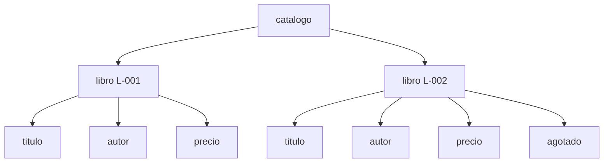

# 04.04 XML, CSV y otros

> **Versiones:** XML 1.0 (quinta edición, 2008) · RFC 4180 para CSV (2005) · TOML 1.1.0 (2025), verificadas el 9 de noviembre de 2026
> **Conviene saber antes:** [04.03 JSON y YAML](03-json-y-yaml.md) · [04.01 Texto, binario y codificación](01-texto-binario-y-codificacion.md) · [03.02 La terminal: sacarle partido, 1.6](../fase-03-herramientas/02-terminal-sacarle-partido.md#16-los-filtros-grep-sort-uniq-wc-cut-head-y-tail)
> **Tiempo estimado:** 2 horas
> **Nivel:** Básico · Ampliación

## Qué aprenderás

- Qué es **XML** y cómo se lee: **elementos**, **atributos**, el **elemento raíz**, los comentarios y la **declaración**.
- Cómo se escriben en XML los caracteres especiales con **entidades** (`&lt;`, `&amp;`…).
- La diferencia entre un XML **bien formado** y uno **válido**, y cómo saber si el tuyo está bien.
- **Dónde verás XML** aunque no lo escribas: `pom.xml`, las imágenes SVG, los canales RSS de los podcasts o un `.docx` por dentro.
- Qué tiene que ver **HTML** con XML y en qué se diferencian.
- **CSV a fondo**: las reglas del RFC 4180, las **comillas**, las **comillas dobladas** y los **saltos de línea dentro** de un campo.
- Por qué el CSV que sale de **Excel en español** usa **punto y coma**, qué pasa con las **tildes** al abrirlo y qué cambia Excel sin avisar.
- Qué es un **TSV** y por qué se lleva tan bien con la terminal.
- Cómo son los ficheros de configuración **`.properties`**, **INI** y **TOML**, y el fichero **`.env`**, donde van los **secretos**.
- **Cuándo usar cada formato.**

En [04.03 JSON y YAML](03-json-y-yaml.md) has visto los dos formatos de datos que más vas a usar. Este módulo completa el mapa con los demás que te vas a encontrar: algunos muy antiguos y todavía por todas partes (XML, CSV), y otros pequeños que sirven para configurar programas. No hace falta que los domines todos: la idea es que **los reconozcas, los sepas leer y no te pillen sus trampas**.

## 1. Teoría

### 1.1. Los formatos que te quedan por conocer

Ya sabes qué es un [formato de datos](03-json-y-yaml.md#11-datos-con-estructura-para-qué-sirven-los-formatos). Todos los de este módulo son [texto plano](../fase-03-herramientas/03-editor-de-codigo.md#11-qué-es-un-editor-de-código): los puedes abrir con VS Code, con `cat` o con `head`.

- **XML** ([1.2](#12-xml-un-lenguaje-de-marcas-para-datos) a [1.6](#16-dónde-verás-xml)): datos con estructura de árbol, sobre todo en sistemas que lo exigen (facturas electrónicas, imágenes SVG); y **HTML**, el de las páginas web ([1.7](#17-html-el-pariente-de-xml)).
- **CSV** y **TSV** ([1.8](#18-csv-a-fondo-las-reglas) a [1.12](#112-tsv-separado-por-tabuladores)): tablas, lo que sale de una hoja de cálculo o de una base de datos.
- **`.properties`**, **INI** y **TOML** ([1.13](#113-ficheros-de-configuración-properties-ini-y-toml)): configuración de programas; y **`.env`** ([1.14](#114-el-fichero-env-y-los-secretos)), variables de entorno y secretos.

Al final, en [1.15](#115-cuándo-usar-cada-formato), tienes una tabla para decidir cuál usar en cada caso.

### 1.2. XML: un lenguaje de marcas para datos

**XML** (*eXtensible Markup Language*, «lenguaje de marcas extensible») es un formato para guardar datos con **estructura de árbol**: cosas que contienen otras cosas. Lo publicó el W3C, el organismo que hace las normas de la web, en 1998; la versión que se usa es la **1.0**, cuya última revisión, la **quinta edición**, es de noviembre de 2008 (comprobado en la web del W3C el 9 de noviembre de 2026).

Es un [lenguaje de marcas](02-markdown.md#11-qué-es-markdown), como Markdown: el texto lleva unas **marcas** que dicen qué es cada parte. En Markdown, la marca `#` dice «esto es un título»; en XML, las marcas son **etiquetas** entre `<` y `>`, que rodean cada dato y dicen qué es:

```xml
<titulo>Don Quijote de la Mancha</titulo>
```

Se lee «el título es *Don Quijote de la Mancha*». La palabra **extensible** quiere decir que **tú eliges los nombres de las etiquetas**: XML no trae una lista fija, sino unas reglas para escribirlas. Una librería usará `<libro>` y `<titulo>`; una panadería, `<pedido>` y `<cliente>`.

Comparado con [JSON](03-json-y-yaml.md), XML es más antiguo y **más largo de escribir** (cada dato lleva su etiqueta de apertura y la de cierre), pero tiene cosas que JSON no tiene: **atributos**, **comentarios** y una forma estándar de **comprobar que un documento sigue un esquema**. Por eso sigue muy presente en la administración y en las empresas, aunque para las aplicaciones nuevas se suela elegir JSON.

### 1.3. Las piezas de un XML

Este es el catálogo de una librería en XML (lo tienes completo en el [ejemplo 2.1](#21-el-catálogo-de-una-librería-en-xml)):

```xml
<?xml version="1.0" encoding="UTF-8"?>
<!-- Catálogo de la Librería Cervantes -->
<catalogo tienda="Librería Cervantes" actualizado="2026-11-09">
  <libro codigo="L-001" unidades="3">
    <titulo>Don Quijote de la Mancha</titulo>
    <autor>Miguel de Cervantes</autor>
    <precio moneda="EUR">14.95</precio>
  </libro>
  ...
</catalogo>
```

| Pieza | En el ejemplo | Qué es |
|---|---|---|
| **Declaración** | `<?xml version="1.0" encoding="UTF-8"?>` | La primera línea: dice que es XML, su versión y su [codificación](01-texto-binario-y-codificacion.md#17-utf-8-cómo-se-guardan-los-caracteres-de-unicode). Es opcional, pero conviene ponerla, y si está, va **la primera**, sin nada antes |
| **Comentario** | `<!-- Catálogo de la Librería Cervantes -->` | Un texto para las personas, entre `<!--` y `-->`. Los programas que leen el XML lo saltan |
| **Elemento** | `<autor>Miguel de Cervantes</autor>` | Una **etiqueta de apertura** (`<autor>`), su **contenido** y una **etiqueta de cierre**, igual que la de apertura pero con `/` (`</autor>`) |
| **Elemento vacío** | `<agotado/>` | Un elemento sin contenido: se abre y se cierra a la vez, con `/>` al final. Es lo mismo que `<agotado></agotado>` |
| **Atributo** | `codigo="L-001"` | Un dato **dentro de la etiqueta de apertura**: un nombre, un `=` y el valor **siempre entre comillas** (dobles o simples) |
| **Elemento raíz** | `<catalogo>` | El elemento que **contiene a todos los demás**. Solo puede haber **uno** |

**Un árbol.** Los elementos van unos **dentro** de otros, y la [sangría](02-markdown.md#16-listas) ayuda a verlo, aunque a XML le da igual: `catalogo` contiene dos `libro`; cada `libro` contiene `titulo`, `autor` y `precio`. Es el mismo árbol que el de las [carpetas de tu ordenador](../fase-02-tu-ordenador/02-archivos-carpetas-y-rutas.md#13-el-árbol-de-carpetas), con el elemento raíz en lo más alto.



En texto: `catalogo` arriba del todo; debajo, sus dos libros; y debajo de cada libro, sus datos (el segundo, además, con `agotado`).

**¿Elemento o atributo?** El mismo dato se podría escribir de las dos formas: `<libro codigo="L-001">` o `<libro><codigo>L-001</codigo></libro>`. No hay una regla fija; la costumbre es usar **atributos para datos cortos que describen al elemento** (un identificador, una unidad, una moneda) y **elementos para el contenido**, y para lo que puede repetirse o tener partes dentro. Si el XML lo define otro (un banco, Hacienda, una herramienta), lo decide él.

> **📌 Nota:** en XML **todo es texto**. `<precio>14.95</precio>` no dice si `14.95` es un número o un texto; lo decide el programa que lo lee (o el esquema, [apartado 1.5](#15-bien-formado-y-válido)). En JSON, en cambio, `14.95` sin comillas ya es un número.

### 1.4. Caracteres especiales: las entidades

Si `<` empieza una etiqueta, ¿cómo se escribe un `<` de verdad dentro de un texto, como en «menores de < 12 años»? Con una **entidad**: un código que empieza por `&` y termina por `;`, y que el programa que lee el XML cambia por el carácter que representa.

XML trae cinco (las de la norma, comprobadas en la web del W3C el 9 de noviembre de 2026):

| Entidad | Carácter | Cuándo es obligatoria |
|---|---|---|
| `&lt;` | `<` (*less than*, «menor que») | Siempre, en el texto y en los atributos |
| `&amp;` | `&` (*ampersand*) | Siempre, en el texto y en los atributos |
| `&gt;` | `>` (*greater than*, «mayor que») | Casi nunca, pero se puede usar |
| `&quot;` | `"` | Dentro de un atributo escrito entre comillas dobles |
| `&apos;` | `'` | Dentro de un atributo escrito entre comillas simples |

Las dos que hay que recordar son **`&lt;` y `&amp;`**: la norma dice que `<` y `&` **no pueden aparecer sueltos** en el texto. Así, el libro *Cocina rápida & sana* se escribe:

```xml
<titulo>Cocina rápida &amp; sana</titulo>
```

En el fichero pone `&amp;`, pero cualquier programa que lea el XML entiende «Cocina rápida & sana». Si escribes el `&` suelto, el XML está roto ([error típico 3.1](#31-un--sin-escapar)).

Es lo que en Markdown hacías con la barra invertida: [escapar](02-markdown.md#114-escapar-caracteres) un carácter para que no se confunda con una marca. Cada formato lo hace a su manera: XML, con entidades; JSON, con `\` ([04.03](03-json-y-yaml.md#16-las-reglas-estrictas-de-json)); y CSV, doblando las comillas ([apartado 1.9](#19-comillas-comillas-dobladas-y-saltos-de-línea-dentro)).

### 1.5. Bien formado y válido

Un XML puede estar bien de dos maneras distintas, y conviene no confundirlas:

**Bien formado** quiere decir que **cumple las reglas de escritura de XML**, sean cuales sean sus etiquetas. Las reglas son pocas y estrictas:

1. Hay **un solo elemento raíz**, que contiene a todos los demás.
2. Toda etiqueta que se abre **se cierra** (o es un elemento vacío, con `/>`).
3. Las etiquetas se cierran **en orden inverso** a como se abrieron: `<a><b></b></a>` vale; `<a><b></a></b>` no. Como las cajas: no puedes cerrar la de fuera con la de dentro abierta.
4. Las **mayúsculas cuentan**: `<Cliente>` y `<cliente>` son etiquetas distintas, así que `<cliente>` no se cierra con `</Cliente>`.
5. Los valores de los atributos van **entre comillas**.
6. Nada de `<` ni `&` sueltos en el texto: se escriben `&lt;` y `&amp;`.

Si un XML **no** está bien formado, **no es XML**: cualquier programa que lo lea se para en el primer error y no lee nada más. No hay término medio. (Es la misma idea que en JSON: un fallo de escritura y el fichero entero no sirve.)

**Válido** es un paso más: además de bien formado, el XML **sigue un esquema**. Un **esquema** es otro fichero que dice qué etiquetas puede tener un tipo de documento, en qué orden y de qué tipo es cada dato («un `libro` tiene un `titulo` y un `precio`, y el precio es un número»). Los esquemas se escriben en **XSD** (*XML Schema Definition*) o en el más antiguo **DTD**. Una factura electrónica, por ejemplo, tiene que ser válida según el esquema que publica Hacienda; si le falta el NIF, está bien formada pero **no es válida**.

| | Bien formado | Válido |
|---|---|---|
| Qué comprueba | Las reglas de escritura de XML | Que sigue un esquema concreto |
| Lo necesita | Todo XML, siempre | Solo si alguien ha definido un esquema |
| Ejemplo de fallo | Un `&` suelto, una etiqueta sin cerrar | Falta un elemento obligatorio, un precio que no es un número |

**¿Cómo sé si mi XML está bien formado?** Sin instalar nada:

- **Ábrelo en el navegador** (arrástralo a una ventana de Firefox, Chrome o Edge; en macOS, Safari puede enseñar solo el texto, sin el árbol). Si está bien formado, el navegador te enseña el árbol; si no, un mensaje de error que dice la **línea** (y normalmente la columna) del primer fallo.
- **En VS Code**, el resaltado de sintaxis ([03.03, apartado 1.9](../fase-03-herramientas/03-editor-de-codigo.md#19-el-resaltado-de-sintaxis)) ya te da pistas, pero VS Code no comprueba XML por su cuenta. La extensión **XML** de **Red Hat** subraya los errores mientras escribes y también valida contra un esquema. Si la instalas, aplica los criterios de [03.03](../fase-03-herramientas/03-editor-de-codigo.md#110-extensiones-ampliar-el-editor-con-cuidado).

### 1.6. Dónde verás XML

Aunque no escribas XML a menudo, lo tienes alrededor:

| Dónde | Qué es |
|---|---|
| **`pom.xml`** | La configuración de un proyecto de **Java** con Maven: qué [bibliotecas](03-json-y-yaml.md#112-los-tipos-que-adivina-yaml-las-versiones-11-y-12) usa y cómo se construye. Lo verás si haces el curso de Java |
| **Imágenes SVG** (`.svg`) | Un dibujo hecho de **texto**: cada línea, círculo o letra es un elemento XML. Por eso se pueden ampliar sin que se pixelen ([ejemplo 2.3](#23-una-imagen-que-es-texto-svg)) |
| **RSS** | Los **canales de noticias y de pódcast**: la lista de episodios que lee tu aplicación de pódcast es un fichero XML |
| **`.docx`, `.xlsx`, `.odt`** | Los documentos de Word, Excel o LibreOffice son, por dentro, un **fichero ZIP lleno de ficheros XML**. Por eso no son texto plano ([03.03, apartado 1.2](../fase-03-herramientas/03-editor-de-codigo.md#12-editor-procesador-de-textos-e-ide)): lo que hay dentro sí lo es, pero comprimido |

### 1.7. HTML, el pariente de XML

**HTML** (*HyperText Markup Language*) es el lenguaje de marcas de las **páginas web**. Se parece mucho a XML, porque los dos vienen del mismo antepasado (SGML), y usa también etiquetas y atributos:

```html
<p>Bienvenido a la <strong>Panadería Sol</strong>.</p>
<a href="contacto.html">Contacto</a>
```

No hace falta que entiendas cada línea: fíjate en que tiene la misma forma que XML (`<p>` abre un párrafo y `</p>` lo cierra; `href` es un atributo). Pero hay **dos diferencias importantes**:

- **Las etiquetas no las eliges tú.** En XML inventas las etiquetas; en HTML hay una lista fija, cada una con su significado: `<p>` es un párrafo, `<a>` un enlace, `` una imagen. La norma la mantiene hoy el WHATWG (un grupo de los fabricantes de navegadores) y se llama **HTML Living Standard**: no tiene números de versión, se va actualizando (comprobado el 9 de noviembre de 2026).
- **HTML perdona los errores.** Un XML con una etiqueta sin cerrar no se lee; una página HTML con el mismo fallo, **el navegador la enseña igual**, porque la norma de HTML dice exactamente cómo arreglar cada error al leerla. Es cómodo, pero esconde fallos: la página «funciona» y está mal escrita.

HTML es el lenguaje de la parte que ve el usuario en una web; lo verás en los cursos de desarrollo web. Y ya lo has usado sin saberlo: los `<details>`, `<summary>` y `<kbd>` de este curso son HTML dentro de [Markdown](02-markdown.md).

### 1.8. CSV a fondo: las reglas

Ya conoces el [CSV](../fase-03-herramientas/01-terminal-lo-basico.md#19-ver-qué-hay-dentro-de-un-fichero-cat-less-head-y-tail) (*Comma-Separated Values*, «valores separados por comas»): un fichero de texto con una **tabla**, una fila por línea, las columnas separadas por comas y, normalmente, una **cabecera** con los nombres de las columnas. Lo exportan las hojas de cálculo, las bases de datos, los bancos y casi cualquier programa de gestión, y lo leen casi todos.

Parece tan sencillo que no necesita reglas, pero las tiene. La referencia es el **RFC 4180**, de octubre de 2005 (comprobado en la web del RFC Editor el 9 de noviembre de 2026). Es un [RFC](01-texto-binario-y-codificacion.md#111-el-bom) (*Request for Comments*, «petición de comentarios»), como el de JSON, pero solo **informativo**: describe cómo se escribe el CSV que usa la mayoría de los programas, sin obligar a nadie. Sus reglas principales:

1. Cada **fila** (la norma dice *registro*) va en su línea.
2. La primera línea **puede** ser una **cabecera**, con el mismo formato que las demás.
3. Las columnas (los **campos**) se separan con **comas**, y todas las filas tienen **el mismo número de campos**.
4. **Los espacios cuentan**: `Madrid, Sevilla` tiene un campo ` Sevilla` con un espacio delante.
5. Un campo **puede** ir entre **comillas dobles**, y **tiene que** ir entre comillas si contiene una **coma**, unas **comillas** o un **salto de línea**.
6. Dentro de un campo entre comillas, una comilla se escribe **doble**: `""`.

**Un CSV no dice nada de sí mismo.** No dice qué separador usa, si la primera línea es una cabecera, qué codificación tiene ni qué tipo es cada columna (para él, todo es texto). Eso lo tiene que saber, o adivinar, quien lo lee. Muchas de las trampas del CSV vienen de ahí.

> **📌 Nota:** el RFC 4180 dice que las líneas terminan en **CRLF**, el [salto de línea de Windows](../fase-03-herramientas/04-errores-y-depuracion.md#32-un-script-con-los-saltos-de-línea-de-windows). En la práctica, los programas leen igual los CSV con `LF` (los de este curso lo llevan), pero si un CSV hecho en Windows da problemas en la terminal, mira sus saltos de línea.

### 1.9. Comillas, comillas dobladas y saltos de línea dentro

Las reglas 5 y 6 son las que se olvidan, y las que rompen los CSV escritos «a mano». Míralas con el fichero de socios de un club de senderismo ([ejemplo 2.4](#24-un-csv-con-comillas-los-socios-de-un-club)):

```text
numero,nombre,localidad,observaciones
1,"Serrano, Lucía",Madrid,
2,"Pérez, Iván",Getafe,Prefiere rutas cortas
3,"Gómez, Marta",Alcalá de Henares,"Viene con su perro ""Toby"""
4,"Ruiz, Jorge",Madrid,"Alérgico a las picaduras.
Lleva su medicación en la mochila"
```

- **Una coma dentro de un campo.** El nombre se guarda como «Apellidos, Nombre», con una coma. Sin comillas, `1,Serrano, Lucía,Madrid,` tendría cinco campos y la fila no cuadraría con la cabecera. Con comillas, `"Serrano, Lucía"` es **un solo campo**, y las comillas no forman parte del dato: el nombre es `Serrano, Lucía`.
- **Un campo vacío.** La fila 1 termina en coma: su `observaciones` está vacío. Sigue teniendo cuatro campos.
- **Comillas dentro de un campo.** El dato es `Viene con su perro "Toby"`. Como tiene comillas, va entre comillas, y cada comilla de dentro se **dobla**: `"Viene con su perro ""Toby"""`. Las tres del final son una comilla del dato (doblada, `""`) y la que cierra el campo.
- **Un salto de línea dentro de un campo.** Las observaciones de Jorge ocupan dos líneas. Como van entre comillas, siguen siendo **un solo campo** de **una sola fila**. Por eso, en un CSV, **una fila no es siempre una línea**: este fichero tiene 6 líneas pero 5 filas (la cabecera y 4 socios).

Cuando se exporta un CSV desde un programa, el programa pone las comillas solo; el problema viene al **escribirlo a mano** o al **leerlo con herramientas que no saben de comillas**, como `cut` ([ejemplo 2.4](#24-un-csv-con-comillas-los-socios-de-un-club) y [error típico 3.4](#34-partir-un-csv-por-las-comas-a-ciegas)).

### 1.10. El CSV en España: punto y coma y coma decimal

En España escribimos los decimales con **coma**: `2,35 €`. Si el separador de un CSV también es la coma, `Manzana,2,35` sería un lío: ¿son dos campos o tres? Por eso **Excel en español usa el punto y coma (`;`) como separador** de los CSV que guarda: toma el separador de la **configuración regional** del sistema, y en los idiomas que usan la coma decimal el separador de listas es el punto y coma (según la ayuda de Microsoft, consultada el 9 de noviembre de 2026).

```text
codigo;producto;precio_kg;origen
0012;Manzana golden;2,35;Lleida
0013;Naranja;1,80;Valencia
```

Se sigue llamando CSV, aunque no lleve comas. Consecuencias:

- **El mismo CSV se lee distinto según el ordenador.** Un CSV con comas abierto con doble clic en un Excel en español sale **todo en una columna** ([error típico 3.5](#35-al-abrir-el-csv-todo-sale-en-una-columna)); uno con punto y coma abierto en un Excel en inglés, igual.
- **Antes de leer un CSV, mira su separador**: un `head -n 2` basta.
- **Para intercambiar datos entre programas** (no para abrirlos en Excel), lo más seguro es el CSV de la norma: **comas** como separador y **punto** decimal (`2.35`), como en JSON y en todos los lenguajes de programación.

### 1.11. La codificación y Excel

Un CSV es texto, así que tiene una codificación, y no la dice en ningún sitio. Hoy lo normal es UTF-8, pero muchos programas de Windows han guardado tradicionalmente los CSV en [Windows-1252](01-texto-binario-y-codificacion.md#15-una-tabla-por-idioma-latin-1-y-windows-1252). El resultado es el [mojibake](01-texto-binario-y-codificacion.md#110-caracteres-estropeados-mojibake) de 04.01: tildes y eñes estropeadas («Alcalá» en lugar de «Alcalá») cuando un programa lee el fichero con la codificación que no es. Aquí, lo práctico:

- **Al abrir un CSV en Excel**, no hagas doble clic: usa **Datos > Desde texto o CSV** (en el grupo **Obtener y transformar datos**). Excel te enseña una vista previa y te deja elegir el **Origen del archivo** (la codificación; para UTF-8, la que dice *UTF-8*) y el **Delimitador** (el separador) antes de cargarlo. Si las tildes de la vista previa salen bien, está bien elegida.
- **LibreOffice Calc**, al abrir un CSV, te pregunta siempre el juego de caracteres y el separador.
- **Al guardar desde Excel**, mira la lista de tipos de **Guardar como**: además del CSV de siempre, suele ofrecer un CSV en **UTF-8**. Ojo: lo suele guardar con BOM y con el separador de tu configuración regional (`;` en español). Si el CSV es para otro programa, compruébalo con `file` y `head` y, si hace falta, quita el BOM ([04.01, ejemplo 2.6](01-texto-binario-y-codificacion.md#26-encontrar-y-quitar-un-bom)).

> **📌 Nota:** esto es Excel para Windows (los nombres, como en su ayuda en español, consultada el 16 de noviembre de 2026). En Excel para Mac, en Numbers o en LibreOffice los menús cambian, pero la idea es la misma: importar eligiendo codificación y separador en lugar de abrir con doble clic.

### 1.12. TSV: separado por tabuladores

Un **TSV** (*Tab-Separated Values*) es un CSV que separa los campos con un **tabulador** (el carácter que se escribe con la tecla <kbd>Tab</kbd>) en lugar de una coma. Suele llevar la extensión `.tsv` (Excel lo guarda como «Texto (delimitado por tabulaciones)», con extensión `.txt`).

Tiene una gran ventaja: **un tabulador casi nunca forma parte de un dato**. Los nombres, las direcciones o los decimales pueden llevar comas o puntos y comas, pero casi nunca tabuladores. Así que un TSV casi nunca necesita comillas, y se puede partir en columnas sin miedo. Y una más: **`cut` usa el tabulador como separador si no le dices otro**, así que con un TSV basta `cut -f 3` ([ejemplo 2.5](#25-punto-y-coma-y-tabuladores-el-mismo-listado)).

Su inconveniente: el tabulador **no se ve**. En el editor parece un grupo de espacios, y si alguien lo cambia por espacios sin querer (algunos editores lo hacen), el fichero se rompe sin que se note.

> **💡 Consejo:** para revisar un TSV en VS Code, activa **Render Whitespace**, que dibuja los tabuladores como flechas ([04.03, error típico 3.5](03-json-y-yaml.md#35-un-tabulador-en-la-sangría)).

### 1.13. Ficheros de configuración: .properties, INI y TOML

Muchos programas leen al arrancar un **fichero de configuración**: un fichero de texto donde se dice cómo tienen que comportarse (en qué puerto escuchar, a qué base de datos conectarse, qué nombre mostrar), para no tener que cambiar el programa cada vez. Ya conoces dos formatos que se usan para eso, JSON y YAML ([04.03](03-json-y-yaml.md)). Hay otros tres que verás a menudo, con la misma idea de base: **una clave, un `=` y un valor por línea**. Aquí tienes la misma configuración de la tienda en línea de una librería en los tres ([ejemplo 2.6](#26-la-misma-configuración-en-cuatro-ficheros)):

| | `.properties` | INI | TOML |
|---|---|---|---|
| **Cómo es** | `tienda.puerto=8080` | `[tienda]` y debajo `puerto = 8080` | `[tienda]` y debajo `puerto = 8080` |
| **Comentarios** | Con `#` o `!` | Con `;` (muchos programas aceptan también `#`) | Con `#` |
| **Grupos** | No hay: se simulan con puntos en la clave (`correo.remitente`) | **Secciones** entre corchetes: `[correo]` | **Tablas** entre corchetes: `[correo]` |
| **Tipos** | Todo es texto | Todo es texto | Texto **entre comillas**, números, `true` y `false`, fechas y **listas** (`["novela", "cocina"]`) |
| **¿Hay norma?** | La de la clase `Properties` de Java | **No**: cada programa tiene sus reglas | **Sí**: la especificación de TOML, versión 1.1.0, de diciembre de 2025 |
| **Dónde lo verás** | Proyectos de Java (`application.properties` de Spring Boot), traducciones | Configuración de Windows y de programas antiguos; **la configuración de Git** se le parece mucho | Proyectos de **Python** (`pyproject.toml`) y de **Rust** (`Cargo.toml`) |

Algunos detalles que conviene saber (comprobados en las fuentes oficiales el 9 de noviembre de 2026):

- **`.properties`.** Una pareja `clave=valor` por línea; el separador puede ser `=`, `:` o un espacio, y los espacios de alrededor no cuentan. Una línea muy larga se puede partir con `\` al final. Nació con Java y lo verás sobre todo allí.
- **INI.** Es un formato muy antiguo, de los primeros Windows, y **no tiene una norma**: cada programa que lo usa decide si admite `#`, comillas o valores en varias líneas. El fichero de configuración de Git, que usarás en la fase 5, tiene esta misma forma: secciones entre corchetes y `nombre = valor` debajo, con comentarios que empiezan por `#` o `;`.
- **TOML** (*Tom's Obvious, Minimal Language*) es el más moderno: tiene la sencillez del INI, pero con **tipos** y **una norma** que dice exactamente cómo se lee. La versión 1.0.0 es de enero de 2021, y la **1.1.0**, del 18 de diciembre de 2025. Ojo: en TOML, los textos van **entre comillas** (`nombre = "Librería Cervantes"`); sin ellas, es un error.

La diferencia de los **tipos** se ve al leerlos: un programa que lee el INI del ejemplo recibe el texto `"8080"`, y tiene que convertirlo él en un número; con el TOML recibe directamente el número `8080`, y con `categorias` recibe una lista de tres textos en lugar de un texto con comas.

### 1.14. El fichero .env y los secretos

Hay datos de configuración que **no se pueden compartir**: la contraseña de la base de datos, la clave de la pasarela de pago o de una [API](03-json-y-yaml.md#11-datos-con-estructura-para-qué-sirven-los-formatos). A eso se le llama un **secreto**. Si un secreto acaba en un repositorio público de GitHub, cualquiera puede usarlo (y hay programas que recorren GitHub buscándolos).

La costumbre para separarlos es el fichero **`.env`** (de *environment*, «entorno»): un fichero de texto en la carpeta del proyecto con una [variable de entorno](../fase-02-tu-ordenador/03-instalar-programas-y-path.md#19-variables-de-entorno) por línea, en la forma `NOMBRE=valor`:

```text
# Valores de mi ordenador: este fichero no se sube a Git
BASEDATOS_CONTRASENA=Rocinante-1605
CORREO_CLAVE_API=k8Hq2Lw9Zt
```

(Son inventados, claro.) Al arrancar, el programa (o una biblioteca, o herramientas como Docker Compose) lee el `.env` y trata cada línea como una variable de entorno. Tampoco tiene una norma: cada herramienta lo lee con reglas parecidas (comentarios con `#`, comillas opcionales).

Tres reglas que se cumplen siempre:

1. **El `.env` no se sube nunca a Git.** Se pone en el fichero `.gitignore`, la lista de lo que Git no debe guardar, que aprenderás en la fase 5. (Como empieza por punto, es un [fichero oculto](../fase-02-tu-ordenador/02-archivos-carpetas-y-rutas.md#115-ficheros-ocultos): `ls` no lo enseña, `ls -a` sí.)
2. **Lo que sí se sube es un `.env.example`**: las mismas variables, con valores de ejemplo, para que quien descargue el proyecto sepa cuáles tiene que rellenar en su `.env`.
3. **En el fichero de configuración que se sube** (el TOML, el YAML…) va todo lo demás: lo que no es secreto.

Cómo se guardan bien los secretos, qué hacer si se te escapa uno y cómo se configura el `.gitignore` para que no pase lo verás en [Seguridad básica](../fase-07-aprender-a-aprender/05-seguridad-basica.md), en la fase 7.

### 1.15. Cuándo usar cada formato

Lo primero: **si el formato ya lo ha elegido otro** (el programa que va a leer el fichero, la herramienta que usas, el banco que te manda los datos), usa ese, sin discutir. Si eliges tú:

| Para | Usa | Por qué |
|---|---|---|
| Intercambiar datos entre programas, una API | **JSON** | Lo entiende cualquier lenguaje, con tipos y anidado ([04.03](03-json-y-yaml.md)) |
| Configuración que escriben personas, con estructura | **YAML** o **TOML** | Se leen y se escriben fácilmente, con comentarios. TOML, si es plana y quieres tipos sin sorpresas; YAML, si tiene mucho anidado o la herramienta lo pide |
| Configuración muy sencilla, en un proyecto que ya la usa | **`.properties`** o **INI** | Una clave y un valor por línea, sin más |
| Secretos y valores que cambian de un ordenador a otro | **`.env`**, fuera de Git | Para que no se compartan sin querer |
| Una tabla: exportar a una hoja de cálculo, cargar en una base de datos | **CSV** (o **TSV**) | Lo abre cualquier hoja de cálculo y ocupa poco |
| Documentos con un esquema, o un sistema que lo exige | **XML** | Comprueba la estructura con un esquema; muchas normas oficiales lo usan |
| Documentación para personas | **Markdown** | Se lee bien como texto y se ve bonito en GitHub ([04.02](02-markdown.md)) |

## 2. Ejemplos de código

En este módulo los ejemplos son **ficheros de datos**: descárgalos (su enlace «📁 Código»), ábrelos en VS Code y, los que llevan sesión, repítela en tu terminal. Recuerda que tu salida puede no ser idéntica letra a letra ([el aviso de 02.03](../fase-02-tu-ordenador/03-instalar-programas-y-path.md#22-un-aviso-sobre-las-salidas-de-la-terminal)).

### 2.1. El catálogo de una librería en XML

**Situación real:** la Librería Cervantes guarda su catálogo en XML para pasárselo a la web que vende sus libros. Este es el fichero:

```xml
<?xml version="1.0" encoding="UTF-8"?>
<!-- Catálogo de la Librería Cervantes -->
<catalogo tienda="Librería Cervantes" actualizado="2026-11-09">
  <libro codigo="L-001" unidades="3">
    <titulo>Don Quijote de la Mancha</titulo>
    <autor>Miguel de Cervantes</autor>
    <precio moneda="EUR">14.95</precio>
  </libro>
  <libro codigo="L-002" unidades="0">
    <titulo>Cocina rápida &amp; sana</titulo>
    <autor>Carmen Ortiz</autor>
    <precio moneda="EUR">19.90</precio>
    <agotado/>
  </libro>
</catalogo>
```

📁 **Código:** [`codigo/04-xml-csv-y-otros/ejemplos/2.1-un-catalogo-en-xml/`](codigo/04-xml-csv-y-otros/ejemplos/2.1-un-catalogo-en-xml/)

Como es texto, las órdenes de la terminal funcionan con él:

**En tu terminal** (`sesion.txt`):

```text
$ head -n 3 catalogo.xml
<?xml version="1.0" encoding="UTF-8"?>
<!-- Catálogo de la Librería Cervantes -->
<catalogo tienda="Librería Cervantes" actualizado="2026-11-09">
$ grep titulo catalogo.xml
    <titulo>Don Quijote de la Mancha</titulo>
    <titulo>Cocina rápida &amp; sana</titulo>
$ grep -c '<libro ' catalogo.xml
2
```

📁 **Código:** [`codigo/04-xml-csv-y-otros/ejemplos/2.1-un-catalogo-en-xml/`](codigo/04-xml-csv-y-otros/ejemplos/2.1-un-catalogo-en-xml/)

**En qué fijarte:**

- **Las piezas del [apartado 1.3](#13-las-piezas-de-un-xml)**: la declaración, el comentario, el elemento raíz `catalogo` con dos atributos, dos `libro` dentro, y el elemento vacío `<agotado/>` en el segundo.
- **`grep` enseña el fichero tal cual**, con `&amp;`. Es un programa que lee XML (la web de la librería, el navegador) el que lo convierte en `&`.
- **`grep -c '<libro '` cuenta los libros** porque cada uno empieza en su línea. Sirve para echar un vistazo, pero no para leer XML en serio: el mismo XML podría estar escrito en una sola línea y seguiría siendo correcto. Para trabajar con XML, los programas usan un **analizador** de XML, el que sabe sus reglas.
- **Ábrelo en el navegador** (con Firefox o Chrome): verás el árbol, con los elementos que se pueden plegar y desplegar.

### 2.2. Un ampersand sin escapar

**Situación real:** alguien de la librería añade un libro escribiendo el título tal cual:

```xml
<?xml version="1.0" encoding="UTF-8"?>
<catalogo tienda="Librería Cervantes">
  <libro codigo="L-002">
    <titulo>Cocina rápida & sana</titulo>
  </libro>
</catalogo>
```

📁 **Código:** [`codigo/04-xml-csv-y-otros/ejemplos/2.2-un-ampersand-sin-escapar/`](codigo/04-xml-csv-y-otros/ejemplos/2.2-un-ampersand-sin-escapar/)

**En qué fijarte:**

- **El fichero no está bien formado**: el `&` de la línea 4 va suelto. Ábrelo en el navegador (con Firefox o Chrome): en lugar del árbol completo, verás un mensaje de error que señala la línea 4.
- **No se lee nada**, ni siquiera lo que estaba bien: un programa que lo lea se para en el error. La web de la librería se quedaría sin catálogo por un solo carácter.
- **El arreglo** es escribir `&amp;` ([error típico 3.1](#31-un--sin-escapar)).

(La carpeta lleva un `debe-fallar.txt`: el fichero está mal a propósito, y así lo sabe la herramienta que comprueba el curso.)

### 2.3. Una imagen que es texto: SVG

**Situación real:** la Panadería Sol quiere un logotipo sencillo para su web, que se vea nítido en cualquier pantalla.

```xml
<svg xmlns="http://www.w3.org/2000/svg" width="240" height="120" viewBox="0 0 240 120">
  <!-- El logotipo de la Panadería Sol: un círculo amarillo y el nombre -->
  <circle cx="60" cy="60" r="40" fill="gold"/>
  <text x="115" y="68" font-family="sans-serif" font-size="20" fill="saddlebrown">Panadería Sol</text>
</svg>
```

📁 **Código:** [`codigo/04-xml-csv-y-otros/ejemplos/2.3-un-dibujo-en-svg/`](codigo/04-xml-csv-y-otros/ejemplos/2.3-un-dibujo-en-svg/)

**En qué fijarte:**

- **Es XML**: un elemento raíz `svg` con dos elementos dentro, un círculo vacío (`circle`, con `/>`) y un texto, y un comentario. No hace falta que entiendas cada atributo: `cx` y `cy` son el centro del círculo, `r` su radio y `fill` su color.
- **Ábrelo en el navegador** (`logo.svg`): verás un círculo amarillo y el nombre de la panadería. Ábrelo en VS Code: verás el texto. Es el mismo fichero.
- **El atributo `xmlns`** dice qué vocabulario de etiquetas usa el fichero (el de SVG): así el navegador sabe que `circle` es un círculo. No hace falta que esa dirección se abra en internet; es solo un nombre.
- **Cambia `gold` por `orange`, guarda y recarga el navegador**: has editado una imagen con un editor de texto.

### 2.4. Un CSV con comillas: los socios de un club

**Situación real:** el club de senderismo Picos Altos exporta su lista de socios desde su programa de gestión. Los nombres van como «Apellidos, Nombre», y hay observaciones con comillas y con varias líneas.

```text
numero,nombre,localidad,observaciones
1,"Serrano, Lucía",Madrid,
2,"Pérez, Iván",Getafe,Prefiere rutas cortas
3,"Gómez, Marta",Alcalá de Henares,"Viene con su perro ""Toby"""
4,"Ruiz, Jorge",Madrid,"Alérgico a las picaduras.
Lleva su medicación en la mochila"
```

📁 **Código:** [`codigo/04-xml-csv-y-otros/ejemplos/2.4-un-csv-con-comillas/`](codigo/04-xml-csv-y-otros/ejemplos/2.4-un-csv-con-comillas/)

Vas a contar las filas y a sacar la columna de la localidad con las órdenes de [03.02](../fase-03-herramientas/02-terminal-sacarle-partido.md#16-los-filtros-grep-sort-uniq-wc-cut-head-y-tail):

**En tu terminal** (`sesion.txt`):

```text
$ wc -l socios.csv
6 socios.csv
$ cut -d ',' -f 3 socios.csv
localidad
 Lucía"
 Iván"
 Marta"
 Jorge"
Lleva su medicación en la mochila"
```

📁 **Código:** [`codigo/04-xml-csv-y-otros/ejemplos/2.4-un-csv-con-comillas/`](codigo/04-xml-csv-y-otros/ejemplos/2.4-un-csv-con-comillas/)

**En qué fijarte:**

- **`wc -l` cuenta líneas, no filas**: dice 6, pero hay 5 filas (la cabecera y 4 socios), porque las observaciones de Jorge ocupan dos líneas.
- **`cut` no sabe nada de comillas.** Parte cada línea por **todas** las comas, también la de «Serrano, Lucía». El tercer trozo ya no es la localidad, sino ` Lucía"`: el final del nombre, con su espacio y su comilla.
- **La última línea sale entera**, porque es la segunda línea de las observaciones de Jorge y no tiene ninguna coma: para `cut`, es una línea con un solo campo, y si no encuentra el separador, la escribe tal cual.
- **El fichero está bien.** Cumple las reglas del CSV: cualquier hoja de cálculo lo abre con sus 4 columnas. Lo que falla es la herramienta, que no está hecha para CSV con comillas. Para estos ficheros se usa una hoja de cálculo o un programa con un **lector de CSV** de verdad, que sabe las reglas del [apartado 1.9](#19-comillas-comillas-dobladas-y-saltos-de-línea-dentro).

### 2.5. Punto y coma y tabuladores: el mismo listado

**Situación real:** la frutería Hermanos Ruiz exporta sus precios desde su Excel en español. Sale con punto y coma y coma decimal:

```text
codigo;producto;precio_kg;origen
0012;Manzana golden;2,35;Lleida
0013;Naranja;1,80;Valencia
0020;Tomate de colgar;3,10;Mallorca
```

📁 **Código:** [`codigo/04-xml-csv-y-otros/ejemplos/2.5-punto-y-coma-y-tabuladores/`](codigo/04-xml-csv-y-otros/ejemplos/2.5-punto-y-coma-y-tabuladores/)

Y también lo guardan como TSV, con los mismos datos separados por tabuladores (en la pantalla, los tabuladores se ven como espacios):

```text
codigo	producto	precio_kg	origen
0012	Manzana golden	2,35	Lleida
0013	Naranja	1,80	Valencia
0020	Tomate de colgar	3,10	Mallorca
```

📁 **Código:** [`codigo/04-xml-csv-y-otros/ejemplos/2.5-punto-y-coma-y-tabuladores/`](codigo/04-xml-csv-y-otros/ejemplos/2.5-punto-y-coma-y-tabuladores/)

Quieres la columna de los precios:

**En tu terminal** (`sesion.txt`):

```text
$ cut -d ';' -f 3 precios.csv
precio_kg
2,35
1,80
3,10
$ cut -d ',' -f 1 precios.csv
codigo;producto;precio_kg;origen
0012;Manzana golden;2
0013;Naranja;1
0020;Tomate de colgar;3
$ cut -f 3 precios.tsv
precio_kg
2,35
1,80
3,10
```

📁 **Código:** [`codigo/04-xml-csv-y-otros/ejemplos/2.5-punto-y-coma-y-tabuladores/`](codigo/04-xml-csv-y-otros/ejemplos/2.5-punto-y-coma-y-tabuladores/)

**En qué fijarte:**

- **Con el separador bueno (`;`)**, el tercer campo es el precio, con su coma decimal.
- **Con el separador equivocado (`,`)**, todo cambia: la cabecera no tiene comas y sale entera, y en las demás líneas la única coma es **la de los decimales**, que parte el precio por la mitad. Es lo que le pasa a un programa que espera comas y recibe un CSV de Excel en español.
- **Con el TSV no hace falta `-d`**: `cut` usa el tabulador si no le dices otro separador.
- **Los ceros del código** (`0012`) están en el fichero. Si abres el CSV con doble clic en Excel, es probable que los veas como `12` ([error típico 3.7](#37-excel-cambia-tus-datos-sin-avisar)).

### 2.6. La misma configuración en cuatro ficheros

**Situación real:** la Librería Cervantes va a tener tienda en línea, y su programa necesita saber el nombre de la tienda, el puerto, el IVA (el de los libros en España es el 4 %), si el envío es gratis, las categorías, el correo y la base de datos. Así quedaría en cada formato del [apartado 1.13](#113-ficheros-de-configuración-properties-ini-y-toml).

`tienda.properties`:

```text
# Configuración de la tienda en línea de la Librería Cervantes
tienda.nombre=Librería Cervantes
tienda.puerto=8080
tienda.iva=4
tienda.envio_gratis=true
tienda.categorias=novela,cocina,infantil
correo.remitente=pedidos@example.com
basedatos.servidor=localhost
basedatos.usuario=tienda
```

📁 **Código:** [`codigo/04-xml-csv-y-otros/ejemplos/2.6-configuracion-en-cuatro-formatos/`](codigo/04-xml-csv-y-otros/ejemplos/2.6-configuracion-en-cuatro-formatos/)

`tienda.ini`:

```ini
; Configuración de la tienda en línea de la Librería Cervantes
[tienda]
nombre = Librería Cervantes
puerto = 8080
iva = 4
envio_gratis = true
categorias = novela,cocina,infantil

[correo]
remitente = pedidos@example.com

[basedatos]
servidor = localhost
usuario = tienda
```

📁 **Código:** [`codigo/04-xml-csv-y-otros/ejemplos/2.6-configuracion-en-cuatro-formatos/`](codigo/04-xml-csv-y-otros/ejemplos/2.6-configuracion-en-cuatro-formatos/)

`tienda.toml`:

```toml
# Configuración de la tienda en línea de la Librería Cervantes
[tienda]
nombre = "Librería Cervantes"
puerto = 8080
iva = 4
envio_gratis = true
categorias = ["novela", "cocina", "infantil"]

[correo]
remitente = "pedidos@example.com"

[basedatos]
servidor = "localhost"
usuario = "tienda"
```

📁 **Código:** [`codigo/04-xml-csv-y-otros/ejemplos/2.6-configuracion-en-cuatro-formatos/`](codigo/04-xml-csv-y-otros/ejemplos/2.6-configuracion-en-cuatro-formatos/)

Y la contraseña de la base de datos y la clave del correo, ¿dónde? En ninguno de esos tres, que se subirán a Git. Van en el `.env` de cada ordenador, y lo que se sube es su plantilla, `.env.example`:

```text
# Copia este fichero como .env y escribe ahí los valores de verdad.
# El .env no se sube nunca a Git: está en el .gitignore.
BASEDATOS_CONTRASENA=escribe-aqui-la-contrasena
CORREO_CLAVE_API=escribe-aqui-la-clave
```

📁 **Código:** [`codigo/04-xml-csv-y-otros/ejemplos/2.6-configuracion-en-cuatro-formatos/`](codigo/04-xml-csv-y-otros/ejemplos/2.6-configuracion-en-cuatro-formatos/)

**En qué fijarte:**

- **Los tres dicen lo mismo**, pero el `.properties` no tiene grupos (los simula con `tienda.` y `correo.` delante de cada clave), y el INI y el TOML los tienen como secciones.
- **Solo el TOML tiene tipos.** Sus textos van entre comillas, `8080` es un número, `true` es un valor verdadero y las categorías son una **lista** de tres textos. En los otros dos, todo es texto: `categorias` es el texto `novela,cocina,infantil`, y el programa tendrá que partirlo por las comas.
- **El `.env.example` es un [fichero oculto](../fase-02-tu-ordenador/02-archivos-carpetas-y-rutas.md#115-ficheros-ocultos)**: en la carpeta del ejemplo, `ls` no lo enseña y `ls -a` sí.
- **No tiene ningún secreto de verdad**: solo dice qué variables hay que rellenar.

## 3. Errores típicos

### 3.1. Un & sin escapar

**Qué pasa:** un XML que funcionaba deja de leerse después de añadir un dato como «Cocina rápida & sana» o «Pérez & Hijos, S. L.». El navegador o el programa dicen que el fichero no está bien formado y señalan esa línea ([ejemplo 2.2](#22-un-ampersand-sin-escapar)).

**Por qué ocurre:** en XML, `&` empieza una entidad (`&amp;`, `&lt;`…), y `<` empieza una etiqueta. Sueltos en el texto, rompen el fichero ([apartado 1.4](#14-caracteres-especiales-las-entidades)).

**Cómo se arregla:** escribe `&amp;` en lugar de `&` y `&lt;` en lugar de `<`. Y si el XML lo genera un programa, que use una biblioteca de XML, que escapa sola, en lugar de pegar textos.

### 3.2. Etiquetas mal cerradas

**Qué pasa:** el XML de un pedido no se lee, y el error habla de una etiqueta que no coincide:

```xml
<?xml version="1.0" encoding="UTF-8"?>
<pedido numero="1024">
  <cliente>Sara Molina</Cliente>
  <producto><nombre>Barra de pan</producto></nombre>
</pedido>
```

📁 **Código:** [`codigo/04-xml-csv-y-otros/ejemplos/3.2-etiquetas-mal-cerradas/`](codigo/04-xml-csv-y-otros/ejemplos/3.2-etiquetas-mal-cerradas/)

**Por qué ocurre:** hay dos fallos. `<cliente>` se cierra con `</Cliente>`, y en XML las mayúsculas cuentan: son etiquetas distintas. Y `<producto>` se cierra antes que `<nombre>`, que se abrió dentro: las etiquetas tienen que cerrarse en orden inverso a como se abrieron ([apartado 1.5](#15-bien-formado-y-válido)).

**Cómo se arregla:** `<cliente>Sara Molina</cliente>` y `<producto><nombre>Barra de pan</nombre></producto>`. Una costumbre que lo evita: **escribe la etiqueta de cierre justo después de la de apertura**, y luego rellena lo de dentro.

### 3.3. Dos elementos raíz

**Qué pasa:** juntas dos pedidos en un mismo fichero, cada uno con su `<pedido>`, y el fichero deja de ser XML:

```xml
<?xml version="1.0" encoding="UTF-8"?>
<pedido numero="1024">
  <cliente>Sara Molina</cliente>
</pedido>
<pedido numero="1025">
  <cliente>Jorge Ruiz</cliente>
</pedido>
```

📁 **Código:** [`codigo/04-xml-csv-y-otros/ejemplos/3.3-dos-elementos-raiz/`](codigo/04-xml-csv-y-otros/ejemplos/3.3-dos-elementos-raiz/)

**Por qué ocurre:** un XML tiene **un solo** elemento raíz. Cuando termina el primer `</pedido>`, el documento ha terminado, y lo que viene detrás sobra.

**Cómo se arregla:** mete los dos dentro de un elemento que los contenga: `<pedidos>` al principio (después de la declaración) y `</pedidos>` al final. Lo mismo pasa al pegar dos XML uno detrás de otro: hay que envolverlos, y quitar la declaración del segundo.

### 3.4. Partir un CSV por las comas a ciegas

**Qué pasa:** sacas una columna de un CSV con `cut -d ','` (o con un programa que parte cada línea por las comas) y los datos salen desplazados: medio nombre en la columna de la localidad, columnas de más en unas filas y de menos en otras ([ejemplo 2.4](#24-un-csv-con-comillas-los-socios-de-un-club)).

**Por qué ocurre:** en un CSV, una coma entre comillas es parte del dato, no un separador, y un salto de línea entre comillas no termina la fila ([apartado 1.9](#19-comillas-comillas-dobladas-y-saltos-de-línea-dentro)). `cut` no sabe nada de eso.

**Cómo se arregla:** mira antes el fichero (`head`): si no tiene comillas, `cut` vale. Si las tiene, usa una hoja de cálculo o un programa con un lector de CSV. Y si eres tú quien elige el formato, un TSV casi nunca necesita comillas ([apartado 1.12](#112-tsv-separado-por-tabuladores)).

### 3.5. Al abrir el CSV, todo sale en una columna

**Qué pasa:** abres un CSV con doble clic en Excel y cada fila sale entera en la columna A: `numero,nombre,localidad`.

**Por qué ocurre:** el fichero usa un separador y Excel espera otro. Un Excel en español espera punto y coma; si el CSV usa comas (como los que salen de muchos programas y webs), no lo parte ([apartado 1.10](#110-el-csv-en-españa-punto-y-coma-y-coma-decimal)).

**Cómo se arregla:** no lo abras con doble clic: usa **Datos > Desde texto o CSV** y elige el delimitador en la ventana de importación ([apartado 1.11](#111-la-codificación-y-excel)). Y no «arregles» el fichero cambiando las comas por puntos y comas a lo bruto: cambiarías también las comas de dentro de los datos.

### 3.6. Las tildes salen estropeadas al abrir el CSV

**Qué pasa:** en la hoja de cálculo, «Alcalá» sale como «Alcalá», o «Muñoz» como «Mu�oz».

**Por qué ocurre:** el programa ha leído el fichero con una codificación que no es la suya: un UTF-8 leído como Windows-1252 da lo primero, y un Windows-1252 leído como UTF-8, lo segundo ([04.01, apartado 1.10](01-texto-binario-y-codificacion.md#110-caracteres-estropeados-mojibake)).

**Cómo se arregla:** al abrirlo, elige la codificación correcta en la ventana de importación (en Excel, **Origen del archivo**; en LibreOffice, el juego de caracteres), mirando que la vista previa salga bien. Si el fichero lo haces tú, guárdalo en UTF-8 y avisa a quien lo reciba.

### 3.7. Excel cambia tus datos sin avisar

**Qué pasa:** abres un CSV con doble clic, lo guardas y, sin haber tocado nada, el fichero ha cambiado: el código `0012` es ahora `12`; el código postal `08001`, `8001`; un número de pedido largo sale como `1,23457E+15`; y algo como `1-3` se ha convertido en una fecha.

**Por qué ocurre:** al abrir un CSV, Excel **adivina el tipo de cada columna** con su formato por defecto (lo dice su propia ayuda). Para él, `0012` es el número 12, y los ceros de delante sobran. Recuerda: el CSV no dice de qué tipo es nada ([apartado 1.8](#18-csv-a-fondo-las-reglas)).

**Cómo se arregla:** importa el fichero con **Datos > Desde texto o CSV** y marca como **texto** las columnas de códigos (códigos de producto, códigos postales, teléfonos, DNI). Y nunca guardes encima del CSV original sin mirar: si el fichero lo va a leer otro programa, compruébalo antes con `head`.

## 4. Buenas prácticas

- **Si el formato lo elige otro, úsalo tal cual**; si lo eliges tú, usa la tabla del [apartado 1.15](#115-cuándo-usar-cada-formato).
- **Mira un fichero antes de procesarlo**: `head -n 3` te dice el separador de un CSV, si tiene cabecera y si lleva comillas.
- **XML con su declaración**, `<?xml version="1.0" encoding="UTF-8"?>`, en UTF-8, con un solo elemento raíz y la etiqueta de cierre escrita justo después de la de apertura.
- **Escapa `&` y `<`** en XML: `&amp;` y `&lt;`.
- **Comprueba que un XML está bien formado** abriéndolo en el navegador o con la extensión XML de VS Code.
- **CSV para intercambiar entre programas: comas, punto decimal, UTF-8 y cabecera.** Para abrirlo en un Excel en español, punto y coma y coma decimal, sabiendo que es para eso.
- **Comillas en los campos que llevan separador, comillas o saltos de línea**, y las comillas de dentro, dobladas.
- **Abre los CSV en Excel con Datos > Desde texto o CSV**, no con doble clic, y marca como texto las columnas de códigos.
- **Nombres de columnas y de claves sin espacios ni tildes** (`precio_kg`, `envio_gratis`), como los de los [ficheros](../fase-02-tu-ordenador/02-archivos-carpetas-y-rutas.md#113-cómo-nombrar-ficheros-y-carpetas): los programas los usan como nombres.
- **Comentarios en la configuración**: un `#` que diga qué es cada cosa ahorra muchas dudas.
- **Los secretos, en el `.env`**, fuera de Git; en Git, un `.env.example` sin valores reales.

## 5. Ejercicios prácticos resueltos

> **💡 Consejo:** intenta cada ejercicio **antes** de abrir las pistas y la solución. Los que llevan carpeta de código los puedes hacer en tu ordenador: descarga la carpeta, abre los ficheros en VS Code y, si hay sesión, repítela en la terminal. Los demás son de **razonar**: escribe tu respuesta y compárala después.

### 🟢 Básico

#### Ejercicio 1 · Las piezas de un pedido en XML

La Panadería Sol recibe los pedidos de su web en XML. Este es uno:

```xml
<?xml version="1.0" encoding="UTF-8"?>
<pedido numero="1024" fecha="2026-11-09">
  <cliente telefono="600123456">Sara Molina</cliente>
  <lineas>
    <linea unidades="2">Barra de pan</linea>
    <linea unidades="1">Tarta de queso</linea>
  </lineas>
  <nota>Sin gluten &amp; sin lactosa, por favor</nota>
  <recoger-en-tienda/>
</pedido>
```

📁 **Código:** [`codigo/04-xml-csv-y-otros/ejercicios/ej01-piezas-de-un-xml/`](codigo/04-xml-csv-y-otros/ejercicios/ej01-piezas-de-un-xml/)

Contesta:

1. ¿Cuál es el elemento raíz?
2. ¿Cuántos elementos tiene el pedido en total, contando el raíz? ¿Cuál es el elemento vacío?
3. Haz una lista de los atributos, con el elemento al que pertenece cada uno y su valor.
4. ¿Qué texto recibe el programa de la panadería cuando lee la nota?

<details>
<summary>Pista 1</summary>

Repasa la tabla del [apartado 1.3](#13-las-piezas-de-un-xml). Para contar los elementos, cuenta las etiquetas de apertura (y las de los elementos vacíos), no las de cierre.

</details>

<details>
<summary>Pista 2</summary>

Para la nota, recuerda qué es `&amp;` ([apartado 1.4](#14-caracteres-especiales-las-entidades)).

</details>

<details>
<summary>Ver solución</summary>

1. **El elemento raíz es `pedido`**: el que contiene a todos los demás.
2. **Siete elementos**: `pedido`, `cliente`, `lineas`, dos `linea`, `nota` y `recoger-en-tienda`. El vacío es **`<recoger-en-tienda/>`**: no tiene contenido y se cierra con `/>`. Por su nombre, dice que el pedido se recoge en la tienda: a veces, que un elemento esté o no ya es el dato.
3. Los atributos:

   | Elemento | Atributo | Valor |
   |---|---|---|
   | `pedido` | `numero` | `1024` |
   | `pedido` | `fecha` | `2026-11-09` |
   | `cliente` | `telefono` | `600123456` |
   | primera `linea` | `unidades` | `2` |
   | segunda `linea` | `unidades` | `1` |

4. **`Sin gluten & sin lactosa, por favor`**. En el fichero pone `&amp;`, pero es una entidad: el programa que lee el XML la cambia por `&`.

**Errores frecuentes al resolverlo:**

- Contar las etiquetas de cierre como elementos (saldrían trece).
- Contar como un elemento la declaración `<?xml … ?>`: no lo es, es la cabecera del documento.
- Responder que la nota dice `&amp;`: eso es lo que está escrito en el fichero, no el dato.

</details>

#### Ejercicio 2 · Lee las inscripciones de una carrera

La carrera popular de San Silvestre de un pueblo recoge las inscripciones en este CSV:

```text
dorsal,nombre,club,categoria,comentario
101,Ana Torres,"Corredores del Sur, Sevilla",Sénior,
102,Luis Navarro,,Veterano,"Pide la camiseta de talla ""XL"""
103,"Sánchez Gil, Elena",Atletismo Getafe,Sénior,"Llegará tarde.
Recoge el dorsal el mismo día"
104,Pablo Díaz,,Júnior,Primera carrera
```

📁 **Código:** [`codigo/04-xml-csv-y-otros/ejercicios/ej02-inscripciones/`](codigo/04-xml-csv-y-otros/ejercicios/ej02-inscripciones/)

Sin ejecutar nada, contesta:

1. ¿Cuántas columnas tiene? ¿Cuántas personas inscritas hay?
2. ¿Qué dirá `wc -l inscripciones.csv`? ¿Por qué no coincide con lo anterior?
3. ¿De qué club es Ana Torres? Escribe el dato exacto, sin las comillas del fichero.
4. ¿Qué comentario ha dejado Luis Navarro? Escríbelo exacto.
5. ¿Quiénes no tienen club? ¿Cómo lo sabes?

Después, comprueba la pregunta 2 en tu terminal.

<details>
<summary>Pista 1</summary>

Las comillas agrupan un campo aunque tenga comas o saltos de línea dentro; y `""` dentro de un campo entre comillas es una sola comilla del dato ([apartado 1.9](#19-comillas-comillas-dobladas-y-saltos-de-línea-dentro)).

</details>

<details>
<summary>Pista 2</summary>

Dos comas seguidas (`,,`) son un campo vacío entre ellas.

</details>

<details>
<summary>Ver solución</summary>

1. **Cinco columnas** (las de la cabecera: `dorsal`, `nombre`, `club`, `categoria` y `comentario`) y **cuatro personas** (los dorsales 101 a 104).
2. **6 líneas**: la cabecera, cuatro filas y una línea más, porque el comentario de Elena Sánchez Gil ocupa dos. Un CSV tiene tantas filas como registros, pero un salto de línea entre comillas no termina la fila.

**En tu terminal** (`sesion.txt`):

```text
$ wc -l inscripciones.csv
6 inscripciones.csv
```

📁 **Código:** [`codigo/04-xml-csv-y-otros/ejercicios/ej02-inscripciones/`](codigo/04-xml-csv-y-otros/ejercicios/ej02-inscripciones/)

3. **`Corredores del Sur, Sevilla`**. Las comillas están porque el dato tiene una coma; no son parte del dato.
4. **`Pide la camiseta de talla "XL"`**. En el fichero, cada comilla del dato está doblada (`""XL""`), y todo el campo va entre comillas. La comilla del final del fichero, la tercera seguida, es la que cierra el campo.
5. **Luis Navarro y Pablo Díaz**: en su fila, entre el nombre y la categoría hay dos comas seguidas (`,,`), que dejan el campo `club` vacío. Ana Torres también tiene un campo vacío, pero es otro: el comentario (su fila termina en coma).

**Errores frecuentes al resolverlo:**

- Contar las personas con el número de líneas (6 − 1 = 5): sale una de más.
- Escribir el club de Ana con las comillas, o el comentario de Luis con las comillas dobladas.
- Pensar que una fila que termina en coma está mal: tiene su último campo vacío, y sigue teniendo cinco.

</details>

### 🟡 Intermedio

#### Ejercicio 3 · Arregla el XML del club de lectura

El club de lectura de Las Rozas lleva sus reuniones en un XML, pero nadie consigue abrirlo:

```xml
<?xml version="1.0" encoding="UTF-8"?>
<club nombre="Club de lectura Las Rozas">
  <reunion fecha=2026-11-20>
    <libro>Matemáticas & magia</libro>
    <Lugar>Biblioteca municipal</lugar>
    <asistentes><persona>Marta Gil</asistentes></persona>
  </reunion>
</club>
<club nombre="Club de lectura Majadahonda"/>
```

📁 **Código:** [`codigo/04-xml-csv-y-otros/ejercicios/ej03-xml-roto/`](codigo/04-xml-csv-y-otros/ejercicios/ej03-xml-roto/)

Tiene **cinco** errores que hacen que no esté bien formado. Encuéntralos todos, di qué regla incumple cada uno y escribe el fichero arreglado, con los dos clubes.

<details>
<summary>Pista 1</summary>

Repasa las seis reglas del [apartado 1.5](#15-bien-formado-y-válido) y búscalas una a una en el fichero: comillas, `&`, mayúsculas, orden de cierre y raíz.

</details>

<details>
<summary>Pista 2</summary>

El último error está en la última línea: ¿cuántos elementos hay en lo más alto del árbol?

</details>

<details>
<summary>Ver solución</summary>

**Los cinco errores:**

| Línea | Error | Regla | Arreglo |
|---|---|---|---|
| 3 | `fecha=2026-11-20` | Los atributos van entre comillas | `fecha="2026-11-20"` |
| 4 | `Matemáticas & magia` | Nada de `&` suelto en el texto | `Matemáticas &amp; magia` |
| 5 | `<Lugar>` se cierra con `</lugar>` | Las mayúsculas cuentan | `<lugar>…</lugar>` |
| 6 | `<asistentes><persona>…</asistentes></persona>` | Se cierra en orden inverso | `<asistentes><persona>…</persona></asistentes>` |
| 9 | Un segundo `club` después de cerrar el primero | Un solo elemento raíz | Un elemento `clubes` que contenga los dos |

**El fichero arreglado:**

```xml
<?xml version="1.0" encoding="UTF-8"?>
<clubes>
  <club nombre="Club de lectura Las Rozas">
    <reunion fecha="2026-11-20">
      <libro>Matemáticas &amp; magia</libro>
      <lugar>Biblioteca municipal</lugar>
      <asistentes><persona>Marta Gil</persona></asistentes>
    </reunion>
  </club>
  <club nombre="Club de lectura Majadahonda"/>
</clubes>
```

📁 **Código:** [`codigo/04-xml-csv-y-otros/ejercicios/ej03-xml-arreglado/`](codigo/04-xml-csv-y-otros/ejercicios/ej03-xml-arreglado/)

**Explicación:**

- Para la etiqueta de la línea 5, cualquiera de las dos vale (`Lugar` o `lugar`) si la de apertura y la de cierre son iguales; se ha elegido la minúscula para que todas las etiquetas sigan la misma costumbre.
- Al envolver los dos clubes en `<clubes>`, todo lo de dentro baja un nivel, y se ha sangrado dos espacios más para que se vea el árbol. A XML le da igual la sangría; a quien lo lee, no.
- Si abres el fichero roto en el navegador, verás **solo el primer error** (el de la línea 3): un programa que lee XML se para en el primero. Al arreglarlo y volver a abrirlo, aparecerá el siguiente. Por eso conviene revisar el fichero entero con las reglas delante, en lugar de ir arreglando de error en error.

**Errores frecuentes al resolverlo:**

- Arreglar la línea 6 cerrando `</asistentes>` dos veces, o borrando una de las etiquetas.
- Quitar el segundo club para que haya una sola raíz: el ejercicio pide conservar los dos datos.
- Poner `<clubes>` antes de la declaración `<?xml … ?>`: la declaración va siempre la primera.

</details>

#### Ejercicio 4 · El CSV de una ferretería

La ferretería Martínez quiere subir sus productos a una tienda en línea, que pide un CSV **con comas, punto decimal y cabecera**, como dice el RFC 4180. Estos son los productos:

| referencia | producto | precio | descripcion |
|---|---|---|---|
| F-101 | Martillo de carpintero | 12.50 | Mango de madera |
| F-102 | Tornillos 4x40, caja de 100 | 3.95 | Para madera |
| F-103 | Cinta "americana" gris | 4.20 | Rollo de 50 m |
| F-104 | Llave inglesa | 9.90 | Se ajusta hasta 30 mm.<br>Garantía de 2 años |

(La descripción de la llave inglesa tiene dos líneas: la tienda las enseña así.)

Escribe `productos.csv`. Usa comillas solo donde hagan falta.

<details>
<summary>Pista 1</summary>

Busca en cada dato las tres cosas que obligan a usar comillas: una coma, unas comillas o un salto de línea.

</details>

<details>
<summary>Pista 2</summary>

En `Cinta "americana" gris`, el campo entero va entre comillas y cada comilla de dentro se dobla.

</details>

<details>
<summary>Ver solución</summary>

```text
referencia,producto,precio,descripcion
F-101,Martillo de carpintero,12.50,Mango de madera
F-102,"Tornillos 4x40, caja de 100",3.95,Para madera
F-103,"Cinta ""americana"" gris",4.20,Rollo de 50 m
F-104,Llave inglesa,9.90,"Se ajusta hasta 30 mm.
Garantía de 2 años"
```

📁 **Código:** [`codigo/04-xml-csv-y-otros/ejercicios/ej04-ferreteria/`](codigo/04-xml-csv-y-otros/ejercicios/ej04-ferreteria/)

**Explicación, campo a campo de los que llevan comillas:**

- **`"Tornillos 4x40, caja de 100"`**: tiene una coma. Sin comillas, la fila tendría cinco campos y la cabecera cuatro.
- **`"Cinta ""americana"" gris"`**: tiene comillas. Va entre comillas, y cada una de dentro, doblada.
- **`"Se ajusta hasta 30 mm.` … `Garantía de 2 años"`**: tiene un salto de línea. Entre comillas, las dos líneas son un solo campo.
- **Los precios con punto** (`12.50`), como pide la tienda. Con coma decimal, `12,50` partiría el precio en dos campos.
- **El resto, sin comillas**: no las necesita. Ponerlas en todos los campos (`"F-101","Martillo de carpintero",…`) también sería correcto según la norma, pero el enunciado pedía solo las necesarias.

Comprueba que cuadra: 4 campos en la cabecera y 4 en cada fila (contando los de dentro de las comillas como uno). Si tienes Excel o LibreOffice, ábrelo con la importación y elige la coma como separador: deben salir 4 columnas y 4 productos.

**Errores frecuentes al resolverlo:**

- Escapar las comillas con una barra (`\"americana\"`), como en otros formatos: en CSV se doblan.
- Poner las comillas solo alrededor de `americana` (`Cinta "americana" gris` sin más): las comillas tienen que rodear el campo entero.
- Escribir la descripción de la llave en una sola línea, o partirla en dos filas.

</details>

### 🔴 Avanzado

#### Ejercicio 5 · Por qué cut se equivoca con los socios

Sergio lleva los socios de una peña ciclista en `socios.csv`:

```text
nombre,ciudad,telefono
"García, Ana",Madrid,600111222
"López, Pedro",Sevilla,600333444
Rosa Vidal,Bilbao,600555666
```

📁 **Código:** [`codigo/04-xml-csv-y-otros/ejercicios/ej05-socios/`](codigo/04-xml-csv-y-otros/ejercicios/ej05-socios/)

Quiere la lista de ciudades y escribe `cut -d ',' -f 2 socios.csv`.

1. Sin ejecutarla, escribe qué saldrá exactamente en la pantalla, línea a línea, y explica por qué.
2. Escribe un `socios.tsv` con los mismos datos que no tenga ese problema, y la orden de `cut` que saca las ciudades de él.
3. ¿En qué caso dejaría de funcionar tu TSV?

<details>
<summary>Pista 1</summary>

`cut` parte cada línea por **todas** las comas, sin mirar las comillas. Fíjate en el espacio que hay después de la coma de «García, Ana».

</details>

<details>
<summary>Pista 2</summary>

En un TSV, el separador es el tabulador. ¿Necesita comillas «García, Ana» si el separador ya no es la coma? Y ¿qué separador usa `cut` si no le das `-d`?

</details>

<details>
<summary>Ver solución</summary>

**1. Lo que sale, y por qué.** `cut` parte cada línea por todas las comas:

- La cabecera, `nombre,ciudad,telefono`: el campo 2 es `ciudad`. Bien.
- `"García, Ana",Madrid,600111222` se parte en `"García`, ` Ana"`, `Madrid` y `600111222`: el campo 2 es ` Ana"`, con el espacio de delante y la comilla de cierre.
- Lo mismo con López: ` Pedro"`.
- `Rosa Vidal,Bilbao,600555666` no tiene comillas: el campo 2 es `Bilbao`. Bien.

**2. El TSV.** Los mismos datos, separados por tabuladores. Como ningún dato tiene tabuladores, **no hacen falta comillas**: `García, Ana` es un solo campo, con su coma y todo.

```text
nombre	ciudad	telefono
García, Ana	Madrid	600111222
López, Pedro	Sevilla	600333444
Rosa Vidal	Bilbao	600555666
```

📁 **Código:** [`codigo/04-xml-csv-y-otros/ejercicios/ej05-socios/`](codigo/04-xml-csv-y-otros/ejercicios/ej05-socios/)

(En la pantalla los tabuladores se ven como espacios.) **Ojo al escribirlo en VS Code:** si no le dices otra cosa, VS Code mete **espacios** al pulsar <kbd>Tab</kbd>, y lo dice en la barra de estado, con algo como `Spaces: 4`. Haz clic ahí, elige **Indent Using Tabs** (sangrar con tabuladores) y comprueba con **Render Whitespace** que entre los campos ves flechas y no puntos.

Las dos órdenes, en la terminal:

**En tu terminal** (`sesion.txt`):

```text
$ cut -d ',' -f 2 socios.csv
ciudad
 Ana"
 Pedro"
Bilbao
$ cut -f 2 socios.tsv
ciudad
Madrid
Sevilla
Bilbao
```

📁 **Código:** [`codigo/04-xml-csv-y-otros/ejercicios/ej05-socios/`](codigo/04-xml-csv-y-otros/ejercicios/ej05-socios/)

Con el TSV, `cut -f 2` basta: el tabulador es el separador por defecto de `cut`.

**3. Cuándo dejaría de funcionar.** Si algún dato tuviera un **tabulador** o un **salto de línea** dentro (por ejemplo, unas observaciones de varias líneas). Entonces el TSV también necesitaría comillas, y `cut` volvería a equivocarse. Por eso, con datos que no controlas, lo seguro es leer el CSV con un programa que sepa sus reglas.

**Errores frecuentes al resolverlo:**

- Predecir `García` para la segunda línea: ese es el campo 1 partido (`"García`, con la comilla), no el 2.
- Olvidar el espacio de ` Ana"`: en CSV, los espacios cuentan.
- Escribir el TSV con comillas alrededor de `García, Ana`: `cut` no las quita, y la columna de nombres saldría con comillas.

</details>

### 🏆 Caso real

#### Ejercicio 6 · La configuración de la tienda en línea

La Librería Cervantes ya tiene su tienda en línea, y Raúl, que la programa, te pasa la lista de lo que el programa necesita saber para arrancar:

- El nombre de la tienda: Librería Cervantes.
- El puerto: 8080.
- Si está en modo de pruebas: sí.
- Los idiomas de la web: español (`es`) e inglés (`en`).
- Los gastos de envío: 3,95 €, y gratis a partir de 30 €.
- El servidor de correo, `smtp.example.com`, su puerto, 587, y el usuario, `pedidos@example.com`.
- La contraseña del correo.
- La clave secreta de la pasarela de pago.

Raúl quiere un `config.toml` que se pueda subir a Git, y que nadie del equipo suba nunca los secretos. Escribe:

1. El `config.toml`, agrupado en tablas y con un comentario al principio.
2. El `.env.example`.
3. La línea que hay que añadir al `.gitignore`, y qué tiene que hacer cada persona del equipo al descargar el proyecto.

<details>
<summary>Pista 1</summary>

Separa primero la lista en dos: lo que puede verlo cualquiera y lo que no. Lo segundo no va en el TOML.

</details>

<details>
<summary>Pista 2</summary>

En TOML, los textos van entre comillas, los números sin ellas y con **punto** decimal, el sí es `true` y una lista va entre corchetes. Repasa el [ejemplo 2.6](#26-la-misma-configuración-en-cuatro-ficheros).

</details>

<details>
<summary>Ver solución</summary>

**Razonamiento:** de los ocho datos, dos son secretos (la contraseña del correo y la clave de la pasarela de pago): van al `.env`, y su plantilla, al `.env.example`. Los demás van al `config.toml`, agrupados por tema: la tienda, los envíos y el correo.

**1. `config.toml`:**

```toml
# Configuración de la tienda en línea de la Librería Cervantes.
# Aquí no hay contraseñas ni claves: esas van en el .env, que no se sube a Git.
[tienda]
nombre = "Librería Cervantes"
puerto = 8080
modo_pruebas = true
idiomas = ["es", "en"]

[envios]
gastos = 3.95
gratis_desde = 30.00

[correo]
servidor = "smtp.example.com"
puerto = 587
usuario = "pedidos@example.com"
```

📁 **Código:** [`codigo/04-xml-csv-y-otros/ejercicios/ej06-configuracion-libreria/`](codigo/04-xml-csv-y-otros/ejercicios/ej06-configuracion-libreria/)

**2. `.env.example`:**

```text
# Copia este fichero como .env y escribe ahí los valores de verdad.
# El .env no se sube nunca a Git.
CORREO_CONTRASENA=escribe-aqui-la-contrasena-del-correo
PAGOS_CLAVE_SECRETA=escribe-aqui-la-clave-de-la-pasarela-de-pago
```

📁 **Código:** [`codigo/04-xml-csv-y-otros/ejercicios/ej06-configuracion-libreria/`](codigo/04-xml-csv-y-otros/ejercicios/ej06-configuracion-libreria/)

**3. El `.gitignore` y el equipo.** En el `.gitignore` del proyecto, una línea:

```text
.env
```

Cada persona, al descargar el proyecto, **copia `.env.example` como `.env`** (`cp .env.example .env`) y escribe en él los valores de verdad, que le dará Raúl por un canal seguro (nunca por el chat del equipo ni en un correo cualquiera; lo verás en [Seguridad básica](../fase-07-aprender-a-aprender/05-seguridad-basica.md)). El `.env.example` sí se sube: así todos saben qué variables hacen falta.

**Explicación de las decisiones:**

- **Los textos, entre comillas** (`"Librería Cervantes"`); los **números, sin ellas** y con **punto decimal** (`3.95`, no `3,95`, que en TOML es un error); el **sí**, `true`; los **idiomas**, una lista. Así el programa recibe cada dato con su tipo.
- **Dos claves `puerto`**, una en `[tienda]` y otra en `[correo]`: no chocan, porque están en tablas distintas. Es una de las ventajas de agrupar.
- **`gratis_desde = 30.00`**, con decimales como `gastos`, para que los dos importes se escriban igual (en TOML, `30` a secas sería un número entero, de otro tipo).
- **Los nombres de las variables del `.env`, en mayúsculas** y con guiones bajos, como las [variables de entorno](../fase-02-tu-ordenador/03-instalar-programas-y-path.md#19-variables-de-entorno).
- **El comentario del TOML** recuerda dónde están los secretos: quien abra el fichero buscando la contraseña sabrá que no está ahí, y por qué.

**Errores frecuentes al resolverlo:**

- Meter la contraseña en el TOML con un comentario «no subir»: el fichero se sube entero.
- Escribir `modo_pruebas = sí` o `idiomas = es, en`: no es TOML (sería válido en un INI, como texto).
- Poner valores reales en el `.env.example`: es un fichero que se sube.
- Añadir `.env.example` al `.gitignore` en lugar de `.env`.

</details>

## 6. Chuleta

### XML

| Pieza | Así se escribe |
|---|---|
| Declaración (la primera línea) | `<?xml version="1.0" encoding="UTF-8"?>` |
| Elemento | `<titulo>Don Quijote</titulo>` |
| Elemento vacío | `<agotado/>` |
| Atributo (siempre con comillas) | `<libro codigo="L-001">` |
| Comentario | `<!-- texto -->` |
| Entidades | `&lt;` `<` · `&amp;` `&` · `&gt;` `>` · `&quot;` `"` · `&apos;` `'` |

**Bien formado:** un solo elemento raíz · toda etiqueta se cierra · en orden inverso · las mayúsculas cuentan · atributos entre comillas · ni `<` ni `&` sueltos. **Válido:** bien formado y, además, sigue su esquema (XSD o DTD). **Comprobarlo:** ábrelo en el navegador (Firefox o Chrome).

### CSV y TSV

| Regla | Ejemplo |
|---|---|
| Un campo con separador, comillas o salto de línea, entre comillas | `"Serrano, Lucía"` |
| Una comilla dentro de un campo, doblada | `"Su perro ""Toby"""` |
| Un campo vacío | `1,Lucía,,Madrid` |
| Mismo número de campos en todas las filas | Comprueba con la cabecera |
| CSV de Excel en español | `;` como separador y coma decimal |
| TSV | Tabulador como separador; casi nunca comillas |

| Para | Escribe |
|---|---|
| Ver el separador y la cabecera | `head -n 3 fichero.csv` |
| Una columna de un CSV con `;` y sin comillas | `cut -d ';' -f 3 fichero.csv` |
| Una columna de un TSV | `cut -f 3 fichero.tsv` |
| Abrirlo en Excel sin sorpresas | Datos > Desde texto o CSV: codificación, delimitador y columnas de códigos como texto |

`wc -l` cuenta **líneas**, no filas · `cut` no sabe de comillas.

### Configuración

| Formato | Así es | Tipos |
|---|---|---|
| `.properties` | `tienda.puerto=8080` · comentarios con `#` o `!` | Todo es texto |
| INI | `[tienda]` y `puerto = 8080` · comentarios con `;` | Todo es texto |
| TOML 1.1.0 | `[tienda]` y `puerto = 8080`, `nombre = "Sol"`, `idiomas = ["es", "en"]` · comentarios con `#` | Texto con comillas, números, `true`/`false`, listas |
| `.env` | `CLAVE=valor` · comentarios con `#` | Variables de entorno |

**Secretos:** en el `.env`, y `.env` en el `.gitignore` · en Git, un `.env.example` sin valores reales.

## 7. Preguntas de repaso

1. ¿Qué quiere decir que XML es «extensible»? ¿En qué se diferencia de HTML en eso?

   <details>
   <summary>Ver respuesta</summary>

   Que las etiquetas las eliges tú: XML da las reglas para escribirlas, no una lista fija. HTML, en cambio, tiene una lista fija de etiquetas, cada una con su significado (`<p>`, `<a>`…). Lo tienes en [1.2. XML: un lenguaje de marcas para datos](#12-xml-un-lenguaje-de-marcas-para-datos) y [1.7. HTML, el pariente de XML](#17-html-el-pariente-de-xml).

   </details>

2. ¿Cómo se escribe en XML el título «Pérez & Hijos»? ¿Por qué?

   <details>
   <summary>Ver respuesta</summary>

   `Pérez &amp; Hijos`. El `&` empieza una entidad, así que no puede ir suelto en el texto; `&amp;` es la entidad que representa el `&`. Lo tienes en [1.4. Caracteres especiales: las entidades](#14-caracteres-especiales-las-entidades).

   </details>

3. ¿Qué diferencia hay entre un XML bien formado y uno válido? ¿Puede uno ser válido sin estar bien formado?

   <details>
   <summary>Ver respuesta</summary>

   Bien formado: cumple las reglas de escritura de XML. Válido: además, sigue un esquema que dice qué elementos puede tener y de qué tipo. No: para ser válido, primero tiene que estar bien formado (si no lo está, ni siquiera es XML). Lo tienes en [1.5. Bien formado y válido](#15-bien-formado-y-válido).

   </details>

4. ¿Cuándo tiene que ir un campo de un CSV entre comillas? ¿Cómo se escribe una comilla dentro de él?

   <details>
   <summary>Ver respuesta</summary>

   Cuando contiene el separador, unas comillas o un salto de línea. La comilla de dentro se dobla: `"Su perro ""Toby"""`. Lo tienes en [1.8. CSV a fondo: las reglas](#18-csv-a-fondo-las-reglas) y [1.9. Comillas, comillas dobladas y saltos de línea dentro](#19-comillas-comillas-dobladas-y-saltos-de-línea-dentro).

   </details>

5. Un CSV tiene 10 líneas según `wc -l`. ¿Tiene seguro 9 filas de datos y una cabecera?

   <details>
   <summary>Ver respuesta</summary>

   No. Si algún campo entre comillas tiene un salto de línea, esa fila ocupa varias líneas, y hay menos filas que líneas. Además, la cabecera es opcional. Lo tienes en [1.9. Comillas, comillas dobladas y saltos de línea dentro](#19-comillas-comillas-dobladas-y-saltos-de-línea-dentro).

   </details>

6. ¿Por qué el Excel en español guarda los CSV con punto y coma? ¿Qué pasa si abres con doble clic un CSV con comas?

   <details>
   <summary>Ver respuesta</summary>

   Porque en español la coma es el separador decimal, y Excel toma el separador de la configuración regional, que en ese caso es el punto y coma. Un CSV con comas, abierto con doble clic, sale con cada fila entera en una sola columna; hay que importarlo con Datos > Desde texto o CSV y elegir el delimitador. Lo tienes en [1.10. El CSV en España: punto y coma y coma decimal](#110-el-csv-en-españa-punto-y-coma-y-coma-decimal) y en el [error típico 3.5](#35-al-abrir-el-csv-todo-sale-en-una-columna).

   </details>

7. ¿Qué ventaja tiene un TSV para trabajar con la terminal? ¿Y qué inconveniente?

   <details>
   <summary>Ver respuesta</summary>

   Como casi ningún dato tiene tabuladores, casi nunca necesita comillas, y `cut` lo parte bien sin más (`cut -f 3`, porque el tabulador es su separador por defecto). El inconveniente es que el tabulador no se ve, y si alguien lo cambia por espacios el fichero se rompe sin que se note. Lo tienes en [1.12. TSV: separado por tabuladores](#112-tsv-separado-por-tabuladores).

   </details>

8. ¿Qué diferencia hay, al leerlo, entre `puerto = 8080` en un INI y en un TOML? ¿Y entre `nombre = Librería` en los dos?

    <details>
    <summary>Ver respuesta</summary>

    En el INI, `8080` es un texto, y el programa tiene que convertirlo; en el TOML es un número. `nombre = Librería` es un texto válido en un INI, pero un error en TOML, donde los textos van entre comillas (`nombre = "Librería"`). Lo tienes en [1.13. Ficheros de configuración: .properties, INI y TOML](#113-ficheros-de-configuración-properties-ini-y-toml).

    </details>

9. ¿Qué va en un `.env`, qué va en un `.env.example` y cuál de los dos se sube a Git?

    <details>
    <summary>Ver respuesta</summary>

    El `.env` tiene los valores de verdad de tu ordenador, secretos incluidos, y no se sube nunca (va en el `.gitignore`). El `.env.example` tiene las mismas variables con valores de ejemplo, para que se sepa cuáles hay que rellenar, y ese sí se sube. Lo tienes en [1.14. El fichero .env y los secretos](#114-el-fichero-env-y-los-secretos).

    </details>

10. Abres un CSV con doble clic en Excel, lo guardas sin tocar nada y los códigos postales de Barcelona (`08001`) han pasado a ser `8001`. ¿Qué ha pasado y cómo lo evitas?

    <details>
    <summary>Ver respuesta</summary>

    Excel ha adivinado que la columna era de números y ha quitado los ceros de delante, porque el CSV no dice de qué tipo es cada columna. Se evita importando con Datos > Desde texto o CSV y marcando esa columna como texto, y no guardando encima del original sin comprobarlo. Lo tienes en el [error típico 3.7](#37-excel-cambia-tus-datos-sin-avisar).

    </details>

---
⬅️ [Anterior: JSON y YAML](03-json-y-yaml.md) · 📚 [Índice](../00-indice.md) · ➡️ [Siguiente: Diagramas y Mermaid](05-diagramas-y-mermaid.md)
