# 04.05 Diagramas y Mermaid

> **Versiones:** Mermaid 12.2.0 (la que usa la academia) y 10.9.8 (una antigua, como la que aún usan algunos sitios); la última publicada es la 12.3.0 (comprobado el 9 de noviembre de 2026)
> **Conviene saber antes:** [01.02 Algoritmos y pseudocódigo, 1.12](../fase-01-que-es-programar/02-algoritmos-y-pseudocodigo.md#112-diagramas-de-flujo) · [04.02 Markdown](02-markdown.md)
> **Tiempo estimado:** 2,5 horas
> **Nivel:** Básico · Núcleo

## Qué aprenderás

- **Por qué se dibuja antes de programar**: para pensar, para explicar y para documentar.
- Los tres diagramas que verás en todos los cursos: el **diagrama de flujo**, el **diagrama de bloques** (o de arquitectura) y el **diagrama de secuencia**, y cuándo usar cada uno.
- Qué es **Mermaid** y por qué conviene escribir los diagramas como **texto** en lugar de dibujarlos.
- A escribir diagramas de flujo en Mermaid: **dirección**, **formas**, **flechas con texto** y grupos con **`subgraph`**.
- A escribir **diagramas de secuencia**: participantes, mensajes, respuestas, notas y alternativas.
- A poner en una etiqueta **paréntesis, comillas y otros caracteres especiales** sin romper el diagrama.
- Dónde se dibuja Mermaid (**GitHub, la academia y VS Code**) y cómo usar el **editor en línea oficial** para probar.
- A reconocer y corregir los **errores de sintaxis** más frecuentes.
- Que existen **más tipos de diagramas** y otras notaciones, como **UML**, que verás en otros cursos.

## 1. Teoría

### 1.1. Por qué se dibuja antes de programar

En [01.02](../fase-01-que-es-programar/02-algoritmos-y-pseudocodigo.md#11-primero-el-algoritmo-después-el-código) viste que primero se piensa el algoritmo y después se escribe el código. Con los diagramas pasa lo mismo, a otra escala: antes de construir algo (un programa, una web, el proceso de una tienda), se **dibuja**. Un dibujo de cinco cajas y unas flechas responde en un minuto preguntas que el código tardaría horas en responder: ¿qué piezas hay?, ¿quién habla con quién?, ¿qué pasa si el pago falla?

Un diagrama sirve para tres cosas:

- **Pensar.** Al dibujar, aparecen los huecos: «¿y si el cliente no está registrado?», «¿de dónde sale este dato?». Es mucho más barato descubrirlos en un dibujo que en un programa a medias.
- **Explicar.** Un buen diagrama se entiende de un vistazo, también para quien no programa: tu cliente, tu jefa o la persona que entra nueva en el equipo.
- **Documentar.** Guardado junto al proyecto (por ejemplo, en su `README.md`), le cuenta a quien llegue después cómo está organizado, sin que tenga que leerse todo el código.

Lo que no es un diagrama: una obra de arte ni un plano con cada detalle. Los diagramas que se usan en el día a día son **bocetos**: pequeños, con lo que importa y fáciles de cambiar. Si para entender un diagrama hace falta un párrafo, le sobran cosas.

### 1.2. Tres diagramas para empezar

Hay muchísimos tipos de diagramas, pero con tres vas a tener para casi todo lo que necesitas antes de tu curso:

| Diagrama | Responde a | Qué dibuja | Ejemplo |
|---|---|---|---|
| **De flujo** | ¿Qué pasos se siguen y qué decisiones se toman? | Pasos, decisiones y el orden entre ellos | Cómo se tramita la devolución de un pedido |
| **De bloques** (o de arquitectura) | ¿Qué piezas tiene el sistema y cómo se conectan? | Cajas (las piezas) y flechas (las conexiones) | El navegador, el servidor y la base de datos de una web |
| **De secuencia** | ¿Quién habla con quién, y en qué orden? | Participantes en columnas y mensajes entre ellos, de arriba abajo en el tiempo | Lo que pasa entre tú, la tienda y el banco al pagar con tarjeta |

**El diagrama de flujo** ya lo conoces: es el que dibuja un algoritmo, con los símbolos que viste en [01.02, apartado 1.12](../fase-01-que-es-programar/02-algoritmos-y-pseudocodigo.md#112-diagramas-de-flujo) (óvalo para el inicio y el fin, rectángulo para un proceso, rombo para una decisión…). Aquí no vamos a repetirlos: vas a aprender a **escribirlos** en Mermaid. Sirve también para cualquier proceso que no sea un programa: los pasos para dar de alta a un socio en un club, por ejemplo.

**El diagrama de bloques** (también llamado **de arquitectura**, cuando dibuja las piezas de un programa) no tiene símbolos oficiales: cada pieza es una caja con su nombre y cada flecha, una conexión, a menudo con una palabra que dice qué viaja por ella. Es el que verás en cuanto un curso te enseñe una aplicación entera: qué hay en tu ordenador, qué hay en el servidor y qué hay en la base de datos (lo verás en el módulo «Las piezas de una aplicación», fase 6).

**El diagrama de secuencia** pone a cada participante (una persona, un programa, un servidor) en una columna, y dibuja los mensajes que se mandan como flechas horizontales, **de arriba abajo en el orden en que ocurren**. Es el mejor para explicar una conversación entre programas, como un pago o un inicio de sesión.

> **📌 Nota:** los tres dibujan **cosas distintas del mismo sistema**. En una tienda en línea, el de flujo dice qué pasos sigue un pedido; el de bloques, qué programas hay; y el de secuencia, qué se dicen esos programas cuando pagas. No compiten: se elige el que responde a la pregunta que tienes.

### 1.3. Dibujar escribiendo: Mermaid

Un diagrama se puede hacer en papel, en una pizarra o con un programa de dibujo, arrastrando cajas y flechas con el ratón. Funciona, pero tiene pegas: el dibujo es una imagen, y cambiar una caja obliga a recolocar media figura; si se guarda en el proyecto, nadie puede ver qué ha cambiado de una versión a otra; y hace falta el mismo programa para editarlo.

**Mermaid** es otra forma: **escribes el diagrama como texto** y un programa lo dibuja por ti. Esto:

````text
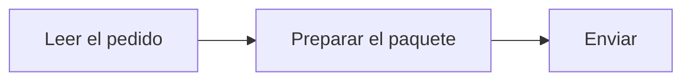
````

se convierte en esto:


En texto: tres cajas de izquierda a derecha, «Leer el pedido», «Preparar el paquete» y «Enviar», unidas por flechas.

Mermaid es **gratuito y de código abierto**, y su documentación oficial está en `mermaid.js.org`. Lo que ganas al escribir los diagramas como texto:

- **Es [texto plano](../fase-03-herramientas/03-editor-de-codigo.md#11-qué-es-un-editor-de-código)**: lo escribes en tu editor, como cualquier otro fichero, y no necesitas ningún programa de dibujo.
- **Se guarda con el proyecto**, dentro de sus ficheros Markdown, y con Git (fase 5) podrás ver qué ha cambiado de una versión a otra, línea a línea, como en el código.
- **Cambiar es fácil**: añadir una caja es añadir una línea. Mermaid recoloca el dibujo solo.
- **Lo dibujan solos** GitHub, la academia y la vista previa de VS Code ([apartado 1.10](#110-dónde-se-dibuja-github-la-academia-y-vs-code)).

A cambio, **tú no decides dónde va cada caja**: Mermaid las coloca a su manera. Para los bocetos del día a día es una ventaja (no pierdes tiempo colocando); para un cartel bonito, mejor un programa de dibujo.

> **📌 Nota:** todos los diagramas de este curso están escritos así. Si alguna vez lees el curso en un sitio que no entiende Mermaid, verás el texto en lugar del dibujo; con lo que aprendas en este módulo, también se entiende.

**Versiones.** Mermaid saca versiones a menudo. A 9 de noviembre de 2026, la última es la **12.3.0** (del 3 de noviembre de 2026), y la academia dibuja los diagramas con la **12.2.0**. Cada sitio usa la suya, y no siempre la última: lo que está en este módulo funciona en todas las versiones recientes (se ha comprobado con la 12.2.0 y con la 10.9.8, mucho más antigua, como la que aún usan algunos sitios).

### 1.4. Tu primer diagrama

Un diagrama de Mermaid dentro de un fichero Markdown es un [bloque de código](02-markdown.md#111-código-en-línea-y-bloques-de-código) cuyo lenguaje es `mermaid`. Dentro:

1. **La primera línea dice el tipo de diagrama**: `flowchart` para uno de flujo (o de bloques) y `sequenceDiagram` para uno de secuencia. Si falta o está mal escrita, no se dibuja nada ([error típico 3.1](#31-el-diagrama-no-se-dibuja)).
2. **Cada línea siguiente** es un trozo del dibujo: una caja, una flecha, un grupo… Se suelen sangrar con cuatro espacios para que se lea mejor, pero la sangría no cambia nada.

Este es el diagrama de flujo más pequeño que tiene sentido:

````text
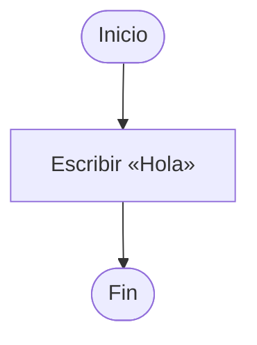
````


En texto: de arriba abajo, un óvalo «Inicio», un rectángulo «Escribir «Hola»» y un óvalo «Fin», unidos por flechas.

Fíjate en las dos piezas de cada caja (lo que Mermaid llama **nodo**):

| Pieza | En el ejemplo | Para qué sirve |
|---|---|---|
| **Identificador** | `inicio`, `saludo`, `fin` | El nombre con el que te refieres al nodo dentro del diagrama. No se ve en el dibujo. Una palabra corta, sin espacios |
| **Etiqueta** | `"Inicio"`, `"Escribir «Hola»"` | El texto que se ve dentro de la caja. Los símbolos que la rodean deciden **la forma** de la caja |

La etiqueta se escribe **solo la primera vez** que aparece el nodo; después basta con su identificador (`saludo --> fin`). Si un identificador aparece sin etiqueta la primera vez, Mermaid usa el propio identificador como texto: `A --> B` dibuja dos cajas, «A» y «B».

> **💡 Consejo:** pon las etiquetas **siempre entre comillas dobles**, como en el ejemplo. Sin comillas también funciona mientras el texto sea sencillo, pero con un paréntesis, unos corchetes o unas llaves el diagrama se rompe ([apartado 1.9](#19-caracteres-especiales-en-las-etiquetas)). Con comillas, nunca te pasará.

### 1.5. Diagramas de flujo: dirección y formas

**La dirección.** Lo que va detrás de `flowchart` dice hacia dónde avanza el dibujo:

| Dirección | Significa | Cuándo |
|---|---|---|
| `TD` o `TB` | De arriba abajo (*top-down*, *top to bottom*) | Lo normal en los diagramas de flujo de un algoritmo |
| `LR` | De izquierda a derecha (*left to right*) | Procesos cortos y diagramas de bloques: se leen como una frase |
| `BT` | De abajo arriba | Pocas veces |
| `RL` | De derecha a izquierda | Pocas veces |

**Las formas.** Los símbolos que rodean la etiqueta deciden la forma del nodo. Estas son las que corresponden a los símbolos de [01.02](../fase-01-que-es-programar/02-algoritmos-y-pseudocodigo.md#112-diagramas-de-flujo), más dos que usarás en los diagramas de bloques (según la documentación oficial de Mermaid, consultada el 9 de noviembre de 2026):

| Se escribe | Forma | Símbolo de 01.02 o uso |
|---|---|---|
| `id(["Inicio"])` | Óvalo (estadio) | Terminal: inicio o fin |
| `id["Calcular el total"]` | Rectángulo | Proceso |
| `id{"¿Hay stock?"}` | Rombo | Decisión |
| `id[/"Leer el pedido"/]` | Paralelogramo | Entrada o salida |
| `id[["Calcular el envío"]]` | Rectángulo con dobles líneas laterales | Subproceso |
| `id("Tienda en línea")` | Rectángulo con las esquinas redondeadas | Una pieza de un diagrama de bloques |
| `id[("Base de datos")]` | Cilindro | Una base de datos o un almacén de ficheros |

Hay más formas (círculo, hexágono, trapecio…), pero con estas siete tienes de sobra. Si un día necesitas otra, está en la documentación oficial.

### 1.6. Flechas y textos en las flechas

Las flechas unen dos nodos. Estas son las que vas a usar:

| Se escribe | Se dibuja | Para qué |
|---|---|---|
| `A --> B` | Flecha | Lo normal: «de A se pasa a B» |
| `A --- B` | Línea sin punta | Unir dos cosas sin dirección |
| `A -.-> B` | Flecha de puntos | Algo opcional, o una conexión menos importante |
| `A ==> B` | Flecha gruesa | Destacar el camino principal |

**Texto en la flecha.** Las flechas que salen de un rombo tienen que decir «Sí» o «No» ([01.02](../fase-01-que-es-programar/02-algoritmos-y-pseudocodigo.md#112-diagramas-de-flujo)). Hay dos formas de escribirlo, y las dos dibujan lo mismo:

```text
    stock -- Sí --> enviar
    stock -->|Sí| enviar
```

En este curso se usa la primera (`-- Sí -->`), que se lee como una frase. El texto de una flecha también admite comillas: `-- "pide páginas" -->`; úsalas si lleva paréntesis. Con las flechas de puntos, el texto va entre los puntos: `A -. "si lo pide" .-> B`.

**Encadenar.** Puedes escribir varios pasos seguidos en una línea: `A --> B --> C`. Es cómodo para los tramos sin decisiones.

**Volver atrás.** Un bucle es una flecha que vuelve a un nodo anterior. En Mermaid no tiene nada especial: escribes la flecha hacia ese nodo y Mermaid la dibuja hacia arriba.

Un ejemplo con todo, la entrada a la piscina de un club:

````text

````

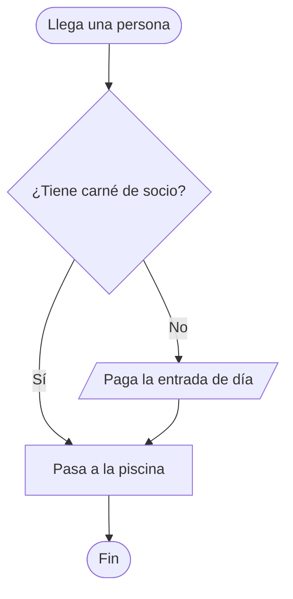

En texto: llega una persona; si tiene carné de socio, pasa a la piscina; si no, paga la entrada de día y después pasa. Fíjate en que los dos caminos se juntan en el mismo nodo: basta con que dos flechas lleguen a `pasar`.

**Comentarios.** Una línea que empieza por `%%` es un comentario: Mermaid no la dibuja. Sirve para dejar notas a quien lea el código del diagrama (`%% Falta el caso de los menores`). Tiene que ir en su propia línea.

### 1.7. Agrupar con subgraph: diagramas de bloques

En un diagrama de bloques es muy útil **agrupar** las piezas que están en el mismo sitio: lo que está en el ordenador del cliente, lo que está en el servidor… Para eso está `subgraph`:

```text
    subgraph identificador ["Título del grupo"]
        nodo1
        nodo2
    end
```

Todo lo que va entre `subgraph` y `end` se dibuja dentro de un recuadro con ese título. Las flechas pueden entrar y salir del grupo con normalidad.

La web de la Panadería Sol, la que hacía Ana en [02.02](../fase-02-tu-ordenador/02-archivos-carpetas-y-rutas.md#21-un-árbol-real-la-web-de-una-panadería), ya tiene tienda en línea. Así se ven sus piezas:

````text
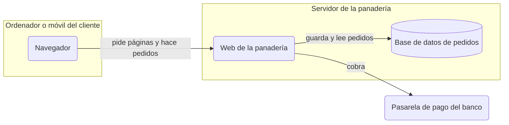
````


En texto: el navegador del cliente, en su ordenador o su móvil, pide páginas y hace pedidos a la web de la panadería; la web, en el servidor de la panadería, guarda y lee los pedidos en una base de datos y cobra a través de la pasarela de pago del banco, que está fuera.

No hace falta que sepas todavía qué es exactamente un servidor o una pasarela de pago: lo verás en [06.01 Redes](../fase-06-internet-y-aplicaciones/01-redes.md#13-cliente-y-servidor) y en [06.05 Las piezas de una aplicación](../fase-06-internet-y-aplicaciones/05-piezas-de-una-aplicacion.md#16-servicios-de-otros-pagos-correo-mapas). Lo que importa aquí es la forma: **cajas para las piezas, flechas con verbos para lo que hacen y recuadros para decir dónde está cada cosa**.

> **⚠️ Cuidado:** cada `subgraph` se cierra con su `end`. Si se te olvida, el diagrama entero deja de dibujarse ([error típico 3.6](#36-un-bloque-sin-su-end)).

### 1.8. Diagramas de secuencia

Un diagrama de secuencia empieza por `sequenceDiagram`. Dentro se escriben **los participantes** y, después, **los mensajes en orden**: cada línea es un mensaje, y el primero que escribes es el primero que ocurre.

Así se pide una cita en el centro de salud desde su web:

````text
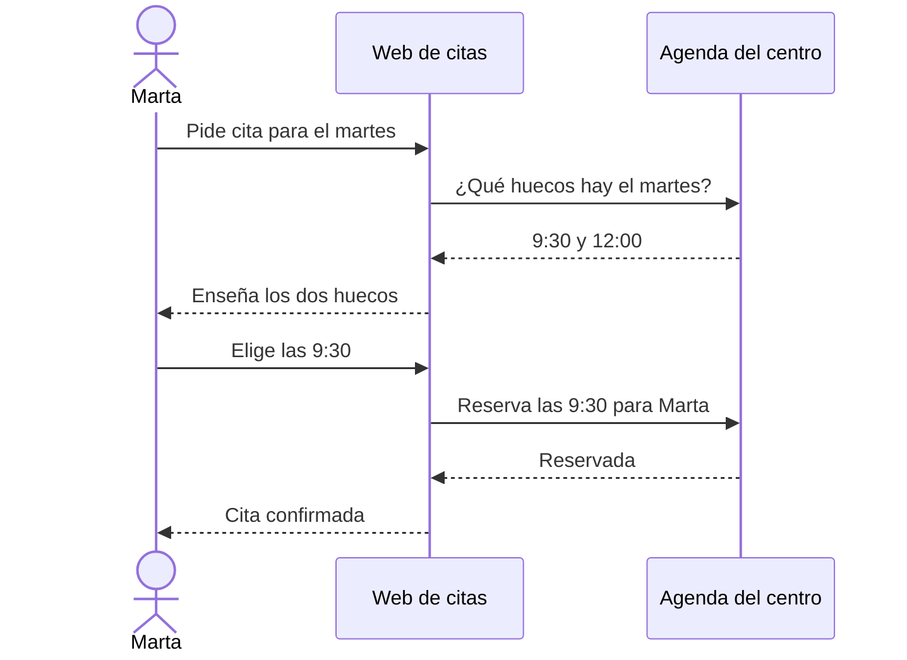
````


En texto: Marta pide cita para el martes a la web de citas; la web pregunta a la agenda del centro qué huecos hay; la agenda contesta que a las 9:30 y a las 12:00; la web se los enseña a Marta, que elige las 9:30; la web reserva ese hueco en la agenda, que contesta que está reservado, y la web le confirma la cita a Marta.

Cómo se lee y cómo se escribe (según la documentación oficial de Mermaid, consultada el 9 de noviembre de 2026):

| Se escribe | Qué es |
|---|---|
| `participant web as Web de citas` | Un participante: un programa, un servidor, un sistema. `web` es su identificador y lo que va detrás de `as`, el nombre que se ve |
| `actor paciente as Marta` | Igual, pero se dibuja como un muñeco: se usa para las personas |
| `A->>B: texto` | Un mensaje de A a B: **flecha continua**. Es lo que A le pide o le dice a B |
| `B-->>A: texto` | Una respuesta de B a A: **flecha discontinua**. Es lo que B devuelve |
| `Note over A,B: texto` | Una nota encima de uno o varios participantes. También `Note right of A: texto` y `Note left of A: texto` |
| `autonumber` | En una línea propia, al principio: numera los mensajes (1, 2, 3…), muy útil para explicarlos uno a uno |

Cada participante tiene debajo una línea vertical, su **línea de vida**. **El tiempo avanza hacia abajo**: lo que está más arriba pasa antes. Si no escribes los participantes, Mermaid los crea solos al ver su identificador en un mensaje, en el orden en que aparecen; escribirlos al principio te deja elegir el orden de las columnas y ponerles un nombre legible.

**Decisiones y repeticiones.** Un diagrama de secuencia también puede decir «si pasa esto, se hace aquello». Se hace con **fragmentos**, recuadros que se abren con una palabra y se cierran con `end`:

| Fragmento | Es como | Se escribe |
|---|---|---|
| `alt` … `else` … `end` | `SI` … `SI NO` … `FIN SI` | `alt` y la condición; los mensajes; `else` y la otra condición; los mensajes; `end` |
| `opt` … `end` | `SI` … `FIN SI` (sin `SI NO`) | `opt` y la condición; los mensajes; `end` |
| `loop` … `end` | Un bucle | `loop` y qué se repite; los mensajes; `end` |

Por ejemplo, si el hueco elegido se lo ha quitado otra persona un segundo antes:

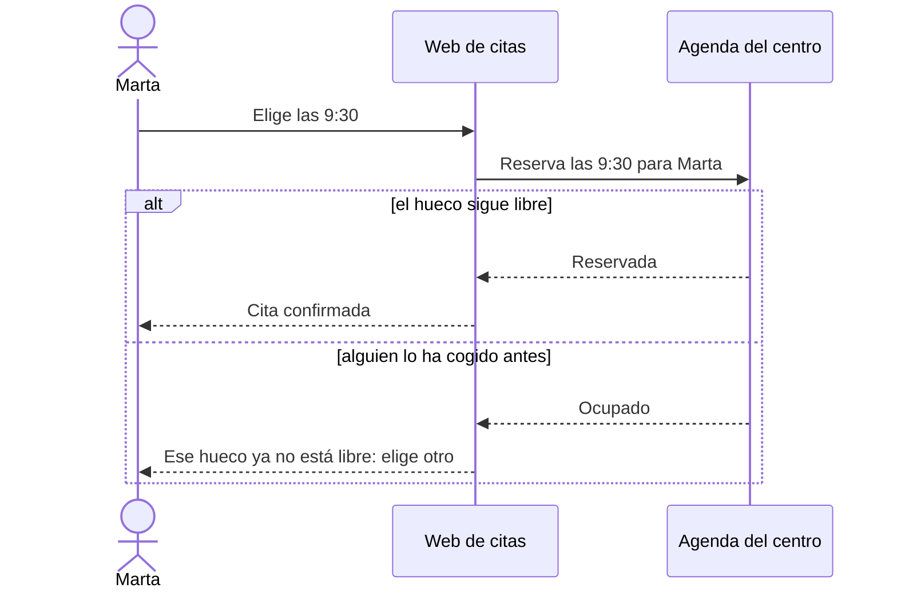

En texto: Marta elige las 9:30 y la web intenta reservarlas; si el hueco sigue libre, la agenda contesta que está reservado y la web confirma la cita; si alguien lo ha cogido antes, la agenda contesta que está ocupado y la web le pide a Marta que elija otro.

> **📌 Nota:** en un diagrama de secuencia, los mensajes van después de los dos puntos y **sin comillas**: todo lo que hay detrás de `:` es el texto del mensaje, con sus comas y sus paréntesis. Las comillas se escribirían tal cual en el dibujo.

### 1.9. Caracteres especiales en las etiquetas

En un diagrama de flujo, algunos caracteres tienen un significado para Mermaid: los paréntesis, los corchetes y las llaves deciden la forma de un nodo; `|` marca el texto de una flecha… Si los escribes dentro de una etiqueta **sin comillas**, Mermaid cree que son parte de la sintaxis y el diagrama no se dibuja:

```text
flowchart TD
    A[Pagar (con tarjeta)] --> B[Fin]
```

La solución es la del consejo del [apartado 1.4](#14-tu-primer-diagrama): **la etiqueta entre comillas dobles**. Dentro de las comillas, Mermaid ya no lee paréntesis, corchetes ni llaves como formas (salvo las comillas y lo que parezca HTML, que se ve a continuación):

```text
flowchart TD
    A["Pagar (con tarjeta)"] --> B["Fin"]
```

Quedan dos casos. ¿Y si la etiqueta lleva **comillas dobles**? No las puedes escribir tal cual, porque cerrarían la etiqueta. Se escriben con una [entidad](04-xml-csv-y-otros.md#14-caracteres-especiales-las-entidades), como en XML y HTML: `&quot;` para las comillas dobles. Y dentro de las comillas Mermaid sigue leyendo HTML: un `<` pegado a una letra parece el principio de una etiqueta, y `"x<y"` se dibuja como `x`, sin avisar. Por eso hay otras tres entidades para los símbolos que podrían confundirse con HTML:

| Para que se vea | Escribe |
|---|---|
| `"` | `&quot;` |
| `<` | `&lt;` |
| `>` | `&gt;` |
| `&` | `&amp;` |

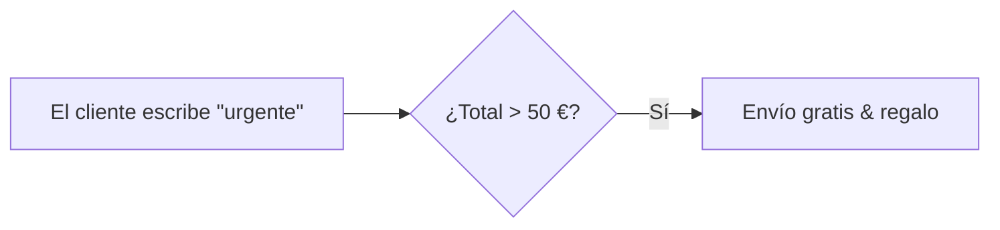

En texto: si el cliente escribe «urgente» y el total pasa de 50 €, envío gratis y regalo.

> **📌 Nota:** la documentación de Mermaid propone también otra forma de escribir estos caracteres, con `#` (`#quot;`). Funciona en Mermaid, pero en este curso y en la academia se usan solo las cuatro de la tabla, que son las de HTML y sirven en todas partes.

**Las tildes, la ñ, los signos `¿` y `¡` y las comillas españolas `« »` no son especiales**: se escriben tal cual, como en el resto de un fichero en [UTF-8](01-texto-binario-y-codificacion.md#17-utf-8-cómo-se-guardan-los-caracteres-de-unicode). Las comillas españolas, de hecho, son una buena forma de citar algo dentro de una etiqueta sin tener que usar `&quot;`.

**Una palabra prohibida: `end`.** En los diagramas de flujo, `end` cierra un `subgraph`. Por eso, **un nodo que se llama `end`, en minúsculas, rompe el diagrama**, como avisa la documentación oficial. Dentro de una etiqueta entre comillas no pasa nada (`fin["The end"]`); el problema es usarla como identificador. Como en este curso los identificadores van en español, lo normal es que uses `fin`, y asunto resuelto.

**Saltos de línea.** Para partir una etiqueta larga en dos líneas, escribe `<br/>` donde quieras el salto: `A["Calcular el total<br/>con el IVA"]`. Funciona también en los mensajes de un diagrama de secuencia.

### 1.10. Dónde se dibuja: GitHub, la academia y VS Code

Un bloque `mermaid` es solo texto. Que se vea como dibujo depende de **quién enseña el fichero Markdown**:

- **GitHub** lo dibuja en los ficheros Markdown (como el `README.md` de un repositorio), en las [*issues*](02-markdown.md#11-qué-es-markdown), en las discusiones y en las wikis (según su documentación, consultada el 9 de noviembre de 2026). Lo verás en [05.03 GitHub](../fase-05-git-y-github/03-github.md).
- **La academia** dibuja los diagramas de todos sus cursos, con la versión 12.2.0 de Mermaid.
- **VS Code** los dibuja en la **vista previa de Markdown** desde su versión 1.121, del 20 de mayo de 2026: antes hacía falta una extensión, *Markdown Preview Mermaid Support*, que se ha incorporado al propio editor (según las notas de la versión 1.121 y la documentación de VS Code, consultadas el 9 de noviembre de 2026). Con la versión del curso, la 1.145, no necesitas instalar nada: abre el `.md` y la vista previa con <kbd>Ctrl</kbd>+<kbd>Mayús</kbd>+<kbd>V</kbd> (en macOS, <kbd>Cmd</kbd>+<kbd>Mayús</kbd>+<kbd>V</kbd>), como viste en [03.03](../fase-03-herramientas/03-editor-de-codigo.md#111-extensiones-útiles-para-este-curso).

Donde no se entiende Mermaid (un editor de texto sencillo, el Bloc de notas, un visor de Markdown antiguo), se ve el **texto del bloque**, sin dibujar. No es un error: es lo que hay dentro del fichero.

**Un diagrama roto no avisa.** Si el código tiene un error, GitHub, la academia o VS Code enseñan en su lugar un mensaje de error de Mermaid (o, según el sitio, nada). Nadie te avisa al guardar ni al subir el fichero. Por eso, **mira siempre el diagrama dibujado** antes de darlo por bueno: en la vista previa de VS Code o en el editor en línea, que es el siguiente apartado.

### 1.11. El editor en línea oficial

Mermaid tiene un **editor en línea oficial**, el **Mermaid Live Editor**, en `https://mermaid.live` (enlazado desde la documentación oficial, a 9 de noviembre de 2026). Es una página web en la que:

- Escribes el código del diagrama (sin las comillas invertidas del bloque: solo lo de dentro) y **ves el dibujo al momento**, mientras escribes.
- Si hay un error, te enseña el **mensaje de error** con la línea donde está, en lugar del dibujo.
- Puedes **descargar el diagrama como imagen** (por ejemplo, en SVG) para ponerlo en una presentación o un documento.
- Puedes conseguir un **enlace para compartirlo**, para que otra persona lo vea o lo cambie.

Es la forma más rápida de **probar** un diagrama o de **encontrar un error**: copias el código, lo pegas y miras. Cuando funciona, lo vuelves a copiar a tu fichero Markdown.

> **⚠️ Cuidado:** un enlace para compartir lleva **dentro el diagrama entero**: quien tenga el enlace lo puede ver. No pongas en un diagrama que vayas a compartir así nada privado (nombres de clientes, direcciones de servidores internos, contraseñas). Las normas de seguridad las verás en [Seguridad básica](../fase-07-aprender-a-aprender/05-seguridad-basica.md#113-los-secretos-dónde-se-guardan) (fase 7).

> **📌 Nota:** el editor en línea suele usar una versión de Mermaid más nueva que GitHub o la academia. Casi nunca importa, pero algo muy nuevo puede verse en el editor y no en otro sitio ([apartado 1.12](#112-más-tipos-de-diagramas-uml-y-otras-notaciones)).

### 1.12. Más tipos de diagramas, UML y otras notaciones

**Mermaid sabe hacer muchos más diagramas.** Cada tipo empieza por su palabra, igual que `flowchart` o `sequenceDiagram`. Estos son algunos que te encontrarás en otros cursos (todos se dibujan con Mermaid 12.2.0 y 10.9.8, comprobado el 9 de noviembre de 2026):

| Empieza por | Diagrama | Para qué |
|---|---|---|
| `classDiagram` | De clases | Las clases de un programa orientado a objetos y sus relaciones ([paradigmas, 01.04](../fase-01-que-es-programar/04-paradigmas-de-programacion.md)) |
| `erDiagram` | Entidad-relación | Las tablas de una base de datos y cómo se relacionan |
| `stateDiagram-v2` | De estados | Por qué estados pasa algo: un pedido pendiente, pagado, enviado, entregado |
| `gitGraph` | De Git | Las ramas y los commits de un repositorio ([05.02](../fase-05-git-y-github/02-ramas-y-conflictos.md#18-dibujar-el-historial-con-mermaid)) |
| `gantt` | De Gantt | Un calendario de tareas de un proyecto |
| `pie` | De tarta | Un gráfico circular sencillo |
| `mindmap` | Mapa mental | Ideas que salen de una central |
| `timeline` | Línea de tiempo | Hechos ordenados por fecha |

No los aprendas ahora: cuando un curso los necesite, te los enseñará. Lo que importa es saber que existen y que se escriben igual, como texto dentro de un bloque `mermaid`.

> **⚠️ Cuidado:** la documentación de Mermaid incluye también tipos **nuevos**, algunos marcados como *beta* (en pruebas). Pueden no dibujarse en las versiones que usan GitHub o la academia: por ejemplo, `architecture-beta` se dibuja con la 12.2.0 y no con la 10.9.8. Antes de usar un tipo nuevo, comprueba que se ve **donde lo vas a publicar**.

**UML.** En muchos cursos (sobre todo los de programación orientada a objetos) verás **UML** (*Unified Modeling Language*, «lenguaje unificado de modelado»): un lenguaje gráfico **estándar** para dibujar el diseño de un programa, con reglas precisas para cada símbolo. Lo mantiene el OMG (*Object Management Group*), y su versión vigente es la **2.5.1**, de diciembre de 2017 (según la web del OMG, consultada el 9 de noviembre de 2026). El diagrama de secuencia de este módulo es, de hecho, uno de los diagramas de UML, en versión sencilla; el de clases de la tabla, otro. No te hace falta aprender UML antes de tu curso: el que lo use te lo enseñará.

**Otras herramientas y notaciones** que oirás nombrar, por si te las cruzas:

- **PlantUML**, otra herramienta de diagramas como texto, muy usada para UML.
- **draw.io** (también llamada diagrams.net), un programa gratuito para dibujar diagramas con el ratón.
- **BPMN**, una notación estándar para dibujar procesos de empresa, parecida a un diagrama de flujo con muchos más símbolos.

## 2. Ejemplos de código

En este módulo, el «código» son diagramas. Puedes probar cada uno copiándolo en el editor en línea ([apartado 1.11](#111-el-editor-en-línea-oficial)) o en un fichero `.md` con la vista previa de VS Code abierta. Cambia cosas y mira qué pasa: es la mejor forma de aprender la sintaxis.

### 2.1. Un diagrama de flujo: la devolución de un pedido

**Situación real:** una tienda de ropa en línea quiere explicar a su equipo de atención al cliente cómo se tramita una devolución. Las reglas: hay **30 días** desde la entrega; la prenda tiene que llegar **sin usar**; si todo está bien, se devuelve el dinero; si la prenda está usada, se le reenvía al cliente; y si han pasado los 30 días, se rechaza la devolución sin más.

Antes de escribir, conviene pensar los pasos y las decisiones, como en [01.02](../fase-01-que-es-programar/02-algoritmos-y-pseudocodigo.md#12-descomponer-un-problema): hay **dos decisiones** (¿plazo? ¿sin usar?), y de cada una salen dos caminos. Como es un proceso con decisiones, el diagrama va de arriba abajo (`TD`).

````text
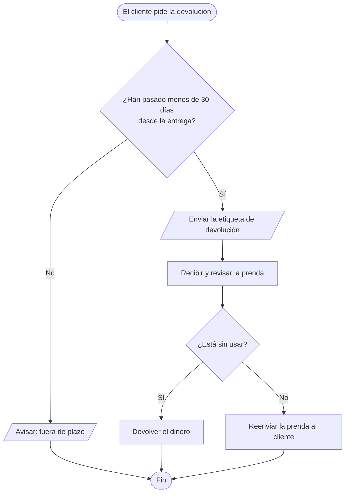
````


En texto: el cliente pide la devolución; si han pasado 30 días o más desde la entrega, se le avisa de que está fuera de plazo; si no, se le envía la etiqueta, se recibe y se revisa la prenda; si está sin usar, se le devuelve el dinero, y si está usada, se le reenvía. Todos los caminos terminan en el mismo fin.

**En qué fijarte:**

- **Identificadores que se entienden** (`plazo`, `usada`, `devolver`): leyendo solo el código ya sabes qué es cada nodo. Con `A`, `B`, `C`… tendrías que buscar cada letra.
- **Paralelogramos** para lo que se comunica al cliente (es salida, como «Escribir» en un algoritmo) y **rectángulos** para lo que hace la tienda por dentro.
- **Un solo fin**, al que llegan los tres caminos: es una de las reglas de [01.02](../fase-01-que-es-programar/02-algoritmos-y-pseudocodigo.md#112-diagramas-de-flujo).
- **El orden de las líneas no es el orden del dibujo.** Las tres flechas al fin están al final del código, pero Mermaid coloca cada nodo según sus conexiones.

### 2.2. Un diagrama de bloques: la reserva de pistas de un club

**Situación real:** el club de tenis La Ribera quiere una aplicación para reservar pistas. Antes de pedir presupuestos, la junta dibuja las piezas: los socios reservan desde una **app del móvil** o desde la **web**; las dos hablan con un **servidor** del club, que guarda las reservas en una **base de datos**, cobra con una **pasarela de pago** y manda un **correo de confirmación** con un servicio de correo externo.

Es un diagrama de **piezas y conexiones**, sin decisiones: diagrama de bloques, de izquierda a derecha (`LR`), con grupos para lo que está en el teléfono o el ordenador del socio, lo que es del club y lo que son servicios de fuera.

````text
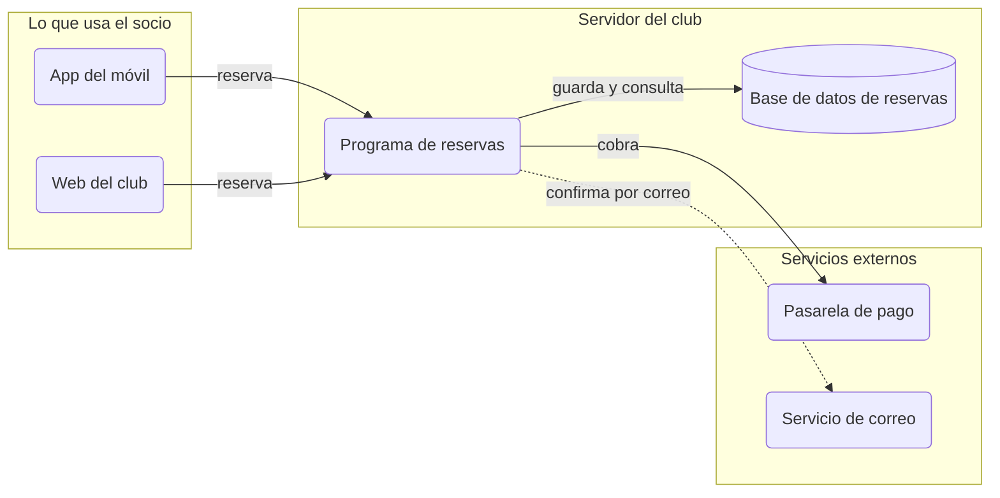
````


En texto: la app del móvil y la web del club, que usa el socio, mandan las reservas al programa de reservas del servidor del club; ese programa guarda y consulta las reservas en su base de datos, cobra a través de una pasarela de pago externa y, además, confirma por correo con un servicio de correo externo.

**En qué fijarte:**

- **Cilindro** para la base de datos y **rectángulos redondeados** para los programas: es la costumbre en estos diagramas, y se entiende sin leyenda.
- **Verbos en las flechas** («reserva», «cobra»): dicen qué viaja por cada conexión.
- **Flecha de puntos** para el correo: no es imprescindible para que la reserva funcione (si el correo falla, la reserva está hecha igual). Es una forma sencilla de distinguir lo secundario.
- **Lo que no aparece:** ni pantallas, ni botones, ni cómo se programa nada. Un diagrama de bloques se queda en las piezas.

### 2.3. Un diagrama de secuencia: pagar con tarjeta en la panadería

**Situación real:** en la tienda en línea de la Panadería Sol ([apartado 1.7](#17-agrupar-con-subgraph-diagramas-de-bloques)), Ana quiere entender qué pasa al pagar. Su cliente, Luis, pulsa «Pagar»; la web le pide a la pasarela de pago que cobre; la pasarela consulta al banco de Luis, que acepta o rechaza el pago; y la web le dice a Luis cómo ha ido. Si el pago se acepta, además, la web guarda el pedido como pagado.

Es una **conversación entre participantes** en orden: diagrama de secuencia, con un `alt` para los dos finales posibles.

````text
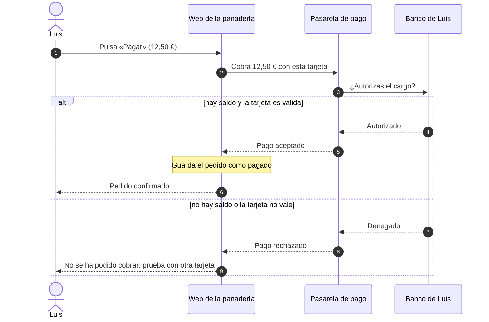
````


En texto: (1) Luis pulsa «Pagar» en la web; (2) la web pide a la pasarela que cobre; (3) la pasarela pregunta al banco de Luis si autoriza el cargo. Si hay saldo y la tarjeta es válida, el banco lo autoriza, la pasarela avisa a la web de que el pago se ha aceptado, la web guarda el pedido como pagado y confirma el pedido a Luis. Si no, el banco lo deniega, la pasarela avisa del rechazo y la web le pide a Luis que pruebe con otra tarjeta.

**En qué fijarte:**

- **La web nunca habla con el banco**: todo pasa por la pasarela. Es justo el tipo de cosa que un diagrama de secuencia deja clarísima y que en el código costaría ver.
- **Flechas continuas para lo que se pide, discontinuas para lo que se contesta.** Cada pregunta tiene su respuesta, y se ve de un vistazo si falta alguna.
- **`autonumber`** numera los mensajes: así puedes decir «en el paso 3…» al explicarlo.
- **Los paréntesis y los dos puntos de los mensajes** van tal cual, sin comillas ([nota del apartado 1.8](#18-diagramas-de-secuencia)).

### 2.4. Un README con su diagrama

**Situación real:** Ana guarda la web de la panadería en un repositorio, y quiere que su `README.md` (el fichero que presenta un proyecto, como viste en [04.02 Markdown](02-markdown.md#116-el-fichero-readme)) explique cómo se hace un pedido. Un diagrama dentro del README es la forma habitual de hacerlo: en GitHub se verá dibujado, y quien abra el proyecto en VS Code lo verá en la vista previa.

````markdown
# Web de la Panadería Sol

Web de la panadería del barrio, con tienda en línea para encargar pan y bollería.

## Cómo se hace un pedido

El cliente elige los productos en la web, paga con tarjeta y recibe un correo con el día de recogida.
Si el pago falla, puede volver a intentarlo.

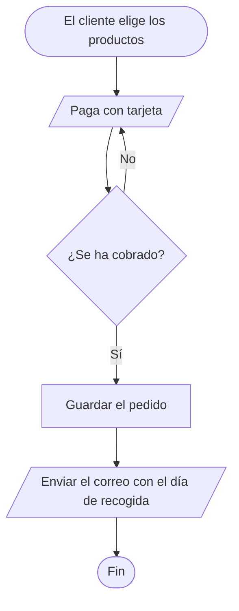

En texto: el cliente elige los productos y paga con tarjeta; si se cobra, se guarda el pedido y se le envía
un correo con el día de recogida; si no, vuelve a pagar.

## Piezas

| Pieza | Qué hace |
|---|---|
| Web | Muestra los productos y recoge los pedidos |
| Base de datos | Guarda los pedidos |
| Pasarela de pago | Cobra con tarjeta |
````

📁 **Código:** [`codigo/05-diagramas-y-mermaid/ejemplos/2.4-readme-con-diagrama/`](codigo/05-diagramas-y-mermaid/ejemplos/2.4-readme-con-diagrama/)

**En qué fijarte:**

- **El diagrama va dentro de una sección** con su título y un párrafo que lo presenta: el diagrama ayuda al texto, no lo sustituye.
- **Debajo, la misma idea en texto** («En texto: …»). Así lo entiende quien lea el README donde no se dibuja Mermaid, y quien no puede ver la imagen (por ejemplo, una persona ciega que usa un [lector de pantalla](02-markdown.md#110-imágenes-y-texto-alternativo)).
- **El bucle**: si no se cobra, la flecha vuelve a «Paga con tarjeta». Es la flecha que vuelve hacia arriba de [01.02](../fase-01-que-es-programar/02-algoritmos-y-pseudocodigo.md#112-diagramas-de-flujo).
- Es un Markdown normal: títulos, párrafos, una tabla… y un bloque `mermaid` más.

## 3. Errores típicos

### 3.1. El diagrama no se dibuja

**Qué pasa:** en lugar del dibujo, ves el texto del bloque tal cual, o un mensaje de error que habla de que no se reconoce el tipo de diagrama.

**Por qué ocurre:** una de estas dos cosas:

- **El bloque no dice `mermaid`** (o lo dice mal: `memraid`, o no dice nada). Entonces, para el visor, es un bloque de código cualquiera y lo enseña como texto.
- **La primera línea de dentro no es un tipo de diagrama** (`flowhcart TD`, o falta). Mermaid responde con un error como este (es el mensaje de la biblioteca Mermaid, la que usan todos los sitios; cada uno lo presenta a su manera):

  ```text
  UnknownDiagramError: No diagram type detected matching given configuration for text: flowhcart TD
  ```

  «No se ha detectado ningún tipo de diagrama»: Mermaid no sabe qué dibujar.

**Cómo se arregla:** comprueba que el bloque empieza por tres comillas invertidas y `mermaid`, en minúsculas, y que la primera línea es `flowchart` (con su dirección) o `sequenceDiagram`, bien escritos ([apartado 1.4](#14-tu-primer-diagrama)).

### 3.2. Un paréntesis sin comillas

**Qué pasa:** escribes `A[Pagar (con tarjeta)]` y el diagrama no se dibuja. Sale un error como este:

```text
Error: Parse error on line 2:
...hart TD    A[Pagar (con tarjeta)] --> B
----------------------^
Expecting 'SQE', 'DOUBLECIRCLEEND', 'PE', …, got 'PS'
```

**Por qué ocurre:** para Mermaid, `(` dentro de una etiqueta sin comillas es el principio de una forma, y no esperaba una ahí. El mensaje lo dice a su manera: «error de análisis (*parse error*) en la línea 2», con una flechita `^` debajo del sitio donde se ha perdido, y una lista de lo que esperaba (`Expecting …`) frente a lo que ha encontrado (`got 'PS'`). No hace falta que entiendas la lista: **la flechita es lo útil**. (La línea del mensaje junta las líneas del diagrama; por eso se ve `flowchart TD` delante.)

**Cómo se arregla:** pon la etiqueta entre comillas dobles: `A["Pagar (con tarjeta)"]`. Mejor aún, ponlas **siempre**, y este error no te pasará nunca ([apartado 1.9](#19-caracteres-especiales-en-las-etiquetas)).

### 3.3. Un nodo que se llama end

**Qué pasa:** el diagrama de flujo termina en `A --> end` y no se dibuja. El error dice `Parse error on line 2` y, al final, `got 'end'`.

**Por qué ocurre:** `end` es la palabra que cierra un `subgraph`. Mermaid la lee como esa orden, no como el nombre de un nodo. La documentación oficial lo avisa: escribir «end» en minúsculas rompe el diagrama de flujo.

**Cómo se arregla:** usa otro identificador, como `fin`. Si quieres que se lea «end» en el dibujo, ponlo en la etiqueta entre comillas: `fin["The end"]`.

### 3.4. Las comillas de dentro desaparecen

**Qué pasa:** escribes `A["El cliente escribe "urgente""]` y el diagrama se dibuja, pero la caja dice **El cliente escribe urgente**, sin comillas. No hay ningún error: simplemente falta algo.

**Por qué ocurre:** las comillas de dentro se confunden con las que rodean la etiqueta, y Mermaid se las come. Es peor que un error, porque **no avisa**: solo lo ves si miras el dibujo.

**Cómo se arregla:** escribe las comillas de dentro como `&quot;` (`A["El cliente escribe &quot;urgente&quot;"]`), o usa comillas españolas, que no son especiales: `A["El cliente escribe «urgente»"]` ([apartado 1.9](#19-caracteres-especiales-en-las-etiquetas)).

### 3.5. Las flechas de otro tipo de diagrama

**Qué pasa:** en un diagrama de flujo escribes `A ->> B` y no se dibuja: `Parse error on line 2`, con la flechita debajo del `->>`.

**Por qué ocurre:** cada tipo de diagrama tiene sus flechas. `->>` y `-->>` son de los diagramas de secuencia; en los de flujo, la flecha es `-->`. Es fácil mezclarlas cuando acabas de escribir uno de cada.

**Cómo se arregla:** en `flowchart`, `-->` (y sus variantes `---`, `-.->`, `==>`); en `sequenceDiagram`, `->>` para los mensajes y `-->>` para las respuestas ([apartados 1.6](#16-flechas-y-textos-en-las-flechas) y [1.8](#18-diagramas-de-secuencia)).

### 3.6. Un bloque sin su end

**Qué pasa:** has escrito un `alt` (o un `loop`, un `opt` o un `subgraph`) y el diagrama no se dibuja. El error apunta al **final** del diagrama, y en la lista de lo que esperaba está `'end'`.

**Por qué ocurre:** cada uno de esos bloques se cierra con su `end`. Si falta, Mermaid llega al final del diagrama todavía esperando el cierre. Por eso el error sale al final, aunque lo que falte esté en otro sitio.

**Cómo se arregla:** cuenta: cada `alt`, `opt`, `loop` y `subgraph` necesita su `end`. Sangrar lo de dentro de cada bloque, como en los ejemplos, ayuda muchísimo a ver cuál se ha quedado sin cerrar.

### 3.7. El diagrama que lo quiere contar todo

**Qué pasa:** el diagrama tiene cuarenta cajas, flechas que se cruzan por todas partes y nadie lo entiende, ni quien lo hizo una semana después.

**Por qué ocurre:** se ha intentado meter en un dibujo todo el sistema, con todos los detalles y todos los casos raros. Un diagrama no es una copia del programa.

**Cómo se arregla:** **varios diagramas pequeños**, cada uno con una pregunta: uno de bloques con las piezas, uno de flujo para el proceso que importa, uno de secuencia para el pago… Y en cada uno, solo lo que ayuda a responder su pregunta ([apartado 1.1](#11-por-qué-se-dibuja-antes-de-programar)). Si un diagrama necesita un párrafo para entenderse, sobran cosas.

## 4. Buenas prácticas

- **Dibuja antes de construir**: un boceto de cinco minutos descubre huecos que costarían horas en el código.
- **Elige el diagrama por la pregunta**: pasos y decisiones, de flujo; piezas, de bloques; quién habla con quién, de secuencia.
- **Pequeños y con una idea cada uno**: mejor tres diagramas claros que uno enorme.
- **Etiquetas siempre entre comillas dobles** en los diagramas de flujo, y `&quot;` (o comillas españolas) para las comillas de dentro.
- **Identificadores que se entiendan** (`pago`, `stock`, `fin`), no `A`, `B`, `C`; y nunca `end`.
- **Verbos en las flechas** de los diagramas de bloques, y «Sí» y «No» en las que salen de un rombo.
- **Guarda los diagramas como texto junto al proyecto** (en su `README.md`, por ejemplo), para que se actualicen con él.
- **Acompaña cada diagrama de una frase** que diga lo mismo en texto, para quien no pueda verlo.
- **Mira siempre el dibujo** antes de darlo por bueno, en la vista previa de VS Code o en el editor en línea: un diagrama roto no avisa.
- **Lo sencillo se ve en todas partes**: usa los tipos y la sintaxis básicos, y comprueba los tipos nuevos donde los vayas a publicar.

## 5. Ejercicios prácticos resueltos

> **💡 Consejo:** para los ejercicios en que escribes un diagrama, ten abierto el editor en línea ([apartado 1.11](#111-el-editor-en-línea-oficial)) o un fichero `.md` con la vista previa de VS Code. Escribe, mira el dibujo, corrige. Tu diagrama no tiene por qué ser idéntico al de la solución: vale si dice lo mismo.

### 🟢 Básico

#### Ejercicio 1 · Qué diagrama dibujarías

Para cada situación, di qué diagrama dibujarías (de flujo, de bloques o de secuencia) y por qué:

1. Explicar a la nueva dependienta de una librería qué hacer cuando un cliente quiere cambiar un libro: si trae el tique, si el libro está en buen estado…
2. Enseñar a la junta de una comunidad de vecinos qué aparatos tiene el sistema de vídeo del portal: cámaras, grabador, pantalla de la portería y la conexión a internet.
3. Contar qué pasa entre el móvil, la app del banco y el servidor del banco cuando haces una transferencia y el banco te pide un código de confirmación.
4. Dibujar el algoritmo que decide el precio de una entrada de cine según la edad.
5. Explicar a un compañero qué programas tiene la web de una academia de idiomas y dónde está cada uno.

<details>
<summary>Pista 1</summary>

Para cada caso, busca la pregunta que responde el diagrama: ¿qué pasos y qué decisiones?, ¿qué piezas hay?, ¿quién le dice qué a quién, y en qué orden? La tabla del [apartado 1.2](#12-tres-diagramas-para-empezar) te las da.

</details>

<details>
<summary>Ver solución</summary>

**Razonamiento:** cada diagrama responde a una pregunta ([apartado 1.2](#12-tres-diagramas-para-empezar)): pasos y decisiones, de flujo; piezas y conexiones, de bloques; una conversación en orden, de secuencia.

| # | Diagrama | Por qué |
|---|---|---|
| 1 | **De flujo** | Es un proceso con decisiones (¿trae tique?, ¿está en buen estado?) y caminos distintos según la respuesta |
| 2 | **De bloques** | Son piezas (aparatos) y cómo se conectan; no hay pasos ni orden |
| 3 | **De secuencia** | Es una conversación entre tres participantes, en un orden concreto: pides, el banco te pide el código, lo mandas, te confirma |
| 4 | **De flujo** | Es un algoritmo con decisiones: justo para lo que se inventó |
| 5 | **De bloques** | Piezas (programas) y dónde está cada una: cajas agrupadas con `subgraph` |

**Errores frecuentes al resolverlo:**

- Elegir el de secuencia para el caso 1 porque «pasan cosas en orden». Hay orden, pero lo importante son las **decisiones** y los caminos; además, no hay varios participantes hablando entre sí.
- Pensar que solo hay una respuesta válida para todo. En el caso 3 también se podría dibujar un diagrama de flujo de la transferencia; pero la pregunta es **quién habla con quién**, y eso lo cuenta mucho mejor el de secuencia.

</details>

#### Ejercicio 2 · Leer un diagrama sin dibujarlo

Sin dibujarlo, lee este código de Mermaid y contesta:

```text
flowchart LR
    pedido(["Llega un pedido"]) --> stock{"¿Hay de todo?"}
    stock -- Sí --> enviar["Preparar y enviar"]
    stock -- No --> avisar[/"Avisar al cliente del retraso"/]
    avisar --> esperar["Esperar a que llegue la mercancía"]
    esperar --> enviar
    enviar --> fin(["Fin"])
```

1. ¿Hacia dónde avanza el dibujo?
2. ¿Qué forma tiene cada nodo y qué significa?
3. ¿Qué camino sigue un pedido cuando falta algún artículo? Escríbelo como una lista de pasos.
4. ¿Cuántas flechas llegan a `enviar`?

<details>
<summary>Pista 1</summary>

La dirección está en la primera línea. Para las formas, mira los símbolos que rodean cada etiqueta y búscalos en la tabla del [apartado 1.5](#15-diagramas-de-flujo-dirección-y-formas).

</details>

<details>
<summary>Ver solución</summary>

**Razonamiento:** primero la primera línea (tipo y dirección); después, cada nodo por sus símbolos; y por último, las flechas, siguiendo los identificadores ([apartados 1.5](#15-diagramas-de-flujo-dirección-y-formas) y [1.6](#16-flechas-y-textos-en-las-flechas)).

1. **De izquierda a derecha**: `LR`.
2. Las formas:

   | Nodo | Se escribe | Forma | Significa |
   |---|---|---|---|
   | `pedido` | `(["…"])` | Óvalo | Inicio |
   | `stock` | `{"…"}` | Rombo | Decisión |
   | `enviar` | `["…"]` | Rectángulo | Proceso |
   | `avisar` | `[/"…"/]` | Paralelogramo | Salida: se comunica algo al cliente |
   | `esperar` | `["…"]` | Rectángulo | Proceso |
   | `fin` | `(["…"])` | Óvalo | Fin |

3. Llega el pedido → no hay de todo → se avisa al cliente del retraso → se espera a que llegue la mercancía → se prepara y se envía → fin.
4. **Dos**: la de `stock` (con el texto «Sí») y la de `esperar`.

**Errores frecuentes al resolverlo:**

- Contar solo una flecha en el apartado 4, porque la línea `esperar --> enviar` está más abajo. El orden de las líneas no importa: cuentan todas las flechas cuyo destino es `enviar`.
- Pensar que `pedido` y `enviar` son lo que se ve en el dibujo. Son los identificadores; lo que se ve son las etiquetas.

</details>

### 🟡 Intermedio

#### Ejercicio 3 · Del pseudocódigo al diagrama

El cine Avenida calcula así el precio de una entrada:

```text
ALGORITMO PrecioEntrada
INICIO
    LEER edad, esMiercoles
    SI edad < 12 ENTONCES
        precio ← 5
    SI NO
        SI esMiercoles ENTONCES
            precio ← 6
        SI NO
            precio ← 9
        FIN SI
    FIN SI
    ESCRIBIR precio
FIN
```

Escribe en Mermaid su diagrama de flujo, de arriba abajo, con las formas de los símbolos de [01.02](../fase-01-que-es-programar/02-algoritmos-y-pseudocodigo.md#112-diagramas-de-flujo) y «Sí» y «No» en las flechas de las decisiones. Compruébalo en el editor en línea o en la vista previa.

<details>
<summary>Pista 1</summary>

Haz primero la lista de nodos con su forma: un inicio, una lectura (paralelogramo), dos decisiones (rombos), tres asignaciones (rectángulos), una escritura (paralelogramo) y un fin.

</details>

<details>
<summary>Pista 2</summary>

Las tres asignaciones de `precio` terminan en el mismo sitio: la escritura del precio. Hacen falta tres flechas hacia ese nodo. Y ojo con los signos: el `<` se escribe `&lt;`, también dentro de unas comillas ([apartado 1.9](#19-caracteres-especiales-en-las-etiquetas)).

</details>

<details>
<summary>Ver solución</summary>

**Razonamiento:** cada instrucción del pseudocódigo es un nodo con su forma ([apartado 1.5](#15-diagramas-de-flujo-dirección-y-formas)); cada `SI` es un rombo con dos flechas, «Sí» y «No» ([apartado 1.6](#16-flechas-y-textos-en-las-flechas)); y los caminos se juntan donde el pseudocódigo sigue después del `FIN SI`.

````markdown
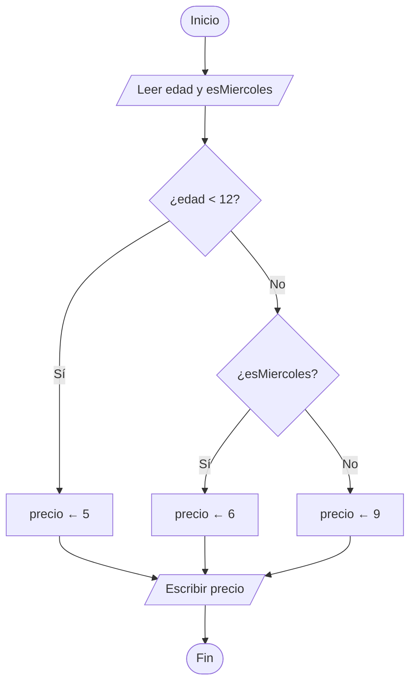
````

📁 **Código:** [`codigo/05-diagramas-y-mermaid/ejercicios/ej03-del-pseudocodigo-al-diagrama/`](codigo/05-diagramas-y-mermaid/ejercicios/ej03-del-pseudocodigo-al-diagrama/)

```mermaid
flowchart TD
    inicio(["Inicio"]) --> leer[/"Leer edad y esMiercoles"/]
    leer --> nino{"¿edad &lt; 12?"}
    nino -- Sí --> infantil["precio ← 5"]
    nino -- No --> miercoles{"¿esMiercoles?"}
    miercoles -- Sí --> espectador["precio ← 6"]
    miercoles -- No --> normal["precio ← 9"]
    infantil --> escribir[/"Escribir precio"/]
    espectador --> escribir
    normal --> escribir
    escribir --> fin(["Fin"])
```

En texto: se leen la edad y si es miércoles; si la edad es menor de 12, el precio es 5; si no, es 6 los miércoles y 9 los demás días; al final se escribe el precio.

**Comprobación:** recorre el diagrama con dos casos de prueba, como en [01.03](../fase-01-que-es-programar/03-probar-un-programa.md): una niña de 8 años un lunes (Sí en el primer rombo → 5) y un adulto de 30 un miércoles (No → Sí → 6). Si los dos caminos llegan al precio correcto, el diagrama dice lo mismo que el pseudocódigo.

**Errores frecuentes al resolverlo:**

- Escribir el identificador con ñ (`niño`): Mermaid lo acepta (comprobado con la 12.2.0 y la 10.9.8), pero el curso escribe los identificadores sin tildes ni eñes, como los [nombres del pseudocódigo](../fase-01-que-es-programar/02-algoritmos-y-pseudocodigo.md#cómo-se-nombran). En las etiquetas, en cambio, escribe con todas sus letras.
- Escribir las etiquetas sin comillas: `nino{¿edad &lt; 12?}` puede funcionar, pero el día que pongas un paréntesis se romperá.
- Escribir el `<` tal cual: aquí se vería bien, porque va seguido de un espacio, pero pegado a una letra (`edad<limite`) Mermaid se comería el resto de la etiqueta sin avisar.
- Olvidar una de las tres flechas hacia `escribir`: ese camino se quedaría colgado, sin llegar al fin.

</details>

#### Ejercicio 4 · Arregla el diagrama

Jorge ha escrito este diagrama de flujo para el préstamo de libros de la biblioteca de su barrio, pero no se dibuja. Tiene **cuatro errores**. Encuéntralos, explica cada uno y escribe el diagrama corregido.

```text
flowchart TD
    inicio(["Llega un socio con un libro"]) --> carne{"¿Trae el carné?"}
    carne -- No --> pedir[/Pedir el carné (o el DNI)/]
    pedir --> carne
    carne -- Sí --> maximo{"¿Tiene menos de 3 libros prestados?"}
    maximo -- Sí --> prestar["Prestar el libro "15 días""]
    maximo -- No --> avisar[/"Avisar: máximo 3 libros"/]
    prestar ->> end
    avisar --> end
```

<details>
<summary>Pista 1</summary>

Repasa los errores típicos 3.2 a 3.5. Uno de los errores no impide que se dibuje, pero el dibujo no dice lo que Jorge quería.

</details>

<details>
<summary>Pista 2</summary>

Mira con lupa: los paréntesis de `pedir`, las comillas de `prestar`, la flecha de `prestar` y el nombre del último nodo.

</details>

<details>
<summary>Ver solución</summary>

**Razonamiento:** se revisa línea a línea con los errores típicos en la cabeza: caracteres especiales sin comillas ([3.2](#32-un-paréntesis-sin-comillas)), comillas dentro de comillas ([3.4](#34-las-comillas-de-dentro-desaparecen)), flechas de otro tipo de diagrama ([3.5](#35-las-flechas-de-otro-tipo-de-diagrama)) y la palabra `end` ([3.3](#33-un-nodo-que-se-llama-end)).

| Línea | Error | Por qué falla | Arreglo |
|---|---|---|---|
| `pedir[/Pedir el carné (o el DNI)/]` | Paréntesis en una etiqueta sin comillas | Mermaid lee `(` como el principio de una forma | `pedir[/"Pedir el carné (o el DNI)"/]` |
| `prestar["Prestar el libro "15 días""]` | Comillas dentro de comillas | No da error, pero las comillas de dentro desaparecen: se vería «Prestar el libro 15 días» | `&quot;15 días&quot;`, o mejor, sin comillas: `"Prestar el libro 15 días"` |
| `prestar ->> end` | Flecha de los diagramas de secuencia | En un diagrama de flujo la flecha es `-->` | `prestar --> fin` |
| `end` (dos veces) | `end` como identificador | Es la palabra que cierra un `subgraph` | `fin(["Fin"])` |

El diagrama corregido:

````text
```mermaid
flowchart TD
    inicio(["Llega un socio con un libro"]) --> carne{"¿Trae el carné?"}
    carne -- No --> pedir[/"Pedir el carné (o el DNI)"/]
    pedir --> carne
    carne -- Sí --> maximo{"¿Tiene menos de 3 libros prestados?"}
    maximo -- Sí --> prestar["Prestar el libro 15 días"]
    maximo -- No --> avisar[/"Avisar: máximo 3 libros"/]
    prestar --> fin(["Fin"])
    avisar --> fin
```
````

```mermaid
flowchart TD
    inicio(["Llega un socio con un libro"]) --> carne{"¿Trae el carné?"}
    carne -- No --> pedir[/"Pedir el carné (o el DNI)"/]
    pedir --> carne
    carne -- Sí --> maximo{"¿Tiene menos de 3 libros prestados?"}
    maximo -- Sí --> prestar["Prestar el libro 15 días"]
    maximo -- No --> avisar[/"Avisar: máximo 3 libros"/]
    prestar --> fin(["Fin"])
    avisar --> fin
```

En texto: llega un socio con un libro; mientras no traiga el carné, se le pide (o el DNI); cuando lo trae, si tiene menos de 3 libros prestados, se le presta el libro 15 días; si no, se le avisa de que el máximo son 3.

**Errores frecuentes al resolverlo:**

- Encontrar solo tres errores: el de las comillas no rompe nada, así que solo se ve **mirando el dibujo**.
- Arreglar el primer `end` y dejar el segundo: hay que cambiar los dos, y ponerle la etiqueta y la forma de óvalo al nuevo `fin` la primera vez que aparece.
- Corregir de memoria sin volver a dibujarlo. Después de arreglar un diagrama, míralo siempre dibujado: puede quedar otro error.

</details>

### 🔴 Avanzado

#### Ejercicio 5 · Las piezas de una academia de idiomas

La academia de idiomas Babel tiene esto, según su informática:

- Los alumnos usan una **web** para ver los horarios y apuntarse a los cursos; el profesorado usa un **panel de profesores**, otra web, para pasar lista y poner notas.
- Las dos webs hablan con el **programa de gestión**, que está en el servidor de la academia y guarda todo en una **base de datos**.
- El programa de gestión cobra las matrículas con una **pasarela de pago** y, cada noche, guarda una **copia de seguridad** de la base de datos en un servicio de almacenamiento en la nube.

Dibuja el diagrama de bloques en Mermaid, de izquierda a derecha, con un `subgraph` para cada sitio (lo que usan las personas, el servidor de la academia y los servicios externos), formas adecuadas para cada pieza y un verbo en cada flecha. La copia de seguridad, con una flecha distinta, porque no forma parte del uso diario.

<details>
<summary>Pista 1</summary>

Empieza por la lista de piezas y en qué grupo va cada una: dos webs para las personas; programa de gestión y base de datos en el servidor; pasarela de pago y almacenamiento en la nube fuera. Después, las flechas: ¿quién habla con quién?

</details>

<details>
<summary>Pista 2</summary>

Las bases de datos y los almacenes de ficheros, con cilindro: `[("…")]`. La flecha distinta, de puntos y con el texto entre los puntos: `-. "texto" .->`. No olvides el `end` de cada grupo.

</details>

<details>
<summary>Ver solución</summary>

**Razonamiento:** las piezas son los nodos y los sitios son los grupos ([apartado 1.7](#17-agrupar-con-subgraph-diagramas-de-bloques)); cada conexión es una flecha con un verbo ([apartado 1.6](#16-flechas-y-textos-en-las-flechas)); y lo que no es del día a día va con flecha de puntos, como el correo del [ejemplo 2.2](#22-un-diagrama-de-bloques-la-reserva-de-pistas-de-un-club).

````text
```mermaid
flowchart LR
    subgraph personas ["Lo que usan las personas"]
        webAlumnos("Web de alumnos")
        panel("Panel de profesores")
    end
    subgraph academia ["Servidor de la academia"]
        gestion("Programa de gestión")
        datos[("Base de datos")]
    end
    subgraph externos ["Servicios externos"]
        pago("Pasarela de pago")
        nube[("Almacenamiento en la nube")]
    end
    webAlumnos -- "consulta horarios y matricula" --> gestion
    panel -- "pasa lista y pone notas" --> gestion
    gestion -- "guarda y consulta" --> datos
    gestion -- "cobra matrículas" --> pago
    datos -. "copia de seguridad cada noche" .-> nube
```
````

```mermaid
flowchart LR
    subgraph personas ["Lo que usan las personas"]
        webAlumnos("Web de alumnos")
        panel("Panel de profesores")
    end
    subgraph academia ["Servidor de la academia"]
        gestion("Programa de gestión")
        datos[("Base de datos")]
    end
    subgraph externos ["Servicios externos"]
        pago("Pasarela de pago")
        nube[("Almacenamiento en la nube")]
    end
    webAlumnos -- "consulta horarios y matricula" --> gestion
    panel -- "pasa lista y pone notas" --> gestion
    gestion -- "guarda y consulta" --> datos
    gestion -- "cobra matrículas" --> pago
    datos -. "copia de seguridad cada noche" .-> nube
```

En texto: la web de alumnos y el panel de profesores mandan sus peticiones al programa de gestión del servidor de la academia, que guarda y consulta todo en su base de datos y cobra las matrículas con una pasarela de pago externa; cada noche, la base de datos se copia a un almacenamiento en la nube.

**Otras soluciones válidas:** la flecha de la copia puede salir de `gestion` en vez de `datos` (es el programa quien la hace); el almacenamiento en la nube puede ser un rectángulo redondeado. Lo importante es que estén todas las piezas, cada una en su sitio, con su conexión.

**Errores frecuentes al resolverlo:**

- Unir las webs directamente con la base de datos. Según la descripción, pasan por el programa de gestión: el diagrama tiene que decir lo que hay, no lo que imaginamos.
- Poner un identificador con espacios (`web alumnos`). Los identificadores son una palabra; el texto con espacios va en la etiqueta.
- Olvidar algún `end`: con tres grupos hacen falta tres.

</details>

### 🏆 Caso real

#### Ejercicio 6 · Documenta el préstamo de material del club

El Club de Montaña Cumbres presta material a sus socios (cascos, crampones, piolets). Hasta ahora lo llevaba Rosa de memoria, pero el club va a crecer y la junta te pide que lo documentes en un `README.md` para su repositorio. El proceso, tal como lo cuenta Rosa:

- El socio pide el material por correo, diciendo qué quiere y para qué fechas.
- Rosa mira en la hoja del inventario si está libre esas fechas. Si no lo está, le contesta que no hay y se acaba ahí.
- Si está libre, lo apunta como reservado y le contesta con el día de recogida.
- El socio lo recoge, lo usa y lo devuelve. Al devolverlo, Rosa lo revisa: si está bien, lo apunta como disponible; si está dañado, lo apunta como «en reparación» y avisa a la junta.

Escribe el `README.md` con:

1. Un título y un párrafo que diga qué es el proyecto.
2. Una sección «Cómo se pide el material» con un **diagrama de flujo** del proceso entero y su frase «En texto: …».
3. Una sección «Quién se escribe con quién» con un **diagrama de secuencia** entre el socio, Rosa y la hoja del inventario, desde que el socio pide el material hasta que Rosa le contesta (con los dos casos: libre u ocupado), y su frase.
4. Una tabla con los tres estados del material y qué significa cada uno.

Comprueba en la vista previa de VS Code que los dos diagramas se dibujan.

<details>
<summary>Pista 1</summary>

Empieza por el esqueleto del README (títulos y párrafos, como en el [ejemplo 2.4](#24-un-readme-con-su-diagrama)), y después escribe cada diagrama por separado en el editor en línea hasta que se dibuje.

</details>

<details>
<summary>Pista 2</summary>

En el diagrama de flujo hay **dos decisiones**: ¿está libre? y ¿está bien al devolverlo? En el de secuencia, la «hoja del inventario» también es un participante: Rosa le pregunta y la hoja le «contesta».

</details>

<details>
<summary>Pista 3</summary>

Los estados son **disponible**, **reservado** y **en reparación**. Las comillas de «en reparación» dentro de una etiqueta: comillas españolas, que no son especiales.

</details>

<details>
<summary>Ver solución</summary>

**Razonamiento:** un README con secciones; cada diagrama responde a una pregunta (los pasos y las decisiones, el de flujo; quién se escribe con quién, el de secuencia), y cada uno lleva su frase en texto ([ejemplo 2.4](#24-un-readme-con-su-diagrama)).

````markdown
# Préstamo de material del Club de Montaña Cumbres

Cómo presta el club su material (cascos, crampones y piolets) a los socios: quién lo pide, cómo se reserva
y qué se hace al devolverlo.

## Cómo se pide el material

```mermaid
flowchart TD
    pedir(["El socio pide material por correo"]) --> mirar["Rosa mira el inventario"]
    mirar --> libre{"¿Está libre esas fechas?"}
    libre -- No --> nohay[/"Contestar: no hay material esas fechas"/]
    libre -- Sí --> reservar["Apuntarlo como «reservado»"]
    reservar --> contestar[/"Contestar con el día de recogida"/]
    contestar --> usar["El socio lo recoge, lo usa y lo devuelve"]
    usar --> revisar{"¿Está en buen estado?"}
    revisar -- Sí --> disponible["Apuntarlo como «disponible»"]
    revisar -- No --> reparar["Apuntarlo como «en reparación»"]
    reparar --> junta[/"Avisar a la junta"/]
    nohay --> fin(["Fin"])
    disponible --> fin
    junta --> fin
```

En texto: el socio pide material por correo y Rosa mira el inventario. Si no está libre esas fechas, le contesta
que no hay. Si lo está, lo apunta como reservado y le contesta con el día de recogida; el socio lo recoge, lo usa
y lo devuelve. Si vuelve en buen estado, se apunta como disponible; si no, se apunta como en reparación y se avisa
a la junta.

## Quién se escribe con quién

```mermaid
sequenceDiagram
    actor socio as Socio
    actor rosa as Rosa
    participant hoja as Hoja del inventario
    socio->>rosa: Pide material y fechas (correo)
    rosa->>hoja: ¿Está libre esas fechas?
    alt está libre
        hoja-->>rosa: Libre
        rosa->>hoja: Apunta «reservado»
        rosa-->>socio: Reservado: recógelo el viernes
    else está ocupado
        hoja-->>rosa: Ocupado
        rosa-->>socio: Lo siento, esas fechas no hay
    end
```

En texto: el socio escribe a Rosa pidiendo el material y las fechas; Rosa lo mira en la hoja del inventario. Si
está libre, lo apunta como reservado y le contesta con el día de recogida; si está ocupado, le contesta que esas
fechas no hay.

## Estados del material

| Estado | Qué significa |
|---|---|
| disponible | Está en el local y se puede prestar |
| reservado | Prestado o apartado para un socio en unas fechas |
| en reparación | Ha vuelto dañado: no se presta hasta que lo arreglen |
````

📁 **Código:** [`codigo/05-diagramas-y-mermaid/ejercicios/ej06-documenta-el-prestamo-de-material/`](codigo/05-diagramas-y-mermaid/ejercicios/ej06-documenta-el-prestamo-de-material/)

**Por qué así:**

- **Dos diagramas, dos preguntas.** El de flujo cuenta el proceso entero, con sus dos decisiones; el de secuencia, solo la conversación del principio, que es donde intervienen tres participantes. Meterlo todo en uno solo lo haría ilegible ([error típico 3.7](#37-el-diagrama-que-lo-quiere-contar-todo)).
- **Rosa es un `actor`**, como el socio, porque es una persona; la hoja del inventario es un `participant`.
- **Comillas españolas** para los estados dentro de las etiquetas: se leen bien y no necesitan `&quot;`.
- **Cada diagrama con su frase en texto**, para quien lea el README sin ver los dibujos.
- **La tabla de estados** usa las mismas palabras que los diagramas: si un día alguien cambia un estado, sabrá que tiene que cambiarlo en los tres sitios.

**Errores frecuentes al resolverlo:**

- Hacer el diagrama de flujo sin el camino de «no hay»: ese camino también tiene que llegar al fin.
- Usar `end` como identificador del final del proceso, o escribir `else` sin su `alt`.
- No volver a mirar los diagramas en la vista previa después de pegarlos en el README: un carácter perdido al copiar basta para que no se dibujen.

</details>

## 6. Chuleta

### Los tres diagramas

| Diagrama | Responde a | En Mermaid |
|---|---|---|
| De flujo | ¿Qué pasos y qué decisiones? | `flowchart TD` |
| De bloques | ¿Qué piezas hay y cómo se conectan? | `flowchart LR` con `subgraph` |
| De secuencia | ¿Quién habla con quién, y en qué orden? | `sequenceDiagram` |

### Diagrama de flujo

````text
```mermaid
flowchart TD
    inicio(["Inicio"]) --> leer[/"Leer el pedido"/]
    leer --> stock{"¿Hay stock?"}
    stock -- Sí --> enviar["Enviar"]
    stock -- No --> esperar[["Pedir al proveedor"]]
    esperar --> stock
    enviar --> fin(["Fin"])
```
````

| Formas | Flechas |
|---|---|
| `(["…"])` óvalo · `["…"]` rectángulo · `{"…"}` rombo | `-->` flecha · `---` línea · `-.->` puntos · `==>` gruesa |
| `[/"…"/]` paralelogramo · `[["…"]]` subproceso | `-- texto -->` o `-->\|texto\|` · `-. "texto" .->` |
| `("…")` redondeado · `[("…")]` cilindro | `A --> B --> C` encadenar |

Direcciones: `TD` (o `TB`), `LR`, `BT`, `RL`. Grupos: `subgraph id ["Título"]` … `end`. Comentario: `%% texto`, en su propia línea.

### Diagrama de secuencia

````text
```mermaid
sequenceDiagram
    autonumber
    actor cliente as Luis
    participant web as Web
    cliente->>web: Pide algo
    alt va bien
        web-->>cliente: Hecho
    else va mal
        web-->>cliente: Error
    end
    Note over web: Una nota
```
````

| Se escribe | Qué es |
|---|---|
| `participant id as Nombre` · `actor id as Nombre` | Participante (un programa) · persona |
| `A->>B: texto` · `B-->>A: texto` | Mensaje (continua) · respuesta (discontinua) |
| `alt` … `else` … `end` · `opt` … `end` · `loop` … `end` | Si… si no · si · repetir |
| `Note over A,B: texto` · `autonumber` | Nota · numerar los mensajes |

### Caracteres especiales

| Para | Escribe |
|---|---|
| Paréntesis, corchetes, llaves… (y, por costumbre, cualquier etiqueta) en un diagrama de flujo | La etiqueta entre comillas: `A["Pagar (con tarjeta)"]` |
| `"` `<` `>` `&` dentro de una etiqueta | `&quot;` `&lt;` `&gt;` `&amp;` |
| Un salto de línea | `<br/>` |
| Un nodo final | `fin`, nunca `end` |

### Dónde se ve

GitHub (ficheros `.md` e *issues*), la academia, la vista previa de VS Code (desde la 1.121, sin extensiones) y el editor en línea `https://mermaid.live`, para probar.

## 7. Preguntas de repaso

1. ¿Para qué tres cosas sirve un diagrama?

   <details>
   <summary>Ver respuesta</summary>

   Para **pensar** (al dibujar aparecen los huecos del diseño), para **explicar** (se entiende de un vistazo, también para quien no programa) y para **documentar** (guardado con el proyecto, cuenta cómo está organizado). Lo tienes en [1.1. Por qué se dibuja antes de programar](#11-por-qué-se-dibuja-antes-de-programar).

   </details>

2. Tienes que explicar qué se dicen la app de un supermercado, su servidor y el servicio de reparto cuando haces un pedido. ¿Qué diagrama usas?

   <details>
   <summary>Ver respuesta</summary>

   Uno **de secuencia**: hay varios participantes que se mandan mensajes en un orden concreto, y la pregunta es quién habla con quién. Si la pregunta fuera qué piezas hay, sería uno de bloques; si fuera qué pasos y decisiones sigue un pedido, uno de flujo. Lo tienes en [1.2. Tres diagramas para empezar](#12-tres-diagramas-para-empezar).

   </details>

3. En `pago{"¿Se ha cobrado?"}`, ¿qué es `pago`, qué es lo de las comillas y qué forma tiene el nodo?

   <details>
   <summary>Ver respuesta</summary>

   `pago` es el **identificador**: el nombre del nodo dentro del diagrama, que no se ve. `"¿Se ha cobrado?"` es la **etiqueta**, el texto que se ve. Las llaves `{ }` lo dibujan como un **rombo**: una decisión. Lo tienes en [1.4. Tu primer diagrama](#14-tu-primer-diagrama) y [1.5. Diagramas de flujo: dirección y formas](#15-diagramas-de-flujo-dirección-y-formas).

   </details>

4. ¿Qué diferencia hay entre `->>` y `-->>` en un diagrama de secuencia? ¿Y si escribes `->>` en un diagrama de flujo?

   <details>
   <summary>Ver respuesta</summary>

   En un diagrama de secuencia, `->>` es un **mensaje** (flecha continua: lo que se pide o se dice) y `-->>`, una **respuesta** (flecha discontinua: lo que se devuelve). En un diagrama de flujo, `->>` no existe: el diagrama no se dibuja y hay que usar `-->`. Lo tienes en [1.8. Diagramas de secuencia](#18-diagramas-de-secuencia) y en el [error típico 3.5](#35-las-flechas-de-otro-tipo-de-diagrama).

   </details>

5. ¿Por qué no se dibuja `A[Enviar (urgente)]`? ¿Cómo se arregla? ¿Y si quieres que se vean unas comillas dobles dentro de la etiqueta?

   <details>
   <summary>Ver respuesta</summary>

   Porque, sin comillas, Mermaid lee el paréntesis como el principio de una forma. Se arregla poniendo la etiqueta entre comillas dobles: `A["Enviar (urgente)"]`. Las comillas dobles de dentro se escriben `&quot;` (o se usan comillas españolas). Lo tienes en [1.9. Caracteres especiales en las etiquetas](#19-caracteres-especiales-en-las-etiquetas).

   </details>

6. Escribes un diagrama en un `README.md`, lo subes y no se ve: sale un mensaje de error. ¿Por qué nadie te avisó antes y cómo lo habrías evitado?

   <details>
   <summary>Ver respuesta</summary>

   Porque un diagrama roto **no avisa**: el fichero se guarda y se sube como cualquier texto, y el error solo aparece cuando alguien intenta dibujarlo. Se evita mirando el dibujo antes de darlo por bueno, en la vista previa de VS Code o en el editor en línea `https://mermaid.live`. Lo tienes en [1.10. Dónde se dibuja: GitHub, la academia y VS Code](#110-dónde-se-dibuja-github-la-academia-y-vs-code) y [1.11. El editor en línea oficial](#111-el-editor-en-línea-oficial).

   </details>

7. Has encontrado en la documentación de Mermaid un tipo de diagrama nuevo, marcado como *beta*. Se ve perfecto en el editor en línea. ¿Puedes dar por hecho que se verá en GitHub y en la academia?

   <details>
   <summary>Ver respuesta</summary>

   No. Cada sitio usa su versión de Mermaid, y el editor en línea suele ir por delante: un tipo nuevo puede no existir en la versión de GitHub o de la academia (`architecture-beta`, por ejemplo, no se dibuja con la 10.9.8). Hay que comprobarlo donde se vaya a publicar. Lo tienes en [1.12. Más tipos de diagramas, UML y otras notaciones](#112-más-tipos-de-diagramas-uml-y-otras-notaciones).

   </details>

8. ¿Qué es UML? ¿Tienes que aprenderlo antes de tu curso?

   <details>
   <summary>Ver respuesta</summary>

   Es un lenguaje gráfico **estándar** para dibujar el diseño de un programa, que mantiene el OMG (versión 2.5.1). Los diagramas de secuencia y de clases son parte de él. No hace falta aprenderlo antes: el curso que lo use te lo enseñará. Lo tienes en [1.12. Más tipos de diagramas, UML y otras notaciones](#112-más-tipos-de-diagramas-uml-y-otras-notaciones).

   </details>

---
⬅️ [Anterior: XML, CSV y otros](04-xml-csv-y-otros.md) · 📚 [Índice](../00-indice.md) · ➡️ [Retos de la fase](retos.md)
