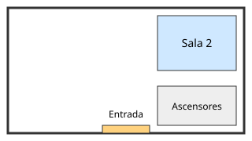

# Guía del club de lectura

Te damos la bienvenida al club de lectura de la biblioteca del barrio. Aquí tienes todo lo que necesitas para la primera reunión.

## Índice

- [Dónde nos reunimos](#dónde-nos-reunimos)
- [El libro de este mes](#el-libro-de-este-mes)
- [Normas del club](#normas-del-club)

## Dónde nos reunimos

En la sala 2 de la biblioteca, el primer jueves de cada mes, a las 19:00. Este es el plano de la planta baja:

## El libro de este mes

*Marianela*, de Benito Pérez Galdós. Hay ejemplares para prestar: búscalo en el [catálogo de la biblioteca](https://www.ejemplo.com/catalogo).

## Normas del club

Son pocas y las tienes en [el fichero de normas](normas.md). La más importante es la de [los turnos de palabra](normas.md#turnos-de-palabra).

[Volver arriba](#guía-del-club-de-lectura)
