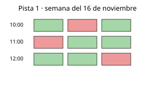

# Reservas del club de pádel

Aplicación web para reservar las pistas del club de pádel Las Encinas desde el móvil, sin llamar por teléfono.



## Índice

- [Qué hace](#qué-hace)
- [Instalación](#instalación)
- [Estado del proyecto](#estado-del-proyecto)
- [Cómo colaborar](#cómo-colaborar)
- [Licencia](#licencia)

## Qué hace

- Muestra las horas libres de las **cuatro pistas**.
- Deja reservar una hora y cancelarla hasta **24 horas antes**.
- Manda un recordatorio por correo el día anterior.

| Pista | Tipo | Luz |
|---|---|:---:|
| 1 y 2 | Cristal | Sí |
| 3 y 4 | Muro | No |

## Instalación

1. Descarga el repositorio y entra en su carpeta:

   ```bash
   git clone https://github.com/ejemplo/reservas-padel.git
   cd reservas-padel
   ```

2. Abre `index.html` en el navegador.

## Estado del proyecto

- [x] Ver las horas libres
- [x] Reservar y cancelar
- [ ] Recordatorio por correo
- [ ] Pagar la pista desde la aplicación

## Cómo colaborar

Lee antes la [guía para colaborar](CONTRIBUTING.md). Las dudas, a Nerea: `nerea@ejemplo.com`.

## Licencia

Código con licencia MIT: los detalles, en [LICENSE](LICENSE).
