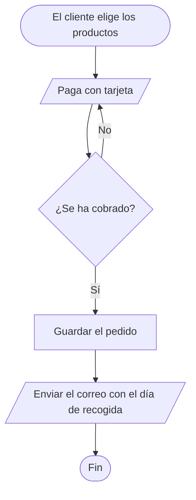

# Web de la Panadería Sol

Web de la panadería del barrio, con tienda en línea para encargar pan y bollería.

## Cómo se hace un pedido

El cliente elige los productos en la web, paga con tarjeta y recibe un correo con el día de recogida.
Si el pago falla, puede volver a intentarlo.

En texto: el cliente elige los productos y paga con tarjeta; si se cobra, se guarda el pedido y se le envía
un correo con el día de recogida; si no, vuelve a pagar.

## Piezas

| Pieza | Qué hace |
|---|---|
| Web | Muestra los productos y recoge los pedidos |
| Base de datos | Guarda los pedidos |
| Pasarela de pago | Cobra con tarjeta |
