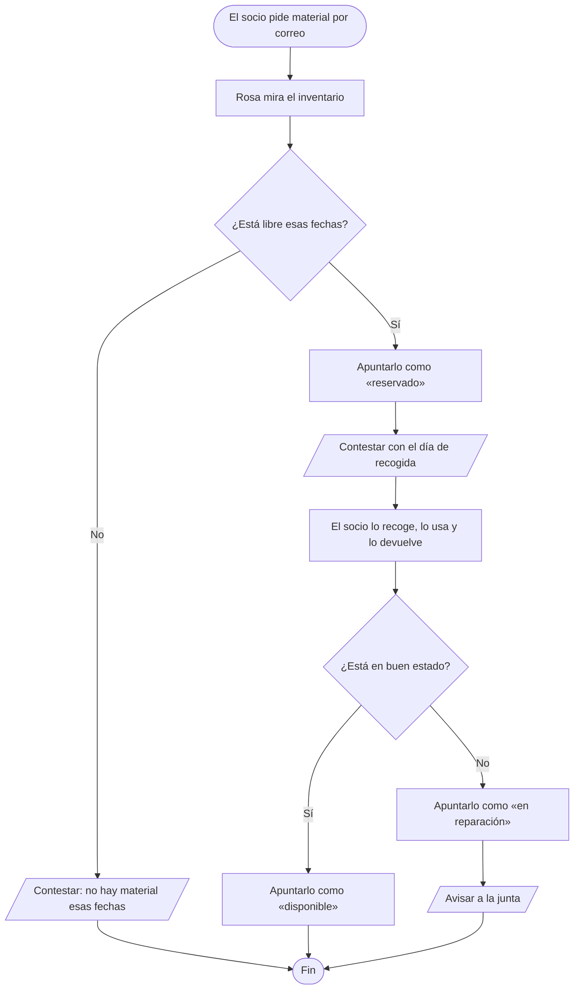
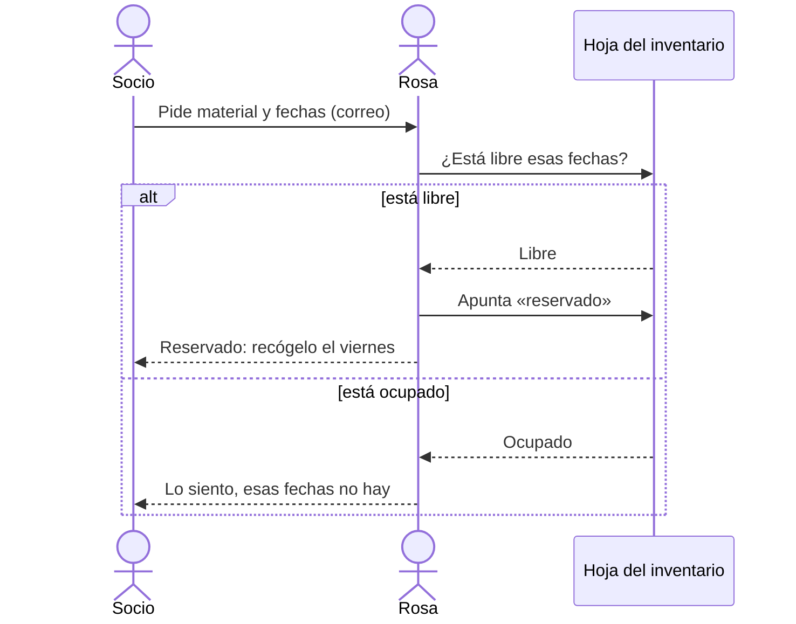

# Préstamo de material del Club de Montaña Cumbres

Cómo presta el club su material (cascos, crampones y piolets) a los socios: quién lo pide, cómo se reserva
y qué se hace al devolverlo.

## Cómo se pide el material

En texto: el socio pide material por correo y Rosa mira el inventario. Si no está libre esas fechas, le contesta
que no hay. Si lo está, lo apunta como reservado y le contesta con el día de recogida; el socio lo recoge, lo usa
y lo devuelve. Si vuelve en buen estado, se apunta como disponible; si no, se apunta como en reparación y se avisa
a la junta.

## Quién se escribe con quién

En texto: el socio escribe a Rosa pidiendo el material y las fechas; Rosa lo mira en la hoja del inventario. Si
está libre, lo apunta como reservado y le contesta con el día de recogida; si está ocupado, le contesta que esas
fechas no hay.

## Estados del material

| Estado | Qué significa |
|---|---|
| disponible | Está en el local y se puede prestar |
| reservado | Prestado o apartado para un socio en unas fechas |
| en reparación | Ha vuelto dañado: no se presta hasta que lo arreglen |
