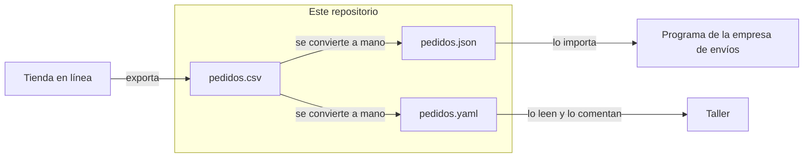

# Pedidos de Cerámica Alba

Los pedidos de la tienda en línea de Cerámica Alba, un taller de Talavera de la Reina, en tres formatos: el CSV que
exporta la tienda, un JSON para el programa de la empresa de envíos y un YAML para leerlos y comentarlos en el taller.
Los tres dicen lo mismo.

- [Los ficheros](#los-ficheros)
- [De dónde sale cada fichero](#de-dónde-sale-cada-fichero)
- [Cómo se convierte cada columna](#cómo-se-convierte-cada-columna)
- [Cómo se comprueba](#cómo-se-comprueba)

## Los ficheros

| Fichero | Formato | Para qué |
|---|---|---|
| [pedidos.csv](pedidos.csv) | CSV: comas, punto decimal, UTF-8 sin BOM | Lo exporta la tienda en línea: es el original |
| [pedidos.json](pedidos.json) | JSON: una lista con un objeto por pedido | Lo importa el programa de la empresa de envíos |
| [pedidos.yaml](pedidos.yaml) | YAML: los mismos datos, con comentarios | Para leerlo y comentarlo en el taller |

## De dónde sale cada fichero



En texto: la tienda en línea exporta `pedidos.csv`; de él se sacan a mano `pedidos.json`, que importa el programa de
la empresa de envíos, y `pedidos.yaml`, que se lee y se comenta en el taller.

## Cómo se convierte cada columna

Cada fila del CSV es un objeto de la lista, en el mismo orden, y las columnas de la cabecera son sus claves. En el
CSV todo es texto; en JSON y en YAML cada valor tiene su tipo:

| Columna | Tipo | En el CSV | En JSON | En YAML |
|---|---|---|---|---|
| `pedido` | Texto | `P-1042` | `"P-1042"` | `P-1042` |
| `fecha` | Texto: año-mes-día | `2026-11-02` | `"2026-11-02"` | `"2026-11-02"` |
| `cliente` | Texto | `"Gómez, Andrés"` | `"Gómez, Andrés"` | `Gómez, Andrés` |
| `codigo_postal` | Texto, por los ceros de delante | `08012` | `"08012"` | `"08012"` |
| `producto` | Texto | `Plato llano` | `"Plato llano"` | `Plato llano` |
| `cantidad` | Número entero | `6` | `6` | `6` |
| `precio_unidad` | Número, con punto decimal | `11.00` | `11.00` | `11.00` |
| `pagado` | Booleano | `sí` o `no` | `true` o `false` | `true` o `false` |
| `notas` | Texto, o nulo si está vacía | (vacío) | `null` | `null` |

Las reglas:

- **Los números** del CSV llevan punto decimal y pasan como números: `11.00` y `11` son el mismo número.
- **Los códigos postales, como texto**: `08012` como número perdería el cero.
- **Las fechas, como texto**, porque JSON no tiene fechas. En el YAML, entre comillas, para que no se lean como fechas.
- **Una casilla vacía es `null`**, no un texto vacío: «no hay notas».
- **En el YAML, entre comillas** todo lo que YAML podría leer como otra cosa: fechas, códigos postales y notas con
  dos puntos y espacio.

## Cómo se comprueba

1. Que el JSON es válido: VS Code no subraya nada en rojo y el panel **Problems** está vacío.
2. Que el YAML es válido, con la extensión de YAML de Red Hat.
3. Que los tres dicen lo mismo: abiertos uno al lado del otro en VS Code, pedido a pedido.
4. Que no se ha perdido ningún pedido y que los códigos postales conservan los ceros:

```bash
tail -n +2 pedidos.csv | wc -l
grep -c '"pedido":' pedidos.json
grep -c '^- pedido:' pedidos.yaml
grep 08012 pedidos.csv pedidos.json pedidos.yaml
```
