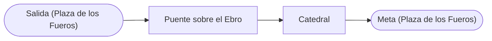
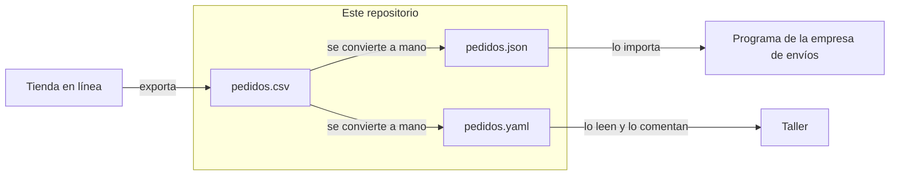

# Retos de la fase 04 — Formatos y diagramas

> **Conviene saber antes:** los módulos de la fase.
> **Tiempo estimado:** 3 horas

Estos retos mezclan lo que has aprendido en los cinco módulos de la fase: las codificaciones y los bytes ([04.01](01-texto-binario-y-codificacion.md)), Markdown ([04.02](02-markdown.md)), JSON y YAML ([04.03](03-json-y-yaml.md)), el CSV ([04.04](04-xml-csv-y-otros.md)) y los diagramas con Mermaid ([04.05](05-diagramas-y-mermaid.md)), con la terminal de la [fase 3](../fase-03-herramientas/02-terminal-sacarle-partido.md) y VS Code.

Van de menor a mayor dificultad, y el último es el más completo. Son **opcionales**: sirven para afianzar lo aprendido y no bloquean nada. Copia a tu carpeta personal la carpeta de cada reto **entera** (la tienes en los enlaces «📁 Código»), ábrela en VS Code y en una terminal, y trabaja ahí; si lo estropeas, vuelve a copiarla y empieza otra vez. La carpeta trae también los ficheros de la solución: no los abras hasta terminar. Abre las pistas solo si te atascas y, si tu solución es distinta de la propuesta, comprueba que hace lo mismo: puede estar igual de bien. Recuerda que tus salidas no serán idénticas letra a letra ([el aviso de 02.03](../fase-02-tu-ordenador/03-instalar-programas-y-path.md#22-un-aviso-sobre-las-salidas-de-la-terminal)).

## Reto 1 · El catálogo de la quesería

**Situación real:** la Quesería Aldaba quiere vender en un mercado en línea de productos de la tierra. El mercado le pide su catálogo en un CSV **como dice la norma**: comas como separador, punto decimal, cabecera y UTF-8 ([04.04, apartado 1.8](04-xml-csv-y-otros.md#18-csv-a-fondo-las-reglas)). Pero el programa de la caja de la quesería, que es antiguo, exporta `catalogo-tpv.csv` a su manera: en **Windows-1252**, con **punto y coma** y con **coma decimal**. Sus datos son estos:

| referencia | producto | precio_kg | existencias_kg |
|---|---|---|---|
| Q-01 | Roncal curado | 24,90 | 12,5 |
| Q-02 | Idiazábal ahumado | 22,50 | 8 |
| Q-03 | Torta del Casar | 31,00 | 3,2 |
| Q-04 | Manchego añejo | 26,75 | 15 |
| Q-05 | Tetilla gallega | 14,20 | 6,4 |

El fichero está en la carpeta del reto: [`codigo/retos/reto-01-catalogo-de-la-queseria/`](codigo/retos/reto-01-catalogo-de-la-queseria/). No está en UTF-8 a propósito: por eso la carpeta lleva un `codificacion.txt`, que le dice al comprobador del curso en qué codificación está.

Desde la terminal, y sin tocar el original:

1. Averigua qué codificación tiene (sabes de dónde viene, y `file` te dará una pista) y pásalo a UTF-8 en `catalogo-utf8.csv`, comprobando que la conversión ha salido bien.
2. Antes de cambiar los separadores, comprueba que ningún producto lleva una coma en el nombre (enseguida verás por qué importa).
3. Deja en `catalogo.csv` la versión que pide el mercado: comas y punto decimal.
4. Comprueba el resultado: su codificación y que la tercera columna son los precios completos, sin partir.

<details>
<summary>Pista 1</summary>

El paso 1 es el de [04.01, apartado 1.12](01-texto-binario-y-codificacion.md#112-convertir-de-una-codificación-a-otra-iconv): `file` para una pista, `iconv` para convertir a un fichero nuevo y `cat` para confirmar que las tildes salen bien. Para el paso 2, saca la columna de los productos con `cut` y cuenta con `grep -c` las líneas que tienen una coma ([03.02, apartado 1.6](../fase-03-herramientas/02-terminal-sacarle-partido.md#16-los-filtros-grep-sort-uniq-wc-cut-head-y-tail)).

</details>

<details>
<summary>Pista 2</summary>

Para el paso 3 hay que hacer **dos cambios**: cada coma decimal pasa a punto, y cada punto y coma pasa a coma. `tr` ya lo usaste para borrar caracteres (`tr -d '\r'`, en [03.04](../fase-03-herramientas/04-errores-y-depuracion.md#32-un-script-con-los-saltos-de-línea-de-windows)). Sin `-d`, **cambia** caracteres: `tr 'ab' 'xy'` cambia cada `a` por `x` y cada `b` por `y`, las dos cosas a la vez. Como `tr` solo lee de su entrada, el fichero se le da con `<`.

</details>

<details>
<summary>Pista 3</summary>

Piensa en el orden: si primero cambias los puntos y comas por comas, ¿cómo distingues después las comas que separan de las decimales? Con `tr` no hay orden: cambia los dos caracteres en una sola pasada.

</details>

<details>
<summary>Ver solución</summary>

**Razonamiento:** dos problemas distintos, cada uno con su herramienta. La codificación se arregla con `iconv`, como en [04.01](01-texto-binario-y-codificacion.md#ejercicio-6--los-socios-del-club-de-montaña). Los separadores y los decimales se arreglan cambiando caracteres: cada `,` por `.` y cada `;` por `,`. Eso es seguro **solo si no hay comas en otro sitio**, por eso se comprueba antes. Y cada paso deja un fichero nuevo y se comprueba ([04.01, buena práctica 4.2](01-texto-binario-y-codificacion.md#42-mira-antes-convierte-a-un-fichero-nuevo-y-comprueba)).

**En tu terminal** (`sesion.txt`):

```text
$ file catalogo-tpv.csv
catalogo-tpv.csv: ISO-8859 text
$ iconv -f WINDOWS-1252 -t UTF-8 catalogo-tpv.csv > catalogo-utf8.csv
$ cat catalogo-utf8.csv
referencia;producto;precio_kg;existencias_kg
Q-01;Roncal curado;24,90;12,5
Q-02;Idiazábal ahumado;22,50;8
Q-03;Torta del Casar;31,00;3,2
Q-04;Manchego añejo;26,75;15
Q-05;Tetilla gallega;14,20;6,4
$ cut -d ';' -f 2 catalogo-utf8.csv | grep -c ','
0
$ tr ',;' '.,' < catalogo-utf8.csv > catalogo.csv
$ cat catalogo.csv
referencia,producto,precio_kg,existencias_kg
Q-01,Roncal curado,24.90,12.5
Q-02,Idiazábal ahumado,22.50,8
Q-03,Torta del Casar,31.00,3.2
Q-04,Manchego añejo,26.75,15
Q-05,Tetilla gallega,14.20,6.4
$ file catalogo.csv
catalogo.csv: CSV Unicode text, UTF-8 text
$ cut -d ',' -f 3 catalogo.csv
precio_kg
24.90
22.50
31.00
26.75
14.20
```

📁 **Código:** [`codigo/retos/reto-01-catalogo-de-la-queseria/`](codigo/retos/reto-01-catalogo-de-la-queseria/)

**En qué fijarte:**

- **`file` dice `ISO-8859`**: una tabla de un byte, sin decir cuál (y en otro sistema puede describirlo con otras palabras). Es solo una **pista**; lo que sabes es que viene de un programa de Windows, así que lo probable es Windows-1252 ([04.01, ejemplo 2.5](01-texto-binario-y-codificacion.md#25-pasar-un-csv-de-windows-1252-a-utf-8)). Lo **confirma** la conversión: después de `iconv`, `cat` enseña bien «Idiazábal» y «añejo».
- **El `0` de `grep -c`**: ningún nombre de producto lleva comas, así que **todas** las comas del fichero son decimales. Por eso se pueden cambiar todas por puntos sin miedo.
- **`tr ',;' '.,'`** cambia, en una sola pasada, cada `,` por `.` y cada `;` por `,`. Como lo hace a la vez, una coma que acaba de nacer de un punto y coma no se vuelve a cambiar por un punto.
- **La comprobación final**, con el separador de la norma: `cut -d ','` saca la tercera columna y salen los precios **completos**, con su punto. Con la coma decimal, ese mismo `cut` los habría partido por la mitad ([04.04, ejemplo 2.5](04-xml-csv-y-otros.md#25-punto-y-coma-y-tabuladores-el-mismo-listado)).
- **Tres ficheros, tres pasos**: el original no se toca, y si algo sale mal, se repite desde el paso que falló.

> **📌 Nota:** en macOS, `file` puede describir los ficheros con otras palabras. `iconv`, `tr` y `cut` hacen lo mismo en Linux, macOS y Git Bash.

**¿Y si un producto llevara una coma?** Por ejemplo, `Q-06;Queso de cabra, en aceite;18,40;5`. Entonces `grep -c` daría `1`, y `tr` convertiría esa coma en un punto: «Queso de cabra. en aceite», **sin avisar**. Ese campo necesitaría comillas en el CSV nuevo (`"Queso de cabra, en aceite"`, [04.04, apartado 1.9](04-xml-csv-y-otros.md#19-comillas-comillas-dobladas-y-saltos-de-línea-dentro)), y `tr` no sabe ponerlas. Para eso, mejor una hoja de cálculo que, al guardar, deje elegir la coma y UTF-8, como LibreOffice Calc: importar con el punto y coma y volver a guardar con comas ([04.04, apartado 1.11](04-xml-csv-y-otros.md#111-la-codificación-y-excel)). Excel en español no sirve tan bien, porque toma el separador de la configuración regional ([04.04, apartado 1.10](04-xml-csv-y-otros.md#110-el-csv-en-españa-punto-y-coma-y-coma-decimal)).

**Errores frecuentes al resolverlo:**

- Cambiar los separadores en dos pasos y en el orden equivocado: `tr ';' ','` primero deja comas de dos clases mezcladas, y el `tr ',' '.'` de después las convierte **todas** en puntos. (Al revés, primero las comas y después los puntos y comas, sí funciona. Con VS Code y **Reemplazar** pasa igual: el orden importa.)
- Usar `tr` antes de `iconv`, sobre el fichero en Windows-1252: aquí funcionaría en Linux y Git Bash, porque `,` y `;` son los mismos bytes en las dos codificaciones (en macOS, `tr` puede negarse con «Illegal byte sequence»), pero mezcla dos problemas. Uno cada vez, comprobando entre medias.
- Escribir `tr ',;' '.,' catalogo-utf8.csv`, con el fichero como argumento: `tr` no lee ficheros, solo su entrada, y se queja.
- Saltarse la comprobación de las comas: con estos datos sale bien, pero el día que llegue un producto con coma, el catálogo se estropeará sin que nadie lo vea.
- Convertir sobre el mismo fichero (`… > catalogo-tpv.csv`): lo vaciarías ([04.01, apartado 1.12](01-texto-binario-y-codificacion.md#112-convertir-de-una-codificación-a-otra-iconv)).

</details>

## Reto 2 · Arregla el repositorio de la carrera

**Situación real:** Irene organiza la San Silvestre de Tudela, la carrera del 31 de diciembre. La web de inscripciones lee los datos de un repositorio con tres ficheros, que escribió a toda prisa otra persona de la organización. Ahora nada funciona:

- La web no arranca: dice que no puede leer `carrera.yaml`.
- VS Code subraya en rojo varias líneas de `inscritos.json`.
- En GitHub, el primer enlace del índice del `README.md` no lleva a su sección, la tabla de precios sale como texto corrido y, donde debería estar el plano del recorrido, sale un error.
- Y, cuando arreglaron a medias el YAML en otra ocasión, la web enseñó la hora de salida como «1080».

Los tres ficheros están en la carpeta del reto: [`codigo/retos/reto-02-carrera-roto/`](codigo/retos/reto-02-carrera-roto/) (lleva un `debe-fallar.txt`, porque los tres están mal a propósito). Ábrela en VS Code y abre el `README.md` con la vista previa al lado. Los otros dos son cortos, y son estos. En `carrera.yaml`, la sangría de las líneas 7 y 8 es un **tabulador**, aunque se vea como espacios.

```yaml
carrera: San Silvestre de Tudela
fecha: "2026-12-31"
hora_salida: 18:00
lugar: Plaza de los Fueros
lema: Corre: el año se acaba
contacto:
	nombre: Irene Sanz
	correo: irene@example.com
distancias:
  - nombre: Infantil
    km: 1
    precio: 0
  - nombre: Popular
    km: 5
    precio: 8
  - nombre: Absoluta
    km: 10
    precio: 12
```

📁 **Código:** [`codigo/retos/reto-02-carrera-roto/`](codigo/retos/reto-02-carrera-roto/)

```json
[
  {"dorsal": 1, "nombre": "Javier Moreno", "carrera": "Absoluta", 'pagado': true},
  {"dorsal": 2, "nombre": "Óscar Lacarra", "carrera": "Popular", "pagado": false}
  {"dorsal": 3, "nombre": "Nerea Aranda", "carrera": "Infantil", "pagado": true},
]
```

📁 **Código:** [`codigo/retos/reto-02-carrera-roto/`](codigo/retos/reto-02-carrera-roto/)

Encuentra **todos** los fallos (hay nueve, tres por fichero) y arréglalos, cambiando lo mínimo. Para cada uno, apunta qué síntoma de la lista explica. Y cuando termines, comprueba los tres ficheros con VS Code. Ojo con el YAML: VS Code solo lo comprueba con la extensión de YAML de Red Hat ([04.03, apartado 1.14](03-json-y-yaml.md#114-comprobar-un-yaml-en-vs-code)); si no la tienes, búscalos leyendo, con las reglas de [04.03](03-json-y-yaml.md#110-mapas-listas-y-sangría).

<details>
<summary>Pista 1</summary>

Prepara VS Code antes de buscar: la extensión de YAML de Red Hat ([04.03, apartado 1.14](03-json-y-yaml.md#114-comprobar-un-yaml-en-vs-code)), el ajuste `markdown.validate.enabled` y la vista previa del README ([04.02, apartado 1.17](02-markdown.md#117-markdown-en-vs-code)), que también dibuja los diagramas. El panel **Problems** te dará seis de los nueve fallos.

</details>

<details>
<summary>Pista 2</summary>

Los tres fallos que no salen en **Problems**: el diagrama (míralo en la vista previa), la tabla (también en la vista previa) y el de «1080», que no da ningún error. ¿Cuántos minutos son 18 horas? Repasa la tabla de [04.03, apartado 1.12](03-json-y-yaml.md#112-los-tipos-que-adivina-yaml-las-versiones-11-y-12).

</details>

<details>
<summary>Pista 3</summary>

En el JSON, mira las comillas, y las comas entre los objetos y después del último ([04.03, apartado 1.6](03-json-y-yaml.md#16-las-reglas-estrictas-de-json)). En el README, escribe el ancla de «Cómo inscribirse» con las reglas de GitHub ([04.02, apartado 1.9](02-markdown.md#19-anclas-enlazar-a-un-título)).

</details>

<details>
<summary>Ver solución</summary>

**Razonamiento:** primero, los fallos que señalan las herramientas (el panel **Problems** y la vista previa), de uno en uno y de arriba abajo, porque a veces uno esconde al siguiente. Después, los que no avisan: para esos hay que **leer** el fichero sabiendo dónde suelen estar las trampas.

| Fichero | Fallo | Síntoma | Arreglo |
|---|---|---|---|
| `README.md` | El ancla `#como-inscribirse` no tiene tilde, y GitHub la conserva | El enlace no lleva a su sección | `#cómo-inscribirse` |
| `README.md` | La tabla no tiene la fila separadora | La tabla sale como texto | `\|---\|---\|---\|` debajo de la cabecera |
| `README.md` | Paréntesis en las etiquetas, sin comillas | El diagrama no se dibuja | Las etiquetas, entre comillas dobles |
| `carrera.yaml` | `lema` lleva dos puntos y un espacio, sin comillas | La web no lo lee | `lema: "Corre: el año se acaba"` |
| `carrera.yaml` | Tabuladores en la sangría de `contacto` | La web no lo lee | Dos espacios |
| `carrera.yaml` | `18:00` sin comillas: YAML 1.1 lo lee en base 60, 18 × 60 = 1080 | La hora sale como «1080» | `hora_salida: "18:00"` |
| `inscritos.json` | `'pagado'`, con comillas simples | Rojo en VS Code | `"pagado"` |
| `inscritos.json` | Falta la coma entre el objeto 2 y el 3 | Rojo en VS Code | Una coma al final de la línea 3 |
| `inscritos.json` | Coma después del último objeto | Rojo en VS Code | Quitarla |

En el `README.md`, estas son las líneas que fallaban (el diagrama tenía también la de la meta, con el mismo problema):

```text
- [Cómo inscribirse](#como-inscribirse)

| Carrera | Distancia | Precio |
| Infantil | 1 km | Gratis |

    salida([Salida (Plaza de los Fueros)]) --> puente[Puente sobre el Ebro]
```

Los tres ficheros, arreglados:

````markdown
# San Silvestre de Tudela

Carrera popular del 31 de diciembre por el centro de Tudela. Este repositorio guarda los datos que usa la web de inscripciones.

- [Cómo inscribirse](#cómo-inscribirse)
- [Distancias y precios](#distancias-y-precios)
- [El recorrido](#el-recorrido)

## Cómo inscribirse

Rellena el formulario de la web antes del 28 de diciembre. Los datos de la carrera están en [carrera.yaml](carrera.yaml) y la lista de inscritos, en [inscritos.json](inscritos.json).

## Distancias y precios

| Carrera | Distancia | Precio |
|---|---|---|
| Infantil | 1 km | Gratis |
| Popular | 5 km | 8 € |
| Absoluta | 10 km | 12 € |

## El recorrido


En texto: se sale de la Plaza de los Fueros, se cruza el puente sobre el Ebro, se pasa por la catedral y se vuelve a la plaza.
````

📁 **Código:** [`codigo/retos/reto-02-carrera-arreglado/`](codigo/retos/reto-02-carrera-arreglado/)

```yaml
carrera: San Silvestre de Tudela
fecha: "2026-12-31"
hora_salida: "18:00"
lugar: Plaza de los Fueros
lema: "Corre: el año se acaba"
contacto:
  nombre: Irene Sanz
  correo: irene@example.com
distancias:
  - nombre: Infantil
    km: 1
    precio: 0
  - nombre: Popular
    km: 5
    precio: 8
  - nombre: Absoluta
    km: 10
    precio: 12
```

📁 **Código:** [`codigo/retos/reto-02-carrera-arreglado/`](codigo/retos/reto-02-carrera-arreglado/)

```json
[
  {"dorsal": 1, "nombre": "Javier Moreno", "carrera": "Absoluta", "pagado": true},
  {"dorsal": 2, "nombre": "Óscar Lacarra", "carrera": "Popular", "pagado": false},
  {"dorsal": 3, "nombre": "Nerea Aranda", "carrera": "Infantil", "pagado": true}
]
```

📁 **Código:** [`codigo/retos/reto-02-carrera-arreglado/`](codigo/retos/reto-02-carrera-arreglado/)

Así se ve ahora el recorrido:



**En qué fijarte:**

- **Seis fallos avisan y tres no.** El JSON, el YAML (con la extensión) y el ancla (con `markdown.validate.enabled`) salen en **Problems**. La tabla y el diagrama solo se ven mal en la vista previa: hay que **mirarla** ([04.05, apartado 1.10](05-diagramas-y-mermaid.md#110-dónde-se-dibuja-github-la-academia-y-vs-code)). Y la hora no da ningún error en ningún sitio.
- **La hora es el fallo peor.** `18:00` es un YAML correcto: un lector de YAML 1.1, como el de la web, lo lee como el número 1080; uno de 1.2, como el de la extensión de VS Code, como texto. Por eso la extensión no avisa. Solo lo arreglan las comillas ([04.03, apartado 1.12](03-json-y-yaml.md#112-los-tipos-que-adivina-yaml-las-versiones-11-y-12)). El `fecha: "2026-12-31"` ya las llevaba, por lo mismo.
- **Un fallo puede esconder al siguiente.** Muchos lectores, como el de la web, se paran en el primer error: el de `lema`; al arreglarlo, la web se quejaría de los tabuladores. Por eso se repasa hasta que **Problems** queda vacío, y no se da nada por arreglado con el primer cambio.
- **El arreglo mínimo.** En el diagrama bastan las comillas: los paréntesis se quedan, porque son parte del nombre de la plaza ([04.05, apartado 1.9](05-diagramas-y-mermaid.md#19-caracteres-especiales-en-las-etiquetas)). Las etiquetas que no tienen paréntesis también llevan comillas: no hacían falta, pero así todas siguen la misma regla.

**Errores frecuentes al resolverlo:**

- Quitar la tilde del título en lugar de ponerla en el ancla: el enlace funcionaría, pero el título quedaría mal escrito.
- Arreglar el JSON quitando las comillas simples de `'pagado'` sin poner las dobles: `pagado` sin comillas tampoco es una clave de JSON.
- Dar el YAML por bueno cuando **Problems** queda vacío, sin pensar en la hora.
- Escribir `hora_salida: 18.00`: ya no es una hora, sino el número 18.

</details>

## Reto 3 · Los pedidos de la tienda de cerámica

**Situación real:** Alba tiene un taller de cerámica en Talavera de la Reina y vende en su tienda en línea, que exporta los pedidos en un CSV. Para que la empresa de envíos los recoja, su programa necesita los pedidos en **JSON**. Y en el taller quieren una copia en **YAML**, más fácil de leer y en la que se puede escribir algún comentario. Te pide que lo conviertas y lo dejes documentado en un repositorio, para que cualquiera del taller sepa repetirlo. Estos son los pedidos de la primera semana de noviembre:

```text
pedido,fecha,cliente,codigo_postal,producto,cantidad,precio_unidad,pagado,notas
P-1041,2026-11-02,Lucía Herrera,45600,Taza de desayuno,2,14.50,sí,
P-1042,2026-11-02,"Gómez, Andrés",08012,Plato llano,6,11.00,sí,Regalo: envolver aparte
P-1043,2026-11-03,Marta Ibáñez,28004,Jarra de agua,1,32.90,no,"Que ponga ""frágil"" en la caja"
P-1044,2026-11-04,Jorge Castro,10003,Fuente de horno,1,27.00,sí,
P-1045,2026-11-05,Nuria Pons,07001,Juego de 4 tazas,1,49.90,no,Entregar después de las 18:30
```

📁 **Código:** [`codigo/retos/reto-03-pedidos-a-json-y-yaml/`](codigo/retos/reto-03-pedidos-a-json-y-yaml/)

El programa de la empresa de envíos pide un JSON así:

- **Una lista** con un objeto por pedido, en el mismo orden que el CSV.
- En cada objeto, **una clave por columna**, con el nombre exacto de la cabecera.
- Los **números**, como números; el `sí` y el `no`, como **booleanos**; y una casilla **vacía**, como `null`.

Haz, en la carpeta del CSV:

1. Una tabla (en papel o donde quieras) con el **tipo** que tendrá cada columna, y por qué.
2. `pedidos.json`, con las reglas del programa de envíos.
3. `pedidos.yaml`, con **exactamente los mismos datos** y un comentario al principio que diga qué es y de dónde sale.
4. `README.md`, que documente el repositorio: un título y un párrafo que diga qué es; un índice con enlaces a sus secciones; una tabla con los tres ficheros y para qué sirve cada uno; un **diagrama de bloques** (`flowchart LR`, [04.05, apartado 1.2](05-diagramas-y-mermaid.md#12-tres-diagramas-para-empezar)) de dónde sale cada fichero y quién lo usa, con su frase «En texto: …»; las reglas de conversión de cada columna; y cómo se comprueba que los tres dicen lo mismo.
5. Las comprobaciones: que el JSON y el YAML son válidos, que dicen lo mismo y que no se ha perdido ningún pedido. Con VS Code y con la terminal, sin programas que no vengan con Git Bash.

<details>
<summary>Pista 1</summary>

En un CSV **todo es texto** ([04.04, apartado 1.8](04-xml-csv-y-otros.md#18-csv-a-fondo-las-reglas)): el tipo lo decides tú. Pregúntate, columna a columna: ¿se calcula con ella? ¿Es un sí o un no? ¿Puede faltar? ¿Y qué le pasaría a `08012` si fuera un número? Es lo mismo que hiciste con las reservas de [04.03, ejercicio 7](03-json-y-yaml.md#ejercicio-7--las-reservas-de-una-casa-rural).

</details>

<details>
<summary>Pista 2</summary>

Lee bien las filas 2 y 3 del CSV: las comillas que rodean un campo no son parte del dato, y una comilla doblada (`""`) es una sola comilla ([04.04, apartado 1.9](04-xml-csv-y-otros.md#19-comillas-comillas-dobladas-y-saltos-de-línea-dentro)). En JSON, una comilla dentro de un texto se escribe `\"`.

</details>

<details>
<summary>Pista 3</summary>

Para el YAML, traduce el JSON símbolo a símbolo ([04.03, apartado 1.15](03-json-y-yaml.md#115-el-mismo-dato-en-json-y-en-yaml)). Después repasa cada valor de texto: fechas, códigos postales y notas con `: ` necesitan comillas ([04.03, apartado 1.11](03-json-y-yaml.md#111-comentarios-comillas-y-textos-largos)).

</details>

<details>
<summary>Pista 4</summary>

Para el diagrama, seis cajas: la tienda, los tres ficheros y los dos que los usan. Un `subgraph` puede agrupar los ficheros del repositorio ([04.05, apartado 1.7](05-diagramas-y-mermaid.md#17-agrupar-con-subgraph-diagramas-de-bloques)), y las flechas pueden llevar texto. Para contar los pedidos en la terminal, busca con `grep -c` una línea que salga una vez por pedido en cada fichero.

</details>

<details>
<summary>Ver solución</summary>

**Razonamiento:** primero se decide el tipo de cada columna; después se escribe el JSON fila a fila, con las reglas del programa de envíos; el YAML se traduce del JSON; y el README cuenta lo que se ha hecho, para que otra persona lo pueda repetir. Al final, se comprueba con VS Code y con la terminal.

**1. Los tipos.** Cada fila del CSV será un objeto, y cada columna, una clave con el mismo nombre:

| Columna | Tipo | Por qué |
|---|---|---|
| `pedido` | Texto | Es un código, no se calcula con él |
| `fecha` | Texto, `"2026-11-02"` | JSON no tiene fechas; año-mes-día, como en el CSV |
| `cliente`, `producto` | Texto | Son nombres |
| `codigo_postal` | Texto | Como número, `08012` perdería el cero: sería 8012 |
| `cantidad` | Número | Se multiplica por el precio |
| `precio_unidad` | Número | Se calcula con él. El CSV ya trae punto decimal, el de JSON |
| `pagado` | Booleano | Es un sí o un no |
| `notas` | Texto, o `null` si está vacía | Una casilla vacía es «no hay notas», no un texto vacío |

**2. `pedidos.json`:**

```json
[
  {
    "pedido": "P-1041",
    "fecha": "2026-11-02",
    "cliente": "Lucía Herrera",
    "codigo_postal": "45600",
    "producto": "Taza de desayuno",
    "cantidad": 2,
    "precio_unidad": 14.50,
    "pagado": true,
    "notas": null
  },
  {
    "pedido": "P-1042",
    "fecha": "2026-11-02",
    "cliente": "Gómez, Andrés",
    "codigo_postal": "08012",
    "producto": "Plato llano",
    "cantidad": 6,
    "precio_unidad": 11.00,
    "pagado": true,
    "notas": "Regalo: envolver aparte"
  },
  {
    "pedido": "P-1043",
    "fecha": "2026-11-03",
    "cliente": "Marta Ibáñez",
    "codigo_postal": "28004",
    "producto": "Jarra de agua",
    "cantidad": 1,
    "precio_unidad": 32.90,
    "pagado": false,
    "notas": "Que ponga \"frágil\" en la caja"
  },
  {
    "pedido": "P-1044",
    "fecha": "2026-11-04",
    "cliente": "Jorge Castro",
    "codigo_postal": "10003",
    "producto": "Fuente de horno",
    "cantidad": 1,
    "precio_unidad": 27.00,
    "pagado": true,
    "notas": null
  },
  {
    "pedido": "P-1045",
    "fecha": "2026-11-05",
    "cliente": "Nuria Pons",
    "codigo_postal": "07001",
    "producto": "Juego de 4 tazas",
    "cantidad": 1,
    "precio_unidad": 49.90,
    "pagado": false,
    "notas": "Entregar después de las 18:30"
  }
]
```

📁 **Código:** [`codigo/retos/reto-03-pedidos-a-json-y-yaml/`](codigo/retos/reto-03-pedidos-a-json-y-yaml/)

- **Una lista de objetos**, con las claves en el orden de la cabecera. En JSON el orden de las claves no cambia el dato, pero así se repasa mejor contra el CSV; el de los pedidos sí importa: es el de la lista.
- **`"Gómez, Andrés"`**: en el CSV llevaba comillas por la coma. Esas comillas no son parte del dato; las de JSON son las de cualquier texto.
- **`"Que ponga \"frágil\" en la caja"`**: en el CSV, la comilla doblada `""` es una comilla; en JSON se escribe `\"`. El dato es el mismo: `Que ponga "frágil" en la caja`.
- **`14.50`, `11.00`**: son números válidos de JSON y se han dejado como en el CSV, que se lee mejor. Para un programa, `14.50` y `14.5` son el mismo número.
- **`null`** en las dos casillas vacías de `notas`.

**3. `pedidos.yaml`:**

```yaml
# Pedidos de la tienda en línea de Cerámica Alba (del 2 al 5 de noviembre de 2026).
# Convertidos a mano de pedidos.csv: los mismos datos que pedidos.json.
# Entre comillas, lo que YAML podría leer como otra cosa: fechas, códigos postales y notas con «: ».
- pedido: P-1041
  fecha: "2026-11-02"
  cliente: Lucía Herrera
  codigo_postal: "45600"
  producto: Taza de desayuno
  cantidad: 2
  precio_unidad: 14.50
  pagado: true
  notas: null
- pedido: P-1042
  fecha: "2026-11-02"
  cliente: Gómez, Andrés
  codigo_postal: "08012"
  producto: Plato llano
  cantidad: 6
  precio_unidad: 11.00
  pagado: true
  notas: "Regalo: envolver aparte"
- pedido: P-1043
  fecha: "2026-11-03"
  cliente: Marta Ibáñez
  codigo_postal: "28004"
  producto: Jarra de agua
  cantidad: 1
  precio_unidad: 32.90
  pagado: false
  notas: "Que ponga \"frágil\" en la caja"
- pedido: P-1044
  fecha: "2026-11-04"
  cliente: Jorge Castro
  codigo_postal: "10003"
  producto: Fuente de horno
  cantidad: 1
  precio_unidad: 27.00
  pagado: true
  notas: null
- pedido: P-1045
  fecha: "2026-11-05"
  cliente: Nuria Pons
  codigo_postal: "07001"
  producto: Juego de 4 tazas
  cantidad: 1
  precio_unidad: 49.90
  pagado: false
  notas: "Entregar después de las 18:30"
```

📁 **Código:** [`codigo/retos/reto-03-pedidos-a-json-y-yaml/`](codigo/retos/reto-03-pedidos-a-json-y-yaml/)

- **Las comillas que hacen falta**: las fechas (un lector de YAML 1.1 las leería como fechas, un tipo que JSON no tiene); los códigos postales (serían números, y `08012` y `07001` perderían el cero); y la nota de Andrés, que lleva dos puntos y un espacio y rompería el fichero ([04.03, error típico 3.7](03-json-y-yaml.md#37-dos-puntos-en-el-valor)).
- **Las que sobran, pero no estorban**: la nota de Nuria (`18:30` no lleva espacio detrás de los dos puntos) y la de Marta, que necesita las suyas para escribir `\"`.
- **`Gómez, Andrés` va sin comillas**: en YAML, una coma dentro de un texto no tiene nada de especial.
- **`pagado: true`**, no `sí`: `sí` sería un texto, y no lo mismo que el `true` del JSON.

**4. `README.md`:**

````markdown
# Pedidos de Cerámica Alba

Los pedidos de la tienda en línea de Cerámica Alba, un taller de Talavera de la Reina, en tres formatos: el CSV que
exporta la tienda, un JSON para el programa de la empresa de envíos y un YAML para leerlos y comentarlos en el taller.
Los tres dicen lo mismo.

- [Los ficheros](#los-ficheros)
- [De dónde sale cada fichero](#de-dónde-sale-cada-fichero)
- [Cómo se convierte cada columna](#cómo-se-convierte-cada-columna)
- [Cómo se comprueba](#cómo-se-comprueba)

## Los ficheros

| Fichero | Formato | Para qué |
|---|---|---|
| [pedidos.csv](pedidos.csv) | CSV: comas, punto decimal, UTF-8 sin BOM | Lo exporta la tienda en línea: es el original |
| [pedidos.json](pedidos.json) | JSON: una lista con un objeto por pedido | Lo importa el programa de la empresa de envíos |
| [pedidos.yaml](pedidos.yaml) | YAML: los mismos datos, con comentarios | Para leerlo y comentarlo en el taller |

## De dónde sale cada fichero



En texto: la tienda en línea exporta `pedidos.csv`; de él se sacan a mano `pedidos.json`, que importa el programa de
la empresa de envíos, y `pedidos.yaml`, que se lee y se comenta en el taller.

## Cómo se convierte cada columna

Cada fila del CSV es un objeto de la lista, en el mismo orden, y las columnas de la cabecera son sus claves. En el
CSV todo es texto; en JSON y en YAML cada valor tiene su tipo:

| Columna | Tipo | En el CSV | En JSON | En YAML |
|---|---|---|---|---|
| `pedido` | Texto | `P-1042` | `"P-1042"` | `P-1042` |
| `fecha` | Texto: año-mes-día | `2026-11-02` | `"2026-11-02"` | `"2026-11-02"` |
| `cliente` | Texto | `"Gómez, Andrés"` | `"Gómez, Andrés"` | `Gómez, Andrés` |
| `codigo_postal` | Texto, por los ceros de delante | `08012` | `"08012"` | `"08012"` |
| `producto` | Texto | `Plato llano` | `"Plato llano"` | `Plato llano` |
| `cantidad` | Número entero | `6` | `6` | `6` |
| `precio_unidad` | Número, con punto decimal | `11.00` | `11.00` | `11.00` |
| `pagado` | Booleano | `sí` o `no` | `true` o `false` | `true` o `false` |
| `notas` | Texto, o nulo si está vacía | (vacío) | `null` | `null` |

Las reglas:

- **Los números** del CSV llevan punto decimal y pasan como números: `11.00` y `11` son el mismo número.
- **Los códigos postales, como texto**: `08012` como número perdería el cero.
- **Las fechas, como texto**, porque JSON no tiene fechas. En el YAML, entre comillas, para que no se lean como fechas.
- **Una casilla vacía es `null`**, no un texto vacío: «no hay notas».
- **En el YAML, entre comillas** todo lo que YAML podría leer como otra cosa: fechas, códigos postales y notas con
  dos puntos y espacio.

## Cómo se comprueba

1. Que el JSON es válido: VS Code no subraya nada en rojo y el panel **Problems** está vacío.
2. Que el YAML es válido, con la extensión de YAML de Red Hat.
3. Que los tres dicen lo mismo: abiertos uno al lado del otro en VS Code, pedido a pedido.
4. Que no se ha perdido ningún pedido y que los códigos postales conservan los ceros:

```bash
tail -n +2 pedidos.csv | wc -l
grep -c '"pedido":' pedidos.json
grep -c '^- pedido:' pedidos.yaml
grep 08012 pedidos.csv pedidos.json pedidos.yaml
```
````

📁 **Código:** [`codigo/retos/reto-03-pedidos-a-json-y-yaml/`](codigo/retos/reto-03-pedidos-a-json-y-yaml/)

Así se ve el diagrama:


- **El README responde a tres preguntas**: qué hay (la tabla de ficheros), de dónde sale (el diagrama) y cómo se hace (las reglas y las comprobaciones). Con eso, cualquiera del taller puede convertir los pedidos de la semana que viene.
- **Los ficheros, dentro de un `subgraph`**: así se ve de un vistazo qué hay en el repositorio y qué queda fuera.
- **Los nodos `csv`, `json` y `yaml`** se nombran en minúsculas y sin puntos: el punto de `pedidos.csv` va en la etiqueta, entre comillas.
- **El índice enlaza a las secciones** con las anclas de GitHub, con sus tildes: `#cómo-se-comprueba`.

**5. Las comprobaciones.** Con VS Code: `pedidos.json` sin nada en **Problems**; `pedidos.yaml`, igual, con la extensión de YAML; los tres ficheros, uno al lado del otro, recorridos pedido a pedido; y el README en la vista previa, con el diagrama dibujado y los enlaces del índice funcionando. Y con la terminal, las órdenes del README:

**En tu terminal** (`sesion.txt`):

```text
$ tail -n +2 pedidos.csv | wc -l
5
$ grep -c '"pedido":' pedidos.json
5
$ grep -c '^- pedido:' pedidos.yaml
5
$ grep 08012 pedidos.csv pedidos.json pedidos.yaml
pedidos.csv:P-1042,2026-11-02,"Gómez, Andrés",08012,Plato llano,6,11.00,sí,Regalo: envolver aparte
pedidos.json:    "codigo_postal": "08012",
pedidos.yaml:  codigo_postal: "08012"
```

📁 **Código:** [`codigo/retos/reto-03-pedidos-a-json-y-yaml/`](codigo/retos/reto-03-pedidos-a-json-y-yaml/)

- **Cinco, cinco y cinco.** `tail -n +2` escribe el CSV desde la línea 2, sin la cabecera, y `wc -l` cuenta las filas. En el JSON y en el YAML se cuenta una línea que sale una vez por pedido: la de la clave `pedido`. En el YAML, `^` pide que esté al principio de la línea, con su guion.
- **Contar líneas solo vale porque ninguna fila ocupa dos**: con un salto de línea dentro de un campo, `wc -l` contaría de más ([04.04, ejemplo 2.4](04-xml-csv-y-otros.md#24-un-csv-con-comillas-los-socios-de-un-club)).
- **`grep` con varios ficheros** dice en cuál está cada línea. El código postal de Andrés conserva el cero en los tres, y con comillas en el JSON y en el YAML: es un texto.

**Errores frecuentes al resolverlo:**

- Convertir los códigos postales en números: el JSON es válido, pero `08012` pasa a ser 8012, y Barcelona deja de tener un código postal correcto.
- Escribir `"pagado": "sí"`: el programa de envíos esperaba un booleano. Y en el YAML, un `no` sin comillas sería `false` con YAML 1.1 y el texto `no` con la 1.2: justo la trampa de Noruega.
- Escribir `"notas": ""` en las casillas vacías, o quitar la clave: el programa pidió `null`, y cada objeto con todas sus claves.
- Copiar las comillas del CSV al JSON: `"\"Gómez, Andrés\""` sería un nombre que empieza y acaba con comillas.
- Dejar en el YAML las fechas sin comillas: el fichero se lee, pero no es el mismo dato que el JSON.
- Pegar el diagrama en el README sin volver a mirarlo en la vista previa.

</details>

---
⬅️ [Anterior: Diagramas y Mermaid](05-diagramas-y-mermaid.md) · 📚 [Índice](../00-indice.md)
