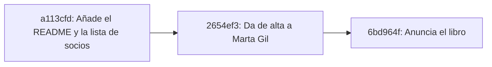
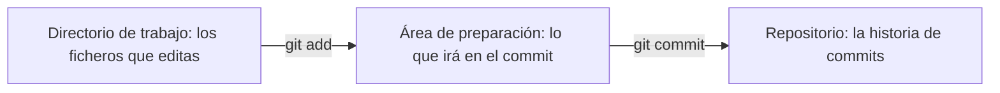
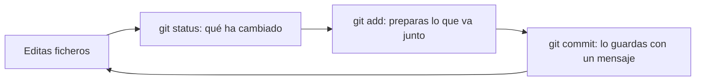

# 05.01 Git: fundamentos

> **Versiones:** Git 2.56; salidas de la 2.56.0; la más reciente, la 2.56.1 (a 16 de noviembre de 2026)
> **Conviene saber antes:** [02.03 Instalar programas, variables de entorno y PATH, 1.6](../fase-02-tu-ordenador/03-instalar-programas-y-path.md#16-instalar-git-en-windows-git-for-windows-y-git-bash) · [03.01 La terminal: lo básico](../fase-03-herramientas/01-terminal-lo-basico.md) · [04.01 Texto, binario y codificación, 1.15](../fase-04-formatos-y-diagramas/01-texto-binario-y-codificacion.md#115-los-ficheros-binarios-y-git)
> **Tiempo estimado:** 3 horas
> **Nivel:** Básico · Núcleo

## Qué aprenderás

- Qué problema resuelve el **control de versiones** y por qué todo programador usa **Git**.
- A **configurar Git** en tu ordenador: tu nombre, tu correo, el nombre de la rama inicial y el editor.
- Qué son un **repositorio** y un **commit**, y las **tres zonas** de Git: el directorio de trabajo, el área de preparación y el repositorio.
- El ciclo de cada día: **`git init`**, **`git status`**, **`git add`**, **`git commit`** y **`git log`**.
- A ver **qué ha cambiado** con `git diff` y `git show`, y por qué Git entiende los ficheros de texto y no los binarios.
- A decidir qué **no** se guarda en Git con el fichero **`.gitignore`**.
- A **deshacer** con seguridad: descartar un cambio, sacarlo del área de preparación, corregir el último commit y anular uno antiguo.
- A **renombrar y borrar** ficheros con Git, y a escribir **buenos mensajes de commit**.

Hasta ahora, cada vez que guardabas un fichero, la versión anterior desaparecía. Desde este módulo, cada paso importante de tus proyectos quedará guardado, con su fecha y su explicación, y podrás volver atrás cuando quieras. Es la herramienta que vas a usar todos los días, en cualquier curso y en cualquier trabajo de programación.

> **📌 Nota:** este módulo trata de Git **en tu ordenador**. Las ramas y los conflictos llegan en [05.02 Ramas y conflictos](02-ramas-y-conflictos.md), y compartir tu trabajo en internet con GitHub, en [05.03 GitHub](03-github.md).

## 1. Teoría

### 1.1. El problema: informe-final-final-bueno

Seguro que has visto (o creado) una carpeta así:

```text
trabajo.docx
trabajo-v2.docx
trabajo-v2-corregido.docx
trabajo-final.docx
trabajo-final-final.docx
trabajo-final-final-bueno.docx
```

Es la forma «a mano» de guardar versiones: antes de cambiar algo importante, haces una copia con otro nombre. Con un documento, más o menos funciona. Con un proyecto de programación, que tiene decenas o cientos de ficheros que cambian cada día, es imposible. Y, aunque lo consiguieras, esa carpeta no contesta a las preguntas que te harás una y otra vez:

- ¿Qué he cambiado **exactamente** desde ayer?
- El programa funcionaba el martes y hoy no. ¿Qué se tocó entre medias?
- ¿Cómo vuelvo a la versión que funcionaba, sin perder lo bueno que he hecho después?
- ¿Quién cambió esta línea, cuándo y **por qué**?
- ¿Cómo trabajamos tres personas en los mismos ficheros sin pisarnos?

### 1.2. El control de versiones

Un **sistema de control de versiones** es un programa que guarda la **historia** de un proyecto: cada vez que se lo pides, toma nota de cómo están todos sus ficheros, junto con **quién** hizo el cambio, **cuándo** y un **mensaje** que explica **qué** se cambió y **por qué**. Con esa historia puedes:

- Ver qué ha cambiado entre dos momentos cualesquiera, línea a línea.
- Volver a cualquier versión anterior de un fichero, o de todo el proyecto.
- Deshacer un cambio concreto sin perder los que vinieron después.
- Trabajar varias personas a la vez y juntar el trabajo de todas.

Y todo eso sin llenar la carpeta de copias: la carpeta del proyecto tiene siempre **una sola versión** de cada fichero, la actual, y las anteriores las guarda el sistema aparte.

> **📌 Nota:** el control de versiones no es solo para programadores. Funciona con cualquier proyecto hecho de [ficheros de texto](../glosario.md#fichero-de-texto): los apuntes de un curso en Markdown, una web, la documentación de una empresa o un libro. Este mismo curso se escribe así.

### 1.3. Git, y GitHub, que no es lo mismo

**Git** es el sistema de control de versiones más usado del mundo. Lo creó en **2005** Linus Torvalds, el creador de Linux, porque los miles de programadores que trabajan en Linux necesitaban una herramienta rápida para coordinarse. Es gratuito y de código abierto, y ya lo tienes instalado desde [02.03](../fase-02-tu-ordenador/03-instalar-programas-y-path.md#16-instalar-git-en-windows-git-for-windows-y-git-bash).

Git es **distribuido**: cada persona que trabaja en un proyecto tiene en su ordenador una **copia completa** del proyecto **con toda su historia**. Así puedes ver el historial, guardar versiones y deshacer cambios **sin internet**; la conexión solo hace falta para compartir el trabajo con los demás.

**Git no es GitHub.** Git es el programa que guarda la historia en tu ordenador; GitHub es una web donde se guardan copias de proyectos de Git para compartirlos y colaborar. Puedes usar Git sin GitHub (lo harás en todo este módulo). GitHub lo verás en [05.03](03-github.md).

> **💡 Consejo:** la referencia oficial de Git es el libro **Pro Git**, gratuito y traducido al español, en la web de Git: `git-scm.com/book/es/v2` (a 16 de noviembre de 2026). Si algo de este módulo te sabe a poco, sus capítulos 1 y 2 son el siguiente paso.

Todo lo que hace Git se pide desde la terminal con la orden **`git`** seguida de una palabra que dice qué quieres hacer: `git init`, `git status`, `git commit`… Las que aprenderás aquí son una docena, y con ellas se hace casi todo el trabajo diario.

### 1.4. Antes de empezar: decirle a Git quién eres

Git apunta en cada versión guardada **quién** la hizo, con un nombre y un correo. Por eso, antes de nada, se lo dices **una sola vez** en cada ordenador, con **`git config --global`**:

```bash
git config --global user.name "Lucía Martín"
git config --global user.email "lucia@example.com"
```

Escribe **tu** nombre y **tu** correo. El nombre puede llevar espacios y tildes (por eso va entre comillas). El correo conviene que sea el mismo que usarás en GitHub ([05.03](03-github.md)), para que GitHub reconozca tus versiones como tuyas.

`--global` quiere decir «para todos mis proyectos de este ordenador». Git lo guarda en un fichero de configuración de tu carpeta personal, **`~/.gitconfig`**, que es un [fichero oculto](../fase-02-tu-ordenador/02-archivos-carpetas-y-rutas.md#115-ficheros-ocultos) con el formato INI que viste en [04.04](../fase-04-formatos-y-diagramas/04-xml-csv-y-otros.md#113-ficheros-de-configuración-properties-ini-y-toml): secciones entre corchetes y `nombre = valor` debajo. Lo verás en el [ejemplo 2.1](#21-configurar-git).

Hay dos ajustes más que conviene dejar hechos el primer día.

**La rama inicial, `main`.** Todo proyecto empieza con una **rama** (qué es lo verás en [05.02](02-ramas-y-conflictos.md#12-qué-es-una-rama-por-dentro)), y su nombre depende de cómo esté configurado Git: hoy casi todos los proyectos nuevos, GitHub incluido, la llaman **`main`**, y es lo que usa este curso. Si en el instalador de Windows elegiste `main` ([02.03, 1.6](../fase-02-tu-ordenador/03-instalar-programas-y-path.md#16-instalar-git-en-windows-git-for-windows-y-git-bash)), ya está hecho; si no, o si usas macOS o Linux, este es el momento:

```bash
git config --global init.defaultBranch main
```

Sin este ajuste, Git 2.56 llama a la rama inicial **`master`**; según su documentación, pasará a llamarla `main` cuando salga Git 3.0 (a 16 de noviembre de 2026, todavía sin fecha).

**El editor.** Algunas órdenes de Git necesitan que escribas un texto más largo, y para eso **abren un editor** y esperan a que lo cierres. Lo verás en el [apartado 1.9](#19-el-ciclo-de-cada-día-status-add-commit-y-log): si haces un commit sin escribir el mensaje en la misma orden, Git abre el editor para que lo escribas allí. ¿Cuál abre?

- **En Windows**, el que elegiste en el instalador de Git for Windows: si seguiste [02.03, 1.6](../fase-02-tu-ordenador/03-instalar-programas-y-path.md#16-instalar-git-en-windows-git-for-windows-y-git-bash), **VS Code**.
- **En macOS y Linux**, el que tenga configurado el sistema y, si no hay ninguno, el que se eligió al preparar Git, que según su documentación suele ser **vi** (hoy, casi siempre su versión moderna, **Vim**). Vim funciona dentro de la terminal y desconcierta mucho la primera vez: no se sale de él con ninguna tecla conocida. En algunos sistemas, como Debian o Ubuntu, puede salir otro editor de terminal, **nano**, más sencillo.

Para que Git use VS Code en cualquier sistema:

```bash
git config --global core.editor "code --wait"
```

La orden `code` es la que abre VS Code desde la terminal ([03.03, 1.13](../fase-03-herramientas/03-editor-de-codigo.md#113-abrir-vs-code-desde-la-terminal)), y **`--wait`** le dice que **espere** a que cierres la pestaña antes de devolverle el control a Git. Sin `--wait`, VS Code se abriría, Git no esperaría y se encontraría el mensaje vacío.

> **⚠️ Si se te abre Vim sin querer:** pulsa <kbd>Esc</kbd> (así Vim deja de escribir lo que tecleas como texto), escribe `:q!` y pulsa <kbd>Intro</kbd>: sale **sin guardar**. Si no habías escrito nada, también vale `:q`. Si lo que quieres es **guardar** el mensaje que escribiste y salir, es `:wq` y <kbd>Intro</kbd>. Si abajo ves atajos con `^` (`^X Salir`), es nano: <kbd>Ctrl</kbd>+<kbd>X</kbd>; si pregunta si guardar, <kbd>N</kbd> para cancelar o <kbd>S</kbd> e <kbd>Intro</kbd> para hacer el commit. Lo cuenta el [error típico 3.4](#34-se-abre-un-editor-y-no-sabes-salir).

Para ver toda tu configuración, **`git config --global --list`**; y para ver un solo valor, `git config user.name`. Si te equivocas al escribir algo, vuelve a dar la orden con el valor bueno: el nuevo sustituye al anterior.

**Sin `--global`**, dentro de un repositorio, el ajuste vale **solo para ese repositorio** (Git lo guarda en su carpeta `.git`) y manda sobre el global. Casi nunca lo necesitarás; en [05.03](03-github.md#22-clonar-luis-se-une-al-club) lo usa Luis para que sus commits salgan a su nombre en un ordenador donde la identidad global es la de Ana.

> **📌 Nota:** en la terminal del curso, la identidad ya viene configurada como «Ana García <ana@example.com>» y la rama inicial como `main`. Por eso, en los ejemplos, los commits salen a nombre de Ana. En los tuyos saldrá el tuyo.

### 1.5. Repositorio: una carpeta con memoria

Un **repositorio** (en inglés, *repository*; se dice mucho «repo») es una **carpeta cuya historia guarda Git**. Se crea con **`git init`** dentro de la carpeta del proyecto, y lo que hace esa orden es crear dentro una subcarpeta oculta, **`.git`**, donde Git guardará todas las versiones y todo lo que necesita.

```text
club-lectura/          ← la carpeta del proyecto: el repositorio
├── .git/              ← la memoria de Git (oculta; no la toques)
├── README.md
└── socios.csv
```

Tres cosas que conviene saber desde el principio:

- **No toques `.git` a mano.** Ni la abras para cambiar nada ni la borres: ahí está toda la historia. Si la borras, la carpeta vuelve a ser una carpeta normal, con los ficheros tal como están, pero sin ninguna versión anterior.
- **Un repositorio por proyecto.** `git init` se hace en la carpeta del proyecto, no en tu carpeta personal ni en el Escritorio entero ([error típico 3.8](#38-crear-el-repositorio-en-la-carpeta-equivocada)).
- **Lo que hay fuera de la carpeta no existe para Git.** Git solo ve lo que está dentro del repositorio, en cualquier subcarpeta.

### 1.6. Commit: una foto del proyecto

Un **commit** es cada versión guardada en la historia: una **foto** de cómo estaban los ficheros del proyecto en ese momento. Cada commit lleva:

| Parte | Qué es | Ejemplo |
|---|---|---|
| **Identificador** (*hash*) | Un código de 40 caracteres, cifras y letras de la `a` a la `f` (en [hexadecimal](../fase-04-formatos-y-diagramas/01-texto-binario-y-codificacion.md#19-ver-los-bytes-de-un-fichero-od)), que lo distingue de cualquier otro. Casi siempre basta con los **7 primeros** | `a113cfd99f0a…` o, corto, `a113cfd` |
| **Autor** | Nombre y correo de quien lo hizo (los de `git config`) | `Ana García <ana@example.com>` |
| **Fecha** | Cuándo se hizo | `Thu Jan 15 10:00:00 2026 +0100` |
| **Mensaje** | Qué se cambió y por qué, escrito por quien lo hizo | `Da de alta a Marta Gil en el club` |
| **Padre** | El commit anterior, del que viene | (Git lo apunta solo) |

La palabra *commit* viene del inglés «comprometerse»: es el momento en que das por buena una versión. En español también se dice **confirmar** (Git en español habla de «cambios a ser confirmados»), pero casi todo el mundo dice «hacer un commit».

Cada commit apunta a su **padre**, así que los commits forman una **cadena**: la **historia** (o **historial**) del proyecto. Y como un commit es una foto de **todo** el proyecto, puedes volver a cualquiera de ellos y tener los ficheros exactamente como estaban.



En texto: tres commits en orden, del más antiguo al más reciente; cada uno sale del anterior.

> **📌 Nota:** el identificador se calcula a partir del contenido, el autor, la fecha y el commit padre. Por eso **los de tus commits serán distintos** de los del curso, aunque escribas lo mismo: lo avisaba [02.03](../fase-02-tu-ordenador/03-instalar-programas-y-path.md#22-un-aviso-sobre-las-salidas-de-la-terminal). Las fechas y el nombre también serán los tuyos.

### 1.7. Las tres zonas de Git

Esta es la idea **más importante** del módulo. Un fichero de tu proyecto puede estar en tres sitios a la vez, que Git llama **zonas**:

1. **El directorio de trabajo** (*working directory*): los ficheros tal como los ves y los editas, en la carpeta del proyecto. Es donde trabajas.
2. **El área de preparación** (*staging area*; también se llama **índice**, *index*): una zona intermedia donde vas **eligiendo** qué cambios entrarán en el próximo commit. Git en español la llama a veces «área de stage».
3. **El repositorio** (la carpeta `.git`): la historia, con todos los commits.



En texto: los cambios pasan del directorio de trabajo al área de preparación con `git add`, y del área de preparación al repositorio con `git commit`.

Una forma de imaginarlo: es como **preparar un paquete**. El directorio de trabajo es tu mesa, llena de cosas. El área de preparación es la caja abierta: vas metiendo lo que quieres enviar. El commit es cerrar la caja, ponerle una etiqueta (el mensaje) y guardarla en el almacén (el repositorio).

**¿Para qué sirve la caja intermedia?** Para que cada commit tenga **un solo propósito**. Imagina que en una tarde has corregido un error en un fichero **y** has empezado otra cosa en otro, que todavía no está terminada. Con el área de preparación metes en el commit solo la corrección, y lo demás se queda en tu mesa para más adelante. Lo practicarás en el [ejercicio 3](#ejercicio-3--dos-cambios-dos-commits).

### 1.8. Los estados de un fichero

Según en qué zona estén sus cambios, Git dice que cada fichero está en uno de estos **estados**:

| Estado | Qué significa | En `git status --short` |
|---|---|---|
| **Sin seguimiento** (*untracked*) | Un fichero nuevo que Git todavía no vigila: nunca se ha añadido | `??` |
| **Modificado** (*modified*) | Un fichero que Git ya vigila y que ha cambiado desde el último commit, pero el cambio **no** está preparado | ` M` (la `M` en la **segunda** columna) |
| **Preparado** (*staged*) | Su cambio está en el área de preparación: **irá en el próximo commit** | `A ` si es nuevo, `M ` si es un cambio (la letra en la **primera** columna) |
| **Confirmado** (*committed*) | Está guardado en el último commit, tal cual: no tiene nada pendiente | No aparece |

La orden que te dice el estado de cada fichero es **`git status`**, y es **la que más vas a usar**: antes de añadir, antes de cada commit y cada vez que dudes. Dice además, entre paréntesis, qué puedes hacer a continuación. Su forma corta, **`git status --short`**, da una línea por fichero con un código de **dos columnas**:

- La **primera columna** es el área de preparación: lo que **irá** en el commit.
- La **segunda columna** es el directorio de trabajo: lo que has cambiado y **todavía no** has preparado.

| Código | Significa |
|---|---|
| `??` | Sin seguimiento |
| `A ` | Fichero nuevo, preparado (*added*) |
| `M ` | Modificado y preparado |
| ` M` | Modificado, sin preparar |
| `MM` | Preparado, y cambiado otra vez después: hay una parte preparada y otra no |
| `D ` | Borrado, y el borrado está preparado (*deleted*) |
| `R ` | Renombrado, y preparado (*renamed*) |

Fíjate en el espacio: `M ` y ` M` no son lo mismo. Es lo que más cuesta al principio, y lo practicarás en el [ejercicio 2](#ejercicio-2--lee-lo-que-dice-git-status---short).

### 1.9. El ciclo de cada día: status, add, commit y log

Con un repositorio creado, el trabajo es siempre el mismo ciclo:



En texto: editas, miras el estado, preparas lo que va junto, haces el commit y vuelves a editar.

| Orden | Qué hace |
|---|---|
| `git init` | Convierte la carpeta actual en un repositorio (una vez por proyecto) |
| `git status` | Dice en qué estado está cada fichero |
| `git add fichero` | Prepara ese fichero: copia su cambio al área de preparación |
| `git add .` | Prepara **todo** lo que ha cambiado en la carpeta actual y sus subcarpetas (el punto es la [carpeta actual](../fase-02-tu-ordenador/02-archivos-carpetas-y-rutas.md#110-las-carpetas-especiales-punto-y-punto-punto)) |
| `git commit -m "mensaje"` | Guarda lo preparado como un commit nuevo, con ese mensaje |
| `git log` | Enseña la historia: los commits, del más reciente al más antiguo |
| `git log --oneline` | La historia resumida: una línea por commit, con el identificador corto |

Tres detalles importantes:

- **`git add` copia el cambio tal como está en ese momento.** Si después de `git add` vuelves a cambiar el fichero, ese cambio nuevo **no** está preparado (es el `MM` del apartado anterior). Antes del commit, otro `git add`.
- **`git commit` solo guarda lo preparado.** Lo que no hayas pasado por `git add` se queda fuera, aunque lo hayas cambiado ([error típico 3.3](#33-olvidar-el-git-add)).
- **El mensaje va con `-m`.** Si haces `git commit` sin `-m`, Git abre el editor para que escribas el mensaje allí ([apartado 1.4](#14-antes-de-empezar-decirle-a-git-quién-eres)); al guardar y cerrar la pestaña, hace el commit. Si lo cierras sin escribir nada, Git cancela el commit. Con `-m` es más rápido, y es lo que usa el curso.

> **📌 Nota:** cuando la historia es larga y no cabe en la pantalla, `git log` la enseña con **`less`**, el paginador que viste en [03.01](../fase-03-herramientas/01-terminal-lo-basico.md#19-ver-qué-hay-dentro-de-un-fichero-cat-less-head-y-tail): avanzas con <kbd>Espacio</kbd> y **sales con <kbd>Q</kbd>**. En la terminal del curso no pasa, porque los ejemplos son cortos.

En la salida de `git log` verás junto al último commit algo como **`(HEAD -> main)`**. Es Git diciéndote **dónde estás**: en la rama `main`, en ese commit. Lo entenderás del todo en [05.02](02-ramas-y-conflictos.md#13-head-dónde-estás); de momento, basta con saber que señala el commit más reciente.

### 1.10. Ver los cambios: diff y show

Antes de guardar un cambio, conviene **mirarlo**. Para eso está **`git diff`**, que enseña las diferencias **línea a línea**:

```text
diff --git a/socios.csv b/socios.csv
index 72869ca..92705dd 100644
--- a/socios.csv
+++ b/socios.csv
@@ -1,3 +1,4 @@
 nombre;socio_desde
 Carmen Ruiz;2024
 Javier Soto;2025
+Marta Gil;2026
```

Cómo se lee:

- Las cuatro primeras líneas dicen **qué fichero** compara: `a/` es la versión de antes y `b/`, la de ahora. La línea `index` son datos internos de Git que puedes ignorar.
- **`@@ -1,3 +1,4 @@`** dice **dónde** está el cambio: antes, desde la línea 1, 3 líneas; ahora, desde la línea 1, 4 líneas.
- Las líneas que empiezan por **`+`** se han **añadido**; las que empiezan por **`-`**, se han **quitado**. Un cambio dentro de una línea se ve como una línea quitada (la vieja) y otra añadida (la nueva).
- Las que empiezan por un **espacio** no han cambiado: son el **contexto**, para que sepas en qué parte del fichero estás.

Lo importante es **qué compara** cada orden:

| Orden | Compara | Responde a |
|---|---|---|
| `git diff` | El directorio de trabajo con el área de preparación | ¿Qué he cambiado y **todavía no** he preparado? |
| `git diff --staged` | El área de preparación con el último commit | ¿Qué **irá** en el próximo commit? |
| `git show identificador` | Un commit con su padre | ¿Qué cambió **ese** commit? Con su autor, su fecha y su mensaje |

Por eso, después de `git add`, `git diff` **ya no enseña** ese cambio (ya está preparado), y lo enseña `git diff --staged`. Repasar `git diff --staged` justo antes de cada commit es una costumbre excelente: es la última oportunidad de ver qué vas a guardar.

**`git show`** sin nada detrás enseña el último commit. Con la opción **`--stat`**, en lugar del cambio completo, solo qué ficheros cambió y cuántas líneas; y lo mismo hace `git log --stat` con cada commit de la historia.

### 1.11. Texto y binario: lo que Git sabe comparar

En [04.01](../fase-04-formatos-y-diagramas/01-texto-binario-y-codificacion.md#115-los-ficheros-binarios-y-git) te adelantamos que Git trabaja muy bien con los [ficheros de texto](../glosario.md#fichero-de-texto) y no tanto con los [binarios](../glosario.md#fichero-binario). Ahora puedes ver por qué:

- Con un fichero de **texto** (Markdown, CSV, JSON, un script), `git diff` enseña **qué líneas** han cambiado.
- Con un **binario** (una imagen, un PDF, un `.docx`), Git no puede comparar líneas, porque no las tiene. Solo sabe decirte que **el fichero ha cambiado**: `Binary files a/logo.png and b/logo.png differ` («los ficheros binarios son distintos»; esa frase Git no la traduce). Lo verás en el [ejemplo 2.5](#25-texto-frente-a-binario-en-el-diff).

Git **guarda** igual de bien los dos: puedes volver a cualquier versión de una imagen. Lo que no puede es enseñarte qué ha cambiado dentro, ni juntar los cambios de dos personas en el mismo binario. Por eso, en programación, todo lo que se pueda se guarda en texto, y los binarios grandes (vídeos, discos de máquinas virtuales, programas ya compilados) no se suelen guardar en Git.

### 1.12. Lo que no va en Git: .gitignore

No todo lo que hay en la carpeta de un proyecto debe entrar en la historia:

| No va en Git | Por qué |
|---|---|
| **Secretos**: contraseñas, claves, el [fichero `.env`](../fase-04-formatos-y-diagramas/04-xml-csv-y-otros.md#114-el-fichero-env-y-los-secretos) | Cualquiera con acceso al repositorio los vería, **también en los commits antiguos**. Es lo más grave |
| Registros (`*.log`) | Cambian cada vez que se ejecuta el programa |
| Lo que se **genera solo** a partir del código (carpetas como `dist/`, `build/` u `out/`) | Se puede volver a generar; solo ocuparía sitio y llenaría la historia de cambios sin interés |
| Ficheros del sistema (`.DS_Store` de macOS, `Thumbs.db` de Windows) | No tienen nada que ver con el proyecto |
| La configuración personal de tu editor (`.vscode/`, si no la quieres compartir) | Es tuya, no del proyecto |

Para decírselo a Git se escribe un fichero llamado exactamente **`.gitignore`** (con su punto: es oculto) en la carpeta principal del proyecto, con un **patrón** por línea. Git ignora todo lo que encaje con alguno: no lo enseña en `git status` y `git add .` no lo añade.

| Patrón | Qué ignora | Ejemplo |
|---|---|---|
| `nombre` | Los ficheros **y** carpetas con ese nombre, en cualquier carpeta | `.env` |
| `*.ext` | Todos los ficheros con esa extensión, en cualquier carpeta (el `*` es el [comodín](../fase-03-herramientas/01-terminal-lo-basico.md#114-comodines-y-comillas) de la terminal) | `*.log` |
| `nombre/` | Solo **carpetas** con ese nombre, con todo lo que tengan dentro | `dist/` |
| `/nombre` | Solo el que está en la carpeta principal del proyecto, no en las subcarpetas | `/notas.txt` |
| `!patrón` | Una **excepción**: esto **no** se ignora, aunque lo ignore una línea anterior (no funciona si está ignorada la carpeta que lo contiene) | `!importante.log` |
| `# texto` | Un comentario | `# Secretos` |

(Según la documentación de `gitignore`, a 16 de noviembre de 2026; tiene más reglas, como `**` para «cualquier número de carpetas», que de momento no necesitas.)

El `.gitignore` **sí se guarda en Git**, con un commit como cualquier otro fichero: así todo el que trabaje en el proyecto ignora lo mismo.

Para saber **por qué** Git ignora un fichero, está **`git check-ignore -v fichero`**: te dice qué línea del `.gitignore` lo ignora. Si no escribe nada, ese fichero no está ignorado.

> **⚠️ Cuidado:** `.gitignore` solo sirve para ficheros que Git **todavía no vigila**. Si un fichero ya entró en un commit, añadirlo después al `.gitignore` **no** hace que Git lo olvide: lo seguirá vigilando. Para que deje de hacerlo, sin borrarlo de tu disco, está **`git rm --cached fichero`** (el `--cached` quiere decir «quítalo solo de Git»). Y si era un secreto, sigue en los commits antiguos: lo verás en el [ejercicio 6](#ejercicio-6--una-contraseña-dentro-del-repositorio).

### 1.13. Deshacer cambios

Git permite deshacer casi todo, pero cada situación tiene su orden. Esta tabla es la que más vas a consultar:

| Situación | Orden | ¿Se pierde algo? |
|---|---|---|
| He cambiado un fichero y quiero **descartar** los cambios **sin preparar**: que vuelva a estar como en el área de preparación (si no había hecho `git add`, como en el último commit) | `git restore fichero` | **Sí**: el cambio descartado no estaba en ningún commit y desaparece |
| He preparado un fichero con `git add` y quiero **sacarlo** del área de preparación, sin perder el cambio | `git restore --staged fichero` | No: el cambio sigue en el fichero |
| Acabo de hacer un commit y quiero **corregir su mensaje** o **añadirle** algo que se me olvidó | `git commit --amend -m "mensaje"` (o `--no-edit` para dejar el mensaje) | No, pero **sustituye** el último commit por otro nuevo |
| Quiero **anular** un commit antiguo, que puede que ya tengan otros | `git revert identificador` | No: crea un commit **nuevo** que hace lo contrario |

**La regla de oro:** `commit --amend` **reescribe la historia**: el commit de antes desaparece y aparece otro, con otro identificador. Solo se usa con commits que **todavía no has compartido** con nadie. Si un commit ya lo tienen otras personas (en GitHub, por ejemplo), se anula con `revert`, que no borra nada: añade un commit al final, y la historia de todos sigue encajando ([error típico 3.9](#39-cambiar-un-commit-que-ya-has-compartido)).

Verás en internet otra orden para deshacer, **`git reset`**, que mueve la historia hacia atrás y hace desaparecer commits. Con la opción **`--hard`** borra además los cambios de los ficheros que Git vigila que no estuvieran en un commit (los ficheros nuevos sin seguimiento se quedan), **sin preguntar y sin papelera**. Es de las pocas órdenes de Git con las que se pierde trabajo de verdad, así que en este curso no la vas a necesitar: con `restore`, `--amend` y `revert` tienes todo lo que hace falta al empezar.

> **📌 Nota:** Git apunta en un registro, el **reflog** (`git reflog`), por dónde has ido pasando, así que un commit que «ha desaparecido» por un `reset` o un `--amend` todavía se puede recuperar durante un tiempo. Es una red de emergencia, no una forma de trabajar: si algún día la necesitas, busca ayuda antes de tocar nada más.

> **📌 Nota:** en tutoriales antiguos verás `git checkout -- fichero` para descartar un cambio y `git reset HEAD fichero` para sacarlo del área de preparación. Funcionan, pero desde 2019 (Git 2.23) existen `git restore` y `git restore --staged`, más claros, que son los que usa este curso y los que te propone el propio `git status`.

### 1.14. Renombrar y borrar: git mv y git rm

Para renombrar o borrar un fichero que Git ya vigila, usa las órdenes de Git en lugar de `mv` y `rm`:

| Orden | Qué hace |
|---|---|
| `git mv viejo nuevo` | Renombra (o mueve) el fichero **y** prepara el cambio: `R  viejo -> nuevo` |
| `git rm fichero` | Borra el fichero del disco **y** prepara el borrado: `D  fichero` |
| `git rm --cached fichero` | Lo quita **solo de Git**: el fichero se queda en tu disco, sin seguimiento ([apartado 1.12](#112-lo-que-no-va-en-git-gitignore)) |

En los tres casos, el cambio queda preparado y falta el commit (tienes `git mv` al final del [ejemplo 2.6](#26-ignorar-ficheros-con-gitignore)). Si usas `mv` o `rm` normales, tampoco pasa nada: `git status` lo verá y lo preparas con `git add` (tras un `mv`, de los dos nombres, o `git add .`). Las de Git te ahorran ese paso.

Que un fichero se borre no significa que se pierda: sigue en los commits anteriores, y lo puedes recuperar de ahí.

### 1.15. Buenos mensajes de commit

Una historia útil es la que te deja entender el proyecto meses después. Para eso:

- **Un commit, un propósito.** «Corrige el teléfono de la escuela» es un buen commit. «Corrige el teléfono, cambia los colores y empieza el horario» son tres.
- **Commits pequeños y frecuentes**, cada uno con el proyecto funcionando.
- **Mensajes que expliquen qué y por qué**, en una primera línea corta (unos 50 caracteres, como orientación), que empiece por un verbo: «Añade…», «Corrige…», «Quita…».

| Mensaje malo | Mensaje bueno |
|---|---|
| `cambios` | `Corrige el precio de la pintura en la lista` |
| `arreglado` | `Evita que el informe salga vacío los domingos` |
| `asdf` | `Añade la receta de las galletas` |
| `viernes` | `Da de alta a Marta Gil en el club` |

Muchos equipos siguen además una convención para la primera línea, **Conventional Commits** («commits convencionales», versión 1.0.0 a 16 de noviembre de 2026), que pone delante el **tipo** de cambio: `feat: añade la búsqueda por autor`, `fix: corrige el total con descuento`, `docs: …`. No la necesitas ahora; si un proyecto la usa, lo dirá en su documentación.

### 1.16. Un recordatorio: los saltos de línea

En [03.04](../fase-03-herramientas/04-errores-y-depuracion.md#32-un-script-con-los-saltos-de-línea-de-windows) viste que Windows termina las líneas con **CRLF** y Linux y macOS con **LF**, y que un script con CRLF falla en bash. Git for Windows viene preparado para **convertir** los saltos de línea (la pantalla *Configuring the line ending conversions* del instalador, que dejaste como venía en [02.03](../fase-02-tu-ordenador/03-instalar-programas-y-path.md#16-instalar-git-en-windows-git-for-windows-y-git-bash)), y por eso avisa de lo que hará (salida de Git 2.56.0 con esa conversión activada):

```text
advertencia: en la copia de trabajo de 'bizcocho.txt', LF será reemplazado con CRLF la próxima vez que Git la toque
```

En Git Bash lo verás en casi todos los `git add`, `git diff` y `git stash` de esta fase, uno por fichero. No sale en las salidas del curso; ignóralo: es solo un **aviso**, no un error. Para no depender de cómo tenga configurado Git cada persona, el proyecto puede llevar en su carpeta principal un fichero **`.gitattributes`** que fije los saltos de línea, con su commit como cualquier otro. El de este curso dice que todo se guarde y se saque con LF: `* text=auto eol=lf`.

### 1.17. Git en VS Code

VS Code trae Git integrado: es el icono de **control de versiones** de la barra de actividades que viste en [03.03](../fase-03-herramientas/03-editor-de-codigo.md#15-las-partes-de-la-ventana), y su vista se llama **Source Control**. Según la documentación de VS Code (a 16 de noviembre de 2026), usa el Git que tienes instalado, y en esa vista revisas los ficheros cambiados, preparas los cambios (aparecen en la lista *Staged Changes*, el área de preparación) y haces el commit con su mensaje.

Por dentro hace exactamente lo mismo que las órdenes de este módulo. Por eso conviene aprenderlas primero en la terminal: cuando VS Code te enseñe algo raro, sabrás qué está pasando. Si quieres verlo, abre con VS Code la carpeta de cualquier repositorio de los ejemplos.

## 2. Ejemplos de código

Todos los ejemplos son reales y los puedes repetir: descarga la carpeta de cada uno (su enlace «📁 Código»), abre la terminal en ella y escribe las mismas órdenes. Cada ejemplo crea su repositorio en una **carpeta nueva** dentro de esa carpeta (`mkdir … && cd … && git init`): así nunca mezclas sus ficheros con los del curso. Recuerda que en tu pantalla cambiarán los identificadores de los commits, las fechas y el autor ([el aviso de 02.03](../fase-02-tu-ordenador/03-instalar-programas-y-path.md#22-un-aviso-sobre-las-salidas-de-la-terminal)): fíjate en lo que dice el texto.

Algunos ejemplos van en **varias sesiones seguidas** (`sesion-1.txt`, `sesion-2.txt`…): hazlas en orden, porque cada una sigue donde lo dejó la anterior. Puedes cerrar la terminal entre una y otra; por eso cada sesión, menos la primera, empieza con su `cd`.

> **📌 Nota:** **Git en español** mezcla palabras: dice «confirmar» y «commit», «archivos» y «área de stage». Algunas cosas **no las traduce** y salen en inglés en cualquier Git: las fechas (`Thu Jan 15`), el resumen de cada commit (`1 file changed, 1 insertion(+)`, «1 fichero cambiado, 1 línea añadida»), muchas pistas que empiezan por `hint:` y algún mensaje suelto. Y su traducción tiene alguna **errata** (un paréntesis sin cerrar, una tilde que falta, una palabra mal escrita). Los módulos de esta fase las dejan tal cual, porque es lo que verás en tu pantalla, y te dicen qué significan. Si tu Git habla inglés, las órdenes son las mismas: Git usa el idioma del sistema, y en macOS puede salirte en inglés.

Estos son los mensajes que comenta la fase, en los dos idiomas (salidas de Git 2.56.0), por si te salen en inglés:

| En español | En inglés |
|---|---|
| `En la rama main` | `On branch main` |
| `nada para hacer commit, el árbol de trabajo está limpio` | `nothing to commit, working tree clean` |
| `Tu rama está adelantada a 'origin/main' por 1 commit.` | `Your branch is ahead of 'origin/main' by 1 commit.` |
| `Tu rama está detrás de 'origin/main' por 1 commit, y puede ser avanzada rápido.` | `Your branch is behind 'origin/main' by 1 commit, and can be fast-forwarded.` |
| `Tu rama y 'origin/main' han divergido,` | `Your branch and 'origin/main' have diverged,` |
| `CONFLICTO (contenido): Conflicto de fusión en precios.txt` | `CONFLICT (content): Merge conflict in precios.txt` |
| `Fusión automática falló; arregle los conflictos y luego realice un commit con el resultado.` | `Automatic merge failed; fix conflicts and then commit the result.` |
| `! [rejected]        main -> main (fetch first)` | Igual: no se traduce |
| `fatal: Necesita especificar cómo reconciliar las ramas divergentes.` | `fatal: Need to specify how to reconcile divergent branches.` |
| `fatal: rehusando fusionar historias no relacionadas` | `fatal: refusing to merge unrelated histories` |

### 2.1. Configurar Git

**Situación real:** Lucía acaba de instalar Git y, antes de su primer commit, le dice quién es, qué nombre quiere para la rama inicial y qué editor debe abrir. Después lo comprueba.

**En tu terminal** (`sesion.txt`):

```text
$ git config --global user.name "Lucía Martín"
$ git config --global user.email "lucia@example.com"
$ git config --global init.defaultBranch main
$ git config --global core.editor "code --wait"
$ git config --global --list
user.name=Lucía Martín
user.email=lucia@example.com
init.defaultbranch=main
core.editor=code --wait
$ git config user.name
Lucía Martín
$ cat ~/.gitconfig
[user]
        name = Lucía Martín
        email = lucia@example.com
[init]
        defaultBranch = main
[core]
        editor = code --wait
```

📁 **Código:** [`codigo/01-git-fundamentos/ejemplos/2.1-configurar-git/`](codigo/01-git-fundamentos/ejemplos/2.1-configurar-git/)

**En qué fijarte:**

- Las órdenes `git config` **no contestan nada** si todo va bien.
- **`--list`** enseña lo que has guardado, una línea por ajuste, con el nombre de la sección delante (`user.name`, `init.defaultbranch`; en esta lista, Git pone los nombres en minúsculas, pero da igual cómo los escribas).
- **`~/.gitconfig`** es un fichero de texto normal, con forma de INI: la sección `[user]` con `name` y `email`, y así con las demás. Git lo escribe por ti.

> **⚠️ Cuidado:** si haces este ejemplo en tu ordenador, **cambia los datos por los tuyos**: lo que escribas aquí es lo que saldrá en todos tus commits. Y no pongas `core.editor "code --wait"` si no tienes la orden `code` ([03.03, 1.13](../fase-03-herramientas/03-editor-de-codigo.md#113-abrir-vs-code-desde-la-terminal)): Git no podría abrir el editor.

### 2.2. Tu primer repositorio y tu primer commit

**Situación real:** Carmen lleva el club de lectura de su barrio, Entre Páginas, y quiere guardar la historia de sus dos ficheros: un `README.md` que presenta el club (un [README](../fase-04-formatos-y-diagramas/02-markdown.md#116-el-fichero-readme), como los de la fase 4) y la lista de socios, `socios.csv`. Empieza un repositorio en una carpeta nueva, crea los ficheros (aquí, con `printf`, para que puedas repetirlo igual; en tu proyecto los escribirías con el editor) y hace su primer commit, mirando el estado en cada paso.

**En tu terminal** (`sesion-1.txt`):

```text
$ mkdir club-lectura && cd club-lectura && git init
Inicializado repositorio Git vacío en /home/alumno/club-lectura/.git/
$ git status
En la rama main

No hay commits todavía

no hay nada para confirmar (crea/copia archivos y usa "git add" para hacerles seguimiento)
$ printf '# Club de lectura Entre Páginas\n\nNos vemos el primer jueves de cada mes.\n' > README.md
$ printf 'nombre;socio_desde\nCarmen Ruiz;2024\nJavier Soto;2025\n' > socios.csv
$ ls
README.md  socios.csv
$ git status
En la rama main

No hay commits todavía

Archivos sin seguimiento:
  (usa "git add <archivo>..." para incluirlo a lo que será confirmado)
        README.md
        socios.csv

no hay nada agregado al commit pero hay archivos sin seguimiento presentes (usa "git add" para hacer
les seguimiento)
$ git status --short
?? README.md
?? socios.csv
$ git add README.md
$ git status --short
A  README.md
?? socios.csv
$ git add socios.csv
$ git status
En la rama main

No hay commits todavía

Cambios a ser confirmados:
  (usa "git rm --cached <archivo>..." para sacar del área de stage)
        nuevos archivos: README.md
        nuevos archivos: socios.csv

$ git commit -m "Añade el README y la lista de socios"
[main (commit-raíz) a113cfd] Añade el README y la lista de socios
 2 files changed, 6 insertions(+)
 create mode 100644 README.md
 create mode 100644 socios.csv
$ git status
En la rama main
nada para hacer commit, el árbol de trabajo está limpio
$ git log
commit a113cfd99f0a0a8db8cdf3b3cbdaf8e5e1caa97e (HEAD -> main)
Author: Ana García <ana@example.com>
Date:   Thu Jan 15 10:00:00 2026 +0100

    Añade el README y la lista de socios
```

📁 **Código:** [`codigo/01-git-fundamentos/ejemplos/2.2-club-de-lectura/`](codigo/01-git-fundamentos/ejemplos/2.2-club-de-lectura/)

**En qué fijarte:**

- **`git init`** dice dónde ha creado el repositorio: la carpeta oculta `.git` dentro de `club-lectura`.
- **Lee `git status` despacio**, porque siempre te dice qué hacer. Primero: «No hay commits todavía» y nada que confirmar. Con los ficheros creados: «Archivos sin seguimiento» y, entre paréntesis, «usa "git add"». (La última línea no cabe en la pantalla del curso y la terminal la parte; en una ventana más ancha te saldrá entera.)
- **`git status --short`** dice lo mismo en una línea por fichero: `??` (sin seguimiento), luego `A ` (añadido y preparado) para el que pasa por `git add`.
- Con los dos preparados, `git status` los pone bajo **«Cambios a ser confirmados»**: es lo que irá en el commit. Y te dice cómo sacarlos de ahí si te arrepientes.
- **El commit** contesta con la rama (`main`), `commit-raíz` (es el primero: no tiene padre), su identificador corto (`a113cfd`), el mensaje y un resumen: 2 ficheros, 6 líneas añadidas.
- Después, **«el árbol de trabajo está limpio»**: no hay nada pendiente. Todo está guardado.
- **`git log`** enseña el commit completo: el identificador entero, el autor, la fecha y el mensaje. `(HEAD -> main)` señala dónde estás ([apartado 1.9](#19-el-ciclo-de-cada-día-status-add-commit-y-log)).

### 2.3. Ver qué ha cambiado: diff y diff --staged

**Situación real:** al día siguiente, Carmen da de alta a una socia nueva y anuncia en el README el libro del mes. Son dos cosas distintas, así que las guarda en **dos commits**, mirando antes qué ha cambiado.

**En tu terminal** (`sesion-2.txt`):

```text
$ cd club-lectura
$ echo "Marta Gil;2026" >> socios.csv
$ printf '\nLibro de este mes: «La sombra del viento».\n' >> README.md
$ git status --short
 M README.md
 M socios.csv
$ git diff
diff --git a/README.md b/README.md
index e48421b..e7ee6c2 100644
--- a/README.md
+++ b/README.md
@@ -1,3 +1,5 @@
 # Club de lectura Entre Páginas

 Nos vemos el primer jueves de cada mes.
+
+Libro de este mes: «La sombra del viento».
diff --git a/socios.csv b/socios.csv
index 72869ca..92705dd 100644
--- a/socios.csv
+++ b/socios.csv
@@ -1,3 +1,4 @@
 nombre;socio_desde
 Carmen Ruiz;2024
 Javier Soto;2025
+Marta Gil;2026
$ git add socios.csv
$ git status --short
 M README.md
M  socios.csv
$ git diff
diff --git a/README.md b/README.md
index e48421b..e7ee6c2 100644
--- a/README.md
+++ b/README.md
@@ -1,3 +1,5 @@
 # Club de lectura Entre Páginas

 Nos vemos el primer jueves de cada mes.
+
+Libro de este mes: «La sombra del viento».
$ git diff --staged
diff --git a/socios.csv b/socios.csv
index 72869ca..92705dd 100644
--- a/socios.csv
+++ b/socios.csv
@@ -1,3 +1,4 @@
 nombre;socio_desde
 Carmen Ruiz;2024
 Javier Soto;2025
+Marta Gil;2026
$ git commit -m "Da de alta a Marta Gil en el club"
[main 2654ef3] Da de alta a Marta Gil en el club
 1 file changed, 1 insertion(+)
$ git add README.md
$ git commit -m "Anuncia el libro de este mes"
[main 6bd964f] Anuncia el libro de este mes
 1 file changed, 2 insertions(+)
$ git log --oneline
6bd964f (HEAD -> main) Anuncia el libro de este mes
2654ef3 Da de alta a Marta Gil en el club
a113cfd Añade el README y la lista de socios
```

📁 **Código:** [`codigo/01-git-fundamentos/ejemplos/2.2-club-de-lectura/`](codigo/01-git-fundamentos/ejemplos/2.2-club-de-lectura/)

**En qué fijarte:**

- Con los dos ficheros cambiados, `git status --short` da ` M` en los dos: modificados, **sin preparar** (la `M` en la segunda columna).
- **`git diff`** enseña los dos cambios: en el README, una línea en blanco y otra con el libro (las dos con `+`); en los socios, la línea de Marta.
- Tras `git add socios.csv`, la `M` de los socios **pasa a la primera columna** (`M `): preparado. El README sigue en la segunda.
- Ahora **`git diff`** ya solo enseña el README (lo que queda sin preparar), y **`git diff --staged`**, solo los socios (lo que irá en el commit). Las dos juntas cuentan todo.
- Cada commit lleva **solo lo suyo**, y `git log --oneline` enseña la historia en tres líneas, del más reciente al más antiguo.

### 2.4. Mirar un commit del pasado: git show

**Situación real:** semanas después, alguien pregunta cuándo entró Marta en el club y qué se cambió exactamente.

**En tu terminal** (`sesion-3.txt`):

```text
$ cd club-lectura
$ git log --oneline
6bd964f (HEAD -> main) Anuncia el libro de este mes
2654ef3 Da de alta a Marta Gil en el club
a113cfd Añade el README y la lista de socios
$ git show 2654ef3
commit 2654ef3a2eeb665022515de8ad3e90850072eca0
Author: Ana García <ana@example.com>
Date:   Thu Jan 15 10:01:00 2026 +0100

    Da de alta a Marta Gil en el club

diff --git a/socios.csv b/socios.csv
index 72869ca..92705dd 100644
--- a/socios.csv
+++ b/socios.csv
@@ -1,3 +1,4 @@
 nombre;socio_desde
 Carmen Ruiz;2024
 Javier Soto;2025
+Marta Gil;2026
$ git show --stat 6bd964f
commit 6bd964f3f6e0445780d749a77c7019e5f2c5e0eb (HEAD -> main)
Author: Ana García <ana@example.com>
Date:   Thu Jan 15 10:02:00 2026 +0100

    Anuncia el libro de este mes

 README.md | 2 ++
 1 file changed, 2 insertions(+)
```

📁 **Código:** [`codigo/01-git-fundamentos/ejemplos/2.2-club-de-lectura/`](codigo/01-git-fundamentos/ejemplos/2.2-club-de-lectura/)

**En qué fijarte:**

- **`git log --oneline`** sirve para encontrar el identificador del commit que te interesa por su mensaje. Aquí se nota lo que vale un buen mensaje: «Da de alta a Marta Gil en el club» se encuentra a la primera.
- **`git show 2654ef3`** enseña ese commit entero: quién, cuándo (un minuto después del primero), el mensaje y el `diff` de lo que cambió. Basta con el identificador corto. **En tu ordenador, usa el identificador que te salga a ti** en `git log --oneline`: el de la sesión no existirá en tu repositorio.
- **`git show --stat`** resume: qué ficheros cambió ese commit y cuántas líneas (`README.md | 2 ++`: dos líneas añadidas).

### 2.5. Texto frente a binario en el diff

**Situación real:** la asociación de vecinos guarda en Git el cartel de su fiesta: un texto (`cartel.txt`) y un logo (`logo.png`). Cambian la hora de la fiesta y retocan el logo. (Para no necesitar una imagen de verdad, la sesión crea con `printf` un fichero binario pequeño, con bytes que no son letras, como los de una imagen.)

**En tu terminal** (`sesion.txt`):

```text
$ mkdir cartel && cd cartel && git init
Inicializado repositorio Git vacío en /home/alumno/cartel/.git/
$ printf 'Fiesta de fin de curso\nSábado 20 de junio, a las 18:00\n' > cartel.txt
$ printf '\x89PNG\r\n\x1a\n\x00\x01' > logo.png
$ git add . && git commit -m "Primer cartel de la fiesta"
[main (commit-raíz) 8ccbcd9] Primer cartel de la fiesta
 2 files changed, 2 insertions(+)
 create mode 100644 cartel.txt
 create mode 100644 logo.png
$ printf 'Fiesta de fin de curso\nSábado 20 de junio, a las 19:00\n' > cartel.txt
$ printf '\x89PNG\r\n\x1a\n\x00\x02' > logo.png
$ git diff
diff --git a/cartel.txt b/cartel.txt
index f997205..09d688e 100644
--- a/cartel.txt
+++ b/cartel.txt
@@ -1,2 +1,2 @@
 Fiesta de fin de curso
-Sábado 20 de junio, a las 18:00
+Sábado 20 de junio, a las 19:00
diff --git a/logo.png b/logo.png
index bccac03..46b8f05 100644
Binary files a/logo.png and b/logo.png differ
$ git diff --stat
 cartel.txt |   2 +-
 logo.png   | Bin 10 -> 10 bytes
 2 files changed, 1 insertion(+), 1 deletion(-)
```

📁 **Código:** [`codigo/01-git-fundamentos/ejemplos/2.5-texto-y-binario/`](codigo/01-git-fundamentos/ejemplos/2.5-texto-y-binario/)

**En qué fijarte:**

- Del **texto**, Git dice exactamente qué ha cambiado: la línea de las 18:00 se ha quitado (`-`) y la de las 19:00 se ha añadido (`+`). Un cambio dentro de una línea siempre se ve así.
- Del **binario**, solo que es distinto: `Binary files a/logo.png and b/logo.png differ`. No hay manera de saber qué ha cambiado dentro.
- **`git diff --stat`** lo resume igual: `2 +-` (una línea añadida y una quitada) para el texto, y `Bin 10 -> 10 bytes` para el binario, que solo dice cuántos bytes tenía antes y cuántos tiene ahora.

### 2.6. Ignorar ficheros con .gitignore

**Situación real:** Olmo hace la web de su tienda de cerámica. En la carpeta tiene la página, un `.env` con la clave de la pasarela de pago (que nunca debe ir a Git), el registro del servidor y una carpeta `salida/` con informes que genera su programa. Antes del primer commit, escribe el `.gitignore`. Después, decide llamar `inicio.html` a la portada.

**En tu terminal** (`sesion.txt`):

```text
$ mkdir tienda && cd tienda && git init
Inicializado repositorio Git vacío en /home/alumno/tienda/.git/
$ printf '<h1>Cerámica Olmo</h1>\n' > index.html
$ echo "CLAVE_PAGO=k8Hq2Lw9Zt" > .env
$ echo "2026-01-15 10:00 Servidor arrancado" > servidor.log
$ mkdir salida && echo "Ventas de enero" > salida/informe.txt
$ git status --short
?? .env
?? index.html
?? salida/
?? servidor.log
$ printf '# Secretos\n.env\n\n# Registros\n*.log\n\n# Lo que se genera solo\nsalida/\n' > .gitignore
$ cat .gitignore
# Secretos
.env

# Registros
*.log

# Lo que se genera solo
salida/
$ git status --short
?? .gitignore
?? index.html
$ git check-ignore -v .env servidor.log salida/informe.txt
.gitignore:2:.env       .env
.gitignore:5:*.log      servidor.log
.gitignore:8:salida/    salida/informe.txt
$ git add .
$ git status --short
A  .gitignore
A  index.html
$ git commit -m "Primera versión de la tienda"
[main (commit-raíz) 8c76eac] Primera versión de la tienda
 2 files changed, 9 insertions(+)
 create mode 100644 .gitignore
 create mode 100644 index.html
$ git mv index.html inicio.html
$ git status --short
R  index.html -> inicio.html
$ git commit -m "Renombra la portada a inicio.html"
[main 0fb379c] Renombra la portada a inicio.html
 1 file changed, 0 insertions(+), 0 deletions(-)
 rename index.html => inicio.html (100%)
```

📁 **Código:** [`codigo/01-git-fundamentos/ejemplos/2.6-gitignore/`](codigo/01-git-fundamentos/ejemplos/2.6-gitignore/)

**En qué fijarte:**

- **Sin `.gitignore`**, Git ofrece todo, también el `.env`. Un `git add .` en ese momento habría metido la clave en la historia.
- **Con `.gitignore`**, `git status --short` solo enseña lo que debe ir a Git: la página y el propio `.gitignore`. Lo ignorado ni aparece.
- **`git check-ignore -v`** dice, para cada fichero, qué regla lo ignora: el fichero (`.gitignore`), el número de línea, el patrón y, separado, el fichero ignorado. `salida/informe.txt` lo ignora la línea 8, `salida/`, porque está dentro de esa carpeta.
- Ahora **`git add .`** es seguro: solo añade los dos ficheros que tocan. El commit guarda también el `.gitignore`, para que quien descargue el proyecto ignore lo mismo.
- **`git mv`** renombra el fichero y deja el cambio preparado (`R`, de *renamed*, «renombrado»): solo falta el commit, que Git resume como `rename index.html => inicio.html (100%)` (el contenido es idéntico).

### 2.7. Descartar cambios: restore y restore --staged

**Situación real:** en la pastelería de Rosa guardan las recetas en un repositorio. Un despiste mete una línea que no debía en el bizcocho, y luego un cambio bueno se prepara antes de tiempo.

**En tu terminal** (`sesion-1.txt`):

```text
$ mkdir recetas && cd recetas && git init
Inicializado repositorio Git vacío en /home/alumno/recetas/.git/
$ printf 'Bizcocho de yogur\n\n- 1 yogur\n- 3 huevos\n- 3 medidas de harina\n' > bizcocho.txt
$ git add bizcocho.txt && git commit -m "Añade la receta del bizcocho"
[main (commit-raíz) 653e453] Añade la receta del bizcocho
 1 file changed, 5 insertions(+)
 create mode 100644 bizcocho.txt
$ echo "- 1 kilo de sal" >> bizcocho.txt
$ git diff
diff --git a/bizcocho.txt b/bizcocho.txt
index 7d56d56..41617ac 100644
--- a/bizcocho.txt
+++ b/bizcocho.txt
@@ -3,3 +3,4 @@ Bizcocho de yogur
 - 1 yogur
 - 3 huevos
 - 3 medidas de harina
+- 1 kilo de sal
$ git restore bizcocho.txt
$ git status
En la rama main
nada para hacer commit, el árbol de trabajo está limpio
$ cat bizcocho.txt
Bizcocho de yogur

- 1 yogur
- 3 huevos
- 3 medidas de harina
$ echo "- 2 medidas de azúcar" >> bizcocho.txt
$ git add bizcocho.txt
$ git status --short
M  bizcocho.txt
$ git restore --staged bizcocho.txt
$ git status --short
 M bizcocho.txt
$ git diff
diff --git a/bizcocho.txt b/bizcocho.txt
index 7d56d56..1e99039 100644
--- a/bizcocho.txt
+++ b/bizcocho.txt
@@ -3,3 +3,4 @@ Bizcocho de yogur
 - 1 yogur
 - 3 huevos
 - 3 medidas de harina
+- 2 medidas de azúcar
```

📁 **Código:** [`codigo/01-git-fundamentos/ejemplos/2.7-deshacer-cambios/`](codigo/01-git-fundamentos/ejemplos/2.7-deshacer-cambios/)

**En qué fijarte:**

- **`git restore bizcocho.txt`** deja el fichero como está en el área de preparación, que, sin `git add`, es como en el último commit: el kilo de sal ha desaparecido y `git status` dice que no hay nada pendiente. **No pide confirmación** y el cambio descartado no se puede recuperar: no estaba en ningún commit.
- **`git restore --staged`** hace algo muy distinto: saca el cambio del área de preparación (`M ` pasa a ` M`), pero **el cambio sigue en el fichero**, como enseña el último `git diff`. No se pierde nada.
- La línea `@@ -3,3 +3,4 @@ Bizcocho de yogur` lleva al final el principio del fichero: es una pista que da Git para que sepas por dónde va el cambio.

### 2.8. Corregir el último commit: commit --amend

**Situación real:** Rosa guarda el azúcar con una falta en el mensaje («azucar», sin tilde). Después guarda la receta de las galletas y se da cuenta de que le falta un ingrediente. Ninguno de los dos commits lo ha compartido todavía.

**En tu terminal** (`sesion-2.txt`):

```text
$ cd recetas
$ git add bizcocho.txt
$ git commit -m "Añade el azucar"
[main e8efdce] Añade el azucar
 1 file changed, 1 insertion(+)
$ git log --oneline
e8efdce (HEAD -> main) Añade el azucar
653e453 Añade la receta del bizcocho
$ git commit --amend -m "Añade el azúcar al bizcocho"
[main d9d927d] Añade el azúcar al bizcocho
 Date: Thu Jan 15 10:01:00 2026 +0100
 1 file changed, 1 insertion(+)
$ git log --oneline
d9d927d (HEAD -> main) Añade el azúcar al bizcocho
653e453 Añade la receta del bizcocho
$ printf 'Galletas de mantequilla\n\n- 250 g de harina\n- 125 g de mantequilla\n' > galletas.txt
$ git add galletas.txt && git commit -m "Añade la receta de las galletas"
[main 808d3b4] Añade la receta de las galletas
 1 file changed, 4 insertions(+)
 create mode 100644 galletas.txt
$ echo "- 1 huevo" >> galletas.txt
$ git add galletas.txt
$ git commit --amend --no-edit
[main a7e5a35] Añade la receta de las galletas
 Date: Thu Jan 15 10:03:00 2026 +0100
 1 file changed, 5 insertions(+)
 create mode 100644 galletas.txt
$ git log --oneline
a7e5a35 (HEAD -> main) Añade la receta de las galletas
d9d927d Añade el azúcar al bizcocho
653e453 Añade la receta del bizcocho
$ git show --stat --oneline
a7e5a35 (HEAD -> main) Añade la receta de las galletas
 galletas.txt | 5 +++++
 1 file changed, 5 insertions(+)
```

📁 **Código:** [`codigo/01-git-fundamentos/ejemplos/2.7-deshacer-cambios/`](codigo/01-git-fundamentos/ejemplos/2.7-deshacer-cambios/)

**En qué fijarte:**

- **`--amend -m`** cambia el mensaje del último commit. Fíjate en el identificador: **`e8efdce` ha desaparecido** y en su lugar está `d9d927d`. No se ha «corregido» el commit: se ha **sustituido** por otro. Por eso solo se hace con lo que no has compartido.
- **`git add` y `--amend --no-edit`** meten un cambio olvidado en el último commit sin tocar su mensaje (`--no-edit` es «no abras el editor: deja el mensaje como estaba»). La historia sigue teniendo tres commits, y el de las galletas ya lleva el huevo: `git show --stat` dice 5 líneas añadidas.
- El commit nuevo conserva la **fecha** del original (la línea `Date:`): Git te la enseña para que veas que es el mismo trabajo, rehecho.

### 2.9. Anular un commit antiguo: revert

**Situación real:** Pablo, el compañero de Rosa, quitó los huevos del bizcocho por error, y después se guardó otro cambio en las galletas. Esos commits ya están en el repositorio que comparten, así que no se pueden reescribir: hay que **anular** el commit malo.

**En tu terminal** (`sesion-3.txt`):

```text
$ cd recetas
$ grep -v huevos bizcocho.txt > sin-huevos.txt && mv sin-huevos.txt bizcocho.txt
$ git add bizcocho.txt
$ git commit -m "Quita los huevos del bizcocho"
[main c8e90eb] Quita los huevos del bizcocho
 1 file changed, 1 deletion(-)
$ echo "Horno: 180 grados, 12 minutos" >> galletas.txt
$ git add galletas.txt
$ git commit -m "Indica el horno de las galletas"
[main ffd6fd6] Indica el horno de las galletas
 1 file changed, 1 insertion(+)
$ git log --oneline
ffd6fd6 (HEAD -> main) Indica el horno de las galletas
c8e90eb Quita los huevos del bizcocho
a7e5a35 Añade la receta de las galletas
d9d927d Añade el azúcar al bizcocho
653e453 Añade la receta del bizcocho
$ git revert --no-edit c8e90eb
[main ead76e3] Revert "Quita los huevos del bizcocho"
 Date: Thu Jan 15 10:07:00 2026 +0100
 1 file changed, 1 insertion(+)
$ git log --oneline
ead76e3 (HEAD -> main) Revert "Quita los huevos del bizcocho"
ffd6fd6 Indica el horno de las galletas
c8e90eb Quita los huevos del bizcocho
a7e5a35 Añade la receta de las galletas
d9d927d Añade el azúcar al bizcocho
653e453 Añade la receta del bizcocho
$ cat bizcocho.txt
Bizcocho de yogur

- 1 yogur
- 3 huevos
- 3 medidas de harina
- 2 medidas de azúcar
```

📁 **Código:** [`codigo/01-git-fundamentos/ejemplos/2.7-deshacer-cambios/`](codigo/01-git-fundamentos/ejemplos/2.7-deshacer-cambios/)

**En qué fijarte:**

- La primera orden quita la línea de los huevos con lo que ya sabes de la terminal ([`grep -v`](../fase-03-herramientas/02-terminal-sacarle-partido.md#16-los-filtros-grep-sort-uniq-wc-cut-head-y-tail) a otro fichero y `mv` encima): así se simula el error de Pablo.
- **`git revert --no-edit c8e90eb`** crea un commit **nuevo**, `Revert "Quita los huevos del bizcocho"`, que hace lo contrario: los huevos vuelven a la receta, en su sitio. `--no-edit` acepta el mensaje que propone Git; sin esa opción, Git abriría el editor para que lo cambiaras.
- **No se ha borrado nada:** el commit malo sigue en la historia, y también el de las galletas, que vino después y no se ha tocado. Queda constancia de lo que pasó, y nadie del equipo tiene problemas.

## 3. Errores típicos

### 3.1. «no es un repositorio git»

**Qué pasa:** escribes una orden de Git y te contesta:

**En tu terminal** (`sesion.txt`):

```text
$ git status
fatal: no es un repositorio git (ni ninguno de los directorios superiores): .git
$ mkdir notas && cd notas && git init
Inicializado repositorio Git vacío en /home/alumno/notas/.git/
$ git status
En la rama main

No hay commits todavía

no hay nada para confirmar (crea/copia archivos y usa "git add" para hacerles seguimiento)
```

📁 **Código:** [`codigo/01-git-fundamentos/ejemplos/3.1-no-es-un-repositorio/`](codigo/01-git-fundamentos/ejemplos/3.1-no-es-un-repositorio/)

**Por qué ocurre:** estás en una carpeta que no es un repositorio ni está dentro de uno. Git busca la carpeta `.git` en la carpeta actual y en todas las de arriba («ni ninguno de los directorios superiores»), y no la encuentra. Casi siempre es porque estás en la carpeta equivocada ([03.01, error típico 3.1](../fase-03-herramientas/01-terminal-lo-basico.md#31-estar-en-la-carpeta-equivocada)).

**Cómo se arregla:** comprueba dónde estás con `pwd` y entra en la carpeta del proyecto con `cd`. Si es un proyecto nuevo, créalo con `git init`, como en la sesión. Lo que **no** debes hacer es `git init` en cualquier sitio «para que funcione» ([error típico 3.8](#38-crear-el-repositorio-en-la-carpeta-equivocada)).

### 3.2. Git no sabe quién eres

**Qué pasa:** en un ordenador nuevo, tu primer commit falla con este mensaje (salida de Git 2.56.0 sin identidad configurada):

```text
Identidad del autor desconocido

*** Por favor cuéntame quién eres.

Ejecuta

  git config --global user.email "you@example.com"
  git config --global user.name "Tu Nombre"

para configurar la identidad por defecto de tu cuenta.
Omite --global para configurar tu identidad solo en este repositorio.

fatal: no es posible auto-detectar la dirección de correo (se obtuvo 'alumno@ordenador.(none)')
```

**Por qué ocurre:** Git necesita un nombre y un correo para cada commit, y no se los has dado.

**Cómo se arregla:** lo dice el propio mensaje: las dos órdenes `git config --global` del [apartado 1.4](#14-antes-de-empezar-decirle-a-git-quién-eres), **con tus datos** (no copies `you@example.com`). Después repite el commit.

### 3.3. Olvidar el git add

**Qué pasa:** cambias un fichero, haces el commit y Git no guarda nada:

**En tu terminal** (`sesion.txt`):

```text
$ mkdir horarios && cd horarios && git init
Inicializado repositorio Git vacío en /home/alumno/horarios/.git/
$ echo "Lunes a viernes, de 9:00 a 14:00" > horario.txt
$ git add horario.txt && git commit -m "Añade el horario"
[main (commit-raíz) a22a152] Añade el horario
 1 file changed, 1 insertion(+)
 create mode 100644 horario.txt
$ echo "Sábados, de 10:00 a 13:00" >> horario.txt
$ git commit -m "Abre los sábados"
En la rama main
Cambios no rastreados para el commit:
  (usa "git add <archivo>..." para actualizar lo que será confirmado)
  (usa "git restore <archivo>..." para descartar los cambios en el directorio de trabajo)
        modificados:     horario.txt

sin cambios agregados al commit (usa "git add" y/o "git commit -a")
$ git status --short
 M horario.txt
$ git add horario.txt
$ git commit -m "Abre los sábados"
[main ef23cc7] Abre los sábados
 1 file changed, 1 insertion(+)
$ git commit -m "Abre los sábados"
En la rama main
nada para hacer commit, el árbol de trabajo está limpio
```

📁 **Código:** [`codigo/01-git-fundamentos/ejemplos/3.3-olvidar-git-add/`](codigo/01-git-fundamentos/ejemplos/3.3-olvidar-git-add/)

**Por qué ocurre:** `git commit` solo guarda lo **preparado**, y el cambio del sábado no había pasado por `git add`. Git te lo dice: «sin cambios agregados al commit». El último intento es la otra cara: ya está todo guardado y no queda «nada para hacer commit».

**Cómo se arregla:** lee el mensaje (te propone `git add`), prepara el cambio y repite el commit. Y antes de cada commit, un `git status`. (La salida menciona `git commit -a`, una opción que prepara a la vez todos los ficheros vigilados. Es cómoda, pero se salta el paso de elegir qué va en cada commit; al empezar, mejor sin ella.)

### 3.4. Se abre un editor y no sabes salir

**Qué pasa:** escribes `git commit` sin `-m` (o una orden que necesita un texto, como `git revert` sin `--no-edit`) y la terminal se llena de líneas que empiezan por `#`, con una columna de `~` a la izquierda (o con una lista de atajos abajo). Escribes y salen letras raras, o nada. No sabes cómo volver.

**Por qué ocurre:** Git ha abierto el editor para que escribas el mensaje, y no tienes configurado uno que conozcas: en macOS y Linux puede ser **Vim**, que funciona dentro de la terminal y tiene sus propias teclas, o **nano** ([apartado 1.4](#14-antes-de-empezar-decirle-a-git-quién-eres)). Las líneas que empiezan por `#` son instrucciones de Git y no entran en el mensaje.

**Cómo se arregla:**

- **Para salir sin guardar:** <kbd>Esc</kbd>, después `:q!` y <kbd>Intro</kbd>. El mensaje se queda vacío y Git cancela el commit; no se pierde ningún cambio de tus ficheros. Repite el commit con `-m "mensaje"`.
- **Para guardar lo que has escrito y salir:** <kbd>Esc</kbd>, después `:wq` y <kbd>Intro</kbd>. Git hace el commit con ese mensaje.
- **Si abajo ves atajos con `^` (`^X Salir`), es nano:** <kbd>Ctrl</kbd>+<kbd>X</kbd>; si pregunta si guardar, <kbd>N</kbd> para cancelar o <kbd>S</kbd> e <kbd>Intro</kbd> para hacer el commit.
- **Para que no vuelva a pasar:** `git config --global core.editor "code --wait"`, y Git abrirá VS Code. Si se abre VS Code y la terminal se queda esperando, es lo normal: escribe el mensaje en la pestaña, guarda y **cierra la pestaña**; entonces Git sigue.

### 3.5. Meter un secreto en un commit

**Qué pasa:** haces `git add .` sin mirar y en el commit entra el `.env` con una contraseña, un registro de miles de líneas o la carpeta de lo que se genera solo.

**Por qué ocurre:** `git add .` añade **todo** lo que no esté ignorado, y no había `.gitignore` (o le faltaba esa línea).

**Cómo se arregla (y cómo se evita):** escribe el `.gitignore` **antes** del primer commit ([ejemplo 2.6](#26-ignorar-ficheros-con-gitignore)) y mira siempre `git status` antes de `git add .` y `git diff --staged` antes de `git commit`. Si ha entrado en el **último** commit y no lo has compartido, `git rm --cached` y `git commit --amend` lo sacan de ese commit. Si entró antes, sigue en la historia: cámbialo ([ejercicio 6](#ejercicio-6--una-contraseña-dentro-del-repositorio)). Y si se compartió, el secreto **ya no es secreto**: hay que cambiarlo también.

### 3.6. Lo añado al .gitignore y Git sigue viéndolo

**Qué pasa:** añades `config.ini` al `.gitignore`, lo cambias y `git status` lo sigue enseñando como modificado.

**Por qué ocurre:** ese fichero ya estaba en un commit, y `.gitignore` solo afecta a los ficheros **sin seguimiento** ([apartado 1.12](#112-lo-que-no-va-en-git-gitignore)).

**Cómo se arregla:** `git rm --cached config.ini` (lo quita de Git y lo deja en tu disco) y un commit. Desde ese momento, el `.gitignore` sí lo ignora. Lo tienes paso a paso en el [ejercicio 6](#ejercicio-6--una-contraseña-dentro-del-repositorio).

> **⚠️ Ojo:** cuando otra persona traiga este commit, Git borrará `config.ini` de su carpeta, porque para Git es un borrado. Avisa antes al equipo para que guarde una copia, o que lo recree a partir de un fichero de ejemplo (como el `config.ejemplo.ini` del ejercicio 6).

### 3.7. Perder trabajo con restore o reset --hard

**Qué pasa:** haces `git restore fichero` (o un `git reset --hard` copiado de internet) y desaparecen horas de cambios.

**Por qué ocurre:** esas órdenes descartan lo que **no está en ningún commit** (`git restore`, los cambios sin preparar; `git reset --hard`, todos los de los ficheros que Git vigila; los ficheros nuevos sin seguimiento se quedan), y lo hacen sin preguntar. Git solo puede devolverte lo que guardaste en un commit.

**Cómo se arregla (y cómo se evita):** antes de descartar, mira qué vas a perder con `git status` y `git diff`. Si dudas, haz antes un commit: lo que está en un commit es muy difícil de perder (y, si lo pierdes por un `reset`, el [reflog](#113-deshacer-cambios) todavía puede encontrarlo). La pregunta antes de descartar es siempre la misma: «¿hay algo aquí que no esté en un commit y que quiera conservar?».

### 3.8. Crear el repositorio en la carpeta equivocada

**Qué pasa:** haces `git init` en tu carpeta personal o en el Escritorio, y desde entonces `git status` te enseña cientos de ficheros sin seguimiento que no tienen nada que ver con tu proyecto. O haces `git init` dentro de un proyecto que ya era un repositorio, en una subcarpeta.

**Por qué ocurre:** el repositorio es la carpeta donde haces `git init` **con todo lo que tiene dentro**, y cualquier carpeta de debajo cree que pertenece a él.

**Cómo se arregla:** si te ha pasado en una carpeta que no debía ser un repositorio, borra **solo** su carpeta `.git` (`ls -a` para verla) con `rm -rf .git` (la `f` evita que pregunte por cada fichero de Git, que son de solo lectura). Antes, comprueba con `pwd` que estás en la carpeta correcta: esta orden no tiene vuelta atrás. Tus ficheros no se tocan. Y desde ahora: una carpeta por proyecto, y `git init` dentro de ella.

### 3.9. Cambiar un commit que ya has compartido

**Qué pasa:** haces `git commit --amend` (o un `reset`) sobre un commit que ya habías compartido. Al intentar compartir otra vez, Git lo rechaza, y si se fuerza, tus compañeros tienen problemas para juntar su trabajo con el tuyo.

**Por qué ocurre:** `--amend` **sustituye** el commit por otro con otro identificador ([ejemplo 2.8](#28-corregir-el-último-commit-commit---amend)). Para quien ya tenía el viejo, la historia ya no encaja.

**Cómo se arregla (y cómo se evita):** la regla de oro del [apartado 1.13](#113-deshacer-cambios): `--amend`, solo con lo que nadie más tiene; para lo compartido, `revert`. Por qué el remoto rechaza la historia cambiada lo verás en [05.03, 1.9](03-github.md#19-cuando-el-remoto-tiene-algo-que-tú-no-tienes).

## 4. Buenas prácticas

- **Configura tu nombre, tu correo, la rama `main` y el editor** en cuanto instales Git, una vez por ordenador.
- **Crea el repositorio el primer día** del proyecto, no «cuando esté más avanzado». Una carpeta por proyecto.
- **Escribe el `.gitignore` antes del primer commit**, con los secretos lo primero.
- **Mira `git status` constantemente**: antes de `git add`, antes de `git commit` y siempre que dudes. Lee lo que te propone.
- **Revisa `git diff --staged` antes de cada commit.**
- **Un commit, un propósito**, pequeño y con el proyecto funcionando. Prepara con `git add fichero` lo que va junto.
- **Mensajes que expliquen qué y por qué**, en una primera línea corta que empiece por un verbo.
- **Nunca guardes contraseñas ni claves en Git**, ni «solo un momento»: quedan en la historia.
- **`--amend`, solo con lo no compartido; para lo compartido, `revert`.**
- **Antes de descartar** (`restore`), mira qué vas a perder. Si dudas, haz un commit.
- **Guarda en texto todo lo que se pueda**: Git te enseñará qué cambia.

**Lo que conviene evitar:**

- Copiar la carpeta del proyecto «por si acaso» (`proyecto-copia`, `proyecto-viejo`): para eso está Git.
- Commits enormes con días de trabajo y mensajes como «cambios».
- `git add .` sin haber mirado `git status`.
- Tocar a mano la carpeta `.git`.
- Copiar órdenes de Git de internet con `reset --hard`, `--force` o `rm -r` sin entender qué hacen.

## 5. Ejercicios prácticos resueltos

> **💡 Consejo:** intenta cada ejercicio **antes** de abrir las pistas y la solución. Los que llevan carpeta de código los puedes hacer en tu terminal: descarga la carpeta, abre la terminal en ella y prueba. Los demás son de **razonar**: escribe tu respuesta y compárala después. Recuerda que los identificadores, las fechas y el autor de tus commits serán distintos ([el aviso de 02.03](../fase-02-tu-ordenador/03-instalar-programas-y-path.md#22-un-aviso-sobre-las-salidas-de-la-terminal)).

### 🟢 Básico

#### Ejercicio 1 · Tu primer repositorio: el diario de un viaje

**Situación real:** Andrés se va de viaje a Asturias y quiere llevar su diario en un fichero de texto, con Git. Haz lo mismo, en una carpeta nueva llamada `viaje-asturias`:

1. Crea el repositorio.
2. Crea `diario.txt` con la línea `Día 1: llegada a Oviedo y paseo por el casco antiguo.` y guárdala en un commit con el mensaje «Empieza el diario del viaje».
3. Añade al final la línea `Día 2: ruta del Cares, 22 kilómetros.`, mira qué ha cambiado y guárdala en otro commit, «Añade el día 2».
4. Comprueba que la historia tiene los dos commits.

Mira el estado con `git status --short` antes de cada `git add`.

<details>
<summary>Pista 1</summary>

Para crear la carpeta y el repositorio en una línea: `mkdir viaje-asturias && cd viaje-asturias && git init`. Para escribir la línea en el fichero, `echo "…" > diario.txt`; para añadir la segunda **sin borrar** la primera, `>>` ([03.02](../fase-03-herramientas/02-terminal-sacarle-partido.md#12-mandar-la-salida-a-un-fichero--y-)).

</details>

<details>
<summary>Pista 2</summary>

El ciclo es siempre `git status`, `git add`, `git commit -m "…"`. Para ver qué ha cambiado antes de preparar, `git diff`; para ver la historia, `git log --oneline`.

</details>

<details>
<summary>Ver solución</summary>

**Razonamiento:** es el ciclo del [ejemplo 2.2](#22-tu-primer-repositorio-y-tu-primer-commit), dos veces: crear o cambiar el fichero, mirar el estado, preparar y confirmar.

**En tu terminal** (`sesion.txt`):

```text
$ mkdir viaje-asturias && cd viaje-asturias && git init
Inicializado repositorio Git vacío en /home/alumno/viaje-asturias/.git/
$ echo "Día 1: llegada a Oviedo y paseo por el casco antiguo." > diario.txt
$ git status --short
?? diario.txt
$ git add diario.txt
$ git commit -m "Empieza el diario del viaje"
[main (commit-raíz) 8b56301] Empieza el diario del viaje
 1 file changed, 1 insertion(+)
 create mode 100644 diario.txt
$ echo "Día 2: ruta del Cares, 22 kilómetros." >> diario.txt
$ git status --short
 M diario.txt
$ git diff
diff --git a/diario.txt b/diario.txt
index 3b97d8a..5db6b03 100644
--- a/diario.txt
+++ b/diario.txt
@@ -1 +1,2 @@
 Día 1: llegada a Oviedo y paseo por el casco antiguo.
+Día 2: ruta del Cares, 22 kilómetros.
$ git add diario.txt
$ git commit -m "Añade el día 2"
[main 4277ab4] Añade el día 2
 1 file changed, 1 insertion(+)
$ git log --oneline
4277ab4 (HEAD -> main) Añade el día 2
8b56301 Empieza el diario del viaje
```

📁 **Código:** [`codigo/01-git-fundamentos/ejercicios/ej01-diario-de-un-viaje/`](codigo/01-git-fundamentos/ejercicios/ej01-diario-de-un-viaje/)

**Lo que debes ver:**

- Antes del primer `git add`, `?? diario.txt`: sin seguimiento.
- El primer commit, con `commit-raíz`; el segundo, ya sin él.
- Tras añadir el día 2, ` M diario.txt` (modificado sin preparar), y `git diff` con una sola línea con `+`.
- En `git log --oneline`, dos líneas, la más reciente arriba.

**Errores frecuentes al resolverlo:**

- Usar `>` en lugar de `>>` para el día 2: el fichero se queda solo con esa línea, y `git diff` enseña la del día 1 quitada (`-`). Si te pasa, `git restore diario.txt` lo deja como en el commit y lo repites con `>>`.
- Hacer `git init` sin haber entrado en la carpeta nueva: el repositorio se crea en la carpeta de fuera ([error típico 3.8](#38-crear-el-repositorio-en-la-carpeta-equivocada)).
- Hacer `git commit` sin `-m` y quedarse dentro del editor ([error típico 3.4](#34-se-abre-un-editor-y-no-sabes-salir)).

</details>

#### Ejercicio 2 · Lee lo que dice git status --short

En el repositorio de una panadería, Elena escribe `git status --short` y obtiene esto (salida real de Git 2.56.0):

```text
 M README.md
D  antiguo.txt
R  fotos.txt -> galeria.txt
MM horario.txt
A  ofertas.txt
M  precios.txt
?? notas.txt
```

Para cada fichero, di en qué estado está y si entraría en el commit si Elena escribiera ahora `git commit -m "…"`.

<details>
<summary>Pista 1</summary>

La **primera columna** es el área de preparación (lo que irá en el commit) y la **segunda**, el directorio de trabajo (lo cambiado y sin preparar). Repasa la tabla del [apartado 1.8](#18-los-estados-de-un-fichero).

</details>

<details>
<summary>Pista 2</summary>

`MM` tiene letra en las dos columnas: una parte del cambio está preparada y otra no. ¿Cuál de las dos entra en el commit?

</details>

<details>
<summary>Ver solución</summary>

**Razonamiento:** lo que tiene una letra en la **primera** columna entra en el commit; lo que solo la tiene en la segunda, o es `??`, no.

| Fichero | Estado | ¿Entra en el commit? |
|---|---|---|
| `README.md` (` M`) | Modificado, **sin preparar** | No |
| `antiguo.txt` (`D `) | **Borrado** y preparado | Sí: el commit apunta que se ha borrado |
| `fotos.txt -> galeria.txt` (`R `) | **Renombrado** y preparado | Sí |
| `horario.txt` (`MM`) | Preparado **y** cambiado otra vez después | Solo la parte preparada; lo cambiado después del `git add` se queda fuera |
| `ofertas.txt` (`A `) | Fichero **nuevo**, preparado | Sí |
| `precios.txt` (`M `) | Modificado y **preparado** | Sí |
| `notas.txt` (`??`) | **Sin seguimiento** | No |

**El más traicionero es `horario.txt`:** Elena hizo `git add` y después siguió escribiendo. El commit llevaría la versión del momento del `git add`, sin lo último. Si quiere que vaya todo, otro `git add horario.txt` antes del commit. Y `README.md` tampoco entraría: si se le ha olvidado, es el [error típico 3.3](#33-olvidar-el-git-add).

**Fíjate también en el orden:** Git ordena los ficheros por su nombre, pero pone los sin seguimiento (`??`) al final.

</details>

### 🟡 Intermedio

#### Ejercicio 3 · Dos cambios, dos commits

**Situación real:** en la agenda de la escuela de música Allegro, una tarde has hecho dos cosas: has corregido el teléfono del README (tenía dos cifras cambiadas) y has añadido al horario la clase de violín de los miércoles. Guárdalo en **dos commits**, uno por cambio, comprobando antes de cada uno qué va a entrar.

Para empezar, este script crea la carpeta `agenda` con su repositorio, su primer commit y los dos cambios sin guardar. Ejecútalo con `bash preparar.sh` en la carpeta del ejercicio:

```bash
#!/usr/bin/env bash
# Prepara el ejercicio 3: la carpeta agenda, un repositorio con un commit
# y dos cambios de la tarde que todavía no están en el historial.
mkdir agenda && cd agenda || exit 1
git init -q
printf 'Escuela de música Allegro\nTeléfono: 600 123 465\n' > README.md
printf 'Lunes: piano\nMartes: guitarra\n' > horario.txt
git add README.md horario.txt
git commit -q -m "Primera versión de la agenda"
# Los dos cambios de la tarde, sin commit
printf 'Escuela de música Allegro\nTeléfono: 600 123 456\n' > README.md
echo "Miércoles: violín" >> horario.txt
echo "Listo: la carpeta agenda tiene un commit y dos cambios sin guardar."
```

📁 **Código:** [`codigo/01-git-fundamentos/ejercicios/ej03-dos-cambios-dos-commits/`](codigo/01-git-fundamentos/ejercicios/ej03-dos-cambios-dos-commits/)

**Salida:**

```text
Listo: la carpeta agenda tiene un commit y dos cambios sin guardar.
```

(`git init -q` y `git commit -q` son las mismas órdenes que conoces con la opción `-q`, *quiet*, que las hace callar. En tus repositorios no la necesitas.)

<details>
<summary>Pista 1</summary>

Mira primero qué hay: `git status --short` y `git diff`. Después, `git add` **de un solo fichero** cada vez.

</details>

<details>
<summary>Pista 2</summary>

Antes de cada commit, `git diff --staged` te enseña exactamente lo que va a entrar. Tiene que ser solo un cambio.

</details>

<details>
<summary>Ver solución</summary>

**Razonamiento:** el área de preparación existe para esto: eliges qué va en cada commit.

**En tu terminal** (`sesion.txt`):

```text
$ bash preparar.sh
Listo: la carpeta agenda tiene un commit y dos cambios sin guardar.
$ cd agenda
$ git status --short
 M README.md
 M horario.txt
$ git diff
diff --git a/README.md b/README.md
index 151fe28..c9a5a8a 100644
--- a/README.md
+++ b/README.md
@@ -1,2 +1,2 @@
 Escuela de música Allegro
-Teléfono: 600 123 465
+Teléfono: 600 123 456
diff --git a/horario.txt b/horario.txt
index 47c032d..0547c89 100644
--- a/horario.txt
+++ b/horario.txt
@@ -1,2 +1,3 @@
 Lunes: piano
 Martes: guitarra
+Miércoles: violín
$ git add README.md
$ git diff --staged
diff --git a/README.md b/README.md
index 151fe28..c9a5a8a 100644
--- a/README.md
+++ b/README.md
@@ -1,2 +1,2 @@
 Escuela de música Allegro
-Teléfono: 600 123 465
+Teléfono: 600 123 456
$ git commit -m "Corrige el teléfono de la escuela"
[main 4af0dde] Corrige el teléfono de la escuela
 1 file changed, 1 insertion(+), 1 deletion(-)
$ git add horario.txt
$ git commit -m "Añade la clase de violín de los miércoles"
[main 88927bd] Añade la clase de violín de los miércoles
 1 file changed, 1 insertion(+)
$ git log --oneline
88927bd (HEAD -> main) Añade la clase de violín de los miércoles
4af0dde Corrige el teléfono de la escuela
8af83b6 Primera versión de la agenda
$ git status
En la rama main
nada para hacer commit, el árbol de trabajo está limpio
```

📁 **Código:** [`codigo/01-git-fundamentos/ejercicios/ej03-dos-cambios-dos-commits/`](codigo/01-git-fundamentos/ejercicios/ej03-dos-cambios-dos-commits/)

**Resultado:** dos commits, cada uno con su cambio y un mensaje que lo dice, y nada pendiente. En el `diff` del teléfono se ve cómo es un cambio dentro de una línea: la vieja con `-` y la nueva con `+`.

**Por qué merece la pena:** si dentro de un mes la clase de violín se cancela, puedes anular ese commit con un `revert` sin deshacer también la corrección del teléfono. Con un solo commit mezclado, no podrías.

**Errores frecuentes al resolverlo:**

- `git add .` al principio: los dos cambios acaban en el mismo commit.
- Olvidar el segundo `git add`: el segundo commit diría «sin cambios agregados al commit» ([error típico 3.3](#33-olvidar-el-git-add)).

</details>

#### Ejercicio 4 · Un .gitignore para la web de una academia de baile

**Situación real:** te encargan la web de la academia de baile Compás. Antes del primer commit, tienes que decidir qué entra en Git. El script crea la carpeta `web-baile` con el repositorio vacío y estos ficheros:

| Fichero | Qué es |
|---|---|
| `index.html`, `estilos.css` | La web |
| `.env` | La clave del correo de la academia |
| `.env.example` | La misma variable, con un valor de ejemplo, para quien descargue el proyecto ([04.04](../fase-04-formatos-y-diagramas/04-xml-csv-y-otros.md#114-el-fichero-env-y-los-secretos)) |
| `errores.log`, `registros/servidor.log` | Registros del servidor |
| `dist/` | La web preparada para publicar, que genera una herramienta a partir de la de arriba |
| `fotos/clase-de-salsa.jpg` | Una foto de la web |
| `.DS_Store` | Un fichero que crea macOS en las carpetas |

```bash
#!/usr/bin/env bash
# Prepara el ejercicio 4: la carpeta web-baile, un repositorio vacío con los
# ficheros de la web de una academia de baile.
mkdir web-baile && cd web-baile || exit 1
git init -q
echo "<h1>Academia de baile Compás</h1>" > index.html
echo "h1 { color: darkred; }" > estilos.css
echo "CLAVE_CORREO=Rumba-2026" > .env
echo "CLAVE_CORREO=pon-aquí-tu-clave" > .env.example
echo "2026-01-15 10:00 error: falta la foto" > errores.log
mkdir registros dist fotos
echo "2026-01-15 10:00 GET /index.html" > registros/servidor.log
echo "<h1>Academia de baile Compás</h1>" > dist/index.html
echo "Foto de la clase de salsa" > fotos/clase-de-salsa.jpg
echo "datos de macOS" > .DS_Store
echo "Listo: la carpeta web-baile tiene la web, sin ningún commit."
```

📁 **Código:** [`codigo/01-git-fundamentos/ejercicios/ej04-gitignore-de-una-web/`](codigo/01-git-fundamentos/ejercicios/ej04-gitignore-de-una-web/)

**Salida:**

```text
Listo: la carpeta web-baile tiene la web, sin ningún commit.
```

Escribe el `.gitignore`, comprueba con `git check-ignore -v` qué ignora cada regla y haz el primer commit con lo que sí debe ir a Git. (Puedes escribir el `.gitignore` con tu editor; la solución lo hace con `printf` para que puedas repetirla igual.)

<details>
<summary>Pista 1</summary>

Fuera de Git: el secreto, los registros (todos, estén donde estén), lo que se genera solo y lo del sistema. Dentro: la web, la foto y el `.env.example`.

</details>

<details>
<summary>Pista 2</summary>

`*.log` ignora los `.log` de cualquier carpeta. Para el `.env`, escribe el nombre exacto: un patrón como `.env*` ignoraría también el `.env.example`, que sí tiene que ir a Git.

</details>

<details>
<summary>Ver solución</summary>

**Razonamiento:** un patrón por tipo de cosa, con un comentario que diga por qué, y comprobar el resultado con `git status` y `git check-ignore -v` antes del commit.

**En tu terminal** (`sesion.txt`):

```text
$ bash preparar.sh
Listo: la carpeta web-baile tiene la web, sin ningún commit.
$ cd web-baile
$ git status --short
?? .DS_Store
?? .env
?? .env.example
?? dist/
?? errores.log
?? estilos.css
?? fotos/
?? index.html
?? registros/
$ printf '# Secretos (el .env.example sí se guarda)\n.env\n\n' > .gitignore
$ printf '# Registros\n*.log\n\n# Lo que se genera al publicar\ndist/\n\n' >> .gitignore
$ printf '# Ficheros del sistema\n.DS_Store\n' >> .gitignore
$ cat .gitignore
# Secretos (el .env.example sí se guarda)
.env

# Registros
*.log

# Lo que se genera al publicar
dist/

# Ficheros del sistema
.DS_Store
$ git status --short
?? .env.example
?? .gitignore
?? estilos.css
?? fotos/
?? index.html
$ git check-ignore -v .env errores.log registros/servidor.log dist/index.html .DS_Store
.gitignore:2:.env       .env
.gitignore:5:*.log      errores.log
.gitignore:5:*.log      registros/servidor.log
.gitignore:8:dist/      dist/index.html
.gitignore:11:.DS_Store .DS_Store
$ git check-ignore -v .env.example fotos/clase-de-salsa.jpg
$ git add .
$ git status --short
A  .env.example
A  .gitignore
A  estilos.css
A  fotos/clase-de-salsa.jpg
A  index.html
$ git commit -m "Primera versión de la web"
[main (commit-raíz) 36459b5] Primera versión de la web
 5 files changed, 15 insertions(+)
 create mode 100644 .env.example
 create mode 100644 .gitignore
 create mode 100644 estilos.css
 create mode 100644 fotos/clase-de-salsa.jpg
 create mode 100644 index.html
```

📁 **Código:** [`codigo/01-git-fundamentos/ejercicios/ej04-gitignore-de-una-web/`](codigo/01-git-fundamentos/ejercicios/ej04-gitignore-de-una-web/)

**Fíjate en:**

- Antes del `.gitignore`, `git status --short` enseña las carpetas como una sola línea (`dist/`, `registros/`): Git no entra a listar los ficheros de una carpeta que no vigila.
- **`*.log`** ignora el de la carpeta principal y el de `registros/`: un patrón sin barra vale en cualquier carpeta.
- **`git check-ignore -v .env.example fotos/clase-de-salsa.jpg` no escribe nada**: ninguno de los dos está ignorado, que es lo que queríamos.
- El commit lleva cinco ficheros: la web, la foto, el `.env.example` y el `.gitignore`.

**Errores frecuentes al resolverlo:**

- Escribir `.env*`: se pierde el `.env.example`, y quien descargue el proyecto no sabrá qué variables necesita. Si lo prefieres así, añade una excepción debajo: `!.env.example`.
- Escribir `dist` sin barra: también funciona, pero ignoraría además cualquier **fichero** llamado `dist`. Con la barra dices que es una carpeta.
- Hacer el commit **antes** de escribir el `.gitignore`: el `.env` ya estaría en la historia ([error típico 3.5](#35-meter-un-secreto-en-un-commit)).

</details>

### 🔴 Avanzado

#### Ejercicio 5 · Arregla el historial antes de compartirlo

**Situación real:** Íñigo y su socia tienen una pequeña empresa de reformas y guardan los presupuestos en un repositorio. El script crea la carpeta `presupuestos` con tres commits. **Los dos primeros ya los tiene su socia; el último, no.** Íñigo ve tres problemas:

1. El último commit se llama «cambios», y además se le olvidó meter `condiciones.txt`, que está en la carpeta sin seguimiento.
2. El segundo commit, «Sube el precio de la pintura», fue un error: la pintura sigue a 20 euros el metro cuadrado.
3. Quiere comprobar que todo ha quedado bien.

Arréglalo **sin reescribir nada de lo que ya tiene su socia**.

```bash
#!/usr/bin/env bash
# Prepara el ejercicio 5: la carpeta presupuestos, con tres commits.
# Los dos primeros ya los tiene tu socia; el último, no.
mkdir presupuestos && cd presupuestos || exit 1
git init -q
printf 'Pintura: 20 euros/m2\nAlicatado: 35 euros/m2\n' > precios.txt
git add precios.txt
git commit -q -m "Añade la lista de precios"
printf 'Pintura: 25 euros/m2\nAlicatado: 35 euros/m2\n' > precios.txt
git add precios.txt
git commit -q -m "Sube el precio de la pintura"
printf 'Cliente: comunidad de la calle Mayor, 12\nPintura del portal: 120 m2\n' > calle-mayor.txt
echo "Validez del presupuesto: 30 días" > condiciones.txt
git add calle-mayor.txt
git commit -q -m "cambios"
echo "Listo: la carpeta presupuestos tiene tres commits."
```

📁 **Código:** [`codigo/01-git-fundamentos/ejercicios/ej05-arreglar-el-historial/`](codigo/01-git-fundamentos/ejercicios/ej05-arreglar-el-historial/)

**Salida:**

```text
Listo: la carpeta presupuestos tiene tres commits.
```

<details>
<summary>Pista 1</summary>

Son dos herramientas distintas, una para cada problema: para el último commit, que nadie más tiene, `--amend`; para el segundo, que ya está compartido, `revert`.

</details>

<details>
<summary>Pista 2</summary>

Empieza por el `--amend`: tiene que ser el último commit cuando lo hagas. Prepara antes el fichero olvidado, y con `-m` cambias a la vez el mensaje.

</details>

<details>
<summary>Ver solución</summary>

**Razonamiento:** el commit «cambios» es el último y no está compartido, así que se puede **sustituir**: se prepara el fichero olvidado y `git commit --amend -m` lo mete con un mensaje que explica qué es. El de la pintura sí está compartido: se **anula** con `revert`, que añade un commit al final y no toca los anteriores.

**En tu terminal** (`sesion.txt`):

```text
$ bash preparar.sh
Listo: la carpeta presupuestos tiene tres commits.
$ cd presupuestos
$ git log --oneline
404a803 (HEAD -> main) cambios
f1019d0 Sube el precio de la pintura
72e6b59 Añade la lista de precios
$ git status --short
?? condiciones.txt
$ git add condiciones.txt
$ git commit --amend -m "Añade el presupuesto de la calle Mayor, 12"
[main 77c73ec] Añade el presupuesto de la calle Mayor, 12
 Date: Thu Jan 15 10:02:00 2026 +0100
 2 files changed, 3 insertions(+)
 create mode 100644 calle-mayor.txt
 create mode 100644 condiciones.txt
$ git show --stat --oneline
77c73ec (HEAD -> main) Añade el presupuesto de la calle Mayor, 12
 calle-mayor.txt | 2 ++
 condiciones.txt | 1 +
 2 files changed, 3 insertions(+)
$ git revert --no-edit f1019d0
[main 842e154] Revert "Sube el precio de la pintura"
 Date: Thu Jan 15 10:04:00 2026 +0100
 1 file changed, 1 insertion(+), 1 deletion(-)
$ git log --oneline
842e154 (HEAD -> main) Revert "Sube el precio de la pintura"
77c73ec Añade el presupuesto de la calle Mayor, 12
f1019d0 Sube el precio de la pintura
72e6b59 Añade la lista de precios
$ cat precios.txt
Pintura: 20 euros/m2
Alicatado: 35 euros/m2
```

📁 **Código:** [`codigo/01-git-fundamentos/ejercicios/ej05-arreglar-el-historial/`](codigo/01-git-fundamentos/ejercicios/ej05-arreglar-el-historial/)

**Comprobación:**

- El commit «cambios» (`404a803`) ya no está: lo ha sustituido `77c73ec`, con los **dos** ficheros y un mensaje que dice qué es.
- **Los dos primeros commits no han cambiado** (`72e6b59` y `f1019d0` siguen igual): la socia no tendrá ningún problema.
- El revert devuelve la pintura a 20 euros con un commit nuevo, al final. La historia cuenta lo que pasó: se subió el precio y se anuló.

**Errores frecuentes al resolverlo:**

- Hacer primero el `revert` y después el `--amend`: el `--amend` cambiaría el commit del revert, no el de «cambios».
- Usar `--amend` para arreglar el precio: solo puede tocar el último commit, y el de la pintura ya está compartido.
- Corregir el precio a mano en `precios.txt` con un commit nuevo: funciona, pero el `revert` deja claro qué commit se anula y por qué.

</details>

### 🏆 Caso real

#### Ejercicio 6 · Una contraseña dentro del repositorio

**Situación real:** te incorporas a ayudar con la aplicación de reservas de pistas del Club de Pádel Norte. Al revisar el repositorio, descubres que `config.ini` está en Git y tiene la contraseña de la base de datos. El script crea la carpeta `reservas-pistas` tal como te la encuentras:

```bash
#!/usr/bin/env bash
# Prepara el ejercicio 6: la carpeta reservas-pistas, un repositorio con un
# commit que guarda, por error, un fichero con una contraseña.
mkdir reservas-pistas && cd reservas-pistas || exit 1
git init -q
echo "# Reservas de pistas del Club de Pádel Norte" > README.md
printf '[basedatos]\nservidor = localhost\nusuario = club\n' > config.ini
echo "contrasena = Padel-2026-Norte" >> config.ini
git add README.md config.ini
git commit -q -m "Primera versión de las reservas"
echo "Listo: la carpeta reservas-pistas tiene un commit."
```

📁 **Código:** [`codigo/01-git-fundamentos/ejercicios/ej06-contrasena-en-el-repositorio/`](codigo/01-git-fundamentos/ejercicios/ej06-contrasena-en-el-repositorio/)

**Salida:**

```text
Listo: la carpeta reservas-pistas tiene un commit.
```

1. Saca `config.ini` del repositorio **sin borrarlo** de tu ordenador: la aplicación lo necesita para funcionar.
2. Evita que vuelva a entrar por error.
3. Deja en Git un fichero de ejemplo, `config.ejemplo.ini`, sin la contraseña, para que quien descargue el proyecto sepa qué tiene que rellenar.
4. ¿Está resuelto del todo? ¿Qué más habría que hacer?

<details>
<summary>Pista 1</summary>

Añadirlo al `.gitignore` no basta: Git ya lo vigila ([apartado 1.12](#112-lo-que-no-va-en-git-gitignore)). Busca la orden que lo quita solo de Git. Para ver qué ficheros vigila Git, `git ls-files`.

</details>

<details>
<summary>Pista 2</summary>

Para el punto 4, piensa en el primer commit: ¿qué tiene dentro? `git show identificador:fichero` enseña cómo era un fichero en un commit concreto.

</details>

<details>
<summary>Ver solución</summary>

**Razonamiento:** `git rm --cached` deja de vigilar el fichero sin borrarlo del disco, y el `.gitignore` impide que un `git add .` lo vuelva a meter. El ejemplo se crea a partir del real, cambiando la contraseña por un texto que diga qué hay que poner (con `sed`, que cambia un texto por otro al copiar; también puedes hacerlo con el editor). Y después, comprobar si la contraseña sigue en algún sitio.

**En tu terminal** (`sesion.txt`):

```text
$ bash preparar.sh
Listo: la carpeta reservas-pistas tiene un commit.
$ cd reservas-pistas
$ git ls-files
README.md
config.ini
$ git rm --cached config.ini
rm 'config.ini'
$ echo "config.ini" >> .gitignore
$ git add .gitignore
$ git status --short
A  .gitignore
D  config.ini
$ git commit -m "Deja de guardar config.ini en Git"
[main c3a6152] Deja de guardar config.ini en Git
 2 files changed, 1 insertion(+), 4 deletions(-)
 create mode 100644 .gitignore
 delete mode 100644 config.ini
$ sed 's/= Padel-2026-Norte/= CAMBIAME/' config.ini > config.ejemplo.ini
$ git add config.ejemplo.ini
$ git commit -m "Añade un config.ini de ejemplo, sin la contraseña"
[main 1c5ecd0] Añade un config.ini de ejemplo, sin la contraseña
 1 file changed, 4 insertions(+)
 create mode 100644 config.ejemplo.ini
$ ls
config.ejemplo.ini  config.ini  README.md
$ git ls-files
.gitignore
README.md
config.ejemplo.ini
$ git status
En la rama main
nada para hacer commit, el árbol de trabajo está limpio
$ git log --oneline
1c5ecd0 (HEAD -> main) Añade un config.ini de ejemplo, sin la contraseña
c3a6152 Deja de guardar config.ini en Git
f6884c0 Primera versión de las reservas
$ git show f6884c0:config.ini
[basedatos]
servidor = localhost
usuario = club
contrasena = Padel-2026-Norte
```

📁 **Código:** [`codigo/01-git-fundamentos/ejercicios/ej06-contrasena-en-el-repositorio/`](codigo/01-git-fundamentos/ejercicios/ej06-contrasena-en-el-repositorio/)

**Puntos 1 a 3:**

- **`git ls-files`** enseña lo que vigila Git: al principio, `README.md` y `config.ini`.
- Tras **`git rm --cached`**, `config.ini` sale como `D ` (borrado) **para Git**, pero `ls` demuestra que sigue en la carpeta: la aplicación funciona igual.
- `git status` dice que todo está limpio aunque `config.ini` existe: el `.gitignore` lo ignora. Ya no puede volver a entrar por despiste.
- `config.ejemplo.ini` sí está en Git, con `contrasena = CAMBIAME`.
- **Ojo:** cuando otra persona traiga este commit, Git borrará `config.ini` de su carpeta, porque para Git es un borrado. Avisa antes al equipo para que guarde una copia, o que lo recree a partir de `config.ejemplo.ini`.

**Punto 4: no está resuelto del todo.** La última orden lo demuestra: **la contraseña sigue en el primer commit**, y cualquiera con acceso al repositorio puede verla con `git show`. Quitar un fichero de Git solo lo quita **desde ese commit en adelante**. Lo que hay que hacer:

1. **Cambiar la contraseña** en la base de datos. Es **lo más importante**: la contraseña que se ha visto tiene que dejar de servir. Vale siempre que un secreto entra en un repositorio, aunque sea privado y aunque se quite al minuto.
2. Avisar a quien lleve el proyecto, para que lo sepa todo el equipo.
3. Si el repositorio es público o lo tiene mucha gente, valorar con el equipo **limpiar la historia** con herramientas especiales. Es delicado, porque reescribe la historia de todos, y **no sustituye** al punto 1.

Cómo se guardan bien los secretos y qué hacer si se escapa uno lo verás en [Seguridad básica](../fase-07-aprender-a-aprender/05-seguridad-basica.md), en la fase 7.

**Errores frecuentes al resolverlo:**

- `git rm config.ini` sin `--cached`: borra también el fichero del disco, y la aplicación deja de funcionar.
- Añadirlo al `.gitignore` y dar el problema por resuelto: Git lo sigue vigilando ([error típico 3.6](#36-lo-añado-al-gitignore-y-git-sigue-viéndolo)).
- Quitarlo de Git y no cambiar la contraseña, pensando que «ya no está en Git».

</details>

## 6. Chuleta

### Configurar Git (una vez por ordenador)

```bash
git config --global user.name "Tu Nombre"
git config --global user.email "tu@correo.com"
git config --global init.defaultBranch main
git config --global core.editor "code --wait"
git config --global --list
```

### El ciclo de cada día

| Orden | Qué hace |
|---|---|
| `git init` | Crea un repositorio en la carpeta actual |
| `git status` · `git status --short` | El estado de cada fichero |
| `git add fichero` · `git add .` | Prepara un fichero · todo lo cambiado |
| `git commit -m "mensaje"` | Guarda lo preparado como un commit |
| `git diff` | Lo cambiado **sin preparar** |
| `git diff --staged` | Lo **preparado**: lo que irá en el commit |
| `git log` · `git log --oneline` | La historia · resumida |
| `git show id` · `git show --stat id` | Un commit con su cambio · con el resumen |
| `git mv a b` · `git rm f` | Renombra · borra, y lo prepara |

### git status --short

| Código | Significa |
|---|---|
| `??` | Sin seguimiento |
| ` M` | Modificado, sin preparar |
| `M ` · `A ` · `D ` · `R ` | Preparado: modificado · nuevo · borrado · renombrado |
| `MM` | Preparado y cambiado otra vez después |

### Deshacer

| Quiero… | Orden | ¿Pierdo algo? |
|---|---|---|
| Descartar los cambios sin preparar de un fichero (vuelve a como está en el área de preparación) | `git restore f` | **Sí** |
| Sacar un fichero del área de preparación | `git restore --staged f` | No |
| Cambiar el mensaje del último commit | `git commit --amend -m "…"` | No (lo sustituye) |
| Añadir algo olvidado al último commit | `git add f` y `git commit --amend --no-edit` | No (lo sustituye) |
| Anular un commit, aunque esté compartido | `git revert --no-edit id` | No |
| Dejar de vigilar un fichero sin borrarlo | `git rm --cached f` | No |

**Regla de oro:** `--amend`, solo con lo no compartido. **`reset --hard`**, no: borra los cambios de los ficheros vigilados que no están en un commit.

### .gitignore

| Patrón | Ignora |
|---|---|
| `.env` | Ese nombre, en cualquier carpeta |
| `*.log` | Esa extensión, en cualquier carpeta |
| `dist/` | Esa carpeta y todo lo que tiene |
| `/notas.txt` | Solo el de la carpeta principal |
| `!fichero` | Excepción: este no (no funciona si está ignorada su carpeta) |

`git check-ignore -v f`: qué línea lo ignora. Lo que ya está en Git no se ignora: `git rm --cached f`.

### Si se abre Vim o nano

Vim: <kbd>Esc</kbd> y `:q!` + <kbd>Intro</kbd> (salir sin guardar) · <kbd>Esc</kbd> y `:wq` + <kbd>Intro</kbd> (guardar y salir).

nano (atajos con `^` abajo): <kbd>Ctrl</kbd>+<kbd>X</kbd>; si pregunta si guardar, <kbd>N</kbd> (cancelar) o <kbd>S</kbd> e <kbd>Intro</kbd> (hacer el commit).

## 7. Preguntas de repaso

1. ¿Qué diferencia hay entre Git y GitHub?

   <details>
   <summary>Ver respuesta</summary>

   Git es el programa que guarda la historia de un proyecto en tu ordenador, y funciona sin internet. GitHub es una web donde se guardan copias de repositorios de Git para compartirlos y colaborar. Puedes usar Git sin GitHub. Lo tienes en [1.3. Git, y GitHub, que no es lo mismo](#13-git-y-github-que-no-es-lo-mismo).

   </details>

2. ¿Para qué sirve `--global` en `git config --global user.name`? ¿Dónde se guarda?

   <details>
   <summary>Ver respuesta</summary>

   Para que el ajuste valga para todos tus repositorios de ese ordenador. Se guarda en `~/.gitconfig`, un fichero oculto de tu carpeta personal con formato INI. Lo tienes en [1.4. Antes de empezar: decirle a Git quién eres](#14-antes-de-empezar-decirle-a-git-quién-eres).

   </details>

3. ¿Qué es un commit y qué lleva?

   <details>
   <summary>Ver respuesta</summary>

   Una versión guardada en la historia: una foto de todos los ficheros del proyecto en ese momento, con un identificador único, el autor, la fecha, un mensaje y el commit anterior (su padre). Lo tienes en [1.6. Commit: una foto del proyecto](#16-commit-una-foto-del-proyecto).

   </details>

4. ¿Cuáles son las tres zonas de Git y con qué órdenes pasan los cambios de una a otra?

   <details>
   <summary>Ver respuesta</summary>

   El directorio de trabajo (los ficheros que editas), el área de preparación (lo que irá en el próximo commit) y el repositorio (la historia). Con `git add` pasan del directorio de trabajo al área de preparación, y con `git commit`, del área de preparación al repositorio. Lo tienes en [1.7. Las tres zonas de Git](#17-las-tres-zonas-de-git).

   </details>

5. En `git status --short`, ¿qué diferencia hay entre `M ` y ` M`?

   <details>
   <summary>Ver respuesta</summary>

   `M ` (la letra en la primera columna) es un cambio preparado, que irá en el commit. ` M` (en la segunda) es un cambio sin preparar, que no irá si no haces `git add`. Lo tienes en [1.8. Los estados de un fichero](#18-los-estados-de-un-fichero).

   </details>

6. Has hecho `git add` de un fichero. ¿Por qué `git diff` ya no enseña su cambio? ¿Cómo lo ves?

   <details>
   <summary>Ver respuesta</summary>

   Porque `git diff` compara el directorio de trabajo con el área de preparación, y el cambio ya está en las dos. Lo preparado se ve con `git diff --staged`, que lo compara con el último commit. Lo tienes en [1.10. Ver los cambios: diff y show](#110-ver-los-cambios-diff-y-show).

   </details>

7. ¿Por qué Git te enseña qué líneas han cambiado en un CSV, pero no en una imagen?

   <details>
   <summary>Ver respuesta</summary>

   Porque el CSV es un fichero de texto, organizado en líneas que Git puede comparar una a una, y la imagen es un binario, que no tiene líneas: Git solo puede decir que es distinto. Lo tienes en [1.11. Texto y binario: lo que Git sabe comparar](#111-texto-y-binario-lo-que-git-sabe-comparar).

   </details>

8. Has añadido `config.ini` al `.gitignore`, pero Git lo sigue viendo. ¿Por qué y qué haces?

   <details>
   <summary>Ver respuesta</summary>

   Porque ya estaba en un commit, y `.gitignore` solo afecta a los ficheros sin seguimiento. Se quita de Git con `git rm --cached config.ini` (sin borrarlo del disco) y un commit. Si tenía un secreto, además hay que cambiarlo, porque sigue en los commits antiguos. Lo tienes en [1.12. Lo que no va en Git: .gitignore](#112-lo-que-no-va-en-git-gitignore).

   </details>

9. ¿Qué diferencia hay entre `git restore fichero` y `git restore --staged fichero`?

   <details>
   <summary>Ver respuesta</summary>

   `git restore fichero` descarta los cambios sin preparar y deja el fichero como en el área de preparación (si no habías hecho `git add`, como en el último commit): el cambio se pierde. `git restore --staged fichero` solo lo saca del área de preparación: el cambio sigue en el fichero. Lo tienes en [1.13. Deshacer cambios](#113-deshacer-cambios).

   </details>

10. ¿Cuándo usas `git commit --amend` y cuándo `git revert`?

    <details>
    <summary>Ver respuesta</summary>

    `--amend` sustituye el último commit por otro, así que solo se usa con un commit que nadie más tiene. `revert` anula cualquier commit añadiendo uno nuevo que hace lo contrario, sin borrar nada, así que es lo que se usa con lo compartido. Lo tienes en [1.13. Deshacer cambios](#113-deshacer-cambios).

    </details>

11. Haces `git commit` sin `-m` y se abre algo en la terminal con líneas que empiezan por `#`. ¿Qué es y cómo sales?

    <details>
    <summary>Ver respuesta</summary>

    Es el editor que Git abre para que escribas el mensaje; en macOS y Linux puede ser Vim (o nano, si ves atajos con `^` abajo: se sale con <kbd>Ctrl</kbd>+<kbd>X</kbd>). Para salir sin guardar, <kbd>Esc</kbd>, `:q!` e <kbd>Intro</kbd> (Git cancela el commit); para guardar y salir, `:wq`. Para que Git abra VS Code, `git config --global core.editor "code --wait"`. Lo tienes en [3.4. Se abre un editor y no sabes salir](#34-se-abre-un-editor-y-no-sabes-salir).

    </details>

12. ¿Qué hace que un mensaje de commit sea bueno?

    <details>
    <summary>Ver respuesta</summary>

    Que diga qué se cambió y por qué, en una primera línea corta que empiece por un verbo, y que el commit tenga un solo propósito. «Corrige el teléfono de la escuela», no «cambios». Lo tienes en [1.15. Buenos mensajes de commit](#115-buenos-mensajes-de-commit).

    </details>

---
⬅️ [Anterior: Retos de la fase 4](../fase-04-formatos-y-diagramas/retos.md) · 📚 [Índice](../00-indice.md) · ➡️ [Siguiente: Ramas y conflictos](02-ramas-y-conflictos.md)
