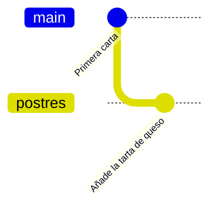
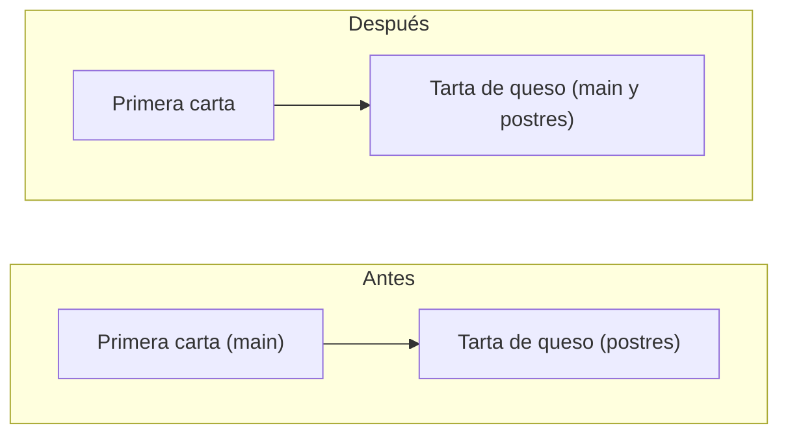
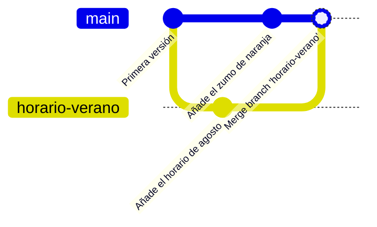
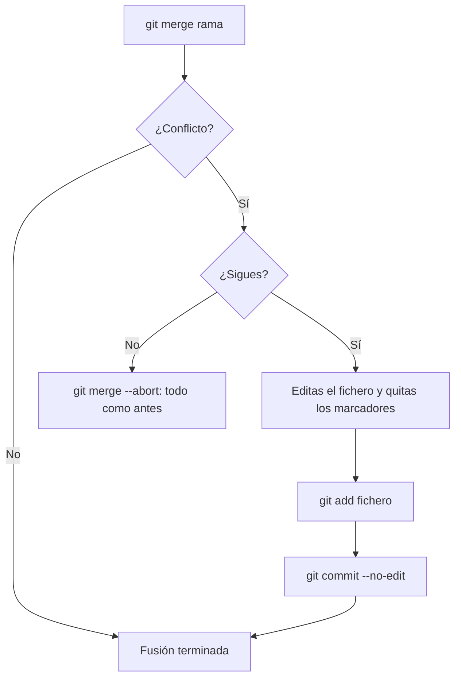
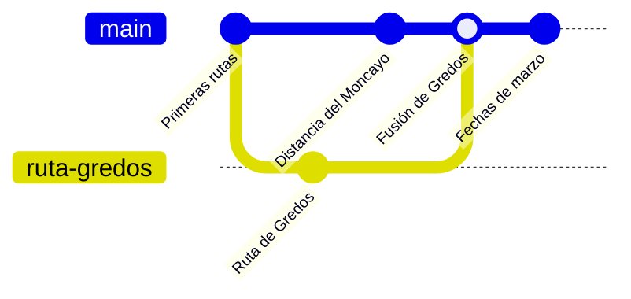

# 05.02 Ramas y conflictos

> **Versiones:** Git 2.56; salidas de la 2.56.0; la más reciente, la 2.56.1 (a 16 de noviembre de 2026)
> **Conviene saber antes:** [05.01 Git: fundamentos](01-git-fundamentos.md) · [04.05 Diagramas y Mermaid](../fase-04-formatos-y-diagramas/05-diagramas-y-mermaid.md)
> **Tiempo estimado:** 3 horas
> **Nivel:** Básico · Núcleo

## Qué aprenderás

- Qué es una **rama**, para qué sirve y qué es por dentro: una etiqueta que apunta a un commit.
- Qué es **`HEAD`** y cómo te dice en qué rama estás.
- A **crear ramas y cambiar** de una a otra con `git branch` y `git switch`, y por qué este curso no usa `git checkout`.
- A ver el historial de **todas las ramas** con `git log --oneline --graph --all` y a **dibujarlo** con un diagrama `gitGraph` de Mermaid.
- Las dos formas de **fusionar** una rama con `git merge`: el **avance rápido** y la **fusión de tres vías**, con su commit de fusión.
- Qué es un **conflicto**, por qué ocurre, cómo se leen sus **marcadores** y cómo se **resuelve** paso a paso, en la terminal y en VS Code; y cómo se da marcha atrás con `git merge --abort`.
- A **borrar ramas** (`-d` y `-D`) sin perder trabajo.
- A **apartar trabajo a medias** con `git stash` para atender una urgencia.
- A marcar versiones con **etiquetas** (`git tag -a`) y la idea del **versionado semántico**.
- Qué son el *rebase* y el *cherry-pick*, solo para que los reconozcas.

En [05.01 Git: fundamentos](01-git-fundamentos.md) aprendiste a guardar versiones de un proyecto con commits, una detrás de otra. Aquí vas a aprender a trabajar **en varias cosas a la vez** sin que se estorben, y a juntarlas después. Es lo que hace cualquier equipo que programa, y lo que verás en GitHub en el módulo siguiente.

## 1. Teoría

### 1.1. Para qué sirven las ramas

Imagina la Cafetería Aurora. Su carta está en un repositorio de Git, en un fichero `carta.md`, y lo que hay en él es lo que se imprime cada mañana. Ana, la encargada, quiere preparar la carta de postres, que tardará unos días en estar lista. Mientras tanto, la carta de siempre tiene que seguir funcionando: si un precio está mal, hay que corregirlo hoy, sin esperar a los postres.

Si Ana trabajara en los postres directamente sobre la carta, cada commit a medias acabaría impreso, con productos que aún no se sirven. Y si lo hiciera en una copia de la carpeta (`carta-con-postres/`), volvería al problema de las versiones `final-final-bueno` que viste en 05.01.

Una **rama** (*branch*) resuelve esto: es una **línea de trabajo independiente** dentro del mismo repositorio. Ana crea una rama para los postres y hace en ella todos los commits que quiera. La rama principal, `main`, no se entera: sigue igual, y se puede corregir mientras tanto. Cuando los postres están listos, Ana **fusiona** la rama con `main` y los cambios pasan a la carta de verdad.

Así trabajan casi todos los equipos:

- **`main` siempre funciona.** Contiene lo que está listo: lo que se imprime, lo que se publica, lo que usan los clientes.
- **Cada tarea, en su propia rama.** Una función nueva, una corrección, un experimento. Si sale mal, se tira la rama y `main` no ha sufrido nada.
- **Cuando la tarea está terminada, se fusiona con `main`.**

> **📌 Nota:** la rama `main` es la que Git crea con el primer commit. Se llama así porque lo configuraste al instalar Git ([02.03, apartado 1.6](../fase-02-tu-ordenador/03-instalar-programas-y-path.md#16-instalar-git-en-windows-git-for-windows-y-git-bash)) o en [05.01, apartado 1.4](01-git-fundamentos.md#14-antes-de-empezar-decirle-a-git-quién-eres). En proyectos antiguos verás que se llama `master`: funciona igual.

### 1.2. Qué es una rama por dentro

Para entender las ramas hay que recordar una cosa de los commits que viste en [05.01, apartado 1.6](01-git-fundamentos.md#16-commit-una-foto-del-proyecto): cada commit apunta a su **padre**, el anterior, y así el historial es una cadena que llega hasta el primero, el `commit-raíz`, que no tiene padre.

Con eso, una rama es algo muy sencillo: **un nombre que apunta a un commit**, el último de esa línea de trabajo. Cuando haces un commit nuevo estando en una rama, el nombre **avanza** solo hasta el commit nuevo. Por eso se dice que una rama es una **etiqueta móvil**.

Crear una rama, por tanto, **no copia ningún fichero**: solo crea un nombre nuevo que apunta al mismo commit que la rama en la que estás. Es instantáneo, aunque el proyecto tenga miles de ficheros.

Este diagrama es el historial de la cafetería después de crear la rama `postres` y hacer en ella un commit:



En texto: las dos ramas comparten el commit «Primera carta». `main` sigue apuntando a él, y `postres` apunta al commit siguiente, «Añade la tarta de queso», que solo está en esa rama. Lo harás de verdad en el [ejemplo 2.1](#21-tu-primera-rama).

### 1.3. HEAD: dónde estás

Si hay varias ramas, Git tiene que saber **en cuál estás trabajando**, para mover esa y no otra al hacer un commit. Lo apunta en **`HEAD`** (en inglés, «cabeza»): un nombre especial que normalmente **apunta a la rama actual**.

- Si estás en `main`, `HEAD` apunta a `main`, y tu próximo commit hará avanzar `main`.
- Si cambias a `postres`, `HEAD` pasa a apuntar a `postres`.

Lo verás escrito en el historial como **`HEAD -> postres`**: «estoy en la rama `postres`». Y lo dice también la primera línea de `git status`: `En la rama postres`.

> **📌 Nota:** `HEAD` también puede apuntar directamente a un commit, sin pasar por una rama. Se llama **`HEAD` desacoplado** (separado) y es un estado especial para mirar versiones antiguas; lo verás en el [error típico 3.2](#32-head-desacoplado-mirar-una-versión-antigua).

### 1.4. Crear ramas y cambiar de una a otra

Tres órdenes bastan para casi todo:

| Orden | Qué hace |
|---|---|
| `git branch` | **Lista** las ramas. La actual lleva un `*` delante |
| `git branch nombre` | **Crea** la rama `nombre`, que apunta al commit en el que estás. No cambia a ella |
| `git switch nombre` | **Cambia** a la rama `nombre` |
| `git switch -c nombre` | **Crea** la rama `nombre` y **cambia** a ella, en un solo paso (`-c` viene de *create*, «crear») |

Lo más habitual es `git switch -c`: creas la rama de una tarea y te pones a trabajar en ella.

**Qué pasa al cambiar de rama.** Git **cambia los ficheros de tu carpeta** para que queden como en el último commit de la rama a la que vas. Si en `postres` añadiste una línea a `carta.md` y vuelves a `main`, esa línea **desaparece** del fichero; si vuelves a `postres`, reaparece. No se ha perdido: está guardada en el commit de su rama. Al principio impresiona; lo comprobarás en el [ejemplo 2.1](#21-tu-primera-rama).

Por eso, antes de cambiar de rama, conviene tener **confirmado** el trabajo (`git status` limpio). Si tienes cambios sin confirmar que chocarían con la otra rama, Git no te deja cambiar, para que no los pierdas ([error típico 3.1](#31-cambiar-de-rama-con-cambios-sin-confirmar)).

> **📌 Nota:** en muchos tutoriales verás **`git checkout rama`** y **`git checkout -b rama`** en lugar de `git switch rama` y `git switch -c rama`. Hacen lo mismo, pero `checkout` sirve para demasiadas cosas distintas (cambiar de rama, recuperar ficheros, mirar commits antiguos) y es fácil equivocarse. Desde 2019 (Git 2.23), Git tiene dos órdenes separadas: **`switch`** para las ramas y **`restore`** para los ficheros, la que viste en 05.01. Este curso usa siempre esas dos.

**Cómo llamar a una rama.** Un nombre corto que diga **qué tarea es**, en minúsculas, sin espacios ni tildes y con guiones: `postres`, `horario-verano`, `corrige-precio-zumo`. Muchos equipos le ponen delante el tipo de trabajo con una barra, como `feature/postres` (una función nueva) o `fix/precio-zumo` (una corrección). Cada equipo tiene su costumbre: cuando entres en uno, mira cómo lo hace.

### 1.5. Ver todas las ramas: git log --oneline --graph --all

El `git log --oneline` de 05.01 enseña el historial de la rama actual. Con dos opciones más ves el de **todas las ramas a la vez**, como un dibujo:

| Opción | Qué añade |
|---|---|
| `--graph` | Dibuja con caracteres cómo se separan y se juntan las ramas |
| `--all` | Enseña los commits de **todas** las ramas, no solo los de la actual |

Así se ve un repositorio con dos ramas que han avanzado por separado (lo harás en el [ejemplo 2.3](#23-fusión-de-tres-vías)):

```text
* 049f0b2 (HEAD -> main) Añade el zumo de naranja
| * e0ccf9c (horario-verano) Añade el horario de agosto
|/
* 506ce93 Primera versión
```

Cómo se lee:

- **De abajo arriba es el orden del tiempo**: abajo, el commit más antiguo; arriba, el más reciente.
- **Cada `*` es un commit**, con su identificador corto y su mensaje.
- **Las líneas `|` y `/`** son las ramas: aquí, `/` dice que la línea de la derecha salió del commit `506ce93`. Desde él, cada rama ha hecho un commit por su cuenta.
- **Entre paréntesis**, qué nombres apuntan a cada commit: `(HEAD -> main)` es la rama `main`, y la flecha dice que es la actual; `(horario-verano)`, la otra rama. Las etiquetas salen igual, como `(tag: v1.0.0)` (las verás en el [apartado 1.15](#115-etiquetas-y-versionado-semántico)).

> **📌 Nota:** en tu equipo, si el historial no cabe en la pantalla, Git lo abre en el paginador `less`: avanzas con las flechas y sales con <kbd>Q</kbd> ([03.01, apartado 1.9](../fase-03-herramientas/01-terminal-lo-basico.md#19-ver-qué-hay-dentro-de-un-fichero-cat-less-head-y-tail)). Además, en tu terminal los nombres de las ramas salen en colores.

### 1.6. Fusionar con avance rápido

**Fusionar** (en inglés, *merge*) es **incorporar a una rama los cambios de otra**. Se hace siempre **desde la rama que recibe** los cambios:

```bash
git switch main          # vas a la rama que recibe
git merge postres        # le traes lo de postres
```

Hay dos casos. El primero es el más sencillo: desde que creaste la rama, **en `main` no ha pasado nada**. Entonces no hay nada que combinar: los commits de `postres` ya parten del último de `main`, así que a Git le basta con **mover la etiqueta `main` hacia delante**, hasta el último commit de `postres`. Se llama **avance rápido** (en inglés, *fast-forward*), y Git lo dice con esa palabra: `Fast-forward`.



En texto: antes de fusionar, `main` apunta a «Primera carta» y `postres` al commit siguiente. Después, las dos apuntan al mismo commit: `main` solo ha avanzado. No se crea ningún commit nuevo y el historial sigue en línea recta.

**Si quieres el commit de fusión aunque baste un avance rápido**, está **`git merge --no-ff rama`** (*no fast-forward*, «sin avance rápido»): Git crea un commit de fusión de todas formas, y en el historial queda a la vista que esos commits llegaron juntos desde una rama. No lo necesitas en tus proyectos de momento, pero es lo que hace el botón de fusionar de GitHub, que verás en [05.03](03-github.md#110-pull-requests-y-revisión).

> **📌 Nota:** en estos diagramas la flecha va del commit más antiguo al más nuevo, como se lee el historial. Por dentro, cada commit apunta a su padre, es decir, al revés; para entender las ramas da igual.

### 1.7. Fusión de tres vías y el commit de fusión

El segundo caso: mientras trabajabas en tu rama, **`main` también ha avanzado**. En la cafetería, alguien añade el zumo de naranja a la carta en `main` mientras Ana prepara el horario de verano en su rama. Ahora hay dos líneas con commits distintos, y mover la etiqueta ya no basta: se perdería lo de una de las dos.

Git hace entonces una **fusión de tres vías** (*three-way merge*). Compara **tres versiones**:

1. La del **antepasado común**: el último commit que comparten las dos ramas, del que salieron.
2. La de la rama **actual** (`main`).
3. La de la rama que **se fusiona** (`horario-verano`).

Con el antepasado sabe **qué ha cambiado cada rama**, y junta los dos cambios. El resultado se guarda en un commit nuevo, el **commit de fusión** (*merge commit*), que tiene algo que no tiene ningún otro: **dos padres**, el último de cada rama.



En texto: las dos ramas salen de «Primera versión» y cada una hace un commit. El commit de fusión, en `main`, une las dos líneas: tiene como padres «Añade el zumo de naranja» y «Añade el horario de agosto».

La orden es la misma, `git merge`; es Git quien decide si basta con un avance rápido o hace falta una fusión de tres vías. Hay una diferencia práctica: el commit de fusión necesita un **mensaje**, y Git propone uno, `Merge branch 'horario-verano'` («fusiona la rama horario-verano»).

- **En tu equipo**, `git merge` abre el **editor de Git** con ese mensaje, para que lo aceptes o lo cambies ([05.01, apartado 1.4](01-git-fundamentos.md#14-antes-de-empezar-decirle-a-git-quién-eres); si te aparece Vim, [05.01, error típico 3.4](01-git-fundamentos.md#34-se-abre-un-editor-y-no-sabes-salir)). Al cerrar el editor, la fusión termina.
- **Con `--no-edit`**, Git acepta el mensaje propuesto sin abrir el editor: `git merge --no-edit horario-verano`. Es lo que hacen las sesiones de este módulo.
- **Con `-m`**, escribes tú el mensaje, como en `git commit`: `git merge -m "Junta el horario de verano" horario-verano`.

Al terminar, Git dice `Merge made by the 'ort' strategy.` («fusión hecha con la estrategia ort»): `ort` es el nombre del método de fusión que usa Git por defecto. No tienes que hacer nada con ello. (Ese mensaje Git no lo traduce: [05.01, apartado 2](01-git-fundamentos.md#2-ejemplos-de-código).)

> **📌 Nota:** lo normal es que la fusión de tres vías salga sola, **aunque las dos ramas hayan tocado el mismo fichero**, siempre que sean líneas distintas. Solo cuando las dos cambian **las mismas líneas** Git necesita ayuda. Es un conflicto, y lo verás en el [apartado 1.9](#19-qué-es-un-conflicto-y-por-qué-ocurre).

### 1.8. Dibujar el historial con Mermaid

El gráfico de `git log --graph` es útil en la terminal, pero para **explicar** un historial (en un README, en la documentación de un proyecto, en tus apuntes) es mejor un dibujo. Mermaid, que conoces de [04.05](../fase-04-formatos-y-diagramas/05-diagramas-y-mermaid.md), tiene un tipo de diagrama para eso: **`gitGraph`** (lo viste nombrado en la [tabla de tipos](../fase-04-formatos-y-diagramas/05-diagramas-y-mermaid.md#112-más-tipos-de-diagramas-uml-y-otras-notaciones)). Lo dibujan GitHub, la academia y VS Code con su extensión, como el resto de los diagramas Mermaid ([04.05, apartado 1.10](../fase-04-formatos-y-diagramas/05-diagramas-y-mermaid.md#110-dónde-se-dibuja-github-la-academia-y-vs-code)).

Se escribe **contando la historia en orden**, con muy pocas palabras:

| Escribes | Qué dibuja |
|---|---|
| `gitGraph` | La primera línea: el tipo de diagrama. Empieza en la rama `main` |
| `commit id: "texto"` | Un commit en la rama actual, con ese texto debajo |
| `branch nombre` | Crea una rama que sale del último commit de la rama actual, y **cambia a ella** |
| `checkout nombre` | Cambia a una rama que ya existe (en Mermaid se llama así, como la orden antigua de Git; también vale `switch`) |
| `merge nombre` | Fusiona `nombre` en la rama actual: dibuja el commit de fusión |
| `commit tag: "v1.0.0"` | Un commit con una etiqueta (también vale en `merge`) |

El diagrama del apartado anterior, que es el historial del [ejemplo 2.3](#23-fusión-de-tres-vías), línea a línea (para dibujar el gráfico de la terminal, se lee **de abajo arriba** y se cuenta la historia en orden):

```text
gitGraph
    commit id: "Primera versión"
    branch horario-verano
    checkout horario-verano
    commit id: "Añade el horario de agosto"
    checkout main
    commit id: "Añade el zumo de naranja"
    merge horario-verano id: "Merge branch 'horario-verano'"
```

Tres cosas que conviene saber:

- **Usa un `id` distinto en cada commit.** Es el texto que Mermaid escribe junto a cada commit, y lo que permite distinguirlos en el dibujo. Si no pones `id`, Mermaid se inventa uno al azar, que no dice nada.
- **No hace falta copiar el identificador de Git** (`049f0b2`): suele ser más claro poner el mensaje del commit, resumido.
- **No lo dibuja Git, lo escribes tú.** El diagrama no lee tu repositorio: si el historial cambia, hay que cambiar el diagrama a mano.

> **📌 Nota:** `gitGraph` tiene más opciones (colores, orientación, tipos de commit). Para lo que necesitas, con esas seis basta. Las demás están en la documentación de Mermaid, en mermaid.js.org.

### 1.9. Qué es un conflicto y por qué ocurre

Git compara los ficheros **línea a línea** (es la razón que viste en [04.01, apartado 1.15](../fase-04-formatos-y-diagramas/01-texto-binario-y-codificacion.md#115-los-ficheros-binarios-y-git)). En una fusión de tres vías, para cada zona de cada fichero mira qué ha hecho cada rama desde el antepasado común:

| Rama actual | Rama que se fusiona | Qué hace Git |
|---|---|---|
| No la tocó | La cambió | Se queda con el cambio |
| La cambió | No la tocó | Se queda con el cambio |
| La cambió | La cambió igual | Se queda con ese cambio |
| La cambió | **La cambió de otra forma** | **No puede decidir: conflicto** |

Un **conflicto** (*merge conflict*) es eso: **las dos ramas han cambiado las mismas líneas de forma distinta**, y Git no sabe cuál de las dos versiones es la buena, o si hay que combinarlas. En lugar de adivinar, **para la fusión y te pregunta**.

En la cafetería: en `main`, Ana sube el café con leche a 1,55 €; en la rama `precios-2027`, Lucía lo sube a 1,60 €. Es la misma línea, cambiada de dos formas. ¿Qué precio vale? Eso no lo sabe Git: lo sabe quien lleva la cafetería.

Hay que tener claras tres cosas:

- **Un conflicto no es un error.** Ni has hecho nada mal ni se ha roto nada. Es Git siendo prudente, y pasa a diario en cualquier equipo.
- **Solo afecta a las líneas en conflicto.** El resto de la fusión ya está hecho: lo que solo cambió una rama, Git lo ha juntado solo.
- **Lo resuelves tú, con criterio.** Muchas veces la buena es una de las dos versiones; otras, una mezcla de las dos. Para decidir hay que entender qué quería hacer cada cambio, y a veces preguntar a quien lo hizo.

> **📌 Nota:** «las mismas líneas» incluye las **pegadas**: si una rama cambia una línea y la otra añade algo justo debajo, Git suele tratarlo como una sola zona y también da conflicto (te pasará en el [ejercicio 4](#ejercicio-4--una-urgencia-a-mitad-de-trabajo)). Con al menos una línea sin tocar entre los dos cambios, los junta solo.

> **📌 Nota:** también hay conflicto cuando una rama **cambia** un fichero y la otra lo **borra**, o cuando las dos cambian un fichero **binario** (una imagen), que Git no puede comparar por líneas. Se resuelven con la misma idea: decides tú qué versión queda.

### 1.10. Los marcadores de conflicto

Cuando hay un conflicto, Git deja **las dos versiones dentro del propio fichero**, separadas por unas líneas especiales, los **marcadores de conflicto**. Así queda `carta.txt` en el conflicto del café con leche:

```text
Café solo: 1,20 €
<<<<<<< HEAD
Café con leche: 1,55 €
=======
Café con leche: 1,60 €
>>>>>>> precios-2027
Tostada: 2,00 €
Zumo: 2,50 €
```

| Marcador | Qué significa |
|---|---|
| `<<<<<<< HEAD` | Empieza la versión de **tu rama actual**, la que recibe la fusión (`HEAD`, aquí `main`) |
| `=======` | Separa las dos versiones |
| `>>>>>>> precios-2027` | Termina la versión de **la rama que se fusiona**, con su nombre |

Todo lo que está **fuera** de los marcadores ya está fusionado: `Café solo` no lo cambió nadie, y `Zumo` lo añadió `main` sin que la otra rama tocara esa zona.

Los marcadores son **texto normal** dentro del fichero. Git no los quita solo: si los dejas, se quedan ahí, y un fichero de datos o un programa con `<<<<<<<` dentro deja de funcionar ([error típico 3.4](#34-dejar-marcadores-en-el-fichero)).

### 1.11. Resolver un conflicto, paso a paso

Cuando `git merge` acaba en conflicto, Git te deja **a mitad de la fusión**: ha hecho todo lo que podía y espera a que termines tú. `git status` te lo recuerda (`Tienes rutas no fusionadas`) y te dice qué ficheros tienen conflictos (`modificados por ambos`). Para resolverlo:

1. **Abre el fichero** y busca los marcadores (en VS Code, con la búsqueda, `<<<<<<<`).
2. **Decide el resultado** de cada zona en conflicto: la versión de tu rama, la de la otra o una combinación de las dos.
3. **Deja el fichero como debe quedar**, **sin ningún marcador**: ni `<<<<<<<`, ni `=======`, ni `>>>>>>>`.
4. **Comprueba** que el fichero está bien: que no queda ningún marcador y, si es un programa, que funciona.
5. **Márcalo como resuelto** con `git add fichero`. En medio de una fusión, `git add` significa «este conflicto ya está resuelto».
6. **Termina la fusión** con un commit. Como en el apartado 1.7, Git ya tiene preparado el mensaje (`Merge branch 'precios-2027'`): con **`git commit --no-edit`** lo acepta sin abrir el editor. Un `git commit` a secas lo abriría en tu equipo, igual que `git merge`.

Si hay varios ficheros con conflicto, repites los pasos 1 a 5 con cada uno y haces un solo commit al final.

**Dar marcha atrás: `git merge --abort`.** Si a mitad de un conflicto prefieres no seguir (es más lío de lo que creías, o necesitas preguntar antes a alguien), **`git merge --abort`** cancela la fusión y deja todo **exactamente como estaba antes del `git merge`**. Podrás volver a intentarlo cuando quieras. Lo verás en el [ejemplo 2.5](#25-cancelar-la-fusión-con-git-merge---abort).



En texto: si `git merge` no da conflicto, la fusión termina sola. Si lo da, o la cancelas con `git merge --abort` o editas el fichero, lo marcas como resuelto con `git add` y terminas con `git commit --no-edit`.

### 1.12. Conflictos en VS Code

Resolver un conflicto es, al final, **editar un fichero**, así que el sitio natural es tu editor. VS Code, con la carpeta del repositorio abierta, reconoce los marcadores y te ayuda (según su documentación, «Merge conflicts in VS Code», actualizada el 11 de noviembre de 2026; los nombres en español son los del paquete de idioma, comprobados el 16 de noviembre de 2026):

- **En el fichero**, colorea las dos versiones y pone encima de cada conflicto unos enlaces de un clic: **Accept Current Change** (**Aceptar cambio actual**), que se queda con la versión de tu rama; **Accept Incoming Change** (**Aceptar cambio entrante**), la de la rama que se fusiona; **Accept Both Changes** (**Aceptar ambos cambios**), las dos, una debajo de otra; y **Compare Changes** (**Comparar cambios**), que las enseña lado a lado. Cada enlace **quita los marcadores** de ese conflicto.
- **En la vista de control de versiones** (el icono de ramas de la barra de actividades, que ya viste en [03.03](../fase-03-herramientas/03-editor-de-codigo.md#15-las-partes-de-la-ventana)), los ficheros con conflictos aparecen en su propia sección, **Merge Changes** (**Fusionar cambios mediante combinación**). Al prepararlos (el `git add`), pasan a **Staged Changes**.
- **El editor de fusión** (*merge editor*): con el botón **Resolve in Merge Editor** (**Resolver en el Editor de combinación**) se abre una vista con tres partes: las dos versiones arriba y el resultado abajo, que vas construyendo. Su botón **Complete Merge** (**Completar la fusión mediante combinación**) prepara ese fichero, pero **no termina la fusión**: después falta el commit.

Dos consejos:

- **Aprende primero a hacerlo a mano**, con los marcadores, como en este módulo. Así sabes qué está haciendo la herramienta por ti, y podrás resolver un conflicto en cualquier editor o en un servidor sin ventanas.
- **«Aceptar ambos cambios» no siempre es lo correcto.** Pone las dos versiones una debajo de otra; en el caso del café con leche, dejaría **dos precios** para el mismo producto. Mira siempre el resultado antes de seguir.

> **📌 Nota:** lo que no hace VS Code por ti es **decidir**: los enlaces solo escriben lo que eliges. La decisión, como en la terminal, sale de entender los dos cambios.

### 1.13. Borrar ramas

Cuando una rama ya está fusionada, su trabajo está en `main` y el nombre ya no hace falta. Se borra con **`git branch -d nombre`** (`-d` de *delete*, «borrar»). Borrar una rama solo borra **el nombre**: los commits siguen en el historial de `main`.

Git te protege: **`-d` solo borra ramas cuyo trabajo ya está fusionado** en la rama en la que estás. Si la rama tiene commits que no están en ningún otro sitio, se niega y te avisa (`error: the branch 'experimento' is not fully merged`, «la rama experimento no está fusionada del todo»). Es lo que quieres casi siempre: que no se pierda trabajo por un despiste.

Si de verdad quieres tirar esa rama y sus commits (un experimento que salió mal), está **`git branch -D nombre`**, con mayúscula, que **borra sin comprobar**. Úsalo solo cuando sepas qué contiene la rama.

> **📌 Nota:** no puedes borrar la rama en la que estás. Cambia antes a otra (normalmente, `main`).

### 1.14. Apartar trabajo a medias: git stash

Estás preparando la oferta de bocadillos en `main`, con el fichero a medio cambiar, y te piden mirar **ya** algo de la rama `ofertas`. No quieres hacer un commit de algo a medias, pero Git no te deja cambiar de rama si tus cambios chocan con los de la otra ([error típico 3.1](#31-cambiar-de-rama-con-cambios-sin-confirmar)).

**`git stash`** (*stash* significa «guardar en un escondite») **aparta tus cambios sin confirmar** en un almacén aparte del repositorio y deja la carpeta limpia, como en el último commit. Ya puedes cambiar de rama. Cuando vuelvas, **`git stash pop`** los saca del almacén y los vuelve a poner donde estaban. Es como guardar en un cajón los papeles de la mesa para atender una visita, y sacarlos después.

| Orden | Qué hace |
|---|---|
| `git stash` | Aparta los cambios de los ficheros **que Git ya sigue** y deja la carpeta limpia |
| `git stash push -u -m "mensaje"` | Igual, pero **también los ficheros nuevos** sin seguimiento (`-u`) y con una descripción (`-m`) |
| `git stash list` | Lista lo apartado: el más reciente es `stash@{0}` |
| `git stash pop` | Recupera lo último apartado y lo borra del almacén |
| `git stash apply` | Recupera lo último apartado, pero lo deja también en el almacén |
| `git stash drop` | Borra lo último apartado sin recuperarlo |

> **⚠️ Cuidado:** `git stash` sin `-u` **no aparta los ficheros nuevos**, los que Git aún no sigue: se quedan en la carpeta y te acompañan a la otra rama, donde podrías meterlos por despiste en un commit que no les toca. Si tienes ficheros nuevos, usa siempre `git stash push -u`. Lo verás en el [ejemplo 2.8](#28-apartar-cambios-con-git-stash).

`stash` es para **interrupciones cortas**: apartar, atender la urgencia y recuperar. No es un sitio para guardar trabajo durante días; para eso, una rama y un commit.

### 1.15. Etiquetas y versionado semántico

Una **etiqueta** (*tag*) es un **nombre fijo para un commit concreto**, normalmente para marcar una **versión publicada**: `v1.0.0`, `v1.1.0`… A diferencia de una rama, **una etiqueta no se mueve**: aunque hagas más commits, sigue apuntando al mismo.

Hay dos tipos, y para versiones se usa la segunda:

| Tipo | Cómo se crea | Qué guarda |
|---|---|---|
| Ligera | `git tag v1.0.0` | Solo el nombre, que apunta al commit |
| **Anotada** | `git tag -a v1.0.0 -m "mensaje"` | Además, quién la creó, cuándo y un mensaje |

Las dos se ponen en el commit en el que estás. `git tag` las lista, y `git show v1.0.0` enseña la etiqueta y su commit. En el historial aparecen junto a su commit: `(tag: v1.0.0)`.

> **📌 Nota:** `git tag -a` sin `-m` abriría el editor para escribir el mensaje, como `git commit` sin `-m`. Escribe siempre el `-m`.

**Qué número le pongo a cada versión.** La costumbre más extendida es el **versionado semántico** (*Semantic Versioning*, o SemVer), una norma pública cuya versión actual es la 2.0.0 (en semver.org, con traducción al español; comprobado el 16 de noviembre de 2026). El número tiene tres partes, **MAYOR.MENOR.PARCHE**, y cada una dice qué tipo de cambio hubo:

| Parte | Cuándo sube | Ejemplo |
|---|---|---|
| **MAYOR** | Hay un cambio **incompatible** con la versión anterior: lo que funcionaba con la anterior puede dejar de funcionar | 1.4.2 → **2**.0.0 |
| **MENOR** | Se añade algo nuevo **compatible**: lo de antes sigue funcionando | 1.4.2 → 1.**5**.0 |
| **PARCHE** | Se corrigen errores, de forma compatible | 1.4.2 → 1.4.**3** |

Al subir una parte, las de su derecha **vuelven a 0**. Y las versiones que empiezan por `0` (`0.3.1`) son de **desarrollo inicial**: cualquier cosa puede cambiar; la `1.0.0` es la primera que se da por estable.

Lo verás en muchos sitios: en los programas que instalas, en las bibliotecas que usarán tus cursos y en los propios cursos de esta academia, que siguen esa norma.

### 1.16. Otras formas de juntar trabajo: rebase y cherry-pick

Hay dos órdenes más que vas a oír nombrar. **No las necesitas para empezar** y no se practican en este módulo, pero conviene que sepas qué son:

- **`git rebase`** («cambiar la base»): en lugar de unir dos ramas con un commit de fusión, **vuelve a aplicar los commits de tu rama, uno a uno, encima** del último commit de la otra, como si hubieras empezado tu trabajo justo ahora. El historial queda en línea recta, pero esos commits se sustituyen por **copias nuevas, con otro identificador**: el *rebase* **reescribe el historial**. Por eso tiene una regla de oro: **nunca hagas *rebase* de commits que ya has compartido** con otras personas. Es la misma idea que el `--amend` de 05.01.
- **`git cherry-pick`** («escoger la cereza»): **copia un commit concreto** de otra rama en la tuya, como un commit nuevo con el mismo cambio. Sirve, por ejemplo, para llevar una corrección urgente a una versión antigua sin traer nada más.

Muchos equipos los usan a diario, y cada curso que los necesite te los enseñará con calma. Para lo que vas a hacer ahora, `merge` es la forma segura y suficiente.

## 2. Ejemplos de código

Todos los ejemplos son reales y los puedes repetir: descarga la carpeta de cada uno (su enlace «📁 Código»), abre la terminal en ella y escribe las mismas órdenes. Cada ejemplo **crea su repositorio en una carpeta nueva** (`mkdir cafeteria && cd cafeteria && git init`), así que no toca nada tuyo. Cuando un ejemplo tiene varias sesiones (`sesion-1.txt`, `sesion-2.txt`…), hazlas **en orden**: cada una sigue donde lo dejó la anterior, y empieza con un `cd` por si has cerrado la terminal entre medias.

Recuerda que **tus identificadores de commit, tus fechas y tu nombre serán distintos** ([el aviso de 02.03](../fase-02-tu-ordenador/03-instalar-programas-y-path.md#22-un-aviso-sobre-las-salidas-de-la-terminal)): fíjate en lo que dice el texto.

En las sesiones, los ficheros se cambian con `echo` y `printf` para que puedas copiar las órdenes tal cual. **En tu trabajo de verdad lo harás en el editor.** `printf '%s\n' 'uno' 'dos' > fichero` escribe cada texto entre comillas en una línea, sustituyendo lo que hubiera en el fichero (con `>>`, lo añade al final).

### 2.1. Tu primera rama

**Situación real:** la carta de la Cafetería Aurora tiene dos cafés. Ana va a preparar la carta de postres en una rama, sin tocar la carta que se imprime cada mañana.

Primero, el repositorio con la carta, y la rama `postres` con su primer commit:

**En tu terminal** (`sesion-1.txt`):

```text
$ mkdir cafeteria && cd cafeteria && git init
Inicializado repositorio Git vacío en /home/alumno/cafeteria/.git/
$ echo '# Carta de la Cafetería Aurora' > carta.md
$ echo '- Café solo: 1,20 €' >> carta.md
$ echo '- Café con leche: 1,50 €' >> carta.md
$ git add carta.md
$ git commit -m "Primera carta"
[main (commit-raíz) 9a6f4ef] Primera carta
 1 file changed, 3 insertions(+)
 create mode 100644 carta.md
$ git branch
* main
$ git switch -c postres
Cambiado a nueva rama 'postres'
$ git branch
  main
* postres
$ echo '- Tarta de queso: 3,50 €' >> carta.md
$ git add carta.md
$ git commit -m "Añade la tarta de queso"
[postres 8515e36] Añade la tarta de queso
 1 file changed, 1 insertion(+)
$ git log --oneline --graph --all
* 8515e36 (HEAD -> postres) Añade la tarta de queso
* 9a6f4ef (main) Primera carta
```

📁 **Código:** [`codigo/02-ramas-y-conflictos/ejemplos/2.1-primera-rama/`](codigo/02-ramas-y-conflictos/ejemplos/2.1-primera-rama/)

**En qué fijarte:**

- **`git branch` antes y después.** Con un solo commit hay una rama, `main`, con el `*`. Tras `git switch -c postres` hay dos, y el `*` ha pasado a `postres`: estás en ella.
- **El commit dice en qué rama se hizo:** `[postres 8515e36]`.
- **El gráfico enseña las dos ramas.** `main` sigue en `Primera carta`; `postres` ha avanzado un commit, y `HEAD -> postres` dice que estás en ella. Es el dibujo del [apartado 1.2](#12-qué-es-una-rama-por-dentro).

Ahora, lo que impresiona la primera vez: cambiar de rama **cambia los ficheros**.

**En tu terminal** (`sesion-2.txt`):

```text
$ cd cafeteria
$ git status
En la rama postres
nada para hacer commit, el árbol de trabajo está limpio
$ git switch main
Cambiado a rama 'main'
$ cat carta.md
# Carta de la Cafetería Aurora
- Café solo: 1,20 €
- Café con leche: 1,50 €
$ git log --oneline --graph --all
* 8515e36 (postres) Añade la tarta de queso
* 9a6f4ef (HEAD -> main) Primera carta
$ git switch postres
Cambiado a rama 'postres'
$ cat carta.md
# Carta de la Cafetería Aurora
- Café solo: 1,20 €
- Café con leche: 1,50 €
- Tarta de queso: 3,50 €
```

📁 **Código:** [`codigo/02-ramas-y-conflictos/ejemplos/2.1-primera-rama/`](codigo/02-ramas-y-conflictos/ejemplos/2.1-primera-rama/)

**En qué fijarte:**

- **Antes de cambiar, `git status` limpio.** Todo está confirmado, así que se puede cambiar de rama sin riesgo.
- **En `main`, la tarta de queso no está.** El fichero es el del commit `Primera carta`. Y al volver a `postres`, la tarta reaparece: estaba guardada en su commit.
- **`HEAD ->` se mueve con `git switch`**: en `main`, el gráfico dice `HEAD -> main`.

> **📌 Nota:** si tienes `carta.md` abierto en VS Code mientras cambias de rama, verás cómo el editor cambia el contenido solo. Es lo esperado: Git ha cambiado el fichero en el disco.

### 2.2. Fusionar con avance rápido

**Situación real:** los postres ya están listos y Ana quiere que pasen a la carta de verdad. Sigue en el mismo repositorio que el ejemplo anterior.

**En tu terminal** (`sesion-3.txt`):

```text
$ cd cafeteria
$ git switch main
Cambiado a rama 'main'
$ git merge postres
Actualizando 9a6f4ef..8515e36
Fast-forward
 carta.md | 1 +
 1 file changed, 1 insertion(+)
$ cat carta.md
# Carta de la Cafetería Aurora
- Café solo: 1,20 €
- Café con leche: 1,50 €
- Tarta de queso: 3,50 €
$ git log --oneline --graph --all
* 8515e36 (HEAD -> main, postres) Añade la tarta de queso
* 9a6f4ef Primera carta
$ git branch -d postres
Eliminada la rama postres (era 8515e36).
$ git branch
* main
$ git log --oneline --graph --all
* 8515e36 (HEAD -> main) Añade la tarta de queso
* 9a6f4ef Primera carta
```

📁 **Código:** [`codigo/02-ramas-y-conflictos/ejemplos/2.1-primera-rama/`](codigo/02-ramas-y-conflictos/ejemplos/2.1-primera-rama/)

**En qué fijarte:**

- **Se fusiona desde la rama que recibe:** primero `git switch main`, después `git merge postres`.
- **`Fast-forward`: avance rápido.** En `main` no había pasado nada desde que se creó `postres`, así que Git solo ha movido `main` de `9a6f4ef` a `8515e36` (`Actualizando 9a6f4ef..8515e36`). No hay commit nuevo.
- **Después de fusionar, `main` y `postres` apuntan al mismo commit**: `(HEAD -> main, postres)`.
- **Borrar la rama no borra nada del trabajo.** `git branch -d` quita el nombre (`era 8515e36`), y el commit de la tarta sigue en `main`.

### 2.3. Fusión de tres vías

**Situación real:** Ana prepara el horario de verano en una rama. Mientras, en `main`, se añade a la carta el zumo de naranja, que ya se sirve. Las dos líneas de trabajo avanzan a la vez, cada una en un fichero distinto.

**En tu terminal** (`sesion-1.txt`):

```text
$ mkdir cafeteria && cd cafeteria && git init
Inicializado repositorio Git vacío en /home/alumno/cafeteria/.git/
$ echo '- Café solo: 1,20 €' > carta.md
$ echo '- Café con leche: 1,50 €' >> carta.md
$ echo 'De lunes a viernes, de 8:00 a 20:00.' > horario.md
$ git add carta.md horario.md
$ git commit -m "Primera versión"
[main (commit-raíz) 506ce93] Primera versión
 2 files changed, 3 insertions(+)
 create mode 100644 carta.md
 create mode 100644 horario.md
$ git switch -c horario-verano
Cambiado a nueva rama 'horario-verano'
$ echo 'En agosto, de 9:00 a 14:00.' >> horario.md
$ git add horario.md
$ git commit -m "Añade el horario de agosto"
[horario-verano e0ccf9c] Añade el horario de agosto
 1 file changed, 1 insertion(+)
$ git switch main
Cambiado a rama 'main'
$ echo '- Zumo de naranja: 2,50 €' >> carta.md
$ git add carta.md
$ git commit -m "Añade el zumo de naranja"
[main 049f0b2] Añade el zumo de naranja
 1 file changed, 1 insertion(+)
$ git log --oneline --graph --all
* 049f0b2 (HEAD -> main) Añade el zumo de naranja
| * e0ccf9c (horario-verano) Añade el horario de agosto
|/
* 506ce93 Primera versión
```

📁 **Código:** [`codigo/02-ramas-y-conflictos/ejemplos/2.3-fusion-de-tres-vias/`](codigo/02-ramas-y-conflictos/ejemplos/2.3-fusion-de-tres-vias/)

El gráfico ya no es una línea recta: las dos ramas salen de `506ce93` y cada una tiene un commit que la otra no tiene. Es el que aprendiste a leer en el [apartado 1.5](#15-ver-todas-las-ramas-git-log---oneline---graph---all). Ahora, la fusión:

**En tu terminal** (`sesion-2.txt`):

```text
$ cd cafeteria
$ git merge --no-edit horario-verano
Merge made by the 'ort' strategy.
 horario.md | 1 +
 1 file changed, 1 insertion(+)
$ git log --oneline --graph --all
*   00a6ae7 (HEAD -> main) Merge branch 'horario-verano'
|\
| * e0ccf9c (horario-verano) Añade el horario de agosto
* | 049f0b2 Añade el zumo de naranja
|/
* 506ce93 Primera versión
$ git log -1
commit 00a6ae78c2158666e76434abd3599d16be010ca6 (HEAD -> main)
Merge: 049f0b2 e0ccf9c
Author: Ana García <ana@example.com>
Date:   Thu Jan 15 10:03:00 2026 +0100

    Merge branch 'horario-verano'
$ cat horario.md
De lunes a viernes, de 8:00 a 20:00.
En agosto, de 9:00 a 14:00.
$ cat carta.md
- Café solo: 1,20 €
- Café con leche: 1,50 €
- Zumo de naranja: 2,50 €
```

📁 **Código:** [`codigo/02-ramas-y-conflictos/ejemplos/2.3-fusion-de-tres-vias/`](codigo/02-ramas-y-conflictos/ejemplos/2.3-fusion-de-tres-vias/)

**En qué fijarte:**

- **No pone `Fast-forward`**, sino `Merge made by the 'ort' strategy.`: es una fusión de tres vías.
- **Hay un commit nuevo, `00a6ae7`**, el commit de fusión, con el mensaje que propone Git. `--no-edit` lo ha aceptado sin abrir el editor.
- **En el gráfico, las dos líneas se juntan** en el commit de fusión: `|\` es donde llegan las dos.
- **`git log -1` enseña sus dos padres** en la línea `Merge: 049f0b2 e0ccf9c`: el último commit de `main` y el último de `horario-verano`. Ningún commit normal tiene esa línea.
- **Los dos cambios están en `main`**: el horario de agosto y el zumo.

### 2.4. Un conflicto: provocarlo y leerlo

**Situación real:** la carta va a cambiar de precios en 2027. Lucía prepara los nuevos en la rama `precios-2027` y sube el café con leche a 1,60 €. Mientras, en `main`, Ana lo sube a 1,55 € y añade el zumo. Las dos han cambiado **la misma línea**.

**En tu terminal** (`sesion-1.txt`):

```text
$ mkdir cafeteria && cd cafeteria && git init
Inicializado repositorio Git vacío en /home/alumno/cafeteria/.git/
$ printf '%s\n' 'Café solo: 1,20 €' 'Café con leche: 1,50 €' 'Tostada: 2,00 €' > carta.txt
$ git add carta.txt
$ git commit -m "Primera carta"
[main (commit-raíz) c343454] Primera carta
 1 file changed, 3 insertions(+)
 create mode 100644 carta.txt
$ git switch -c precios-2027
Cambiado a nueva rama 'precios-2027'
$ printf '%s\n' 'Café solo: 1,20 €' 'Café con leche: 1,60 €' 'Tostada: 2,00 €' > carta.txt
$ git add carta.txt
$ git commit -m "Sube el café con leche a 1,60 €"
[precios-2027 6db32d0] Sube el café con leche a 1,60 €
 1 file changed, 1 insertion(+), 1 deletion(-)
$ git switch main
Cambiado a rama 'main'
$ printf '%s\n' 'Café solo: 1,20 €' 'Café con leche: 1,55 €' 'Tostada: 2,00 €' > carta.txt
$ echo 'Zumo: 2,50 €' >> carta.txt
$ git add carta.txt
$ git commit -m "Sube el café con leche y añade el zumo"
[main b2287c4] Sube el café con leche y añade el zumo
 1 file changed, 2 insertions(+), 1 deletion(-)
$ git log --oneline --graph --all
* b2287c4 (HEAD -> main) Sube el café con leche y añade el zumo
| * 6db32d0 (precios-2027) Sube el café con leche a 1,60 €
|/
* c343454 Primera carta
$ git merge precios-2027
Auto-fusionando carta.txt
CONFLICTO (contenido): Conflicto de fusión en carta.txt
Fusión automática falló; arregle los conflictos y luego realice un commit con el resultado.
$ git status
En la rama main
Tienes rutas no fusionadas.
  (arregla los conflictos y ejecuta "git commit"
  (usa "git merge --abort" para abortar la fusion)

Rutas no fusionadas:
  (usa "git add <archivo>..." para marcar una resolución)
        modificados por ambos:  carta.txt

sin cambios agregados al commit (usa "git add" y/o "git commit -a")
$ cat carta.txt
Café solo: 1,20 €
<<<<<<< HEAD
Café con leche: 1,55 €
=======
Café con leche: 1,60 €
>>>>>>> precios-2027
Tostada: 2,00 €
Zumo: 2,50 €
```

📁 **Código:** [`codigo/02-ramas-y-conflictos/ejemplos/2.4-un-conflicto-paso-a-paso/`](codigo/02-ramas-y-conflictos/ejemplos/2.4-un-conflicto-paso-a-paso/)

**En qué fijarte:**

- **`git merge` avisa del conflicto** en tres líneas: intenta fusionar `carta.txt` (`Auto-fusionando`), encuentra un conflicto en su contenido (`CONFLICTO (contenido)`) y se para (`Fusión automática falló`), pidiéndote que lo arregles y hagas un commit.
- **`git status` explica la situación y qué hacer**: hay rutas (ficheros) sin fusionar; `carta.txt` está `modificados por ambos` (las dos ramas lo cambiaron); se resuelve con `git add` y `git commit`, o se cancela con `git merge --abort`.
- **El fichero tiene los marcadores** del [apartado 1.10](#110-los-marcadores-de-conflicto): arriba, el 1,55 € de `HEAD` (`main`, donde estás); abajo, el 1,60 € de `precios-2027`.
- **El zumo ya está, fuera de los marcadores.** Lo añadió `main` en una zona que la otra rama no tocó, y Git lo ha fusionado solo.

> **📌 Nota:** al primer paréntesis de `git status` le falta el cierre, y `fusion` va sin tilde: son erratas de la traducción de Git ([05.01, apartado 2](01-git-fundamentos.md#2-ejemplos-de-código)).

### 2.5. Cancelar la fusión con git merge --abort

**Situación real:** Ana no sabe qué precio vale. Antes de decidir, quiere preguntar a la dueña, así que deja la carta como estaba y lo intentará más tarde. Sigue en el mismo repositorio.

**En tu terminal** (`sesion-2.txt`):

```text
$ cd cafeteria
$ git merge --abort
$ git status
En la rama main
nada para hacer commit, el árbol de trabajo está limpio
$ cat carta.txt
Café solo: 1,20 €
Café con leche: 1,55 €
Tostada: 2,00 €
Zumo: 2,50 €
$ git merge precios-2027
Auto-fusionando carta.txt
CONFLICTO (contenido): Conflicto de fusión en carta.txt
Fusión automática falló; arregle los conflictos y luego realice un commit con el resultado.
```

📁 **Código:** [`codigo/02-ramas-y-conflictos/ejemplos/2.4-un-conflicto-paso-a-paso/`](codigo/02-ramas-y-conflictos/ejemplos/2.4-un-conflicto-paso-a-paso/)

**En qué fijarte:**

- **`git merge --abort` no dice nada**, pero `git status` confirma que todo está como antes del `git merge`: la carta tiene su 1,55 € y no hay marcadores.
- **La rama `precios-2027` sigue intacta**: cancelar no borra nada. Por eso, ya con la respuesta de la dueña (1,60 €), Ana vuelve a fusionar y el conflicto reaparece igual.

### 2.6. Resolver el conflicto

**Situación real:** la dueña ha decidido: el café con leche, a 1,60 €. Ana deja la línea así, **sin marcadores**, y termina la fusión. En tu equipo lo harías editando `carta.txt` en VS Code; aquí se escribe el fichero entero con `printf`, en dos órdenes para que no sean tan largas.

**En tu terminal** (`sesion-3.txt`):

```text
$ cd cafeteria
$ grep -c '<<<<<<<' carta.txt
1
$ printf '%s\n' 'Café solo: 1,20 €' 'Café con leche: 1,60 €' > carta.txt
$ printf '%s\n' 'Tostada: 2,00 €' 'Zumo: 2,50 €' >> carta.txt
$ cat carta.txt
Café solo: 1,20 €
Café con leche: 1,60 €
Tostada: 2,00 €
Zumo: 2,50 €
$ grep -c '<<<<<<<' carta.txt
0
$ git add carta.txt
$ git status
En la rama main
Todos los conflictos resueltos pero sigues fusionando.
  (usa "git commit" para concluir la fusión)

Cambios a ser confirmados:
        modificados:     carta.txt

$ git commit --no-edit
[main 02c5727] Merge branch 'precios-2027'
$ git log --oneline --graph --all
*   02c5727 (HEAD -> main) Merge branch 'precios-2027'
|\
| * 6db32d0 (precios-2027) Sube el café con leche a 1,60 €
* | b2287c4 Sube el café con leche y añade el zumo
|/
* c343454 Primera carta
$ git branch -d precios-2027
Eliminada la rama precios-2027 (era 6db32d0).
```

📁 **Código:** [`codigo/02-ramas-y-conflictos/ejemplos/2.4-un-conflicto-paso-a-paso/`](codigo/02-ramas-y-conflictos/ejemplos/2.4-un-conflicto-paso-a-paso/)

**En qué fijarte:**

- **`grep -c` cuenta los marcadores** (repasa `grep -c` en [03.02](../fase-03-herramientas/02-terminal-sacarle-partido.md#16-los-filtros-grep-sort-uniq-wc-cut-head-y-tail)): antes de resolver hay un conflicto; después, 0. Es una comprobación rápida y muy útil cuando el fichero es largo.
- **El fichero resuelto** tiene el precio decidido y **conserva el zumo**: al resolver, no se tira lo que Git ya había fusionado.
- **Tras el `git add`, `git status` cambia**: `Todos los conflictos resueltos pero sigues fusionando`, y te dice que termines con `git commit`.
- **`git commit --no-edit`** crea el commit de fusión con el mensaje que Git tenía preparado. El gráfico es igual que en una fusión de tres vías sin conflicto: el conflicto no deja ninguna marca especial en el historial.

### 2.7. Borrar ramas: -d y -D

**Situación real:** Ana probó a añadir un café con canela en una rama `experimento`, pero no gustó. Quiere borrar la rama, con su commit.

**En tu terminal** (`sesion.txt`):

```text
$ mkdir pruebas && cd pruebas && git init
Inicializado repositorio Git vacío en /home/alumno/pruebas/.git/
$ echo 'Café solo: 1,20 €' > carta.txt
$ git add carta.txt
$ git commit -m "Primera carta"
[main (commit-raíz) fc4dea2] Primera carta
 1 file changed, 1 insertion(+)
 create mode 100644 carta.txt
$ git switch -c experimento
Cambiado a nueva rama 'experimento'
$ echo 'Café con canela: 1,70 €' >> carta.txt
$ git add carta.txt
$ git commit -m "Prueba el café con canela"
[experimento 1c57c2b] Prueba el café con canela
 1 file changed, 1 insertion(+)
$ git switch main
Cambiado a rama 'main'
$ git branch -d experimento
error: the branch 'experimento' is not fully merged
hint: If you are sure you want to delete it, run 'git branch -D experimento'
hint: Disable this message with "git config set advice.forceDeleteBranch false"
$ git branch -D experimento
Eliminada la rama experimento (era 1c57c2b).
$ git branch
* main
```

📁 **Código:** [`codigo/02-ramas-y-conflictos/ejemplos/2.7-borrar-ramas/`](codigo/02-ramas-y-conflictos/ejemplos/2.7-borrar-ramas/)

**En qué fijarte:**

- **`-d` se niega**: la rama tiene un commit (`1c57c2b`) que no está en `main`, y borrarla lo perdería. El error y sus pistas (`hint`) salen en inglés, sin traducir ([05.01, apartado 2](01-git-fundamentos.md#2-ejemplos-de-código)). Dicen: «la rama no está fusionada del todo; si estás seguro de que quieres borrarla, ejecuta `git branch -D experimento`»; la última línea explica cómo dejar de ver esa pista.
- **`-D` la borra sin preguntar.** Aquí es lo que se quería; en otro caso, habrías perdido el trabajo de la rama.

> **📌 Nota:** si borras con `-D` una rama por error, Git aún guarda sus commits un tiempo, y se pueden recuperar con el identificador que dice el mensaje (`era 1c57c2b`): `git switch -c experimento 1c57c2b` vuelve a crear la rama en ese commit. Por eso conviene no cerrar la terminal hasta estar seguro.

### 2.8. Apartar cambios con git stash

**Situación real:** en `main`, Ana está añadiendo los bocadillos a la carta y ha apuntado una nota en un fichero nuevo, `notas.txt`. A mitad, le piden revisar la oferta del desayuno, que está en la rama `ofertas`.

**En tu terminal** (`sesion-1.txt`):

```text
$ mkdir cafeteria && cd cafeteria && git init
Inicializado repositorio Git vacío en /home/alumno/cafeteria/.git/
$ printf '%s\n' 'Café solo: 1,20 €' 'Café con leche: 1,50 €' > carta.txt
$ git add carta.txt
$ git commit -m "Primera carta"
[main (commit-raíz) 3975047] Primera carta
 1 file changed, 2 insertions(+)
 create mode 100644 carta.txt
$ git switch -c ofertas
Cambiado a nueva rama 'ofertas'
$ echo 'Oferta: café y tostada, 2,90 €' >> carta.txt
$ git add carta.txt
$ git commit -m "Añade la oferta del desayuno"
[ofertas f341c4b] Añade la oferta del desayuno
 1 file changed, 1 insertion(+)
$ git switch main
Cambiado a rama 'main'
$ echo 'Bocadillo: 4,00 €' >> carta.txt
$ echo 'Preguntar precio del pan' > notas.txt
$ git status --short
 M carta.txt
?? notas.txt
$ git switch ofertas
error: Los cambios locales de los siguientes archivos serán sobrescritos por checkout:
        carta.txt
Por favor realiza un commit con los cambios o un stash antes de cambiar de rama.
Abortando
```

📁 **Código:** [`codigo/02-ramas-y-conflictos/ejemplos/2.8-apartar-cambios-con-stash/`](codigo/02-ramas-y-conflictos/ejemplos/2.8-apartar-cambios-con-stash/)

Git **no deja cambiar de rama**: `carta.txt` tiene cambios sin confirmar, y en `ofertas` es distinto, así que al cambiar se perderían. El mensaje propone las dos salidas: un commit o un *stash*. Ana aparta su trabajo, revisa la oferta y vuelve a lo suyo:

**En tu terminal** (`sesion-2.txt`):

```text
$ cd cafeteria
$ git stash push -u -m "Bocadillo a medias"
Directorio de trabajo y estado de índice On main: Bocadillo a medias guardados
$ git status --short
$ git stash list
stash@{0}: On main: Bocadillo a medias
$ git switch ofertas
Cambiado a rama 'ofertas'
$ cat carta.txt
Café solo: 1,20 €
Café con leche: 1,50 €
Oferta: café y tostada, 2,90 €
$ git switch main
Cambiado a rama 'main'
$ git stash pop
En la rama main
Cambios no rastreados para el commit:
  (usa "git add <archivo>..." para actualizar lo que será confirmado)
  (usa "git restore <archivo>..." para descartar los cambios en el directorio de trabajo)
        modificados:     carta.txt

Archivos sin seguimiento:
  (usa "git add <archivo>..." para incluirlo a lo que será confirmado)
        notas.txt

sin cambios agregados al commit (usa "git add" y/o "git commit -a")
Descartado refs/stash@{0} (325b2eb096937d21faefe8470a356f8646103c1b)
$ git status --short
 M carta.txt
?? notas.txt
$ git stash list
```

📁 **Código:** [`codigo/02-ramas-y-conflictos/ejemplos/2.8-apartar-cambios-con-stash/`](codigo/02-ramas-y-conflictos/ejemplos/2.8-apartar-cambios-con-stash/)

**En qué fijarte:**

- **`git stash push -u -m` lo aparta todo**, también `notas.txt`, que es nuevo (con `git stash` a secas se habría quedado en la carpeta: es el aviso del [apartado 1.14](#114-apartar-trabajo-a-medias-git-stash)). Después, `git status --short` no enseña nada: la carpeta está limpia.
- **`git stash list`** enseña lo apartado con su descripción.
- **Ya se puede cambiar de rama**, y en `ofertas` la carta tiene la oferta del desayuno y no el bocadillo.
- **Primero se vuelve a la rama donde estabas** (`main`), y después `git stash pop`. Si lo hicieras en `ofertas`, los cambios del bocadillo caerían en la rama equivocada.
- **Todo vuelve como estaba**, el bocadillo en `carta.txt` y `notas.txt`, y `Descartado refs/stash@{0}` dice que `pop` lo ha sacado del almacén: `git stash list` ya no enseña nada.

### 2.9. Etiquetar una versión

**Situación real:** la carta de otoño está lista y se imprime. Ana quiere marcar ese commit como la versión 1.0.0, para encontrarlo fácilmente aunque la carta siga cambiando.

**En tu terminal** (`sesion.txt`):

```text
$ mkdir cafeteria && cd cafeteria && git init
Inicializado repositorio Git vacío en /home/alumno/cafeteria/.git/
$ echo 'Café solo: 1,20 €' > carta.txt
$ git add carta.txt
$ git commit -m "Primera carta"
[main (commit-raíz) fc4dea2] Primera carta
 1 file changed, 1 insertion(+)
 create mode 100644 carta.txt
$ echo 'Café con leche: 1,50 €' >> carta.txt
$ git add carta.txt
$ git commit -m "Añade el café con leche"
[main 11409b8] Añade el café con leche
 1 file changed, 1 insertion(+)
$ git tag -a v1.0.0 -m "Carta de otoño"
$ echo 'Chocolate caliente: 2,20 €' >> carta.txt
$ git add carta.txt
$ git commit -m "Añade el chocolate caliente"
[main 905b48a] Añade el chocolate caliente
 1 file changed, 1 insertion(+)
$ git tag
v1.0.0
$ git log --oneline
905b48a (HEAD -> main) Añade el chocolate caliente
11409b8 (tag: v1.0.0) Añade el café con leche
fc4dea2 Primera carta
$ git show --no-patch v1.0.0
tag v1.0.0
Tagger: Ana García <ana@example.com>
Date:   Thu Jan 15 10:02:00 2026 +0100

Carta de otoño

commit 11409b814dbb7bfcac5048a56cf9701fc3cf7d82 (tag: v1.0.0)
Author: Ana García <ana@example.com>
Date:   Thu Jan 15 10:01:00 2026 +0100

    Añade el café con leche
```

📁 **Código:** [`codigo/02-ramas-y-conflictos/ejemplos/2.9-etiquetas/`](codigo/02-ramas-y-conflictos/ejemplos/2.9-etiquetas/)

**En qué fijarte:**

- **La etiqueta se queda donde se puso.** Tras el commit del chocolate, `main` ha avanzado, pero `v1.0.0` sigue en `11409b8`. Una rama se habría movido.
- **`git log` la enseña junto a su commit**: `(tag: v1.0.0)`.
- **`git show` de una etiqueta anotada** enseña primero la etiqueta (quién la puso, `Tagger`, cuándo y su mensaje) y después su commit. `--no-patch` quita los cambios del commit, para que la salida sea corta.

## 3. Errores típicos

### 3.1. Cambiar de rama con cambios sin confirmar

**Qué pasa:** al cambiar de rama, Git se niega:

```text
error: Los cambios locales de los siguientes archivos serán sobrescritos por checkout:
        carta.txt
Por favor realiza un commit con los cambios o un stash antes de cambiar de rama.
Abortando
```

**Por qué ocurre:** tienes cambios sin confirmar en un fichero que es distinto en la otra rama. Para cambiar, Git tendría que sustituir el fichero por el de la otra rama, y tus cambios se perderían. Te protege. (Si el fichero es igual en las dos ramas, Git sí te deja cambiar, y tus cambios te acompañan.) El mensaje dice `checkout` aunque uses `switch`: por dentro, las dos órdenes hacen lo mismo.

**Cómo se arregla:** lo que dice el mensaje. Si el trabajo está en un estado razonable, haz un commit; si está a medias, `git stash push -u` y, al volver, `git stash pop` ([ejemplo 2.8](#28-apartar-cambios-con-git-stash)). Y si son cambios que no quieres, deséchalos con `git restore` ([05.01, apartado 1.13](01-git-fundamentos.md#113-deshacer-cambios)).

### 3.2. HEAD desacoplado: mirar una versión antigua

**Qué pasa:** quieres ver cómo era la carta en la versión 1.0.0 y Git no te deja ir a la etiqueta; o, si vas, te dice que `HEAD` está «desacoplada».

**En tu terminal** (`sesion.txt`):

```text
$ mkdir cafeteria && cd cafeteria && git init
Inicializado repositorio Git vacío en /home/alumno/cafeteria/.git/
$ echo 'Café solo: 1,20 €' > carta.txt
$ git add carta.txt
$ git commit -m "Primera carta"
[main (commit-raíz) fc4dea2] Primera carta
 1 file changed, 1 insertion(+)
 create mode 100644 carta.txt
$ git tag -a v1.0.0 -m "Carta de otoño"
$ echo 'Chocolate caliente: 2,20 €' >> carta.txt
$ git add carta.txt
$ git commit -m "Añade el chocolate caliente"
[main ced44b3] Añade el chocolate caliente
 1 file changed, 1 insertion(+)
$ git switch v1.0.0
fatal: se esperaba un branch, se obtuvo tag 'v1.0.0'
hint: Si quieres desacoplar HEAD al commit, intenta de nuevo con la opción --detach.
$ git switch --detach v1.0.0
HEAD está ahora en fc4dea2 Primera carta
$ git status
HEAD desacoplada en v1.0.0
nada para hacer commit, el árbol de trabajo está limpio
$ cat carta.txt
Café solo: 1,20 €
$ git switch main
La posición previa de HEAD era fc4dea2 Primera carta
Cambiado a rama 'main'
```

📁 **Código:** [`codigo/02-ramas-y-conflictos/ejemplos/3.2-head-desacoplado/`](codigo/02-ramas-y-conflictos/ejemplos/3.2-head-desacoplado/)

**Por qué ocurre:** `git switch` sirve para ir a **ramas**, y `v1.0.0` es una etiqueta; por eso se niega y te dice cómo hacerlo. Con **`--detach`** («desacoplar») sí va, y `HEAD` pasa a apuntar **directamente a un commit**, no a una rama: es el **`HEAD` desacoplado** (separado; en inglés, *detached HEAD*). Sirve para **mirar** cómo estaba el proyecto: la carta tiene solo el café solo. Pero si haces commits ahí, no pertenecen a ninguna rama, y al volver a `main` es fácil perderlos.

**Cómo se arregla:** para volver, `git switch main` (la última línea te recuerda dónde estabas). Si en ese estado has hecho algo que quieres conservar, crea una rama antes de salir: `git switch -c arreglo-carta-otono`. Con `git checkout v1.0.0`, la orden antigua, entrarías en este estado sin pedirlo, y es la forma más común de acabar aquí por sorpresa; Git te enseña entonces un aviso largo que explica lo mismo.

### 3.3. Resolver un conflicto a ciegas

**Qué pasa:** ante un conflicto, se elige «lo mío» (o «aceptar el cambio actual» en VS Code) sin leer la otra versión, y desaparece el trabajo de otra persona. O se aceptan las dos versiones sin mirar, y quedan dos precios para el mismo producto.

**Por qué ocurre:** las prisas, y pensar que el conflicto es un error que hay que quitar de en medio, cuando es una **pregunta** que Git te hace: «estas dos personas querían cosas distintas; ¿qué queda?».

**Cómo se arregla:** antes de decidir, **lee las dos versiones y entiende qué quería cada cambio**. El mensaje del commit de cada rama ayuda (`git log --oneline --graph --all`). Si dudas, pregunta a quien hizo el otro cambio, o cancela con `git merge --abort` hasta saberlo, como en el [ejemplo 2.5](#25-cancelar-la-fusión-con-git-merge---abort). Muchas veces la respuesta buena es **combinar** las dos ideas ([ejercicio 3](#ejercicio-3--resuelve-el-conflicto)). Y después de resolver, **comprueba** el resultado.

### 3.4. Dejar marcadores en el fichero

**Qué pasa:** se resuelve el conflicto, se hace el commit… y el fichero tiene todavía un `=======` o un `>>>>>>> precios-2027`. La carta impresa sale con esas líneas, o el programa deja de funcionar.

**Por qué ocurre:** Git no comprueba lo que hay dentro del fichero: `git add` lo acepta **con marcadores o sin ellos**. Para Git, «resuelto» significa solo que tú le has dicho que lo está.

**Cómo se arregla:** antes del `git add`, busca los marcadores: `grep -c '<<<<<<<' fichero` debe dar `0` (y lo mismo con `=======` y `>>>>>>>`), o búscalos en VS Code. Si ya hiciste el commit, corrige el fichero y haz otro commit.

### 3.5. Fusionar en la dirección equivocada

**Qué pasa:** querías llevar los postres a `main`, pero estabas en `postres` al escribir `git merge main`. Lo que has hecho es traer lo de `main` a `postres`, y `main` sigue sin los postres.

**Por qué ocurre:** `git merge rama` trae `rama` **a la rama en la que estás**. Si no miras dónde estás, es fácil hacerlo al revés.

**Cómo se arregla:** antes de fusionar, comprueba con `git status` o `git branch` que estás en la rama que **recibe**. Si ya lo has hecho al revés, no es grave: traer `main` a tu rama es algo que se hace a menudo a propósito, para ponerla al día. Haz ahora la fusión buena: `git switch main` y `git merge postres`.

### 3.6. Un nombre de rama mal escrito

**Qué pasa:** cambias o fusionas una rama y Git dice que no existe. Con una rama `postres`, si escribes `postre`:

```text
$ git switch postre
fatal: referencia inválida: postre
$ git merge postre
merge: postre - no es nada que se pueda fusionar
```

**Por qué ocurre:** la rama se llama `postres` y se ha escrito `postre`. Para Git, un nombre que no conoce es una «referencia inválida»: no sabe a qué commit lleva.

**Cómo se arregla:** mira el nombre exacto con `git branch` y vuelve a escribirlo. Mejor aún, usa el autocompletado: en Git Bash (y en muchas otras terminales), escribe `git switch pos` y pulsa <kbd>Tab</kbd>, y se completa el nombre de la rama.

### 3.7. Ramas que viven demasiado

**Qué pasa:** una rama pasa semanas sin fusionarse mientras `main` avanza. Cuando por fin se fusiona, salen conflictos en muchos ficheros, y ya nadie recuerda bien por qué se cambió cada cosa.

**Por qué ocurre:** cuanto más tiempo pasan dos ramas separadas, más líneas cambian las dos, y más probable es que coincidan.

**Cómo se arregla:** ramas **cortas**, de una tarea concreta, que se fusionan en pocos días. Si una tarea es grande, divídela en partes que se puedan fusionar por separado. Y si tu rama tiene que durar, tráete a menudo lo nuevo de `main` (`git merge main` estando en tu rama): resolverás los conflictos de poco en poco, cuando aún los recuerdas.

## 4. Buenas prácticas

- **`main` siempre funciona.** El trabajo nuevo se hace en ramas, y a `main` solo llega lo que está terminado.
- **Una rama por tarea**, con un nombre que diga qué es (`horario-verano`, `corrige-precio-zumo`).
- **Ramas cortas**, fusionadas en pocos días.
- **Antes de cambiar de rama, `git status` limpio**: confirma o aparta (`git stash push -u`) lo que tengas a medias.
- **Antes de fusionar, mira dónde estás**: `git merge` trae la otra rama a la actual.
- **Lee y entiende las dos versiones** antes de resolver un conflicto; si dudas, pregunta o cancela con `git merge --abort`.
- **Después de resolver, comprueba**: ningún marcador en el fichero y, si es un programa, que funciona.
- **Borra las ramas fusionadas** con `-d`, para que la lista no se llene de ramas viejas. Usa `-D` solo cuando sepas qué estás tirando.
- **`stash` para interrupciones cortas**, con `-u` y un mensaje; revisa de vez en cuando `git stash list` para no olvidar nada ahí.
- **Etiqueta cada versión publicada** con una etiqueta anotada y versionado semántico.
- **Dibuja el historial** con `gitGraph` cuando tengas que explicarlo a alguien.

**Lo que conviene evitar:**

- Trabajar directamente en `main` en un proyecto compartido.
- Resolver un conflicto «quedándose con lo mío» sin leer lo otro.
- Hacer `rebase` de commits ya compartidos (cuando lo aprendas, en tu curso).

## 5. Ejercicios prácticos resueltos

> **💡 Consejo:** intenta cada ejercicio **antes** de abrir las pistas y la solución. Los que llevan carpeta de código se hacen en tu terminal: cada uno crea su repositorio en una carpeta nueva, así que puedes equivocarte sin miedo, borrar la carpeta y empezar otra vez. Los demás son de **razonar**: escribe tu respuesta y compárala después. Recuerda que tus identificadores de commit serán distintos ([el aviso de 02.03](../fase-02-tu-ordenador/03-instalar-programas-y-path.md#22-un-aviso-sobre-las-salidas-de-la-terminal)).

### 🟢 Básico

#### Ejercicio 1 · Tu primera rama

**Situación real:** el club de lectura del barrio apunta en un repositorio la lectura de cada mes, en `lecturas.txt`. Tú preparas la de febrero.

1. Crea una carpeta `club-lectura` con un repositorio y un fichero `lecturas.txt` con la línea `Enero: Nada, de Carmen Laforet`. Haz el commit.
2. Crea la rama `febrero` y cambia a ella.
3. Añade la línea `Febrero: La casa de Bernarda Alba, de Federico García Lorca` y haz el commit.
4. Vuelve a `main` y mira qué tiene `lecturas.txt`.
5. Fusiona `febrero` en `main`, mira otra vez el fichero y borra la rama.
6. Mira el historial de todas las ramas.

¿Qué tipo de fusión ha sido y por qué?

<details>
<summary>Pista 1</summary>

Las órdenes están en el [ejemplo 2.1](#21-tu-primera-rama) y el [ejemplo 2.2](#22-fusionar-con-avance-rápido): `git switch -c`, `git switch`, `git merge` y `git branch -d`.

</details>

<details>
<summary>Pista 2</summary>

Para saber el tipo de fusión, piensa: ¿ha pasado algo en `main` desde que creaste `febrero`?

</details>

<details>
<summary>Ver solución</summary>

**En tu terminal** (`sesion.txt`):

```text
$ mkdir club-lectura && cd club-lectura && git init
Inicializado repositorio Git vacío en /home/alumno/club-lectura/.git/
$ echo 'Enero: Nada, de Carmen Laforet' > lecturas.txt
$ git add lecturas.txt
$ git commit -m "Lectura de enero"
[main (commit-raíz) 08a1352] Lectura de enero
 1 file changed, 1 insertion(+)
 create mode 100644 lecturas.txt
$ git switch -c febrero
Cambiado a nueva rama 'febrero'
$ echo 'Febrero: La casa de Bernarda Alba, de Federico García Lorca' >> lecturas.txt
$ git add lecturas.txt
$ git commit -m "Añade la lectura de febrero"
[febrero b7d498d] Añade la lectura de febrero
 1 file changed, 1 insertion(+)
$ git switch main
Cambiado a rama 'main'
$ cat lecturas.txt
Enero: Nada, de Carmen Laforet
$ git merge febrero
Actualizando 08a1352..b7d498d
Fast-forward
 lecturas.txt | 1 +
 1 file changed, 1 insertion(+)
$ cat lecturas.txt
Enero: Nada, de Carmen Laforet
Febrero: La casa de Bernarda Alba, de Federico García Lorca
$ git branch -d febrero
Eliminada la rama febrero (era b7d498d).
$ git log --oneline --graph --all
* b7d498d (HEAD -> main) Añade la lectura de febrero
* 08a1352 Lectura de enero
```

📁 **Código:** [`codigo/02-ramas-y-conflictos/ejercicios/ej01-tu-primera-rama/`](codigo/02-ramas-y-conflictos/ejercicios/ej01-tu-primera-rama/)

**Resultado:** al volver a `main`, `lecturas.txt` **solo tiene enero**: la lectura de febrero estaba en el commit de su rama. Tras la fusión, aparece.

**Ha sido un avance rápido** (`Fast-forward`), porque en `main` no había ningún commit nuevo desde que se creó `febrero`: Git solo ha movido `main` hacia delante, de `08a1352` a `b7d498d`. Por eso no hay commit de fusión y el historial es una línea recta.

**Errores frecuentes al resolverlo:**

- Usar `>` en lugar de `>>` en el paso 3: el fichero se quedaría solo con febrero.
- Hacer `git merge febrero` estando en `febrero`: Git diría que ya está todo al día (`Ya está actualizado.`) y `main` seguiría sin febrero ([error típico 3.5](#35-fusionar-en-la-dirección-equivocada)).
- Intentar `git branch -d febrero` estando en `febrero`: no se puede borrar la rama en la que estás.

</details>

#### Ejercicio 2 · Lee el gráfico

**Situación real:** te unes al club de montaña, que guarda sus rutas en un repositorio. Antes de tocar nada, miras el historial:

```text
* 1e37943 (HEAD -> main) Añade las fechas de marzo
*   609bf65 Merge branch 'ruta-gredos'
|\
| * e2c8c65 Añade la ruta de Gredos
* | 18745d1 Corrige la distancia del Moncayo
|/
* b907207 Primeras rutas
```

1. Cuenta lo que ha pasado, en orden.
2. ¿En qué rama estás? ¿Qué ramas existen ahora?
3. ¿Qué commit es el de fusión y cuáles son sus padres?
4. ¿Podría haber sido un avance rápido?
5. Dibuja este historial con `gitGraph`.

<details>
<summary>Pista 1</summary>

Se lee **de abajo arriba**. Las líneas `|` y `/` son las dos ramas, y `|\` es donde se juntan. Repasa el [apartado 1.5](#15-ver-todas-las-ramas-git-log---oneline---graph---all).

</details>

<details>
<summary>Pista 2</summary>

Para el diagrama, cuenta la historia en orden con `commit`, `branch`, `checkout` y `merge`, como en el [apartado 1.8](#18-dibujar-el-historial-con-mermaid). La rama `ruta-gredos` ya no sale en el historial entre paréntesis, pero su nombre está en el mensaje del commit de fusión.

</details>

<details>
<summary>Ver solución</summary>

**1. La historia, de abajo arriba:**

1. `b907207`: se crean las primeras rutas. Es el antepasado común de las dos ramas.
2. Desde ahí, el trabajo se divide: en una rama, `ruta-gredos`, se añade la ruta de Gredos (`e2c8c65`); en `main`, se corrige la distancia del Moncayo (`18745d1`).
3. `609bf65`: se fusiona `ruta-gredos` en `main`, con un commit de fusión (su mensaje lo dice).
4. `1e37943`: después, en `main`, se añaden las fechas de marzo.

**2.** Estás en **`main`** (`HEAD -> main`). Es la única rama que existe: ningún otro nombre sale entre paréntesis, así que `ruta-gredos` se borró después de fusionarla. Sus commits siguen en el historial.

**3.** El de fusión es **`609bf65`**: le llegan dos líneas (`|\`). Sus padres son `18745d1` (el último de `main` antes de fusionar) y `e2c8c65` (el último de `ruta-gredos`). `git log -1 609bf65` lo confirmaría en su línea `Merge:`.

**4.** **No.** Mientras se trabajaba en `ruta-gredos`, `main` también avanzó (la corrección del Moncayo), así que hizo falta una **fusión de tres vías**. Si hubo conflicto o no, el gráfico no lo dice: un conflicto resuelto no deja ninguna marca en el historial ([ejemplo 2.6](#26-resolver-el-conflicto)).

**5. El diagrama:**



En texto: las dos ramas salen de «Primeras rutas»; cada una hace un commit; `main` fusiona `ruta-gredos` y después hace un commit más.

**Errores frecuentes al resolverlo:**

- Leer el gráfico de arriba abajo, como un texto: el orden del tiempo es el contrario.
- Pensar que `e2c8c65` está en otra rama todavía: tras la fusión, todos sus commits forman parte de la historia de `main`.
- En el diagrama, olvidar el `checkout main` antes del commit del Moncayo: se dibujaría en `ruta-gredos`.

</details>

### 🟡 Intermedio

#### Ejercicio 3 · Resuelve el conflicto

**Situación real:** el polideportivo municipal guarda el horario de sus actividades en `horario.txt`. Javier, en la rama `cambio-de-hora`, ha pasado el baloncesto de los miércoles a las 20:00, porque la pista está ocupada a las 19:00. Mientras, en `main`, Marta ha añadido el pádel a los miércoles, a la hora de siempre. Al fusionar, hay un conflicto.

Prepara la situación con esta sesión:

**En tu terminal** (`sesion-1.txt`):

```text
$ mkdir polideportivo && cd polideportivo && git init
Inicializado repositorio Git vacío en /home/alumno/polideportivo/.git/
$ printf '%s\n' 'Lunes: fútbol sala, 19:00' 'Miércoles: baloncesto, 19:00' > horario.txt
$ echo 'Viernes: voleibol, 18:00' >> horario.txt
$ git add horario.txt
$ git commit -m "Horario de otoño"
[main (commit-raíz) 624c930] Horario de otoño
 1 file changed, 3 insertions(+)
 create mode 100644 horario.txt
$ git switch -c cambio-de-hora
Cambiado a nueva rama 'cambio-de-hora'
$ printf '%s\n' 'Lunes: fútbol sala, 19:00' 'Miércoles: baloncesto, 20:00' > horario.txt
$ echo 'Viernes: voleibol, 18:00' >> horario.txt
$ git add horario.txt
$ git commit -m "Pasa el baloncesto a las 20:00"
[cambio-de-hora 519c8cc] Pasa el baloncesto a las 20:00
 1 file changed, 1 insertion(+), 1 deletion(-)
$ git switch main
Cambiado a rama 'main'
$ printf '%s\n' 'Lunes: fútbol sala, 19:00' 'Miércoles: baloncesto y pádel, 19:00' > horario.txt
$ echo 'Viernes: voleibol, 18:00' >> horario.txt
$ git add horario.txt
$ git commit -m "Añade el pádel los miércoles"
[main c526778] Añade el pádel los miércoles
 1 file changed, 1 insertion(+), 1 deletion(-)
$ git merge cambio-de-hora
Auto-fusionando horario.txt
CONFLICTO (contenido): Conflicto de fusión en horario.txt
Fusión automática falló; arregle los conflictos y luego realice un commit con el resultado.
$ cat horario.txt
Lunes: fútbol sala, 19:00
<<<<<<< HEAD
Miércoles: baloncesto y pádel, 19:00
=======
Miércoles: baloncesto, 20:00
>>>>>>> cambio-de-hora
Viernes: voleibol, 18:00
```

📁 **Código:** [`codigo/02-ramas-y-conflictos/ejercicios/ej03-resuelve-el-conflicto/`](codigo/02-ramas-y-conflictos/ejercicios/ej03-resuelve-el-conflicto/)

1. ¿Qué cambió cada rama? ¿Cuál de las dos versiones es la buena?
2. Resuelve el conflicto (en tu editor o con `printf`), comprueba que no quedan marcadores y termina la fusión.
3. Borra la rama y mira el historial.

<details>
<summary>Pista 1</summary>

Ninguna de las dos versiones está mal: cada rama hizo un cambio **distinto** en la misma línea. ¿Qué querían Javier y Marta? ¿Se puede tener las dos cosas a la vez?

</details>

<details>
<summary>Pista 2</summary>

Los pasos están en el [apartado 1.11](#111-resolver-un-conflicto-paso-a-paso) y el [ejemplo 2.6](#26-resolver-el-conflicto): deja el fichero sin marcadores, `grep -c`, `git add` y `git commit --no-edit`.

</details>

<details>
<summary>Ver solución</summary>

**1. Qué cambió cada rama.** `HEAD` (`main`) **añadió el pádel**, sin tocar la hora; `cambio-de-hora` **cambió la hora** a las 20:00, sin saber nada del pádel. Las dos tocaron la misma línea, y por eso hay conflicto. Pero no se contradicen: **la buena no es ninguna de las dos, sino la combinación**: baloncesto y pádel, a las 20:00. Quedarse con una sola versión perdería el pádel o devolvería el baloncesto a una hora en la que la pista está ocupada.

**2 y 3.** El fichero queda así, sin marcadores, y se termina la fusión:

**En tu terminal** (`sesion-2.txt`):

```text
$ cd polideportivo
$ printf '%s\n' 'Lunes: fútbol sala, 19:00' 'Miércoles: baloncesto y pádel, 20:00' > horario.txt
$ echo 'Viernes: voleibol, 18:00' >> horario.txt
$ cat horario.txt
Lunes: fútbol sala, 19:00
Miércoles: baloncesto y pádel, 20:00
Viernes: voleibol, 18:00
$ grep -c '<<<<<<<' horario.txt
0
$ git add horario.txt
$ git commit --no-edit
[main 3cd4c6f] Merge branch 'cambio-de-hora'
$ git branch -d cambio-de-hora
Eliminada la rama cambio-de-hora (era 519c8cc).
$ git log --oneline --graph --all
*   3cd4c6f (HEAD -> main) Merge branch 'cambio-de-hora'
|\
| * 519c8cc Pasa el baloncesto a las 20:00
* | c526778 Añade el pádel los miércoles
|/
* 624c930 Horario de otoño
```

📁 **Código:** [`codigo/02-ramas-y-conflictos/ejercicios/ej03-resuelve-el-conflicto/`](codigo/02-ramas-y-conflictos/ejercicios/ej03-resuelve-el-conflicto/)

**Explicación:** el commit de fusión `3cd4c6f` une las dos líneas, y el horario tiene las dos ideas. Como la rama ya está fusionada, `git branch -d` la borra sin problemas.

**En VS Code**, ningún enlace de un clic lo resuelve solo: **Accept Current Change** perdería las 20:00, **Accept Incoming Change** perdería el pádel y **Accept Both Changes** dejaría dos líneas de miércoles. Lo cómodo es aceptar una de las dos y corregir la línea a mano.

**Errores frecuentes al resolverlo:**

- Quedarse con una versión sin pensar: se pierde el cambio de la otra persona ([error típico 3.3](#33-resolver-un-conflicto-a-ciegas)).
- Borrar los marcadores de arriba y olvidar el `=======` o el `>>>>>>> cambio-de-hora` ([error típico 3.4](#34-dejar-marcadores-en-el-fichero)).
- Hacer `git commit` sin el `git add`: Git se niega, porque el fichero sigue sin fusionar.

</details>

#### Ejercicio 4 · Una urgencia a mitad de trabajo

**Situación real:** tienes una tienda de cerámica en línea y preparas la colección de invierno en la rama `coleccion-invierno`. Has añadido una pieza a `catalogo.txt` y has creado un fichero nuevo, `fotos.txt`, pero aún no has hecho commit: está a medias. Te avisan de que el jarrón aparece a 40 € y cuesta 45 €, y hay que corregirlo **ya** en `main`.

Prepara la situación:

**En tu terminal** (`sesion-1.txt`):

```text
$ mkdir ceramica && cd ceramica && git init
Inicializado repositorio Git vacío en /home/alumno/ceramica/.git/
$ printf '%s\n' 'Taza azul: 12 €' 'Plato llano: 15 €' 'Jarrón: 40 €' > catalogo.txt
$ git add catalogo.txt
$ git commit -m "Catálogo de otoño"
[main (commit-raíz) dcc5026] Catálogo de otoño
 1 file changed, 3 insertions(+)
 create mode 100644 catalogo.txt
$ git switch -c coleccion-invierno
Cambiado a nueva rama 'coleccion-invierno'
$ echo 'Cuenco de invierno: 18 €' >> catalogo.txt
$ echo 'Foto del cuenco: pendiente' > fotos.txt
$ git status --short
 M catalogo.txt
?? fotos.txt
```

📁 **Código:** [`codigo/02-ramas-y-conflictos/ejercicios/ej04-una-urgencia/`](codigo/02-ramas-y-conflictos/ejercicios/ej04-una-urgencia/)

Escribe las órdenes para corregir el precio en `main` y volver después a tu trabajo **exactamente como lo dejaste**, con los dos ficheros, sin haber hecho ningún commit de lo que estaba a medias.

<details>
<summary>Pista 1</summary>

No conviene hacer un commit de algo a medias. Hay una orden que aparta los cambios sin hacer commit: repasa el [apartado 1.14](#114-apartar-trabajo-a-medias-git-stash).

</details>

<details>
<summary>Pista 2</summary>

Mira bien `git status --short`: uno de los dos ficheros es **nuevo** (`??`). ¿Qué opción necesita `git stash` para llevárselo?

</details>

<details>
<summary>Ver solución</summary>

**Razonamiento:** `git stash push -u` aparta los dos cambios, también `fotos.txt`, que es nuevo; con la carpeta limpia se puede ir a `main`, corregir y hacer el commit. Al volver a la rama, `git stash pop` lo devuelve todo.

**En tu terminal** (`sesion-2.txt`):

```text
$ cd ceramica
$ git stash push -u -m "Invierno a medias"
Directorio de trabajo y estado de índice On coleccion-invierno: Invierno a medias guardados
$ git status --short
$ git switch main
Cambiado a rama 'main'
$ printf '%s\n' 'Taza azul: 12 €' 'Plato llano: 15 €' 'Jarrón: 45 €' > catalogo.txt
$ git add catalogo.txt
$ git commit -m "Corrige el precio del jarrón"
[main d4438a1] Corrige el precio del jarrón
 1 file changed, 1 insertion(+), 1 deletion(-)
$ git switch coleccion-invierno
Cambiado a rama 'coleccion-invierno'
$ git stash pop
En la rama coleccion-invierno
Cambios no rastreados para el commit:
  (usa "git add <archivo>..." para actualizar lo que será confirmado)
  (usa "git restore <archivo>..." para descartar los cambios en el directorio de trabajo)
        modificados:     catalogo.txt

Archivos sin seguimiento:
  (usa "git add <archivo>..." para incluirlo a lo que será confirmado)
        fotos.txt

sin cambios agregados al commit (usa "git add" y/o "git commit -a")
Descartado refs/stash@{0} (7f468eb1e6877b807a8135c9b7cfb9cb38799cc8)
$ git status --short
 M catalogo.txt
?? fotos.txt
$ git stash list
```

📁 **Código:** [`codigo/02-ramas-y-conflictos/ejercicios/ej04-una-urgencia/`](codigo/02-ramas-y-conflictos/ejercicios/ej04-una-urgencia/)

**Resultado:** el jarrón está corregido en `main` (`d4438a1`), y en `coleccion-invierno` todo está como lo dejaste: `git status --short` es igual que antes de la urgencia y el almacén queda vacío.

**Una cosa más:** tu rama todavía tiene el jarrón a 40 €, porque salió de `main` antes de la corrección. Y cuando fusiones la colección en `main` habrá un **conflicto**, aunque tu rama no cambió el jarrón: el cuenco se añadió justo debajo de esa línea, y Git trata como una sola zona dos cambios pegados (lo dice la nota del [apartado 1.9](#19-qué-es-un-conflicto-y-por-qué-ocurre)). Al resolverlo, quédate con el jarrón a 45 € y con el cuenco. Si prefieres resolverlo antes, en tu rama, haz `git merge main` estando en ella, después del commit de tu trabajo.

**Errores frecuentes al resolverlo:**

- Olvidar `-u`: `fotos.txt` se quedaría en la carpeta, te acompañaría a `main` y podría acabar en el commit de la corrección.
- Hacer `git stash pop` en `main`, antes de volver a la rama: el trabajo de invierno caería en `main`.
- Hacer un commit «provisional» del trabajo a medias en lugar del `stash`: funciona, pero deja en el historial un commit que no sirve.

</details>

### 🔴 Avanzado

#### Ejercicio 5 · Avance rápido, tres vías o conflicto

**Situación real:** en una librería guardan los precios en `precios.txt` (una categoría por línea: novela, cómic, poesía, ensayo, viajes…) y el horario en `horario.txt`. Estos son cuatro momentos de su historia. Para cada uno, **predice** qué hará `git merge` (estando en `main`): ¿avance rápido, fusión de tres vías sin conflicto o conflicto? Razona por qué.

- **Caso A.** Se crea la rama `caso-a`, se añaden en ella los libros infantiles al final de `precios.txt` y se fusiona. En `main` no ha pasado nada mientras.
- **Caso B.** En la rama `caso-b` se añade el horario del sábado en `horario.txt`. Mientras, en `main`, se añade el teatro al final de `precios.txt`.
- **Caso C.** En la rama `caso-c` se sube el precio de la novela (la primera línea de `precios.txt`). Mientras, en `main`, se sube el del teatro (la última línea del mismo fichero).
- **Caso D.** En la rama `caso-d` se sube el cómic a 13 €. Mientras, en `main`, se sube el mismo cómic a 14 €.

<details>
<summary>Pista 1</summary>

Primero, para cada caso: ¿ha avanzado `main` mientras tanto? Si no, ya sabes la respuesta ([apartado 1.6](#16-fusionar-con-avance-rápido)).

</details>

<details>
<summary>Pista 2</summary>

Si las dos ramas han avanzado, la pregunta es: ¿han cambiado **las mismas líneas**? Mira la tabla del [apartado 1.9](#19-qué-es-un-conflicto-y-por-qué-ocurre). Que sea el mismo fichero no basta para un conflicto.

</details>

<details>
<summary>Ver solución</summary>

**Las predicciones:**

| Caso | Qué pasa | Por qué |
|---|---|---|
| A | **Avance rápido** | `main` no ha avanzado desde que se creó la rama: basta con mover la etiqueta |
| B | **Tres vías, sin conflicto** | Las dos ramas han avanzado, pero en ficheros distintos |
| C | **Tres vías, sin conflicto** | El mismo fichero, pero líneas distintas y alejadas: Git junta los dos cambios |
| D | **Conflicto** | Las dos ramas cambian la misma línea de forma distinta: 13 € o 14 € lo tiene que decidir una persona |

**En la terminal se vería así:** en el A, `Fast-forward` y ningún commit nuevo; en el B y el C, `Merge made by the 'ort' strategy.` y un commit de fusión (en el C, precedido de `Auto-fusionando precios.txt`, porque Git ha tenido que combinar dos cambios en el mismo fichero); y en el D, `CONFLICTO (contenido)`, como en el [ejemplo 2.4](#24-un-conflicto-provocarlo-y-leerlo).

**Errores frecuentes al resolverlo:**

- Creer que dos ramas que tocan **el mismo fichero** siempre dan conflicto (caso C): lo que importa son **las líneas**.
- Creer que una fusión sin conflicto es siempre un avance rápido (caso B): si las dos ramas han avanzado, hay commit de fusión aunque no haya conflicto.

</details>

### 🏆 Caso real

#### Ejercicio 6 · La carta de invierno

**Situación real:** la Cafetería Aurora tiene publicada su carta de otoño, con la etiqueta `v1.0.0`. Ana empieza a preparar la carta de invierno y, a mitad, descubre que el chocolate tiene mal el precio en la carta que se imprime cada día. Tienes que llevar los dos trabajos a buen puerto:

1. **Prepara el repositorio** con la carta de otoño (`sesion-1.txt`, más abajo).
2. **Carta de invierno**, en la rama `carta-invierno`, con dos commits: el chocolate pasa a ser **chocolate con churros, a 3,80 €** (en la misma línea), y se añade una **sopa de cocido a 4,50 €** al final.
3. **La urgencia**: sin terminar la carta de invierno, corrige en una rama `arregla-precio`, que sale de `main`, el precio del chocolate, de 2,20 € a **2,40 €**. Fusiónala en `main` y bórrala.
4. **Fusiona la carta de invierno en `main`.** Habrá un conflicto: resuélvelo. La dueña decide mantener **las dos cosas**: el chocolate solo, con el precio corregido, y el chocolate con churros como producto nuevo.
5. **Publica la versión** con la etiqueta que le toque según el versionado semántico, y borra la rama.

La carta de partida:

**En tu terminal** (`sesion-1.txt`):

```text
$ mkdir aurora && cd aurora && git init
Inicializado repositorio Git vacío en /home/alumno/aurora/.git/
$ printf '%s\n' 'Café solo: 1,20 €' 'Chocolate: 2,20 €' 'Tostada: 2,00 €' > carta.txt
$ git add carta.txt
$ git commit -m "Carta de otoño"
[main (commit-raíz) 56c9d61] Carta de otoño
 1 file changed, 3 insertions(+)
 create mode 100644 carta.txt
$ git tag -a v1.0.0 -m "Carta de otoño"
```

📁 **Código:** [`codigo/02-ramas-y-conflictos/ejercicios/ej06-la-carta-de-invierno/`](codigo/02-ramas-y-conflictos/ejercicios/ej06-la-carta-de-invierno/)

<details>
<summary>Pista 1</summary>

La rama `arregla-precio` tiene que salir de `main`, no de `carta-invierno`: vuelve a `main` antes de crearla. Si no, la corrección llevaría dentro la carta de invierno a medias.

</details>

<details>
<summary>Pista 2</summary>

¿Qué fusión será la de `arregla-precio`? ¿Ha cambiado `main` desde que la creaste? ¿Y la de `carta-invierno`, que salió antes de la corrección?

</details>

<details>
<summary>Pista 3</summary>

Para el número de versión: la carta de invierno **añade** productos y no quita nada de lo que había. ¿Es un cambio compatible?

</details>

<details>
<summary>Ver solución</summary>

**Razonamiento:** cada trabajo va en su rama. La corrección sale de `main` y vuelve a `main` enseguida, con un avance rápido (en `main` no ha pasado nada mientras). La carta de invierno salió **antes** de la corrección, así que su fusión será de tres vías; y como las dos ramas cambiaron la línea del chocolate, habrá conflicto. Al resolverlo hay que conservar **las dos decisiones**: el precio corregido y el producto nuevo.

**Pasos 2 y 3: la carta de invierno y la urgencia.**

**En tu terminal** (`sesion-2.txt`):

```text
$ cd aurora
$ git switch -c carta-invierno
Cambiado a nueva rama 'carta-invierno'
$ printf '%s\n' 'Café solo: 1,20 €' 'Chocolate con churros: 3,80 €' 'Tostada: 2,00 €' > carta.txt
$ git add carta.txt
$ git commit -m "Cambia el chocolate por chocolate con churros"
[carta-invierno a97e586] Cambia el chocolate por chocolate con churros
 1 file changed, 1 insertion(+), 1 deletion(-)
$ echo 'Sopa de cocido: 4,50 €' >> carta.txt
$ git add carta.txt
$ git commit -m "Añade la sopa de cocido"
[carta-invierno bf399a2] Añade la sopa de cocido
 1 file changed, 1 insertion(+)
$ git switch main
Cambiado a rama 'main'
$ git switch -c arregla-precio
Cambiado a nueva rama 'arregla-precio'
$ printf '%s\n' 'Café solo: 1,20 €' 'Chocolate: 2,40 €' 'Tostada: 2,00 €' > carta.txt
$ git add carta.txt
$ git commit -m "Corrige el precio del chocolate"
[arregla-precio 9042b28] Corrige el precio del chocolate
 1 file changed, 1 insertion(+), 1 deletion(-)
$ git switch main
Cambiado a rama 'main'
$ git merge arregla-precio
Actualizando 56c9d61..9042b28
Fast-forward
 carta.txt | 2 +-
 1 file changed, 1 insertion(+), 1 deletion(-)
$ git branch -d arregla-precio
Eliminada la rama arregla-precio (era 9042b28).
$ git log --oneline --graph --all
* 9042b28 (HEAD -> main) Corrige el precio del chocolate
| * bf399a2 (carta-invierno) Añade la sopa de cocido
| * a97e586 Cambia el chocolate por chocolate con churros
|/
* 56c9d61 (tag: v1.0.0) Carta de otoño
```

📁 **Código:** [`codigo/02-ramas-y-conflictos/ejercicios/ej06-la-carta-de-invierno/`](codigo/02-ramas-y-conflictos/ejercicios/ej06-la-carta-de-invierno/)

La corrección ya está en `main` (avance rápido) y se imprime al día siguiente, aunque la carta de invierno siga a medias. El gráfico enseña las dos líneas saliendo de la carta de otoño.

**Paso 4: la fusión y el conflicto.**

**En tu terminal** (`sesion-3.txt`):

```text
$ cd aurora
$ git merge carta-invierno
Auto-fusionando carta.txt
CONFLICTO (contenido): Conflicto de fusión en carta.txt
Fusión automática falló; arregle los conflictos y luego realice un commit con el resultado.
$ cat carta.txt
Café solo: 1,20 €
<<<<<<< HEAD
Chocolate: 2,40 €
=======
Chocolate con churros: 3,80 €
>>>>>>> carta-invierno
Tostada: 2,00 €
Sopa de cocido: 4,50 €
```

📁 **Código:** [`codigo/02-ramas-y-conflictos/ejercicios/ej06-la-carta-de-invierno/`](codigo/02-ramas-y-conflictos/ejercicios/ej06-la-carta-de-invierno/)

Arriba, la corrección de `main`; abajo, el producto de invierno. La sopa, que solo añadió una rama, ya está fusionada. La dueña quiere las dos líneas, así que el resultado lleva las dos, **sin marcadores**:

**En tu terminal** (`sesion-4.txt`):

```text
$ cd aurora
$ printf '%s\n' 'Café solo: 1,20 €' 'Chocolate: 2,40 €' 'Chocolate con churros: 3,80 €' > carta.txt
$ printf '%s\n' 'Tostada: 2,00 €' 'Sopa de cocido: 4,50 €' >> carta.txt
$ grep -c '<<<<<<<' carta.txt
0
$ git add carta.txt
$ git commit --no-edit
[main a81ea9c] Merge branch 'carta-invierno'
$ git branch -d carta-invierno
Eliminada la rama carta-invierno (era bf399a2).
$ git tag -a v1.1.0 -m "Carta de invierno"
$ git log --oneline --graph --all
*   a81ea9c (HEAD -> main, tag: v1.1.0) Merge branch 'carta-invierno'
|\
| * bf399a2 Añade la sopa de cocido
| * a97e586 Cambia el chocolate por chocolate con churros
* | 9042b28 Corrige el precio del chocolate
|/
* 56c9d61 (tag: v1.0.0) Carta de otoño
```

📁 **Código:** [`codigo/02-ramas-y-conflictos/ejercicios/ej06-la-carta-de-invierno/`](codigo/02-ramas-y-conflictos/ejercicios/ej06-la-carta-de-invierno/)

**Paso 5: la versión.** La carta de invierno **añade** productos y no quita nada (el chocolate de siempre sigue): es un cambio compatible, así que sube la **MENOR**: de la 1.0.0 a la **1.1.0**. La corrección del precio, sola, habría sido la 1.0.1, pero manda el cambio de mayor nivel. Si la dueña hubiera quitado el chocolate solo, algún cliente ya no encontraría lo de siempre: se podría discutir si eso es un cambio incompatible, y por eso cada proyecto decide qué considera su «parte pública».

**Errores frecuentes al resolverlo:**

- Crear `arregla-precio` estando en `carta-invierno`: la corrección arrastraría a `main` la carta de invierno a medias.
- Resolver el conflicto con **Accept Incoming Change** (quedarse solo con lo de la rama): desaparecerían de la carta el chocolate solo y su precio corregido.
- Etiquetar antes de terminar la fusión: la etiqueta quedaría en el commit de la corrección, no en la carta de invierno.
- Llamar a esta versión 2.0.0: no se ha roto nada de lo que había.

</details>

## 6. Chuleta

### Ramas

| Orden | Qué hace |
|---|---|
| `git branch` | Lista las ramas (`*` = la actual) |
| `git switch -c rama` | Crea `rama` y cambia a ella |
| `git switch rama` | Cambia a `rama` |
| `git branch -d rama` | Borra una rama ya fusionada |
| `git branch -D rama` | Borra una rama sin comprobar (se pierde lo no fusionado) |
| `git log --oneline --graph --all` | Historial de todas las ramas, dibujado |
| `git switch --detach v1.0.0` | Va a una versión para mirarla (`HEAD` desacoplado); se vuelve con `git switch main` |

### Fusionar

| Orden | Qué hace |
|---|---|
| `git merge rama` | Trae `rama` a la rama actual (avance rápido o tres vías) |
| `git merge --no-edit rama` | Igual, aceptando el mensaje del commit de fusión sin abrir el editor |
| `git merge -m "mensaje" rama` | Igual, con tu mensaje |
| `git merge --abort` | Cancela una fusión con conflictos: todo como antes |

### Resolver un conflicto

1. `git status`: qué ficheros están `modificados por ambos`.
2. Edita cada uno: deja lo que debe quedar y **quita los marcadores**.
3. `grep -c '<<<<<<<' fichero` debe dar `0`.
4. `git add fichero`.
5. `git commit --no-edit`.

| Marcador | Qué es |
|---|---|
| `<<<<<<< HEAD` | Empieza tu rama (la actual) |
| `=======` | Separa las dos versiones |
| `>>>>>>> rama` | Termina la rama que se fusiona |

En VS Code: **Accept Current Change** (la tuya) · **Accept Incoming Change** (la otra) · **Accept Both Changes** (las dos) · **Compare Changes** · **Resolve in Merge Editor**.

### Apartar trabajo: stash

| Orden | Qué hace |
|---|---|
| `git stash push -u -m "mensaje"` | Aparta todos los cambios, también los ficheros nuevos |
| `git stash list` | Lista lo apartado |
| `git stash pop` | Lo recupera y lo borra del almacén |
| `git stash apply` · `git stash drop` | Lo recupera sin borrarlo · lo borra sin recuperarlo |

### Etiquetas y versiones

| Orden | Qué hace |
|---|---|
| `git tag -a v1.0.0 -m "mensaje"` | Etiqueta anotada en el commit actual |
| `git tag` | Lista las etiquetas |
| `git show --no-patch v1.0.0` | La etiqueta y su commit, sin los cambios |

**Versionado semántico, MAYOR.MENOR.PARCHE:** incompatible → MAYOR · nuevo y compatible → MENOR · corrección → PARCHE. Al subir una, las de la derecha a 0.

### gitGraph de Mermaid

```text
gitGraph
    commit id: "Primera versión" tag: "v1.0.0"
    branch rama
    checkout rama
    commit id: "Cambio en la rama"
    checkout main
    commit id: "Cambio en main"
    merge rama id: "Fusión"
```

### Para reconocerlos

`git checkout rama` = `git switch rama` (antigua) · `git rebase` reaplica tus commits encima de otra rama y reescribe el historial (nunca con lo compartido) · `git cherry-pick` copia un commit concreto.

## 7. Preguntas de repaso

1. ¿Qué es una rama por dentro y por qué crear una es instantáneo?

   <details>
   <summary>Ver respuesta</summary>

   Es un nombre que apunta a un commit, el último de esa línea de trabajo, y que avanza solo con cada commit nuevo. Crearla no copia ningún fichero: solo crea un nombre nuevo que apunta al commit en el que estás. Lo tienes en [1.2. Qué es una rama por dentro](#12-qué-es-una-rama-por-dentro).

   </details>

2. ¿Qué es `HEAD` y dónde lo ves?

   <details>
   <summary>Ver respuesta</summary>

   Es lo que dice en qué rama estás: normalmente apunta a la rama actual, que es la que avanza con tu próximo commit. Lo ves en el historial como `HEAD -> main` y en la primera línea de `git status` (`En la rama main`). Lo tienes en [1.3. HEAD: dónde estás](#13-head-dónde-estás).

   </details>

3. Estás en la rama `postres`, con un commit que no está en `main`, y haces `git switch main`. ¿Qué le pasa a `carta.md`? ¿Se ha perdido algo?

   <details>
   <summary>Ver respuesta</summary>

   Git cambia el fichero para que quede como en el último commit de `main`, así que lo que añadiste en `postres` desaparece de la carpeta. No se ha perdido: está guardado en el commit de `postres`, y vuelve al cambiar a esa rama. Lo tienes en [1.4. Crear ramas y cambiar de una a otra](#14-crear-ramas-y-cambiar-de-una-a-otra).

   </details>

4. ¿Qué diferencia hay entre un avance rápido y una fusión de tres vías? ¿Cuándo pasa cada una?

   <details>
   <summary>Ver respuesta</summary>

   Si la rama que recibe no ha avanzado desde que se creó la otra, Git solo mueve su etiqueta hacia delante: es el avance rápido, sin commit nuevo. Si las dos han avanzado, Git compara tres versiones (el antepasado común y la de cada rama) y crea un commit de fusión con dos padres. Lo tienes en [1.6. Fusionar con avance rápido](#16-fusionar-con-avance-rápido) y [1.7. Fusión de tres vías y el commit de fusión](#17-fusión-de-tres-vías-y-el-commit-de-fusión).

   </details>

5. ¿Por qué las sesiones del módulo usan `git merge --no-edit`? ¿Qué pasaría en tu equipo sin esa opción?

   <details>
   <summary>Ver respuesta</summary>

   Porque una fusión de tres vías crea un commit, y su mensaje se escribe en el editor. Sin `--no-edit` (ni `-m`), en tu equipo Git abriría el editor que configuraste con el mensaje propuesto, y la fusión terminaría al cerrarlo. `--no-edit` acepta el mensaje propuesto sin abrirlo. Lo tienes en [1.7. Fusión de tres vías y el commit de fusión](#17-fusión-de-tres-vías-y-el-commit-de-fusión).

   </details>

6. ¿Cuándo hay un conflicto? ¿Hay conflicto si dos ramas cambian el mismo fichero?

   <details>
   <summary>Ver respuesta</summary>

   Cuando las dos ramas cambian las mismas líneas de forma distinta, y Git no puede saber cuál es la buena. Si cambian el mismo fichero pero en líneas distintas, Git junta los dos cambios solo y no hay conflicto. Lo tienes en [1.9. Qué es un conflicto y por qué ocurre](#19-qué-es-un-conflicto-y-por-qué-ocurre).

   </details>

7. ¿Qué significan `<<<<<<< HEAD`, `=======` y `>>>>>>> precios-2027`?

   <details>
   <summary>Ver respuesta</summary>

   Entre `<<<<<<< HEAD` y `=======` está la versión de tu rama actual, la que recibe la fusión; entre `=======` y `>>>>>>> precios-2027`, la de la rama que se fusiona. Lo que queda fuera ya está fusionado. Hay que quitarlos todos al resolver. Lo tienes en [1.10. Los marcadores de conflicto](#110-los-marcadores-de-conflicto).

   </details>

8. ¿Qué pasos sigues para resolver un conflicto? ¿Y si prefieres no seguir?

   <details>
   <summary>Ver respuesta</summary>

   Abres el fichero, decides qué debe quedar, lo dejas así sin marcadores, compruebas que no queda ninguno, lo marcas como resuelto con `git add` y terminas con `git commit --no-edit`. Si prefieres no seguir, `git merge --abort` deja todo como antes de la fusión. Lo tienes en [1.11. Resolver un conflicto, paso a paso](#111-resolver-un-conflicto-paso-a-paso).

   </details>

9. ¿Por qué `git branch -d` a veces se niega a borrar una rama, y qué hace `-D`?

   <details>
   <summary>Ver respuesta</summary>

   `-d` solo borra ramas cuyo trabajo ya está fusionado; si la rama tiene commits que no están en ningún otro sitio, se niega para que no los pierdas. `-D` la borra sin comprobar: úsalo solo si sabes que quieres tirar ese trabajo. Lo tienes en [1.13. Borrar ramas](#113-borrar-ramas).

   </details>

10. Tienes cambios a medias y un fichero nuevo, y necesitas cambiar de rama. ¿Qué orden usas y por qué con `-u`?

    <details>
    <summary>Ver respuesta</summary>

    `git stash push -u -m "mensaje"`, que aparta los cambios y deja la carpeta limpia; al volver, `git stash pop`. Sin `-u`, el fichero nuevo, que Git aún no sigue, se queda en la carpeta y te acompaña a la otra rama. Lo tienes en [1.14. Apartar trabajo a medias: git stash](#114-apartar-trabajo-a-medias-git-stash).

    </details>

11. ¿En qué se diferencia una etiqueta de una rama? Una aplicación en la 2.3.1 añade una función nueva compatible: ¿qué versión toca?

    <details>
    <summary>Ver respuesta</summary>

    Una etiqueta apunta siempre al mismo commit y no se mueve; una rama avanza con cada commit. Una función nueva compatible sube la MENOR y la PARCHE vuelve a 0: la 2.4.0. Lo tienes en [1.15. Etiquetas y versionado semántico](#115-etiquetas-y-versionado-semántico).

    </details>

---
⬅️ [Anterior: Git: fundamentos](01-git-fundamentos.md) · 📚 [Índice](../00-indice.md) · ➡️ [Siguiente: GitHub](03-github.md)
