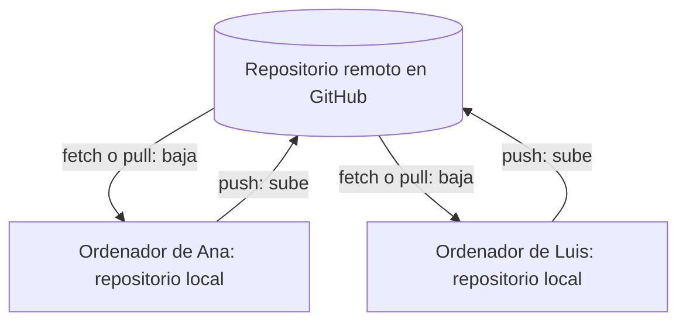
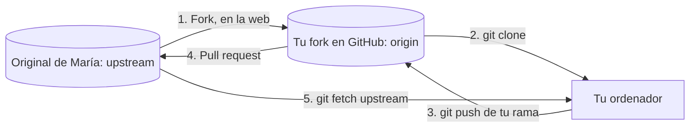

# 05.03 GitHub

> **Versiones:** Git 2.56; salidas de la 2.56.0; la más reciente, la 2.56.1 (a 16 de noviembre de 2026) · GitHub, según su documentación a 16 de noviembre de 2026
> **Conviene saber antes:** [05.01 Git: fundamentos](01-git-fundamentos.md) · [05.02 Ramas y conflictos](02-ramas-y-conflictos.md)
> **Tiempo estimado:** 2,5 horas
> **Nivel:** Básico · Núcleo

## Qué aprenderás

- Qué es un **repositorio remoto** y para qué sirve: copia de seguridad, trabajo en equipo y publicar tu trabajo.
- Qué es **GitHub**, qué otros servicios hacen lo mismo (GitLab, Codeberg…) y qué te da una **cuenta gratuita**.
- Cómo sabe GitHub que eres tú: **HTTPS** con Git Credential Manager o con un ***token***, y **SSH** con un par de claves.
- Las órdenes de los remotos: `git remote add`, `git push -u`, `git clone`, `git fetch` y `git pull`, y qué son `origin` y `origin/main`.
- Qué hacer cuando **alguien ha subido antes que tú** y tu `push` se rechaza, y por qué **nunca** se arregla con `--force`.
- Qué es una ***pull request*** y cómo se **revisa** el trabajo de otra persona.
- Para qué sirven las ***issues***, los ***forks*** y el flujo de trabajo **GitHub Flow**.
- Cómo convertir tu repositorio en un **escaparate**: README, licencia y perfil.
- Qué son **GitHub Pages** y **GitHub Actions**, que usarás más adelante.

## 1. Teoría

### 1.1. Un repositorio en otro sitio

Hasta ahora, tu repositorio vivía solo en tu ordenador: la carpeta del proyecto y, dentro, la carpeta oculta `.git` con todo el historial ([05.01](01-git-fundamentos.md)). Eso tiene tres problemas:

- **Si se rompe el disco** o pierdes el portátil, pierdes el proyecto y su historia entera.
- **Si trabajas con más gente**, cada uno tiene su copia y no hay forma de juntar el trabajo.
- **Nadie más lo puede ver**: ni quien quiere usar tu programa ni quien revisa tu portfolio.

Un **repositorio remoto** es una copia del repositorio guardada **en otro sitio**, casi siempre un servidor en internet, con la que tu repositorio se sincroniza. Sirve para:

- **Tener una copia de seguridad** fuera de tu ordenador.
- **Trabajar en equipo**: cada persona sube sus commits al remoto y se baja los de los demás.
- **Trabajar desde varios ordenadores**: el de casa, el del trabajo, el portátil.
- **Publicar** tu código para que otros lo vean, lo usen o te propongan mejoras.



En el dibujo: Ana y Luis tienen cada uno su repositorio en su ordenador. Los dos suben sus commits al repositorio remoto (`push`) y se bajan de él los del otro (`fetch` o `pull`). El remoto es el **punto de encuentro**.

Fíjate en una cosa importante: **cada copia es completa**. El repositorio de Ana tiene todo el historial, igual que el de Luis y el del remoto. Git no necesita el remoto para trabajar: haces commits, ramas y fusiones sin conexión, como en 05.01 y 05.02, y solo hablas con el remoto cuando quieres subir o bajar commits. Es lo que quiere decir que Git es **distribuido** ([05.01, apartado 1.3](01-git-fundamentos.md#13-git-y-github-que-no-es-lo-mismo)).

### 1.2. GitHub y otros servicios

**GitHub** es un servicio de internet que guarda repositorios de Git. Es el más usado: allí están muchísimos proyectos de software libre, los de muchas empresas y los portfolios de mucha gente que programa (también estos cursos: [`myopenacademy`](https://github.com/myopenacademy)). Además de guardar repositorios, añade herramientas para colaborar que Git no tiene: las *pull requests*, las *issues*, la revisión del código, una web para cada proyecto…

Como viste en [05.01](01-git-fundamentos.md#13-git-y-github-que-no-es-lo-mismo), **Git no es GitHub**. Git es el programa que usas en tu ordenador; GitHub es **uno** de los sitios donde se pueden guardar repositorios de Git. Hay otros, y funcionan de forma muy parecida:

| Servicio | Qué tiene de particular |
|---|---|
| **GitHub** | El más usado. Es de Microsoft |
| **GitLab** | Muy usado en empresas; además del servicio en internet, se puede instalar en un servidor propio |
| **Codeberg** | Lo mantiene una asociación sin ánimo de lucro de Berlín (Codeberg e.V.) y funciona con Forgejo, un programa libre |
| **Bitbucket** | De Atlassian, la empresa de Jira; habitual en equipos que ya usan sus herramientas |

Las órdenes de Git (`push`, `pull`, `clone`…) son **exactamente las mismas** con cualquiera de ellos: lo único que cambia es la dirección del remoto. Lo que sí cambia son los menús de la web y algunos nombres (en GitLab, una *pull request* se llama *merge request*). Este curso usa GitHub porque es donde están los cursos de la academia y donde lo buscará casi todo el mundo.

### 1.3. Tu cuenta de GitHub

Para guardar repositorios en GitHub necesitas una **cuenta**, que se crea en `https://github.com` con un correo, una contraseña y un **nombre de usuario**. Elige ese nombre con calma: forma parte de la dirección de todos tus repositorios (`https://github.com/tu-usuario/tu-repositorio`) y de tu perfil, que verá cualquiera a quien enseñes tu trabajo. Algo como `ana-garcia` o `agarcia-dev` mejor que `xXanaXx92`.

Lo que te da la cuenta **gratuita** (el plan **GitHub Free**), según la documentación de GitHub a 16 de noviembre de 2026:

- **Repositorios públicos ilimitados**, con todas las funciones. Un repositorio **público** lo puede ver cualquiera; uno **privado**, solo tú y quien invites.
- **Repositorios privados ilimitados**, con algunas funciones menos.
- **Colaboradores ilimitados**: puedes invitar a quien quieras a trabajar contigo.
- **GitHub Pages en los repositorios públicos** (una web gratuita para tu proyecto: [apartado 1.15](#115-lo-que-verás-más-adelante-pages-actions-y-gh)).

> **📌 Nota:** según su documentación (a 16 de noviembre de 2026), GitHub pide la **verificación en dos pasos** (*two-factor authentication*, 2FA) a quienes suben código y la recomienda a todo el mundo: además de la contraseña, un código de una aplicación del móvil o una llave de seguridad. Actívala en cuanto puedas. Qué es y por qué protege tanto lo verás en [Seguridad básica](../fase-07-aprender-a-aprender/05-seguridad-basica.md), en la fase 7.

**Crear un repositorio en GitHub** se hace desde la web (a 16 de noviembre de 2026): el icono **+** de arriba a la derecha, **New repository**; eliges el dueño (**Owner**: tu cuenta), el nombre (**Repository name**: letras sin tildes, cifras, `.`, `-` y `_`), una descripción si quieres, si es público o privado, y **Create repository**. El formulario ofrece además crear el repositorio con un README, un `.gitignore` y una licencia. **Si ya tienes el repositorio en tu ordenador, no marques nada de eso**: el de GitHub tiene que nacer **vacío**, para recibir tu historial tal cual (verás lo que pasa si no en el [error típico 3.4](#34-crear-el-repositorio-de-github-con-un-readme)).

> **📌 Nota:** la web de GitHub está **en inglés**, y sus menús cambian de sitio de vez en cuando. Los nombres de este módulo son los de su documentación a 16 de noviembre de 2026; si no encuentras uno, búscalo en `https://docs.github.com`, que siempre está al día.

### 1.4. Cómo sabe GitHub que eres tú: HTTPS

Cualquiera puede **leer** un repositorio público, pero para **subir** commits GitHub tiene que saber que eres tú y que tienes permiso. A eso se le llama **autenticarse**, y con Git se hace de dos formas: por **HTTPS** o por **SSH**. Las dos son seguras; cambia cómo se escribe la dirección del remoto y cómo se demuestra quién eres.

Lo primero, y lo que más confunde: **la contraseña de tu cuenta no sirve para Git**. Según la documentación de GitHub (a 16 de noviembre de 2026), la autenticación de Git con contraseña **se eliminó** y se cambió por métodos más seguros. Si Git te pide una contraseña y escribes la de tu cuenta, fallará ([error típico 3.1](#31-la-contraseña-de-tu-cuenta-no-vale)).

Con **HTTPS**, la dirección del remoto es como la de una web: `https://github.com/ana-garcia/club-lectura.git`. Para demostrar quién eres, dos caminos:

- **Git Credential Manager** (gestor de credenciales de Git). Es un programa que, la primera vez que Git necesita autenticarse, **abre una ventana para iniciar sesión en GitHub** (si te ofrece varias formas, elige la del navegador) para que entres y des permiso; después guarda la credencial de forma segura y no te la vuelve a pedir. En **Windows ya lo tienes**: viene con Git for Windows, y es la opción que dejaste marcada en el instalador ([02.03, apartado 1.6](../fase-02-tu-ordenador/03-instalar-programas-y-path.md#16-instalar-git-en-windows-git-for-windows-y-git-bash)). En **macOS y Linux** se instala aparte, según la documentación de GitHub (en macOS, con Homebrew).
- **Un *token* de acceso personal** (*personal access token*). Es una especie de contraseña larga que generas en la web de GitHub, con los permisos justos y una fecha de caducidad, y que escribes **donde Git te pide la contraseña**. Se crea en la foto de tu perfil, **Settings > Developer settings > Personal access tokens** (a 16 de noviembre de 2026). Hay dos tipos: los ***fine-grained*** («de grano fino»), que solo dan acceso a los repositorios que elijas, y los ***classic*** («clásicos»), que dan acceso a todos. GitHub recomienda los primeros. Para hacer `push`, el de grano fino necesita en ese repositorio el permiso **Contents** con escritura. Cuando Git te lo pida, en **Username** va tu usuario de GitHub, y en **Password**, el *token*. Si no tienes un gestor de credenciales (lo normal en Linux si no instalas Git Credential Manager), Git te los pedirá en cada `push`. En macOS se suelen guardar en el **Llavero**; si guardaste uno equivocado, búscalo como `github.com` en la aplicación **Acceso a Llaveros** (*Keychain Access*) y bórralo (docs.github.com, *Updating credentials from the macOS Keychain*, a 16 de noviembre de 2026).

> **⚠️ Cuidado:** un *token* **es una contraseña**. No lo pegues en un fichero del proyecto, ni en un chat, ni en un mensaje de commit: quien lo tenga puede subir a tus repositorios. Si se te escapa, bórralo en GitHub y crea otro. Cómo se guardan los secretos lo verás a fondo en [Seguridad básica](../fase-07-aprender-a-aprender/05-seguridad-basica.md).

**Qué te recomienda este curso:** en Windows, HTTPS con Git Credential Manager, que ya tienes y no te pide nada más que entrar en GitHub. En macOS y Linux, SSH (el apartado siguiente), que se configura una vez y no necesita instalar nada.

### 1.5. SSH: un par de claves

**SSH** es otra forma de conectarse de forma segura a un servidor. En lugar de una contraseña, usa **un par de claves**: dos ficheros que se generan juntos en tu ordenador y que funcionan como una cerradura y su llave:

- La **clave pública** (fichero que acaba en `.pub`) es la **cerradura**: se la das a GitHub, y puedes dársela a quien quieras.
- La **clave privada** (el mismo nombre, sin `.pub`) es la **llave**: se queda en tu ordenador y **no sale nunca de él**.

Cuando te conectas, GitHub comprueba que tienes la llave que abre la cerradura que le diste, sin que la llave viaje por internet. Con SSH, la dirección del remoto se escribe de otra forma: `git@github.com:ana-garcia/club-lectura.git`.

Los pasos, según la documentación de GitHub a 16 de noviembre de 2026 (los harás de verdad en el [ejemplo 2.7](#27-conectarte-a-github-de-verdad)):

1. **Generar el par de claves** con `ssh-keygen -t ed25519 -C "tu-correo@example.com"`. `-t ed25519` elige el tipo de clave que recomienda GitHub y `-C` le pone un comentario (tu correo) para reconocerla.
2. **Dar la clave pública a GitHub**: en la foto de tu perfil, **Settings**, en el apartado **Access** de la barra lateral, **SSH and GPG keys > New SSH key**; le pones un título (**Title**, por ejemplo «Portátil de casa»), pegas el contenido del `.pub` en **Key** y pulsas **Add SSH key**.
3. **Comprobar la conexión** con `ssh -T git@github.com`.

> **⚠️ Cuidado:** la clave **privada** (`id_ed25519`, sin `.pub`) **nunca** se comparte, ni se sube a ningún repositorio, ni se pega en ningún sitio. Quien la tenga puede hacerse pasar por ti en GitHub. Si crees que alguien la ha visto, borra la clave pública en **SSH and GPG keys** y genera un par nuevo.

### 1.6. La dirección de un remoto y origin

Tu repositorio guarda una lista de **remotos**: cada uno con un **nombre** corto y una **dirección**. La dirección puede tener tres formas:

| Forma | Ejemplo | Cuándo |
|---|---|---|
| **HTTPS** | `https://github.com/ana-garcia/club-lectura.git` | GitHub con Git Credential Manager o con *token* |
| **SSH** | `git@github.com:ana-garcia/club-lectura.git` | GitHub con claves SSH |
| **Una ruta** de tu disco | `../../github/club-lectura.git` | Un remoto en tu propio ordenador (lo usa este módulo para practicar: [apartado 1.8](#18-un-github-de-prácticas-en-tu-ordenador)) |

Las dos primeras apuntan **al mismo repositorio** de GitHub: solo cambia cómo te autenticas. El `.git` del final es opcional en GitHub, pero es lo que te da su web al copiar la dirección.

**`origin`** es el nombre que se da, por costumbre, al remoto principal: cuando clonas un repositorio, Git llama `origin` al sitio de donde lo has clonado, y cuando conectas tú uno, casi todo el mundo usa ese nombre. Es **solo un nombre**: podría llamarse `github` o `nube`, pero `origin` es lo que verás en todas partes. Un repositorio puede tener varios remotos, cada uno con su nombre (lo verás con los *forks*, en el [apartado 1.12](#112-forks-contribuir-a-proyectos-ajenos)).

### 1.7. Las órdenes de los remotos

| Orden | Qué hace |
|---|---|
| `git remote add origin DIRECCIÓN` | Conecta tu repositorio con un remoto y le pone el nombre `origin` |
| `git remote -v` | Lista los remotos, con su dirección (`-v`, de *verbose*, «detallado») |
| `git push -u origin main` | **Sube** la rama `main` al remoto por primera vez y la deja **vinculada** a la del remoto (`-u`, de *upstream*) |
| `git push` | **Sube** los commits nuevos de la rama en la que estás (una vez vinculada) |
| `git clone DIRECCIÓN` | **Descarga un repositorio entero**, con todo su historial, en una carpeta nueva, ya conectado al remoto como `origin` |
| `git fetch` | **Descarga** los commits nuevos del remoto, **sin tocar** tus ficheros ni tus ramas |
| `git pull` | **Descarga y fusiona**: un `git fetch` y después un `git merge` con la rama del remoto |

**Las ramas de seguimiento.** Tu repositorio guarda, además de tus ramas, **su copia de lo último que supo del remoto**: dónde estaban las ramas del remoto la última vez que hablaste con él. Se llaman con el nombre del remoto delante: **`origin/main`** es «la rama `main` de `origin`, según la última vez que miré». No las mueves tú: las actualizan `git fetch`, `git pull` y `git push`.

Esa copia explica algo que despista mucho: **`git status` compara tu rama con la copia, no con el remoto de verdad**. Si Luis ha subido algo hace cinco minutos y tú no has hecho `git fetch`, tu `git status` sigue diciendo «Tu rama está actualizada con 'origin/main'», porque tu copia es vieja. Lo verás pasar en el [ejemplo 2.3](#23-traer-los-cambios-de-los-demás-fetch-y-pull).

**Qué te dice `git status` comparando con esa copia:**

| Mensaje (resumido) | Qué quiere decir | Qué haces |
|---|---|---|
| `Tu rama está actualizada con 'origin/main'` | Tienes lo mismo que la copia | Nada (y, si hace rato, un `git fetch` para renovar la copia) |
| `Tu rama está adelantada a 'origin/main' por 1 commit` | Tienes commits que el remoto no tiene | `git push` |
| `Tu rama está detrás de 'origin/main' por 1 commit, y puede ser avanzada rápido` | El remoto tiene commits que tú no tienes, y tú nada nuevo | `git pull`, que será un avance rápido |
| `Tu rama y 'origin/main' han divergido` | Los dos tenéis commits que el otro no tiene | `git pull --no-rebase`, resolver si hay conflicto y `git push` ([apartado 1.9](#19-cuando-el-remoto-tiene-algo-que-tú-no-tienes)) |

> **💡 Consejo:** `git fetch` es **inofensivo**: nunca cambia tus ficheros ni tus ramas, solo renueva la copia. Úsalo siempre que quieras saber si hay algo nuevo, y decide después si lo integras.

### 1.8. Un GitHub de prácticas en tu ordenador

Para practicar con remotos no hace falta GitHub, ni internet, ni dos personas: Git puede usar como remoto **otro repositorio de tu propio disco**. Es lo que hacen los ejemplos y los ejercicios de este módulo, y así puedes repetirlos tal cual y ver las mismas salidas.

Ese remoto de prácticas se crea con **`git init --bare`** (*bare*, «desnudo»): un **repositorio vacío y sin directorio de trabajo**. No tiene los ficheros del proyecto a la vista, solo lo que en un repositorio normal va dentro de `.git` (el historial). Es justo lo que guardan GitHub y los demás servicios en sus servidores: nadie trabaja directamente allí, solo se sube y se baja. Por costumbre, su carpeta acaba en `.git` (`club-lectura.git`).

Lo que funciona **igual** que con GitHub: `git remote add`, `git push`, `git clone`, `git fetch`, `git pull`, el `push` rechazado, las ramas de seguimiento… Todas las órdenes y casi todos los mensajes. Lo que **cambia**:

- **La dirección** es una ruta de tu disco (`../../github/club-lectura.git`), no `https://github.com/…`.
- **No hay autenticación**: el remoto es una carpeta tuya, así que nadie te pregunta quién eres.
- **Faltan las líneas `remote:` de GitHub.** Al subir a GitHub, su servidor añade al final unas líneas que empiezan por `remote:`, con avisos o enlaces (por ejemplo, para crear una *pull request*). Un remoto de tu disco no las escribe.
- **No hay web**: ni *pull requests*, ni *issues*, ni botones. Eso es de GitHub, no de Git, y se explica con salidas y pantallas de ejemplo.

En los ejemplos, la carpeta del remoto se llama `github` para que se entienda qué papel hace. **Es solo un nombre**: no tiene nada que ver con el GitHub de verdad.

> **📌 Nota:** fuera de este módulo, un remoto en tu disco también tiene su uso: una copia de seguridad en un disco externo o en una carpeta compartida de la red de una oficina. Pero para trabajar en equipo y publicar, lo normal es un servicio como GitHub.

### 1.9. Cuando el remoto tiene algo que tú no tienes

Ana y Luis trabajan a la vez sobre la misma versión. Luis sube su commit primero. Cuando Ana intenta subir el suyo, **GitHub lo rechaza**:

```text
 ! [rejected]        main -> main (fetch first)
```

Tiene sentido: el remoto tiene un commit (el de Luis) que Ana no tiene. Si aceptara el `push` de Ana tal cual, la rama `main` del remoto pasaría a apuntar al commit de Ana y **el de Luis se perdería**. Git nunca hace eso por su cuenta. El mensaje lo dice: primero trae lo del remoto (*fetch first*).

La solución es la de siempre en Git: **integrar primero el trabajo del otro** y después subir. Es una fusión como las de [05.02](02-ramas-y-conflictos.md): la `main` de Ana y la `origin/main` han **divergido** (cada una tiene un commit que la otra no tiene), y hay que juntarlas en un commit de fusión. Los pasos:

1. `git pull --no-rebase` trae los commits del remoto y los **fusiona** con los tuyos.
2. Si los dos habéis cambiado las mismas líneas, hay un **conflicto**: se resuelve como en 05.02 (abres el fichero, decides, quitas los marcadores, `git add` y `git commit`).
3. `git push`: ahora tu rama contiene lo del remoto y lo tuyo, y el remoto la acepta.

**Por qué `--no-rebase`.** Si escribes `git pull` a secas con las ramas divergidas, Git se para y te pide que elijas **cómo** juntarlas: con una fusión (*merge*, lo que conoces) o con un *rebase* (que en [05.02](02-ramas-y-conflictos.md) viste solo como idea). `--no-rebase` le dice «fusiona». (En Windows, con la opción del instalador como venía, no se para: fusiona directamente, como explica el [ejemplo 2.4](#24-cuando-alguien-ha-subido-antes-que-tú).) Lo verás en el [ejemplo 2.4](#24-cuando-alguien-ha-subido-antes-que-tú) y en el [error típico 3.3](#33-necesita-especificar-cómo-reconciliar-las-ramas-divergentes), donde está cómo dejarlo elegido para siempre.

> **⚠️ Cuidado:** en internet verás que un `push` rechazado «se arregla» con **`git push --force`** (forzar). **No lo hagas.** `--force` le dice al remoto «olvida lo que tienes y quédate con lo mío», y **borra los commits de tus compañeros** que tú no tenías. Existe una variante menos peligrosa, `--force-with-lease`, que se niega si el remoto tiene algo que tú no has visto; la usarás, si acaso, en cursos posteriores, y siempre en ramas que solo usas tú.

### 1.10. Pull requests y revisión

En un equipo, nadie sube sus cambios directamente a `main`. Cada tarea se hace **en una rama** ([05.02](02-ramas-y-conflictos.md)), la rama se sube a GitHub y se abre una ***pull request*** (*PR*, «petición de integración»): según la documentación de GitHub, **una propuesta para fusionar unos cambios** en el proyecto. Antes de aceptarla, otras personas la revisan.

Una *pull request* tiene, en la web de GitHub (a 16 de noviembre de 2026), cuatro pestañas:

| Pestaña | Qué muestra |
|---|---|
| **Conversation** | La descripción, los comentarios y las revisiones |
| **Commits** | Los commits de la rama |
| **Checks** | El resultado de las comprobaciones automáticas, si el proyecto las tiene ([apartado 1.15](#115-lo-que-verás-más-adelante-pages-actions-y-gh)) |
| **Files changed** | Los cambios, línea a línea, como un `git diff`: es lo que se revisa |

**La revisión** (*code review*, «revisión de código») es que otra persona lea los cambios y deje su opinión, en general o en una línea concreta. Al terminar, elige uno de tres tipos de revisión (según la documentación de GitHub):

| Revisión | Qué significa |
|---|---|
| **Comment** | Comentarios, sin aprobar ni pedir cambios |
| **Approve** | Los cambios están listos para fusionarse |
| **Request changes** | Hay cosas que se deben arreglar antes de fusionar |

Si te piden cambios, los haces **en la misma rama**, con commits nuevos, y los subes con `git push`: la *pull request* se actualiza sola. Cuando está aprobada, alguien pulsa el botón de fusionar. GitHub ofrece tres formas (los nombres, de su documentación):

| Botón | Qué hace |
|---|---|
| **Merge pull request** | Una fusión con su commit de fusión, como [`git merge --no-ff`](02-ramas-y-conflictos.md#16-fusionar-con-avance-rápido): se conservan todos los commits de la rama |
| **Squash and merge** | Junta todos los commits de la rama en **uno solo** sobre la rama principal |
| **Rebase and merge** | Copia los commits de la rama, uno a uno, encima de la principal, sin commit de fusión |

Cada equipo elige la suya; para empezar, la primera es la que mejor se entiende, porque es la fusión que ya conoces. Y si quieres opiniones antes de terminar, puedes abrir la *pull request* como **borrador** (*draft*): un borrador **no se puede fusionar** hasta que lo marques como listo.

**Si la *pull request* tiene conflictos.** Mientras esperas la revisión, `main` sigue avanzando, y otra *pull request* ya fusionada puede haber cambiado las mismas líneas que la tuya. Según la documentación de GitHub (a 16 de noviembre de 2026), hay que resolver los conflictos antes de fusionar, y mientras tanto el botón de fusionar está desactivado. El conflicto se resuelve **en tu rama**, no en `main`: pones al día tu `main` (`git switch main` y `git pull`), vuelves a tu rama y traes `main` a ella (`git switch tu-rama` y `git merge main`, la fusión «al revés» de [05.02, error típico 3.7](02-ramas-y-conflictos.md#37-ramas-que-viven-demasiado)), resuelves el conflicto como en [05.02](02-ramas-y-conflictos.md#111-resolver-un-conflicto-paso-a-paso) y subes la rama con `git push`. La *pull request* se actualiza sola con ese commit, y ya se puede fusionar. Para conflictos sencillos de líneas, GitHub ofrece además el botón **Resolve conflicts** de la propia *pull request*, que hace lo mismo desde la web: fusiona la rama principal en la tuya. Lo practicarás en el [reto 3](retos.md#reto-3--una-pull-request-con-conflictos).

**Por qué importa tanto la revisión:** encuentra errores antes de que lleguen a quien usa el programa, reparte entre el equipo el conocimiento del código y es una de las mejores formas de aprender, tanto revisando como siendo revisado. Una buena revisión habla **del código, no de la persona**, señala el problema concreto y explica el porqué (lo practicarás en el [ejercicio 3](#ejercicio-3--revisa-una-pull-request)).

### 1.11. Issues y tableros

Una [*issue*](../glosario.md#issue) es, en GitHub, **un aviso de un fallo o de una tarea pendiente**: «el enlace del menú no funciona», «añadir el horario de verano». Tiene un número (`#12`), una descripción escrita en [Markdown](../fase-04-formatos-y-diagramas/02-markdown.md), comentarios, una persona asignada y *labels* (marcas de colores; no tienen que ver con las etiquetas de versión de Git de [05.02](02-ramas-y-conflictos.md#115-etiquetas-y-versionado-semántico)) como `bug` (fallo) o `enhancement` (mejora). Es la lista de tareas del proyecto, a la vista de todo el equipo.

Una *pull request* puede **cerrar una *issue* sola**: si su descripción incluye una de estas palabras seguida del número de la *issue*, la *issue* se cierra al fusionar la *pull request* en la rama principal (según la documentación de GitHub, a 16 de noviembre de 2026):

`close`, `closes`, `closed`, `fix`, `fixes`, `fixed`, `resolve`, `resolves` y `resolved`.

```text
Añade el lugar de las reuniones al README.

Closes #3
```

Las *issues* y las *pull requests* se pueden organizar en un **tablero** (*Projects*, en GitHub), con columnas como «Por hacer», «En curso» y «Hecho». Cómo organizar así tu trabajo lo verás en [Organizar tu trabajo](../fase-07-aprender-a-aprender/02-organizar-tu-trabajo.md), en la fase 7.

### 1.12. Forks: contribuir a proyectos ajenos

En un repositorio de otra persona, normalmente **no puedes subir**: no tienes permiso. Para proponerle un cambio (corregir una errata en la documentación de un proyecto de software libre, por ejemplo) se hace un ***fork*** («bifurcación»): según la documentación de GitHub, **un repositorio nuevo que empieza siendo una copia de otro**, en tu cuenta. En tu *fork* sí puedes subir, y desde él propones tus cambios al original con una *pull request*. Al original se le llama ***upstream*** («río arriba»).



En el dibujo: (1) haces el *fork* del original de María con el botón **Fork** de la web (arriba a la derecha de la página del repositorio); (2) clonas **tu** *fork*, que pasa a ser tu `origin`; (3) subes tu rama a tu *fork*; (4) desde allí abres la *pull request* hacia el original; y (5) para traerte lo nuevo del original, lo añades como un segundo remoto, `upstream`, y haces `git fetch upstream`.

Mientras trabajas, el original sigue avanzando, y tu *fork* se queda atrás. Para **ponerlo al día** (*sync*), según la documentación de GitHub hay dos formas: desde la web, el botón **Sync fork > Update branch** de tu *fork*; o desde tu ordenador, `git fetch upstream`, `git merge upstream/main` en tu `main` y `git push` para subirlo a tu *fork*. Lo harás en el [ejercicio 4](#ejercicio-4--corrige-una-errata-en-un-proyecto-ajeno).

> **💡 Consejo:** antes de proponer nada a un proyecto ajeno, lee su `CONTRIBUTING.md`, si lo tiene ([04.02](../fase-04-formatos-y-diagramas/02-markdown.md#116-el-fichero-readme)): ahí dice cómo quiere el proyecto que se colabore (formato de los mensajes de commit, a qué rama van las *pull requests*…).

### 1.13. GitHub Flow

Un **flujo de trabajo** es el acuerdo de un equipo sobre cómo usar las ramas. El más sencillo y el más extendido es **GitHub Flow**, que según la documentación de GitHub tiene seis pasos:

1. **Crea una rama** desde la principal, con un nombre que diga qué vas a hacer (`lugar`, `corrige-menu`).
2. **Haz los cambios** en la rama, con commits, y súbelos con `git push`.
3. **Abre una *pull request*** (como borrador, si quieres opiniones pronto).
4. **Atiende los comentarios** de la revisión, con commits nuevos en la misma rama.
5. **Fusiona la *pull request*** cuando esté aprobada.
6. **Borra la rama**: el trabajo está hecho, y la *pull request* y el historial se quedan.

La idea de fondo: **`main` siempre funciona**, porque nada entra en ella sin pasar por una rama y una revisión. Lo harás entero, sin la web, en los ejemplos [2.5](#25-una-rama-para-una-pull-request) y [2.6](#26-después-de-fusionar-la-pull-request).

> **📌 Nota:** oirás hablar de otros flujos, como **Git Flow**, con más ramas fijas (`develop`, `release`…), pensado para programas que publican versiones numeradas y mantienen varias a la vez. Para empezar, y para la mayoría de proyectos, GitHub Flow es suficiente; si tu equipo usa otro, te lo explicarán.

Aunque trabajes sola o solo, **sigue GitHub Flow en tus proyectos**: te acostumbra a trabajar en ramas, deja en el historial qué se hizo en cada tarea, y quien revise tu portfolio verá que sabes trabajar como en un equipo.

En el [proyecto final](../fase-08-proyecto-final/01-primer-repositorio.md#13-planificar-con-issues-y-un-tablero) verás una forma más ligera para cuando trabajas sola o solo: las tareas pequeñas, con commits en `main`; al menos una, en una rama que después fusionas; y la *pull request* en GitHub, opcional.

### 1.14. El escaparate: README, licencia y perfil

**El README.** Al entrar en un repositorio, GitHub muestra debajo de la lista de ficheros el `README.md` de su raíz, dibujado: es la **portada** del proyecto. Cómo se escribe uno bueno ya lo sabes de [04.02](../fase-04-formatos-y-diagramas/02-markdown.md#116-el-fichero-readme): qué es, cómo se usa, cómo se instala, dónde pedir ayuda y quién lo mantiene. GitHub entiende todo lo de GitHub Flavored Markdown (tablas, listas de tareas…) y **dibuja los diagramas de Mermaid** que pongas en él ([04.05](../fase-04-formatos-y-diagramas/05-diagramas-y-mermaid.md#110-dónde-se-dibuja-github-la-academia-y-vs-code)). Los demás ficheros de Markdown del repositorio (`CONTRIBUTING.md`, `CHANGELOG.md`, cualquier `.md`) también se ven dibujados al abrirlos en la web. Para subirlos no hay nada especial: son ficheros como cualquier otro, que van con tus commits.

**La licencia.** Según la documentación de GitHub, un repositorio **sin licencia** está protegido por los derechos de autor de siempre: aunque sea público y cualquiera pueda verlo (y hacer un *fork*, por las condiciones de uso de GitHub), **nadie puede legalmente copiarlo, repartirlo ni hacer obras a partir de él**. Si quieres que otros usen tu código, añade un fichero `LICENSE` con una licencia. Para elegirla, GitHub mantiene la web `https://choosealicense.com`; para un proyecto personal, una licencia sencilla y permisiva como la **MIT** es lo más habitual (el código de este curso la usa). El formulario de **New repository** ofrece añadirla al crear el repositorio.

**Tu perfil.** Tu página de GitHub (`https://github.com/tu-usuario`) muestra tus repositorios públicos y tu actividad, y mucha gente la mira para conocer tu trabajo. Puedes añadirle una presentación: el **README de perfil**. Según la documentación de GitHub (a 16 de noviembre de 2026), aparece en tu perfil si:

1. Creas un repositorio con **el mismo nombre que tu usuario** (si eres `ana-garcia`, el repositorio `ana-garcia`).
2. Es **público**.
3. Tiene un fichero **`README.md` en su raíz**.
4. Ese `README.md` tiene algo escrito.

Breve, concreto y con enlaces a tu mejor trabajo: quién eres, qué estás aprendiendo y en qué proyecto estás. En el [proyecto final](../fase-08-proyecto-final/01-primer-repositorio.md) prepararás el tuyo.

### 1.15. Lo que verás más adelante: Pages, Actions y gh

Tres cosas de GitHub que conviene que te suenen:

- **GitHub Pages** publica una **web** directamente desde un repositorio: según la documentación de GitHub, un servicio para alojar webs **estáticas** (ficheros HTML, CSS y JavaScript que se envían tal cual). La web de tu cuenta queda en `https://tu-usuario.github.io` y la de cada proyecto en `https://tu-usuario.github.io/nombre-del-repositorio`. Con la cuenta gratuita, en repositorios públicos. Lo usarás para publicar tu [proyecto final](../fase-08-proyecto-final/01-primer-repositorio.md).
- **GitHub Actions** es el servicio de GitHub para la [integración continua](../fase-01-que-es-programar/03-probar-un-programa.md#19-las-pruebas-automáticas): ejecutar las pruebas (y otras tareas) automáticamente cada vez que alguien sube un cambio. Sus resultados son los que salen en la pestaña **Checks** de una *pull request*. Lo verás en el curso de tu lenguaje.
- **GitHub CLI** (`gh`), la herramienta oficial de GitHub para la terminal: con `gh auth login` te autentica desde el navegador, y sirve para crear repositorios o *pull requests* sin salir de la terminal. No hace falta para este curso; está en `https://cli.github.com`.

## 2. Ejemplos de código

Los ejemplos de este apartado son **una sola historia en seis sesiones**, que se hacen una detrás de otra: Ana y Luis llevan las notas del club de lectura Las Hojas en un repositorio compartido. Como no hay GitHub ni dos ordenadores, todo pasa en tu carpeta, con un remoto de prácticas ([apartado 1.8](#18-un-github-de-prácticas-en-tu-ordenador)):

```text
(carpeta del ejemplo)
├── github/
│   └── club-lectura.git   ← el remoto, que hace de GitHub
├── ana/
│   └── club-lectura/      ← el repositorio de Ana
└── luis/
    └── club-lectura/      ← el clon de Luis
```

Descarga la carpeta del ejemplo (su enlace «📁 Código»), abre la terminal en ella y escribe las órdenes de cada sesión en orden. Cada sesión empieza en la carpeta del ejemplo, como si hubieras cerrado la terminal entre una y otra; por eso, desde la segunda, empiezan con un `cd`.

Recuerda que los identificadores de los commits, las fechas y el autor de los tuyos serán distintos ([el aviso de 02.03](../fase-02-tu-ordenador/03-instalar-programas-y-path.md#22-un-aviso-sobre-las-salidas-de-la-terminal)). En las salidas de `git push` y `git fetch` cambiarán además cuántos **hilos** usa Git para comprimir (depende de tu procesador) y la **velocidad** a la que copia (`354.00 KiB/s`); donde aquí sale `/home/alumno`, a ti te saldrá tu carpeta personal; y, según tu sistema y tu versión de Git, algún detalle más: en Windows las rutas salen como `C:/Users/tu-nombre/…`; con un Git más antiguo (el de Apple o el de tu distribución), alguna línea de `push` o `fetch` y algunas pistas `hint:` pueden ser distintas o faltar; el orden de `ls` también puede cambiar. En Git Bash verás además el aviso de los saltos de línea en casi todos los `git add`, uno por fichero ([05.01, apartado 1.16](01-git-fundamentos.md#116-un-recordatorio-los-saltos-de-línea)): no sale en las salidas del curso; ignóralo.

### 2.1. Subir un repositorio que ya tienes

**Situación real:** Ana empieza las notas del club en su ordenador y quiere subirlas a un remoto. Primero crea el remoto vacío (en la vida real, lo crearía en la web de GitHub, sin README: [apartado 1.3](#13-tu-cuenta-de-github)); después crea su repositorio, hace un commit, lo conecta con el remoto y sube su rama `main`.

**En tu terminal** (`sesion-1.txt`):

```text
$ mkdir github
$ git init --bare github/club-lectura.git
Inicializado repositorio Git vacío en /home/alumno/github/club-lectura.git/
$ ls github/club-lectura.git
config  description  HEAD  hooks  info  objects  refs
$ mkdir -p ana/club-lectura && cd ana/club-lectura && git init
Inicializado repositorio Git vacío en /home/alumno/ana/club-lectura/.git/
$ printf '# Club de lectura Las Hojas\n\nLecturas y reuniones del club.\n' > README.md
$ printf '# Lecturas\n\n- Enero: El camino\n' > lecturas.md
$ git add README.md lecturas.md
$ git commit -m "Primeras notas del club"
[main (commit-raíz) dcc251c] Primeras notas del club
 2 files changed, 6 insertions(+)
 create mode 100644 README.md
 create mode 100644 lecturas.md
$ git remote add origin ../../github/club-lectura.git
$ git remote -v
origin  ../../github/club-lectura.git (fetch)
origin  ../../github/club-lectura.git (push)
$ git push -u origin main
Enumerando objetos: 4, listo.
Contando objetos: 100% (4/4), listo.
Compresión delta usando hasta 16 hilos
Comprimiendo objetos: 100% (3/3), listo.
Escribiendo objetos: 100% (4/4), 354 byte | 354.00 KiB/s, listo.
Total 4 (delta 0), reused 0 (delta 0), pack-reused 0 (from 0)
To ../../github/club-lectura.git
 * [new branch]      main -> main
rama 'main' configurada para rastrear 'origin/main'.
$ git status
En la rama main
Tu rama está actualizada con 'origin/main'.

nada para hacer commit, el árbol de trabajo está limpio
```

📁 **Código:** [`codigo/03-github/ejemplos/2.1-club-de-lectura/`](codigo/03-github/ejemplos/2.1-club-de-lectura/)

**En qué fijarte:**

- **El remoto vacío** no tiene ficheros del proyecto, solo las piezas de dentro de un `.git` (`HEAD`, `objects`, `refs`…). Eso es lo que guarda GitHub en sus servidores.
- **Cada repositorio, en su carpeta**: el remoto en `github/`, el de Ana en `ana/club-lectura/`. Desde la carpeta de Ana, el remoto está dos niveles más arriba: `../../github/club-lectura.git`, una [ruta relativa](../fase-02-tu-ordenador/02-archivos-carpetas-y-rutas.md#19-la-carpeta-actual-y-las-rutas-relativas).
- **`git remote -v`** sale dos veces: la dirección para bajar (*fetch*) y para subir (*push*). Casi siempre son la misma.
- **`git push -u origin main`** escribe primero cómo prepara y envía los commits (enumerar, comprimir, escribir; no hace falta que lo entiendas) y después lo importante: **`* [new branch] main -> main`**, que la rama `main` se ha creado en el remoto, y **«rama 'main' configurada para rastrear 'origin/main'»**, que ha quedado vinculada. Desde ahora, en esta rama, basta con `git push` y `git pull`.
- **`git status`** ya compara con el remoto: «Tu rama está actualizada con 'origin/main'».

**Con GitHub de verdad,** la orden sería la misma con su dirección (`git remote add origin https://github.com/ana-garcia/club-lectura.git`), la primera vez se abriría el navegador para autenticarte ([apartado 1.4](#14-cómo-sabe-github-que-eres-tú-https)) y saldrían líneas parecidas (más al clonar o bajar por red, y las `remote:` de GitHub, en inglés) con `To https://github.com/ana-garcia/club-lectura.git`. Lo verás en el [ejemplo 2.7](#27-conectarte-a-github-de-verdad).

### 2.2. Clonar: Luis se une al club

**Situación real:** Luis va a llevar las notas con Ana. No crea nada: **clona** el remoto, y tiene al momento el proyecto entero con su historial. Como Luis y Ana comparten ordenador en este ejemplo, Luis pone su nombre y su correo **solo en su repositorio** (`git config` sin `--global`: [05.01, apartado 1.4](01-git-fundamentos.md#14-antes-de-empezar-decirle-a-git-quién-eres)): así sus commits saldrán a su nombre. En tus proyectos no te hace falta: ya tienes tu identidad global.

**En tu terminal** (`sesion-2.txt`):

```text
$ mkdir luis && cd luis && git clone ../github/club-lectura.git
Clonando en 'club-lectura'...
hecho.
$ cd club-lectura
$ ls
lecturas.md  README.md
$ git log --oneline
dcc251c (HEAD -> main, origin/main, origin/HEAD) Primeras notas del club
$ git remote -v
origin  /home/alumno/luis/../github/club-lectura.git (fetch)
origin  /home/alumno/luis/../github/club-lectura.git (push)
$ git branch -a
* main
  remotes/origin/HEAD -> origin/main
  remotes/origin/main
$ git config user.name "Luis Pérez"
$ git config user.email luis@example.com
```

📁 **Código:** [`codigo/03-github/ejemplos/2.1-club-de-lectura/`](codigo/03-github/ejemplos/2.1-club-de-lectura/)

**En qué fijarte:**

- **`git clone`** crea una carpeta con el nombre del repositorio (sin el `.git`), con los ficheros y **todo el historial**: el `git log` de Luis tiene el commit de Ana.
- **El remoto ya está conectado** como `origin`, sin `git remote add`. Al clonar de una ruta, Git la guarda completa (`/home/alumno/luis/../github/…`); de GitHub, guardaría la dirección `https://…` tal cual. Y al clonar por red salen más líneas: las `remote:` de GitHub, en inglés, y el progreso de la descarga (`Recibiendo objetos`, `Resolviendo deltas`).
- **`git log`** muestra la copia del remoto (`origin/main`) en el mismo commit que `main`: Luis está al día.
- **`git branch -a`** (*all*, «todas») enseña también las ramas de seguimiento, con `remotes/` delante. `origin/HEAD` dice cuál es la rama principal del remoto.

### 2.3. Traer los cambios de los demás: fetch y pull

**Situación real:** Luis apunta la lectura de febrero y la sube. Ana no se ha enterado. ¿Qué ve su `git status`?

**En tu terminal** (`sesion-3.txt`):

```text
$ cd luis/club-lectura
$ echo "- Febrero: Nada" >> lecturas.md
$ git add lecturas.md
$ git commit -m "Añade la lectura de febrero"
[main c73a464] Añade la lectura de febrero
 1 file changed, 1 insertion(+)
$ git push
Enumerando objetos: 5, listo.
Contando objetos: 100% (5/5), listo.
Compresión delta usando hasta 16 hilos
Comprimiendo objetos: 100% (2/2), listo.
Escribiendo objetos: 100% (3/3), 337 byte | 337.00 KiB/s, listo.
Total 3 (delta 0), reused 0 (delta 0), pack-reused 0 (from 0)
To /home/alumno/luis/../github/club-lectura.git
   dcc251c..c73a464  main -> main
$ cd ../../ana/club-lectura
$ git status
En la rama main
Tu rama está actualizada con 'origin/main'.

nada para hacer commit, el árbol de trabajo está limpio
$ git fetch
remote: Enumerando objetos: 5, listo.
remote: Contando objetos: 100% (5/5), listo.
remote: Comprimiendo objetos: 100% (2/2), listo.
remote: Total 3 (delta 0), reused 0 (delta 0), pack-reused 0 (from 0)
Desempaquetando objetos: 100% (3/3), 317 byte | 317.00 KiB/s, listo.
Desde ../../github/club-lectura
   dcc251c..c73a464  main       -> origin/main
$ git status
En la rama main
Tu rama está detrás de 'origin/main' por 1 commit, y puede ser avanzada rápido.
  (usa "git pull" para actualizar tu rama local)

nada para hacer commit, el árbol de trabajo está limpio
$ git pull
Actualizando dcc251c..c73a464
Fast-forward
 lecturas.md | 1 +
 1 file changed, 1 insertion(+)
$ cat lecturas.md
# Lecturas

- Enero: El camino
- Febrero: Nada
```

📁 **Código:** [`codigo/03-github/ejemplos/2.1-club-de-lectura/`](codigo/03-github/ejemplos/2.1-club-de-lectura/)

**En qué fijarte:**

- **El `push` de Luis** termina con `dcc251c..c73a464  main -> main`: la `main` del remoto ha pasado del commit `dcc251c` al `c73a464`.
- **El primer `git status` de Ana miente**, sin querer: dice que está al día, porque compara con su copia, que es de antes del `push` de Luis ([apartado 1.7](#17-las-órdenes-de-los-remotos)).
- **`git fetch`** renueva la copia: `origin/main` pasa a `c73a464`. Las líneas `remote:` son del remoto, que cuenta lo que envía (GitHub escribe líneas parecidas, en inglés, porque las escribe su servidor). Los ficheros de Ana **no han cambiado**.
- **Ahora `git status` sí lo sabe**: Ana va un commit por detrás, y se puede «avanzar rápido» (*fast-forward*, el [avance rápido](02-ramas-y-conflictos.md#16-fusionar-con-avance-rápido) de 05.02), porque ella no tiene nada nuevo.
- **`git pull`** fusiona: como es un avance rápido, no hay commit de fusión. Ya tiene la lectura de febrero.

> **💡 Consejo:** el hábito que te ahorra muchos disgustos: **antes de empezar a trabajar, `git pull`**. Así empiezas siempre desde lo último.

### 2.4. Cuando alguien ha subido antes que tú

**Situación real:** Luis apunta la lectura de marzo y la sube. Mientras, Ana, que no lo sabe, añade al README cuándo se reúne el club, y lo intenta subir.

**En tu terminal** (`sesion-4.txt`):

```text
$ cd luis/club-lectura
$ echo "- Marzo: Marianela" >> lecturas.md
$ git add lecturas.md
$ git commit -m "Añade la lectura de marzo"
[main efa1b4e] Añade la lectura de marzo
 1 file changed, 1 insertion(+)
$ git push
Enumerando objetos: 5, listo.
Contando objetos: 100% (5/5), listo.
Compresión delta usando hasta 16 hilos
Comprimiendo objetos: 100% (3/3), listo.
Escribiendo objetos: 100% (3/3), 350 byte | 350.00 KiB/s, listo.
Total 3 (delta 0), reused 0 (delta 0), pack-reused 0 (from 0)
To /home/alumno/luis/../github/club-lectura.git
   c73a464..efa1b4e  main -> main
$ cd ../../ana/club-lectura
$ echo "Nos reunimos el primer jueves de cada mes." >> README.md
$ git add README.md
$ git commit -m "Añade cuándo nos reunimos"
[main 0c9b68b] Añade cuándo nos reunimos
 1 file changed, 1 insertion(+)
$ git status
En la rama main
Tu rama está adelantada a 'origin/main' por 1 commit.
  (usa "git push" para publicar tus commits locales)

nada para hacer commit, el árbol de trabajo está limpio
$ git push
To ../../github/club-lectura.git
 ! [rejected]        main -> main (fetch first)
error: falló el empuje de algunas referencias a '../../github/club-lectura.git'
hint: Updates were rejected because the remote contains work that you do not
hint: have locally. This is usually caused by another repository pushing to
hint: the same ref. If you want to integrate the remote changes, use
hint: 'git pull' before pushing again.
hint: See the 'Note about fast-forwards' in 'git push --help' for details.
$ git fetch
remote: Enumerando objetos: 5, listo.
remote: Contando objetos: 100% (5/5), listo.
remote: Comprimiendo objetos: 100% (3/3), listo.
remote: Total 3 (delta 0), reused 0 (delta 0), pack-reused 0 (from 0)
Desempaquetando objetos: 100% (3/3), 330 byte | 330.00 KiB/s, listo.
Desde ../../github/club-lectura
   c73a464..efa1b4e  main       -> origin/main
$ git status
En la rama main
Tu rama y 'origin/main' han divergido,
y tienen 1 y 1 commits diferentes cada una respectivamente.
  (use "git pull" if you want to integrate the remote branch with yours)

nada para hacer commit, el árbol de trabajo está limpio
$ git pull
hint: Las ramas se han divergido y hay que especificar cómo reconciliarlas.
hint: Se puede hacerlo ejecutando uno de los comandos siguiente antes del
hint: próximo pull:
hint:
hint:   git config pull.rebase false  # fusionar
hint:   git config pull.rebase true   # rebasar
hint:   git config pull.ff only       # solo avance rápido
hint:
hint: Se puede reemplazar "git config" con "git config --global" para aplicar
hint: la preferencia en todos los repositorios. También se puede pasar
hint: --rebase, --no-rebase o --ff-only en el comando para sobrescribir la
hint: configuración por defecto en cada invocación.
fatal: Necesita especificar cómo reconciliar las ramas divergentes.
$ git pull --no-rebase --no-edit
Merge made by the 'ort' strategy.
 lecturas.md | 1 +
 1 file changed, 1 insertion(+)
$ git log --oneline --graph
*   f2b05b2 (HEAD -> main) Merge branch 'main' of ../../github/club-lectura
|\
| * efa1b4e (origin/main, origin/HEAD) Añade la lectura de marzo
* | 0c9b68b Añade cuándo nos reunimos
|/
* c73a464 Añade la lectura de febrero
* dcc251c Primeras notas del club
$ git push
Enumerando objetos: 9, listo.
Contando objetos: 100% (8/8), listo.
Compresión delta usando hasta 16 hilos
Comprimiendo objetos: 100% (5/5), listo.
Escribiendo objetos: 100% (5/5), 675 byte | 675.00 KiB/s, listo.
Total 5 (delta 0), reused 0 (delta 0), pack-reused 0 (from 0)
To ../../github/club-lectura.git
   efa1b4e..f2b05b2  main -> main
$ git status
En la rama main
Tu rama está actualizada con 'origin/main'.

nada para hacer commit, el árbol de trabajo está limpio
```

📁 **Código:** [`codigo/03-github/ejemplos/2.1-club-de-lectura/`](codigo/03-github/ejemplos/2.1-club-de-lectura/)

**En qué fijarte:**

- **«Adelantada por 1 commit»**: con su copia vieja, Ana cree que le basta con subir.
- **El `push` se rechaza** (`! [rejected] … (fetch first)`): el remoto tiene un commit que Ana no tiene ([apartado 1.9](#19-cuando-el-remoto-tiene-algo-que-tú-no-tienes)). Las líneas `hint:` («pista») son consejos de Git, aquí en inglés, sin traducir ([05.01, apartado 2](01-git-fundamentos.md#2-ejemplos-de-código)).
- **Tras el `git fetch`**, `git status` dice la verdad: las ramas **han divergido**, un commit cada una.
- **`git pull` a secas se para** y explica las tres formas de juntar las ramas. No ha cambiado nada: solo pregunta.
- **`git pull --no-rebase --no-edit`** elige la fusión. `--no-edit` acepta el mensaje que propone Git para el commit de fusión, sin abrir el editor (sin él, Git abriría [su editor](01-git-fundamentos.md#14-antes-de-empezar-decirle-a-git-quién-eres) para que lo puedas cambiar). Como Ana y Luis tocaron ficheros distintos, no hay conflicto.
- **El gráfico** muestra la fusión de tres vías de [05.02](02-ramas-y-conflictos.md): el commit de Ana y el de Luis, juntos en `f2b05b2`. Con GitHub, el mensaje diría `Merge branch 'main' of https://github.com/…`.
- **Ahora el `push` se acepta**, y todo queda al día.

> **⚠️ En Windows:** si dejaste en el instalador la opción de `git pull` como venía ([02.03, apartado 1.6](../fase-02-tu-ordenador/03-instalar-programas-y-path.md#16-instalar-git-en-windows-git-for-windows-y-git-bash)), tu Git ya tiene elegida la fusión: ese `git pull` no se para, fusiona y abre el editor con el mensaje `Merge branch 'main' of …`; guarda y cierra (o escribe desde el principio `git pull --no-rebase --no-edit`). Por eso allí no verás este mensaje.

Si Ana y Luis hubieran cambiado la misma línea, el `git pull --no-rebase` habría acabado en un **conflicto**. Se resuelve como en 05.02, y después `git push`: lo harás en el [ejercicio 2](#ejercicio-2--el-push-rechazado-del-taller-de-bicis).

### 2.5. Una rama para una pull request

**Situación real:** Ana quiere añadir al README dónde se reúne el club, y lo hace con GitHub Flow ([apartado 1.13](#113-github-flow)): una rama, sus commits y la rama subida al remoto, para abrir una *pull request* que revise Luis.

**En tu terminal** (`sesion-5.txt`):

```text
$ cd ana/club-lectura
$ git switch -c lugar
Cambiado a nueva rama 'lugar'
$ echo "Lugar: biblioteca municipal, sala 2." >> README.md
$ git add README.md
$ git commit -m "Añade el lugar de las reuniones"
[lugar d6a9f6a] Añade el lugar de las reuniones
 1 file changed, 1 insertion(+)
$ git push -u origin lugar
Enumerando objetos: 5, listo.
Contando objetos: 100% (5/5), listo.
Compresión delta usando hasta 16 hilos
Comprimiendo objetos: 100% (3/3), listo.
Escribiendo objetos: 100% (3/3), 362 byte | 362.00 KiB/s, listo.
Total 3 (delta 1), reused 0 (delta 0), pack-reused 0 (from 0)
To ../../github/club-lectura.git
 * [new branch]      lugar -> lugar
rama 'lugar' configurada para rastrear 'origin/lugar'.
$ git branch -vv
* lugar d6a9f6a [origin/lugar] Añade el lugar de las reuniones
  main  f2b05b2 [origin/main] Merge branch 'main' of ../../github/club-lectura
```

📁 **Código:** [`codigo/03-github/ejemplos/2.1-club-de-lectura/`](codigo/03-github/ejemplos/2.1-club-de-lectura/)

**En qué fijarte:**

- **Una rama nueva se sube con `-u`**, como `main` la primera vez: `* [new branch] lugar -> lugar` y queda vinculada a `origin/lugar`.
- **`git branch -vv`** (doble *verbose*) dice, de cada rama, su último commit y **a qué rama del remoto está vinculada**, entre corchetes.

**Con GitHub, el `push` de una rama nueva** acabaría además con unas líneas `remote:` como estas, con un enlace para crear la *pull request*. Es una **salida de ejemplo** (a 16 de noviembre de 2026; no se ha podido comprobar en la terminal del curso, que no tiene GitHub ni internet, y puede cambiar):

```text
remote:
remote: Create a pull request for 'lugar' on GitHub by visiting:
remote:      https://github.com/ana-garcia/club-lectura/pull/new/lugar
remote:
To https://github.com/ana-garcia/club-lectura.git
 * [new branch]      lugar -> lugar
```

**Abrir la *pull request*** (en la web de GitHub, a 16 de noviembre de 2026, según su documentación): al entrar en el repositorio, un aviso amarillo sobre la lista de ficheros ofrece **Compare & pull request** para la rama recién subida. Se elige la rama de destino (**base**: `main`) y la de los cambios (**compare**: `lugar`), se escribe un título y una descripción, y se pulsa **Create pull request** (o, en su desplegable, el borrador). Una buena descripción dice **qué** cambia, **por qué** y **cómo comprobarlo**:

```markdown
## Qué cambia
Añade al README dónde nos reunimos: la sala 2 de la biblioteca municipal.

## Por qué
Dos personas nuevas preguntaron dónde era la reunión (#3).

## Cómo comprobarlo
Abre el README: la última línea dice el lugar.

Closes #3
```

Luis la revisa en **Files changed**, ve la línea añadida, y elige **Approve**.

### 2.6. Después de fusionar la pull request

**Situación real:** la *pull request* está aprobada y alguien pulsa **Merge pull request**. Como aquí no hay web, **Luis hace a mano lo mismo que haría ese botón**: una fusión con su commit de fusión ([`--no-ff`](02-ramas-y-conflictos.md#16-fusionar-con-avance-rápido)) de la rama `lugar` en `main`, que sube al remoto. Después, Ana hace lo que se hace siempre tras fusionar: vuelve a `main`, se trae lo fusionado y borra la rama, en su ordenador y en el remoto.

**En tu terminal** (`sesion-6.txt`):

```text
$ cd luis/club-lectura
$ git pull
remote: Enumerando objetos: 12, listo.
remote: Contando objetos: 100% (11/11), listo.
remote: Comprimiendo objetos: 100% (8/8), listo.
remote: Total 8 (delta 1), reused 0 (delta 0), pack-reused 0 (from 0)
Desempaquetando objetos: 100% (8/8), 953 byte | 953.00 KiB/s, listo.
Desde /home/alumno/luis/../github/club-lectura
   efa1b4e..f2b05b2  main       -> origin/main
 * [nueva rama]      lugar      -> origin/lugar
Actualizando efa1b4e..f2b05b2
Fast-forward
 README.md | 1 +
 1 file changed, 1 insertion(+)
$ git merge --no-ff --no-edit origin/lugar
Merge made by the 'ort' strategy.
 README.md | 1 +
 1 file changed, 1 insertion(+)
$ git push
Enumerando objetos: 1, listo.
Contando objetos: 100% (1/1), listo.
Escribiendo objetos: 100% (1/1), 245 byte | 245.00 KiB/s, listo.
Total 1 (delta 0), reused 0 (delta 0), pack-reused 0 (from 0)
To /home/alumno/luis/../github/club-lectura.git
   f2b05b2..d591b80  main -> main
$ cd ../../ana/club-lectura
$ git switch main
Cambiado a rama 'main'
Tu rama está actualizada con 'origin/main'.
$ git pull
remote: Enumerando objetos: 1, listo.
remote: Contando objetos: 100% (1/1), listo.
remote: Total 1 (delta 0), reused 0 (delta 0), pack-reused 0 (from 0)
Desempaquetando objetos: 100% (1/1), 225 byte | 225.00 KiB/s, listo.
Desde ../../github/club-lectura
   f2b05b2..d591b80  main       -> origin/main
Actualizando f2b05b2..d591b80
Fast-forward
 README.md | 1 +
 1 file changed, 1 insertion(+)
$ git branch -d lugar
Eliminada la rama lugar (era d6a9f6a).
$ git push origin --delete lugar
To ../../github/club-lectura.git
 - [deleted]         lugar
$ git log --oneline --graph
*   d591b80 (HEAD -> main, origin/main, origin/HEAD) Merge remote-tracking branch 'origin/lugar'
|\
| * d6a9f6a Añade el lugar de las reuniones
|/
*   f2b05b2 Merge branch 'main' of ../../github/club-lectura
|\
| * efa1b4e Añade la lectura de marzo
* | 0c9b68b Añade cuándo nos reunimos
|/
* c73a464 Añade la lectura de febrero
* dcc251c Primeras notas del club
```

📁 **Código:** [`codigo/03-github/ejemplos/2.1-club-de-lectura/`](codigo/03-github/ejemplos/2.1-club-de-lectura/)

**En qué fijarte:**

- **El `git pull` de Luis** trae dos cosas: la `main` nueva (con la fusión de Ana del ejemplo 2.4) y la rama `lugar`, que no tenía (`* [nueva rama] lugar -> origin/lugar`).
- **Luis no tiene una rama `lugar` propia**: tiene `origin/lugar`, que trajo el `git pull`, y se puede fusionar como cualquier rama. Por eso el mensaje dice `remote-tracking branch` (rama de seguimiento).
- **La fusión de Luis** es lo que hace el botón **Merge pull request**: un commit de fusión en `main` con lo de la rama. En GitHub, ese commit lo crearía el propio GitHub en el remoto, con un mensaje que nombra la *pull request*.
- **Ana vuelve a `main`**, que todavía no tiene el cambio, y lo trae con `git pull`.
- **`git branch -d lugar`** borra la rama en su ordenador (Git deja, porque ya está fusionada) y **`git push origin --delete lugar`** la borra del remoto (`- [deleted]`). En GitHub, la página de la *pull request* fusionada tiene además un botón para borrar la rama.
- **El historial** cuenta lo que pasó: cada tarea, en su rama, y cada fusión, en su commit.

### 2.7. Conectarte a GitHub de verdad

Este ejemplo **no se puede comprobar** en la terminal del curso (no tiene GitHub ni internet, y `ssh-keygen` da cada vez una clave distinta): sus salidas son **de ejemplo**, a 16 de noviembre de 2026. Hazlo en tu ordenador cuando tengas tu cuenta.

**Opción A: HTTPS (lo recomendado en Windows).** Crea en la web un repositorio **vacío** ([apartado 1.3](#13-tu-cuenta-de-github)) y copia su dirección HTTPS. En la carpeta de tu repositorio:

```bash
git remote add origin https://github.com/TU-USUARIO/club-lectura.git
git push -u origin main
```

La primera vez, Git Credential Manager abre una ventana para iniciar sesión en GitHub (si te ofrece varias formas, elige la del navegador) para que entres y le des permiso; después, el `push` sigue como en el ejemplo 2.1, con `To https://github.com/TU-USUARIO/club-lectura.git`. Las siguientes veces ya no pide nada. Si en lugar de esa ventana Git te pide un usuario y una contraseña en la terminal, en el usuario va tu usuario de GitHub y en la contraseña, un *token* ([apartado 1.4](#14-cómo-sabe-github-que-eres-tú-https)), no la de tu cuenta.

**Opción B: SSH.** Genera tu par de claves, con el correo de tu cuenta de GitHub:

```bash
ssh-keygen -t ed25519 -C "ana@example.com"
```

Te hace tres preguntas (en inglés: `ssh-keygen` no está traducido). A la primera, dónde guardar la clave, pulsa <kbd>Intro</kbd> para aceptar el sitio que propone. Si te pregunta `Overwrite (y/n)?`, ya tienes una clave con ese nombre: contesta `n` y usa la que tienes (su `.pub` es lo que necesitas), o pide ayuda antes de sobrescribirla. Las otras dos piden una **frase de contraseña** (*passphrase*) para proteger la clave privada, dos veces; si escribes una, mientras la tecleas no se ve nada (es normal, como con `sudo`). Si pones frase, SSH te la pedirá cada vez que hables con GitHub, salvo que añadas la clave al agente de SSH; los pasos cambian en cada sistema y están en docs.github.com, *Generating a new SSH key and adding it to the ssh-agent* (a 16 de noviembre de 2026). Al terminar, dice dónde ha guardado las dos claves, en inglés (`Your identification has been saved in …/.ssh/id_ed25519` y `Your public key has been saved in …/.ssh/id_ed25519.pub`), y enseña una huella (*fingerprint*) y un dibujo (*randomart*) que son distintos en cada clave. Lo importante: se han guardado **dos ficheros** en la carpeta oculta `.ssh` de tu carpeta personal, `id_ed25519` (la **privada**, que no sale de ahí) e `id_ed25519.pub` (la **pública**).

Para dársela a GitHub, mira el contenido de la pública con `cat ~/.ssh/id_ed25519.pub`: es **una sola línea** que empieza por `ssh-ed25519`, sigue con una ristra larga de letras y números y acaba con tu correo. Cópiala entera y pégala en **Settings > SSH and GPG keys > New SSH key** ([apartado 1.5](#15-ssh-un-par-de-claves)). Después, comprueba la conexión:

```bash
ssh -T git@github.com
```

La primera vez, SSH avisa de que no conoce el servidor (`The authenticity of host 'github.com …' can't be established.`) y te enseña su huella. Compárala con las que publica GitHub en su documentación (busca «GitHub's SSH key fingerprints») y, si coincide, escribe `yes`. Si todo va bien, GitHub contesta con tu usuario:

```text
Hi TU-USUARIO! You've successfully authenticated, but GitHub does not provide shell access.
```

(«No ofrece acceso a una terminal» es normal: GitHub solo deja usar Git, no entrar en su servidor). A partir de ahí, usa las direcciones SSH: `git remote add origin git@github.com:TU-USUARIO/club-lectura.git`.

## 3. Errores típicos

### 3.1. La contraseña de tu cuenta no vale

**Qué pasa:** al hacer `git push` por HTTPS, Git te pide usuario y contraseña en la terminal, escribes la contraseña con la que entras en la web de GitHub, y falla la autenticación.

**Por qué ocurre:** GitHub **no acepta la contraseña de la cuenta** para Git desde hace años ([apartado 1.4](#14-cómo-sabe-github-que-eres-tú-https)).

**Cómo se arregla:** usa Git Credential Manager (en Windows ya lo tienes: si no se abre el navegador, revisa que en el instalador de Git dejaste el gestor de credenciales, [02.03](../fase-02-tu-ordenador/03-instalar-programas-y-path.md#16-instalar-git-en-windows-git-for-windows-y-git-bash)), escribe un ***token*** donde Git pide la contraseña, o pásate a **SSH**.

### 3.2. El push rechazado, y el --force

**Qué pasa:** `git push` termina con `! [rejected] main -> main (fetch first)`, y alguien te dice que lo arregles con `git push --force`.

**Por qué ocurre:** el remoto tiene commits que tú no tienes, porque otra persona subió antes ([apartado 1.9](#19-cuando-el-remoto-tiene-algo-que-tú-no-tienes)). Y `--force` «funciona» porque sustituye la rama del remoto por la tuya: **los commits de los demás desaparecen** del remoto.

**Cómo se arregla:** primero integras (`git pull --no-rebase`), resuelves el conflicto si lo hay, compruebas que todo está bien y después `git push`, como en el [ejemplo 2.4](#24-cuando-alguien-ha-subido-antes-que-tú). Nunca `--force` en una rama que usa más gente.

### 3.3. «Necesita especificar cómo reconciliar las ramas divergentes»

**Qué pasa:** `git pull` no hace nada y termina con:

```text
fatal: Necesita especificar cómo reconciliar las ramas divergentes.
```

**Por qué ocurre:** tu rama y la del remoto tienen cada una commits que la otra no tiene, y Git no sabe si quieres juntarlas con una fusión o con un *rebase* (lo viste en el [ejemplo 2.4](#24-cuando-alguien-ha-subido-antes-que-tú)). No es un error de verdad: es una pregunta.

En Windows, si dejaste en el instalador la opción de `git pull` como venía ([02.03, apartado 1.6](../fase-02-tu-ordenador/03-instalar-programas-y-path.md#16-instalar-git-en-windows-git-for-windows-y-git-bash)), tu Git ya tiene elegida la fusión: ese `git pull` no se para, fusiona y abre el editor con el mensaje `Merge branch 'main' of …`; guarda y cierra (o escribe desde el principio `git pull --no-rebase --no-edit`). Por eso allí no verás este mensaje.

**Cómo se arregla:** dilo en la orden, `git pull --no-rebase` (fusionar, lo que conoces). O díselo a Git una vez para todos tus repositorios, como propone su propio mensaje:

```bash
git config --global pull.rebase false
```

Desde entonces, `git pull` fusiona sin preguntar. Si tu equipo prefiere *rebase*, te dirá que pongas `true`.

### 3.4. Crear el repositorio de GitHub con un README

**Qué pasa:** creas el repositorio en la web marcando «Add a README» (o una licencia), y después quieres subir el que ya tenías en tu ordenador. El `push` se rechaza (`fetch first`), y el `git pull --no-rebase origin main` termina con `fatal: rehusando fusionar historias no relacionadas`. En esta sesión, la carpeta `web-de-github` hace lo que haría GitHub al crear el repositorio con README: un primer commit en el remoto.

**En tu terminal** (`sesion.txt`):

```text
$ mkdir github && git init --bare github/tienda.git
Inicializado repositorio Git vacío en /home/alumno/github/tienda.git/
$ mkdir web-de-github && cd web-de-github && git init
Inicializado repositorio Git vacío en /home/alumno/web-de-github/.git/
$ echo "# tienda" > README.md
$ git add README.md
$ git commit -m "Initial commit"
[main (commit-raíz) 4b1b84e] Initial commit
 1 file changed, 1 insertion(+)
 create mode 100644 README.md
$ git push -q ../github/tienda.git main
$ cd ..
$ mkdir tienda && cd tienda && git init
Inicializado repositorio Git vacío en /home/alumno/tienda/.git/
$ echo '<h1>Tienda</h1>' > index.html
$ git add index.html
$ git commit -m "Primera página"
[main (commit-raíz) 2b3f8ac] Primera página
 1 file changed, 1 insertion(+)
 create mode 100644 index.html
$ git remote add origin ../github/tienda.git
$ git push -u origin main
To ../github/tienda.git
 ! [rejected]        main -> main (fetch first)
error: falló el empuje de algunas referencias a '../github/tienda.git'
hint: Updates were rejected because the remote contains work that you do not
hint: have locally. This is usually caused by another repository pushing to
hint: the same ref. If you want to integrate the remote changes, use
hint: 'git pull' before pushing again.
hint: See the 'Note about fast-forwards' in 'git push --help' for details.
$ git pull --no-rebase origin main
remote: Enumerando objetos: 3, listo.
remote: Contando objetos: 100% (3/3), listo.
remote: Total 3 (delta 0), reused 0 (delta 0), pack-reused 0 (from 0)
Desempaquetando objetos: 100% (3/3), 205 byte | 205.00 KiB/s, listo.
Desde ../github/tienda
 * branch            main       -> FETCH_HEAD
 * [nueva rama]      main       -> origin/main
fatal: rehusando fusionar historias no relacionadas
$ git pull --no-rebase --no-edit --allow-unrelated-histories origin main
Desde ../github/tienda
 * branch            main       -> FETCH_HEAD
Merge made by the 'ort' strategy.
 README.md | 1 +
 1 file changed, 1 insertion(+)
 create mode 100644 README.md
$ git push -q -u origin main
$ git log --oneline --graph
*   a1ebf4e (HEAD -> main, origin/main) Merge branch 'main' of ../github/tienda
|\
| * 4b1b84e Initial commit
* 2b3f8ac Primera página
```

📁 **Código:** [`codigo/03-github/ejemplos/3.4-github-con-readme/`](codigo/03-github/ejemplos/3.4-github-con-readme/)

**Por qué ocurre:** al crearlo con README, GitHub hizo un primer commit en el remoto. Tu repositorio tiene su propio primer commit. Son **dos historias que no tienen ningún commit en común**, y Git se niega a juntarlas sin que se lo pidas, porque casi siempre es una equivocación.

**Cómo se arregla:** lo mejor es no llegar ahí: si ya tienes el repositorio, créalo en GitHub **vacío**, sin marcar nada. Si ya te ha pasado y el repositorio de GitHub es nuevo, puedes borrarlo en la web y crearlo de nuevo vacío; o juntar las dos historias, diciéndoselo a Git con `git pull --no-rebase --allow-unrelated-histories origin main` (resuelve el conflicto si los dos tenéis un `README.md`) y después `git push -u origin main`, como al final de la sesión (`-q`, de *quiet*, «silencioso», solo quita las líneas de progreso).

### 3.5. Creer que git status sabe lo último

**Qué pasa:** `git status` dice «Tu rama está actualizada con 'origin/main'», empiezas a trabajar, y al subir resulta que había commits nuevos y te toca resolver un conflicto que te podrías haber ahorrado.

**Por qué ocurre:** `git status` compara con la **copia** que tienes del remoto (`origin/main`), no con el remoto de verdad. Si no has hecho `git fetch` (o `git pull`) desde hace rato, la copia es vieja ([ejemplo 2.3](#23-traer-los-cambios-de-los-demás-fetch-y-pull)).

**Cómo se arregla:** antes de empezar una tarea, `git pull` (o `git fetch` y después `git status`, si solo quieres mirar).

### 3.6. Subir un secreto a GitHub

**Qué pasa:** un fichero con una contraseña o una clave (un [`.env`](../fase-04-formatos-y-diagramas/04-xml-csv-y-otros.md#114-el-fichero-env-y-los-secretos), un *token*) acaba en un commit, y el repositorio se sube a GitHub. Lo borras en un commit nuevo y crees que ya está.

**Por qué ocurre:** el secreto no estaba en el [`.gitignore`](01-git-fundamentos.md#112-lo-que-no-va-en-git-gitignore), o se añadió con un `git add .` sin mirar el `git status`. Y borrarlo después **no lo quita del historial**: cualquiera que clone el repositorio puede ver el commit antiguo. En un repositorio público, hay programas que recorren GitHub buscando claves y las encuentran en minutos. GitHub puede **bloquear el `push`** si reconoce una clave de un servicio conocido (la protección de subida, *push protection*, activada por defecto para tu cuenta en los repositorios públicos, según su documentación a 16 de noviembre de 2026). No te fíes de ello: detecta solo algunos tipos de secreto, y una contraseña tuya no la reconoce.

**Cómo se arregla:** **cambia el secreto ya** (la contraseña, el *token*, la clave): es la única forma de que el que se ha escapado deje de servir. Después, quítalo del seguimiento y añádelo al `.gitignore`. Lo comprobarás en el [ejercicio 5](#ejercicio-5--antes-de-hacer-público-el-repositorio-de-la-protectora), y lo verás a fondo en [Seguridad básica](../fase-07-aprender-a-aprender/05-seguridad-basica.md).

## 4. Buenas prácticas

- **`git pull` antes de empezar** cada tarea, para partir de lo último.
- **Sube tu trabajo a menudo**, a tu rama: el remoto es también tu copia de seguridad.
- **Una tarea, una rama, una *pull request***, pequeña: una *pull request* de cuarenta ficheros nadie la revisa de verdad.
- **Describe tus *pull requests***: qué cambia, por qué y cómo comprobarlo, y enlaza su *issue* (`Closes #3`).
- **Revisa con respeto y en concreto**: habla del código, no de la persona, y explica el porqué de cada comentario.
- **Nunca `git push --force`** en una rama que usa más gente.
- **Crea vacío** en GitHub el repositorio que ya tienes en tu ordenador.
- **Mira `git status` antes de cada `git add .` y cada `git push`**, y no subas nunca un secreto; si se escapa, cámbialo.
- **Autentícate con Git Credential Manager o con SSH**, y si usas *tokens*, de grano fino, con caducidad y con los permisos justos.
- **La clave privada SSH no sale de tu ordenador.**
- **Pon un README y una licencia** en todo repositorio público.
- **Borra las ramas fusionadas**, en tu ordenador y en el remoto.

**Lo que conviene evitar:**

- Subir directamente a `main` en un proyecto de equipo.
- Fusionar tus propias *pull requests* sin que nadie las mire, cuando hay alguien que pueda.
- Clonar un repositorio dentro de la carpeta de otro repositorio: cada repositorio, en su carpeta.

## 5. Ejercicios prácticos resueltos

> **💡 Consejo:** intenta cada ejercicio **antes** de abrir las pistas y la solución. Los que llevan carpeta de código se hacen en tu terminal, con un remoto de prácticas en una carpeta nueva: si te equivocas, borra lo que hayas creado y empieza otra vez. Los demás son de **razonar**: escribe tu respuesta y compárala después.

### 🟢 Básico

#### Ejercicio 1 · Sube un repositorio y compruébalo clonándolo

**Situación real:** Elena quiere guardar las recetas de su abuela Carmen en un remoto, para no perderlas si se le estropea el portátil. Practica con un remoto en tu disco:

1. Crea un remoto vacío, `remoto/recetas.git`.
2. Crea en una carpeta nueva, `recetas`, un repositorio con un `README.md` que diga `# Recetas de la abuela Carmen` y, dos líneas más abajo, `- Tortilla de patatas`, y haz un commit.
3. Conéctalo con el remoto y sube `main`, vinculada.
4. **Compruébalo**: clona el remoto en otra carpeta, `copia`, y mira que están el fichero y el commit.

<details>
<summary>Pista 1</summary>

El remoto vacío se crea con `git init --bare`. El repositorio de Elena, como siempre: `mkdir recetas && cd recetas && git init`. Para el `README.md`, `printf` con `\n` para los saltos de línea.

</details>

<details>
<summary>Pista 2</summary>

Desde `recetas/`, el remoto está en `../remoto/recetas.git`. Para subir y vincular: `git push -u origin main`. Para clonar, vuelve antes a la carpeta de arriba.

</details>

<details>
<summary>Ver solución</summary>

**En tu terminal** (`sesion.txt`):

```text
$ mkdir remoto
$ git init --bare remoto/recetas.git
Inicializado repositorio Git vacío en /home/alumno/remoto/recetas.git/
$ mkdir recetas && cd recetas && git init
Inicializado repositorio Git vacío en /home/alumno/recetas/.git/
$ printf '# Recetas de la abuela Carmen\n\n- Tortilla de patatas\n' > README.md
$ git add README.md
$ git commit -m "Primera receta"
[main (commit-raíz) 5a4e981] Primera receta
 1 file changed, 3 insertions(+)
 create mode 100644 README.md
$ git remote add origin ../remoto/recetas.git
$ git push -u origin main
Enumerando objetos: 3, listo.
Contando objetos: 100% (3/3), listo.
Compresión delta usando hasta 16 hilos
Comprimiendo objetos: 100% (2/2), listo.
Escribiendo objetos: 100% (3/3), 265 byte | 265.00 KiB/s, listo.
Total 3 (delta 0), reused 0 (delta 0), pack-reused 0 (from 0)
To ../remoto/recetas.git
 * [new branch]      main -> main
rama 'main' configurada para rastrear 'origin/main'.
$ git status
En la rama main
Tu rama está actualizada con 'origin/main'.

nada para hacer commit, el árbol de trabajo está limpio
$ cd ..
$ git clone remoto/recetas.git copia
Clonando en 'copia'...
hecho.
$ cd copia
$ ls
README.md
$ git log --oneline
5a4e981 (HEAD -> main, origin/main, origin/HEAD) Primera receta
```

📁 **Código:** [`codigo/03-github/ejercicios/ej01-primer-push/`](codigo/03-github/ejercicios/ej01-primer-push/)

**Explicación:**

- **El remoto** se crea vacío con `git init --bare`, en su carpeta; el repositorio de Elena, en otra (`recetas/`). Nunca uno dentro del otro.
- **`git remote add origin ../remoto/recetas.git`**: la ruta es relativa a la carpeta donde estás, `recetas/`.
- **`git push -u origin main`** crea la rama en el remoto (`* [new branch]`) y la vincula; `git status` lo confirma.
- **`git clone remoto/recetas.git copia`**: el segundo argumento es el nombre de la carpeta que crea (sin él, sería `recetas`, que ya existe). La copia tiene el fichero y el commit, con el mismo identificador (`5a4e981`): es **el mismo historial**. Si un día se rompe el portátil de Elena, así lo recuperaría.

**Con GitHub**, el paso 1 sería crear el repositorio vacío en la web, y la dirección, `https://github.com/elena…/recetas.git`.

**Errores frecuentes al resolverlo:**

- Escribir `git push` a secas la primera vez: Git contesta «fatal: La rama actual main no tiene una rama upstream.» (no está vinculada a ninguna rama del remoto) y propone `git push --set-upstream origin main`, que es lo mismo que `-u`.
- Clonar dentro de `recetas/`: tendrías un repositorio dentro de otro.

</details>

### 🟡 Intermedio

#### Ejercicio 2 · El push rechazado del taller de bicis

**Situación real:** Jorge y Sara llevan la lista de precios de su taller de bicicletas, `precios.txt`, en un remoto compartido. Los dos han cambiado a la vez **la misma línea**, la del cambio de cámara: Sara ha aclarado que la cámara se cobra aparte, y lo ha subido; Jorge ha cambiado el precio a 14 €, y todavía no lo ha enviado al remoto. La primera sesión lo prepara todo (cópiala tal cual):

**En tu terminal** (`sesion-1.txt`):

```text
$ mkdir github
$ git init --bare github/taller.git
Inicializado repositorio Git vacío en /home/alumno/github/taller.git/
$ mkdir jorge && cd jorge && git init
Inicializado repositorio Git vacío en /home/alumno/jorge/.git/
$ git config user.name "Jorge Ruiz"
$ git config user.email jorge@example.com
$ printf 'Revisión: 35 €\nCámara: 12 €\nFrenos: 10 €\n' > precios.txt
$ git add precios.txt
$ git commit -m "Lista de precios"
[main (commit-raíz) bf5535b] Lista de precios
 1 file changed, 3 insertions(+)
 create mode 100644 precios.txt
$ git remote add origin ../github/taller.git
$ git push -u origin main
Enumerando objetos: 3, listo.
Contando objetos: 100% (3/3), listo.
Escribiendo objetos: 100% (3/3), 262 byte | 262.00 KiB/s, listo.
Total 3 (delta 0), reused 0 (delta 0), pack-reused 0 (from 0)
To ../github/taller.git
 * [new branch]      main -> main
rama 'main' configurada para rastrear 'origin/main'.
$ cd ..
$ mkdir sara && cd sara && git clone ../github/taller.git
Clonando en 'taller'...
hecho.
$ cd taller
$ git config user.name "Sara Gil"
$ git config user.email sara@example.com
$ printf 'Revisión: 35 €\nCámara: 12 € (cámara aparte)\nFrenos: 10 €\n' > precios.txt
$ git add precios.txt
$ git commit -m "Aclara que la cámara se cobra aparte"
[main 8392eb0] Aclara que la cámara se cobra aparte
 1 file changed, 1 insertion(+), 1 deletion(-)
$ git push
Enumerando objetos: 5, listo.
Contando objetos: 100% (5/5), listo.
Compresión delta usando hasta 16 hilos
Comprimiendo objetos: 100% (2/2), listo.
Escribiendo objetos: 100% (3/3), 317 byte | 317.00 KiB/s, listo.
Total 3 (delta 0), reused 0 (delta 0), pack-reused 0 (from 0)
To /home/alumno/sara/../github/taller.git
   bf5535b..8392eb0  main -> main
$ cd ../../jorge
$ printf 'Revisión: 35 €\nCámara: 14 €\nFrenos: 10 €\n' > precios.txt
$ git add precios.txt
$ git commit -m "Sube el cambio de cámara a 14 €"
[main 9f9ad9c] Sube el cambio de cámara a 14 €
 1 file changed, 1 insertion(+), 1 deletion(-)
```

📁 **Código:** [`codigo/03-github/ejercicios/ej02-push-rechazado/`](codigo/03-github/ejercicios/ej02-push-rechazado/)

Ahora eres Jorge, en la carpeta `jorge`. Sube tu cambio. Cuando Git te ponga pegas, resuélvelas sin perder el trabajo de Sara: Jorge y Sara han hablado y la línea buena es `Cámara: 14 € (cámara aparte)`. Termina con todo subido y mira el gráfico del historial.

<details>
<summary>Pista 1</summary>

El `push` se rechazará. Integra primero lo del remoto con `git pull --no-rebase --no-edit`.

</details>

<details>
<summary>Pista 2</summary>

Habrá un conflicto en `precios.txt`. Como en [05.02](02-ramas-y-conflictos.md), escribe el fichero como debe quedar (sin marcadores; aquí, con `printf`), márcalo como resuelto con `git add` y termina la fusión con `git commit --no-edit`. Después, `git push`.

</details>

<details>
<summary>Ver solución</summary>

**En tu terminal** (`sesion-2.txt`):

```text
$ cd jorge
$ git push
To ../github/taller.git
 ! [rejected]        main -> main (fetch first)
error: falló el empuje de algunas referencias a '../github/taller.git'
hint: Updates were rejected because the remote contains work that you do not
hint: have locally. This is usually caused by another repository pushing to
hint: the same ref. If you want to integrate the remote changes, use
hint: 'git pull' before pushing again.
hint: See the 'Note about fast-forwards' in 'git push --help' for details.
$ git pull --no-rebase --no-edit
remote: Enumerando objetos: 5, listo.
remote: Contando objetos: 100% (5/5), listo.
remote: Comprimiendo objetos: 100% (2/2), listo.
remote: Total 3 (delta 0), reused 0 (delta 0), pack-reused 0 (from 0)
Desempaquetando objetos: 100% (3/3), 297 byte | 297.00 KiB/s, listo.
Desde ../github/taller
   bf5535b..8392eb0  main       -> origin/main
Auto-fusionando precios.txt
CONFLICTO (contenido): Conflicto de fusión en precios.txt
Fusión automática falló; arregle los conflictos y luego realice un commit con el resultado.
$ cat precios.txt
Revisión: 35 €
<<<<<<< HEAD
Cámara: 14 €
=======
Cámara: 12 € (cámara aparte)
>>>>>>> 8392eb045bc359afa904bd4f0d073605b1945d59
Frenos: 10 €
$ printf 'Revisión: 35 €\nCámara: 14 € (cámara aparte)\nFrenos: 10 €\n' > precios.txt
$ git add precios.txt
$ git commit --no-edit
[main 71bd050] Merge branch 'main' of ../github/taller
$ git push
Enumerando objetos: 10, listo.
Contando objetos: 100% (10/10), listo.
Compresión delta usando hasta 16 hilos
Comprimiendo objetos: 100% (3/3), listo.
Escribiendo objetos: 100% (6/6), 656 byte | 656.00 KiB/s, listo.
Total 6 (delta 0), reused 0 (delta 0), pack-reused 0 (from 0)
To ../github/taller.git
   8392eb0..71bd050  main -> main
$ git log --oneline --graph
*   71bd050 (HEAD -> main, origin/main, origin/HEAD) Merge branch 'main' of ../github/taller
|\
| * 8392eb0 Aclara que la cámara se cobra aparte
* | 9f9ad9c Sube el cambio de cámara a 14 €
|/
* bf5535b Lista de precios
```

📁 **Código:** [`codigo/03-github/ejercicios/ej02-push-rechazado/`](codigo/03-github/ejercicios/ej02-push-rechazado/)

**Explicación, paso a paso:**

1. **`git push` se rechaza** (`fetch first`): el remoto tiene el commit de Sara (`8392eb0`), que Jorge no tiene.
2. **`git pull --no-rebase --no-edit`** trae el commit de Sara y empieza la fusión, pero los dos cambiaron la misma línea: **conflicto** en `precios.txt`.
3. **Los marcadores** son los de 05.02: entre `<<<<<<< HEAD` y `=======`, la versión de Jorge (su rama, donde está); entre `=======` y `>>>>>>>`, la que llega del remoto, la de Sara, con el identificador completo de su commit.
4. **Se resuelve escribiendo el fichero como debe quedar**, sin marcadores, con lo de los dos: `Cámara: 14 € (cámara aparte)`. En tu ordenador lo harías en el editor; aquí, con `printf`.
5. **`git add precios.txt`** marca el conflicto como resuelto y **`git commit --no-edit`** crea el commit de fusión con el mensaje que propone Git.
6. **Ahora `git push` se acepta**: la rama de Jorge contiene el commit de Sara. El gráfico lo enseña: los dos cambios, juntos en la fusión `71bd050`.

**Errores frecuentes al resolverlo:**

- **`git push --force`** para «saltarse» el rechazo: el commit de Sara desaparecería del remoto ([error típico 3.2](#32-el-push-rechazado-y-el---force)).
- **Quedarse con una de las dos versiones** sin hablar con la otra persona: el conflicto no es de Git, es de dos decisiones distintas.
- **Dejar algún marcador** (`<<<<<<<`, `=======`, `>>>>>>>`) en el fichero: Git no lo comprueba, y acabaría subido.
- **`git pull` a secas**: Git se pararía a preguntar cómo juntar las ramas ([error típico 3.3](#33-necesita-especificar-cómo-reconciliar-las-ramas-divergentes)).

</details>

#### Ejercicio 3 · Revisa una pull request

**Situación real:** en el repositorio del club de lectura, que es **público**, Luis abre una *pull request* con el título «cambios» y sin descripción. En **Files changed** se ve esto (las líneas que **empiezan** por `+` se añaden y las que empiezan por un espacio no cambian; el guion que va detrás es el de la lista de Markdown):

```diff
 # Lecturas

 - Enero: El camino
 - Febrero: Nada
 - Marzo: Marianela
+- Abril: La regenta
+- Mayo: Fortunata y Jacinta
+
+Cuota anual: 15 €. Pagar a Luis: ES12 3456 7890 1234 5678 9012
```

El club decidió en su última reunión que en abril se leería *Los santos inocentes*, y que la cuota se paga en mano en la reunión. Escribe tu revisión: qué tipo eliges entre los tres de GitHub y qué comentarios dejas.

<details>
<summary>Pista 1</summary>

Tres tipos: **Comment**, **Approve** y **Request changes** ([apartado 1.10](#110-pull-requests-y-revisión)). ¿Hay algo que **deba** cambiar antes de fusionar?

</details>

<details>
<summary>Pista 2</summary>

Mira tres cosas: si el cambio dice lo que el club decidió, si hay algún dato que no debería estar en un repositorio (y menos en uno público), y si la *pull request* explica qué hace.

</details>

<details>
<summary>Ver solución</summary>

**Tipo de revisión: *Request changes*** (pedir cambios), porque hay cosas que se deben corregir antes de fusionar.

**Comentario en la línea de abril:**

> En la reunión de marzo quedamos en leer *Los santos inocentes* en abril; *La regenta* la dejamos para más adelante, por lo larga que es. ¿Puedes cambiarlo? Lo de mayo me parece bien si es lo que votasteis, pero no estuve: ¿lo confirmas?

**Comentario en la línea de la cuota:**

> Hay que quitar esta línea. Por un lado, quedamos en que la cuota se paga en mano en la reunión. Por otro, un número de cuenta es un dato personal, y el número ya está en los commits de esta *pull request*: aunque lo quites con otro commit, se puede seguir viendo. Como el repositorio es público, considéralo expuesto (y cambia ese dato si es real).

**Comentario general:**

> ¡Gracias por ponerte con las lecturas! Para la próxima, ¿le pones un título y una descripción a la *pull request*? «Cambios» no dice qué cambia: algo como «Añade las lecturas de abril y mayo», y en la descripción, que sale de la reunión de marzo.

**Qué hace buena esta revisión:**

- **Distingue lo que bloquea** (la lectura equivocada y el dato personal) de lo que es una mejora (la descripción).
- **Es concreta**: dice qué línea, qué está mal y cómo arreglarlo.
- **Explica el porqué**, con el acuerdo del club y el riesgo del dato personal.
- **Habla del cambio, no de la persona**, y agradece el trabajo.

Si Luis hace los cambios en la misma rama y los sube, la *pull request* se actualiza sola; entonces revisas otra vez y, si está bien, **Approve**.

**Errores frecuentes al resolverlo:**

- **Approve** «porque solo son unas líneas»: el número de cuenta acabaría también en `main`.
- Creer que, si Luis lo quita con otro commit, el problema desaparece: GitHub conserva los commits de la rama de la *pull request*, aunque se borre la rama.
- Un comentario como «esto está mal» sin decir qué ni por qué: a Luis no le sirve para arreglarlo.

</details>

### 🔴 Avanzado

#### Ejercicio 4 · Corrige una errata en un proyecto ajeno

**Situación real:** María publica su recetario en GitHub. Has visto una errata en el gazpacho («vinagr.») y quieres proponerle la corrección, pero no tienes permiso para subir a su repositorio, así que has hecho un *fork*. Desde entonces, María ha añadido una receta: tu *fork* se ha quedado atrás.

La primera sesión prepara la situación con remotos de tu disco: `github/maria/recetario.git` es el original de María, y `github/tu/recetario.git`, tu *fork* (en la web, el botón **Fork** hace una copia así en tu cuenta; aquí se imita con `git clone --bare`). Cópiala tal cual:

**En tu terminal** (`sesion-1.txt`):

```text
$ mkdir -p github/maria github/tu
$ git init --bare github/maria/recetario.git
Inicializado repositorio Git vacío en /home/alumno/github/maria/recetario.git/
$ mkdir maria && cd maria && git init
Inicializado repositorio Git vacío en /home/alumno/maria/.git/
$ git config user.name "María Soto"
$ git config user.email maria@example.com
$ printf '# Recetario\n\nGazpacho: tomate, pepino, ajo, aceite y vinagr.\n' > README.md
$ git add README.md
$ git commit -m "Añade el gazpacho"
[main (commit-raíz) cefe637] Añade el gazpacho
 1 file changed, 3 insertions(+)
 create mode 100644 README.md
$ git remote add origin ../github/maria/recetario.git
$ git push -u origin main
Enumerando objetos: 3, listo.
Contando objetos: 100% (3/3), listo.
Compresión delta usando hasta 16 hilos
Comprimiendo objetos: 100% (2/2), listo.
Escribiendo objetos: 100% (3/3), 282 byte | 282.00 KiB/s, listo.
Total 3 (delta 0), reused 0 (delta 0), pack-reused 0 (from 0)
To ../github/maria/recetario.git
 * [new branch]      main -> main
rama 'main' configurada para rastrear 'origin/main'.
$ cd ..
$ git clone --bare github/maria/recetario.git github/tu/recetario.git
Clonando en un repositorio vacío 'github/tu/recetario.git'...
hecho.
$ cd maria
$ echo "Salmorejo: tomate, pan, ajo, aceite y sal." >> README.md
$ git add README.md
$ git commit -m "Añade el salmorejo"
[main 809ca09] Añade el salmorejo
 1 file changed, 1 insertion(+)
$ git push
Enumerando objetos: 5, listo.
Contando objetos: 100% (5/5), listo.
Compresión delta usando hasta 16 hilos
Comprimiendo objetos: 100% (2/2), listo.
Escribiendo objetos: 100% (3/3), 334 byte | 334.00 KiB/s, listo.
Total 3 (delta 0), reused 0 (delta 0), pack-reused 0 (from 0)
To ../github/maria/recetario.git
   cefe637..809ca09  main -> main
```

📁 **Código:** [`codigo/03-github/ejercicios/ej04-fork/`](codigo/03-github/ejercicios/ej04-fork/)

(«Clonando en un repositorio vacío» es la traducción de Git para *bare*: quiere decir «sin directorio de trabajo», aunque tenga commits).

Ahora, desde una carpeta nueva, `yo`:

1. Clona **tu *fork*** y añade el original de María como remoto `upstream`.
2. Corrige la errata en una rama, `errata`, y súbela a tu *fork*, vinculada.
3. Pon al día el `main` de tu *fork* con lo nuevo de María.
4. Mira todas las ramas con `git log --oneline --all`, y explica cómo seguirías en la web de GitHub.

<details>
<summary>Pista 1</summary>

Desde `yo/recetario`, el original está en `../../github/maria/recetario.git`. Los dos remotos: `origin` (tu *fork*, el que has clonado) y `upstream` (el de María). Repasa el [apartado 1.12](#112-forks-contribuir-a-proyectos-ajenos).

</details>

<details>
<summary>Pista 2</summary>

Para el paso 3, en `main`: `git fetch upstream`, `git merge upstream/main` y `git push`, que sube a `origin`, tu *fork*.

</details>

<details>
<summary>Ver solución</summary>

**En tu terminal** (`sesion-2.txt`):

```text
$ mkdir yo && cd yo && git clone ../github/tu/recetario.git
Clonando en 'recetario'...
hecho.
$ cd recetario
$ git remote add upstream ../../github/maria/recetario.git
$ git remote -v
origin  /home/alumno/yo/../github/tu/recetario.git (fetch)
origin  /home/alumno/yo/../github/tu/recetario.git (push)
upstream        ../../github/maria/recetario.git (fetch)
upstream        ../../github/maria/recetario.git (push)
$ git switch -c errata
Cambiado a nueva rama 'errata'
$ printf '# Recetario\n\nGazpacho: tomate, pepino, ajo, aceite y vinagre.\n' > README.md
$ git add README.md
$ git commit -m "Corrige una errata en el gazpacho"
[errata f11c89a] Corrige una errata en el gazpacho
 1 file changed, 1 insertion(+), 1 deletion(-)
$ git push -u origin errata
Enumerando objetos: 5, listo.
Contando objetos: 100% (5/5), listo.
Compresión delta usando hasta 16 hilos
Comprimiendo objetos: 100% (2/2), listo.
Escribiendo objetos: 100% (3/3), 288 byte | 288.00 KiB/s, listo.
Total 3 (delta 1), reused 0 (delta 0), pack-reused 0 (from 0)
To /home/alumno/yo/../github/tu/recetario.git
 * [new branch]      errata -> errata
rama 'errata' configurada para rastrear 'origin/errata'.
$ git switch main
Cambiado a rama 'main'
Tu rama está actualizada con 'origin/main'.
$ git fetch upstream
remote: Enumerando objetos: 5, listo.
remote: Contando objetos: 100% (5/5), listo.
remote: Comprimiendo objetos: 100% (2/2), listo.
remote: Total 3 (delta 0), reused 0 (delta 0), pack-reused 0 (from 0)
Desempaquetando objetos: 100% (3/3), 314 byte | 314.00 KiB/s, listo.
Desde ../../github/maria/recetario
 * [nueva rama]      main       -> upstream/main
$ git merge upstream/main
Actualizando cefe637..809ca09
Fast-forward
 README.md | 1 +
 1 file changed, 1 insertion(+)
$ git push
Enumerando objetos: 5, listo.
Contando objetos: 100% (5/5), listo.
Compresión delta usando hasta 16 hilos
Comprimiendo objetos: 100% (2/2), listo.
Escribiendo objetos: 100% (3/3), 334 byte | 334.00 KiB/s, listo.
Total 3 (delta 0), reused 0 (delta 0), pack-reused 0 (from 0)
To /home/alumno/yo/../github/tu/recetario.git
   cefe637..809ca09  main -> main
$ git log --oneline --all
f11c89a (origin/errata, errata) Corrige una errata en el gazpacho
809ca09 (HEAD -> main, upstream/main, upstream/HEAD, origin/main, origin/HEAD) Añade el salmorejo
cefe637 Añade el gazpacho
```

📁 **Código:** [`codigo/03-github/ejercicios/ej04-fork/`](codigo/03-github/ejercicios/ej04-fork/)

**Explicación:**

- **Se clona el *fork*, no el original**: `origin` es tu *fork*, donde puedes subir. El original se añade aparte como `upstream`, solo para leer de él. `git remote -v` enseña los dos (las columnas no salen alineadas porque Git separa con un tabulador).
- **La corrección va en una rama** (`errata`), que se sube a **tu *fork*** con `git push -u origin errata`. Nunca directamente a tu `main`: así tu `main` puede seguir siendo una copia limpia del original.
- **`git fetch upstream`** trae lo de María: `* [nueva rama] main -> upstream/main` (era la primera vez que hablabas con `upstream`). **`git merge upstream/main`**, estando en `main`, es un avance rápido. **`git push`** sube ese `main` al día a tu *fork*: sin él, solo estaría al día tu ordenador.
- **El historial final**: `main` está igual que el de María (`upstream/main`) y que el de tu *fork* (`origin/main`), y tu rama `errata` sale del commit del gazpacho.

**Cómo seguirías en GitHub** (a 16 de noviembre de 2026, según su documentación): en la página de tu *fork* aparece el aviso **Compare & pull request** para la rama `errata`; la *pull request* va de tu rama `errata` hacia el `main` **del original de María** (GitHub lo propone así en un *fork*). Escribes qué corriges y por qué, la creas, y María la revisa y la fusiona si le parece bien. Si te pide cambios, haces commits nuevos en `errata` y `git push`: la *pull request* se actualiza sola. Y para poner al día tu *fork* sin la terminal, el botón **Sync fork > Update branch**.

**Errores frecuentes al resolverlo:**

- **Clonar el original** en vez de tu *fork*: el `push` fallaría, porque en el de María no tienes permiso.
- **Olvidar el `git push`** tras el `merge`: tu *fork* en GitHub seguiría atrasado.
- **Corregir en `main`**: si María no acepta tu cambio, o tarda, tu `main` ya no es como el suyo y ponerlo al día se complica.

</details>

### 🏆 Caso real

#### Ejercicio 5 · Antes de hacer público el repositorio de la protectora

**Situación real:** la protectora de animales Huellas te pasa el repositorio de su web para que lo subas a GitHub como **público**, y así cualquiera pueda ver los animales en adopción. Antes de hacerlo, revísalo. La primera sesión crea el repositorio tal como te lo pasan (cópiala tal cual):

**En tu terminal** (`sesion-1.txt`):

```text
$ mkdir huellas && cd huellas && git init
Inicializado repositorio Git vacío en /home/alumno/huellas/.git/
$ printf '# Protectora Huellas\n\nWeb de adopciones de la protectora.\n' > README.md
$ printf 'CLAVE_CORREO=gatitos2026\n' > .env
$ git add README.md .env
$ git commit -m "Primera versión de la web"
[main (commit-raíz) 5e4cc21] Primera versión de la web
 2 files changed, 4 insertions(+)
 create mode 100644 .env
 create mode 100644 README.md
$ printf '# En adopción\n\n- Lola, galga, 3 años\n- Tizón, gato, 1 año\n' > adopciones.md
$ git add adopciones.md
$ git commit -m "Añade la lista de adopciones"
[main 24f8a48] Añade la lista de adopciones
 1 file changed, 4 insertions(+)
 create mode 100644 adopciones.md
$ git rm --cached .env
rm '.env'
$ echo ".env" > .gitignore
$ git add .gitignore
$ git commit -m "Deja de seguir el fichero .env"
[main f7394f4] Deja de seguir el fichero .env
 2 files changed, 1 insertion(+), 1 deletion(-)
 delete mode 100644 .env
 create mode 100644 .gitignore
```

📁 **Código:** [`codigo/03-github/ejercicios/ej05-antes-de-publicar/`](codigo/03-github/ejercicios/ej05-antes-de-publicar/)

(En tu ordenador, el `.env` se queda en la carpeta, aunque Git ya no lo siga y `ls` no lo enseñe por ser un [fichero oculto](../fase-02-tu-ordenador/02-archivos-carpetas-y-rutas.md#115-ficheros-ocultos)).

Haz una revisión con la terminal y responde:

1. ¿Qué ficheros se subirían a GitHub, y alguno de ellos tiene un secreto?
2. ¿Hay algún secreto **en el historial**? ¿Se puede leer todavía?
3. ¿Qué harías antes de subirlo, y qué más le falta al repositorio para ser público?

<details>
<summary>Pista 1</summary>

`git ls-files` lista los ficheros que sigue Git: los que se subirían. `git log --oneline -- .env` lista los commits que tocaron `.env`, aunque ya no esté.

</details>

<details>
<summary>Pista 2</summary>

`git show IDENTIFICADOR:fichero` enseña un fichero tal como estaba en un commit. Y piensa en lo que dice el [apartado 1.14](#114-el-escaparate-readme-licencia-y-perfil) de un repositorio sin licencia.

</details>

<details>
<summary>Ver solución</summary>

**En tu terminal** (`sesion-2.txt`):

```text
$ cd huellas
$ git status
En la rama main
nada para hacer commit, el árbol de trabajo está limpio
$ git ls-files
.gitignore
README.md
adopciones.md
$ ls
adopciones.md  README.md
$ git log --oneline
f7394f4 (HEAD -> main) Deja de seguir el fichero .env
24f8a48 Añade la lista de adopciones
5e4cc21 Primera versión de la web
$ git log --oneline -- .env
f7394f4 (HEAD -> main) Deja de seguir el fichero .env
5e4cc21 Primera versión de la web
$ git show 5e4cc21:.env
CLAVE_CORREO=gatitos2026
```

📁 **Código:** [`codigo/03-github/ejercicios/ej05-antes-de-publicar/`](codigo/03-github/ejercicios/ej05-antes-de-publicar/)

**1. Los ficheros de hoy.** `git ls-files` dice que Git sigue `.gitignore`, `README.md` y `adopciones.md`. El `.env` ya no está, y el `.gitignore` impide que vuelva a entrar por descuido. Hasta aquí, bien. (Ojo: cuando otra persona traiga el commit `f7394f4`, Git borrará `.env` de su carpeta, porque para Git es un borrado. Si el proyecto ya lo tiene alguien más, avísale antes para que guarde una copia, o que lo recree a partir de un `.env.example`.)

**2. El historial.** `git log --oneline -- .env` enseña **dos commits** que tocaron `.env`: el que lo añadió (`5e4cc21`) y el que lo dejó de seguir (`f7394f4`). Y `git show 5e4cc21:.env` lo demuestra: **la clave del correo se puede leer**. Al subir el repositorio, se suben **todos los commits**, y cualquiera que lo clone podría hacer lo mismo. Dejar de seguir un fichero no lo borra del pasado ([error típico 3.6](#36-subir-un-secreto-a-github)).

**3. Qué harías:**

| Antes de hacerlo público | Por qué |
|---|---|
| **Cambiar la contraseña del correo** de la protectora, ya | Es la única forma de que la que está en el historial deje de servir. Aunque no subas el repositorio, ya ha pasado por tus manos y por las de quien te lo dio |
| **No reutilizar** `gatitos2026` en ningún sitio | Ya no es secreta |
| **Comprobar que no hay más secretos**: `git log -p` (todos los cambios de todos los commits) y `git ls-files` | Uno que se escapó suele tener compañía |
| **Añadir una licencia** (`LICENSE`) | Sin ella, nadie puede reutilizar legalmente lo que publiquéis ([apartado 1.14](#114-el-escaparate-readme-licencia-y-perfil)). Lo decide la protectora |
| **Completar el README**: qué es, cómo se ve la web, quién la mantiene, cómo colaborar | Es la portada que verá todo el mundo ([04.02](../fase-04-formatos-y-diagramas/02-markdown.md#116-el-fichero-readme)) |
| **Revisar los datos personales**: los animales, sí; teléfonos o direcciones de personas, no | Un repositorio público lo puede leer cualquiera |
| **Crear el repositorio vacío en GitHub**, conectarlo y subir | [Ejemplo 2.7](#27-conectarte-a-github-de-verdad) |

> **📌 Nota:** existe una forma de **reescribir el historial** para que el secreto desaparezca de todos los commits (GitHub la explica en su documentación, buscando «Removing sensitive data from a repository»). Es delicado, cambia los identificadores de todos los commits y **no sustituye a cambiar la contraseña**: alguien puede haberla copiado ya. Para un repositorio que todavía nadie ha clonado, otra opción es empezar uno nuevo sin ese commit. Sea como sea, primero se cambia la contraseña.

**Errores frecuentes al resolverlo:**

- **Quedarse con `git ls-files`** y dar el repositorio por limpio: el problema está en el historial.
- **Pensar que basta con borrar el commit** o con hacerlo privado: si la clave ha estado a la vista de alguien, hay que cambiarla igual.
- **Olvidar la licencia**: un repositorio público sin licencia se puede ver, pero no reutilizar.

</details>

## 6. Chuleta

### Órdenes de los remotos

| Orden | Qué hace |
|---|---|
| `git init --bare carpeta.git` | Crea un repositorio vacío, sin directorio de trabajo (un remoto de prácticas) |
| `git remote add origin DIRECCIÓN` | Conecta con un remoto llamado `origin` |
| `git remote -v` | Lista los remotos y sus direcciones |
| `git push -u origin rama` | Sube una rama por primera vez y la vincula |
| `git push` | Sube los commits nuevos de la rama actual |
| `git clone DIRECCIÓN [carpeta]` | Descarga un repositorio entero, ya conectado como `origin` |
| `git fetch` · `git fetch upstream` | Renueva la copia del remoto, sin tocar tus ficheros |
| `git pull` · `git pull --no-rebase` | Baja y fusiona · baja y fusiona aunque las ramas hayan divergido |
| `git branch -a` · `git branch -vv` | Ramas, también las del remoto · con su rama vinculada |
| `git push origin --delete rama` | Borra una rama del remoto |
| `git config --global pull.rebase false` | Que `git pull` fusione siempre, sin preguntar |

### Conectarte a GitHub (a 16 de noviembre de 2026)

| Forma | Dirección | Cómo |
|---|---|---|
| HTTPS + Git Credential Manager | `https://github.com/usuario/repo.git` | Una ventana para iniciar sesión, la primera vez (mejor la del navegador; en Windows, viene con Git) |
| HTTPS + *token* | `https://github.com/usuario/repo.git` | Tu usuario y, donde Git pide la contraseña, el *token* (Settings > Developer settings > Personal access tokens; de grano fino, con *Contents* de escritura) |
| SSH | `git@github.com:usuario/repo.git` | `ssh-keygen -t ed25519 -C "correo"` → el `.pub` en Settings > SSH and GPG keys → `ssh -T git@github.com` |

### En la web de GitHub

| Para | Dónde |
|---|---|
| Crear un repositorio | **+ > New repository** (vacío si ya lo tienes en tu ordenador) |
| Abrir una *pull request* | Aviso **Compare & pull request** tras subir una rama |
| Revisar | **Files changed**; al terminar, **Comment**, **Approve** o **Request changes** |
| Fusionar | **Merge pull request**, **Squash and merge** o **Rebase and merge** |
| Cerrar una *issue* al fusionar | `Closes #N` (o `fixes`, `resolves`…) en la descripción |
| Hacer un *fork* · ponerlo al día | **Fork** · **Sync fork > Update branch** |
| README de perfil | Repositorio público con tu nombre de usuario y un `README.md` |

## 7. Preguntas de repaso

1. ¿Para qué sirve un repositorio remoto, si Git funciona sin él?

   <details>
   <summary>Ver respuesta</summary>

   Para tener una copia de seguridad fuera de tu ordenador, trabajar en equipo (cada uno sube y baja commits del remoto), trabajar desde varios ordenadores y publicar tu trabajo. Git no lo necesita para hacer commits ni ramas: cada copia es completa, y solo hablas con el remoto para subir o bajar. Lo tienes en [1.1. Un repositorio en otro sitio](#11-un-repositorio-en-otro-sitio).

   </details>

2. Git te pide una contraseña al hacer `git push` por HTTPS y escribes la de tu cuenta de GitHub. ¿Qué pasa y qué haces?

   <details>
   <summary>Ver respuesta</summary>

   Falla: GitHub ya no acepta la contraseña de la cuenta para Git. Usas Git Credential Manager (que abre el navegador), un *token* de acceso personal en lugar de la contraseña, o SSH. Lo tienes en [1.4. Cómo sabe GitHub que eres tú: HTTPS](#14-cómo-sabe-github-que-eres-tú-https).

   </details>

3. De las dos claves que crea `ssh-keygen`, ¿cuál se da a GitHub y cuál no se comparte nunca?

   <details>
   <summary>Ver respuesta</summary>

   La pública, el fichero que acaba en `.pub`, se da a GitHub (en **SSH and GPG keys**). La privada, el mismo nombre sin `.pub`, no sale nunca de tu ordenador: quien la tenga puede hacerse pasar por ti. Lo tienes en [1.5. SSH: un par de claves](#15-ssh-un-par-de-claves).

   </details>

4. ¿Qué es `origin/main` y por qué `git status` puede decirte que estás al día cuando no lo estás?

   <details>
   <summary>Ver respuesta</summary>

   Es la copia que guarda tu repositorio de la rama `main` del remoto, de la última vez que hablaste con él (`fetch`, `pull` o `push`). `git status` compara con esa copia, no con el remoto de verdad: si alguien ha subido después, no lo sabe hasta que haces `git fetch`. Lo tienes en [1.7. Las órdenes de los remotos](#17-las-órdenes-de-los-remotos).

   </details>

5. ¿Qué diferencia hay entre `git fetch` y `git pull`?

   <details>
   <summary>Ver respuesta</summary>

   `git fetch` solo descarga los commits nuevos y renueva la copia (`origin/main`), sin tocar tus ficheros ni tus ramas. `git pull` hace un `fetch` y después fusiona la rama del remoto con la tuya. Lo tienes en [1.7. Las órdenes de los remotos](#17-las-órdenes-de-los-remotos).

   </details>

6. Tu `git push` se rechaza con `fetch first`. ¿Por qué, qué haces y qué no debes hacer?

   <details>
   <summary>Ver respuesta</summary>

   Porque el remoto tiene commits que tú no tienes (alguien subió antes). Integras primero con `git pull --no-rebase`, resuelves el conflicto si lo hay y vuelves a hacer `git push`. Lo que no debes hacer es `git push --force`, que borraría del remoto los commits de los demás. Lo tienes en [1.9. Cuando el remoto tiene algo que tú no tienes](#19-cuando-el-remoto-tiene-algo-que-tú-no-tienes).

   </details>

7. ¿Qué es una *pull request* y qué tres tipos de revisión puede dejar quien la revisa?

   <details>
   <summary>Ver respuesta</summary>

   Una propuesta de fusionar los cambios de una rama en otra (normalmente, en `main`), para que otras personas los revisen antes. Quien revisa elige **Comment** (solo comentarios), **Approve** (lista para fusionar) o **Request changes** (hay que arreglar algo antes). Lo tienes en [1.10. Pull requests y revisión](#110-pull-requests-y-revisión).

   </details>

8. Quieres corregir algo en el repositorio de otra persona, donde no puedes subir. ¿Qué haces, y qué son `origin` y `upstream`?

   <details>
   <summary>Ver respuesta</summary>

   Un *fork* (una copia del repositorio en tu cuenta), lo clonas, haces el cambio en una rama, lo subes a tu *fork* y abres una *pull request* hacia el original. `origin` es tu *fork*, donde subes; `upstream`, el original, del que te traes lo nuevo con `git fetch upstream`. Lo tienes en [1.12. Forks: contribuir a proyectos ajenos](#112-forks-contribuir-a-proyectos-ajenos).

   </details>

9. Subiste por error un `.env` con una contraseña y lo quitaste en el commit siguiente. ¿Está resuelto?

   <details>
   <summary>Ver respuesta</summary>

   No: el commit antiguo sigue en el historial, y cualquiera que clone el repositorio puede leerlo (`git show`). Lo primero es cambiar la contraseña; después, que el fichero quede fuera del seguimiento y en el `.gitignore`. Lo tienes en el [error típico 3.6](#36-subir-un-secreto-a-github) y en el [ejercicio 5](#ejercicio-5--antes-de-hacer-público-el-repositorio-de-la-protectora).

   </details>

10. ¿Qué pasa si publicas un repositorio sin licencia?

    <details>
    <summary>Ver respuesta</summary>

    Que se aplican los derechos de autor de siempre: cualquiera puede verlo (y hacer un *fork* en GitHub), pero nadie puede legalmente copiarlo, repartirlo ni hacer obras a partir de él. Si quieres que se use, añade un `LICENSE` (por ejemplo, MIT). Lo tienes en [1.14. El escaparate: README, licencia y perfil](#114-el-escaparate-readme-licencia-y-perfil).

    </details>

---
⬅️ [Anterior: Ramas y conflictos](02-ramas-y-conflictos.md) · 📚 [Índice](../00-indice.md) · ➡️ [Retos de la fase](retos.md)
