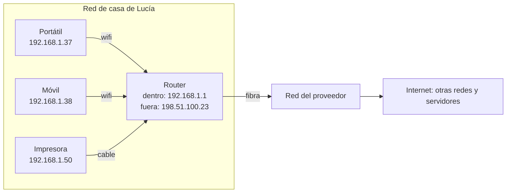
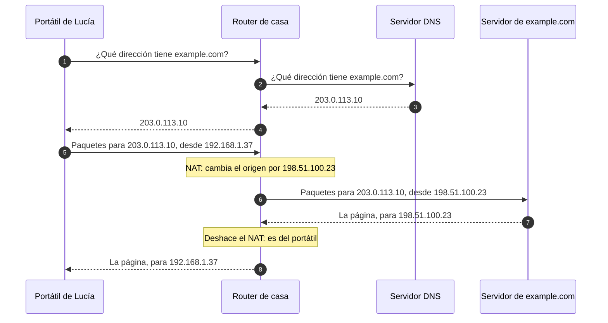
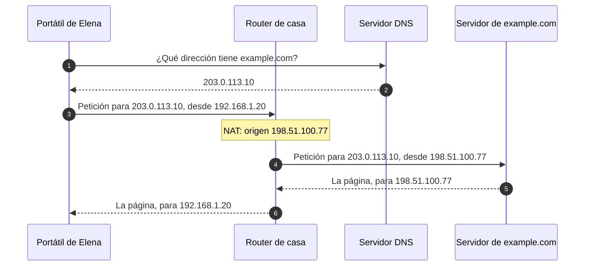

# 06.01 Redes: IP, router, DNS y cortafuegos

> **Versiones:** IPv4 e IPv6; salidas de ejemplo con el formato de `ping` de iputils (20250605) y de `nslookup` de BIND (9.20), comprobado en Linux el 16 de noviembre de 2026
> **Conviene saber antes:** [02.01 Cómo funciona un ordenador, 1.11](../fase-02-tu-ordenador/01-como-funciona-un-ordenador.md#111-la-nube-el-ordenador-de-otro) · [02.03 Instalar programas, variables de entorno y PATH, 1.3](../fase-02-tu-ordenador/03-instalar-programas-y-path.md#13-descarga-siempre-de-la-web-oficial) · [03.01 La terminal: lo básico](../fase-03-herramientas/01-terminal-lo-basico.md)
> **Tiempo estimado:** 2,5 horas
> **Nivel:** Básico · Ampliación

## Qué aprenderás

- Qué es **internet**: una **red de redes** por la que los datos viajan partidos en **paquetes**.
- El modelo **cliente-servidor**: quién pide, quién contesta y qué es exactamente un **servidor**.
- Qué es un **protocolo** y por qué todos los ordenadores del mundo se entienden.
- Qué es una **dirección IP**, cómo se escriben las de **IPv4** y las de **IPv6**, y por qué existen las dos.
- Qué hace el **router** de tu casa, qué diferencia hay entre una **IP privada** y una **IP pública**, y qué es el **NAT**, en una frase.
- Qué direcciones son **especiales**: la de tu propio equipo (`127.0.0.1`), la que delata que algo va mal (`169.254…`) y las que se reservan para los ejemplos.
- Cómo el **DNS** convierte un nombre como `example.com` en una dirección IP, y por qué a veces un cambio tarda en verse.
- La diferencia entre **TCP** y **UDP**, en una idea.
- Qué es un **cortafuegos**, qué decide y por qué no se apaga «para probar».
- A usar **`ping`** y **`nslookup`** para saber si un equipo responde y qué dirección tiene un nombre, y a **leer lo que contestan**.
- A **diagnosticar** paso a paso un «no tengo internet»: la red, el router, la IP o el DNS.

Este módulo es de **ampliación**: te da el mapa de cómo viajan los datos entre ordenadores. No vas a configurar ninguna red, pero cuando un curso te diga «el servidor está en tal dirección», «no resuelve el nombre» o «lo bloquea el cortafuegos», sabrás de qué te habla. Lo que viene después en esta fase (los **puertos**, la **web** y las **API**) se apoya en lo que aprendes aquí.

## 1. Teoría

### 1.1. Internet: una red de redes

Una **red** es un grupo de equipos conectados que pueden mandarse datos: los ordenadores, los móviles y la impresora de tu casa, unidos por cable o por wifi, forman una red. La de una oficina, la de un instituto o la de un centro de datos lleno de servidores, también.

**Internet** es lo que pasa cuando **todas esas redes se conectan entre sí**: una **red de redes**. Tu red de casa se conecta a la de tu **proveedor de internet** (la compañía con la que tienes contratada la fibra o los datos del móvil), esa se conecta a otras más grandes, y así hasta llegar a cualquier red del mundo. No hay un «centro» de internet ni un dueño: hay miles de redes de empresas, universidades y gobiernos que han acordado **hablar el mismo idioma** y pasarse los datos unas a otras.

> **📌 Nota:** internet y **la web** no son lo mismo, aunque se usen como sinónimos. **Internet es la red**: los cables, las antenas y las reglas para mover datos. **La web** (las páginas que abres en el navegador) es **uno de los servicios** que funcionan sobre internet, como el correo electrónico, las videollamadas, los juegos en línea o el `git push` que hiciste en la fase 5. La web la verás en [06.03 La web: HTTP, peticiones, respuestas y APIs](03-la-web-http-y-apis.md).

Cuando en la fase 2 viste que la [nube](../fase-02-tu-ordenador/01-como-funciona-un-ordenador.md#111-la-nube-el-ordenador-de-otro) son «ordenadores de otra empresa a los que accedes por internet», ese «por internet» es justo lo que explica este módulo.

### 1.2. Los paquetes: los datos viajan a trozos

Cuando mandas una foto por internet, no viaja de una pieza. Tu equipo la **parte en trozos pequeños**, llamados **paquetes**, y manda cada uno por separado. Cada paquete lleva, además de su trozo de datos, una especie de **sobre** con:

- **La dirección de destino**: a qué equipo va.
- **La dirección de origen**: de qué equipo viene, para que la respuesta sepa volver.
- Algunos datos más, como el **orden** del trozo, para poder montarlos al final.

Los paquetes van **saltando de red en red**: cada equipo del camino que une redes (los **routers**, que verás en el [apartado 1.7](#17-tu-red-de-casa-y-el-router)) mira la dirección de destino y lo pasa al siguiente que esté más cerca. Es como el correo postal: la oficina de tu barrio no sabe dónde vive el destinatario, pero sabe a qué oficina mandarlo para que se acerque. Paquetes de la misma foto pueden ir por caminos distintos y llegar desordenados; el equipo de destino los **vuelve a montar** en orden.

¿Por qué a trozos? Porque así **muchos pueden compartir los mismos cables a la vez**: tus paquetes se intercalan con los de millones de personas. Y si un trozo se pierde por el camino, basta con **volver a mandar ese trozo**, no la foto entera.

### 1.3. Cliente y servidor

Casi todo lo que pasa en internet sigue el modelo **cliente-servidor**:

- El **cliente** es el programa que **toma la iniciativa**: sabe a quién quiere hablar, se conecta y **pide** algo. Tu navegador cuando abres una web, la aplicación del tiempo de tu móvil o Git cuando haces `git push`.
- El **servidor** es el programa que **espera a que le pidan** y **contesta**. No sabe quién le va a hablar ni cuándo: está en marcha todo el tiempo, atento, y cuando llega una petición, la atiende y responde. El programa que entrega las páginas de una web, el que guarda tus correos o el de GitHub que recibe tus commits.

Por extensión, **servidor** también se llama al **ordenador** donde funcionan esos programas: «la web está en un servidor de Fráncfort». Suele ser un ordenador sin pantalla, encendido día y noche en un centro de datos y casi siempre con Linux (por eso en [02.02](../fase-02-tu-ordenador/02-archivos-carpetas-y-rutas.md) importaban tanto las mayúsculas de las rutas). Pero no tiene nada de mágico: es un ordenador con las mismas piezas que el tuyo, y **tu propio portátil puede hacer de servidor** (lo verás en [06.02 Puertos y localhost](02-puertos-y-localhost.md#14-escuchar-en-un-puerto)).


En texto: el cliente (el navegador de Lucía) pide la página al servidor (el programa de la web), y el servidor le contesta con la página.

Tres ideas que conviene tener claras:

- **Cliente y servidor son papeles, no tipos de ordenador.** El mismo programa puede ser servidor para unos y cliente de otros: el servidor de una tienda en línea **contesta** al navegador de quien compra y, a la vez, **pide** datos a su base de datos (lo verás en [06.05 Las piezas de una aplicación](05-piezas-de-una-aplicacion.md)).
- **Un servidor atiende a muchos clientes a la vez.** Miles de navegadores pueden estar pidiendo la misma web en el mismo segundo.
- **Hay otro modelo**, menos común, en el que todos los equipos hacen de cliente y de servidor a la vez: se llama ***peer-to-peer*** («de igual a igual»). No lo necesitas para empezar.

### 1.4. Protocolos: las reglas de la conversación

Para que dos programas se entiendan, no basta con que les lleguen los datos: tienen que **saber qué esperar del otro**. ¿Quién habla primero? ¿Cómo se pide algo? ¿Cómo se dice «no lo tengo»? ¿Cómo se sabe dónde termina un mensaje?

Ese acuerdo se llama **protocolo**: el conjunto de **reglas que siguen dos programas para comunicarse**. Es como el protocolo de una llamada de teléfono: quien llama marca, quien contesta dice «¿diga?», se hablan por turnos y se despiden antes de colgar. Si uno de los dos no sigue las reglas, la conversación no funciona.

En internet hay protocolos para cada cosa, y se apoyan unos en otros como los pisos de un edificio:

| Protocolo | Para qué sirve | Dónde lo ves |
|---|---|---|
| **IP** | Llevar cada paquete hasta la dirección de destino | Las direcciones IP, en este módulo |
| **TCP** y **UDP** | Que los datos lleguen al programa que toca, enteros o deprisa | [Apartado 1.13](#113-tcp-y-udp) |
| **DNS** | Convertir un nombre en una dirección | [Apartado 1.11](#111-dns-de-nombres-a-números) |
| **HTTP** y **HTTPS** | Pedir y entregar páginas web y datos | [06.03](03-la-web-http-y-apis.md) |
| **SSH** | Conectarse de forma segura a otro equipo | Lo usaste con GitHub en [05.03](../fase-05-git-y-github/03-github.md#15-ssh-un-par-de-claves) |

Los protocolos de internet son **normas públicas**: las publica la IETF (*Internet Engineering Task Force*, el grupo que redacta las normas técnicas de internet) en documentos llamados [RFC](../glosario.md#rfc), los mismos que viste para JSON o CSV. Por eso un móvil de una marca, un servidor de otra y un router de una tercera se entienden sin conocerse.

### 1.5. La dirección IP

Para que un paquete llegue a su destino, cada equipo conectado necesita una dirección, igual que cada casa necesita la suya para recibir cartas. Esa es la **dirección IP**: un número que **identifica a un equipo dentro de una red** (la «IP» viene de *Internet Protocol*, «protocolo de internet»).

Una dirección IP de las de toda la vida se escribe como **cuatro números separados por puntos**:

```text
192.168.1.37
```

Cada uno de los cuatro números va **del 0 al 255** (es un [byte](../glosario.md#byte), y un byte da para 256 valores). Así que `192.168.1.300` **no es una dirección válida**, ni lo es `192.168.1` (le falta un número).

Más cosas que conviene saber desde ya:

- **La dirección es del equipo en una red, no del equipo para siempre.** Si llevas el portátil de casa a la biblioteca, allí tendrá otra. Lo normal es que el equipo **la reciba al conectarse**, sin que hagas nada: se la da el router (lo verás en el [apartado 1.7](#17-tu-red-de-casa-y-el-router)).
- **Un equipo puede tener varias**: una por cada forma de conectarse (cable, wifi) y, a menudo, una de cada tipo (IPv4 e IPv6, el apartado siguiente).
- **En una misma red no puede haber dos equipos con la misma dirección**, igual que no puede haber dos casas con el mismo número en la misma calle: los paquetes no sabrían a cuál ir.

> **📌 Nota:** las direcciones de los ejemplos de este módulo son **de mentira a propósito**. Hay bloques de direcciones reservados para documentación, que no pertenecen a nadie: `192.0.2.x`, `198.51.100.x` y `203.0.113.x` en IPv4 (RFC 5737) y las que empiezan por `2001:db8:` en IPv6 (RFC 3849). Lo mismo pasa con los nombres: `example.com` existe solo para los ejemplos (RFC 2606). Así, ninguna dirección de este curso es la de una persona o una empresa de verdad. Las de la red de casa (`192.168.1.x`) son de otro tipo y las verás en el [apartado 1.8](#18-ip-privada-e-ip-pública).

### 1.6. IPv4 e IPv6

Las direcciones de cuatro números son las de **IPv4**, la versión 4 del protocolo IP, la que se usa desde los años ochenta. Ocupan **4 bytes** (32 bits), así que hay unos **4.300 millones** de direcciones distintas (2 elevado a 32: 4.294.967.296). En los años ochenta parecían infinitas; hoy hay muchos más equipos conectados que eso: móviles, ordenadores, televisores, relojes, cámaras, enchufes…

**Las direcciones IPv4 libres se acabaron.** Se reparten por regiones, y la organización que las reparte en Europa, el RIPE NCC, anunció el 25 de noviembre de 2019 que había entregado las últimas que le quedaban. Desde entonces, quien necesita direcciones IPv4 las consigue de otros que las devuelven o las venden. Hay dos soluciones, y se usan las dos a la vez:

1. **Compartir una dirección entre muchos equipos**, con el NAT del [apartado 1.9](#19-nat-muchos-equipos-con-una-sola-dirección-pública). Es lo que hace tu casa.
2. **Pasar a una versión nueva con muchísimas más direcciones**: **IPv6**.

Una dirección **IPv6** ocupa **16 bytes** (128 bits): hay tantas que no se van a acabar. Se escribe en **ocho grupos de cuatro cifras [hexadecimales](../fase-04-formatos-y-diagramas/01-texto-binario-y-codificacion.md#16-unicode-un-número-para-cada-carácter)** (del `0` al `9` y de la `a` a la `f`), separados por **dos puntos**:

```text
2001:0db8:0000:0000:0000:0000:0000:0025
```

Como es larguísima, se **abrevia** con dos reglas:

- Los **ceros a la izquierda** de cada grupo se quitan: `0db8` se escribe `db8`, y `0025`, `25`.
- **Una sola vez** por dirección, una racha de grupos que son todo ceros se cambia por **`::`**.

Así, la dirección de arriba queda en `2001:db8::25`. Es la misma dirección, solo que escrita corta, y es como la verás casi siempre.

**¿Cuál usa tu ordenador?** Lo más probable es que **las dos a la vez**: hoy casi todos los sistemas, routers y proveedores manejan IPv4 e IPv6, y tu equipo usa la que funcione con cada destino, sin que tengas que elegir. Para lo que vas a hacer en los cursos, **IPv4 sigue siendo la que verás en los ejemplos**, porque se lee mejor; pero no te extrañes cuando en una salida aparezca una dirección con dos puntos.

> **📌 Nota:** ¿qué pasó con IPv5? Hubo un protocolo experimental que usó ese número a finales de los años setenta y nunca se extendió, así que la versión nueva se llamó 6.

### 1.7. Tu red de casa y el router

En tu casa tienes una caja con luces que te instaló tu proveedor de internet: el **router** (en español a veces se dice *enrutador*, pero casi todo el mundo dice *router*). Es la pieza que **une tu red de casa con internet**. Hace varias cosas a la vez, y conviene distinguirlas:

| Lo que hace | Qué quiere decir |
|---|---|
| **Une dos redes** | Por un lado, tu red de casa; por el otro, la red del proveedor (por la fibra, el cable o la antena). Todo lo que sale de casa hacia internet, y todo lo que vuelve, pasa por él. Es su trabajo principal, y de ahí su nombre: *route* es «ruta» en inglés |
| **Da direcciones** | Cuando un equipo se conecta, el router le **asigna una dirección IP** de la red de casa (con un protocolo llamado DHCP). Por eso no tienes que configurar nada al conectar el móvil |
| **Hace de punto de acceso wifi** | La wifi no es internet: es **una forma de conectarse al router sin cable**. Un equipo puede estar conectado a la wifi y el router no tener salida a internet ([error típico 3.1](#31-confundir-la-wifi-con-internet)) |
| **Hace de intermediario del DNS** | Muchos routers contestan las preguntas de DNS de tu casa, o se las pasan al proveedor ([apartado 1.11](#111-dns-de-nombres-a-números)) |
| **Tiene un cortafuegos** | Por defecto, no deja entrar en tu red conexiones que nadie de dentro ha pedido ([apartado 1.14](#114-el-cortafuegos)) |

Así es la red de casa de Lucía:



En texto: el portátil (`192.168.1.37`), el móvil (`192.168.1.38`) y la impresora (`192.168.1.50`) de Lucía están conectados al router, los dos primeros por wifi y la impresora por cable. El router tiene dos direcciones: `192.168.1.1` hacia dentro de casa y `198.51.100.23` hacia fuera. Por la fibra se conecta a la red del proveedor, y de ahí al resto de internet.

Fíjate en que **el router tiene dos direcciones**, una a cada lado, porque está en las dos redes a la vez. La de dentro (aquí `192.168.1.1`) es a la que mandan los equipos de casa todo lo que va hacia fuera; por eso se le llama la **puerta de enlace** (*gateway* en inglés), y la verás con ese nombre en los ajustes de red.

> **⚠️ Cuidado:** el router tiene una **página de configuración** a la que se entra escribiendo su dirección de dentro en el navegador (suele ser `192.168.1.1` o `192.168.0.1`; la de tu router viene en su etiqueta o en sus instrucciones). Ahí se cambia el nombre y la contraseña de la wifi, entre otras cosas. **Mírala si quieres, pero no cambies nada que no entiendas**: puedes dejar a toda la casa sin internet. Y si la contraseña para entrar sigue siendo la que traía de fábrica, cámbiala: cualquiera conectado a tu wifi podría entrar.

### 1.8. IP privada e IP pública

Mira otra vez las direcciones de casa de Lucía: todas empiezan por `192.168.`. No es casualidad. Hay tres bloques de direcciones IPv4 **reservados para redes privadas** (RFC 1918):

| Bloque | Dónde lo verás |
|---|---|
| `192.168.0.0` a `192.168.255.255` (todas las que empiezan por `192.168.`) | Casi todas las redes de casa |
| `10.0.0.0` a `10.255.255.255` (todas las que empiezan por `10.`) | Empresas, universidades, algunas redes de casa y de móviles |
| `172.16.0.0` a `172.31.255.255` (las que empiezan por `172.16.` hasta `172.31.`) | Empresas y algunas herramientas de programación, que crean sus propias redes |

Una **IP privada** es una dirección de uno de esos bloques. Tiene dos propiedades:

- **Solo vale dentro de su red.** Desde internet **no se puede llegar** a una dirección privada: los routers de internet no llevan paquetes a esas direcciones.
- **Se repite en millones de casas.** Tu portátil puede tener la `192.168.1.37` y el de tu vecino, también. No pasa nada, porque cada una vale solo en su red, igual que «el piso 3.º B» existe en muchos edificios.

Una **IP pública** es una dirección **única en todo internet**, a la que se puede llegar desde cualquier sitio. La tienen los servidores (si no, nadie podría visitarlos) y la tiene **el router de tu casa** en su lado de fuera: la `198.51.100.23` de Lucía. Esa es la dirección con la que **te ven** las webs que visitas: todas las peticiones de la casa salen a internet con ella.

> **📌 Nota:** tu IP privada no es ningún secreto: está repetida en millones de casas y desde fuera no sirve para llegar a ti. La pública, en cambio, dice desde qué conexión te conectas y, aproximadamente, desde qué zona. No es una contraseña, pero tampoco hace falta ir publicándola. Por eso este curso no enseña nunca direcciones de verdad.

¿Y la IP pública de tu casa es siempre la misma? Depende del proveedor: en muchas conexiones de casa **cambia de vez en cuando** (por ejemplo, al reiniciar el router), y las fijas se suelen contratar aparte. Los servidores, en cambio, tienen direcciones fijas.

> **📌 Nota:** algunos proveedores, sobre todo los de datos del móvil, comparten también su dirección pública entre muchos clientes, con otro NAT en su propia red (el NAT, en el apartado siguiente). Entonces el lado de fuera de tu router no tiene una dirección pública, y la que ven las webs es la del proveedor. No cambia nada de lo que haces en este curso.

### 1.9. NAT: muchos equipos con una sola dirección pública

Si los equipos de casa tienen direcciones privadas, a las que no se puede llegar desde internet, ¿cómo le llega a tu portátil la página que ha pedido? Gracias al **NAT** (*Network Address Translation*, «traducción de direcciones de red»), que en una frase es esto: **el router cambia la dirección privada de cada paquete que sale por su dirección pública, apunta quién lo mandó y, cuando llega la respuesta, se la entrega a ese equipo**.

Es como la recepción de una empresa: todas las cartas salen con la dirección de la empresa, y la recepcionista sabe a qué mesa llevar cada respuesta. No necesitas saber más de NAT; lo que importa son sus dos consecuencias:

- **Toda tu casa sale a internet con una sola IP pública.** Así se gastan muchas menos direcciones IPv4: una por casa, no una por aparato.
- **Desde fuera no se puede empezar una conexión hacia tu portátil**: el router no sabría a qué equipo de casa dársela, porque nadie la pidió. (Si un día quieres que alguien de fuera entre en un programa de tu ordenador, hay que configurar el router; no lo necesitas en este curso.)

> **📌 Nota:** con **IPv6** no hace falta NAT: hay direcciones de sobra, y cada equipo de casa tiene la suya, pública. Lo que impide entonces que alguien de fuera empiece una conexión con tu portátil es el **cortafuegos del router** ([apartado 1.14](#114-el-cortafuegos)), que deja entrar solo las respuestas a lo que se pidió desde dentro. Por eso el NAT no es una medida de seguridad: quien te protege es el cortafuegos.

### 1.10. Direcciones especiales

Además de las privadas, hay algunas direcciones que tienen un significado fijo. Tres te vas a encontrar a menudo:

| Dirección | Qué es |
|---|---|
| `127.0.0.1` (y `::1` en IPv6) | **Tu propio equipo.** Lo que mandas a esa dirección no sale a ninguna red: vuelve a tu ordenador. Tiene un nombre, `localhost`, y la vas a usar muchísimo cuando programes, porque es donde escucharán tus propios servidores de prueba. La verás a fondo en [06.02 Puertos y localhost](02-puertos-y-localhost.md#15-localhost-tu-propio-ordenador) |
| `169.254.x.x` | Una dirección que **se pone el equipo a sí mismo cuando no ha conseguido que el router le dé una** (Windows y macOS; en Linux, lo normal es que se quede **sin dirección IPv4**). Si ves una así en tus ajustes de red, o ninguna, el problema no está en internet: tu equipo no se entiende con el router (el cable, la wifi o el propio router) |
| `192.0.2.x`, `198.51.100.x`, `203.0.113.x` y `2001:db8:…` | Las **de documentación**, que no son de nadie y se usan en los ejemplos ([nota del apartado 1.5](#15-la-dirección-ip)) |

### 1.11. DNS: de nombres a números

Las personas no recordamos números como `203.0.113.10`, y menos aún como `2001:db8::10`. Recordamos nombres: `example.com`, `github.com`. El **dominio** (la parte de la dirección de una web que va antes de la primera `/`) ya lo conoces de [02.03](../fase-02-tu-ordenador/03-instalar-programas-y-path.md#13-descarga-siempre-de-la-web-oficial), donde aprendiste a leerlo **desde el final** para saber si una web es la oficial.

Pero los paquetes solo entienden de direcciones IP. Alguien tiene que traducir. Ese es el **DNS** (*Domain Name System*, «sistema de nombres de dominio»): un sistema, repartido por todo internet, que **convierte un nombre en una dirección IP**. Es como la agenda del móvil: tú buscas «Mamá» y el móvil marca el número.

Cuando escribes `example.com` en el navegador, antes de nada pasa esto:

1. Tu equipo le pregunta a un **servidor DNS** (normalmente, el de tu router o el de tu proveedor): «¿Qué dirección tiene `example.com`?».
2. El servidor DNS contesta: «`203.0.113.10`» (en este ejemplo; la de verdad es otra).
3. **Ahora sí**, tu navegador manda los paquetes a `203.0.113.10`.

Al paso de nombre a dirección se le llama **resolver** el nombre: «este nombre no resuelve» quiere decir que el DNS no ha sabido darle una dirección. Un mismo nombre puede tener **varias direcciones** (por ejemplo, una IPv4 y una IPv6, o varias para repartir el trabajo entre servidores), y varias webs pequeñas pueden compartir una misma dirección.

> **📌 Nota:** el DNS es un servicio aparte. Por eso puede fallar solo él: los paquetes llegan bien a cualquier dirección, pero ningún nombre funciona. Desde fuera parece que «no hay internet», y no es verdad. Aprenderás a distinguirlo en el [ejemplo 2.7](#27-cuando-el-dns-no-contesta-o-el-nombre-no-existe).

### 1.12. Cómo se resuelve un nombre

Ningún servidor DNS conoce todos los nombres del mundo. Los nombres se organizan **por niveles, de derecha a izquierda**, como una dirección postal que empieza por el país:

```text
www.tienda.example.com
                   └── com: el dominio de primer nivel (como .es, .org, .net)
           └────────── example: el nombre registrado dentro de .com
    └───────────────── tienda: un subdominio, que decide quien tiene example.com
└───────────────────── www: otro nivel más
```

Y cada nivel tiene sus propios servidores DNS, que saben quién lleva el nivel de debajo:

- Los **servidores raíz** saben quién lleva cada dominio de primer nivel (`.com`, `.es`…).
- Los servidores de **`.com`** saben quién lleva `example.com`.
- Los servidores de **`example.com`** saben la dirección de `example.com`, de `www.example.com` y de todo lo que cuelga de él. Se les llama **autoritativos**: son los que tienen la respuesta oficial.

El servidor DNS al que pregunta tu equipo hace ese recorrido por ti y te da el resultado. Además, **guarda las respuestas un rato** (las tiene en **caché**, como se llama en informática a una copia que se guarda de algo para no tener que volver a buscarlo), y tu propio equipo y el navegador también. El tiempo que se puede guardar cada respuesta lo decide quien lleva el dominio. Eso tiene una consecuencia práctica:

- La segunda vez que pides un nombre, la respuesta es **inmediata**.
- Pero si alguien **cambia la dirección** de su dominio (por ejemplo, porque pasa su web a otro servidor), durante un tiempo **unos verán la dirección nueva y otros la vieja**, según tengan guardada una u otra. Que un cambio de DNS «tarde en propagarse» es eso.

> **📌 Nota:** antes de preguntar al DNS, tu equipo mira un pequeño fichero de texto, el fichero **`hosts`** (en Linux y macOS, `/etc/hosts`; en Windows, `C:\Windows\System32\drivers\etc\hosts`), donde pueden estar apuntados algunos nombres a mano. Ahí suele estar, por ejemplo, que `localhost` es `127.0.0.1`. No necesitas tocarlo.

### 1.13. TCP y UDP

IP lleva cada paquete hasta el equipo de destino, pero **no garantiza nada más**: un paquete se puede perder por el camino o llegar después que el siguiente. Además, en ese equipo hay muchos programas a la vez, y hay que saber **a cuál** le toca cada paquete. De eso se encargan los dos protocolos que van encima de IP: **TCP** y **UDP**. La idea de cada uno:

| | **TCP** | **UDP** |
|---|---|---|
| Es como | Una **llamada de teléfono**: primero se establece la conexión, se habla por turnos y se cuelga | Mandar **postales**: cada una va por su cuenta, sin avisar |
| ¿Llega todo? | **Sí**: lo que se pierde se vuelve a mandar solo | **No está garantizado**: una postal se puede perder sin que nadie se entere |
| ¿En orden? | **Sí** | No necesariamente |
| ¿Rápido? | Algo más lento: conectar y confirmar lo recibido lleva tiempo | Más rápido y ligero |
| Se usa en | Casi todo: la web, el correo, Git, SSH, las descargas | Lo que tiene prisa: videollamadas, voz, juegos en línea y la mayoría de las preguntas al DNS |

**¿Por qué alguien querría un protocolo que puede perder datos?** Porque a veces **un dato que llega tarde ya no sirve**. En una videollamada, si se pierde un trocito de imagen, es mejor seguir con el siguiente que parar a esperar el perdido: sería un salto atrás en el tiempo. En una descarga, en cambio, no puede faltar ni un byte: TCP.

Tanto TCP como UDP llevan a cada paquete hasta el **programa** que toca dentro del equipo con un número llamado **puerto**. Qué es un puerto lo verás en [06.02 Puertos y localhost](02-puertos-y-localhost.md#11-una-dirección-ip-no-basta-el-puerto); de momento, basta con saber que **la dirección IP dice a qué equipo va un paquete, y el puerto, a qué programa de ese equipo**.

> **📌 Nota:** las versiones más nuevas de HTTP, el protocolo de la web, pueden ir sobre UDP y se encargan ellas mismas de que no se pierda nada. No te hace falta para empezar: la idea de «TCP para que llegue todo, UDP para que llegue rápido» sigue valiendo.

### 1.14. El cortafuegos

Un **cortafuegos** (*firewall* en inglés) es un programa, o un aparato, que **decide qué conexiones pueden pasar y cuáles no**, según unas **reglas**. Su nombre viene de los muros que se construyen para que un incendio no pase de una parte de un edificio a otra.

Las reglas suelen distinguir **dos direcciones**:

- **Conexiones entrantes**: las que **otro equipo empieza hacia el tuyo**. Son las peligrosas, porque las empieza alguien que no conoces. Por defecto, casi todas **se bloquean**.
- **Conexiones salientes**: las que **empieza un programa de tu equipo** (tu navegador pidiendo una web). Por defecto, en los equipos de casa, **se dejan pasar**, igual que sus respuestas.

Y hay cortafuegos en dos sitios:

- **En el router**: protege a toda la red de casa de lo que viene de internet: deja entrar las respuestas a lo que se pidió desde dentro y para lo demás, tanto con IPv4 como con IPv6.
- **En tu propio ordenador**: protege al equipo incluso de los demás equipos de **su misma red**. Importa sobre todo en redes que no son tuyas: la wifi de una cafetería, de un hotel o de una biblioteca, donde cualquiera conectado podría intentar entrar en tu portátil.

En cada sistema (según la documentación oficial, a 16 de noviembre de 2026):

- **Windows** trae su cortafuegos **activado de serie**, y usa **perfiles de red**: **público** (el que pone por defecto a las redes que no conoce, el más estricto), **privado** (para la red de casa o del trabajo, que es de confianza) y **dominio** (el de las redes de algunas empresas). Por eso, al conectarte a una wifi nueva, Windows la trata como pública hasta que digas otra cosa.
- **macOS** trae un cortafuegos que se activa y se ajusta en **Ajustes del Sistema > Red > Firewall**, según la guía de Apple en español. Allí ves si lo tienes activado.
- **Linux** tiene cortafuegos, y cada distribución lo trae activado o no y con su propia herramienta. En un servidor, configurarlo es parte del trabajo; en tu portátil de estudio, no necesitas tocarlo.

Lo verás de cerca en [06.02](02-puertos-y-localhost.md#18-el-cortafuegos-pregunta): cuando un programa de tu ordenador quiere **recibir** conexiones (hacer de servidor), el cortafuegos del sistema suele **preguntarte** si le dejas. Ahí entenderás qué te está pidiendo.

> **⚠️ Cuidado:** si algo no funciona, **no apagues el cortafuegos «para probar»** y te olvides de volver a encenderlo: dejas tu equipo abierto a cualquiera de la red en la que estés. Lo correcto es averiguar qué regla falta y permitir **solo** ese programa ([error típico 3.4](#34-apagar-el-cortafuegos-para-que-funcione)).

> **📌 Nota:** un cortafuegos **no es un antivirus**. El cortafuegos decide qué conexiones pasan; el antivirus busca programas dañinos en tus ficheros. Hacen cosas distintas, y conviene tener los dos. La seguridad la verás más a fondo en [07.05 Seguridad básica](../fase-07-aprender-a-aprender/05-seguridad-basica.md).

### 1.15. ping: ¿me oyes?

Ya tienes el mapa. Ahora, dos órdenes para **mirar la red desde la terminal**. La primera es **`ping`**: manda a un equipo unos paquetes pequeños de prueba que dicen «¿me oyes?» y espera a que le conteste «te oigo». Te dice **si responde** y **cuánto tarda** en ir y volver. Se llama así por el sonido del sónar de los submarinos: mandas un «ping» y escuchas el eco.

Se escribe `ping` y, detrás, una dirección IP o un nombre:

```text
ping -c 4 192.168.1.1
ping -c 4 example.com
```

`-c 4` (de *count*, «cuenta») le dice que mande **4** paquetes y pare. Es importante: **en Linux y en macOS, sin `-c`, `ping` no para nunca**; sigue mandando uno cada segundo hasta que pulses <kbd>Ctrl</kbd>+<kbd>C</kbd> (lo viste en [03.01](../fase-03-herramientas/01-terminal-lo-basico.md#113-trucos-que-ahorran-tiempo)), y entonces escribe el resumen.

Lo que verás en el [ejemplo 2.3](#23-ping-al-router), y cómo se lee:

| En la salida | Qué quiere decir |
|---|---|
| `64 bytes from 192.168.1.1` | Ha llegado una respuesta de ese equipo: **responde** |
| `icmp_seq=1`, `icmp_seq=2`… | El número de cada paquete. Si falta alguno, se ha perdido |
| `time=2.85 ms` | Lo que ha tardado en **ir y volver**, en milisegundos (milésimas de segundo). A tu router, pocos milisegundos; a un servidor de otro país, decenas o cientos |
| `ttl=64` | Cuántos saltos de router le quedaban al paquete de respuesta. Cada router del camino le resta uno, y si llega a cero se tira, para que un paquete perdido no dé vueltas para siempre. No te hace falta usarlo |
| `4 packets transmitted, 4 received, 0% packet loss` | El resumen: **mandados, recibidos y porcentaje perdido**. Es la línea más importante |
| `rtt min/avg/max/mdev` | El tiempo mínimo, el medio, el máximo y cuánto varía |

En Linux, las salidas de `ping` suelen estar **en inglés** aunque el sistema esté en español (en Git Bash, ya verás que no). Y como dependen de tu red, **en este módulo son de ejemplo**: tus direcciones y tus tiempos serán otros. Fíjate en lo que dice cada una, no en los números exactos ([aviso de 02.03](../fase-02-tu-ordenador/03-instalar-programas-y-path.md#22-un-aviso-sobre-las-salidas-de-la-terminal)).

> **⚠️ Cuidado:** que un equipo **no responda** a `ping` **no quiere decir que esté apagado ni caído**. Muchos servidores y cortafuegos están configurados para **no contestar** a estos paquetes de prueba, a propósito. `ping` te sirve para comprobar que algo responde; si no responde, solo sabes que no ha contestado ([error típico 3.2](#32-creer-que-si-ping-no-responde-el-servidor-está-caído)).

**En Git Bash y en macOS**, `ping` no es igual que en Linux:

- En **Git Bash**, `ping` es **el de Windows**: manda **cuatro** paquetes y para solo, sus mensajes salen en el idioma de tu Windows y con otro formato, y sus opciones son otras (el número de paquetes se elige con `-n`, no con `-c`, según la documentación de Microsoft). Escribe simplemente `ping example.com`.
- En **macOS**, `ping` funciona como en Linux (también con `-c`), pero su salida cambia en algunos detalles: por ejemplo, numera los paquetes desde 0.

En los tres, lo importante es lo mismo: **si llegan respuestas, cuánto tardan y cuántas se pierden**.

> **📌 Nota para Git Bash:** escribe `ping example.com` (o `ping -n 4 example.com`), **no** `ping -c 4`: en el `ping` de Windows, el número de paquetes se elige con `-n`, no con `-c`. Tampoco copies la forma con barra de la documentación de Microsoft (`/n`): en Git Bash, una palabra que empieza por `/` puede tomarse como una ruta; usa `-n`. Su salida tiene otra forma, pero dice lo mismo: una línea por cada **respuesta** (sin numerar: cuéntalas), con su tiempo; una línea de aviso por cada paquete **perdido**, y al final un **resumen** con los paquetes enviados, recibidos y perdidos. Y es posible que las letras con tilde salgan cambiadas por `�`: `ping`, `nslookup`, `ipconfig` y `netstat` son programas de Windows y escriben en otra [codificación](../fase-04-formatos-y-diagramas/01-texto-binario-y-codificacion.md#110-caracteres-estropeados-mojibake) que la que espera la ventana de Git Bash. No has roto nada: lee lo que entiendas y fíjate en los números.

### 1.16. nslookup: preguntar al DNS

La segunda orden es **`nslookup`** (de *name server lookup*, «consulta al servidor de nombres»): le pregunta al DNS qué dirección tiene un nombre, y te enseña la respuesta.

```text
nslookup example.com
```

Su salida tiene dos partes, como verás en el [ejemplo 2.6](#26-preguntar-al-dns-con-nslookup):

- **Arriba, `Server` y `Address`: a quién ha preguntado.** Es tu servidor DNS (a menudo, el router: `192.168.1.1`). El `#53` del final es el puerto en el que escuchan los servidores DNS ([06.02](02-puertos-y-localhost.md#11-una-dirección-ip-no-basta-el-puerto) te explicará qué es un puerto).
- **Abajo, la respuesta**: `Name` (el nombre preguntado) y `Address` (su dirección). Puede haber varias, por ejemplo una IPv4 y una IPv6. La línea `Non-authoritative answer` («respuesta no autoritativa») quiere decir que no contesta el servidor oficial del dominio, sino tu servidor DNS, que se lo ha preguntado a él o lo tenía guardado: es lo normal.

`nslookup` existe en Linux, en macOS y en Windows (y por tanto en Git Bash, donde es el de Windows, con los mensajes en el idioma de tu Windows, otro formato y, a veces, las tildes cambiadas, como `ping`: mira la nota para Git Bash del [apartado 1.15](#115-ping-me-oyes)). Lo que importa es lo mismo: si **alguien contesta** con una dirección, si contesta que **el nombre no existe** o si **nadie contesta** porque se agota el tiempo. Sus salidas, como las de `ping`, son **de ejemplo** en este módulo.

> **📌 Nota:** en algunos Linux, como Ubuntu, `nslookup` dice que ha preguntado a `127.0.0.53`. Es un pequeño programa de tu propio equipo que hace de intermediario y pasa la pregunta al servidor DNS de la red. Hay más órdenes para preguntar al DNS (`dig` y `host`, en Linux y macOS), con más detalle; `nslookup` es la que está en los tres sistemas.

### 1.17. Lo que verás después

Este módulo es el mapa. Lo que se apoya en él, en esta misma fase:

- **Los puertos** y cómo tu ordenador hace de servidor (`localhost`): [06.02 Puertos y localhost](02-puertos-y-localhost.md).
- **La web**: qué viaja exactamente cuando el navegador pide una página, y las **API**: [06.03 La web: HTTP, peticiones, respuestas y APIs](03-la-web-http-y-apis.md).
- **Cómo encajan** el navegador, el servidor, la base de datos y la nube en una aplicación entera: [06.05 Las piezas de una aplicación](05-piezas-de-una-aplicacion.md).

Lo que **no** necesitas para empezar y verás, si te hace falta, en un curso de redes o de sistemas: cómo se dividen las redes en subredes (las **máscaras**, como `255.255.255.0`, que verás en los ajustes de red), los modelos de capas que se estudian en las carreras de informática, o cómo se configura un router por dentro.

## 2. Ejemplos de código

> **📌 Nota:** este módulo **no tiene código verificable**. Las salidas de `ping` y `nslookup` dependen de la red de cada uno, así que no se pueden repetir igual en ningún sitio: las de estos ejemplos son **de ejemplo**, con el formato de Linux y con direcciones de documentación ([nota del apartado 1.5](#15-la-dirección-ip)). Si pruebas las órdenes en tu equipo (puedes hacerlo: solo miran, no cambian nada), verás tus direcciones y tus tiempos. Fíjate en lo que dice el texto de cada una.

Todos los ejemplos son de la red de casa de Lucía, la del [apartado 1.7](#17-tu-red-de-casa-y-el-router):

| Equipo | Dirección |
|---|---|
| Portátil de Lucía | `192.168.1.37` (privada) |
| Router, por dentro | `192.168.1.1` (privada) |
| Router, por fuera | `198.51.100.23` (pública) |
| Servidor de `example.com`, en estos ejemplos | `203.0.113.10` y `2001:db8::10` |

### 2.1. Dónde ver tu dirección y la de tu router

**Situación real:** Lucía quiere saber qué dirección tiene su portátil en la red de casa y cuál es la de su router.

No hace falta la terminal: está en los **ajustes de red** del sistema. Busca la red a la que estás conectado (la wifi o el cable) y sus **detalles** o **propiedades**. Los nombres exactos cambian con cada sistema y cada versión, pero siempre encontrarás algo así:

```text
Dirección IPv4 .......... 192.168.1.37
Máscara de subred ....... 255.255.255.0
Puerta de enlace ........ 192.168.1.1
Servidores DNS .......... 192.168.1.1
Dirección IPv6 .......... 2001:db8:1:1::37
```

(Es un resumen inventado de lo que muestran los ajustes; en tu sistema saldrá con otro aspecto y, a menudo, con más datos.)

**En qué fijarte:**

- **La dirección IPv4** del portátil empieza por `192.168.`: es **privada**, la de la red de casa.
- **La puerta de enlace** es el **router**: `192.168.1.1`.
- **El servidor DNS** también es el router, que hace de intermediario con el del proveedor.
- La **máscara de subred** es lo que se dejó fuera en el [apartado 1.17](#117-lo-que-verás-después): puedes ignorarla.
- Si la dirección IPv4 empezara por **`169.254.`** (o, en Linux, si no hubiera ninguna), el portátil no habría conseguido dirección del router ([apartado 1.10](#110-direcciones-especiales)).

> **📌 Nota:** también se puede ver desde la terminal, y lo verás en tutoriales: en Windows, `ipconfig` (que funciona también en Git Bash, porque es un programa de Windows, con las tildes a veces cambiadas, como `ping`); en Linux, `ip address`; en macOS, `ifconfig`. Sus salidas son largas y muy distintas en cada sistema, con datos de todas las conexiones del equipo; no las necesitas.

¿Y la **IP pública**? Esa no está en tu ordenador, sino en el router (en su lado de fuera). Puedes verla en su página de configuración (salvo que tu proveedor comparta la suya, como dice la nota del [apartado 1.8](#18-ip-privada-e-ip-pública)), y la conoce cualquier web que visites, porque es la dirección desde la que le llegan tus peticiones.

### 2.2. Qué dirección lleva cada paquete

**Situación real:** Lucía abre `example.com` en su portátil. ¿Con qué direcciones viajan los paquetes en cada tramo?

| Tramo | Origen | Destino |
|---|---|---|
| 1. Del portátil al router | `192.168.1.37` (el portátil) | `203.0.113.10` (el servidor) |
| 2. Del router a internet (tras el NAT) | `198.51.100.23` (el router, por fuera) | `203.0.113.10` |
| 3. La respuesta, del servidor al router | `203.0.113.10` | `198.51.100.23` |
| 4. Del router al portátil (deshace el NAT) | `203.0.113.10` | `192.168.1.37` |

**En qué fijarte:**

- **El destino no cambia** en todo el viaje de ida: siempre es el servidor.
- **El origen sí cambia** al salir de casa: el router pone su dirección pública en lugar de la privada del portátil. Es el **NAT** del [apartado 1.9](#19-nat-muchos-equipos-con-una-sola-dirección-pública).
- **El servidor nunca ve la `192.168.1.37`**: para él, la petición viene de `198.51.100.23`. Si el móvil de Lucía abriera la misma web a la vez, el servidor vería las dos peticiones con la misma dirección.
- El router **se acuerda** de quién mandó cada cosa, y por eso en el tramo 4 sabe que la respuesta es del portátil y no del móvil.

### 2.3. ping al router

**Situación real:** Lucía comprueba que su portátil se entiende con el router. Es lo primero que se mira cuando algo de la red falla.

```text
$ ping -c 4 192.168.1.1
PING 192.168.1.1 (192.168.1.1) 56(84) bytes of data.
64 bytes from 192.168.1.1: icmp_seq=1 ttl=64 time=2.85 ms
64 bytes from 192.168.1.1: icmp_seq=2 ttl=64 time=3.12 ms
64 bytes from 192.168.1.1: icmp_seq=3 ttl=64 time=2.47 ms
64 bytes from 192.168.1.1: icmp_seq=4 ttl=64 time=2.96 ms

--- 192.168.1.1 ping statistics ---
4 packets transmitted, 4 received, 0% packet loss, time 3005ms
rtt min/avg/max/mdev = 2.470/2.850/3.120/0.239 ms
```

(Salida de ejemplo, con el formato de Linux.)

**En qué fijarte:**

- La primera línea repite a quién se manda (`192.168.1.1`) y el tamaño de cada paquete de prueba (`56(84) bytes`), que no te importa.
- Llegan **cuatro respuestas**, numeradas del 1 al 4: no falta ninguna.
- Cada una tarda **unos 3 milisegundos** en ir y volver: el router está al lado.
- El resumen lo confirma: **4 mandados, 4 recibidos, 0 % perdido**. El portátil y el router se entienden.
- `ping` ha parado solo tras los cuatro, gracias a `-c 4`.

### 2.4. ping a un dominio

**Situación real:** ahora Lucía hace `ping` a un nombre, `example.com`. Así comprueba dos cosas a la vez: que el DNS resuelve el nombre y que hay camino hasta ese servidor.

```text
$ ping -c 4 example.com
PING example.com (203.0.113.10) 56(84) bytes of data.
64 bytes from 203.0.113.10 (203.0.113.10): icmp_seq=1 ttl=54 time=21.4 ms
64 bytes from 203.0.113.10 (203.0.113.10): icmp_seq=2 ttl=54 time=20.9 ms
64 bytes from 203.0.113.10 (203.0.113.10): icmp_seq=3 ttl=54 time=22.8 ms
64 bytes from 203.0.113.10 (203.0.113.10): icmp_seq=4 ttl=54 time=21.3 ms

--- example.com ping statistics ---
4 packets transmitted, 4 received, 0% packet loss, time 3004ms
rtt min/avg/max/mdev = 20.900/21.600/22.800/0.718 ms
```

(Salida de ejemplo, con el formato de Linux. Las direcciones de verdad de `example.com` son otras.)

**En qué fijarte:**

- **La primera línea ya es una respuesta del DNS**: `example.com (203.0.113.10)`. Antes de mandar nada, `ping` ha preguntado la dirección del nombre. Si el DNS no supiera contestar, `ping` pararía aquí ([ejemplo 2.5](#25-un-ping-sin-respuesta)).
- Las respuestas vienen de **esa dirección**. (Si la dirección tiene un nombre registrado, puede salir ese nombre delante del paréntesis.)
- **Unos 21 milisegundos**: siete veces más que al router. Es normal: los paquetes han salido de casa, han cruzado la red del proveedor y varias más, y han vuelto.
- `ttl=54`: la respuesta ha pasado por unos cuantos routers por el camino, que le han ido restando uno. No necesitas sacar más de ahí.

> **📌 Nota:** si tu equipo usa IPv6 con ese servidor, la primera línea mostrará una dirección con dos puntos (`2001:db8::10`), y el formato del resto cambia un poco. Para forzar IPv4, en Linux, `ping -4`; no lo necesitas.

### 2.5. Un ping sin respuesta

**Situación real:** dos intentos que salen mal, y que no significan lo mismo.

Primero, a una dirección que no contesta:

```text
$ ping -c 4 203.0.113.50
PING 203.0.113.50 (203.0.113.50) 56(84) bytes of data.

--- 203.0.113.50 ping statistics ---
4 packets transmitted, 0 received, 100% packet loss, time 3062ms

```

Después, a un nombre que no existe:

```text
$ ping -c 4 tienda-luis.invalid
ping: tienda-luis.invalid: Nombre o servicio desconocido
```

(Salidas de ejemplo, con el formato de Linux en español.)

**En qué fijarte:**

- **En el primero, el nombre no tiene nada que ver**: se ha mandado a una dirección. Han salido 4 paquetes y no ha vuelto **ninguno** (`100% packet loss`). Puede que el equipo esté apagado, que no exista o, muy a menudo, que **no conteste a `ping` a propósito**. Con esto solo no sabes cuál de las tres.
- **En el segundo, `ping` ni siquiera ha empezado**: no ha conseguido la dirección del nombre. El mensaje, «Nombre o servicio desconocido», es el del sistema, no el de `ping`, y por eso sale en español (o en inglés, según el sistema). El problema está en el **nombre**: está mal escrito, no existe, o el DNS no contesta (el [ejemplo 2.7](#27-cuando-el-dns-no-contesta-o-el-nombre-no-existe) te dirá cuál).
- Los nombres que acaban en **`.invalid`** están reservados justo para esto: para los ejemplos de nombres que no existen (RFC 2606). Nunca existirán.

### 2.6. Preguntar al DNS con nslookup

**Situación real:** Lucía quiere saber, sin hacer `ping`, qué dirección tiene `example.com` y quién se la da.

```text
$ nslookup example.com
Server:         192.168.1.1
Address:        192.168.1.1#53

Non-authoritative answer:
Name:   example.com
Address: 203.0.113.10
Name:   example.com
Address: 2001:db8::10

```

(Salida de ejemplo, con el formato de Linux y macOS. Las direcciones de verdad de `example.com` son otras.)

**En qué fijarte:**

- **`Server: 192.168.1.1`**: ha preguntado al **router**, que es el servidor DNS de la casa (el que salía en los ajustes del [ejemplo 2.1](#21-dónde-ver-tu-dirección-y-la-de-tu-router)). El `#53` es el puerto de los servidores DNS.
- **`Non-authoritative answer`**: la respuesta no viene del servidor oficial de `example.com`, sino del router, que la ha conseguido por el camino del [apartado 1.12](#112-cómo-se-resuelve-un-nombre). Lo normal.
- **Dos respuestas para el mismo nombre**: una dirección **IPv4** (`203.0.113.10`) y una **IPv6** (`2001:db8::10`). Tu equipo usará la que le vaya mejor.
- Es la **misma dirección** que encontró `ping` en el [ejemplo 2.4](#24-ping-a-un-dominio): los dos le preguntaron lo mismo al mismo DNS.

### 2.7. Cuando el DNS no contesta o el nombre no existe

**Situación real:** dos fallos de `nslookup` que se parecen y piden soluciones distintas.

Un nombre que **no existe**:

```text
$ nslookup tienda-luis.invalid
Server:         192.168.1.1
Address:        192.168.1.1#53

** server can't find tienda-luis.invalid: NXDOMAIN

```

Un servidor DNS que **no contesta**:

```text
$ nslookup example.com
;; communications error to 192.168.1.1#53: timed out
;; communications error to 192.168.1.1#53: timed out
;; communications error to 192.168.1.1#53: timed out
;; no servers could be reached

```

(Salidas de ejemplo, con el formato de Linux.)

**En qué fijarte:**

- **En el primero, el DNS funciona**: el router ha contestado. Lo que dice es que **ese nombre no existe**. `NXDOMAIN` quiere decir eso, «dominio que no existe» (*non-existent domain*). La solución está en el nombre: **revisa cómo lo has escrito**.
- **En el segundo, nadie contesta**: `nslookup` lo ha intentado tres veces con el router (`timed out`: «se ha agotado el tiempo») y se ha rendido (`no servers could be reached`: «no se ha podido llegar a ningún servidor»). Aquí el nombre da igual: **ningún** nombre funcionaría. El problema está en el **servidor DNS** o en el camino hasta él.
- Con el segundo, la sensación es que «no hay internet». Pero puede que los paquetes a direcciones IP sigan llegando bien: solo falla la traducción de nombres. Lo comprobarás en el [ejercicio 8](#ejercicio-8--no-hay-internet-en-la-academia-de-baile).

> **📌 Nota:** el texto de estos errores cambia según el sistema y el servidor DNS. Por ejemplo, algunos servidores contestan a un nombre inexistente con `*** Can't find …: No answer` en lugar de `NXDOMAIN`. Lo que importa es distinguir si **alguien contesta** (el DNS funciona y el nombre no existe) o **nadie contesta** (falla el DNS).

### 2.8. El viaje completo de una petición

**Situación real:** juntando todo el módulo, esto es lo que pasa cuando Lucía escribe `example.com` en el navegador de su portátil, hasta que tiene la página.



En texto: (1) el portátil pregunta al router qué dirección tiene `example.com`; (2) el router se lo pregunta al servidor DNS del proveedor; (3) el DNS contesta `203.0.113.10` y (4) el router se lo pasa al portátil. (5) El portátil manda los paquetes de su petición a esa dirección, con su dirección privada como origen; el router les cambia el origen por su dirección pública y (6) los manda al servidor de `example.com`. (7) El servidor contesta con la página a la dirección pública, y (8) el router, que sabe que la había pedido el portátil, se la entrega.

**En qué fijarte:**

- **Primero el DNS, después todo lo demás.** Si fallan los pasos 1 a 4, el resto no llega a pasar.
- **El router está en medio de todo**: del DNS y de los paquetes. Por eso es lo primero que se mira cuando algo falla ([ejemplo 2.3](#23-ping-al-router)).
- Entre el router y el servidor hay en realidad **muchos routers más**, uno por cada red que se cruza; el diagrama no los dibuja para que se lea mejor.
- Lo que va dentro de esos paquetes (cómo se pide una página y cómo se contesta) es **HTTP**, y lo verás en [06.03](03-la-web-http-y-apis.md). Y cómo llega la petición al **programa** concreto del servidor, con los puertos, en [06.02](02-puertos-y-localhost.md#11-una-dirección-ip-no-basta-el-puerto).

## 3. Errores típicos

### 3.1. Confundir la wifi con internet

**Qué pasa:** el móvil o el portátil dice que está conectado a la wifi (o pone «Conectado, sin internet»), pero no carga nada. Llamas a tu proveedor diciendo «la wifi no va», o reinicias el portátil una y otra vez.

**Por qué ocurre:** la wifi es solo **el tramo entre tu equipo y el router** ([apartado 1.7](#17-tu-red-de-casa-y-el-router)). Puedes estar perfectamente conectado a él y que sea el **router** el que no tiene salida a internet (una avería del proveedor, un cable de fibra suelto…). O al revés: el router tiene internet y es tu equipo el que no se entiende con él.

**Cómo se arregla:** separa los tramos. Si **otros equipos** de casa tampoco tienen internet, el problema es del router o del proveedor: mira las luces del router, reinícialo y, si sigue, llama al proveedor. Si solo falla **tu equipo**, el problema está entre él y el router: mira su dirección ([ejemplo 2.1](#21-dónde-ver-tu-dirección-y-la-de-tu-router); una `169.254.x.x`, o ninguna, lo delata) y haz `ping` al router ([ejemplo 2.3](#23-ping-al-router)).

### 3.2. Creer que si ping no responde, el servidor está caído

**Qué pasa:** haces `ping` a la web de una empresa, sale `100% packet loss` y concluyes que la web está caída. Pero la abres en el navegador y funciona.

**Por qué ocurre:** muchos servidores y cortafuegos **no contestan a `ping` a propósito**, para dar menos pistas a quien intenta atacarlos. Que un servidor no responda a `ping` no dice nada de si su web funciona.

**Cómo se arregla:** usa `ping` para **confirmar** que algo responde, no para demostrar que algo está caído. Para saber si una web funciona, lo que cuenta es si responde **la web** (con el navegador, o con `curl`, que verás en [06.02](02-puertos-y-localhost.md#112-responde-alguien-comprobarlo-con-curl) y [06.03](03-la-web-http-y-apis.md#113-curl-http-desde-la-terminal)). Y para saber si **el nombre** está bien, `nslookup`.

### 3.3. Dar tu IP privada como si fuera la de internet

**Qué pasa:** un amigo te pide tu dirección para conectarse a un juego que tienes en tu ordenador, le das la `192.168.1.37` que ves en tus ajustes, y no consigue nada. O, al revés, te asustas porque has visto tu dirección `192.168.1.37` en una captura de pantalla de un tutorial.

**Por qué ocurre:** la dirección que ves en tu equipo es la **privada**, que solo vale dentro de tu casa y que tienen millones de personas ([apartado 1.8](#18-ip-privada-e-ip-pública)). Desde fuera, tu casa entera se ve con la **pública** del router, y aun así el router no deja empezar conexiones hacia dentro: con IPv4 no sabría a qué equipo dársela (el NAT, [apartado 1.9](#19-nat-muchos-equipos-con-una-sola-dirección-pública)), y su cortafuegos las para, también con IPv6 ([apartado 1.14](#114-el-cortafuegos)).

**Cómo se arregla:** aprende a reconocer las privadas (`192.168.`, `10.`, de `172.16.` a `172.31.`): **no son de nadie en particular** y no sirven fuera de su red. Y no abras tu ordenador a internet para un juego o un programa: los servicios de verdad funcionan en servidores con dirección pública, y para probar los tuyos tienes `localhost` ([06.02](02-puertos-y-localhost.md#15-localhost-tu-propio-ordenador)).

### 3.4. Apagar el cortafuegos para que funcione

**Qué pasa:** un programa no consigue conectar, alguien en un foro dice «desactiva el cortafuegos» y, efectivamente, funciona. Y el cortafuegos se queda apagado semanas, también cuando te llevas el portátil a la cafetería.

**Por qué ocurre:** apagar el cortafuegos quita **todas** las reglas, no solo la que molestaba. Funciona, pero deja tu equipo abierto a cualquiera de la red en la que estés ([apartado 1.14](#114-el-cortafuegos)).

**Cómo se arregla:** si el cortafuegos te pregunta si dejas a un programa recibir conexiones, contesta pensando qué programa es y en qué red estás (lo verás en [06.02](02-puertos-y-localhost.md#18-el-cortafuegos-pregunta)). Si necesitas abrir algo, **permite solo ese programa**, y en las redes **privadas**, no en las públicas. Si alguna vez lo apagas para comprobar si el problema es él, vuelve a encenderlo **en cuanto lo compruebes**.

### 3.5. Echar la culpa a la red cuando falla el DNS

**Qué pasa:** ninguna web carga, el navegador dice algo como «no se ha encontrado la dirección» y llegas a la conclusión de que no tienes internet. Pero el móvil de tu hermana, en la misma wifi, va perfectamente.

**Por qué ocurre:** la conexión puede estar bien y fallar solo **la traducción de nombres** ([apartado 1.11](#111-dns-de-nombres-a-números)): sin DNS, ningún nombre funciona, y parece que no hay nada. A veces es un problema de tu equipo (o de un DNS que configuraste a mano y ya no funciona), y por eso otros equipos de la misma red van bien.

**Cómo se arregla:** pregunta al DNS directamente con `nslookup` ([ejemplo 2.7](#27-cuando-el-dns-no-contesta-o-el-nombre-no-existe)). Si **nadie contesta**, el fallo está en el DNS: reiniciar el router suele arreglarlo, y si solo falla en tu equipo, revisa sus ajustes de DNS (lo normal es dejarlos en automático). Si contesta `NXDOMAIN`, el fallo está en **el nombre** que has escrito.

### 3.6. Escribir mal una dirección IP

**Qué pasa:** intentas entrar en la página de tu router con `192.168.1.256`, o con `192.168.1`, o con `192,168,1,1`, y no hay manera.

**Por qué ocurre:** una dirección IPv4 son **exactamente cuatro números del 0 al 255 separados por puntos** ([apartado 1.5](#15-la-dirección-ip)). `256` se pasa del máximo; a la segunda le falta un número; la tercera lleva comas.

**Cómo se arregla:** cuenta los números y mira que ninguno pase de 255. Y copia la dirección de donde la veas (la etiqueta del router, los ajustes de red) en lugar de escribirla de memoria.

### 3.7. Un ping que no se acaba nunca

**Qué pasa:** escribes `ping example.com` en Linux o en macOS y la pantalla se llena de líneas sin parar. No sabes cómo salir, y cierras la terminal.

**Por qué ocurre:** en Linux y en macOS, `ping` **sigue hasta que lo paras**. En Windows (y en Git Bash) para solo tras cuatro paquetes, y por eso los tutoriales escritos en Windows no avisan ([apartado 1.15](#115-ping-me-oyes)).

**Cómo se arregla:** pulsa <kbd>Ctrl</kbd>+<kbd>C</kbd>: `ping` para y te escribe el resumen. Y la próxima vez, escribe `ping -c 4 …` para que pare solo.

## 4. Buenas prácticas

- **Diagnostica de dentro hacia fuera**, un tramo cada vez: tu equipo (¿tiene dirección?), el router (`ping` a la puerta de enlace), internet (`ping` a una dirección de fuera) y el DNS (`nslookup`). El primer tramo que falla es el que hay que arreglar.
- **Mira si a los demás les pasa lo mismo.** Si falla en todos los equipos de la casa, es el router o el proveedor; si solo en uno, es ese equipo.
- **Distingue «nadie contesta» de «contesta que no»**: no es lo mismo un DNS que no responde que un nombre que no existe, ni un `ping` sin respuesta que un nombre desconocido.
- **No saques conclusiones de un `ping` sin respuesta**: muchos servidores no contestan a propósito.
- **Escribe `ping -c 4`** en Linux y macOS, para que pare solo.
- **Deja el cortafuegos encendido**, sobre todo en redes públicas, y abre solo lo que necesites.
- **Trata como pública cualquier red que no sea tuya** (la de la cafetería, el hotel, la biblioteca).
- **Cambia la contraseña de fábrica** de la página de configuración del router, y no cambies en ella nada que no entiendas.
- **Lee los nombres desde el final**, como aprendiste en [02.03](../fase-02-tu-ordenador/03-instalar-programas-y-path.md#13-descarga-siempre-de-la-web-oficial): es lo que hace el DNS, nivel a nivel.
- **En tus ejemplos y documentación, usa direcciones y nombres de documentación** (`192.0.2.x`, `198.51.100.x`, `203.0.113.x`, `2001:db8::`, `example.com`, `.invalid`) en lugar de los de tu red o los de una empresa real.

**Lo que conviene evitar:**

- Publicar capturas de pantalla o salidas con tu IP pública, o con datos de la red de tu trabajo.
- Apagar el cortafuegos o abrir puertos del router porque lo dice un tutorial que no entiendes.
- Cambiar los ajustes de DNS de tu equipo a mano «para probar» y olvidarte de que lo hiciste.

## 5. Ejercicios prácticos resueltos

> **💡 Consejo:** intenta cada ejercicio **antes** de abrir las pistas y la solución. Son ejercicios de **razonar**: las salidas son de ejemplo, como las del módulo. Si quieres, puedes probar `ping` y `nslookup` en tu equipo con `example.com` o con tu router: verás tus direcciones y tus tiempos, y la forma será la misma (o la de Git Bash o macOS, si es tu caso).

### 🟢 Básico

#### Ejercicio 1 · Privada, pública o especial

Pablo está ordenando las notas de un curso de informática y encuentra estas direcciones. Para cada una, di si es **privada**, **pública**, **especial** (y cuál) o **no válida**, y por qué:

1. `192.168.1.37`
2. `10.0.4.12`
3. `172.20.5.9`
4. `203.0.113.25`
5. `127.0.0.1`
6. `169.254.33.7`
7. `192.168.1.300`
8. `2001:db8::25`
9. `10.0.0`
10. `172.31.255.254`

<details>
<summary>Pista 1</summary>

Primero comprueba que es válida: en IPv4, cuatro números del 0 al 255. Después mira **cómo empieza** y compáralo con los bloques privados del [apartado 1.8](#18-ip-privada-e-ip-pública) y con las direcciones especiales del [apartado 1.10](#110-direcciones-especiales).

</details>

<details>
<summary>Pista 2</summary>

Del bloque `172.` solo son privadas las que tienen como segundo número del 16 al 31. Y la del número 8 tiene dos puntos seguidos: ¿qué versión de IP es?

</details>

<details>
<summary>Ver solución</summary>

**Razonamiento:** para cada dirección, primero se comprueba la forma (cuatro números del 0 al 255 en IPv4; grupos separados por `:` en IPv6) y después el principio de la dirección.

| # | Dirección | Tipo | Por qué |
|---|---|---|---|
| 1 | `192.168.1.37` | **Privada** | Empieza por `192.168.`: la típica de una red de casa |
| 2 | `10.0.4.12` | **Privada** | Empieza por `10.` |
| 3 | `172.20.5.9` | **Privada** | Empieza por `172.` y el segundo número (20) está entre 16 y 31 |
| 4 | `203.0.113.25` | **Pública** (de documentación) | No es de ningún bloque privado. En concreto, es del bloque `203.0.113.x`, reservado para los ejemplos: en un documento real ocuparía el lugar de una pública |
| 5 | `127.0.0.1` | **Especial: este mismo equipo** | Es `localhost`: lo que se manda ahí no sale del ordenador |
| 6 | `169.254.33.7` | **Especial: sin dirección del router** | El equipo se la ha puesto solo porque el router no le ha dado una. Señal de problema entre el equipo y el router |
| 7 | `192.168.1.300` | **No válida** | 300 se pasa de 255 |
| 8 | `2001:db8::25` | **IPv6, de documentación** | Tiene grupos separados por `:` y `::` abrevia los ceros. Las que empiezan por `2001:db8:` están reservadas para los ejemplos |
| 9 | `10.0.0` | **No válida** | Solo tiene tres números: le falta uno |
| 10 | `172.31.255.254` | **Privada** | Segundo número 31: es la última parte del bloque `172.16` a `172.31` |

**Lo importante:** casi todo se decide mirando **el principio** de la dirección. Y antes de clasificar, comprueba que la dirección está bien escrita: las de los números 7 y 9 se parecen mucho a direcciones de casa, pero no lo son.

**Errores frecuentes al resolverlo:**

- Dar por privadas **todas** las que empiezan por `172.`: solo lo son las de `172.16` a `172.31`.
- Clasificar la `192.168.1.300` como privada sin mirar que 300 no puede ser.
- Pensar que la `127.0.0.1` es la del router: es la del **propio** equipo. La del router de casa suele ser una `192.168.x.1`.

</details>

#### Ejercicio 2 · Quién es el cliente y quién el servidor

En cada situación, di qué programa (o aparato) hace de **cliente** y cuál de **servidor**:

1. Carmen abre la web de su biblioteca en el navegador del portátil.
2. La aplicación del tiempo del móvil de Jorge se actualiza sola cada hora.
3. Ana hace `git push` de su repositorio a GitHub.
4. El servidor de una tienda en línea consulta en su base de datos el precio de un producto, para enseñárselo a quien está comprando.
5. Luis manda a imprimir un documento desde su portátil a la impresora de la oficina, conectada a la red.
6. El portátil de Lucía pregunta a su router qué dirección tiene `example.com`.

<details>
<summary>Pista 1</summary>

Pregúntate en cada caso **quién toma la iniciativa** (el cliente) y **quién estaba esperando a que le pidieran algo** (el servidor). Repasa el [apartado 1.3](#13-cliente-y-servidor).

</details>

<details>
<summary>Pista 2</summary>

En el caso 4 hay tres partes: la persona que compra (con su navegador), el servidor de la tienda y la base de datos. Recuerda que cliente y servidor son **papeles**: un mismo programa puede tener los dos.

</details>

<details>
<summary>Ver solución</summary>

**Razonamiento:** el cliente es quien empieza la conversación para pedir algo; el servidor, quien la estaba esperando y contesta.

| # | Cliente | Servidor |
|---|---|---|
| 1 | El navegador de Carmen | El servidor de la web de la biblioteca |
| 2 | La aplicación del tiempo | El servidor de la empresa del tiempo, que tiene los datos |
| 3 | Git, en el ordenador de Ana | GitHub |
| 4 | **El servidor de la tienda**, frente a la base de datos | La base de datos |
| 5 | El portátil de Luis | La impresora: espera trabajos y los atiende |
| 6 | El portátil de Lucía | El router, que hace de **servidor DNS** de la casa |

**Lo importante:**

- En el caso 4, el servidor de la tienda es **servidor** para el navegador de quien compra y, a la vez, **cliente** de la base de datos. Por eso se dice que cliente y servidor son papeles, no tipos de ordenador.
- En los casos 5 y 6, el «servidor» no es un ordenador de un centro de datos: es una impresora y un router. Cualquier equipo que espera peticiones y las atiende hace de servidor.
- En el caso 2 nadie pulsa nada, pero quien toma la iniciativa sigue siendo la aplicación: el servidor nunca le escribe por su cuenta.

**Errores frecuentes al resolverlo:**

- Pensar que «servidor» es siempre un ordenador grande y lejano, y no ver la impresora o el router.
- En el caso 4, decir que la base de datos es el cliente porque «es la que tiene los datos»: tener los datos y contestar es justo lo que hace un servidor.

</details>

### 🟡 Intermedio

#### Ejercicio 3 · Lee la salida de ping

Teresa trabaja en una gestoría y le dicen que «internet va a tirones». Hace dos `ping` desde su ordenador: uno al router de la oficina y otro a la web de un cliente, `www.example.com`. Estas son las salidas (de ejemplo):

```text
$ ping -c 4 192.168.0.1
PING 192.168.0.1 (192.168.0.1) 56(84) bytes of data.
64 bytes from 192.168.0.1: icmp_seq=1 ttl=64 time=1.92 ms
64 bytes from 192.168.0.1: icmp_seq=2 ttl=64 time=2.14 ms
64 bytes from 192.168.0.1: icmp_seq=3 ttl=64 time=1.87 ms
64 bytes from 192.168.0.1: icmp_seq=4 ttl=64 time=2.05 ms

--- 192.168.0.1 ping statistics ---
4 packets transmitted, 4 received, 0% packet loss, time 3004ms
rtt min/avg/max/mdev = 1.870/1.995/2.140/0.106 ms
```

```text
$ ping -c 4 www.example.com
PING www.example.com (203.0.113.10) 56(84) bytes of data.
64 bytes from 203.0.113.10 (203.0.113.10): icmp_seq=1 ttl=54 time=184 ms
64 bytes from 203.0.113.10 (203.0.113.10): icmp_seq=2 ttl=54 time=412 ms
64 bytes from 203.0.113.10 (203.0.113.10): icmp_seq=4 ttl=54 time=296 ms

--- www.example.com ping statistics ---
4 packets transmitted, 3 received, 25% packet loss, time 3009ms
rtt min/avg/max/mdev = 184.000/297.333/412.000/93.085 ms
```

Contesta:

1. ¿Responde el router? ¿Cuánto tarda, más o menos?
2. ¿Qué dirección tiene `www.example.com`? ¿Cómo lo sabes, si no has usado `nslookup`?
3. ¿Cuántos paquetes se han perdido en el segundo `ping`? ¿Cuál?
4. ¿Qué tramo parece estar dando problemas: entre el ordenador y el router, o de la oficina hacia fuera? ¿Por qué?

<details>
<summary>Pista 1</summary>

Fíjate en la línea del resumen de cada uno (`transmitted`, `received`, `packet loss`) y en los números de `icmp_seq`: ¿falta alguno? Repasa la tabla del [apartado 1.15](#115-ping-me-oyes).

</details>

<details>
<summary>Pista 2</summary>

Compara los tiempos con los del router de Lucía ([ejemplo 2.3](#23-ping-al-router)) y con los de `example.com` ([ejemplo 2.4](#24-ping-a-un-dominio)). Y mira cuánto cambian de un paquete a otro.

</details>

<details>
<summary>Ver solución</summary>

**Razonamiento:** primero el resumen de cada `ping` (cuántos van, cuántos vuelven) y después los tiempos; al final se comparan los dos tramos.

1. **Sí, el router responde**: 4 mandados, 4 recibidos, 0 % perdido. Tarda **unos 2 milisegundos** (la media, `avg`, es 1,995 ms). Es lo esperable de un aparato que está en la misma oficina.
2. **`203.0.113.10`**. Lo dice la primera línea: `PING www.example.com (203.0.113.10)`. Antes de mandar nada, `ping` preguntó al DNS, y la respuesta está entre paréntesis. Eso, de paso, demuestra que **el DNS funciona**.
3. **Uno** de cuatro (`25% packet loss`): el **3**. En las respuestas aparecen `icmp_seq=1`, `2` y `4`; falta el 3.
4. **De la oficina hacia fuera.** El tramo hasta el router está perfecto (nada perdido, unos 2 ms, siempre parecido). En cambio, hacia `www.example.com` se pierde un paquete, los tiempos son altos (de 184 a 412 ms, cuando con una conexión normal serían unas decenas) y **varían muchísimo** de uno a otro (`mdev`, de 93 ms). Todo eso encaja con «va a tirones».

**Lo importante:** dos `ping`, uno **cerca** (el router) y otro **lejos**, te dicen en qué tramo está el problema. Aquí, la red de la oficina está bien: lo siguiente sería mirar si el problema es de la conexión de la oficina (otras webs, otros equipos, el proveedor) o solo de ese servidor.

**Errores frecuentes al resolverlo:**

- Concluir que el servidor de `www.example.com` está mal: con un solo `ping` lejano no sabes si el problema es suyo o de la conexión de la oficina. Habría que probar con otros destinos.
- Contar los paquetes perdidos mirando solo las líneas, sin el resumen: el resumen lo dice sin equivocarse.
- Pensar que `ttl=54` frente a `ttl=64` es un problema: solo dice que el segundo está más lejos, con más routers por el camino.

</details>

#### Ejercicio 4 · Lee la salida de nslookup

Sara está montando la web de su floristería y prueba `nslookup` con tres nombres. Estas son las salidas (de ejemplo):

```text
$ nslookup example.com
Server:         192.168.1.1
Address:        192.168.1.1#53

Non-authoritative answer:
Name:   example.com
Address: 203.0.113.10
Name:   example.com
Address: 2001:db8::10

```

```text
$ nslookup floristeria-sara.invalid
Server:         192.168.1.1
Address:        192.168.1.1#53

** server can't find floristeria-sara.invalid: NXDOMAIN

```

```text
$ nslookup www.example.com
;; communications error to 192.168.1.1#53: timed out
;; communications error to 192.168.1.1#53: timed out
;; communications error to 192.168.1.1#53: timed out
;; no servers could be reached

```

Para cada una, contesta: ¿a qué servidor DNS ha preguntado? ¿Ha contestado? ¿Qué ha contestado? ¿Qué haría Sara a continuación?

<details>
<summary>Pista 1</summary>

Mira primero si salen las líneas `Server` y `Address` de arriba, o si sale un error de comunicación. Repasa los [ejemplos 2.6 y 2.7](#26-preguntar-al-dns-con-nslookup).

</details>

<details>
<summary>Pista 2</summary>

`NXDOMAIN` y `timed out` no son lo mismo: en uno, alguien ha contestado; en el otro, no.

</details>

<details>
<summary>Ver solución</summary>

**Razonamiento:** en cada salida se mira primero **si el servidor DNS ha contestado** y después **qué**.

1. **`example.com`**: ha preguntado al router (`192.168.1.1`), que **ha contestado** con dos direcciones, una IPv4 (`203.0.113.10`) y una IPv6 (`2001:db8::10`). La respuesta es «no autoritativa»: el router la ha conseguido de otro servidor o la tenía guardada, lo normal. Todo funciona: no hay nada que hacer.
2. **`floristeria-sara.invalid`**: ha preguntado al router, que **ha contestado**, pero para decir que **ese nombre no existe** (`NXDOMAIN`). El DNS funciona; el problema es el nombre. Sara revisaría cómo lo ha escrito, o si su dominio está registrado. (Este en concreto nunca existirá: los nombres en `.invalid` están reservados para los ejemplos de nombres que no existen.)
3. **`www.example.com`**: intentó preguntar al router, pero **nadie ha contestado**: tres intentos agotados (`timed out`) y `no servers could be reached`. No se sabe nada del nombre, porque la pregunta no ha llegado a tener respuesta. Sara miraría el **router** (¿responde a `ping`? ¿Lo reinicia?) y si otros equipos tienen el mismo problema.

**Lo importante:** la diferencia entre la segunda y la tercera. En la segunda, el DNS **funciona y dice que no**; en la tercera, el DNS **no funciona**. Que `www.example.com` falle en la tercera no tiene nada que ver con ese nombre: con cualquier otro habría pasado lo mismo.

**Errores frecuentes al resolverlo:**

- Pensar en la tercera que `www.example.com` «no existe»: nadie ha llegado a decirlo.
- Pensar en la segunda que el router está mal: ha contestado, y bien.
- Preocuparse por el `Non-authoritative answer` de la primera: es la respuesta normal.

</details>

#### Ejercicio 5 · TCP o UDP

Para cada situación, di si es más adecuado **TCP** o **UDP**, y por qué:

1. Descargar el PDF de una factura.
2. La voz de una llamada por internet.
3. Hacer `git push` de un repositorio.
4. Un juego en línea que manda la posición de cada jugador muchas veces por segundo.
5. Mandar un correo electrónico con un fichero adjunto.
6. Ver un partido en directo por internet.
7. Preguntar al DNS la dirección de un nombre.

<details>
<summary>Pista 1</summary>

Pregúntate: si se pierde un trocito, ¿se puede vivir sin él o hay que esperar a que llegue? ¿Sirve de algo un dato que llega tarde? Repasa el [apartado 1.13](#113-tcp-y-udp).

</details>

<details>
<summary>Ver solución</summary>

**Razonamiento:** TCP cuando **no puede faltar nada** y da igual tardar un poco más; UDP cuando **un dato que llega tarde ya no sirve** o cuando los mensajes son tan pequeños que conectar sería un desperdicio.

| # | Protocolo | Por qué |
|---|---|---|
| 1 | **TCP** | Un PDF al que le falta un trozo está roto: tiene que llegar entero y en orden |
| 2 | **UDP** | Un trozo de voz que llega tarde ya no sirve: mejor perderlo que parar la conversación |
| 3 | **TCP** | Los commits tienen que llegar enteros (Git va por HTTPS o por SSH, y los dos van sobre TCP) |
| 4 | **UDP** | Solo importa la última posición; la de hace un instante ya está vieja |
| 5 | **TCP** | Ni el texto ni el adjunto pueden llegar a medias |
| 6 | **Depende** | En teoría, UDP: en directo, lo que llega tarde ya ha pasado. En la práctica, muchas plataformas lo mandan por HTTP, sobre TCP, guardando unos segundos de margen: por eso un partido por internet va unos segundos por detrás de la tele. En una llamada (caso 2) no se puede esperar así, y por eso usa UDP |
| 7 | **UDP**, normalmente | Una pregunta pequeña y una respuesta pequeña: si se pierde, se vuelve a preguntar, como hace `nslookup` |

**Lo importante:** la pregunta clave es **qué es peor, perder un trozo o esperar por él**. En casi todo lo que guarda datos (ficheros, correos, commits), perder es inaceptable: TCP. En una conversación en directo, esperar es peor: UDP. Y cuando se puede guardar un poco de margen, como en el partido, se puede usar TCP sin que se note.

**Errores frecuentes al resolverlo:**

- Elegir UDP para el caso 1 «porque es más rápido»: un fichero estropeado no sirve, por rápido que llegue.
- Contestar el caso 6 como si fuera una llamada: en una llamada no se puede ir unos segundos por detrás, y en un partido sí. Por eso muchas plataformas lo mandan con TCP, y la respuesta «UDP, en teoría» se queda corta.
- En el caso 7, contestar TCP porque «el DNS es importante»: es importante, pero sus preguntas son tan pequeñas que, si una se pierde, se repite y ya está.

</details>

### 🔴 Avanzado

#### Ejercicio 6 · El viaje de una petición

Elena está en casa y abre `example.com` en su portátil. Estos son los pasos que ocurren, **desordenados**:

- A. El router cambia el origen de los paquetes por su dirección pública.
- B. El portátil pregunta al servidor DNS qué dirección tiene `example.com`.
- C. El servidor de `example.com` manda la página a la dirección pública del router.
- D. El portátil manda los paquetes de la petición a la dirección de `example.com`.
- E. El servidor DNS contesta con la dirección de `example.com`.
- F. El router entrega la página al portátil, porque recuerda que fue él quien la pidió.

Los equipos tienen estas direcciones: portátil, `192.168.1.20`; router, `192.168.1.1` por dentro y `198.51.100.77` por fuera; servidor de `example.com`, `203.0.113.10`.

1. Ordena los pasos.
2. ¿Qué dirección de **origen** y qué dirección de **destino** llevan los paquetes del paso D, al salir del portátil? ¿Y al llegar al servidor?
3. Dibuja el viaje como un diagrama de secuencia de Mermaid ([04.05](../fase-04-formatos-y-diagramas/05-diagramas-y-mermaid.md#18-diagramas-de-secuencia)).
4. Si el paso E no llegara nunca, ¿qué pasos no ocurrirían?

<details>
<summary>Pista 1</summary>

Antes de mandar nada al servidor, hace falta saber su dirección. Y la respuesta del servidor no puede llegar al portátil sin pasar por el router. Repasa el [ejemplo 2.8](#28-el-viaje-completo-de-una-petición).

</details>

<details>
<summary>Pista 2</summary>

Para la pregunta 2, repasa el [ejemplo 2.2](#22-qué-dirección-lleva-cada-paquete): el destino no cambia en el viaje de ida; el origen, sí.

</details>

<details>
<summary>Ver solución</summary>

**Razonamiento:** se sigue el orden lógico: primero el nombre se convierte en dirección (DNS), después la petición sale de casa (NAT) y llega al servidor, y la respuesta vuelve por el mismo router.

**1. El orden:** B, E, D, A, C, F.

1. **B.** El portátil pregunta al DNS por `example.com`.
2. **E.** El DNS contesta: `203.0.113.10`.
3. **D.** El portátil manda la petición a `203.0.113.10`.
4. **A.** Al pasar por el router, el origen cambia por la dirección pública.
5. **C.** El servidor contesta a la dirección pública del router.
6. **F.** El router entrega la página al portátil.

**2. Las direcciones del paso D:**

| Momento | Origen | Destino |
|---|---|---|
| Al salir del portátil | `192.168.1.20` (el portátil) | `203.0.113.10` (el servidor) |
| Al llegar al servidor | `198.51.100.77` (el router, por fuera) | `203.0.113.10` |

El destino es el mismo todo el viaje; el origen cambia en el router (NAT). El servidor no llega a ver nunca la `192.168.1.20`.

**3. El diagrama:**



En texto: el portátil de Elena pregunta al DNS la dirección de `example.com` y recibe `203.0.113.10`; manda la petición al router con su dirección privada como origen; el router la cambia por su dirección pública y se la manda al servidor; el servidor contesta a la dirección pública, y el router pasa la página al portátil.

Para que se lea mejor, el diagrama dibuja la pregunta al DNS directamente; en casa de Elena, como en la de Lucía ([ejemplo 2.8](#28-el-viaje-completo-de-una-petición)), esa pregunta también pasaría por el router.

**4. Sin el paso E**, el portátil no sabría a qué dirección mandar la petición: **no ocurriría ninguno de los pasos siguientes** (D, A, C ni F). Desde fuera parecería que «no hay internet», aunque la conexión estuviera perfecta: es el fallo del [error típico 3.5](#35-echar-la-culpa-a-la-red-cuando-falla-el-dns).

**Errores frecuentes al resolverlo:**

- Poner D antes que B y E: sin la dirección, no hay a dónde mandar nada.
- Decir que el servidor ve la `192.168.1.20`: el NAT del router la ha cambiado antes de salir de casa.
- En el diagrama, poner la respuesta del servidor directa al portátil: tiene que pasar por el router, que es el único que sabe a quién dársela.

</details>

#### Ejercicio 7 · Lo deja pasar el cortafuegos

Lucía tiene el cortafuegos de su portátil activado, con la configuración de serie, y el de su router también. Para cada situación, di si la conexión **pasa** o **no pasa** (o si **le preguntará** a Lucía), qué cortafuegos decide y por qué:

1. Lucía, en casa, abre `example.com` en el navegador.
2. Un equipo desconocido de internet intenta conectarse directamente al portátil de Lucía, que está en casa.
3. Lucía está en la wifi de una cafetería, que su portátil trata como red **pública**, y otro cliente de la cafetería intenta conectarse a su portátil.
4. Lucía, en casa, pone en marcha un programa que quiere **recibir** conexiones de otros equipos de su red.
5. En la cafetería, Lucía hace `git push` a GitHub.

<details>
<summary>Pista 1</summary>

Para cada caso, decide primero si la conexión es **saliente** (la empieza el portátil) o **entrante** (la empieza otro equipo). Repasa el [apartado 1.14](#114-el-cortafuegos).

</details>

<details>
<summary>Pista 2</summary>

En el caso 2, la conexión tiene que atravesar **dos** cortafuegos (y, con IPv4, un NAT). En el caso 3, en cambio, el otro equipo está en la **misma red**: el router no está en medio.

</details>

<details>
<summary>Ver solución</summary>

**Razonamiento:** las conexiones **salientes** (y sus respuestas) pasan; las **entrantes** se bloquean, salvo que una regla las permita. Y hay que ver qué cortafuegos hay **en medio**: el del router solo protege de lo que viene de internet.

| # | ¿Pasa? | Quién decide | Por qué |
|---|---|---|---|
| 1 | **Pasa** | Ninguno la para | Es **saliente**: la empieza el navegador. La respuesta también pasa, porque es la respuesta a algo que se pidió |
| 2 | **No pasa** | El **cortafuegos del router** (y, con IPv4, además el NAT) | Es **entrante** y viene de internet, y nadie la pidió: el cortafuegos del router la para. Con IPv4, además, el router no sabría a qué equipo de casa dársela. Y aunque llegara, el cortafuegos del portátil la pararía |
| 3 | **No pasa** | El cortafuegos **del portátil** | Es **entrante**. El otro equipo está en la misma wifi, así que el router de la cafetería no está en medio: solo protege el del portátil, que en una red pública es el más estricto |
| 4 | **Le preguntará** | El cortafuegos **del portátil** | Que un programa quiera recibir conexiones es justo lo que vigila: el sistema suele preguntar si se lo permite. Lo verás en [06.02](02-puertos-y-localhost.md#18-el-cortafuegos-pregunta) |
| 5 | **Pasa** | Ninguno la para | Es **saliente**, como la 1, aunque la red sea pública: el perfil público es estricto con lo que **entra**, no con lo que sale |

**Lo importante:** el caso 3 es el que justifica tener cortafuegos **en el propio ordenador** y no solo en el router. En redes que no son tuyas, el resto de equipos de la red están al lado, sin ningún router en medio.

**Errores frecuentes al resolverlo:**

- Pensar en el caso 5 que, en una red pública, no se puede hacer nada: lo que se bloquea es lo que entra sin haberlo pedido.
- En el caso 3, pensar que el router de la cafetería protege a Lucía de los demás clientes: están todos en la misma red, a este lado del router.
- En el caso 4, contestar «no pasa»: el cortafuegos no lo prohíbe sin más; pregunta, y la decisión es de Lucía.

</details>

### 🏆 Caso real

#### Ejercicio 8 · No hay internet en la academia de baile

Marta tiene una academia de baile con un ordenador en la recepción. El lunes por la mañana la llama la recepcionista: «No hay internet». El ordenador dice que está conectado a la wifi. Marta, que ha hecho este curso, abre la terminal y hace estas pruebas, en este orden (salidas de ejemplo):

```text
$ ping -c 4 192.168.1.1
PING 192.168.1.1 (192.168.1.1) 56(84) bytes of data.
64 bytes from 192.168.1.1: icmp_seq=1 ttl=64 time=3.41 ms
64 bytes from 192.168.1.1: icmp_seq=2 ttl=64 time=2.98 ms
64 bytes from 192.168.1.1: icmp_seq=3 ttl=64 time=3.12 ms
64 bytes from 192.168.1.1: icmp_seq=4 ttl=64 time=3.05 ms

--- 192.168.1.1 ping statistics ---
4 packets transmitted, 4 received, 0% packet loss, time 3005ms
rtt min/avg/max/mdev = 2.980/3.140/3.410/0.164 ms
```

```text
$ ping -c 4 www.example.com
ping: www.example.com: Fallo temporal en la resolución del nombre
```

```text
$ ping -c 4 203.0.113.10
PING 203.0.113.10 (203.0.113.10) 56(84) bytes of data.
64 bytes from 203.0.113.10: icmp_seq=1 ttl=54 time=22.1 ms
64 bytes from 203.0.113.10: icmp_seq=2 ttl=54 time=21.7 ms
64 bytes from 203.0.113.10: icmp_seq=3 ttl=54 time=23.0 ms
64 bytes from 203.0.113.10: icmp_seq=4 ttl=54 time=21.9 ms

--- 203.0.113.10 ping statistics ---
4 packets transmitted, 4 received, 0% packet loss, time 3004ms
rtt min/avg/max/mdev = 21.700/22.175/23.000/0.497 ms
```

```text
$ nslookup www.example.com
;; communications error to 192.168.1.1#53: timed out
;; communications error to 192.168.1.1#53: timed out
;; communications error to 192.168.1.1#53: timed out
;; no servers could be reached

```

(`203.0.113.10` es la dirección de `www.example.com`, que Marta tenía apuntada de cuando todo funcionaba.)

1. Para cada prueba, di qué tramo comprueba y qué resultado da.
2. ¿Dónde está el problema? ¿Por qué la recepcionista cree que «no hay internet»?
3. ¿Qué haría Marta para arreglarlo, y en qué orden?
4. El martes, el portátil de una profesora no conecta a nada, y en sus ajustes de red ve la dirección `169.254.12.40`. ¿Es el mismo problema? ¿Por dónde empezaría?

<details>
<summary>Pista 1</summary>

Sigue la buena práctica de **diagnosticar de dentro hacia fuera** ([apartado 4](#4-buenas-prácticas)): el router, internet con una dirección y, después, los nombres. El primer tramo que falla es el culpable.

</details>

<details>
<summary>Pista 2</summary>

En la prueba 2, `ping` no ha llegado a mandar nada. Compara su mensaje con el del [ejemplo 2.5](#25-un-ping-sin-respuesta), y la prueba 4 con el [ejemplo 2.7](#27-cuando-el-dns-no-contesta-o-el-nombre-no-existe).

</details>

<details>
<summary>Pista 3</summary>

Para la pregunta 4, repasa qué significan las direcciones que empiezan por `169.254.` en el [apartado 1.10](#110-direcciones-especiales).

</details>

<details>
<summary>Ver solución</summary>

**Razonamiento:** cada prueba comprueba un tramo, de dentro hacia fuera. Las que funcionan descartan sospechosos; la que falla señala al culpable.

**1. Qué dice cada prueba:**

| # | Prueba | Tramo que comprueba | Resultado |
|---|---|---|---|
| 1 | `ping` al router | Del ordenador al router | **Bien**: 4 de 4, unos 3 ms |
| 2 | `ping` a un nombre | El DNS (y, si resolviera, el camino hasta el servidor) | **Mal**: no ha conseguido la dirección del nombre, y no ha mandado nada. El mensaje no es el del ejemplo 2.5 («Nombre o servicio desconocido»: el nombre no existe), sino «Fallo temporal en la resolución del nombre»: el sistema no ha obtenido respuesta del DNS. Es la misma diferencia que entre `NXDOMAIN` y `timed out` |
| 3 | `ping` a una dirección de internet | Del ordenador a internet, sin DNS | **Bien**: 4 de 4, unos 22 ms |
| 4 | `nslookup` | El servidor DNS (el router) | **Mal**: el router no contesta a las preguntas de DNS |

**2. El problema está en el DNS**, en concreto en el del router: los paquetes llegan a internet sin problema (prueba 3), pero **ningún nombre se convierte en dirección** (pruebas 2 y 4). Como todo lo que usa la recepcionista funciona con nombres (las webs, el correo), para ella **no hay nada**, y lo resume en «no hay internet». Pero internet está ahí: falla solo la traducción de nombres ([error típico 3.5](#35-echar-la-culpa-a-la-red-cuando-falla-el-dns)).

**3. Qué haría Marta, de lo más sencillo a lo más complicado:**

1. **Reiniciar el router.** Es lo más rápido y arregla muchos fallos de su DNS.
2. **Volver a probar** `nslookup www.example.com`: si contesta con una dirección, resuelto.
3. Si sigue igual, **comprobar si a los demás equipos les pasa lo mismo**. Si les pasa a todos, es el router o el proveedor: **llamar al proveedor** contándole exactamente lo que ha visto («llego a direcciones de internet, pero el DNS del router no contesta»), que les ahorra muchas preguntas.
4. Si solo le pasara a ese ordenador, revisar sus **ajustes de DNS** (lo normal es tenerlos en automático, para que los dé el router).

**4. El portátil de la profesora tiene otro problema.** Una dirección que empieza por `169.254.` quiere decir que **el portátil no ha conseguido dirección del router** y se ha puesto una él solo (en un portátil con Linux, lo normal sería no ver ninguna dirección IPv4, y quiere decir lo mismo). El fallo está **antes** del DNS y antes de internet: entre el portátil y el router. Marta empezaría por ahí: comprobar que el portátil está conectado a la wifi de la academia (y no a otra con un nombre parecido), desconectarlo y volver a conectarlo, y, si sigue, reiniciar el router. Mientras tenga esa dirección, ni `ping` al router funcionará.

**Lo importante:** cuatro pruebas sencillas, en orden, convierten un «no hay internet» en un diagnóstico preciso. Cada una descarta un tramo, y **la primera que falla te dice dónde mirar**.

**Errores frecuentes al resolverlo:**

- Quedarse con la prueba 2 y concluir que no hay internet: la prueba 3 demuestra lo contrario.
- Pensar que `www.example.com` está caído: con la prueba 3, su servidor contesta perfectamente.
- Llamar al proveedor antes de reiniciar el router y de mirar los demás equipos.
- En la pregunta 4, ponerse a mirar el DNS: con una `169.254.x.x`, el portátil ni siquiera tiene una dirección de la red de la academia.

</details>

## 6. Chuleta

### Conceptos

| Concepto | En una línea |
|---|---|
| Internet | Una red de redes que se pasan los datos con las mismas reglas |
| Paquete | Cada trozo en que se parten los datos, con su dirección de origen y de destino |
| Cliente / servidor | El que pide / el que espera peticiones y contesta (papeles, no tipos de ordenador) |
| Protocolo | Las reglas de una conversación entre programas (IP, TCP, UDP, DNS, HTTP, SSH…) |
| Dirección IP | El número que identifica a un equipo en una red |
| Router | Une la red de casa con internet; da direcciones, hace de wifi, de DNS y de cortafuegos |
| Puerta de enlace | La dirección del router por dentro, a la que se manda todo lo que va fuera |
| NAT | El router cambia la dirección privada de lo que sale por su pública, y deshace el cambio en las respuestas |
| DNS | Convierte nombres en direcciones IP; las respuestas se guardan un rato (caché) |
| TCP / UDP | Llega todo y en orden / llega rápido, sin garantías |
| Puerto | El número que dice a qué programa del equipo va cada paquete ([06.02](02-puertos-y-localhost.md#11-una-dirección-ip-no-basta-el-puerto)) |
| Cortafuegos | Decide qué conexiones pasan: las entrantes se bloquean, las salientes pasan |

### Direcciones

| Dirección | Qué es |
|---|---|
| Cuatro números del 0 al 255 (`192.168.1.37`) | IPv4 |
| Grupos hexadecimales con `:` (`2001:db8::25`) | IPv6; `::` abrevia los ceros |
| `192.168.x.x`, `10.x.x.x`, `172.16.x.x` a `172.31.x.x` | Privadas: solo valen dentro de su red |
| Las demás | Públicas: únicas en internet |
| `127.0.0.1`, `::1`, `localhost` | Este mismo equipo |
| `169.254.x.x` (o ninguna, en Linux) | El equipo no ha conseguido dirección del router |
| `192.0.2.x`, `198.51.100.x`, `203.0.113.x`, `2001:db8:…` | De documentación, para ejemplos |
| `example.com`, `.invalid` | Nombres para ejemplos y para nombres que no existen |

### Órdenes

| Orden | Qué hace |
|---|---|
| `ping -c 4 dirección-o-nombre` | Manda 4 paquetes de prueba y dice si responde y cuánto tarda (Linux y macOS) |
| `ping nombre` | En Git Bash (el de Windows): manda 4 y para solo |
| <kbd>Ctrl</kbd>+<kbd>C</kbd> | Para un `ping` sin `-c` y escribe el resumen |
| `nslookup nombre` | Pregunta al DNS la dirección de un nombre |

### Cómo leer las salidas

| Ves | Quiere decir |
|---|---|
| `4 received, 0% packet loss` | Todo ha ido y vuelto |
| `0 received, 100% packet loss` | No ha vuelto nada: no contesta (que no es lo mismo que «está caído») |
| `time=2.85 ms` | Lo que tarda en ir y volver |
| `ping: …: Nombre o servicio desconocido` | No ha conseguido la dirección del nombre: no existe |
| `ping: …: Fallo temporal en la resolución del nombre` | El DNS no ha contestado |
| `Non-authoritative answer` + `Address` | El DNS ha contestado: lo normal |
| `NXDOMAIN` | El DNS contesta que el nombre no existe |
| `timed out`, `no servers could be reached` | El servidor DNS no contesta |

### Diagnóstico de «no hay internet», de dentro hacia fuera

1. ¿Tiene el equipo una dirección de la red (no una `169.254.x.x`, ni ninguna)?
2. ¿Responde el router? `ping -c 4 192.168.1.1` (la tuya, en los ajustes de red).
3. ¿Se llega a internet con una dirección, sin DNS? `ping -c 4` a una dirección conocida.
4. ¿Contesta el DNS? `nslookup example.com`.
5. ¿Les pasa a los demás equipos? Si sí, router o proveedor.

## 7. Preguntas de repaso

1. ¿Qué diferencia hay entre internet y la web?

   <details>
   <summary>Ver respuesta</summary>

   Internet es la red: miles de redes conectadas entre sí que se pasan los datos con las mismas reglas. La web, las páginas que abres en el navegador, es uno de los servicios que funcionan sobre internet, como el correo o las videollamadas. Lo tienes en [1.1. Internet: una red de redes](#11-internet-una-red-de-redes).

   </details>

2. ¿Por qué los datos viajan por internet partidos en paquetes?

   <details>
   <summary>Ver respuesta</summary>

   Para que muchos puedan compartir los mismos cables a la vez, intercalando sus paquetes, y para que, si se pierde un trozo, baste con volver a mandar ese trozo y no todo. Cada paquete lleva su dirección de origen y de destino, y el equipo de destino los vuelve a montar en orden. Lo tienes en [1.2. Los paquetes: los datos viajan a trozos](#12-los-paquetes-los-datos-viajan-a-trozos).

   </details>

3. ¿Qué es un servidor? ¿Puede un mismo programa ser cliente y servidor?

   <details>
   <summary>Ver respuesta</summary>

   Un servidor es un programa que espera a que le pidan algo y contesta (y, por extensión, el ordenador donde funciona). El cliente es el que toma la iniciativa y pide. Son papeles: el servidor de una tienda en línea es servidor para los navegadores y cliente de su base de datos. Lo tienes en [1.3. Cliente y servidor](#13-cliente-y-servidor).

   </details>

4. ¿Qué es un protocolo? Pon dos ejemplos.

   <details>
   <summary>Ver respuesta</summary>

   El conjunto de reglas que siguen dos programas para comunicarse: quién habla primero, cómo se pide algo, cómo se contesta. Por ejemplo, IP (llevar los paquetes a su destino), DNS (convertir nombres en direcciones), HTTP (la web) o SSH (conectarse de forma segura). Lo tienes en [1.4. Protocolos: las reglas de la conversación](#14-protocolos-las-reglas-de-la-conversación).

   </details>

5. ¿Cómo es una dirección IPv4 válida? ¿Por qué hizo falta IPv6?

   <details>
   <summary>Ver respuesta</summary>

   Cuatro números del 0 al 255 separados por puntos, como `192.168.1.37`. Solo hay unos 4.300 millones de direcciones IPv4, menos que equipos conectados, y las libres se acabaron; IPv6 tiene tantas que no se acabarán. Se escribe en grupos hexadecimales separados por `:`, como `2001:db8::25`. Lo tienes en [1.5. La dirección IP](#15-la-dirección-ip) y [1.6. IPv4 e IPv6](#16-ipv4-e-ipv6).

   </details>

6. ¿Qué hace el router de tu casa? Di al menos tres cosas.

   <details>
   <summary>Ver respuesta</summary>

   Une la red de casa con la del proveedor de internet, da una dirección a cada equipo que se conecta, hace de punto de acceso wifi, suele hacer de intermediario del DNS y tiene un cortafuegos. Lo tienes en [1.7. Tu red de casa y el router](#17-tu-red-de-casa-y-el-router).

   </details>

7. ¿Qué diferencia hay entre una IP privada y una pública? ¿Cuál ven las webs que visitas?

   <details>
   <summary>Ver respuesta</summary>

   La privada (`192.168.x.x`, `10.x.x.x`, de `172.16.x.x` a `172.31.x.x`) solo vale dentro de su red y se repite en millones de casas; la pública es única en internet. Las webs ven la pública de tu router, porque todo lo que sale de casa sale con ella. Lo tienes en [1.8. IP privada e IP pública](#18-ip-privada-e-ip-pública).

   </details>

8. Explica el NAT en una frase. ¿Qué consecuencia tiene para alguien de internet que quiere conectarse a tu portátil?

   <details>
   <summary>Ver respuesta</summary>

   El router cambia la dirección privada de cada paquete que sale por su dirección pública, apunta quién lo mandó y le entrega la respuesta. Desde fuera no se puede empezar una conexión hacia tu portátil, porque el router no sabría a qué equipo dársela. Con IPv6 no hay NAT, y esa protección la pone el cortafuegos del router: él es quien de verdad protege la red. Lo tienes en [1.9. NAT: muchos equipos con una sola dirección pública](#19-nat-muchos-equipos-con-una-sola-dirección-pública) y en [1.14. El cortafuegos](#114-el-cortafuegos).

   </details>

9. ¿Qué es `127.0.0.1`? ¿Y qué te dice una dirección que empieza por `169.254.`?

   <details>
   <summary>Ver respuesta</summary>

   `127.0.0.1` (o `localhost`) es tu propio equipo: lo que se manda ahí no sale a ninguna red. Una `169.254.x.x` es la que se pone el equipo cuando el router no le ha dado una (en Linux, lo normal es quedarse sin ninguna): el problema está entre el equipo y el router. Lo tienes en [1.10. Direcciones especiales](#110-direcciones-especiales).

   </details>

10. ¿Qué hace el DNS? ¿Por qué a veces un cambio de dirección de una web tarda en verse?

    <details>
    <summary>Ver respuesta</summary>

    Convierte nombres, como `example.com`, en direcciones IP, preguntando nivel a nivel a los servidores que llevan cada parte del nombre. Las respuestas se guardan un rato en caché (en el servidor DNS, en tu equipo, en el navegador), así que, tras un cambio, unos ven la dirección vieja y otros la nueva hasta que caducan. Lo tienes en [1.11. DNS: de nombres a números](#111-dns-de-nombres-a-números) y [1.12. Cómo se resuelve un nombre](#112-cómo-se-resuelve-un-nombre).

    </details>

11. ¿Cuándo se usa TCP y cuándo UDP?

    <details>
    <summary>Ver respuesta</summary>

    TCP cuando no puede faltar nada y tiene que llegar en orden (la web, el correo, Git, las descargas); UDP cuando un dato que llega tarde ya no sirve (voz, videollamadas, juegos) o los mensajes son muy pequeños (las preguntas al DNS). Lo tienes en [1.13. TCP y UDP](#113-tcp-y-udp).

    </details>

12. ¿Qué hace un cortafuegos? ¿Por qué conviene tener uno en tu portátil si el router ya tiene el suyo?

    <details>
    <summary>Ver respuesta</summary>

    Decide qué conexiones pasan según unas reglas: normalmente bloquea las entrantes que nadie ha pedido y deja pasar las salientes. El del router solo protege de lo que viene de internet; en una red que no es tuya (una cafetería), los demás equipos están en tu misma red, sin router en medio, y solo te protege el de tu portátil. Lo tienes en [1.14. El cortafuegos](#114-el-cortafuegos).

    </details>

13. Haces `ping` a la web de una empresa y sale `100% packet loss`. ¿Está caída?

    <details>
    <summary>Ver respuesta</summary>

    No necesariamente: muchos servidores y cortafuegos no contestan a `ping` a propósito. Solo sabes que no ha contestado; para saber si la web funciona, hay que probar la web. Lo tienes en [1.15. ping: ¿me oyes?](#115-ping-me-oyes) y en el [error típico 3.2](#32-creer-que-si-ping-no-responde-el-servidor-está-caído).

    </details>

14. `nslookup` puede contestar `NXDOMAIN` o `no servers could be reached`. ¿Qué diferencia hay?

    <details>
    <summary>Ver respuesta</summary>

    Con `NXDOMAIN`, el servidor DNS ha contestado: dice que ese nombre no existe, así que hay que revisar el nombre. Con `no servers could be reached`, nadie ha contestado: falla el servidor DNS o el camino hasta él, y fallaría con cualquier nombre. Lo tienes en [1.16. nslookup: preguntar al DNS](#116-nslookup-preguntar-al-dns) y en el [ejemplo 2.7](#27-cuando-el-dns-no-contesta-o-el-nombre-no-existe).

    </details>

---
⬅️ [Anterior: Retos de la fase 5](../fase-05-git-y-github/retos.md) · 📚 [Índice](../00-indice.md) · ➡️ [Siguiente: Puertos y localhost: tu ordenador como servidor](02-puertos-y-localhost.md)
