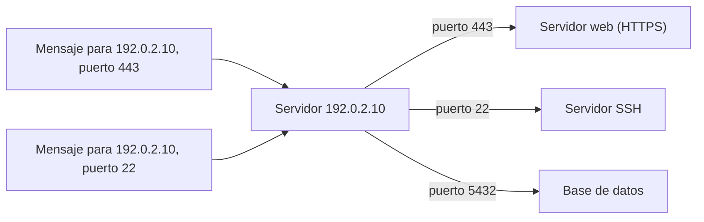
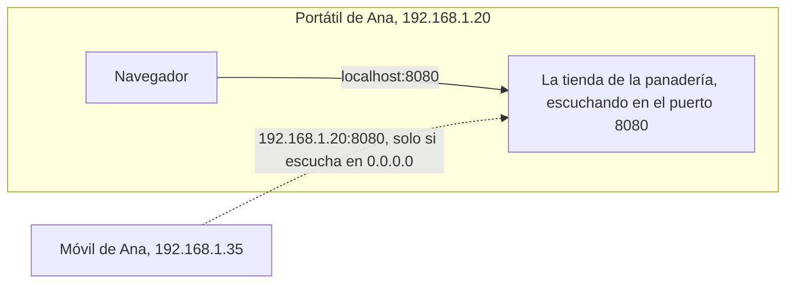

# 06.02 Puertos y localhost: tu ordenador como servidor

> **Versiones:** curl 8.18.0 en las salidas, la de la terminal del curso; la más reciente, la 8.23.0, del 14 de octubre de 2026 (comprobado en curl.se el 16 de noviembre de 2026)
> **Conviene saber antes:** [06.01 Redes: IP, router, DNS y cortafuegos](01-redes.md) · [03.02 La terminal: sacarle partido, 1.12](../fase-03-herramientas/02-terminal-sacarle-partido.md#112-procesos-verlos-y-pararlos) · [03.02 La terminal: sacarle partido, 1.13](../fase-03-herramientas/02-terminal-sacarle-partido.md#113-códigos-de-salida)
> **Tiempo estimado:** 1,5 horas
> **Nivel:** Básico · Núcleo

## Qué aprenderás

- Qué es un **puerto** y por qué una dirección IP no basta para llegar a un programa.
- A leer una dirección completa, **IP y puerto** (`192.0.2.10:443`), y los puertos que verás siempre: el **80**, el **443** y el **22**.
- Qué quiere decir que un programa **escucha** en un puerto, y por qué tu ordenador puede hacer de **servidor**.
- Qué son **`localhost`** y `127.0.0.1`, y qué significa la dirección que verás en todos los cursos: **`localhost:8080`**.
- La diferencia entre escuchar en **`localhost`** y en **`0.0.0.0`**, y por qué el **cortafuegos** te pregunta cuando un programa quiere escuchar.
- Qué hacer con el error **«el puerto ya está en uso»**: averiguar quién lo ocupa con `ss`, `lsof` o `netstat` y pararlo.
- A comprobar con **`curl`** si responde un servidor, y a leer el `000` y el código de salida `7` cuando no responde nadie.

En [06.01](01-redes.md) viste cómo llega un mensaje de un ordenador a otro por su dirección IP. Falta una pieza: dentro de cada ordenador hay muchos programas usando la red a la vez, y el mensaje tiene que llegar **al programa correcto**. De eso van los puertos. Y en cuanto empieces tu curso, el primer servidor que arranques estará **en tu propio ordenador**: lo abrirás en el navegador como `localhost:8080`. Este módulo es para que entonces sepas qué estás viendo y qué hacer cuando falla.

## 1. Teoría

### 1.1. Una dirección IP no basta: el puerto

Piensa en un edificio de oficinas. La dirección de la calle lleva una carta **hasta el edificio**, pero dentro hay muchas oficinas: la carta necesita también **el número de la oficina**. Con un ordenador pasa lo mismo. La dirección IP lleva el mensaje hasta el ordenador ([06.01](01-redes.md#15-la-dirección-ip)), pero dentro hay a la vez un navegador con varias pestañas, un programa de correo, quizá una base de datos y un servidor web. ¿A cuál de ellos va cada mensaje?

Para eso está el **puerto**: un **número del 0 al 65535** que identifica, dentro de un ordenador, al programa al que va un mensaje. No es nada físico (no tiene que ver con los puertos USB): es solo un número que acompaña a cada mensaje, como el número de oficina en el sobre.



El diagrama dice: los dos mensajes llegan al mismo ordenador, `192.0.2.10`, y el puerto decide a qué programa le toca cada uno; el de la base de datos espera en el 5432 aunque ahora no le llegue nada.

> **📌 Nota:** las direcciones IP de los ejemplos (`192.0.2.10`, `198.51.100.7`, `203.0.113.5`, `2001:db8::1`) están **reservadas para documentación**: no son de nadie, como `example.com`. Las de la red de casa, `192.168.1.x`, son las privadas que viste en [06.01](01-redes.md#18-ip-privada-e-ip-pública).

### 1.2. IP y puerto: la dirección completa

Para hablar con un programa de otro ordenador hacen falta las dos cosas: **la IP (o un nombre de dominio) y el puerto**. Se escriben juntas, separadas por dos puntos:

| Dirección | Qué es |
|---|---|
| `192.0.2.10:443` | El programa del puerto 443 del ordenador `192.0.2.10` |
| `example.com:80` | El programa del puerto 80 del ordenador que se llama `example.com` (el DNS dice su IP) |
| `localhost:8080` | El programa del puerto 8080 **de tu propio ordenador** ([apartado 1.5](#15-localhost-tu-propio-ordenador)) |
| `[2001:db8::1]:22` | El puerto 22 de una dirección IPv6, que va **entre corchetes** porque ya lleva dos puntos dentro |

¿Y por qué casi nunca escribes el puerto en el navegador? Porque cada tipo de dirección tiene uno **por defecto**: si escribes `https://example.com`, el navegador usa el **443**, y con `http://`, el **80**. Solo hay que escribirlo cuando el programa escucha en otro: `http://localhost:8080`. Cómo se lee entera una dirección web lo verás en [06.03](03-la-web-http-y-apis.md).

### 1.3. Los puertos que verás siempre

Quién usa cada número lo apunta un registro público, el de la **IANA** (la organización que reparte los números de internet). Los del **0 al 1023** son los «bien conocidos», los de los servicios de siempre (la web, SSH, el correo); los de más arriba los piden programas concretos o los usa el propio sistema (según el RFC 6335, comprobado el 16 de noviembre de 2026). Los que tienes que reconocer:

| Puerto | Quién lo usa | Dónde lo ves |
|---|---|---|
| **80** | La web sin cifrar (HTTP) | [06.03](03-la-web-http-y-apis.md) |
| **443** | La web cifrada (HTTPS); también Git cuando usas direcciones `https://` | [05.03, HTTPS](../fase-05-git-y-github/03-github.md#14-cómo-sabe-github-que-eres-tú-https) |
| **22** | **SSH**: conectarse de forma segura a otro ordenador; también Git con direcciones `git@github.com:…` | [05.03, SSH](../fase-05-git-y-github/03-github.md#15-ssh-un-par-de-claves) |
| **5432** y **3306** | Las bases de datos PostgreSQL y MySQL | [06.04](04-que-es-una-base-de-datos.md) |
| **8080**, **3000**, **8000**, **5000**… | Servidores de desarrollo en tu ordenador. No son de nadie en concreto: son costumbre | [Apartado 1.6](#16-localhost8080-la-dirección-de-tu-curso) |

Así que cuando hiciste `git push` en la fase 5, sin saberlo usaste el puerto 443 (con HTTPS) o el 22 (con SSH) de los servidores de GitHub.

> **📌 Nota:** que un número esté registrado para un programa no obliga a nada: cualquier programa puede escuchar en cualquier puerto libre. Es un acuerdo para que todos sepan dónde buscar.

### 1.4. Escuchar en un puerto

En [06.01](01-redes.md#13-cliente-y-servidor) viste el modelo **cliente-servidor**: el cliente pide y el servidor responde. Ahora puedes decir cómo empieza todo:

1. El **servidor** arranca y le pide al sistema operativo un puerto, por ejemplo el 8080. Desde ese momento **escucha** en él (en inglés, *listen*): se queda esperando a que alguien se conecte. Un programa que escucha no hace nada más hasta que llega alguien.
2. El **cliente** (tu navegador, `curl`, Git…) **se conecta** a la IP y el puerto del servidor, manda su petición y recibe la respuesta.
3. El cliente también necesita un puerto, para que la respuesta sepa volver. No lo eliges tú: el sistema le da uno libre cualquiera, para esa conexión y nada más.

Lo importante: **solo se puede conectar a un puerto donde hay un programa escuchando**. Si no hay nadie, el sistema operativo del otro lado rechaza la conexión al momento: «conexión rechazada» (*connection refused*). Es lo que verás en el [ejemplo 2.2](#22-el-puerto-equivocado).

Y como «servidor» es un papel y no un tipo de ordenador ([06.01](01-redes.md#13-cliente-y-servidor)), tu portátil hace de servidor en cuanto arrancas en él un programa que escucha: es lo que harás en cualquier curso de desarrollo web.

> **📌 Nota para Linux:** los puertos por debajo del 1024 están reservados: para escuchar en ellos hace falta ser administrador (según la documentación del núcleo de Linux, el primer puerto que puede usar cualquiera es el 1024, salvo que se cambie). Por eso los servidores de desarrollo usan números altos, como el 8080, y no el 80. En macOS y Windows, los detalles cambian; con un puerto alto no tendrás problemas en ninguno.

### 1.5. localhost: tu propio ordenador

Cuando el cliente y el servidor están **en el mismo ordenador**, el mensaje no tiene que salir a ninguna red. Para eso existe una dirección especial que siempre quiere decir «este mismo ordenador»:

- **`127.0.0.1`** en IPv4 (de hecho, todas las que empiezan por `127.` son de este tipo, pero se usa siempre esa).
- **`::1`** en IPv6.
- **`localhost`**, el **nombre** de las dos: tu ordenador lo traduce a `127.0.0.1` o a `::1` sin preguntar a ningún DNS. Cuál de las dos usa primero depende del sistema y del programa.

Lo que mandas a esa dirección vuelve a entrar en tu propio ordenador sin tocar la red. Por eso:

- **Funciona sin internet** y sin wifi: puedes programar en un tren.
- **Nadie de fuera la ve.** `localhost` en tu portátil es tu portátil; `localhost` en el móvil de tu amiga es su móvil. No hay forma de que otro ordenador use tu `localhost`.

> **⚠️ Cuidado:** no confundas `127.0.0.1` con la IP privada de tu ordenador en la red de casa (`192.168.1.20`, por ejemplo). La primera solo la usa tu ordenador para hablar consigo mismo; la segunda es la que usan los demás aparatos de la red para encontrarlo ([06.01](01-redes.md#18-ip-privada-e-ip-pública)).

### 1.6. localhost:8080: la dirección de tu curso

Juntando las dos piezas: **`localhost:8080`** quiere decir «el programa que escucha en el puerto 8080 **de mi propio ordenador**». Es la dirección que verás en casi todos los cursos de desarrollo web, porque así se prueba una aplicación mientras se escribe:

1. Arrancas tu aplicación en la terminal. Se queda **escuchando** en un puerto y la terminal ocupada (como el `sleep` de [03.02](../fase-03-herramientas/02-terminal-sacarle-partido.md#27-parar-un-proceso)); suele decirte en qué dirección la tienes.
2. Abres el navegador en `http://localhost:8080` (o el puerto que diga). El navegador es el **cliente**; tu aplicación, el **servidor**; los dos en tu ordenador.
3. Cambias algo, recargas y lo ves. Cuando terminas, paras la aplicación con <kbd>Ctrl</kbd>+<kbd>C</kbd> en su terminal.

El número cambia según la herramienta: el 8080 es el más clásico, y verás también el 3000, el 8000, el 5000, el 5173 o el 4200. Cada curso te dirá el suyo. Muchas aplicaciones lo leen de su [fichero de configuración](../glosario.md#fichero-de-configuración), como el `puerto: 8080` que viste en el YAML de [04.03](../fase-04-formatos-y-diagramas/03-json-y-yaml.md) o en los ficheros de configuración de [04.04](../fase-04-formatos-y-diagramas/04-xml-csv-y-otros.md#113-ficheros-de-configuración-properties-ini-y-toml): si quieres otro puerto, se cambia ahí.

> **📌 Nota:** fíjate en que es `http://localhost:8080`, **sin la s**. Mientras programas en tu ordenador, el servidor de desarrollo casi nunca usa HTTPS; si escribes `https://`, no conectará ([ejemplo 2.3](#23-http-no-es-https)).

### 1.7. Escuchar en localhost o en 0.0.0.0

Cuando un servidor arranca, además del puerto elige **en qué dirección** de tu ordenador escucha. Tu portátil tiene al menos dos: la de `localhost` (`127.0.0.1`) y la de la red de casa (`192.168.1.20`, por ejemplo). Las dos opciones que verás:

| Escucha en | Quién puede conectarse | Cuándo |
|---|---|---|
| **`127.0.0.1`** (o `localhost`, o `::1`) | **Solo tu ordenador** | Lo normal mientras programas. Muchos servidores de desarrollo lo hacen así por defecto |
| **`0.0.0.0`** (en IPv6, `::`) | **Cualquiera que llegue a tu ordenador**: tu ordenador y los demás aparatos de la red (el móvil, otro portátil…) | Cuando quieres probar tu web en el móvil, o en un servidor de verdad, que tiene que atender a todo el mundo |

`0.0.0.0` no es la dirección de ningún sitio: quiere decir **«todas mis direcciones»**. Por eso no se escribe en el navegador: para conectarte desde tu ordenador usas `localhost`, y desde el móvil, la IP privada de tu ordenador (`http://192.168.1.20:8080`).



En palabras: el navegador del propio portátil llega siempre por `localhost`; el móvil, que está en la misma wifi, solo llega si la tienda escucha en `0.0.0.0` (y el cortafuegos lo deja pasar, [apartado 1.8](#18-el-cortafuegos-pregunta)).

Cómo se elige depende de cada herramienta: suele ser una opción al arrancarla (con nombres como `--host`) o una línea de su configuración. Lo verás en tu curso. Aquí basta con saber **qué significa** cada una cuando la leas.

> **⚠️ Cuidado:** escuchar en `0.0.0.0` en la wifi de una cafetería, una biblioteca o un hotel deja tu aplicación a la vista de **cualquiera conectado a esa red**. Una aplicación a medio hacer suele tener fallos y datos de prueba que no quieres enseñar. Ábrela a la red solo en casa y solo mientras la necesites.

### 1.8. El cortafuegos pregunta

El [cortafuegos](01-redes.md#114-el-cortafuegos) de tu ordenador bloquea las conexiones que entran sin que nadie las haya pedido. Por eso, la primera vez que un programa quiere **recibir conexiones de la red**, puede pararlo y preguntarte:

- **En Windows**, según la documentación de Microsoft (a 16 de noviembre de 2026), la primera vez que un programa sin permiso intenta recibir conexiones, **abre una ventana** para que lo permitas o lo bloquees. Si dices que no o la cierras, crea reglas de **bloqueo**, y la ventana **no vuelve a salir**: para cambiarlo hay que ir a la configuración del cortafuegos. La ventana distingue las **redes privadas** de las **públicas**, los [perfiles de red](01-redes.md#114-el-cortafuegos) de Windows. Permitirlo pide permiso de administrador: en un ordenador del trabajo o del centro de estudios en el que no lo eres, Windows crea reglas de bloqueo elijas lo que elijas, y quien lo administra es quien puede abrirlo.
- **En macOS**, si tienes el cortafuegos activado (**Ajustes del Sistema > Red > Firewall**), te pregunta la primera vez si permites o deniegas que la aplicación reciba conexiones; mientras no contestas, se deniegan, según la guía de Apple en español (a 16 de noviembre de 2026). En esos mismos ajustes se añaden o se quitan las aplicaciones que pueden recibir conexiones.
- **En Linux**, lo normal en un ordenador personal es que no salga ninguna ventana.

**Qué contestar:** si es **tu** servidor de desarrollo (o una herramienta que acabas de instalar para tu curso) y quieres probarlo desde el móvil, permítelo **solo en redes privadas**. Si no lo reconoces, no lo permitas. Y si solo lo vas a usar desde tu ordenador, con `localhost`, no te hace falta abrirlo a la red.

### 1.9. «El puerto ya está en uso»

En un puerto (y una dirección) **solo puede escuchar un programa a la vez**: si dos pudieran, el sistema no sabría a cuál darle cada conexión. Si arrancas un servidor en un puerto que ya tiene otro, el segundo no puede empezar y termina con un error. Cada programa lo cuenta a su manera, pero siempre con las mismas palabras clave: ***address already in use*** («la dirección ya está en uso») o su código, **`EADDRINUSE`**. Dos ejemplos reales, comprobados en Linux el 16 de noviembre de 2026 al arrancar dos veces un servidor en el puerto 8080:

```text
Error: listen EADDRINUSE: address already in use 127.0.0.1:8080
```

```text
Exception in thread "main" java.net.BindException: La dirección ya se está usando
```

El primero es de un servidor escrito en JavaScript (Node.js), en inglés; el segundo, de uno en Java, que en un sistema en español lo traduce. Debajo de cada uno salen más líneas, que aquí no importan: busca la frase clave. En Windows el código es otro, `WSAEADDRINUSE` (el 10048, según la documentación de Microsoft), con el mismo significado.

Las causas, de más a menos frecuente:

1. **El mismo servidor sigue en marcha** en otra terminal, en otra ventana del editor o en segundo plano: lo arrancaste antes y no lo paraste.
2. **Otro programa** usa ese puerto (otra aplicación de otro curso, una base de datos, una herramienta instalada). Uno conocido: en macOS, el **receptor de AirPlay** (lo que deja que otros aparatos de Apple manden imagen o sonido a tu Mac) usa el 5000 y el 7000, según la lista de puertos de Apple, y `lsof` lo enseña a tu nombre aunque sea del sistema. No lo pares: usa otro puerto (o desactiva el receptor de AirPlay en los ajustes del sistema, si no lo usas).
3. **Un servidor que acaba de cerrarse** a veces tarda unos segundos en soltar el puerto: espera un momento y vuelve a probar.

Las salidas: **parar el que lo ocupa** (si es tuyo y no lo necesitas) o **arrancar el tuyo en otro puerto** (cambiando su configuración). Para decidir, primero hay que saber quién es.

### 1.10. Ver quién ocupa un puerto: ss, lsof y netstat

Cada sistema tiene su orden para ver qué programas escuchan y en qué puerto. Todas dan lo mismo: la **dirección y el puerto** y el **PID** del proceso que escucha (el número que lo identifica, [03.02](../fase-03-herramientas/02-terminal-sacarle-partido.md#112-procesos-verlos-y-pararlos)).

| Sistema | Orden | Qué es cada opción |
|---|---|---|
| **Linux** | `ss -ltnp` | `-l`, solo los que escuchan (*listening*); `-t`, conexiones [TCP](01-redes.md#113-tcp-y-udp) (las de la web); `-n`, números en vez de nombres; `-p`, el proceso |
| **macOS** (y Linux, si lo tienes instalado) | `lsof -nP -iTCP:8080 -sTCP:LISTEN` | `-n` y `-P`, números en vez de nombres; `-iTCP:8080`, conexiones TCP del puerto 8080; `-sTCP:LISTEN`, solo las que escuchan |
| **Windows** (desde Git Bash) | `netstat -ano` | Es la orden de Windows, que Git Bash encuentra en el PATH. `-a`, todas; `-n`, números; `-o`, el PID |

Una salida **de ejemplo** de `ss` (los PID y la lista de tu ordenador serán otros):

```text
$ ss -ltnp
State  Recv-Q Send-Q Local Address:Port  Peer Address:PortProcess
LISTEN 0      511        127.0.0.1:8080       0.0.0.0:*    users:(("node",pid=4242,fd=21))
LISTEN 0      128          0.0.0.0:22         0.0.0.0:*
```

Lo que te importa es la columna **`Local Address:Port`** (dirección y puerto) y **`Process`** (el nombre del programa y su `pid`). Aquí, un programa `node` con el PID 4242 escucha en el 8080, **solo para tu ordenador** (`127.0.0.1`); y algo escucha en el 22 **para toda la red** (`0.0.0.0`), sin decir qué es: `ss` solo enseña el proceso de los programas que son **tuyos**; los del sistema necesitan `sudo` ([03.02](../fase-03-herramientas/02-terminal-sacarle-partido.md#111-administrador-sudo-y-cuándo-no-usarlo)). `Recv-Q`, `Send-Q` y `Peer Address:Port` no los necesitas. Para no leer la lista entera, fíltrala: `ss -ltnp | grep 8080`.

La de `lsof`, también **de ejemplo**:

```text
$ lsof -nP -iTCP:8080 -sTCP:LISTEN
COMMAND  PID USER   FD   TYPE DEVICE SIZE/OFF NODE NAME
node    4242 lucia  21u  IPv4  52731      0t0  TCP 127.0.0.1:8080 (LISTEN)
```

Aquí las columnas son **`COMMAND`** (el programa), **`PID`**, **`USER`** (de quién es) y **`NAME`** (dirección y puerto). Si no sale nada, no hay nadie escuchando en el 8080. En macOS la orden es la misma y las columnas se llaman igual.

En **Windows**, `netstat -ano | grep 8080` enseña una línea por cada conexión del puerto 8080: busca la que está **escuchando** (la palabra sale en el idioma de tu Windows) y cuya dirección local acaba en `:8080`; el **último número** de la línea es el PID. La salida de `netstat` en Windows tiene otro aspecto y depende del idioma del sistema, así que aquí no se muestra; si alguna letra con tilde sale cambiada por `�`, es lo que cuenta la nota para Git Bash de [06.01](01-redes.md#115-ping-me-oyes).

> **📌 Nota:** `netstat` también existe en Linux y macOS, pero en muchos Linux ya no viene instalado (`ss` lo sustituye) y en macOS sus opciones son otras. Por eso, aquí, `ss` para Linux, `lsof` para macOS y `netstat` solo para Windows.

### 1.11. Pararlo

Con el PID en la mano, decides. Si es **tu servidor olvidado**:

- Si encuentras **su terminal**, ve a ella y pulsa <kbd>Ctrl</kbd>+<kbd>C</kbd>. Es lo mejor: el programa termina bien.
- Si no, en Linux y macOS, **`kill PID`** (`kill 4242`), como en [03.02](../fase-03-herramientas/02-terminal-sacarle-partido.md#112-procesos-verlos-y-pararlos). `kill -9` solo si no hace caso, como último recurso.
- En Windows, abre el **Administrador de tareas**, pestaña **Detalles** (tiene la columna PID), selecciona el proceso con ese PID y pulsa **Finalizar tarea**. Desde Git Bash, `kill` solo para los procesos de la propia Git Bash ([03.02](../fase-03-herramientas/02-terminal-sacarle-partido.md#112-procesos-verlos-y-pararlos)).

Si **no es tuyo** o no sabes qué es (una base de datos, un programa del sistema), **no lo pares**: cambia el puerto de tu aplicación. Es lo que aprendiste en [02.01](../fase-02-tu-ordenador/01-como-funciona-un-ordenador.md#36-finalizar-procesos-a-ciegas): nada de finalizar procesos a ciegas.

Después, comprueba que el puerto ha quedado libre (repite `ss` o `lsof`: ya no sale) y arranca otra vez tu servidor.

### 1.12. ¿Responde alguien? Comprobarlo con curl

**`curl`** es un programa de la terminal que hace de **cliente**: se conecta a una dirección, pide algo y te enseña lo que le responden. Viene con macOS y con casi todos los Linux (si `curl --version` dice que no existe, instálalo con el gestor de paquetes de tu distribución; en Ubuntu, `sudo apt install curl`), y Git Bash trae el suyo (con Git for Windows). En [06.03](03-la-web-http-y-apis.md) lo usarás a fondo para hablar con la web y con las API; aquí basta con saber usarlo para una pregunta: **¿hay un servidor respondiendo en esta dirección?**

```bash
curl http://localhost:8080/
```

- **Si hay un servidor**, `curl` escribe lo que responde: el texto o la página que manda.
- **Si no hay nadie escuchando**, `curl` escribe un error y termina con el **código de salida 7**, que según su manual quiere decir *Failed to connect to host*: «no se ha podido conectar». Es lo que viste en el [apartado 1.4](#14-escuchar-en-un-puerto): conexión rechazada. El mensaje es como este (de ejemplo: el número de milisegundos cambia cada vez; en Windows, `curl` tarda un par de segundos en rendirse, y verás un número de unos 2000):

```text
curl: (7) Failed to connect to localhost port 8080 after 0 ms: Could not connect to server
```

Para no depender de ese mensaje, dos opciones de `curl` que lo dejan todo en un número:

| Opción | Qué hace |
|---|---|
| `-s` | Silencioso: sin mensajes de error ni barra de progreso |
| `-w '%{http_code}\n'` | Al terminar, escribe el **código** que ha respondido el servidor y un salto de línea. Si no ha respondido nadie, **`000`** |
| `-o /dev/null` | Tira la respuesta ([`/dev/null`](../fase-03-herramientas/02-terminal-sacarle-partido.md#13-mandar-los-errores-a-otro-sitio-2-y-devnull)): solo te interesa el código |

Así, `curl -s -o /dev/null -w '%{http_code}\n' http://localhost:8080/` escribe **un número de tres cifras** si hay un servidor (`200` quiere decir «todo bien»; qué significa cada código lo verás en [06.03](03-la-web-http-y-apis.md)) y **`000`** si no hay nadie. Y `echo $?` justo después dice el código de salida: `0` si ha conectado, `7` si no ([03.02](../fase-03-herramientas/02-terminal-sacarle-partido.md#113-códigos-de-salida)).

El navegador hace lo mismo que `curl`, con más adornos: si no hay nadie escuchando, te dice que **no se puede conectar** (en Chrome y Edge, con el código `ERR_CONNECTION_REFUSED`).

## 2. Ejemplos de código

Los ejemplos de este módulo los ha hecho la terminal del curso, que arranca un **servidor de prueba** en `localhost` antes de cada ejemplo que lo necesita (lo describe el fichero `servidor.json` de su carpeta). **En tu ordenador no tienes esos servidores**: si tecleas las órdenes tal cual, `curl` no encontrará a nadie y verás lo del [ejemplo 2.2](#22-el-puerto-equivocado) (`000` y `7`). Lee las salidas del curso para entender qué pasa; cuando tu curso te haga arrancar tu primer servidor, repítelas contra él.

### 2.1. Preguntar a un servidor de tu ordenador

**Situación real:** Ana está haciendo la tienda en línea de la Panadería Sol. La ha arrancado en su portátil, en el puerto 8080, y antes de abrir el navegador comprueba desde la terminal que responde.

**En tu terminal** (`sesion.txt`):

```text
$ curl http://localhost:8080/
Panadería Sol: la tienda, en pruebas
$ curl http://127.0.0.1:8080/
Panadería Sol: la tienda, en pruebas
$ curl -s -o /dev/null -w '%{http_code}\n' http://localhost:8080/
200
```

📁 **Código:** [`codigo/02-puertos-y-localhost/ejemplos/2.1-preguntar-a-tu-ordenador/`](codigo/02-puertos-y-localhost/ejemplos/2.1-preguntar-a-tu-ordenador/)

**En qué fijarte:**

- **`localhost` y `127.0.0.1` llegan aquí al mismo sitio**: el mismo servidor, en el mismo ordenador. `localhost` es solo el nombre ([apartado 1.5](#15-localhost-tu-propio-ordenador)). Este servidor escucha en las dos direcciones de tu ordenador, la IPv4 y la IPv6, así que con `http://[::1]:8080/` también llegaría (en la terminal, entre comillas simples, para que los corchetes no se tomen como un [comodín](../glosario.md#comodín)).
- **Pero no siempre es así:** muchos servidores de desarrollo escuchan **solo en una** de las dos. Si `localhost` funciona y `127.0.0.1` no (o al revés), es eso. Usa la dirección que el servidor dice al arrancar, o `localhost`, que el navegador y `curl` prueban con las dos.
- **Sin opciones, `curl` escribe la respuesta**: el texto que manda el servidor. Una web de verdad mandaría una página entera, con mucho más.
- **Con `-s -o /dev/null -w '%{http_code}\n'`**, solo el número: `200`, «todo bien».

### 2.2. El puerto equivocado

**Situación real:** Andrés arranca la web de su club de lectura, Entre Líneas, y escribe, por costumbre, `localhost:8080`. No responde nada. Pero su aplicación escucha en el **3000**.

**En tu terminal** (`sesion.txt`):

```text
$ curl -s -w '%{http_code}\n' http://localhost:8080/
000
$ echo $?
7
$ curl -s -w '%{http_code}\n' http://localhost:3000/
Club de lectura Entre Líneas: la web, en pruebas
200
$ echo $?
0
```

📁 **Código:** [`codigo/02-puertos-y-localhost/ejemplos/2.2-el-puerto-equivocado/`](codigo/02-puertos-y-localhost/ejemplos/2.2-el-puerto-equivocado/)

**En qué fijarte:**

- **En el 8080 no escucha nadie**: `000` (nadie ha respondido) y código de salida `7` (no se ha podido conectar). Con `-s` no sale el mensaje de error, y no hace falta: los dos números lo dicen.
- **En el 3000 sí**: la respuesta, y después el `200` que añade `-w`. Aquí no se ha puesto `-o /dev/null`, así que salen las dos cosas.
- **La IP es la misma** (tu ordenador): solo cambia el puerto, y con él, el programa al que llegas.
- Si Andrés no supiera el puerto, lo encontraría en lo que escribe su aplicación al arrancar, en su configuración o con `ss` o `lsof` ([apartado 1.10](#110-ver-quién-ocupa-un-puerto-ss-lsof-y-netstat)).

### 2.3. http no es https

**Situación real:** Ana escribe `https://localhost:8080` porque «las webs de verdad llevan https». Su servidor de desarrollo habla HTTP, sin cifrar.

**En tu terminal** (`sesion.txt`):

```text
$ curl -s -w '%{http_code}\n' https://localhost:8080/
000
$ echo $?
35
$ curl -s -w '%{http_code}\n' http://localhost:8080/
Panadería Sol: la tienda, en pruebas
200
```

📁 **Código:** [`codigo/02-puertos-y-localhost/ejemplos/2.3-http-no-es-https/`](codigo/02-puertos-y-localhost/ejemplos/2.3-http-no-es-https/)

**En qué fijarte:**

- **Esta vez sí hay alguien escuchando**, pero no se entienden: con `https://`, `curl` intenta empezar una conexión cifrada y el servidor no sabe cifrar. Resultado: `000` otra vez, pero con el código de salida **`35`** (según el manual de `curl`, *SSL connect error*: ha fallado el saludo del cifrado), no el `7`.
- **El código de salida distingue los dos problemas**: `7`, no hay nadie en ese puerto; `35`, hay alguien, pero no habla HTTPS. Qué es exactamente HTTPS lo verás en [06.03](03-la-web-http-y-apis.md#19-https-http-con-candado).
- En el navegador, la misma equivocación da un error de conexión segura. Quita la `s`.

### 2.4. El puerto ya está en uso

**Situación real:** Héctor arrancó por la mañana su aplicación (que escucha en el 8080) en una terminal, y la dejó escondida detrás de otras ventanas. Por la tarde la vuelve a arrancar en otra terminal y sale el error. Esta salida es **de ejemplo** (la terminal del curso no tiene ningún programa que escuche; los PID serán otros), en Linux:

```text
$ ss -ltnp | grep 8080
LISTEN 0      511        127.0.0.1:8080       0.0.0.0:*    users:(("node",pid=5120,fd=21))
$ kill 5120
$ ss -ltnp | grep 8080
$
```

**En qué fijarte:**

- **Primero, el error** de su aplicación: `Error: listen EADDRINUSE: address already in use 127.0.0.1:8080`, el del [apartado 1.9](#19-el-puerto-ya-está-en-uso). La palabra clave es `EADDRINUSE`.
- **`ss -ltnp | grep 8080`** encuentra al que ocupa el puerto: un `node` con el PID 5120, que es **suyo** (si no, `ss` no diría su nombre). Es la aplicación de la mañana.
- **`kill 5120`** lo para, y el segundo `ss` ya no encuentra nada: el puerto está libre. Ahora puede arrancar la aplicación de nuevo.
- **En macOS**, lo mismo con `lsof -nP -iTCP:8080 -sTCP:LISTEN` (la columna `PID`) y `kill`. **En Windows**, `netstat -ano | grep 8080` y el Administrador de tareas ([apartado 1.11](#111-pararlo)).

Para comprobar que la nueva responde, el `curl` del [ejemplo 2.1](#21-preguntar-a-un-servidor-de-tu-ordenador).

### 2.5. Lo mismo, contra un servidor de internet

**Opcional, con internet.** Esto sí puedes hacerlo en tu ordenador: preguntar a un servidor real, el de la API de GitHub, por el usuario de ejemplo de su documentación, `octocat`. La salida es **de ejemplo**, a 16 de noviembre de 2026:

```text
$ curl -s -o /dev/null -w '%{http_code}\n' https://api.github.com/users/octocat
200
$ curl -s -o /dev/null -w '%{http_code}\n' https://api.github.com:443/users/octocat
200
```

**En qué fijarte:**

- **Las dos órdenes son la misma petición**: con `https://`, el puerto por defecto es el 443 ([apartado 1.2](#12-ip-y-puerto-la-dirección-completa)), lo escribas o no.
- **El servidor está en otro ordenador**: el [DNS](01-redes.md#111-dns-de-nombres-a-números) traduce `api.github.com` a una IP y `curl` se conecta a su puerto 443. Qué devuelve exactamente, lo verás en [06.03](03-la-web-http-y-apis.md).
- Usa siempre el usuario de ejemplo, `octocat`, no el de una persona. Y no lo repitas en bucle: según la documentación de GitHub (a 16 de noviembre de 2026), sin identificarte puedes hacer **60 peticiones por hora**, contadas por tu IP.

## 3. Errores típicos

### 3.1. «Address already in use» al arrancar tu aplicación

**Qué pasa:** arrancas tu servidor y termina al momento con `EADDRINUSE`, *address already in use* o «La dirección ya se está usando».

**Por qué ocurre:** otro programa escucha ya en ese puerto; casi siempre, **tu propia aplicación**, que dejaste en marcha en otra terminal o en la del editor ([apartado 1.9](#19-el-puerto-ya-está-en-uso)).

**Cómo se arregla:** busca quién es con `ss`, `lsof` o `netstat` ([apartado 1.10](#110-ver-quién-ocupa-un-puerto-ss-lsof-y-netstat)). Si es tuyo, páralo ([apartado 1.11](#111-pararlo)); si no, arranca el tuyo en otro puerto. No reinicies el ordenador cada vez: funciona, pero no aprendes qué pasaba.

### 3.2. «No se puede conectar»: no hay nadie en ese puerto

**Qué pasa:** el navegador dice que no se puede conectar (`ERR_CONNECTION_REFUSED`), o `curl` da `000` y el código de salida `7`.

**Por qué ocurre:** en esa dirección y ese puerto no escucha nadie. O el servidor **no está arrancado** (o se ha parado por un error: mira su terminal), o escucha en **otro puerto** ([ejemplo 2.2](#22-el-puerto-equivocado)).

**Cómo se arregla:** mira la terminal donde arrancaste el servidor: ¿sigue en marcha?, ¿qué dirección dice? Comprueba el puerto en su configuración o con `ss` o `lsof`, y usa ese.

### 3.3. Escribir https para un servidor de desarrollo

**Qué pasa:** con `https://localhost:8080`, el navegador da un error de conexión segura y `curl`, `000` con el código de salida `35`.

**Por qué ocurre:** tu servidor de desarrollo habla HTTP, sin cifrar; el cliente intenta cifrar y no se entienden ([ejemplo 2.3](#23-http-no-es-https)).

**Cómo se arregla:** `http://localhost:8080`, sin la `s`. Si tu curso configura HTTPS en desarrollo, te lo dirá.

### 3.4. Desde el móvil no se ve tu web

**Qué pasa:** en el portátil, `localhost:8080` funciona. En el móvil, conectado a la misma wifi, `localhost:8080` no carga, y `192.168.1.20:8080` tampoco.

**Por qué ocurre:** dos errores que suelen ir juntos. **`localhost` en el móvil es el móvil**, no tu portátil ([apartado 1.5](#15-localhost-tu-propio-ordenador)). Y aunque uses la IP del portátil, si tu servidor escucha en `127.0.0.1` **solo acepta conexiones del propio portátil** ([apartado 1.7](#17-escuchar-en-localhost-o-en-0000)). También puede ser el **cortafuegos**, si dijiste que no a su ventana ([apartado 1.8](#18-el-cortafuegos-pregunta)).

**Cómo se arregla:** en el móvil, la IP privada del portátil con el puerto (`http://192.168.1.20:8080`); en tu servidor, que escuche en `0.0.0.0` (la opción que diga su documentación); y en el cortafuegos, permitirlo **en redes privadas**. Al terminar, vuelve a dejarlo en `localhost`.

### 3.5. Abrir tu aplicación a cualquier red

**Qué pasa:** para probar en el móvil, arrancas tu servidor en `0.0.0.0` y lo permites en el cortafuegos «en todas las redes». Una semana después lo arrancas igual en la wifi de la biblioteca.

**Por qué ocurre:** lo que abriste para casa queda abierto en cualquier red a la que te conectes.

**Cómo se arregla:** escucha en `localhost` salvo cuando de verdad necesites otro aparato, y en el cortafuegos permite **solo las redes privadas** ([apartado 1.7](#17-escuchar-en-localhost-o-en-0000)).

### 3.6. Parar un proceso que no es tuyo

**Qué pasa:** el puerto 5432 está ocupado, ves que lo usa algo llamado `postgres` y lo paras con `kill -9` o «Finalizar tarea». Después, otra aplicación de tu ordenador deja de funcionar.

**Por qué ocurre:** ese proceso era una base de datos que otro programa necesitaba. Que ocupe el puerto que tú querías no quiere decir que sobre.

**Cómo se arregla:** solo paras lo que reconoces como tuyo; si no, cambia el puerto de **tu** aplicación ([apartado 1.11](#111-pararlo)). Y con `kill` a secas antes que `kill -9`.

## 4. Buenas prácticas

- **Mira siempre en qué dirección dice escuchar tu servidor** al arrancar: la IP (o `localhost`) y el puerto. Es lo primero que hay que saber cuando algo no conecta.
- **Un puerto por aplicación.** Si trabajas en dos proyectos a la vez, ponle a cada uno el suyo en su configuración (el 8080 a uno y el 8081 a otro, por ejemplo) y apúntalo en su README.
- **Para tus servidores al terminar**, con <kbd>Ctrl</kbd>+<kbd>C</kbd> en su terminal. Antes de cerrar el editor o la terminal, mira si hay alguno en marcha.
- **`localhost` por defecto; `0.0.0.0` solo cuando lo necesites**, en casa, y lo devuelves a `localhost` al terminar.
- **En el cortafuegos, permite solo lo que reconoces**, y solo en redes privadas.
- **Antes de parar un proceso, mira de quién es** (`USER` en `lsof`, o si `ss` dice su nombre). Si no es tuyo, **o no sabes qué programa es**, cambia tu puerto.
- **Para saber si responde un servidor, `curl -s -o /dev/null -w '%{http_code}\n'`** y el código de salida: un número dice más que un mensaje largo.
- **Puertos altos para tus pruebas** (del 1024 en adelante): no necesitan administrador ([apartado 1.4](#14-escuchar-en-un-puerto)).

## 5. Ejercicios prácticos resueltos

### 🟢 Básico

#### Ejercicio 1 · Lee las direcciones

Para cada dirección, di a qué ordenador va (si es el tuyo o uno de fuera), a qué puerto y, si lo sabes, qué programa espera ahí:

1. `https://example.com`
2. `localhost:8080`
3. `203.0.113.5:22`
4. `http://127.0.0.1:3000`
5. `[2001:db8::1]:443`
6. `git@github.com:TU-USUARIO/club-lectura.git` (con `TU-USUARIO`, el usuario de GitHub de quien guarda ahí su repositorio)

<details>
<summary>Pista 1</summary>

Si no hay número después de los dos puntos, el puerto es el de por defecto: ¿qué puerto usa `https://`? ¿Y `http://`?

</details>

<details>
<summary>Pista 2</summary>

La última es una dirección de un remoto de Git de [05.03](../fase-05-git-y-github/03-github.md#15-ssh-un-par-de-claves). Los dos puntos de esa dirección no separan un puerto: ¿con qué se conecta Git cuando la dirección empieza por `git@`?

</details>

<details>
<summary>Ver solución</summary>

| Dirección | Ordenador | Puerto | Quién espera ahí |
|---|---|---|---|
| `https://example.com` | De fuera (el DNS da su IP) | **443**, el de `https://` por defecto | Un servidor web con HTTPS |
| `localhost:8080` | **El tuyo** | 8080 | Un servidor de desarrollo (por costumbre) |
| `203.0.113.5:22` | De fuera | 22 | Un servidor **SSH** |
| `http://127.0.0.1:3000` | **El tuyo** (`127.0.0.1` es `localhost`) | 3000 | Un servidor de desarrollo, sin cifrar |
| `[2001:db8::1]:443` | De fuera, con IPv6 (los corchetes separan la dirección de su puerto) | 443 | Un servidor web con HTTPS |
| `git@github.com:TU-USUARIO/…` | De fuera, `github.com` | **22**, el de SSH | El servidor SSH de GitHub |

**Explicación:**

- Sin puerto escrito, manda **el de por defecto** de cada tipo de dirección: 443 para `https://`, 80 para `http://` ([apartado 1.2](#12-ip-y-puerto-la-dirección-completa)).
- `localhost` y `127.0.0.1` son **tu propio ordenador** ([apartado 1.5](#15-localhost-tu-propio-ordenador)).
- En la dirección SSH de Git, lo que va tras los dos puntos es la **ruta del repositorio**, no un puerto: Git usa SSH, y SSH, el puerto 22.

**Errores frecuentes al resolverlo:** decir que `example.com` «no tiene puerto» (siempre hay uno; si no se escribe, es el de por defecto) y pensar que `127.0.0.1` es la IP de tu ordenador en la wifi (esa es la privada, `192.168.1.x`).

</details>

#### Ejercicio 2 · Hay alguien en el 8080

En tu ordenador, comprueba con `curl` si hay algún servidor escuchando en el puerto 8080, de forma que la respuesta sea solo un número, y mira después el código de salida. ¿Qué te dicen los dos números?

<details>
<summary>Pista 1</summary>

Las opciones están en el [apartado 1.12](#112-responde-alguien-comprobarlo-con-curl): una para que no salgan mensajes y otra para escribir el código.

</details>

<details>
<summary>Ver solución</summary>

**En tu terminal** (`sesion.txt`):

```text
$ curl -s -w '%{http_code}\n' http://localhost:8080/
000
$ echo $?
7
```

📁 **Código:** [`codigo/02-puertos-y-localhost/ejercicios/ej02-hay-alguien-en-el-8080/`](codigo/02-puertos-y-localhost/ejercicios/ej02-hay-alguien-en-el-8080/)

**Explicación:**

- **`-s`** quita el mensaje de error, y **`-w '%{http_code}\n'`** escribe el código de la respuesta: **`000`** quiere decir que nadie ha respondido.
- **`echo $?`**, justo después, da **`7`**: `curl` no ha podido conectar. Nadie escucha en el 8080 de tu ordenador.
- Es lo más probable en tu ordenador. Si te sale otro número (un `200`, un `404`…), **sí hay algo** escuchando en tu 8080: averigua qué con `ss` o `lsof` ([apartado 1.10](#110-ver-quién-ocupa-un-puerto-ss-lsof-y-netstat)).

</details>

### 🟡 Intermedio

#### Ejercicio 3 · El puerto de la configuración

Víctor ha arrancado la tienda en línea del Vivero Los Olivos en su ordenador, pero `localhost:8080` no responde. En la carpeta del proyecto tiene su `config.yaml`:

```yaml
# Configuración de la tienda en línea del Vivero Los Olivos, en el ordenador de Víctor
tienda:
  nombre: Vivero Los Olivos
  puerto: 3000
```

📁 **Código:** [`codigo/02-puertos-y-localhost/ejercicios/ej03-el-puerto-de-la-configuracion/`](codigo/02-puertos-y-localhost/ejercicios/ej03-el-puerto-de-la-configuracion/)

Escribe las órdenes para: sacar de la configuración la línea del puerto, sin abrir el fichero; comprobar que en el 8080 no hay nadie; y preguntar a la tienda en el puerto correcto.

<details>
<summary>Pista 1</summary>

Para sacar las líneas de un fichero que contienen una palabra, `grep` ([03.02](../fase-03-herramientas/02-terminal-sacarle-partido.md#16-los-filtros-grep-sort-uniq-wc-cut-head-y-tail)).

</details>

<details>
<summary>Ver solución</summary>

**En tu terminal** (`sesion.txt`):

```text
$ grep puerto config.yaml
  puerto: 3000
$ curl -s -w '%{http_code}\n' http://localhost:8080/
000
$ curl http://localhost:3000/
Vivero Los Olivos: la tienda, en pruebas
```

📁 **Código:** [`codigo/02-puertos-y-localhost/ejercicios/ej03-el-puerto-de-la-configuracion/`](codigo/02-puertos-y-localhost/ejercicios/ej03-el-puerto-de-la-configuracion/)

**Explicación:**

- **`grep puerto config.yaml`** saca la línea con la sangría del YAML: la tienda escucha en el **3000**.
- **En el 8080, `000`**: nadie. Víctor estaba llamando a la puerta equivocada, como Andrés en el [ejemplo 2.2](#22-el-puerto-equivocado).
- **En el 3000 responde la tienda.**

En tu ordenador, el `grep` te dará lo mismo, pero no tienes la tienda de Víctor en marcha: el `curl` al 3000 también te dará error (con `-s -w '%{http_code}\n'`, `000`). La salida de arriba es la de la terminal del curso, con la tienda arrancada.

**Errores frecuentes al resolverlo:** cambiar el `puerto:` del fichero a 8080 con la tienda en marcha y esperar que cambie solo. Un programa lee su configuración **al arrancar**: después de cambiarla, hay que pararlo y arrancarlo otra vez.

</details>

#### Ejercicio 4 · Lee la lista de ss

Lucía mira qué escucha en su portátil, con Linux. Esta salida es **de ejemplo**:

```text
$ ss -ltnp
State  Recv-Q Send-Q Local Address:Port  Peer Address:PortProcess
LISTEN 0      244        127.0.0.1:5432       0.0.0.0:*
LISTEN 0      511        127.0.0.1:8080       0.0.0.0:*    users:(("node",pid=4242,fd=21))
LISTEN 0      511          0.0.0.0:3000       0.0.0.0:*    users:(("node",pid=4380,fd=21))
LISTEN 0      128          0.0.0.0:22         0.0.0.0:*
```

1. ¿Qué programas puede usar **solo su portátil**, y cuáles **cualquier aparato de su red**?
2. ¿Qué es probablemente lo del 5432? ¿Y lo del 22? ¿Por qué no sale su nombre?
3. Quiere arrancar otra aplicación en el 3000 y le sale `EADDRINUSE`. ¿Quién lo ocupa y cómo lo pararía, si es suyo?
4. ¿Con qué dirección abriría desde su móvil la aplicación del 3000, si su portátil tiene la IP `192.168.1.37`? ¿Y la del 8080?

<details>
<summary>Pista 1</summary>

Fíjate en la dirección delante de cada puerto, en la columna `Local Address:Port`: `127.0.0.1` o `0.0.0.0` ([apartado 1.7](#17-escuchar-en-localhost-o-en-0000)).

</details>

<details>
<summary>Pista 2</summary>

Mira la tabla de puertos del [apartado 1.3](#13-los-puertos-que-verás-siempre), y lo que se dice de `ss` y `sudo` en el [apartado 1.10](#110-ver-quién-ocupa-un-puerto-ss-lsof-y-netstat).

</details>

<details>
<summary>Ver solución</summary>

1. **Solo el portátil:** el 5432 y el 8080, que escuchan en `127.0.0.1`. **Cualquier aparato de la red:** el 3000 y el 22, en `0.0.0.0`.
2. El **5432** es el puerto de PostgreSQL, una base de datos; el **22**, el de **SSH**. No sale su nombre porque no son de Lucía: son programas del sistema, y sin `sudo` `ss` solo dice el proceso de los programas propios.
3. Lo ocupa un `node` con el **PID 4380**, y es de Lucía (sale su nombre). Si encuentra su terminal, <kbd>Ctrl</kbd>+<kbd>C</kbd>; si no, `kill 4380`. Después, `ss -ltnp | grep 3000` no debe sacar nada.
4. La del 3000, con **`http://192.168.1.37:3000`** (escucha en `0.0.0.0`; el cortafuegos tiene que dejarla pasar). La del 8080, **con ninguna**: escucha solo en `127.0.0.1`, así que el móvil no puede llegar. Tendría que arrancarla en `0.0.0.0`.

**Explicación:** la lista de `ss` responde a tres preguntas en cada línea: **qué puerto**, **para quién** (la dirección) y **qué programa** (si es tuyo). Con eso se resuelven casi todos los problemas de este módulo.

</details>

### 🔴 Avanzado

#### Ejercicio 5 · Un script que comprueba puertos

Escribe un script `comprobar.sh` que reciba uno o varios puertos como argumentos y diga, para cada uno, si responde un servidor en `localhost` (con su código) o no responde nadie. Al final, cuántos responden. Sin argumentos, debe explicar cómo se usa y terminar con 2. Pruébalo con `bash comprobar.sh 8080 3000 5173`.

<details>
<summary>Pista 1</summary>

Recorre los argumentos con `for puerto in "$@"` y guarda lo que escribe `curl` en una variable con `$( … )`, como en los scripts de [03.02](../fase-03-herramientas/02-terminal-sacarle-partido.md#116-decidir-y-repetir-en-un-script-if-y-for).

</details>

<details>
<summary>Pista 2</summary>

Con `-s -o /dev/null -w '%{http_code}'`, `curl` escribe solo el código: `000` si no ha respondido nadie. Compáralo con `[ "$codigo" = "000" ]`.

</details>

<details>
<summary>Ver solución</summary>

```bash
#!/usr/bin/env bash
# Comprueba si responde un servidor en cada puerto de tu ordenador (localhost).
# Uso: bash comprobar.sh PUERTO [PUERTO...]     (por ejemplo: bash comprobar.sh 8080 3000)
# Termina con 0 si ha podido comprobarlos y con 2 si se usa mal.

# Sin ningún puerto no hay nada que comprobar: se explica cómo se usa y se termina con 2
if [ $# -eq 0 ]; then
  echo "Uso: bash comprobar.sh PUERTO [PUERTO...]" >&2
  exit 2
fi

responden=0
for puerto in "$@"; do
  # -s: sin barra de progreso ni mensajes; -o /dev/null: la respuesta no interesa;
  # -w '%{http_code}': solo el código. Si nadie escucha, curl escribe 000.
  codigo=$(curl -s -o /dev/null -w '%{http_code}' "http://localhost:$puerto/")
  if [ "$codigo" = "000" ]; then
    echo "Puerto $puerto: no responde nadie"
  else
    echo "Puerto $puerto: responde un servidor (código $codigo)"
    responden=$((responden + 1))
  fi
done

echo "Responden $responden de $# puertos"
```

📁 **Código:** [`codigo/02-puertos-y-localhost/ejercicios/ej05-comprobar-puertos/`](codigo/02-puertos-y-localhost/ejercicios/ej05-comprobar-puertos/)

**Salida:**

```text
Puerto 8080: responde un servidor (código 200)
Puerto 3000: no responde nadie
Puerto 5173: no responde nadie
Responden 1 de 3 puertos
```

**Explicación:**

- **`$#`** es el número de argumentos: si es 0, el mensaje de uso va a la salida de error (`>&2`) y el script termina con 2, como el de [03.02](../fase-03-herramientas/02-terminal-sacarle-partido.md#29-un-script-con-argumentos).
- **`for puerto in "$@"`** repite el cuerpo una vez por cada puerto.
- **`codigo=$(curl …)`** guarda el número que escribe `curl`. Aquí el `-w` va **sin `\n`**: no hace falta salto de línea dentro de una variable.
- **`000`** es «nadie ha respondido»; cualquier otro, que hay un servidor. El contador `responden` se suma con `$((…))`.
- La salida de arriba es la de la terminal del curso, con un servidor de prueba en el 8080. **En tu ordenador**, lo normal es que los tres digan «no responde nadie» (en Windows, cada uno tarda un par de segundos); cuando arranques tu primer servidor, verás el suyo.

**Errores frecuentes al resolverlo:** usar `curl` sin `-s` dentro del script (el mensaje de error de cada puerto sin servidor ensucia la salida) y olvidar las comillas de `"http://localhost:$puerto/"`. Funciona con bash 3.2, la de macOS.

</details>

#### Ejercicio 6 · La web de la panadería en el móvil

Ana quiere ver la tienda de la Panadería Sol en el móvil antes de enseñársela a su socia. Para la tienda se ha comprado un portátil con Windows, con la IP `192.168.1.20` en la wifi de casa, y en él `http://localhost:8080` funciona. El móvil está en la misma wifi. Al arrancar, su aplicación dice que escucha en `127.0.0.1:8080`.

Explica, en orden: qué escribe en el móvil y por qué no sirve `localhost`; qué tiene que cambiar en su aplicación; qué le preguntará Windows y qué debe contestar; cómo comprueba desde el portátil que el cambio ha funcionado; y qué hace al terminar.

<details>
<summary>Pista 1</summary>

¿Qué es `localhost` para el móvil? ([apartado 1.5](#15-localhost-tu-propio-ordenador)).

</details>

<details>
<summary>Pista 2</summary>

`127.0.0.1:8080` en lo que dice al arrancar significa que **solo** acepta conexiones de su propio portátil ([apartado 1.7](#17-escuchar-en-localhost-o-en-0000)).

</details>

<details>
<summary>Ver solución</summary>

1. **En el móvil, `http://192.168.1.20:8080`**: la IP del portátil en la wifi y el puerto. `localhost` en el móvil es **el propio móvil**, que no tiene ninguna tienda escuchando.
2. **En la aplicación**, que escuche en **`0.0.0.0`** en lugar de `127.0.0.1` (con la opción o la línea de configuración que diga su documentación), y arrancarla de nuevo. Al arrancar, debe decir `0.0.0.0:8080` (o algo como «en todas las direcciones»).
3. **Windows**, la primera vez, abrirá la ventana del cortafuegos ([apartado 1.8](#18-el-cortafuegos-pregunta)): debe **permitirlo solo en redes privadas** (la de casa). Si dice que no, el móvil seguirá sin llegar y la ventana no volverá a salir: tendría que cambiarlo en la configuración del cortafuegos.
4. **Comprobarlo desde el portátil** con `ss -ltnp | grep 8080` (en Linux) o `netstat -ano | grep 8080` (en Windows): ahora la dirección local es `0.0.0.0:8080`. Y con `curl -s -o /dev/null -w '%{http_code}\n' http://192.168.1.20:8080/`, que debe dar un código de tres cifras, no `000`: así sabe que el servidor ya atiende por la IP de la red. Pero esa prueba sale y entra en el mismo portátil, sin pasar por el cortafuegos: **la prueba de verdad es abrir la dirección en el móvil**.
5. **Al terminar**, volver a dejarla en `localhost`, sobre todo antes de llevarse el portátil a otra red ([error típico 3.5](#35-abrir-tu-aplicación-a-cualquier-red)).

**Explicación:** para que el móvil llegue hacen falta tres cosas a la vez: la **dirección correcta** (la IP del portátil, no `localhost`), que el servidor **escuche para la red** (`0.0.0.0`) y que el **cortafuegos** deje pasar. Si falla una, el móvil no conecta, y el mensaje no dice cuál: por eso conviene comprobarlas en orden.

</details>

### 🏆 Caso real

#### Ejercicio 7 · El lunes de Sergio

Sergio, en su Mac, tiene que arrancar la aplicación de reservas de su gimnasio (puerto 8080) para el curso. Le sale `Error: listen EADDRINUSE: address already in use 127.0.0.1:8080`. Mira quién ocupa el puerto (salida **de ejemplo**):

```text
$ lsof -nP -iTCP:8080 -sTCP:LISTEN
COMMAND  PID USER   FD   TYPE DEVICE SIZE/OFF NODE NAME
java    6331 sergio 48u  IPv6  81244      0t0  TCP *:8080 (LISTEN)
```

Recuerda que el viernes estuvo probando una aplicación en Java de otro curso y cerró la tapa del portátil sin pararla. Escribe su plan, paso a paso: qué lee en la salida, qué decide, qué órdenes usa y cómo comprueba que todo ha ido bien. Di también qué haría si el `USER` fuera otro (por ejemplo, `_postgres`).

<details>
<summary>Pista 1</summary>

Las columnas de `lsof` están en el [apartado 1.10](#110-ver-quién-ocupa-un-puerto-ss-lsof-y-netstat). `*:8080` es el `0.0.0.0` de `lsof`: todas las direcciones.

</details>

<details>
<summary>Pista 2</summary>

El orden de [1.11](#111-pararlo): primero la terminal y <kbd>Ctrl</kbd>+<kbd>C</kbd>; si no, `kill`; `kill -9` solo como último recurso.

</details>

<details>
<summary>Ver solución</summary>

**1. Leer la salida.** Un programa `java` con el **PID 6331**, del usuario **`sergio`** (es suyo), escucha en el 8080 en **todas las direcciones** (`*:8080`; `*` quiere decir «todas»). Encaja con la aplicación del viernes: además de ocupar el puerto, llevaba el fin de semana **abierta a la red**.

**2. Decidir.** Es suya y no la necesita: la para. (Si la necesitara, arrancaría la del gimnasio en otro puerto.)

**3. Pararla.** Primero busca la terminal del viernes; si está, <kbd>Ctrl</kbd>+<kbd>C</kbd>. Si no la encuentra:

```bash
kill 6331
```

**4. Comprobar que el puerto ha quedado libre:**

```bash
lsof -nP -iTCP:8080 -sTCP:LISTEN
```

No debe salir nada. Si sigue saliendo al cabo de unos segundos, la aplicación no ha hecho caso: entonces, y solo entonces, `kill -9 6331`.

**5. Arrancar la aplicación del gimnasio y comprobar que responde:**

```bash
curl -s -o /dev/null -w '%{http_code}\n' http://localhost:8080/
```

Un número de tres cifras (no `000`) quiere decir que hay un servidor respondiendo; para estar seguro de que es la del gimnasio y no otra, mira lo que dice al arrancar o repite el `lsof`: ahora el `PID` es otro.

**Si el `USER` fuera `_postgres`** (u otro que no es él): no es suyo. Probablemente una base de datos que usa otro programa. **No la para**: cambia el puerto de la aplicación del gimnasio en su configuración (por ejemplo, al 8081), la arranca y comprueba con `curl` en el 8081.

**Explicación:** el método sirve para cualquier «puerto en uso»: **leer** quién es, **decidir** si es tuyo, **pararlo** de la forma más suave que funcione, **comprobar** que el puerto queda libre y **comprobar** que lo nuevo responde. Y una lección extra: parar los servidores al terminar evita el problema y no deja nada abierto.

**Errores frecuentes al resolverlo:** empezar por `kill -9` (no deja a la aplicación cerrar bien), parar el proceso sin mirar de quién es y dar por buena la aplicación nueva sin comprobar que responde.

</details>

## 6. Chuleta

### Conceptos clave

| Concepto | En una línea |
|---|---|
| **Puerto** | Número del 0 al 65535 que dice a qué programa de un ordenador va un mensaje |
| **IP y puerto** | La dirección completa de un programa: `192.0.2.10:443`; en IPv6, `[2001:db8::1]:443` |
| **Escuchar** | Lo que hace un servidor: esperar conexiones en un puerto |
| **`localhost`** | Tu propio ordenador: `127.0.0.1` en IPv4, `::1` en IPv6. Funciona sin red y nadie de fuera lo ve |
| **`localhost:8080`** | El programa del puerto 8080 de tu ordenador: tu servidor de desarrollo |
| **`0.0.0.0`** | «Todas mis direcciones»: el servidor acepta conexiones de la red. No se escribe en el navegador |
| **Puerto en uso** | `EADDRINUSE`, *address already in use*: otro programa escucha ya en ese puerto |

### Puertos que verás siempre

| Puerto | Para qué |
|---|---|
| 80 / 443 | Web con HTTP / con HTTPS (los de por defecto de `http://` y `https://`) |
| 22 | SSH (y Git con direcciones `git@…`) |
| 5432 / 3306 | PostgreSQL / MySQL |
| 8080, 3000, 8000, 5000, 5173… | Servidores de desarrollo, por costumbre |
| Por debajo de 1024 | En Linux, solo con administrador |

### Órdenes

| Para | Orden |
|---|---|
| ¿Responde un servidor? Solo el código | `curl -s -o /dev/null -w '%{http_code}\n' http://localhost:8080/` |
| Ver la respuesta | `curl http://localhost:8080/` |
| Código de salida de `curl` | `echo $?`: `0` conectó · `7` nadie escucha · `35` falló el cifrado (¿`https` a un servidor `http`?) |
| Quién escucha (Linux) | `ss -ltnp` · `ss -ltnp \| grep 8080` |
| Quién escucha en el 8080 (macOS) | `lsof -nP -iTCP:8080 -sTCP:LISTEN` |
| Quién escucha (Windows, en Git Bash) | `netstat -ano \| grep 8080` (el último número, el PID) |
| Parar tu servidor | <kbd>Ctrl</kbd>+<kbd>C</kbd> en su terminal · `kill PID` · Windows: Administrador de tareas, Detalles |

### Cuando no conecta

1. ¿Está arrancado? Mira su terminal.
2. ¿En qué puerto y en qué dirección dice que escucha?
3. ¿Es `http` y no `https`?
4. Desde otro aparato: ¿IP del ordenador (no `localhost`), servidor en `0.0.0.0` y cortafuegos en redes privadas?

## 7. Preguntas de repaso

1. Si la dirección IP ya lleva el mensaje al ordenador, ¿para qué hace falta el puerto?

   <details>
   <summary>Ver respuesta</summary>

   Porque en un ordenador hay muchos programas usando la red a la vez. La IP lleva el mensaje hasta el ordenador y el puerto dice a cuál de sus programas va, como el número de oficina en un edificio. Lo tienes en [1.1. Una dirección IP no basta: el puerto](#11-una-dirección-ip-no-basta-el-puerto).

   </details>

2. ¿A qué puerto se conecta el navegador con `https://example.com`? ¿Y con `http://example.com`?

   <details>
   <summary>Ver respuesta</summary>

   Al 443 con `https://` y al 80 con `http://`: son los puertos por defecto, y por eso no se escriben. Lo tienes en [1.2. IP y puerto: la dirección completa](#12-ip-y-puerto-la-dirección-completa).

   </details>

3. ¿Qué quiere decir que un programa «escucha» en un puerto? ¿Qué pasa si te conectas a un puerto donde no escucha nadie?

   <details>
   <summary>Ver respuesta</summary>

   Que está esperando conexiones en ese puerto: es lo que hace un servidor. Si no escucha nadie, el otro ordenador rechaza la conexión al momento (*connection refused*); `curl` da `000` y el código de salida 7. Lo tienes en [1.4. Escuchar en un puerto](#14-escuchar-en-un-puerto).

   </details>

4. ¿Qué es `localhost`? ¿Por qué no sirve para abrir en el móvil la web que tienes en el portátil?

   <details>
   <summary>Ver respuesta</summary>

   Es el nombre de «este mismo ordenador» (`127.0.0.1` o `::1`). Cada aparato tiene el suyo: `localhost` en el móvil es el móvil. Desde el móvil hay que usar la IP privada del portátil. Lo tienes en [1.5. localhost: tu propio ordenador](#15-localhost-tu-propio-ordenador).

   </details>

5. Un servidor dice que escucha en `127.0.0.1:8080` y otro en `0.0.0.0:8080`. ¿Qué diferencia hay? ¿Cuál conviene mientras programas?

   <details>
   <summary>Ver respuesta</summary>

   El primero solo acepta conexiones del propio ordenador; el segundo, de cualquier aparato que llegue a él por la red. Mientras programas, `127.0.0.1` (`localhost`); `0.0.0.0` solo cuando necesites probar desde otro aparato, en una red de confianza. Lo tienes en [1.7. Escuchar en localhost o en 0.0.0.0](#17-escuchar-en-localhost-o-en-0000).

   </details>

6. Windows te pregunta si permites a tu servidor de desarrollo comunicarse en la red. ¿Qué contestas? ¿Qué pasa si dices que no?

   <details>
   <summary>Ver respuesta</summary>

   Si es tuyo y quieres probarlo desde otro aparato, permitirlo solo en redes privadas; si no lo reconoces, no. Si dices que no, Windows crea reglas de bloqueo y la ventana no vuelve a salir: habría que cambiarlo en la configuración del cortafuegos. Para usarlo solo con `localhost` no hace falta abrirlo. Lo tienes en [1.8. El cortafuegos pregunta](#18-el-cortafuegos-pregunta).

   </details>

7. Al arrancar tu aplicación sale `EADDRINUSE`. ¿Qué significa, cuál es la causa más frecuente y qué haces?

   <details>
   <summary>Ver respuesta</summary>

   Que el puerto ya lo usa otro programa; casi siempre, tu misma aplicación, que sigue en marcha en otra terminal. Buscas quién es con `ss -ltnp`, `lsof -nP -iTCP:PUERTO -sTCP:LISTEN` o `netstat -ano`; si es tuyo, lo paras (<kbd>Ctrl</kbd>+<kbd>C</kbd> o `kill PID`); si no, cambias el puerto de tu aplicación. Lo tienes en [1.9. «El puerto ya está en uso»](#19-el-puerto-ya-está-en-uso) y [1.10](#110-ver-quién-ocupa-un-puerto-ss-lsof-y-netstat).

   </details>

8. Con `curl -s -w '%{http_code}\n'` obtienes `000`. ¿Cómo distingues si no había nadie escuchando o si había un servidor que no habla HTTPS?

   <details>
   <summary>Ver respuesta</summary>

   Con el código de salida, `echo $?` justo después: `7` si no se pudo conectar (nadie escucha) y `35` si falló el cifrado (escribiste `https://` a un servidor `http`). Lo tienes en [2.3. http no es https](#23-http-no-es-https).

   </details>

---
⬅️ [Anterior: Redes: IP, router, DNS y cortafuegos](01-redes.md) · 📚 [Índice](../00-indice.md) · ➡️ [Siguiente: La web: HTTP, peticiones, respuestas y APIs](03-la-web-http-y-apis.md)
