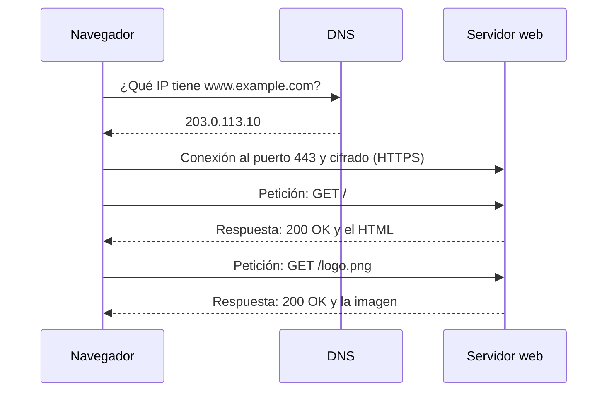
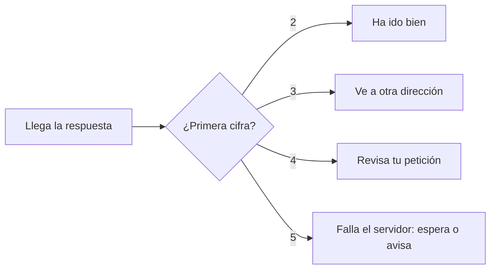

# 06.03 La web: HTTP, peticiones, respuestas y APIs

> **Versiones:** HTTP/1.1 y HTTP/2 (RFC 9110, 9112 y 9113) · curl 8.18.0 en las salidas del curso (a 16 de noviembre de 2026)
> **Conviene saber antes:** [06.01 Redes: IP, router, DNS y cortafuegos](01-redes.md) · [06.02 Puertos y localhost: tu ordenador como servidor](02-puertos-y-localhost.md) · [04.03 JSON y YAML, 1.3](../fase-04-formatos-y-diagramas/03-json-y-yaml.md#13-json-el-formato-para-intercambiar-datos) · [03.02 La terminal: sacarle partido, 1.13](../fase-03-herramientas/02-terminal-sacarle-partido.md#113-códigos-de-salida)
> **Tiempo estimado:** 2,5 horas
> **Nivel:** Básico · Núcleo

## Qué aprenderás

- Qué pasa, paso a paso, desde que escribes una dirección en el navegador hasta que ves la página.
- A leer una **URL** por partes: esquema, dominio, puerto, ruta, parámetros y fragmento.
- Qué es **HTTP**: una conversación de **petición** y **respuesta**, con sus **métodos** (`GET`, `POST`, `PUT`, `PATCH`, `DELETE`), sus **códigos de estado** (`200`, `404`, `500`…), sus **cabeceras** y su **cuerpo**.
- Qué añade **HTTPS** y por qué hoy casi toda la web lo usa.
- A mirar las peticiones de una web en la **pestaña Red** de las herramientas del desarrollador del navegador.
- Qué es una **API web** y qué es **REST**, la forma más común de organizarlas.
- A hablar HTTP desde la terminal con **`curl`**: ver la respuesta entera (`-i`), solo el código (`-w`), guardarla en un fichero (`-o`) y enviar datos (`-X`, `-H` y `-d`).
- Por qué la **clave de una API** no se escribe nunca en el código.

En [06.01](01-redes.md) viste cómo viajan los datos de un ordenador a otro y quién es el [cliente y quién el servidor](01-redes.md#13-cliente-y-servidor), y en [06.02](02-puertos-y-localhost.md), que un servidor escucha en un [puerto](02-puertos-y-localhost.md#11-una-dirección-ip-no-basta-el-puerto) y cómo saber con `curl` si responde. Aquí verás **qué se dicen** el cliente y el servidor cuando hablan por la web. Es el idioma que vas a usar en cualquier curso que toque la web, las aplicaciones del móvil o los datos de otros programas.

## 1. Teoría

### 1.1. Qué pasa cuando abres una web

Escribes `https://www.example.com/` en el navegador y pulsas <kbd>Intro</kbd>. En menos de un segundo pasan estas cosas:

1. **El nombre se convierte en una dirección IP.** El navegador le pregunta al DNS qué IP tiene `www.example.com` ([06.01](01-redes.md#111-dns-de-nombres-a-números)).
2. **Se abre una conexión** con esa IP, en el puerto que toca: el 443 para `https` y el 80 para `http` ([06.02](02-puertos-y-localhost.md#13-los-puertos-que-verás-siempre)).
3. **Si es `https`, se protege la conexión**: el servidor demuestra quién es y, desde ese momento, todo viaja cifrado ([apartado 1.9](#19-https-http-con-candado)).
4. **El navegador envía una petición HTTP**: «dame la página `/`».
5. **El servidor envía una respuesta HTTP**: «aquí la tienes», con el código de la página (en HTML, el lenguaje de las páginas web que conociste en [04.04](../fase-04-formatos-y-diagramas/04-xml-csv-y-otros.md#17-html-el-pariente-de-xml)).
6. **El navegador lee el HTML** y, por cada imagen, hoja de estilos o programa que la página necesita, **hace otra petición**. Una página normal hace decenas.



En texto: el navegador pregunta al DNS la IP del servidor, se conecta a él, pide la página y, con lo que dice la página, pide la imagen. Cada «pedir y recibir» es una petición y su respuesta. (Es un [diagrama de secuencia](../fase-04-formatos-y-diagramas/05-diagramas-y-mermaid.md#18-diagramas-de-secuencia), como los de la fase 4; la IP es una de las reservadas para ejemplos.)

Este módulo trata de los pasos 4 y 5: **la petición y la respuesta**. Son siempre iguales, las haga un navegador, una aplicación del móvil o un programa tuyo.

Recuerda que la web no es internet: es uno de los servicios que viajan por ella ([nota de 06.01](01-redes.md#11-internet-una-red-de-redes)).

### 1.2. Las partes de una URL

La dirección que escribes en el navegador se llama **URL** (*Uniform Resource Locator*, «localizador uniforme de recursos»). Dice **dónde está** algo y **cómo pedirlo**. Tiene partes, y cada una tiene su papel:

```text
https://tienda.example.com:8443/libros/novela?orden=precio&pagina=2#opiniones
└─┬─┘   └───────┬────────┘ └┬─┘└─────┬─────┘└─────────┬─────────┘└───┬────┘
esquema      dominio     puerto    ruta         parámetros       fragmento
```

| Parte | En el ejemplo | Para qué sirve |
|---|---|---|
| **Esquema** | `https` | Cómo se habla con el servidor: `http` o `https` (hay otros, como `mailto` o `file`) |
| **Dominio** | `tienda.example.com` | A qué servidor se pide. Es el nombre que el DNS convierte en IP; ya sabes leerlo de [02.03](../fase-02-tu-ordenador/03-instalar-programas-y-path.md#13-descarga-siempre-de-la-web-oficial). A veces, en su lugar, va una IP o `localhost` |
| **Puerto** | `8443` | En qué puerto escucha ([06.02](02-puertos-y-localhost.md#12-ip-y-puerto-la-dirección-completa)). Casi nunca se escribe: si no está, es el 443 con `https` y el 80 con `http` |
| **Ruta** | `/libros/novela` | **Qué** se pide dentro de ese servidor. Se parece a una [ruta de carpetas](../fase-02-tu-ordenador/02-archivos-carpetas-y-rutas.md), pero no tiene por qué haber carpetas detrás |
| **Parámetros** | `orden=precio&pagina=2` | Detalles de la petición: después de `?`, parejas `nombre=valor` separadas por `&`. También se llaman *query* o «cadena de consulta» |
| **Fragmento** | `opiniones` | Después de `#`, un punto dentro de la página. **No viaja al servidor**: lo usa solo el navegador para saltar a esa parte |

Así, `http://localhost:8080/libros/1` es: por `http`, a tu propio ordenador ([`localhost`](02-puertos-y-localhost.md#15-localhost-tu-propio-ordenador)), en el puerto 8080, pide `/libros/1`. Sin parámetros ni fragmento.

Dos detalles que te ahorrarán sustos:

- **La ruta distingue mayúsculas y minúsculas** en casi todos los servidores (que suelen ser Linux, como viste en [02.02](../fase-02-tu-ordenador/02-archivos-carpetas-y-rutas.md)): `/Libros` y `/libros` son dos cosas distintas. El dominio, en cambio, no: `EXAMPLE.com` es `example.com`.
- **Algunos caracteres no pueden ir tal cual.** Una URL solo admite letras sin tilde, números y unos pocos signos. Lo demás se escribe con `%` y un código: el espacio es `%20` y la «é», `%C3%A9`. Se llama **codificación por porcentaje**. Por eso, al copiar la dirección de una página de Wikipedia con tildes, a veces te sale llena de `%`. No tienes que aprendértelos: el navegador y los programas los ponen solos.

> **📌 Nota:** las [anclas](../glosario.md#ancla) de este curso (`#13-json-el-formato-para-intercambiar-datos`) son fragmentos: por eso un enlace con `#` te lleva a un apartado concreto de la página.

### 1.3. HTTP: pedir y responder con texto

**HTTP** (*HyperText Transfer Protocol*, «protocolo de transferencia de hipertexto») es el **idioma de la web**: las reglas con las que un cliente pide algo y un servidor responde. Es un [protocolo](01-redes.md#14-protocolos-las-reglas-de-la-conversación), como los que viste en 06.01.

La conversación de HTTP es siempre la misma:

1. El **cliente** (el navegador, una aplicación, `curl`) envía una **petición**.
2. El **servidor** envía **una respuesta** a esa petición.

Y nada más. El servidor **no habla si no le preguntan**: nunca envía una respuesta sin una petición antes.

Tres ideas que conviene tener claras desde el principio:

- **Es texto.** En HTTP/1.1, la versión más sencilla, la petición y la respuesta son líneas de texto que podrías leer. Lo verás en los dos apartados siguientes.
- **No tiene memoria.** Cada petición va sola: el servidor no recuerda la anterior. Para que una tienda sepa que la petición del carrito es tuya, el navegador le envía en cada petición un dato que te identifica (una *cookie*: un pequeño texto que el servidor le pidió que guardara).
- **Tiene versiones**, que cambian **cómo viaja**, no **qué significa**: **HTTP/1.1** (texto, la base de todo), **HTTP/2** (binario y más rápido, la que usan muchas webs) y **HTTP/3** (que viaja sobre UDP, como se apuntó en [06.01](01-redes.md#113-tcp-y-udp)). Los métodos, códigos y cabeceras son los mismos en las tres (RFC 9110, a 16 de noviembre de 2026). Lo que aprendas aquí vale para todas.

> **📌 Nota:** las normas de internet se publican como [RFC](../glosario.md#rfc), documentos numerados y públicos. HTTP está en el RFC 9110 (lo que significa cada cosa) y en el 9112, el 9113 y el 9114 (cómo viajan HTTP/1.1, HTTP/2 y HTTP/3). No hace falta que los leas; sí saber que existen: cuando dos personas discuten qué significa un código, el RFC tiene la última palabra.

### 1.4. La petición

Una petición HTTP tiene cuatro partes. Esta es la que envía `curl` al pedir `http://localhost:8080/libros/1` (lo que viaja, con HTTP/1.1):

```text
GET /libros/1 HTTP/1.1
Host: localhost:8080
User-Agent: curl/8.18.0
Accept: */*

```

1. **La línea de petición**, la primera: el **método** (`GET`, qué quieres hacer), la **ruta** (`/libros/1`, sobre qué) y la **versión** de HTTP.
2. **Las cabeceras**: una por línea, `Nombre: valor`. Son datos sobre la petición: a qué servidor va (`Host`), qué programa la hace (`User-Agent`) y qué formatos acepta (`Accept`; `*/*` es «cualquiera»).
3. **Una línea en blanco**, que dice «se acabaron las cabeceras».
4. **El cuerpo**, opcional: los datos que envías. Un `GET` no lleva; cuando rellenas un formulario o creas algo, el cuerpo lleva esos datos (en una API, casi siempre en JSON).

> **📌 Nota:** fíjate en que en la petición **no va el dominio en la ruta**, sino en la cabecera `Host`. Un mismo servidor (una sola IP) puede alojar cientos de webs, y `Host` le dice cuál le estás pidiendo.

### 1.5. Los métodos: qué quieres hacer

El **método** (también se le llama «verbo») dice **qué quieres hacer** con lo que indica la ruta. Los que vas a ver casi siempre:

| Método | Qué pide | ¿Cambia algo en el servidor? | ¿Lleva cuerpo? | Ejemplo en una biblioteca |
|---|---|---|---|---|
| `GET` | **Leer**: «dame esto» | No | No | `GET /libros/1`: la ficha del libro 1 |
| `POST` | **Crear** algo nuevo (o hacer una acción) | Sí | Sí: lo que se crea | `POST /libros`: dar de alta un libro |
| `PUT` | **Sustituir** algo entero por lo que envías | Sí | Sí: el recurso completo | `PUT /libros/1`: la ficha nueva entera del libro 1 |
| `PATCH` | **Cambiar una parte** | Sí | Sí: solo lo que cambia | `PATCH /libros/1`: solo «ya no está disponible» |
| `DELETE` | **Borrar** | Sí | No | `DELETE /libros/1`: quitar el libro 1 |

Hay dos más que verás de vez en cuando: `HEAD` (como `GET`, pero el servidor responde solo las cabeceras, sin el cuerpo) y `OPTIONS` («¿qué puedo hacer aquí?»).

Dos ideas importantes:

- **`GET` no debe cambiar nada.** Los navegadores, los buscadores y las cachés de la web (copias de las respuestas que guardan el navegador y otros servidores por el camino, como la [caché del DNS](01-redes.md#112-cómo-se-resuelve-un-nombre), pero de páginas) hacen `GET` sin preguntarte (al recargar, al adelantar páginas, al indexar la web). Si un `GET` borrara algo, lo borraría cualquiera que pasara por ahí.
- **Al escribir una dirección en el navegador o pulsar un enlace, siempre es `GET`.** Los formularios pueden enviar `POST`. Para enviar `PUT`, `PATCH` o `DELETE` hace falta un programa: el código de la propia página, una aplicación o una herramienta como `curl` ([apartado 1.13](#113-curl-http-desde-la-terminal)).

### 1.6. La respuesta

La respuesta tiene las mismas cuatro partes que la petición, con una primera línea distinta. Esta es la que da el servidor de prueba del curso a la petición del apartado 1.4:

```text
HTTP/1.1 200 OK
Content-Type: application/json
Content-Length: 90

{
  "id": 1,
  "titulo": "Niebla",
  "autor": "Miguel de Unamuno",
  "disponible": true
}
```

1. **La línea de estado**: la versión de HTTP, el **código de estado** (`200`) y su texto (`OK`). Es lo primero que hay que mirar: dice **cómo ha ido**.
2. **Las cabeceras**: datos sobre la respuesta. Aquí, qué formato tiene el cuerpo (`Content-Type: application/json`, es decir, [JSON](../fase-04-formatos-y-diagramas/03-json-y-yaml.md#13-json-el-formato-para-intercambiar-datos)) y cuánto ocupa, en bytes (`Content-Length: 90`).
3. **Una línea en blanco**.
4. **El cuerpo**: lo que has pedido. Puede ser una página HTML, una imagen, un JSON… o nada.

Pedir y recibir: eso es todo HTTP. Lo demás son detalles de estas partes.

### 1.7. Los códigos de estado

El **código de estado** es un número de tres cifras. **La primera cifra dice la familia**, y con ella ya sabes lo esencial:

| Familia | Quiere decir | De quién es la culpa si falla |
|---|---|---|
| **1xx** | Información: «sigue, te estoy oyendo» (casi no los verás) | — |
| **2xx** | **Éxito**: ha ido bien | — |
| **3xx** | **Redirección**: lo que buscas está en otro sitio | — |
| **4xx** | **Error del cliente**: la petición está mal (no existe, no tienes permiso…) | De quien pide |
| **5xx** | **Error del servidor**: la petición estaba bien, pero el servidor ha fallado | Del servidor |

Los que más vas a ver:

| Código | Texto | Cuándo |
|---|---|---|
| `200` | OK | Ha ido bien y en el cuerpo va lo que pediste |
| `201` | Created | Se ha **creado** algo; la cabecera `Location` dice dónde está |
| `204` | No Content | Ha ido bien y no hay nada que devolver (después de borrar, por ejemplo) |
| `301` | Moved Permanently | Se ha mudado para siempre a la dirección de `Location`; el navegador va allí solo |
| `302` | Found | Está en otra dirección, de momento |
| `304` | Not Modified | Lo que ya tienes guardado sigue valiendo: no hace falta descargarlo otra vez |
| `400` | Bad Request | La petición está mal escrita (un JSON roto, un dato que no es un número) |
| `401` | Unauthorized | No sé quién eres: falta identificarse, o la clave no vale |
| `403` | Forbidden | Sé quién eres, pero no tienes permiso para esto |
| `404` | Not Found | Eso no existe |
| `405` | Method Not Allowed | Existe, pero no admite ese método; la cabecera `Allow` dice cuáles sí |
| `429` | Too Many Requests | Demasiadas peticiones seguidas: espera un poco |
| `500` | Internal Server Error | El servidor ha fallado por dentro (un error de su programa) |
| `503` | Service Unavailable | El servidor no puede atender ahora (está en mantenimiento o saturado) |



En texto: con la primera cifra decides qué hacer. Un 2 es que ha ido bien; un 3, que hay que ir a otra dirección; un 4, que tu petición tiene algo mal; y un 5, que el problema es del servidor.

Las dudas más frecuentes:

- **¿`401` o `403`?** `401` es «¿quién eres?»; `403`, «ya sé quién eres, y no puedes».
- **¿Un `404` es culpa mía?** Casi siempre: la dirección está mal escrita o eso ya no existe. Un `500`, en cambio, no lo arreglas cambiando tu petición: es un fallo del servidor.
- **Los textos (`OK`, `Not Found`) son para las personas.** Los programas miran solo el número. Con HTTP/2 ni siquiera viajan: la línea de estado es solo `HTTP/2 200`.

### 1.8. Las cabeceras más habituales

Las **cabeceras** son los datos que acompañan a la petición o a la respuesta: qué formato tiene el cuerpo, quién la envía, cuánto ocupa… Su nombre **no distingue mayúsculas y minúsculas** (`Content-Type` y `content-type` son la misma; con HTTP/2 viajan siempre en minúsculas). Las que más verás:

| Cabecera | Va en | Para qué |
|---|---|---|
| `Host` | Petición | A qué web se pide ([apartado 1.4](#14-la-petición)) |
| `User-Agent` | Petición | Qué programa pide: un navegador, `curl/8.18.0`… |
| `Accept` | Petición | Qué formatos acepta el cliente: `application/json`, `text/html`… |
| `Authorization` | Petición | Quién eres: la clave o el *token* para entrar en una API ([apartado 1.15](#115-las-claves-de-una-api-fuera-del-código)) |
| `Content-Type` | Las dos | Qué formato tiene el **cuerpo**: `application/json`, `text/html; charset=utf-8`, `image/png`… |
| `Content-Length` | Las dos | Cuántos bytes ocupa el cuerpo |
| `Location` | Respuesta | Adónde ir (en una redirección) o dónde está lo que se acaba de crear (con un `201`) |
| `Allow` | Respuesta | Qué métodos admite esa ruta (con un `405`) |
| `Cache-Control` | Respuesta | Si se puede guardar la respuesta y cuánto tiempo, para no pedirla otra vez |
| `Date` · `Server` | Respuesta | Cuándo respondió el servidor y qué programa es |
| `Set-Cookie` · `Cookie` | Respuesta · Petición | El servidor pide guardar una *cookie*; el navegador la devuelve en cada petición |

El valor de `Content-Type` se llama **tipo de medio** (o tipo MIME): dos palabras separadas por `/`, la familia y el formato. `charset=utf-8` añade la [codificación](../fase-04-formatos-y-diagramas/01-texto-binario-y-codificacion.md) del texto.

Muchas webs y API añaden **cabeceras propias**. Suelen empezar por el nombre de quien las pone: la API de GitHub, por ejemplo, manda `x-github-request-id` o `x-ratelimit-remaining` ([ejemplo 2.6](#26-una-api-de-verdad-la-de-github)).

### 1.9. HTTPS: HTTP con candado

Con `http`, la petición y la respuesta viajan **tal cual**: cualquiera que esté en medio (quien controla la wifi de una cafetería, por ejemplo) puede leerlas y hasta cambiarlas. **HTTPS** es HTTP **dentro de una conexión cifrada**. La protección la pone **TLS** (*Transport Layer Security*, «seguridad de la capa de transporte»), y da tres garantías:

- **Nadie lo lee**: lo que viaja va cifrado. Quien está en medio ve con qué servidor hablas, pero no qué pides ni qué te responde.
- **Nadie lo cambia** sin que se note.
- **El servidor es quien dice ser.** Lo demuestra con un **certificado**, una especie de DNI digital firmado por una **autoridad de certificación**, una organización en la que confía tu navegador. Si el certificado no es válido (caducado, de otro dominio…), el navegador te enseña una pantalla de aviso en lugar de la web.

El candado de la barra de direcciones quiere decir «esta conexión es HTTPS y el certificado es válido». **No quiere decir que la web sea de fiar**: una web falsa también puede tener su candado. Lo que identifica a una web es su **dominio**, como viste en [02.03](../fase-02-tu-ordenador/03-instalar-programas-y-path.md#13-descarga-siempre-de-la-web-oficial).

Hoy casi toda la web es HTTPS, y los navegadores marcan las páginas `http` como «no seguras». Ya lo usaste en la fase 5: la dirección `https://github.com/…` de un remoto de Git va por HTTPS ([05.03](../fase-05-git-y-github/03-github.md#14-cómo-sabe-github-que-eres-tú-https)). Cuando trabajes en tu propio ordenador con un servidor de prueba, en cambio, lo normal es `http://localhost`: los datos no salen de tu ordenador ([06.02](02-puertos-y-localhost.md)).

Cómo se protegen los datos, qué es un certificado por dentro y otras ideas de seguridad lo verás en [Seguridad básica](../fase-07-aprender-a-aprender/05-seguridad-basica.md), en la fase 7.

### 1.10. La pestaña Red del navegador

Todo lo que acabas de leer lo puedes ver en tu navegador, con sus **herramientas del desarrollador** (*DevTools*, en inglés). Los navegadores las traen de serie; según su documentación (a 16 de noviembre de 2026):

| Navegador | Abrir las herramientas | Ir directo a la pestaña de red |
|---|---|---|
| Chrome (y Edge, que se basa en él) | <kbd>F12</kbd> o <kbd>Ctrl</kbd>+<kbd>Mayús</kbd>+<kbd>I</kbd>; en macOS, <kbd>Cmd</kbd>+<kbd>Opción</kbd>+<kbd>I</kbd> | Pestaña **Network** |
| Firefox | <kbd>F12</kbd> o <kbd>Ctrl</kbd>+<kbd>Mayús</kbd>+<kbd>I</kbd>; en macOS, <kbd>Cmd</kbd>+<kbd>Opción</kbd>+<kbd>I</kbd> | <kbd>Ctrl</kbd>+<kbd>Mayús</kbd>+<kbd>E</kbd>; en macOS, <kbd>Cmd</kbd>+<kbd>Opción</kbd>+<kbd>E</kbd> |
| Safari (macOS) | Vienen ocultas. Primero, una vez: **Safari > Ajustes > Avanzado** y marca «Mostrar funciones para desarrolladores web» (según la guía de Apple en español). Después, las abres desde el menú **Desarrollo** que aparece arriba | Su pestaña de red |

Con el navegador en español, los nombres de las pestañas pueden salir traducidos, y cambian de un navegador a otro (la de red, la de las cabeceras de cada petición…): busca la que enseña las peticiones.

La pestaña **Red** muestra **una fila por cada petición** que hace la página mientras la tienes abierta (si la abres con la página ya cargada, recarga para verlas). En cada fila, el **método**, la **dirección**, el **código de estado**, el tipo, el tamaño y el tiempo que ha tardado. Si pulsas en una, ves sus **cabeceras** (las de la petición y las de la respuesta) y su **cuerpo**.

Pruébalo con cualquier web: verás que una sola página hace decenas de peticiones (el HTML, las hojas de estilo, las imágenes, las fuentes…), casi todas `GET` y casi todas con `200`. Es la herramienta que más vas a usar cuando una web «no carga bien»: la fila en rojo te dice qué petición ha fallado y con qué código.

> **📌 Nota:** el aspecto de estas herramientas cambia con cada versión del navegador, y este módulo no tiene capturas por eso. Lo que no cambia es lo que enseñan: peticiones, métodos, códigos y cabeceras.

### 1.11. Qué es una API web

Ya sabes, de [04.03](../fase-04-formatos-y-diagramas/03-json-y-yaml.md#11-datos-con-estructura-para-qué-sirven-los-formatos), que una [API](../glosario.md#api) es la puerta por la que un programa le pide datos o servicios a otro. Una **API web** es esa puerta **a través de HTTP**: un servidor que, en lugar de páginas para personas, responde **datos para programas**, casi siempre en JSON.

Un ejemplo de cada día: la aplicación del tiempo de tu móvil. No trae dentro el tiempo de mañana: cuando la abres, hace una petición HTTP a la API de un servicio meteorológico (`GET /prevision?ciudad=Zaragoza`, por ejemplo) y recibe un JSON con temperaturas y lluvias, que pinta a su manera. Lo mismo hacen la aplicación del banco, la del autobús o la de una tienda:

| Página web | API web |
|---|---|
| La pide una **persona**, con el navegador | La pide un **programa**: una aplicación del móvil, otra web, un script |
| Responde **HTML**, para verlo | Responde **datos** (JSON), para usarlos |
| `GET https://tienda.example.com/libros` | `GET https://api.tienda.example.com/libros` |

Una API es un **contrato**: qué direcciones hay, qué método usa cada una, qué hay que enviar y qué se recibe. Ese contrato se publica en su **documentación**, y es lo primero que se lee antes de usar una API. Mientras el contrato se cumpla, el servidor puede cambiar por dentro (otro lenguaje, otra base de datos) sin que las aplicaciones que lo usan se enteren.

> **📌 Nota:** a cada dirección de una API con su método (`GET /libros`, `POST /libros`…) se le suele llamar ***endpoint*** («punto de acceso»). Lo verás mucho en la documentación de las API, en inglés y sin traducir.

### 1.12. REST: recursos y métodos

Una API se puede organizar de muchas formas. La más común en la web es **REST** (*REpresentational State Transfer*): no es una norma ni un programa, sino un **estilo**, una forma de usar HTTP tal como se pensó. Sus ideas, en la práctica:

- **Todo es un recurso, con su dirección.** Los libros de una biblioteca son `/libros`; el libro 1, `/libros/1`. Las direcciones son **nombres en plural**, no verbos: `/libros`, no `/darDeAltaLibro`.
- **La acción la dice el método**, no la dirección: `GET` lee, `POST` crea, `PUT` y `PATCH` cambian, `DELETE` borra.
- **El resultado lo dice el código de estado**: `201` si se ha creado, `404` si no existe…
- **Los parámetros filtran, ordenan o pasan página**: `/libros?disponible=true` son los libros disponibles.
- **No hay memoria entre peticiones** ([apartado 1.3](#13-http-pedir-y-responder-con-texto)): cada una lleva todo lo que hace falta, también quién eres.

Con dos direcciones, una para **la colección** y otra para **cada elemento**, se cubre casi todo:

| | `/libros` (todos) | `/libros/1` (uno) |
|---|---|---|
| `GET` | La lista de libros | La ficha del libro 1 |
| `POST` | Dar de alta uno nuevo → `201` y `Location` | — |
| `PUT` | — | Sustituir su ficha entera |
| `PATCH` | — | Cambiar una parte de su ficha |
| `DELETE` | — | Borrarlo → `204` |

Una casilla con «—» es una combinación que no tiene sentido: si la pides, la API responde `405` (ese método no se admite ahí).

A una API que sigue estas ideas se la llama **API REST** (o *RESTful*). Muchas que se llaman así solo siguen una parte, y hay otras formas de hacer API (GraphQL, gRPC…) que te enseñará el curso que las use. Pero casi todas las API que vas a usar al empezar son de este estilo.

### 1.13. curl: HTTP desde la terminal

El navegador solo hace `GET` cuando escribes una dirección, y esconde las cabeceras. Para probar una API hace falta algo más: enviar otros métodos, cabeceras y cuerpos, y ver la respuesta entera. La herramienta clásica es **`curl`**, un programa de la terminal que hace peticiones (su nombre viene de *client URL*).

**Ya lo tienes**, casi seguro (a 16 de noviembre de 2026):

- **En Linux** viene con casi todas las distribuciones (si no, se instala con su gestor de paquetes).
- **En macOS** viene con el sistema.
- **En Git Bash** viene con Git for Windows (sus notas de versión dicen cuál trae: la 2.56.1, la última a 16 de noviembre de 2026, trae la 8.23.0). Windows 10 y 11 traen además su propio `curl.exe`. **Usa siempre Git Bash**: en PowerShell, `curl` puede ser el nombre de otra orden, que no funciona igual.

Ya lo usaste en [06.02](02-puertos-y-localhost.md#112-responde-alguien-comprobarlo-con-curl) para saber si responde un servidor. Su versión la ves con `curl --version`, como hiciste con Git en [02.03](../fase-02-tu-ordenador/03-instalar-programas-y-path.md). Las salidas de este módulo son de la versión 8.18.0; la tuya puede ser otra, y lo que enseña el módulo funciona igual.

`curl` se usa así: `curl [opciones] dirección`. Sin opciones, hace un `GET` y escribe **el cuerpo** de la respuesta en la pantalla. Las opciones que vas a usar:

| Opción | Qué hace | Ejemplo |
|---|---|---|
| `-i` | Escribe **también la línea de estado y las cabeceras** de la respuesta, antes del cuerpo | `curl -i URL` |
| `-s` | **Silencioso**: sin la barra de progreso ni los mensajes de error de `curl` | `curl -s URL` |
| `-o fichero` | Guarda el cuerpo en un **fichero** en lugar de escribirlo en la pantalla | `curl -s -o libros.json URL` |
| `-w formato` | Al terminar, escribe lo que le pidas de la respuesta; `%{http_code}` es el código de estado | `curl -s -o /dev/null -w '%{http_code}\n' URL` |
| `-X MÉTODO` | Usa ese **método** en lugar de `GET` | `curl -X DELETE URL` |
| `-H 'Nombre: valor'` | Añade una **cabecera** a la petición | `curl -H 'Accept: application/json' URL` |
| `-d 'datos'` · `-d @fichero` | Envía esos datos como **cuerpo** (y, si no dices otro método, usa `POST`); con `@`, los lee de un fichero | `curl -d @libro.json URL` |

Detalles que conviene saber de cada una (de la documentación de `curl`, `man curl`):

- **`-i`** se llama en su forma larga `--include`, que funciona en todas las versiones; desde la 8.10.0 se llama también `--show-headers`, que en versiones anteriores (como la 8.5.0 de Ubuntu 24.04, a 16 de noviembre de 2026) no existe, y algunos sistemas traen todavía una de ellas. Usa `-i` y no tendrás que pensarlo.
- **La barra de progreso** sale cuando el cuerpo no va a la pantalla: si lo guardas con `-o` o lo pasas por una [tubería](../fase-03-herramientas/02-terminal-sacarle-partido.md#15-tuberías-la-salida-de-una-orden-es-la-entrada-de-otra). Por eso `-s` va casi siempre junto a `-o` o a una tubería ([error típico 3.5](#35-la-barra-de-progreso-que-aparece-al-guardar)).
- **`-w`** escribe lo que le pides **después** del cuerpo. Con `-o /dev/null` y `-s` te quedas solo con el código, como en [06.02](02-puertos-y-localhost.md#112-responde-alguien-comprobarlo-con-curl): `000` si no responde nadie, y el código de salida de `curl` (7 o 35) dice por qué.
- **`-d`** envía los datos con la cabecera `Content-Type: application/x-www-form-urlencoded`, la de los formularios. Si envías JSON, añade `-H 'Content-Type: application/json'`, para que el servidor sepa qué le llega. Con **`-d @fichero`**, los datos salen de ese fichero (quitando sus saltos de línea, que en un JSON no cambian nada): un JSON largo se escribe mejor en un fichero que en la orden.
- **Comillas simples** alrededor de la dirección si lleva `?` o `&`, y alrededor del JSON de `-d` ([03.01](../fase-03-herramientas/01-terminal-lo-basico.md#114-comodines-y-comillas)). Lo verás en los errores típicos [3.1](#31-una-url-con--sin-comillas) y [3.4](#34-comillas-dobles-dentro-de-comillas-dobles).

> **📌 Nota:** en tutoriales verás mucho **`curl -v`** (de *verbose*, «detallado»): escribe además la petición entera y lo que va haciendo `curl` por dentro (las líneas que empiezan por `>` son lo que envía, y por `<`, lo que recibe). Es muy útil para investigar un problema, pero lo que escribe cambia de una versión de `curl` a otra, y por eso este curso no lo usa en sus salidas.

### 1.14. El servidor de prueba y los servidores de verdad

Como en [06.02](02-puertos-y-localhost.md#2-ejemplos-de-código), las salidas de este módulo se han obtenido con el **servidor de prueba** del curso: uno pequeño que se arranca en `localhost`, en el puerto 8080, y que responde siempre lo mismo a cada petición. Cada ejemplo describe sus respuestas en el fichero **`servidor.json`** de su carpeta: qué método y qué ruta, qué código, qué cabeceras y qué cuerpo. Es como el guion de una API de mentira:

```json
{"metodo": "GET", "ruta": "/libros/1", "estado": 200, "cuerpo": {"id": 1, "titulo": "Niebla"}}
```

Ese servidor **no viene en tu ordenador**: el `servidor.json` va en la carpeta que descargas, pero en tu equipo no hay nadie escuchando en el 8080 (si lo intentas, verás el `000` del [ejemplo 2.2 de 06.02](02-puertos-y-localhost.md#22-el-puerto-equivocado)). Así que, con estos ejemplos:

- **Léelos** como cualquier otra salida del curso: están comprobados, y son lo que verías.
- **Abre el `servidor.json`** de la carpeta: es la «documentación» de esa API de mentira, y te sirve para predecir qué responderá cada petición.
- **Practica con una API de verdad**, la de GitHub, en el [ejemplo 2.6](#26-una-api-de-verdad-la-de-github) y el [ejercicio 7](#ejercicio-7--consulta-la-api-de-github).

Un servidor de verdad se comporta igual en lo esencial, con algunas diferencias que verás en el ejemplo 2.6:

- **Manda más cabeceras**: `Date` (la fecha y hora de la respuesta), `Server` (qué programa responde), `Cache-Control` y otras suyas. El de prueba manda solo las imprescindibles, para que su salida no cambie de un día a otro.
- **Suele responder con `HTTP/2`** en lugar de `HTTP/1.1`, sobre todo con `https`. Y con HTTP/2, las cabeceras salen en minúsculas y la línea de estado no lleva texto: `HTTP/2 200`.
- **Responde lo que hay en ese momento**: si alguien da de alta un libro, la lista cambia. El de prueba no guarda nada: un `POST` responde que ha creado algo, pero la lista sigue igual.

### 1.15. Las claves de una API, fuera del código

Muchas API no se pueden usar sin identificarse: el servicio quiere saber quién hace cada petición, para cobrarle, para limitar cuántas hace o para darle acceso a sus datos. Para eso te dan una **clave de API** (*API key*): un texto largo y secreto que va en **cada petición**, casi siempre en una cabecera:

```bash
curl -H "Authorization: Bearer $CLAVE_TIEMPO" 'https://api.tiempo.example.com/prevision?ciudad=Zaragoza'
```

(Cada API dice en su documentación en qué cabecera va: `Authorization` es la más común, y otras usan una suya, como `X-API-Key`. `Bearer`, «portador», es la palabra que esa cabecera pone delante de la clave: vale para quien la lleve.)

Una clave de API es un [secreto](../glosario.md#secreto), igual que el *token* de GitHub de [05.03](../fase-05-git-y-github/03-github.md#14-cómo-sabe-github-que-eres-tú-https): **quien la tenga, es tú** para ese servicio, y lo que haga con ella (miles de peticiones, por ejemplo) te lo cobran o te lo bloquean a ti. Por eso:

- **Nunca se escribe en el código**, ni en un script, ni en un fichero que se sube a Git. Va en un **[fichero `.env`](../fase-04-formatos-y-diagramas/04-xml-csv-y-otros.md#114-el-fichero-env-y-los-secretos)** que Git ignora, y el programa la lee de una variable de entorno, como `$CLAVE_TIEMPO` en el ejemplo de arriba. Al repositorio se sube solo el `.env.example`, con un valor que se vea falso.
- **No se pega en un chat, un correo, un *issue* ni una captura de pantalla.** Cuidado también con la salida de `curl -v`, que enseña las cabeceras que envías.
- **Si se te escapa, se anula** en la web del servicio y se pide otra.

Cómo se guardan bien los secretos y qué hacer si se te escapa uno lo verás a fondo en [Seguridad básica](../fase-07-aprender-a-aprender/05-seguridad-basica.md), en la fase 7.

### 1.16. Postman, Bruno y otros clientes de API

`curl` está en todas partes y se puede meter en un script, pero escribir peticiones largas en una línea cansa. Por eso hay **clientes de API** con ventanas: eliges el método en un desplegable, escribes la dirección, rellenas las cabeceras y el cuerpo en sus pestañas, pulsas un botón y ves la respuesta con colores. Y las peticiones se guardan con un nombre, en **colecciones**, para repetirlas. Dos de los más usados, según su documentación (a 16 de noviembre de 2026):

- **Postman**: aplicación de escritorio para Windows, macOS y Linux, y también versión web.
- **Bruno**: aplicación de escritorio que guarda las colecciones como **ficheros de texto en tu proyecto**, pensados para versionarlos con Git, y que no necesita cuenta.

No te hacen falta para este curso: todo lo que hacen se puede hacer con `curl`, y lo que aprendas con `curl` (métodos, cabeceras, códigos) es lo mismo que verás en sus ventanas. El curso que te enseñe a construir una API te enseñará también a usar uno.

## 2. Ejemplos de código

Los ejemplos usan la API de una biblioteca de barrio, con el servidor de prueba del [apartado 1.14](#114-el-servidor-de-prueba-y-los-servidores-de-verdad). Recuerda que **en tu ordenador no tienes ese servidor**: lee las salidas (son las que verías), mira el `servidor.json` de cada carpeta y practica en vivo con la API de GitHub del [ejemplo 2.6](#26-una-api-de-verdad-la-de-github). El [aviso sobre las salidas de 02.03](../fase-02-tu-ordenador/03-instalar-programas-y-path.md#22-un-aviso-sobre-las-salidas-de-la-terminal) también vale aquí.

La API de la biblioteca, tal como la describe su `servidor.json`:

| Método y ruta | Responde |
|---|---|
| `GET /estado` | `200` y un texto: «La biblioteca está abierta» |
| `GET /libros` | `200` y la lista de los tres libros |
| `GET /libros?disponible=true` | `200` y la lista de los libros disponibles |
| `GET /libros/1` | `200` y la ficha del libro 1 |
| `POST /libros` | `201`, la cabecera `Location: /libros/4` y la ficha del libro creado |
| `PUT /libros/1` | `200` y la ficha nueva del libro 1 |
| `DELETE /libros/1` | `204`, sin cuerpo |
| Cualquier otra ruta | `404` |
| Una ruta de la tabla con otro método | `405` |

### 2.1. Tu primera petición con curl

**Situación real:** Beatriz lleva la biblioteca de su barrio y un voluntario le ha preparado una API. Antes de nada, quiere comprobar que responde y ver la ficha de un libro.

**En tu terminal** (`sesion.txt`):

```text
$ curl http://localhost:8080/estado
La biblioteca está abierta
$ curl http://localhost:8080/libros/1
{
  "id": 1,
  "titulo": "Niebla",
  "autor": "Miguel de Unamuno",
  "disponible": true
}
$ curl -i http://localhost:8080/libros/1
HTTP/1.1 200 OK
Content-Type: application/json
Content-Length: 90

{
  "id": 1,
  "titulo": "Niebla",
  "autor": "Miguel de Unamuno",
  "disponible": true
}
```

📁 **Código:** [`codigo/03-la-web-http-y-apis/ejemplos/2.1-primera-peticion/`](codigo/03-la-web-http-y-apis/ejemplos/2.1-primera-peticion/)

**En qué fijarte:**

- **Sin opciones, `curl` hace un `GET` y escribe solo el cuerpo.** El de `/estado` es un texto; el de `/libros/1`, un JSON con la ficha del libro.
- **Con `-i` aparece todo lo demás**: la línea de estado (`200 OK`, ha ido bien), las cabeceras (el cuerpo es JSON y ocupa 90 bytes) y la línea en blanco que las separa del cuerpo. Es la respuesta del [apartado 1.6](#16-la-respuesta), tal cual.
- **No hay barra de progreso**: el cuerpo va a la pantalla, y en ese caso `curl` no la enseña.

### 2.2. Una colección, un elemento y uno que no existe

**Situación real:** Beatriz quiere ver todos los libros, solo los que se pueden prestar y qué pasa si pide uno que no está.

**En tu terminal** (`sesion.txt`):

```text
$ curl http://localhost:8080/libros
[
  {
    "id": 1,
    "titulo": "Niebla",
    "autor": "Miguel de Unamuno",
    "disponible": true
  },
  {
    "id": 2,
    "titulo": "Fortunata y Jacinta",
    "autor": "Benito Pérez Galdós",
    "disponible": false
  },
  {
    "id": 3,
    "titulo": "La casa de Bernarda Alba",
    "autor": "Federico García Lorca",
    "disponible": true
  }
]
$ curl 'http://localhost:8080/libros?disponible=true'
[
  {
    "id": 1,
    "titulo": "Niebla",
    "autor": "Miguel de Unamuno",
    "disponible": true
  },
  {
    "id": 3,
    "titulo": "La casa de Bernarda Alba",
    "autor": "Federico García Lorca",
    "disponible": true
  }
]
$ curl -i http://localhost:8080/libros/9
HTTP/1.1 404 Not Found
Content-Type: application/json
Content-Length: 45

{
  "error": "No existe la ruta /libros/9"
}
```

📁 **Código:** [`codigo/03-la-web-http-y-apis/ejemplos/2.2-coleccion-y-elemento/`](codigo/03-la-web-http-y-apis/ejemplos/2.2-coleccion-y-elemento/)

**En qué fijarte:**

- **La colección (`/libros`) devuelve una lista** de JSON, entre corchetes; **un elemento** (`/libros/1`, en el ejemplo anterior), un objeto, entre llaves. Es el reparto de REST del [apartado 1.12](#112-rest-recursos-y-métodos).
- **El parámetro filtra**: `?disponible=true` deja fuera *Fortunata y Jacinta*, que está prestado. La dirección va **entre comillas simples** porque lleva `?` (y si llevara `&`, sería imprescindible: [error típico 3.1](#31-una-url-con--sin-comillas)).
- **El libro 9 no existe**: `404 Not Found`. Y el servidor explica el motivo en el cuerpo, en JSON. Muchas API lo hacen así: el código, para los programas; el mensaje, para las personas.

### 2.3. Solo el código de estado

**Situación real:** Beatriz quiere comprobar rápido si unas direcciones responden bien, sin leer el cuerpo de cada una.

**En tu terminal** (`sesion.txt`):

```text
$ curl -s -o /dev/null -w '%{http_code}\n' http://localhost:8080/libros/1
200
$ curl -s -o /dev/null -w '%{http_code}\n' http://localhost:8080/libros/9
404
$ curl -s -o /dev/null -w '%{http_code} %{content_type}\n' http://localhost:8080/estado
200 text/plain; charset=utf-8
```

📁 **Código:** [`codigo/03-la-web-http-y-apis/ejemplos/2.3-solo-el-codigo/`](codigo/03-la-web-http-y-apis/ejemplos/2.3-solo-el-codigo/)

**En qué fijarte:**

- **Cada pieza tiene su trabajo**: `-o /dev/null` tira el cuerpo, `-s` quita la barra de progreso (que saldría, porque el cuerpo ya no va a la pantalla) y `-w '%{http_code}\n'` escribe el código y un salto de línea.
- **`-w` admite varias cosas a la vez**: `%{content_type}` es el valor de la cabecera `Content-Type`. El cuerpo de `/estado` es texto (`text/plain`) en UTF-8. La lista entera de lo que puede escribir `-w` está en `man curl`.
- Esta orden es la base de muchos scripts que vigilan una web: si el código deja de ser `200`, algo pasa. Escribirás uno en el [ejercicio 6](#ejercicio-6--vigila-varias-direcciones).

### 2.4. Guardar la respuesta en un fichero

**Situación real:** Beatriz quiere guardar la lista de libros para trabajar con ella sin volver a pedirla, y guardar también una respuesta entera, con sus cabeceras, para enseñársela al voluntario.

**En tu terminal** (`sesion.txt`):

```text
$ curl -s -o libros.json http://localhost:8080/libros
$ ls
libros.json
$ grep -c '"id"' libros.json
3
$ grep titulo libros.json
    "titulo": "Niebla",
    "titulo": "Fortunata y Jacinta",
    "titulo": "La casa de Bernarda Alba",
$ curl -s -i -o niebla.txt http://localhost:8080/libros/1
$ head -n 1 niebla.txt
HTTP/1.1 200 OK
```

📁 **Código:** [`codigo/03-la-web-http-y-apis/ejemplos/2.4-guardar-la-respuesta/`](codigo/03-la-web-http-y-apis/ejemplos/2.4-guardar-la-respuesta/)

**En qué fijarte:**

- **Con `-o`, la pantalla se queda en silencio**: el cuerpo está en `libros.json`. Es un fichero JSON como los de la fase 4, y lo puedes abrir en VS Code o buscar en él con `grep`.
- **`grep -c '"id"'` cuenta los libros**: cada uno tiene una línea con su `"id"`. Funciona porque el servidor envía el JSON **formateado**, con un dato por línea. Con un JSON **compacto** ([04.03](../fase-04-formatos-y-diagramas/03-json-y-yaml.md#17-los-espacios-y-el-orden)), todo iría en una línea y `grep -c` diría 1. Para trabajar en serio con JSON en la terminal hay herramientas como `jq`, que te enseñará el curso que la necesite.
- **Con `-i` y `-o` juntos, el fichero guarda la respuesta entera**: la línea de estado, las cabeceras y el cuerpo.

> **📌 Nota:** HTTP termina cada línea de la línea de estado y las cabeceras con CRLF, el salto de línea de Windows ([salto de línea](../glosario.md#salto-de-línea-lf-y-crlf)), aunque estés en Linux o macOS. En la pantalla no se nota, pero un fichero guardado con `curl -i -o` lleva esos `\r`: si un día un `grep` o un `cut` sobre esas líneas te da resultados raros, ya sabes por qué.

### 2.5. Crear, cambiar y borrar

**Situación real:** han donado *La Regenta* a la biblioteca. Beatriz la da de alta, marca *Niebla* como prestado y prueba a borrarlo. Al final, por curiosidad, intenta borrar la colección entera.

**En tu terminal** (`sesion.txt`):

```text
$ cat regenta.json
{"titulo": "La Regenta", "autor": "Leopoldo Alas, Clarín"}
$ curl -i -H 'Content-Type: application/json' -d @regenta.json http://localhost:8080/libros
HTTP/1.1 201 Created
Content-Type: application/json
Location: /libros/4
Content-Length: 99

{
  "id": 4,
  "titulo": "La Regenta",
  "autor": "Leopoldo Alas, Clarín",
  "disponible": true
}
$ curl -i -X PUT -H 'Content-Type: application/json' -d @niebla.json http://localhost:8080/libros/1
HTTP/1.1 200 OK
Content-Type: application/json
Content-Length: 91

{
  "id": 1,
  "titulo": "Niebla",
  "autor": "Miguel de Unamuno",
  "disponible": false
}
$ curl -i -X DELETE http://localhost:8080/libros/1
HTTP/1.1 204 No Content
Content-Length: 0

$ curl -i -X DELETE http://localhost:8080/libros
HTTP/1.1 405 Method Not Allowed
Content-Type: application/json
Allow: GET, POST, HEAD
Content-Length: 50

{
  "error": "La ruta /libros no admite DELETE"
}
```

📁 **Código:** [`codigo/03-la-web-http-y-apis/ejemplos/2.5-crear-cambiar-y-borrar/`](codigo/03-la-web-http-y-apis/ejemplos/2.5-crear-cambiar-y-borrar/)

**En qué fijarte:**

- **`POST` sobre la colección crea**: `201 Created`, y la cabecera `Location` dice dónde está lo nuevo (`/libros/4`). El cuerpo trae la ficha completa, con el `id` que le ha dado el servidor: quien crea el número es el servidor, no tú.
- **Para enviar JSON hacen falta dos cosas**: la cabecera que dice el formato (`-H 'Content-Type: application/json'`) y los datos. Aquí van en un fichero (`-d @regenta.json`), más cómodo que escribirlos en la orden; también valdría `-d '{"titulo": "La Regenta", …}'`, entre comillas simples. Con `-d`, el método ya es `POST`; para otro, `-X`.
- **`PUT` envía la ficha entera** del libro 1 (la de `niebla.json`), con el cambio: `"disponible": false`.
- **`DELETE` responde `204 No Content`**: ha ido bien y no hay nada que enseñar. Por eso, después de las cabeceras, solo sale la línea en blanco.
- **`DELETE /libros` no se admite**: `405`, y la cabecera `Allow` dice qué métodos sí admite esa ruta. Borrar el catálogo entero de un golpe no es algo que una API deba dejar hacer.

> **📌 Nota:** el servidor de prueba no guarda nada: después de este `DELETE`, `GET /libros/1` seguiría dando la ficha de *Niebla*. Un servidor de verdad la habría borrado y respondería `404`.

### 2.6. Una API de verdad: la de GitHub

**Situación real:** quieres ver una API real por dentro. En [06.02](02-puertos-y-localhost.md#25-lo-mismo-contra-un-servidor-de-internet) le preguntaste a la API de GitHub solo el código; ahora vas a ver la respuesta entera. Su documentación usa como ejemplo una cuenta de GitHub, **`octocat`**, su mascota. Esta petición la puedes hacer tú desde tu ordenador, con internet y sin cuenta.

Esta es una salida **de ejemplo**, del 16 de noviembre de 2026 y **recortada**: donde pone `(…)` faltan líneas. **La fecha (`date`) y los contadores (`x-ratelimit-…`) son de ejemplo.** A ti te saldrán **más cabeceras** y **otros valores**, y algún dato de la cuenta puede haber cambiado:

```text
$ curl -i https://api.github.com/users/octocat
HTTP/2 200
date: Mon, 16 Nov 2026 10:00:00 GMT
content-type: application/json; charset=utf-8
cache-control: public, max-age=60, s-maxage=60
(…)
server: github.com
(…)
x-ratelimit-limit: 60
x-ratelimit-remaining: 59
x-ratelimit-used: 1
x-ratelimit-resource: core
x-ratelimit-reset: 1794826800
content-length: 1350
(…)

{
  "login": "octocat",
  "id": 583231,
  (…)
  "type": "User",
  (…)
  "name": "The Octocat",
  "company": "@github",
  "blog": "https://github.blog",
  "location": "San Francisco",
  (…)
  "public_repos": 8,
  (…)
  "created_at": "2011-01-25T18:44:36Z",
  "updated_at": "2026-10-22T11:50:51Z"
}
```

**En qué fijarte:**

- **`HTTP/2 200`**: un servidor de verdad, con `https`, responde con HTTP/2. Las cabeceras van en minúsculas y la línea de estado no lleva el texto `OK` ([apartado 1.14](#114-el-servidor-de-prueba-y-los-servidores-de-verdad)).
- **Muchas más cabeceras** que en el servidor de prueba: la fecha (`date`), el programa que responde (`server`), cuánto tiempo se puede guardar la respuesta (`cache-control`: 60 segundos)…
- **Las `x-ratelimit-…` son de GitHub** y dicen cuántas peticiones te quedan. Según su documentación (a 16 de noviembre de 2026), sin identificarte puedes hacer **60 peticiones por hora**, contadas por tu dirección IP: `limit` es el máximo, `used` las que llevas, `remaining` las que te quedan y `reset` cuándo vuelve a empezar la cuenta (en segundos desde el 1 de enero de 1970, la forma habitual de guardar un instante en los programas). Si te pasas, GitHub responde `403` o `429`.
- **El cuerpo es un JSON** con los datos públicos de la cuenta: su nombre de usuario (`login`), su nombre, su web, cuántos repositorios públicos tiene… Los datos que tú veas pueden haber cambiado.

> **⚠️ Cuidado:** prueba con `octocat`, la cuenta de ejemplo de la documentación de GitHub, y no con la cuenta de otra persona. Y no hace falta tu clave ni tu *token* para esto: son datos públicos.

## 3. Errores típicos

### 3.1. Una URL con & sin comillas

**Qué pasa:** escribes `curl http://localhost:8080/libros?disponible=true&pagina=2` y la terminal se comporta de forma rara: sale un número entre corchetes, la respuesta aparece a destiempo y no tiene en cuenta la página 2.

**Por qué ocurre:** para bash, `&` no es parte de la dirección: quiere decir «ejecuta lo de la izquierda **en segundo plano**» (sin esperar a que termine). Así que bash lanza `curl http://localhost:8080/libros?disponible=true` en segundo plano (el número entre corchetes es el del trabajo y su [PID](../glosario.md#pid)) y, después, ejecuta `pagina=2`, que crea una [variable](../fase-03-herramientas/02-terminal-sacarle-partido.md) y no hace nada más. El servidor nunca recibe `pagina=2`. Además, `?` es un [comodín](../fase-03-herramientas/01-terminal-lo-basico.md#114-comodines-y-comillas) para bash.

**Cómo se arregla:** pon **siempre entre comillas simples** las direcciones que llevan `?` o `&`:

```bash
curl 'http://localhost:8080/libros?disponible=true&pagina=2'
```

### 3.2. Creer que curl avisa de un 404

**Qué pasa:** en un script compruebas si `curl` ha ido bien mirando su código de salida, y el script dice que todo está en orden aunque la dirección no existe.

**En tu terminal** (`sesion.txt`):

```text
$ curl -s -o /dev/null http://localhost:8080/libros/9
$ echo $?
0
$ curl -s -o /dev/null -w '%{http_code}\n' http://localhost:8080/libros/9
404
$ curl -s -f -o /dev/null http://localhost:8080/libros/9
$ echo $?
22
```

📁 **Código:** [`codigo/03-la-web-http-y-apis/ejemplos/3.2-curl-no-falla-con-un-404/`](codigo/03-la-web-http-y-apis/ejemplos/3.2-curl-no-falla-con-un-404/)

**Por qué ocurre:** para `curl`, una respuesta `404` es una respuesta como otra cualquiera: ha conectado, ha preguntado y le han contestado. Su código de salida es 0. Solo da otro código cuando **no ha podido** hablar con el servidor (el 7 o el 35 de [06.02](02-puertos-y-localhost.md#23-http-no-es-https)).

**Cómo se arregla:** mira el **código de estado**, con `-w '%{http_code}\n'`. O añade **`-f`** (de *fail*, «fallar»): con ella, una respuesta `400` o mayor hace que `curl` termine con el código 22 y no escriba el cuerpo.

### 3.3. Una letra o una barra de más en la ruta

**Qué pasa:** la dirección «es la misma», pero el servidor responde `404`.

**En tu terminal** (`sesion.txt`):

```text
$ curl -s -o /dev/null -w '%{http_code}\n' http://localhost:8080/libros
200
$ curl -s -o /dev/null -w '%{http_code}\n' http://localhost:8080/Libros
404
$ curl -s -o /dev/null -w '%{http_code}\n' http://localhost:8080/libros/
404
$ curl -s -o /dev/null -w '%{http_code}\n' http://localhost:8080/libro
404
```

📁 **Código:** [`codigo/03-la-web-http-y-apis/ejemplos/3.3-la-ruta-exacta/`](codigo/03-la-web-http-y-apis/ejemplos/3.3-la-ruta-exacta/)

**Por qué ocurre:** para el servidor, la ruta es un texto que se compara **letra a letra**: `/Libros` (con mayúscula), `/libros/` (con una barra al final) y `/libro` (en singular) no son `/libros`. Algunos servidores son más tolerantes con la barra del final y otros no; no cuentes con ello.

**Cómo se arregla:** copia la ruta **tal como la da la documentación** de la API, sin escribirla de memoria. Y ante un `404`, lo primero, compara letra a letra la dirección que has pedido con la de la documentación.

### 3.4. Comillas dobles dentro de comillas dobles

**Qué pasa:** envías un JSON con `-d "{"titulo": "Niebla"}"` y la API responde `400 Bad Request`: dice que el JSON no es válido, aunque lo has escrito bien.

Lo ves con `echo`, que escribe lo que le llega después de que bash trate las comillas:

**En tu terminal** (`sesion.txt`):

```text
$ echo "{"titulo": "Niebla"}"
{titulo: Niebla}
$ echo '{"titulo": "Niebla"}'
{"titulo": "Niebla"}
```

📁 **Código:** [`codigo/03-la-web-http-y-apis/ejemplos/3.4-comillas-dentro-de-comillas/`](codigo/03-la-web-http-y-apis/ejemplos/3.4-comillas-dentro-de-comillas/)

**Por qué ocurre:** bash ve las comillas dobles del JSON como el final y el principio de otros textos entre comillas, y se las come. Al servidor le llega `{titulo: Niebla}`, que no es JSON: en JSON las claves y los textos van [entre comillas dobles](../fase-04-formatos-y-diagramas/03-json-y-yaml.md#16-las-reglas-estrictas-de-json).

**Cómo se arregla:** el JSON de `-d`, **entre comillas simples**: dentro de las simples, bash no toca nada. O, si es largo, en un fichero, con `-d @fichero` ([ejemplo 2.5](#25-crear-cambiar-y-borrar)).

### 3.5. La barra de progreso que aparece al guardar

**Qué pasa:** guardas una respuesta con `curl -o libros.json URL` y, en lugar del silencio que esperabas, salen unas líneas con columnas como `% Total`, `% Received`, `Average Speed` y `Time`.

**Por qué ocurre:** es la **barra de progreso** de `curl`. Cuando el cuerpo va a la pantalla, no la enseña (se mezclaría con el cuerpo); cuando va a un fichero (`-o`) o a una tubería, sí. En una descarga grande es útil; para una respuesta de una API, sobra.

**Cómo se arregla:** añade **`-s`** siempre que uses `-o` o una tubería. Si quieres seguir viendo los mensajes de error, `curl` tiene también `-S` (`--show-error`), que junto a `-s` quita la barra pero no los errores.

### 3.6. La clave de la API dentro del código

**Qué pasa:** para que tu script funcione, escribes dentro la clave de la API (`curl -H 'Authorization: Bearer k8Hq2…' …`) y lo subes a GitHub. Al día siguiente te llega un aviso del servicio, o una factura: alguien la está usando.

**Por qué ocurre:** lo que se sube a un repositorio público lo puede leer cualquiera, y hay programas que recorren GitHub buscando claves. Además, Git guarda el historial: aunque borres la clave en el commit siguiente, sigue en el anterior.

**Cómo se arregla:** la clave, en un `.env` que Git ignora, y el script la lee de una variable de entorno (`"Authorization: Bearer $CLAVE_TIEMPO"`, con comillas dobles para que bash ponga el valor). Si ya se ha escapado, **anúlala en el servicio y pide otra**: borrarla del repositorio no basta ([apartado 1.15](#115-las-claves-de-una-api-fuera-del-código)).

## 4. Buenas prácticas

- **Mira primero el código de estado.** Antes de leer el cuerpo, la primera cifra te dice si ha ido bien (2), si hay que ir a otro sitio (3), si tu petición está mal (4) o si falla el servidor (5).
- **Lee la documentación de la API antes de usarla**: qué rutas hay, qué método usa cada una, qué hay que enviar y en qué cabecera va la clave. Copia las rutas de ahí, no de memoria.
- **Empieza por un `GET`.** Antes de crear, cambiar o borrar nada, comprueba con un `GET` que llegas a la API y que entiendes lo que responde.
- **`curl -i` para investigar** (ves el código y las cabeceras) y **`curl -s -o /dev/null -w '%{http_code}\n'`** para comprobar en un script.
- **`-s` siempre con `-o` o con una tubería**, para que no salga la barra de progreso.
- **Comillas simples** alrededor de las direcciones con `?` o `&` y alrededor del JSON de `-d`.
- **Con JSON, di que es JSON**: `-H 'Content-Type: application/json'`.
- **Cuidado con `POST`, `PUT`, `PATCH` y `DELETE` en una API de verdad**: cambian datos reales. Prueba en un entorno de pruebas si la API lo tiene.
- **Las claves de una API, nunca en el código ni en Git**: en un `.env` que Git ignora, y en el código, una variable de entorno.
- **Respeta los límites de peticiones.** Un script que pregunta a una API cada segundo agota el límite enseguida (y puede que te bloqueen). Pregunta lo justo.
- **Usa `localhost` o las direcciones de ejemplo** (`example.com`, la cuenta `octocat`) para practicar, y no las webs o cuentas de otras personas.

## 5. Ejercicios prácticos resueltos

> **💡 Consejo:** intenta cada ejercicio **antes** de abrir las pistas y la solución. Los que usan el servidor de prueba no los puedes ejecutar tal cual en tu ordenador: escribe las órdenes y **predice** la respuesta a partir de la descripción de la API (o de su `servidor.json`), y compara después con la salida de la solución, que está comprobada. Los ejercicios 3, 6 y 7 sí los puedes hacer en tu terminal, y el 4, en parte, con las respuestas guardadas de su carpeta.

### 🟢 Básico

#### Ejercicio 1 · Las partes de una URL

**Situación real:** los Cines Mirador tienen una web y una API para su aplicación del móvil. Estas son algunas direcciones que aparecen en el historial del navegador y en el registro de la aplicación:

```text
1. https://www.cinesmirador.example.com/cartelera
2. https://www.cinesmirador.example.com/peliculas/campeones#horarios
3. https://api.cinesmirador.example.com/peliculas?dia=2026-11-20&sala=3
4. http://localhost:8080/reservas/57
5. https://www.cinesmirador.example.com:8443/admin
```

1. De cada una, di el esquema, el dominio, el puerto (aunque no esté escrito), la ruta y, si los hay, los parámetros y el fragmento.
2. En la 2, ¿qué parte **no** le llega al servidor?
3. En la 3, ¿qué crees que pide la aplicación?
4. ¿Cuál de ellas no sale de tu ordenador?

<details>
<summary>Pista 1</summary>

Sigue el orden de la tabla del [apartado 1.2](#12-las-partes-de-una-url): el esquema antes de `://`, el dominio hasta `:` o `/`, el puerto después de `:`, la ruta desde la `/`, los parámetros después de `?` y el fragmento después de `#`.

</details>

<details>
<summary>Pista 2</summary>

Si no hay puerto escrito, el esquema dice cuál es: 443 para `https` y 80 para `http`.

</details>

<details>
<summary>Ver solución</summary>

**Razonamiento:** se corta cada dirección por sus separadores (`://`, `:`, `/`, `?`, `#`). El puerto, si no está, se deduce del esquema.

1. Las partes:

   | # | Esquema | Dominio | Puerto | Ruta | Parámetros | Fragmento |
   |---|---|---|---|---|---|---|
   | 1 | `https` | `www.cinesmirador.example.com` | 443 (no escrito) | `/cartelera` | — | — |
   | 2 | `https` | `www.cinesmirador.example.com` | 443 (no escrito) | `/peliculas/campeones` | — | `horarios` |
   | 3 | `https` | `api.cinesmirador.example.com` | 443 (no escrito) | `/peliculas` | `dia=2026-11-20` y `sala=3` | — |
   | 4 | `http` | `localhost` | 8080 | `/reservas/57` | — | — |
   | 5 | `https` | `www.cinesmirador.example.com` | 8443 | `/admin` | — | — |

2. **El fragmento, `#horarios`.** El navegador pide `/peliculas/campeones` y, cuando tiene la página, salta a la parte «horarios». El servidor nunca lo ve.
3. **Las películas del 20 de noviembre de 2026 en la sala 3.** La ruta dice qué (las películas) y los parámetros filtran. Fíjate en el dominio: empieza por `api.`, una costumbre muy común para separar la API de la web.
4. **La 4**, la de `localhost`: es tu propio ordenador ([06.02](02-puertos-y-localhost.md)). Además va por `http`, lo normal en las pruebas en tu equipo.

**Errores frecuentes al resolverlo:**

- Decir que la 1 «no tiene puerto». Lo tiene, el 443; lo que pasa es que no hace falta escribirlo.
- Meter `www.` o `api.` en la ruta: son parte del dominio. La ruta empieza en la primera `/` después del dominio.
- Contar `&` como parte de un valor: separa dos parámetros.

</details>

#### Ejercicio 2 · Qué ha pasado con cada petición

**Situación real:** la aplicación de los Cines Mirador ha guardado en su registro el método, la ruta y el código de cada petición. Para cada línea, explica qué ha pasado y, si algo ha fallado, de quién es probablemente el problema: de la aplicación (el cliente) o del servidor.

```text
1. GET    /peliculas            200
2. POST   /reservas             201
3. GET    /peliculas/99         404
4. DELETE /reservas/57          204
5. DELETE /peliculas            405
6. POST   /reservas             400
7. GET    /mis-reservas         401
8. GET    /peliculas            503
9. POST   /reservas             500
```

<details>
<summary>Pista 1</summary>

Empieza por la primera cifra de cada código ([apartado 1.7](#17-los-códigos-de-estado)): 2, ha ido bien; 4, la petición tiene algo mal; 5, falla el servidor.

</details>

<details>
<summary>Ver solución</summary>

**Razonamiento:** la primera cifra da la familia, y el método y la ruta dicen qué se intentaba.

| # | Qué ha pasado | ¿De quién es el problema? |
|---|---|---|
| 1 | Ha leído la lista de películas: bien | — |
| 2 | Ha creado una reserva: bien. La respuesta llevará `Location` con la dirección de la reserva nueva | — |
| 3 | Ha pedido la película 99, que no existe | Del cliente: pide algo que no está (un enlace viejo, un número mal escrito) |
| 4 | Ha borrado (anulado) la reserva 57: bien, sin cuerpo en la respuesta | — |
| 5 | Ha intentado borrar **todas** las películas, y esa ruta no admite `DELETE` | Del cliente: la cabecera `Allow` le dirá qué métodos sí admite |
| 6 | Ha intentado reservar, pero la petición estaba mal (un JSON roto, un dato que falta o que no es válido) | Del cliente |
| 7 | Ha pedido las reservas del usuario sin identificarse (o con una clave que no vale) | Del cliente: falta iniciar sesión |
| 8 | El servidor no puede atender ahora (mantenimiento o demasiada gente) | Del servidor; la aplicación puede reintentar más tarde |
| 9 | La petición llegó, pero el servidor ha fallado por dentro al hacer la reserva | Del servidor: hay que avisar a quien lo mantiene |

**Errores frecuentes al resolverlo:**

- Pensar que el `204` es un error porque «no devuelve nada». Es éxito (familia 2): no hay nada que devolver.
- Confundir el 6 con el 9: los dos son `POST /reservas` que fallan, pero el `400` dice «tu petición está mal» y el `500`, «he fallado yo».
- Ver el 8 como error de la aplicación: un `503` no se arregla cambiando la petición.

</details>

### 🟡 Intermedio

#### Ejercicio 3 · Lee una respuesta guardada

**Situación real:** Andrés, que prueba la aplicación de los Cines Mirador, ha reservado dos butacas desde la terminal y ha guardado la respuesta entera (con `curl -i`) en `respuesta.txt` para enseñártela. Descarga la carpeta y, con órdenes de la terminal sobre ese fichero:

1. Enséñalo entero.
2. Saca solo la línea de estado. ¿Ha ido bien la reserva? ¿Qué ha pasado exactamente?
3. Saca la cabecera que dice dónde está la reserva nueva.
4. Saca la cabecera que dice el formato del cuerpo, sin preocuparte de mayúsculas y minúsculas.
5. Sin ninguna orden: ¿qué número de reserva le han dado, para qué película y sesión, y qué butacas?

El fichero está en [la carpeta del ejercicio](codigo/03-la-web-http-y-apis/ejercicios/ej03-lee-una-respuesta-guardada/).

<details>
<summary>Pista 1</summary>

La línea de estado es la primera línea del fichero: `head -n 1`. Para las cabeceras, `grep` con su nombre ([03.01](../fase-03-herramientas/01-terminal-lo-basico.md#110-buscar-grep-y-find)).

</details>

<details>
<summary>Pista 2</summary>

`grep -i` no distingue mayúsculas y minúsculas. Viene bien con las cabeceras, que pueden venir escritas de cualquiera de las dos formas.

</details>

<details>
<summary>Ver solución</summary>

**Razonamiento:** una respuesta guardada con `curl -i` es un fichero de texto como otro cualquiera: la primera línea es la de estado, después van las cabeceras (una por línea, `Nombre: valor`), una línea en blanco y el cuerpo. Se lee con las órdenes de siempre.

**En tu terminal** (`sesion.txt`):

```text
$ cat respuesta.txt
HTTP/1.1 201 Created
Content-Type: application/json
Location: /reservas/57
Content-Length: 92

{
  "id": 57,
  "pelicula": 3,
  "sesion": "22:00",
  "butacas": [
    "F7",
    "F8"
  ]
}
$ head -n 1 respuesta.txt
HTTP/1.1 201 Created
$ grep Location respuesta.txt
Location: /reservas/57
$ grep -i content-type respuesta.txt
Content-Type: application/json
```

📁 **Código:** [`codigo/03-la-web-http-y-apis/ejercicios/ej03-lee-una-respuesta-guardada/`](codigo/03-la-web-http-y-apis/ejercicios/ej03-lee-una-respuesta-guardada/)

**Resultado:**

- **Ha ido bien**: `201 Created` quiere decir que el servidor **ha creado** algo, la reserva.
- **La reserva nueva está en `/reservas/57`** (cabecera `Location`): para consultarla después, Andrés haría `GET /reservas/57`, y para anularla, `DELETE /reservas/57`.
- **El cuerpo es JSON** (`application/json`) y ocupa 92 bytes.
- **En el cuerpo**: la reserva 57, para la película 3, en la sesión de las 22:00, con las butacas F7 y F8.

**Errores frecuentes al resolverlo:**

- Buscar `grep content-type` sin `-i`: no encuentra nada, porque en el fichero está escrito `Content-Type`.
- Confundir el `id` de la reserva (57) con el de la película (3). Por eso conviene que los nombres de las claves sean claros: `pelicula` dice qué es ese 3.

</details>

#### Ejercicio 4 · Pregunta a la API del cine

**Situación real:** la API de los Cines Mirador, según su documentación:

| Método y ruta | Responde |
|---|---|
| `GET /peliculas` | La cartelera: la lista de películas, con su `id`, su `titulo`, su duración en `minutos` y sus `sesiones` |
| `GET /peliculas/{id}` | Una película (en el servidor de prueba, solo existe la 3). `{id}` quiere decir «aquí va el número»: `/peliculas/3` |
| `POST /reservas` | Crea una reserva |

Con el servidor en `http://localhost:8080`, escribe las órdenes de `curl` para:

1. Ver la cartelera.
2. Ver la película 3, con la línea de estado y las cabeceras.
3. Saber, **solo con el código de estado**, si existe la película 7.
4. Guardar la cartelera en `cartelera.json`, sin que salga nada en la pantalla, y comprobar que el fichero está.
5. Contar cuántas películas hay en `cartelera.json`.

Antes de mirar la solución, predice qué responderá cada una (el `servidor.json` de [la carpeta del ejercicio](codigo/03-la-web-http-y-apis/ejercicios/ej04-pregunta-a-la-api-del-cine/) tiene las respuestas).

**En tu ordenador**, sin el servidor del cine, trabaja sobre dos respuestas ya guardadas que están en esa misma carpeta: `respuesta-pelicula-3.txt`, la respuesta entera a `GET /peliculas/3` (guardada con `curl -i` y sin los `\r`, como la del ejercicio 3), y `cartelera.json`, la cartelera tal como la deja el paso 4. Haz el paso 2 leyendo `respuesta-pelicula-3.txt` y el 5 sobre `cartelera.json`. Y para practicar en vivo el paso 3, pedir solo el código de una dirección que no existe, usa la API de GitHub, si tienes internet: `curl -s -o /dev/null -w '%{http_code}\n' https://api.github.com/users/octocat/no-existe`, que debe dar `404`.

<details>
<summary>Pista 1</summary>

Repasa la tabla de opciones del [apartado 1.13](#113-curl-http-desde-la-terminal): `-i` para ver las cabeceras, `-o` para guardar, `-s` para el silencio y `-w '%{http_code}\n'` para el código.

</details>

<details>
<summary>Pista 2</summary>

Para contar, haz como en el [ejemplo 2.4](#24-guardar-la-respuesta-en-un-fichero): cada película tiene una línea con su `"id"`.

</details>

<details>
<summary>Ver solución</summary>

**Razonamiento:** todo es `GET`, así que no hace falta `-X`. Para cada tarea, la opción que la resuelve: nada (solo el cuerpo), `-i` (con cabeceras), `-s -o /dev/null -w` (solo el código), `-s -o` (a un fichero). Y para contar, `grep -c` sobre el fichero.

**En tu terminal** (`sesion.txt`):

```text
$ curl http://localhost:8080/peliculas
[
  {
    "id": 1,
    "titulo": "El viaje de Chihiro",
    "minutos": 125,
    "sesiones": [
      "17:00",
      "19:45"
    ]
  },
  {
    "id": 2,
    "titulo": "Ocho apellidos vascos",
    "minutos": 98,
    "sesiones": [
      "18:30",
      "20:30",
      "22:30"
    ]
  },
  {
    "id": 3,
    "titulo": "Campeones",
    "minutos": 124,
    "sesiones": [
      "16:15",
      "22:00"
    ]
  }
]
$ curl -i http://localhost:8080/peliculas/3
HTTP/1.1 200 OK
Content-Type: application/json
Content-Length: 103

{
  "id": 3,
  "titulo": "Campeones",
  "minutos": 124,
  "sesiones": [
    "16:15",
    "22:00"
  ]
}
$ curl -s -o /dev/null -w '%{http_code}\n' http://localhost:8080/peliculas/7
404
$ curl -s -o cartelera.json http://localhost:8080/peliculas
$ ls cartelera.json
cartelera.json
$ grep -c '"id"' cartelera.json
3
```

📁 **Código:** [`codigo/03-la-web-http-y-apis/ejercicios/ej04-pregunta-a-la-api-del-cine/`](codigo/03-la-web-http-y-apis/ejercicios/ej04-pregunta-a-la-api-del-cine/)

**Resultado:** la cartelera tiene 3 películas; la 3 es *Campeones*, de 124 minutos, con sesiones a las 16:15 y a las 22:00; la 7 no existe (`404`); y `cartelera.json` guarda la lista, con 3 películas.

**En tu ordenador**, con las respuestas guardadas:

**En tu terminal** (`sesion-en-tu-ordenador.txt`):

```text
$ cat respuesta-pelicula-3.txt
HTTP/1.1 200 OK
Content-Type: application/json
Content-Length: 103

{
  "id": 3,
  "titulo": "Campeones",
  "minutos": 124,
  "sesiones": [
    "16:15",
    "22:00"
  ]
}
$ grep -c '"id"' cartelera.json
3
```

📁 **Código:** [`codigo/03-la-web-http-y-apis/ejercicios/ej04-pregunta-a-la-api-del-cine/`](codigo/03-la-web-http-y-apis/ejercicios/ej04-pregunta-a-la-api-del-cine/)

Es lo mismo que escriben `curl -i` en el paso 2 y `grep -c` en el 5 con el servidor: las respuestas guardadas son las que da el servidor de prueba. Y la consulta en vivo a GitHub, con una salida **de ejemplo** del 16 de noviembre de 2026:

```text
$ curl -s -o /dev/null -w '%{http_code}\n' https://api.github.com/users/octocat/no-existe
404
```

La cuenta `octocat` existe, pero `/users/octocat/no-existe` no es ninguna ruta de su API: `404`, como la película 7 del cine.

**Errores frecuentes al resolverlo:**

- Olvidar `-s` en el paso 4: saldría la barra de progreso ([error típico 3.5](#35-la-barra-de-progreso-que-aparece-al-guardar)).
- Olvidar `-o /dev/null` en el paso 3: saldría también el cuerpo del `404` antes del código.
- Contar con `grep -c titulo`: aquí da lo mismo, pero `"id"` es más seguro, porque cada elemento tiene uno y solo uno.

</details>

### 🔴 Avanzado

#### Ejercicio 5 · La API de un club de pádel

**Situación real:** el Club de Pádel Norte (el del [ejercicio 6 de 05.01](../fase-05-git-y-github/01-git-fundamentos.md#ejercicio-6--una-contraseña-dentro-del-repositorio)) quiere una API para que sus socios reserven pista desde el móvil con su aplicación de reservas. Necesitan poder:

1. Ver las pistas del club.
2. Ver una pista concreta (si es cubierta o no).
3. Ver las reservas de un día.
4. Reservar una pista (qué pista, qué día, a qué hora y quién).
5. Anular una reserva.

Diseña la API siguiendo REST ([apartado 1.12](#112-rest-recursos-y-métodos)): para cada necesidad, el método, la ruta, el código de estado que respondería si va bien y si lleva cuerpo la petición. Después, di qué respondería la API a alguien que intenta **borrar una pista** con `DELETE /pistas/2`, si ese método no se admite ahí.

<details>
<summary>Pista 1</summary>

Primero, los recursos: ¿de qué cosas habla el club? De **pistas** y de **reservas**. Cada uno tendrá su colección (`/pistas`, `/reservas`) y sus elementos (`/pistas/2`, `/reservas/31`).

</details>

<details>
<summary>Pista 2</summary>

«Las reservas de un día» no es un recurso nuevo: es la colección de reservas, filtrada con un parámetro.

</details>

<details>
<summary>Ver solución</summary>

**Razonamiento:** dos recursos, pistas y reservas, en plural. La acción la dice el método (`GET` leer, `POST` crear, `DELETE` borrar), no la ruta: nada de `/reservar` ni `/anularReserva`. Filtrar por día es un parámetro de la colección.

| Necesidad | Método y ruta | Código si va bien | ¿Cuerpo en la petición? |
|---|---|---|---|
| 1. Ver las pistas | `GET /pistas` | `200`, con la lista | No |
| 2. Ver una pista | `GET /pistas/2` | `200`, con la pista | No |
| 3. Las reservas de un día | `GET /reservas?fecha=2026-11-20` | `200`, con la lista | No |
| 4. Reservar | `POST /reservas` | `201`, con `Location: /reservas/31` | Sí: pista, fecha, hora y socio, en JSON |
| 5. Anular una reserva | `DELETE /reservas/31` | `204`, sin cuerpo | No |

Y `DELETE /pistas/2` respondería **`405 Method Not Allowed`**, con la cabecera `Allow` diciendo qué métodos admite esa ruta (en este diseño, `GET`).

Esta API, puesta en el servidor de prueba (su `servidor.json` está en la carpeta, junto a `reserva.json`, la reserva de Sofía Herrero para la pista 2 el 20 de noviembre a las 19:30), responde así:

**En tu terminal** (`sesion.txt`):

```text
$ curl 'http://localhost:8080/reservas?fecha=2026-11-20'
[
  {
    "id": 30,
    "pista": 1,
    "fecha": "2026-11-20",
    "hora": "18:00",
    "socio": "Raúl Medina"
  }
]
$ curl -i -H 'Content-Type: application/json' -d @reserva.json http://localhost:8080/reservas
HTTP/1.1 201 Created
Content-Type: application/json
Location: /reservas/31
Content-Length: 102

{
  "id": 31,
  "pista": 2,
  "fecha": "2026-11-20",
  "hora": "19:30",
  "socio": "Sofía Herrero"
}
$ curl -i -X DELETE http://localhost:8080/reservas/31
HTTP/1.1 204 No Content
Content-Length: 0

$ curl -s -o /dev/null -w '%{http_code}\n' -X DELETE http://localhost:8080/pistas/2
405
```

📁 **Código:** [`codigo/03-la-web-http-y-apis/ejercicios/ej05-la-api-de-un-club-de-padel/`](codigo/03-la-web-http-y-apis/ejercicios/ej05-la-api-de-un-club-de-padel/)

**En qué fijarte:**

- **La fecha va en formato `AAAA-MM-DD`** (`2026-11-20`), el habitual en las API: se ordena bien y no se confunde con el orden de día y mes de cada país.
- **El `id` de la reserva lo da el servidor** (31), y la `Location` dice dónde consultarla o anularla.
- **No es la única respuesta buena.** Otro diseño razonable sería `GET /pistas/2/reservas?fecha=…` para las reservas de una pista. Lo que no sería REST es poner el verbo en la ruta (`POST /reservarPista`) o leer con `POST`.

**Errores frecuentes al resolverlo:**

- Rutas con verbos (`/anular-reserva/31`): la acción ya la dice `DELETE`.
- Usar `GET` para reservar porque «es más fácil probarlo en el navegador»: un `GET` no debe cambiar nada ([apartado 1.5](#15-los-métodos-qué-quieres-hacer)).
- Responder `200` al crear: funciona, pero `201` con `Location` dice más.

</details>

#### Ejercicio 6 · Vigila varias direcciones

**Situación real:** la tienda en línea de Raúl ha tenido caídas y quiere un script que compruebe varias direcciones de una vez. Escribe `vigilar.sh`, que:

1. Reciba las direcciones como [argumentos](../fase-03-herramientas/02-terminal-sacarle-partido.md#115-argumentos-lo-que-recibe-un-script) (tantas como quieras).
2. Si no recibe ninguna, explique cómo se usa por la salida de error y termine con el código 2, como los scripts de [03.02](../fase-03-herramientas/02-terminal-sacarle-partido.md#29-un-script-con-argumentos).
3. Para cada dirección, escriba `OK` o `ALERTA`, el código de estado y la dirección. Es `OK` solo si el código es `200`.
4. Al final, diga cuántas direcciones han dado problemas de cuántas.

Tiene que funcionar también cuando no hay servidor (código `000`).

<details>
<summary>Pista 1</summary>

El código de una dirección se guarda en una variable con `codigo=$(curl -s -o /dev/null -w '%{http_code}' "$direccion")`. Aquí, sin `\n`: la variable no necesita el salto de línea.

</details>

<details>
<summary>Pista 2</summary>

Recorre los argumentos con `for direccion in "$@"` y cuenta los problemas con `$((problemas + 1))`, como en [03.02](../fase-03-herramientas/02-terminal-sacarle-partido.md#116-decidir-y-repetir-en-un-script-if-y-for). `$#` es cuántos argumentos hay.

</details>

<details>
<summary>Ver solución</summary>

**Razonamiento:** primero se comprueban los argumentos, como en los scripts de 03.02. Después, un `for` que, para cada dirección, guarda el código con `curl -s -o /dev/null -w` y decide con un `if`. Un contador lleva la cuenta de los problemas.

```bash
#!/usr/bin/env bash
# vigilar.sh: comprueba si responden bien las direcciones que recibe.
# Uso: bash vigilar.sh DIRECCIÓN [DIRECCIÓN...]

if [ $# -eq 0 ]; then
    echo "Uso: bash vigilar.sh DIRECCIÓN [DIRECCIÓN...]" >&2
    exit 2
fi

problemas=0
for direccion in "$@"; do
    # -s: sin barra de progreso · -o /dev/null: el cuerpo no interesa
    # -w: escribe solo el código de estado (000 si no hay respuesta)
    codigo=$(curl -s -o /dev/null -w '%{http_code}' "$direccion")
    if [ "$codigo" = "200" ]; then
        echo "OK      $codigo  $direccion"
    else
        echo "ALERTA  $codigo  $direccion"
        problemas=$((problemas + 1))
    fi
done

echo "Direcciones con problemas: $problemas de $#"
```

📁 **Código:** [`codigo/03-la-web-http-y-apis/ejercicios/ej06-vigilar-varias-direcciones/`](codigo/03-la-web-http-y-apis/ejercicios/ej06-vigilar-varias-direcciones/)

Con el servidor de prueba de la tienda (que responde `200` en `/estado` y `503` en `/tienda`, en mantenimiento), y con una dirección en un puerto en el que no escucha nadie:

**En tu terminal** (`sesion.txt`):

```text
$ bash vigilar.sh http://localhost:8080/estado http://localhost:8080/tienda
OK      200  http://localhost:8080/estado
ALERTA  503  http://localhost:8080/tienda
Direcciones con problemas: 1 de 2
$ bash vigilar.sh http://localhost:8080/carrito http://localhost:8081/estado
ALERTA  404  http://localhost:8080/carrito
ALERTA  000  http://localhost:8081/estado
Direcciones con problemas: 2 de 2
$ bash vigilar.sh
Uso: bash vigilar.sh DIRECCIÓN [DIRECCIÓN...]
$ echo $?
2
```

📁 **Código:** [`codigo/03-la-web-http-y-apis/ejercicios/ej06-vigilar-varias-direcciones/`](codigo/03-la-web-http-y-apis/ejercicios/ej06-vigilar-varias-direcciones/)

**En qué fijarte:**

- **Distingue los tres casos**: un servidor que responde bien (`200`), uno que responde con un error (`503`, `404`) y uno que no responde (`000`).
- **`"$direccion"` entre comillas dobles**: si una dirección lleva `&`, las comillas evitan que bash la trate como el [error típico 3.1](#31-una-url-con--sin-comillas).
- **En tu ordenador** lo puedes probar ya: `bash vigilar.sh http://localhost:8081/estado` te dará `ALERTA  000`, porque no hay nadie en ese puerto. Cuando tengas tu primer servidor (lo arrancarás en tu curso), pruébalo contra él.

**Errores frecuentes al resolverlo:**

- Comparar con `-eq` (`[ "$codigo" -eq 200 ]`): funciona con números, pero `000` y los códigos son mejor como texto, con `=`.
- Quitar el `-s`: con la salida en `$( )` (que es como una tubería), saldría la barra de progreso en la pantalla.

</details>

### 🏆 Caso real

#### Ejercicio 7 · Consulta la API de GitHub

**Situación real:** vas a usar una API de verdad, como lo harías en un proyecto. Lee la salida de ejemplo del [ejemplo 2.6](#26-una-api-de-verdad-la-de-github) y, si tienes internet, haz tú la misma petición **dos veces** en tu terminal:

```bash
curl -i https://api.github.com/users/octocat
```

Responde:

1. ¿Qué versión de HTTP ha usado y qué código de estado ha dado? ¿Por qué no sale `OK` detrás del código?
2. ¿En qué formato viene el cuerpo y con qué codificación? ¿Qué cabecera lo dice?
3. ¿Cuántas peticiones por hora puedes hacer sin identificarte? ¿Cuántas te quedan? ¿Qué ha cambiado entre tu primera petición y la segunda?
4. Si un script tuyo pidiera esta dirección una vez por minuto, ¿qué pasaría al cabo de una hora? ¿Y qué código esperarías entonces?
5. ¿Cuántos repositorios públicos tiene `octocat` y desde cuándo existe la cuenta? ¿En qué formato viene la fecha?
6. ¿Qué dos diferencias ves con las respuestas del servidor de prueba?

<details>
<summary>Pista 1</summary>

Las respuestas 1 y 2 están en la línea de estado y en `content-type`; la 3, en las cabeceras `x-ratelimit-…`. Repasa lo que dice de ellas el ejemplo 2.6.

</details>

<details>
<summary>Pista 2</summary>

Para la 4: una vez por minuto son 60 peticiones en una hora. ¿Y si además haces alguna a mano?

</details>

<details>
<summary>Ver solución</summary>

**Razonamiento:** todo está en la respuesta: la línea de estado, las cabeceras y el cuerpo. Los números de las cabeceras `x-ratelimit-…` y las fechas cambian con cada persona y cada momento, así que lo que cuenta es **qué significan**. Las respuestas, con la salida de ejemplo del 16 de noviembre de 2026:

1. **`HTTP/2` y `200`**: ha ido bien. No sale `OK` porque en HTTP/2 la línea de estado no lleva texto, solo el número ([apartado 1.7](#17-los-códigos-de-estado)).
2. **JSON en UTF-8**: lo dice `content-type: application/json; charset=utf-8`.
3. **60 por hora** (`x-ratelimit-limit: 60`), según la documentación de GitHub a 16 de noviembre de 2026, contadas por tu IP. En la salida de ejemplo quedaban 59 (`x-ratelimit-remaining`). Entre tu primera petición y la segunda, `remaining` baja en 1 y `used` sube en 1; `reset` se queda igual, porque la hora todavía no ha terminado.
4. **Iría justo en el límite**: 60 peticiones por hora son exactamente las que permite GitHub sin identificarte. En cuanto hubiera **una más** desde tu red (otra a mano, la de otro equipo de casa), `remaining` llegaría a 0 y GitHub dejaría de responder con los datos hasta la hora de `reset`. Según su documentación, respondería **`403` o `429`** (`429 Too Many Requests` es el código pensado para eso). Un script así tiene que preguntar menos a menudo, o identificarse con un *token* (con más límite), guardado en un `.env`, nunca en el código ([apartado 1.15](#115-las-claves-de-una-api-fuera-del-código)).
5. **8 repositorios públicos** en la salida de ejemplo (`public_repos`; el tuyo puede ser otro), y la cuenta se creó el **25 de enero de 2011** (`created_at`). La fecha viene como `2011-01-25T18:44:36Z`: año-mes-día, una `T` que separa la hora y una `Z` que dice que es la hora universal (UTC). Es la forma habitual de escribir fechas en las API: se ordena bien y no depende del país.
6. Cualquiera de estas: responde con **HTTP/2** y no con HTTP/1.1; las cabeceras van **en minúsculas**; manda **muchas más cabeceras** (`date`, `server`, `cache-control` y las suyas, `x-…`); y sus datos **cambian con el tiempo**, mientras que el de prueba responde siempre lo mismo ([apartado 1.14](#114-el-servidor-de-prueba-y-los-servidores-de-verdad)).

**Errores frecuentes al resolverlo:**

- Probar con la cuenta de un amigo o la tuya «para ver más datos»: para practicar, la de ejemplo de la documentación.
- Pensar que `remaining` es «las peticiones de hoy»: es lo que queda **en la hora actual**, hasta `reset`.
- Pensar que el límite es de tu cuenta: sin identificarte, se cuenta por tu IP, así que lo comparten todos los equipos de tu red de casa.

</details>

## 6. Chuleta

### Una URL

```text
https://tienda.example.com:8443/libros/novela?orden=precio&pagina=2#opiniones
esquema  dominio            puerto ruta        parámetros            fragmento
```

Sin puerto: 443 con `https` y 80 con `http`. El fragmento no viaja al servidor. La ruta distingue mayúsculas.

### Métodos

| Método | Para | Cambia algo |
|---|---|---|
| `GET` | Leer | No |
| `POST` | Crear (o una acción) | Sí |
| `PUT` | Sustituir entero | Sí |
| `PATCH` | Cambiar una parte | Sí |
| `DELETE` | Borrar | Sí |

### Códigos de estado

| Familia | Quiere decir | Los más comunes |
|---|---|---|
| 2xx | Ha ido bien | `200` OK · `201` Created (+ `Location`) · `204` No Content |
| 3xx | Ve a otro sitio | `301` · `302` (+ `Location`) · `304` Not Modified |
| 4xx | Tu petición está mal | `400` mal escrita · `401` ¿quién eres? · `403` no puedes · `404` no existe · `405` método no admitido (+ `Allow`) · `429` demasiadas |
| 5xx | Falla el servidor | `500` error interno · `503` no disponible |

### curl

| Orden | Qué hace |
|---|---|
| `curl URL` | `GET` y escribe el cuerpo |
| `curl -i URL` | Con la línea de estado y las cabeceras |
| `curl -s -o fichero URL` | Guarda el cuerpo en un fichero, sin barra de progreso |
| `curl -s -o /dev/null -w '%{http_code}\n' URL` | Solo el código de estado (`000` si no hay respuesta) |
| `curl -X DELETE URL` | Con otro método |
| `curl -H 'Content-Type: application/json' -d '{"a": 1}' URL` | `POST` con un cuerpo en JSON |
| `curl -H 'Content-Type: application/json' -d @fichero.json URL` | Lo mismo, con el JSON en un fichero |
| `curl -s -f URL` | Termina con el código 22 si la respuesta es `400` o mayor |
| `curl -v URL` | Todo lo que envía y recibe (para investigar; cambia con la versión) |

Códigos de salida de `curl`: 0, ha hablado con el servidor (aunque responda `404`); 7, no ha podido conectar; 35, ha fallado la conexión cifrada ([06.02](02-puertos-y-localhost.md#23-http-no-es-https)); 22, con `-f`, respuesta `400` o mayor.

### Para no fallar

- Direcciones con `?` o `&` y el JSON de `-d`, **entre comillas simples**.
- `-s` siempre con `-o` o con una tubería.
- La clave de una API, en `.env` y en una variable de entorno: nunca en el código ni en Git.
- Pestaña **Red** del navegador: <kbd>F12</kbd> (en Firefox, también <kbd>Ctrl</kbd>+<kbd>Mayús</kbd>+<kbd>E</kbd>).
- Para practicar con una API real: `curl -i https://api.github.com/users/octocat` (60 peticiones por hora sin identificarte, a 16 de noviembre de 2026).

## 7. Preguntas de repaso

1. ¿Qué pasos hay entre que escribes una dirección en el navegador y ves la página?

   <details>
   <summary>Ver respuesta</summary>

   El DNS convierte el nombre en una IP; se abre una conexión con el servidor en su puerto (443 con `https`); si es `https`, se protege con TLS; el navegador envía una petición HTTP y el servidor envía la respuesta con el HTML; y el navegador hace otra petición por cada imagen, estilo o programa que necesita la página. Lo tienes en [1.1. Qué pasa cuando abres una web](#11-qué-pasa-cuando-abres-una-web).

   </details>

2. En `https://www.example.com/buscar?q=gatos#resultados`, ¿qué parte no llega al servidor y por qué?

   <details>
   <summary>Ver respuesta</summary>

   El fragmento, `#resultados`: lo usa solo el navegador para saltar a esa parte de la página. Lo tienes en [1.2. Las partes de una URL](#12-las-partes-de-una-url).

   </details>

3. ¿Qué partes tiene una petición HTTP? ¿Y una respuesta?

   <details>
   <summary>Ver respuesta</summary>

   Las dos tienen una primera línea, las cabeceras, una línea en blanco y un cuerpo opcional. En la petición, la primera línea lleva el método, la ruta y la versión; en la respuesta, la versión y el código de estado. Lo tienes en [1.4. La petición](#14-la-petición) y [1.6. La respuesta](#16-la-respuesta).

   </details>

4. ¿Por qué un `GET` no debe cambiar nada en el servidor?

   <details>
   <summary>Ver respuesta</summary>

   Porque los navegadores, los buscadores y las cachés hacen `GET` sin preguntar (al recargar, al indexar…): si un `GET` cambiara o borrara algo, pasaría sin que nadie lo quisiera. Para cambiar están `POST`, `PUT`, `PATCH` y `DELETE`. Lo tienes en [1.5. Los métodos: qué quieres hacer](#15-los-métodos-qué-quieres-hacer).

   </details>

5. Una petición da `404` y otra `500`. ¿Cuál puedes arreglar cambiando tu petición?

   <details>
   <summary>Ver respuesta</summary>

   La del `404`: los 4xx son errores del cliente (aquí, que eso no existe; quizá está mal escrita la ruta). Un `500` es un fallo del servidor, que no se arregla cambiando la petición. Lo tienes en [1.7. Los códigos de estado](#17-los-códigos-de-estado).

   </details>

6. ¿Para qué sirven las cabeceras `Content-Type` y `Location`?

   <details>
   <summary>Ver respuesta</summary>

   `Content-Type` dice el formato del cuerpo (`application/json`, `text/html`…); `Location`, adónde ir en una redirección o dónde está lo que se acaba de crear con un `201`. Lo tienes en [1.8. Las cabeceras más habituales](#18-las-cabeceras-más-habituales).

   </details>

7. ¿Qué te garantiza el candado de HTTPS y qué no?

   <details>
   <summary>Ver respuesta</summary>

   Que la conexión va cifrada (nadie la lee ni la cambia por el camino) y que el servidor tiene un certificado válido para ese dominio. No garantiza que la web sea de fiar: una web falsa también puede tener candado; lo que la identifica es el dominio. Lo tienes en [1.9. HTTPS: HTTP con candado](#19-https-http-con-candado).

   </details>

8. ¿En qué se diferencia una API web de una página web?

   <details>
   <summary>Ver respuesta</summary>

   La página la pide una persona con el navegador y responde HTML para verlo; la API la pide un programa y responde datos (casi siempre JSON) para usarlos. Lo tienes en [1.11. Qué es una API web](#111-qué-es-una-api-web).

   </details>

9. En una API REST de una tienda, ¿cómo darías de alta un producto y cómo borrarías el producto 12?

   <details>
   <summary>Ver respuesta</summary>

   `POST /productos`, con los datos del producto en el cuerpo (respondería `201` y `Location`), y `DELETE /productos/12` (respondería `204`). La acción la dice el método, no la ruta. Lo tienes en [1.12. REST: recursos y métodos](#112-rest-recursos-y-métodos).

   </details>

10. ¿Qué orden de `curl` te da solo el código de estado de una dirección? ¿Qué hace cada opción?

    <details>
    <summary>Ver respuesta</summary>

    `curl -s -o /dev/null -w '%{http_code}\n' URL`: `-o /dev/null` tira el cuerpo, `-s` quita la barra de progreso y `-w` escribe el código con un salto de línea. Lo tienes en [1.13. curl: HTTP desde la terminal](#113-curl-http-desde-la-terminal) y en el [ejemplo 2.3](#23-solo-el-código-de-estado).

    </details>

11. `curl` ha terminado con el código de salida 0, pero la respuesta era un `404`. ¿Por qué? ¿Y qué quiere decir un código de salida 7?

    <details>
    <summary>Ver respuesta</summary>

    Porque para `curl` un `404` es una respuesta normal: ha podido hablar con el servidor. Solo con `-f` termina con error (22) ante un `400` o mayor. El 7 quiere decir que no ha podido conectar: no hay servidor. Lo tienes en el [error típico 3.2](#32-creer-que-curl-avisa-de-un-404) y en [06.02](02-puertos-y-localhost.md#112-responde-alguien-comprobarlo-con-curl).

    </details>

12. ¿Por qué el JSON de `-d` va entre comillas simples?

    <details>
    <summary>Ver respuesta</summary>

    Porque el JSON lleva comillas dobles, y dentro de unas comillas dobles bash se las comería: al servidor le llegaría algo que no es JSON. Dentro de las simples, bash no toca nada. Lo tienes en el [error típico 3.4](#34-comillas-dobles-dentro-de-comillas-dobles).

    </details>

13. ¿Dónde guardas la clave de una API que usa tu script?

    <details>
    <summary>Ver respuesta</summary>

    En un fichero `.env` que Git ignora, y el script la lee de una variable de entorno. Nunca en el código ni en un fichero que se suba a Git; si se escapa, se anula en el servicio. Lo tienes en [1.15. Las claves de una API, fuera del código](#115-las-claves-de-una-api-fuera-del-código).

    </details>

14. ¿Qué diferencias hay entre la respuesta del servidor de prueba del curso y la de un servidor de verdad?

    <details>
    <summary>Ver respuesta</summary>

    Un servidor de verdad manda más cabeceras (`Date`, `Server`, `Cache-Control` y las suyas), suele responder con HTTP/2 (cabeceras en minúsculas y sin texto en la línea de estado) y sus datos cambian con el tiempo. El de prueba responde siempre lo mismo y no guarda nada. Lo tienes en [1.14. El servidor de prueba y los servidores de verdad](#114-el-servidor-de-prueba-y-los-servidores-de-verdad).

    </details>

---
⬅️ [Anterior: Puertos y localhost: tu ordenador como servidor](02-puertos-y-localhost.md) · 📚 [Índice](../00-indice.md) · ➡️ [Siguiente: Qué es una base de datos](04-que-es-una-base-de-datos.md)
