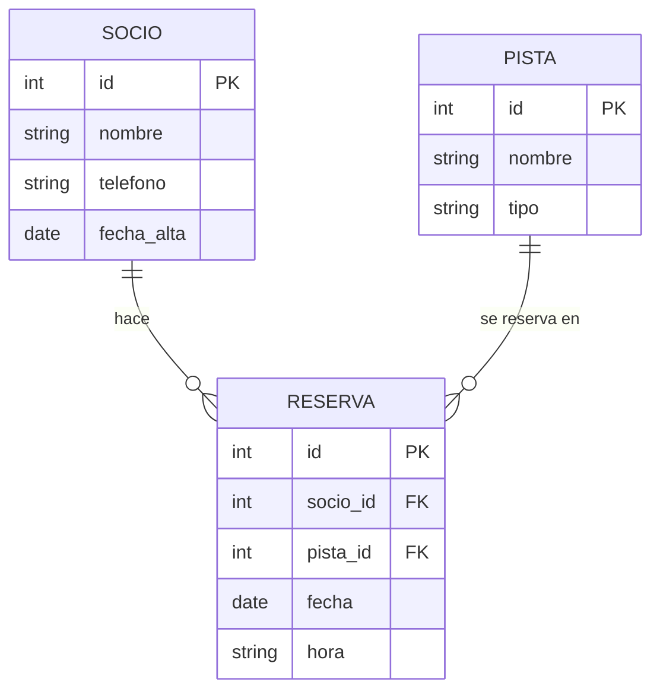
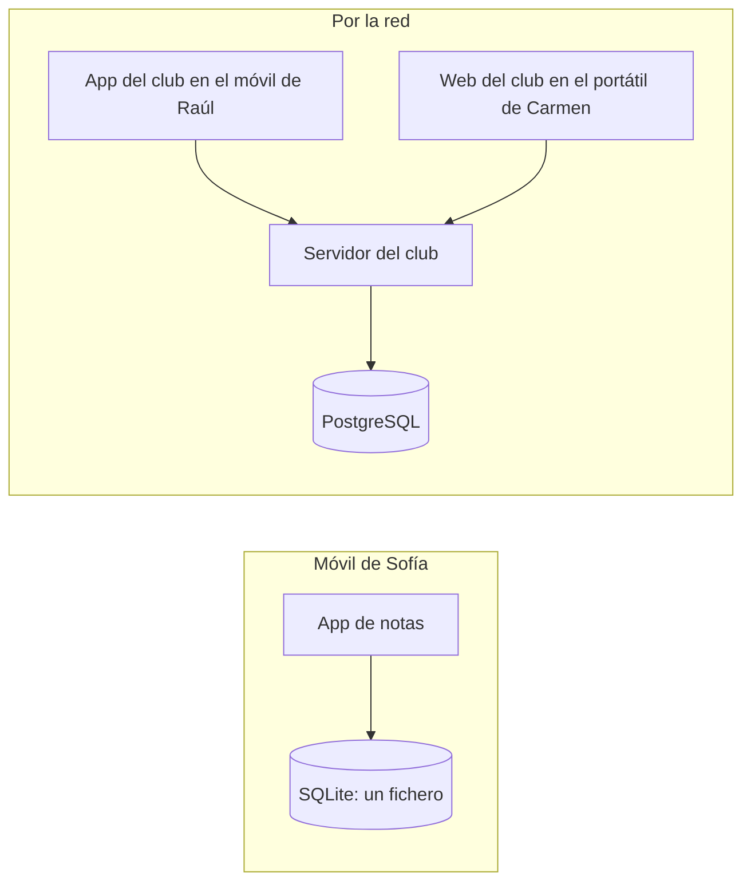
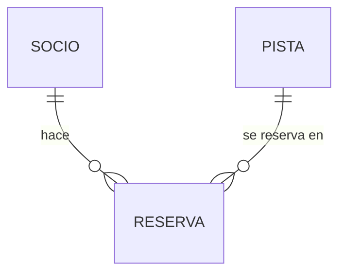
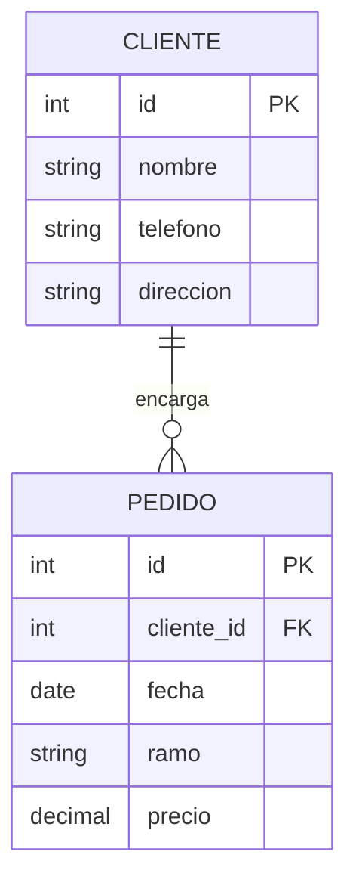

# 06.04 Qué es una base de datos

> **Versiones:** Mermaid 12.2.0 (la que usa la academia) y 10.9.8, para los diagramas entidad-relación (comprobado el 16 de noviembre de 2026)
> **Conviene saber antes:** [04.04 XML, CSV y otros, 1.8](../fase-04-formatos-y-diagramas/04-xml-csv-y-otros.md#18-csv-a-fondo-las-reglas) · [04.03 JSON y YAML, 1.2](../fase-04-formatos-y-diagramas/03-json-y-yaml.md#12-las-tres-piezas-valores-listas-y-objetos) · [03.02 La terminal: sacarle partido, 1.6](../fase-03-herramientas/02-terminal-sacarle-partido.md#16-los-filtros-grep-sort-uniq-wc-cut-head-y-tail) · [06.01 Redes: IP, router, DNS y cortafuegos, 1.3](01-redes.md#13-cliente-y-servidor)
> **Tiempo estimado:** 2 horas
> **Nivel:** Básico · Ampliación

## Qué aprenderás

- Por qué casi todas las aplicaciones guardan sus datos en una **base de datos** y no en un CSV o en una hoja de cálculo.
- Qué es una **base de datos** y qué es el **motor** (el **SGBD**) que la gestiona, y qué hace el motor por ti.
- Cómo se organizan los datos en una base de datos **relacional**: **tablas**, **filas** y **columnas**.
- Qué es una **clave primaria** y cómo se **relacionan** las tablas con una **clave foránea**.
- Cómo se dibujan unas tablas y sus relaciones con un **diagrama entidad-relación** en Mermaid.
- Qué es **SQL**, el lenguaje de las bases de datos relacionales (solo para que sepas qué es: no lo vas a escribir aquí).
- Los otros tipos de bases de datos, las **NoSQL**: **documentales** (con documentos como los de JSON), **clave-valor** y **de grafos**.
- Dónde **vive** una base de datos: dentro de la aplicación o en un servidor aparte.
- **Qué tipo elegir** en cada caso, y por qué la respuesta más habitual es «relacional».

## 1. Teoría

### 1.1. Dónde guardas los datos hasta ahora

Casi todos los programas trabajan con datos que tienen que **durar**: los socios de un club, los pedidos de una tienda, las citas de una peluquería. Cuando cierras el programa o apagas el ordenador, esos datos tienen que seguir ahí la próxima vez.

Hasta ahora has visto una forma de guardarlos: en **ficheros**. Una tabla, en un [CSV](../fase-04-formatos-y-diagramas/04-xml-csv-y-otros.md#18-csv-a-fondo-las-reglas); datos con estructura, en un [JSON](../fase-04-formatos-y-diagramas/03-json-y-yaml.md#13-json-el-formato-para-intercambiar-datos). Y fuera del curso conoces otra: la **hoja de cálculo** (Excel, LibreOffice Calc, Google Sheets), donde mucha gente lleva sus listas de clientes o de socios.

Para un club pequeño con una persona en la oficina, un CSV o una hoja de cálculo bastan. Pero imagina el Club de Pádel Norte cuando estrena su aplicación de reservas: cientos de socios reservando pistas desde el móvil, a la vez, a cualquier hora. Ahí los ficheros se quedan cortos, y el club necesita otra cosa: una **base de datos**.

### 1.2. Los límites de un fichero y de una hoja de cálculo

Estos son los problemas que aparecen cuando una aplicación de verdad guarda sus datos en un fichero (sea un CSV, un JSON o una hoja de cálculo):

| Límite | Qué pasa en el club | Por qué |
|---|---|---|
| **Varios a la vez** | Raúl y Sofía reservan a la vez la pista Central a las 18:00. Los dos programas leen el fichero, los dos ven la pista libre y los dos guardan: la segunda reserva borra la primera, o la pista queda reservada dos veces | El fichero no sabe que hay dos personas escribiendo en él |
| **Cada pregunta, un programa** | «¿Qué socios han reservado esta semana pista cubierta?» obliga a escribir un programa que lea los ficheros línea a línea y los cruce | Un fichero solo **guarda**; buscar lo tiene que hacer quien lo lee |
| **No hay reglas** | Alguien escribe una reserva de un socio que no existe, una hora que dice «por la tarde» o dos socios con el mismo número, y el fichero lo acepta | Para un CSV, todo es texto ([04.04, 1.8](../fase-04-formatos-y-diagramas/04-xml-csv-y-otros.md#18-csv-a-fondo-las-reglas)): no sabe qué es un número ni qué datos son obligatorios |
| **Un fallo a mitad** | Se va la luz mientras se guarda el fichero, y queda a medias: con la mitad de las reservas, o roto | Escribir un fichero no es una operación de «todo o nada» |
| **El volumen** | Con años de reservas, cada cambio obliga a leer y reescribir el fichero entero, y todo va cada vez más lento | Un fichero de texto no se puede cambiar «por dentro» de forma ordenada: se reescribe |

Una hoja de cálculo arregla algunas cosas (sabe que una celda es un número, puede comprobar algunos valores) y las de internet dejan que varias personas la editen a la vez. Pero sigue siendo **una herramienta para personas**, no para programas: no impide que alguien borre una fila que otra tabla necesita, y tiene un tamaño máximo. Excel, por ejemplo, admite como mucho **1.048.576 filas** por hoja (según la página de especificaciones y límites de Microsoft, consultada el 16 de noviembre de 2026). Parecen muchas, pero una tienda en línea con muchos pedidos al día puede llegar a ellas.

> **📌 Nota:** los ficheros no desaparecen. Siguen siendo la mejor opción para la **configuración** de un programa, para los **informes** que se mandan fuera y para **intercambiar** datos entre programas ([04.04, 1.15](../fase-04-formatos-y-diagramas/04-xml-csv-y-otros.md#115-cuándo-usar-cada-formato)). Lo normal es usar las dos cosas: la base de datos para los datos de la aplicación y los ficheros para todo lo demás.

### 1.3. Base de datos y motor

Dos palabras que se usan casi como sinónimos, pero que no son lo mismo:

- Una **base de datos** es un **conjunto de datos organizados** para guardarlos y consultarlos: los socios, las pistas y las reservas del club; los clientes, los productos y los pedidos de una tienda.
- Un **sistema gestor de bases de datos** (**SGBD**; en inglés, *DBMS*, *Database Management System*) es el **programa** que guarda esos datos y atiende a quien se los pide. Se le llama también **motor de base de datos**, o simplemente **motor**. PostgreSQL, MySQL o SQLite son motores. Un mismo motor puede tener muchas bases de datos: la del club, la de la tienda…

Una comparación: la base de datos es el **archivo** de una oficina, con todos los expedientes ordenados; el motor es el **archivero**. Tú nunca entras en el archivo a buscar papeles: se los pides al archivero, que sabe dónde está cada expediente, no deja guardar uno mal rellenado y atiende a varias personas a la vez sin que se pisen. Tu programa hace lo mismo: no toca los ficheros donde se guardan los datos, **se los pide al motor**.

En el día a día se dice «la base de datos» para las dos cosas: «la base de datos no responde» quiere decir que el motor no responde. En este módulo también, salvo cuando la diferencia importa.

> **📌 Nota:** ya viste la palabra **motor** en [01.04](../fase-01-que-es-programar/04-paradigmas-de-programacion.md#17-declarativo), con la consulta de los pedidos: tú dices **qué** datos quieres y «el motor de la base de datos» decide **cómo** encontrarlos. Es este programa.

### 1.4. Lo que hace el motor por ti

Todo lo que faltaba en el [apartado 1.2](#12-los-límites-de-un-fichero-y-de-una-hoja-de-cálculo), lo hace el motor:

| Lo que hace | Qué quiere decir |
|---|---|
| **Guardar** | Los datos sobreviven al programa, al apagado y a los fallos |
| **Atender a muchos a la vez** | Cientos de programas o personas leen y escriben al mismo tiempo, y el motor pone orden para que no se pisen: la pista Central de las 18:00 solo la reserva uno |
| **Responder preguntas** | Le dices qué datos quieres («las reservas de esta semana en pista cubierta») y él los busca, deprisa, aunque haya millones |
| **Cumplir reglas** | Las reglas se escriben **en la propia base de datos**: el nombre es obligatorio, el número de socio no se repite, una reserva solo puede ser de un socio que existe. Si un programa intenta saltárselas, el motor se niega |
| **Todo o nada** | Varios cambios que van juntos se agrupan en una **transacción**: o se hacen todos, o ninguno. Si al cobrar una reserva falla algo a mitad, no queda la reserva sin el pago ni el pago sin la reserva |
| **Seguridad** | Usuarios, contraseñas y permisos: quién puede leer o cambiar cada cosa |
| **Copias de seguridad** | Copias de los datos sin parar la aplicación, para recuperarlos si algo sale mal |

Programar todo eso a mano, y bien, llevaría años. Por eso las aplicaciones no lo hacen: usan un motor que ya lo sabe hacer.

### 1.5. Tablas, filas y columnas

La mayoría de las bases de datos que vas a encontrar son **relacionales**: guardan los datos en **tablas**, como una hoja de cálculo muy estricta. Esta es la tabla de socios del club:

| id | nombre | telefono | fecha_alta |
|---|---|---|---|
| 1 | Carmen Ortiz | 600111222 | 2025-03-10 |
| 2 | Raúl Medina | 600333444 | 2025-09-02 |
| 3 | Sofía Herrero | 600555666 | 2026-01-15 |
| 4 | Daniel Castro | 600777888 | 2026-02-20 |

| Pieza | Qué es | En la tabla de socios |
|---|---|---|
| **Tabla** | Un tipo de cosa que se guarda | `socios`: los socios del club |
| **Fila** (o **registro**) | Una cosa concreta | Raúl Medina, con su número, su teléfono y su fecha de alta |
| **Columna** (o **campo**) | Un dato de cada cosa, con su [tipo](../fase-01-que-es-programar/02-algoritmos-y-pseudocodigo.md#tipos-de-datos) | `nombre`, de tipo texto; `fecha_alta`, de tipo fecha |

Se parece mucho a un CSV con su cabecera, y de hecho una tabla se exporta a CSV sin problema ([ejemplo 2.1](#21-la-tabla-de-socios-en-csv-y-en-json)). Pero hay diferencias importantes:

- **Cada columna tiene un tipo fijo.** En la columna `fecha_alta` solo caben fechas; si un programa intenta guardar «la semana pasada», el motor lo rechaza. En un CSV, todo es texto.
- **Las reglas van con la tabla.** «El nombre es obligatorio» o «el `id` no se repite» se escriben al crear la tabla, y valen para todos los programas que la usen.
- **Cada casilla guarda un solo dato.** Un número, un texto, una fecha. Si un socio tiene dos teléfonos, no se escriben los dos en la misma casilla ([error típico 3.3](#33-varios-datos-en-una-sola-columna)).
- **El orden de las filas no significa nada.** El motor puede devolverlas en el orden que le venga mejor; si quieres un orden, lo pides.

> **📌 Nota:** los nombres de las tablas y las columnas se suelen escribir **sin tildes ni espacios** (`fecha_alta`, `telefono`), como los nombres de los ficheros del curso: así funcionan igual en todos los motores y en todos los lenguajes. Muchos proyectos los escriben en inglés (`members`, `phone`); lo que importa es que todo el proyecto siga la misma regla.

### 1.6. La clave primaria

Si en el club hay dos socias que se llaman Ana López, ¿cómo sabe la aplicación de cuál es una reserva? Hace falta algo que **identifique cada fila sin dudas**. Eso es la **clave primaria**: una columna (o varias juntas) cuyo valor **no se repite nunca** y **no puede estar vacío**. En la tabla de socios es `id`, el número de socio.

Cómo se elige una buena clave primaria:

- **Que no se repita nunca, ni en el futuro.** El nombre no vale: tarde o temprano habrá dos personas con el mismo ([error típico 3.1](#31-usar-el-nombre-como-clave)).
- **Que no cambie.** El teléfono o el correo parecen únicos, pero la gente los cambia, y la clave se usa en otras tablas: cambiarla obliga a cambiarla en todas partes.
- **Que exista siempre.** Si es obligatoria, todo el mundo tiene que tenerla desde el primer día.

Por eso lo más habitual es un **número que pone el propio motor**: 1, 2, 3… para cada fila nueva. No dice nada del socio (no es su nombre ni su teléfono), y justo por eso es una buena clave: nunca hay motivo para cambiarlo. Los motores saben ponerlo solos, sin repetir ninguno.

> **📌 Nota:** ya conoces claves parecidas: el número de un pedido, el ISBN de un libro, la matrícula de un coche o el [identificador de un commit](../fase-05-git-y-github/01-git-fundamentos.md#16-commit-una-foto-del-proyecto). Todos sirven para lo mismo: señalar una cosa concreta sin confundirla con otra.

### 1.7. Relacionar tablas: la clave foránea

El club también guarda las **pistas** y las **reservas**. Cada reserva es de un socio y de una pista, pero no repite el nombre del socio ni el de la pista: guarda **sus números**.

Tabla `pistas`:

| id | nombre | tipo |
|---|---|---|
| 1 | Central | cubierta |
| 2 | Norte | cubierta |
| 3 | Jardín | exterior |

Tabla `reservas`:

| id | socio_id | pista_id | fecha | hora |
|---|---|---|---|---|
| 1 | 2 | 1 | 2026-11-20 | 18:00 |
| 2 | 1 | 3 | 2026-11-20 | 19:00 |
| 3 | 4 | 1 | 2026-11-21 | 10:00 |
| 4 | 2 | 2 | 2026-11-21 | 18:00 |
| 5 | 3 | 3 | 2026-11-22 | 11:00 |

La reserva 1 dice `socio_id` 2 y `pista_id` 1: Raúl Medina ha reservado la pista Central el 20 de noviembre a las 18:00. Las columnas `socio_id` y `pista_id` son **claves foráneas**: columnas que **apuntan a la clave primaria de otra tabla**. Así quedan **relacionadas** las tablas, y de ahí viene el nombre de «relacionales».

¿Por qué no escribir el nombre y el teléfono del socio en cada reserva, y así está todo junto? Porque Raúl tiene muchas reservas: si cambia de teléfono, habría que cambiarlo en todas, y basta con olvidar una para que la base de datos diga dos cosas distintas ([error típico 3.2](#32-repetir-los-mismos-datos-en-muchas-filas)). Con la clave foránea, el teléfono de Raúl está **en un solo sitio**.

Y aquí está la regla más útil del motor: si `socio_id` se declara como clave foránea, **el motor no deja guardar una reserva de un socio que no existe**, ni borrar un socio que todavía tiene reservas (a menos que se le diga qué hacer con ellas). En un CSV, nadie lo impide ([ejemplo 2.5](#25-lo-que-un-csv-acepta-y-una-base-de-datos-no)).

Hay tres formas de relacionarse dos tablas:

| Relación | Qué quiere decir | Ejemplo |
|---|---|---|
| **Uno a muchos** | Una fila de una tabla se relaciona con muchas de la otra | Un socio tiene muchas reservas; cada reserva es de un solo socio. Es la más común |
| **Uno a uno** | Una fila con una sola de la otra | Cada socio, con su ficha médica |
| **Muchos a muchos** | Muchas con muchas | Los alumnos y las clases de una academia: un alumno va a varias clases y una clase tiene varios alumnos. Se resuelve con una **tabla intermedia** (las inscripciones) que guarda las parejas ([ejercicio 3](#ejercicio-3--sigue-la-relación-a-mano)) |

Fíjate en que la tabla `reservas` es justo eso: la tabla intermedia entre socios y pistas, porque un socio reserva muchas pistas y una pista la reservan muchos socios.

### 1.8. Dibujar las tablas: el diagrama entidad-relación

Cuando hay varias tablas, se dibujan. El diagrama que se usa se llama **entidad-relación** (o **diagrama E-R**): cada tabla es una caja con sus columnas, y las líneas entre cajas son las relaciones. Ya lo viste nombrado en la [tabla de tipos de Mermaid](../fase-04-formatos-y-diagramas/05-diagramas-y-mermaid.md#112-más-tipos-de-diagramas-uml-y-otras-notaciones) de 04.05: en Mermaid empieza por `erDiagram`.

Las tres tablas del club:



En texto: un socio hace cero o más reservas, y cada reserva es de exactamente un socio; una pista se reserva cero o más veces, y cada reserva es de exactamente una pista.

Cómo se lee:

- **Cada caja** es una tabla, con una línea por columna: primero el tipo (`int`, número entero; `string`, texto; `date`, fecha) y luego el nombre. Mermaid no comprueba los tipos: son texto para quien lee el diagrama.
- **`PK`** (*primary key*) marca la clave primaria y **`FK`** (*foreign key*), las claves foráneas.
- **Los símbolos de las líneas** dicen cuántas filas de cada lado. Cada extremo lleva dos signos: el de fuera (el que toca la caja) dice el máximo, y el de dentro, el mínimo.
- **Lo que va tras los dos puntos** es el nombre de la relación, entre comillas, y es obligatorio.

| Símbolo | Quiere decir |
|---|---|
| `\|\|` | Exactamente uno |
| `\|o` y `o\|` | Cero o uno |
| `}o` y `o{` | Cero o más |
| `}\|` y `\|{` | Uno o más |

`SOCIO ||--o{ RESERVA` se lee en los dos sentidos: **cada reserva** tiene exactamente un socio (`||`, junto a `SOCIO`) y **cada socio** tiene cero o más reservas (`o{`, junto a `RESERVA`; cero, porque un socio recién dado de alta todavía no ha reservado).

Los símbolos se llaman **notación pata de gallo** (*crow's foot*), por el `{`, que dibuja tres líneas abiertas como una pata. No hace falta que te los aprendas: con este apartado como chuleta, puedes leer cualquier diagrama E-R que te encuentres.

> **📌 Nota:** este diagrama se dibuja igual con Mermaid 12.2.0 y 10.9.8 (comprobado el 16 de noviembre de 2026). Los nombres de las cajas y de las columnas van **sin tildes ni espacios** (`SOCIO`, `fecha_alta`): según la documentación de Mermaid, los nombres con espacios necesitan comillas, y los de las columnas tienen reglas más estrictas. Las tildes sí valen en el nombre de la relación, entre comillas.

### 1.9. SQL, el idioma de las bases de datos relacionales

Para hablar con un motor relacional (crear tablas, guardar filas, hacer preguntas) se usa **SQL** (*Structured Query Language*, «lenguaje estructurado de consultas»; se dice «ese-cu-ele» o, a la inglesa, «sícuel»). Ya viste una consulta en [01.04, ejemplo 2.5](../fase-01-que-es-programar/04-paradigmas-de-programacion.md#25-estilo-declarativo): la de los pedidos a la península.

Tres cosas que conviene saber de SQL antes de tu curso:

- **Es declarativo** ([01.04, 1.7](../fase-01-que-es-programar/04-paradigmas-de-programacion.md#17-declarativo)): dices **qué** datos quieres («las reservas del 21 de noviembre, con el nombre del socio y de la pista») y el motor decide **cómo** buscarlos. Lo que tú harás a mano en el [ejemplo 2.2](#22-tres-tablas-relacionadas-seguir-la-pista-a-mano), con cinco órdenes y mirando los números, en SQL es una sola consulta.
- **Es una norma internacional**, la ISO/IEC 9075, que se revisa de vez en cuando; la última versión es de 2023 y se llama **SQL:2023** (según la documentación de PostgreSQL, consultada el 16 de noviembre de 2026).
- **Cada motor tiene su dialecto.** Lo básico es igual en todos, pero cada uno añade cosas propias y muestra los resultados y los errores a su manera. Lo que aprendas con uno te sirve casi entero para los demás.

En este curso no vas a escribir SQL: se aprende en el curso de tu lenguaje y en el curso «SQL y bases de datos» de la academia. Lo que importa ahora es que sepas qué es cuando lo veas: el idioma en que los programas le hablan a una base de datos relacional.

### 1.10. No todo son tablas: las bases de datos NoSQL

No todas las bases de datos guardan tablas. Las que guardan los datos de otra forma se llaman **NoSQL**; el nombre se suele explicar como «no solo SQL» (*not only SQL*), aunque hay quien lo lee como «sin SQL» (los dos, según la web de MongoDB, consultada el 16 de noviembre de 2026). Cada tipo está pensado para un problema concreto. Los tres que más oirás:

**Documentales.** Guardan **documentos**: datos con la forma de un objeto de [JSON](../fase-04-formatos-y-diagramas/03-json-y-yaml.md#12-las-tres-piezas-valores-listas-y-objetos), con sus pares clave-valor, sus listas y sus objetos anidados. Cada documento puede tener una forma distinta, y lo que va junto se guarda junto: un socio **con sus reservas dentro** ([ejemplo 2.4](#24-un-socio-como-documento)). El más conocido es **MongoDB**, que guarda documentos en BSON, una versión binaria de JSON con más tipos de datos (según su documentación, consultada el 16 de noviembre de 2026).

**Clave-valor.** Guardan [pares clave-valor](../fase-04-formatos-y-diagramas/03-json-y-yaml.md#12-las-tres-piezas-valores-listas-y-objetos) y nada más: le das una clave y te devuelve su valor, muy deprisa. Es como un guardarropa: entregas la ficha número 27 y te devuelven tu abrigo, sin buscar nada más. Se usan para lo que se consulta muchísimas veces y tiene que ir rapidísimo: quién ha iniciado sesión en una web, una [caché](01-redes.md#112-cómo-se-resuelve-un-nombre) de datos ya calculados, contadores. El más conocido es **Redis**, que guarda los datos **en memoria** (en la [RAM](../fase-02-tu-ordenador/01-como-funciona-un-ordenador.md#15-la-memoria-ram-rápida-y-olvidadiza)) y puede además copiarlos al disco (según su documentación, consultada el 16 de noviembre de 2026).

```text
sesion:a81f3c  →  socio 2
pistas-libres:2026-11-21  →  Central, Jardín
```

**De grafos.** Guardan **nodos** (las cosas) y **relaciones** entre ellos, cada uno con sus datos. Sirven para lo que de verdad es una red: amigos de amigos en una red social, rutas entre ciudades, recomendaciones («quien compró esto compró también…»). El más conocido es **Neo4j**, que guarda los datos «como nodos, relaciones y propiedades, en lugar de tablas o documentos» (según su documentación, consultada el 16 de noviembre de 2026).

Hay más tipos (de columnas anchas, de búsqueda, vectoriales…) que verás si tu curso los usa. Y las fronteras no son tan claras: PostgreSQL, que es relacional, también sabe guardar y consultar JSON dentro de una columna.

> **⚠️ Cuidado:** «NoSQL» no quiere decir «más moderno» ni «mejor». Cada tipo resuelve un problema concreto, y casi siempre se usa **junto** a una base de datos relacional, no en su lugar ([error típico 3.5](#35-elegir-la-base-de-datos-por-moda)).

### 1.11. Dónde vive la base de datos

Hay dos formas de usar un motor, y conviene distinguirlas porque cambian cómo se instala y quién la usa:

- **Dentro de la aplicación** (**embebida**). El motor es una [biblioteca](../fase-04-formatos-y-diagramas/03-json-y-yaml.md#11-datos-con-estructura-para-qué-sirven-los-formatos) que va dentro del programa, sin nada más que instalar, y la base de datos entera es **un fichero** en el disco. El ejemplo es **SQLite**: «no tiene un proceso servidor aparte» y guarda una base de datos completa, con todas sus tablas, «en un solo fichero» (según su web oficial, consultada el 16 de noviembre de 2026). La misma web dice que va en todos los dispositivos Android, iPhone e iOS y en los navegadores Firefox, Chrome y Safari. Es la que usan las aplicaciones del móvil y de escritorio para guardar los datos de **una persona** en **su** dispositivo.
- **En un servidor aparte** (**cliente-servidor**). El motor es un programa que está siempre en marcha, en un [servidor](01-redes.md#13-cliente-y-servidor) (o en la [nube](../fase-02-tu-ordenador/01-como-funciona-un-ordenador.md#111-la-nube-el-ordenador-de-otro)), y las aplicaciones se conectan a él **por la red**, a través de un [puerto](02-puertos-y-localhost.md#11-una-dirección-ip-no-basta-el-puerto), como un navegador a una web. Así trabajan **PostgreSQL** (escucha por defecto en el puerto 5432, según su documentación) y **MySQL** (en el 3306, según la suya; las dos, consultadas el 16 de noviembre de 2026). Es lo normal cuando muchas personas o muchos programas usan los mismos datos, como en la aplicación del club.



En texto: la aplicación de notas del móvil de Sofía lleva su base de datos SQLite dentro, en un fichero; las aplicaciones del club, en cambio, hablan con el servidor del club, que es el único que habla con la base de datos PostgreSQL.

Fíjate en un detalle del dibujo: **las aplicaciones del móvil y de la web no se conectan directamente a la base de datos**. Se conectan al servidor del club, y es el servidor el que habla con la base de datos. Cómo encajan esas piezas lo verás en el módulo siguiente, [Las piezas de una aplicación](05-piezas-de-una-aplicacion.md#17-el-mapa-completo-de-una-tienda-en-línea).

> **📌 Nota:** para conectarse a un motor cliente-servidor hace falta un usuario y una **contraseña**. Esa contraseña es un [secreto](../fase-04-formatos-y-diagramas/04-xml-csv-y-otros.md#114-el-fichero-env-y-los-secretos): va en el `.env`, nunca en el código ni en Git ([error típico 3.6](#36-la-contraseña-de-la-base-de-datos-en-el-código)).

### 1.12. Qué tipo elegir

Para empezar, con estas reglas tienes de sobra:

1. **Si dudas, relacional.** La mayoría de los datos de un negocio (clientes, pedidos, facturas, socios, reservas) tienen una forma fija y relaciones entre sí, y necesitan reglas y transacciones. Es lo que mejor hace una base de datos relacional.
2. **Si el proyecto ya tiene una, esa.** Una base de datos dura muchos años: si la empresa ya usa una y sabe mantenerla, cambiarla tiene un coste que rara vez compensa.
3. **Si los datos son de una persona y viven en su dispositivo**, una embebida (SQLite).
4. **Un tipo NoSQL, para un problema concreto**, y casi siempre **además** de la relacional: documental si cada registro tiene una forma muy distinta; clave-valor para lo que tiene que ir rapidísimo (sesiones, caché); de grafos si los datos son una red.
5. **Un fichero**, para lo que no es «los datos de la aplicación»: la configuración, los informes, los intercambios.

| Tipo | Guarda | Motores que oirás | Para |
|---|---|---|---|
| **Relacional** | Tablas relacionadas por claves | PostgreSQL, MySQL, MariaDB, SQLite, Oracle Database, SQL Server | Casi todo: datos con forma fija y relaciones |
| **Documental** | Documentos tipo JSON | MongoDB | Datos de forma muy variable; lo que se lee siempre junto |
| **Clave-valor** | Pares clave → valor, en memoria | Redis | Sesiones, caché, contadores |
| **De grafos** | Nodos y relaciones | Neo4j | Redes: amigos, rutas, recomendaciones |

No hace falta que elijas motor ahora: el curso de tu lenguaje te dirá con cuál trabaja. Lo que te llevas de este módulo es entender **qué** es cada uno y **por qué** se elige.

## 2. Ejemplos de código

Los ejemplos de este módulo son **ficheros de datos** (CSV y JSON) y alguna sesión de terminal con los filtros de [03.02](../fase-03-herramientas/02-terminal-sacarle-partido.md#16-los-filtros-grep-sort-uniq-wc-cut-head-y-tail). No hay ningún motor de base de datos: lo que vas a hacer es **ver con ficheros** cómo se organizan los datos en una base de datos, y **notar** lo que el motor haría por ti. Descarga cada carpeta, abre los ficheros en VS Code y repite las sesiones en tu terminal.

### 2.1. La tabla de socios, en CSV y en JSON

**Situación real:** el Club de Pádel Norte exporta su tabla de socios para mandarla a la gestoría. La misma tabla se puede escribir en CSV, una fila por línea:

```text
id,nombre,telefono,fecha_alta
1,Carmen Ortiz,600111222,2025-03-10
2,Raúl Medina,600333444,2025-09-02
3,Sofía Herrero,600555666,2026-01-15
4,Daniel Castro,600777888,2026-02-20
```

📁 **Código:** [`codigo/04-que-es-una-base-de-datos/ejemplos/2.1-la-tabla-de-socios/`](codigo/04-que-es-una-base-de-datos/ejemplos/2.1-la-tabla-de-socios/)

Y en JSON, como una **lista de objetos**, uno por fila, con las columnas como claves:

```json
[
  {"id": 1, "nombre": "Carmen Ortiz", "telefono": "600111222", "fecha_alta": "2025-03-10"},
  {"id": 2, "nombre": "Raúl Medina", "telefono": "600333444", "fecha_alta": "2025-09-02"},
  {"id": 3, "nombre": "Sofía Herrero", "telefono": "600555666", "fecha_alta": "2026-01-15"},
  {"id": 4, "nombre": "Daniel Castro", "telefono": "600777888", "fecha_alta": "2026-02-20"}
]
```

📁 **Código:** [`codigo/04-que-es-una-base-de-datos/ejemplos/2.1-la-tabla-de-socios/`](codigo/04-que-es-una-base-de-datos/ejemplos/2.1-la-tabla-de-socios/)

**En qué fijarte:**

- **Una tabla es una lista de filas con las mismas columnas.** En el CSV, la cabecera dice las columnas una vez; en el JSON, cada objeto repite los nombres de las claves. Los datos son exactamente los mismos (los dos ficheros se han comprobado: dicen lo mismo).
- **El JSON dice el tipo; el CSV, no.** En el JSON, `id` es un número (`1`, sin comillas) y `telefono` es un texto (`"600111222"`, con comillas): un teléfono no se suma ni se resta, y si empezara por 0, como número perdería ese 0. En el CSV todo es texto, y quien lo lee tiene que adivinarlo. En una base de datos, el tipo de cada columna se decide **al crear la tabla**.
- **Las fechas van como `2026-01-15`** (año, mes y día). Es el orden año-mes-día que viste en [04.03, 1.4](../fase-04-formatos-y-diagramas/03-json-y-yaml.md#14-los-seis-tipos-de-valores-de-json): ordenadas como texto, quedan ordenadas por fecha.

### 2.2. Tres tablas relacionadas: seguir la pista a mano

**Situación real:** el sábado 21 de noviembre, la recepción del club quiere saber quién juega ese día y en qué pista. Tiene las tres tablas exportadas en CSV. La de socios es la del [ejemplo 2.1](#21-la-tabla-de-socios-en-csv-y-en-json); estas son las otras dos:

```text
id,nombre,tipo
1,Central,cubierta
2,Norte,cubierta
3,Jardín,exterior
```

📁 **Código:** [`codigo/04-que-es-una-base-de-datos/ejemplos/2.2-tres-tablas-relacionadas/`](codigo/04-que-es-una-base-de-datos/ejemplos/2.2-tres-tablas-relacionadas/)

```text
id,socio_id,pista_id,fecha,hora
1,2,1,2026-11-20,18:00
2,1,3,2026-11-20,19:00
3,4,1,2026-11-21,10:00
4,2,2,2026-11-21,18:00
5,3,3,2026-11-22,11:00
```

📁 **Código:** [`codigo/04-que-es-una-base-de-datos/ejemplos/2.2-tres-tablas-relacionadas/`](codigo/04-que-es-una-base-de-datos/ejemplos/2.2-tres-tablas-relacionadas/)

Primero, las reservas de ese día; después, cada socio y cada pista por su número. El `^` de `grep` quiere decir «al principio de la línea»: `'^4,'` busca la línea que **empieza** por `4,`, la del socio número 4, y no cualquier línea que tenga un 4 por en medio.

**En tu terminal** (`sesion.txt`):

```text
$ grep 2026-11-21 reservas.csv
3,4,1,2026-11-21,10:00
4,2,2,2026-11-21,18:00
$ grep '^4,' socios.csv
4,Daniel Castro,600777888,2026-02-20
$ grep '^2,' socios.csv
2,Raúl Medina,600333444,2025-09-02
$ grep '^1,' pistas.csv
1,Central,cubierta
$ grep '^2,' pistas.csv
2,Norte,cubierta
```

📁 **Código:** [`codigo/04-que-es-una-base-de-datos/ejemplos/2.2-tres-tablas-relacionadas/`](codigo/04-que-es-una-base-de-datos/ejemplos/2.2-tres-tablas-relacionadas/)

La respuesta: el 21 de noviembre juegan **Daniel Castro**, a las 10:00 en la pista **Central**, y **Raúl Medina**, a las 18:00 en la pista **Norte**.

**En qué fijarte:**

- **Las reservas solo tienen números.** Para saber quién es el socio 4 hay que ir a la tabla de socios y buscar la fila cuya **clave primaria** es 4. Eso es **seguir una clave foránea** ([apartado 1.7](#17-relacionar-tablas-la-clave-foránea)).
- **Cinco órdenes para una pregunta sencilla**, y has tenido que mirar los números y apuntarlos tú. Con cien reservas al día, sería imposible a mano. En una base de datos relacional, esta pregunta es **una sola consulta** de SQL que junta las tres tablas, y el motor hace el cruce por ti ([apartado 1.9](#19-sql-el-idioma-de-las-bases-de-datos-relacionales)).
- **La fecha está en la columna 4, pero `grep` la busca en toda la línea.** Aquí funciona porque ningún otro dato se parece a una fecha. Es otra pista de que los ficheros no saben de columnas: una base de datos sí.

### 2.3. El diagrama de las tablas del club

**Situación real:** antes de crear la base de datos del club, quien la diseña dibuja las tablas para revisarlas con la junta directiva. Es el diagrama del [apartado 1.8](#18-dibujar-las-tablas-el-diagrama-entidad-relación), con lo mínimo para empezar: solo las cajas y las relaciones, sin columnas.



En texto: un socio hace cero o más reservas; una pista se reserva cero o más veces; cada reserva es de un socio y de una pista.

**En qué fijarte:**

- **Las columnas son opcionales en Mermaid.** Para hablar de qué tablas hay y cómo se relacionan, basta con las cajas. Las columnas se añaden cuando se baja al detalle.
- **El diagrama hace preguntas.** Al verlo, la junta pregunta: «¿una reserva puede ser de dos socios, si juegan por parejas?». Con este diseño, no: cada reserva tiene **un** socio. Si hiciera falta, el diseño cambiaría (por ejemplo, con una tabla de jugadores de cada reserva). Es mucho más barato descubrirlo en el dibujo que con la aplicación terminada: es lo que viste en [04.05, 1.1](../fase-04-formatos-y-diagramas/05-diagramas-y-mermaid.md#11-por-qué-se-dibuja-antes-de-programar).

### 2.4. Un socio como documento

**Situación real:** el club estudia guardar sus datos en una base de datos **documental**. Así sería el documento de Raúl Medina, con sus reservas **dentro**:

```json
{
  "id": 2,
  "nombre": "Raúl Medina",
  "telefono": "600333444",
  "fecha_alta": "2025-09-02",
  "reservas": [
    {"pista": "Central", "fecha": "2026-11-20", "hora": "18:00"},
    {"pista": "Norte", "fecha": "2026-11-21", "hora": "18:00"}
  ]
}
```

📁 **Código:** [`codigo/04-que-es-una-base-de-datos/ejemplos/2.4-un-socio-como-documento/`](codigo/04-que-es-una-base-de-datos/ejemplos/2.4-un-socio-como-documento/)

**En qué fijarte:**

- **Todo lo de Raúl está junto.** Para enseñar su ficha en la aplicación, con sus reservas, basta con leer **un** documento. En las tablas, hacía falta ir a dos tablas y cruzarlas ([ejemplo 2.2](#22-tres-tablas-relacionadas-seguir-la-pista-a-mano)). Esa es la gran ventaja de un documento: lo que se lee junto, se guarda junto.
- **Pero la pregunta del ejemplo 2.2 se complica.** «¿Quién juega el 21 de noviembre?» obliga a mirar **dentro de todos los socios**, porque las reservas están repartidas en sus documentos. Lo que en las tablas era una tabla de reservas, aquí son trocitos dentro de cada socio.
- **El nombre de la pista está copiado** en cada reserva. Si el club cambia el nombre de la pista Central, habría que cambiarlo dentro de cada socio que la haya reservado. En las tablas, estaba **en un solo sitio**.
- **Ninguna de las dos formas es mejor siempre.** Depende de qué preguntas se van a hacer más. Para las reservas de un club, con muchas preguntas que cruzan socios, pistas y fechas, las tablas encajan mejor; por eso el club se queda con una base de datos relacional ([apartado 1.12](#112-qué-tipo-elegir)).

### 2.5. Lo que un CSV acepta y una base de datos no

**Situación real:** un día, el fichero de reservas del club aparece así. Alguien lo ha editado a mano:

```text
id,socio_id,pista_id,fecha,hora
1,2,1,2026-11-20,18:00
2,1,3,2026-11-20,19:00
3,4,1,2026-11-21,10:00
3,9,2,2026-11-21,18:00
5,3,,2026-11-22,por la tarde
```

📁 **Código:** [`codigo/04-que-es-una-base-de-datos/ejemplos/2.5-lo-que-un-csv-acepta/`](codigo/04-que-es-una-base-de-datos/ejemplos/2.5-lo-que-un-csv-acepta/)

Como CSV, **es perfectamente válido**: todas las filas tienen cinco campos, y cualquier hoja de cálculo lo abre sin quejarse. Pero tiene cuatro errores que una base de datos no habría dejado pasar. Con los filtros de la terminal se pueden buscar algunos. Dos opciones nuevas: `uniq -d` deja **solo las líneas repetidas** (una vez cada una), y `sort -u` ordena y **quita las repetidas**.

**En tu terminal** (`sesion.txt`):

```text
$ cut -d , -f 1 reservas.csv | sort | uniq -d
3
$ cut -d , -f 2 reservas.csv | sort -u
1
2
3
4
9
socio_id
$ grep ',,' reservas.csv
5,3,,2026-11-22,por la tarde
```

📁 **Código:** [`codigo/04-que-es-una-base-de-datos/ejemplos/2.5-lo-que-un-csv-acepta/`](codigo/04-que-es-una-base-de-datos/ejemplos/2.5-lo-que-un-csv-acepta/)

**En qué fijarte:**

- **La primera orden** saca la columna `id`, la ordena y deja las repetidas: **el `3` está dos veces**. Una clave primaria repetida; el motor la habría rechazado ([apartado 1.6](#16-la-clave-primaria)).
- **La segunda** enseña los socios que aparecen en las reservas, sin repetir. Entre ellos está el **9**, y el club solo tiene los socios 1 a 4: es una reserva de un socio que no existe. Una clave foránea lo habría impedido ([apartado 1.7](#17-relacionar-tablas-la-clave-foránea)). La última línea, `socio_id`, es la cabecera, que también es una línea para `cut`.
- **La tercera** busca dos comas seguidas, un campo vacío: la reserva 5 **no tiene pista**. Si la columna es obligatoria, el motor no deja guardarla vacía.
- **El cuarto error no lo encuentra ninguna orden**: la hora «por la tarde». En la base de datos, si la columna es de tipo hora, ese texto no cabe ([apartado 1.5](#15-tablas-filas-y-columnas)).
- **Has tenido que saber qué buscar.** Has encontrado estos errores porque sabías cuáles podía haber. Con una base de datos, las reglas se escriben **una vez**, al crear la tabla, y el motor las comprueba **siempre**, cada vez que alguien guarda algo.

## 3. Errores típicos

### 3.1. Usar el nombre como clave

**Qué pasa:** en la tabla de reservas, en lugar del número de socio, se guarda su nombre. Un día se da de alta otra Ana López, y la aplicación empieza a mezclar las reservas de las dos: cada una ve las de la otra.

**Por qué ocurre:** el nombre parecía único porque en el club, al principio, no había dos iguales. Pero nada impide que lleguen, y una clave primaria tiene que identificar **sin dudas**, también en el futuro.

**Cómo se arregla:** usa como clave un número que no diga nada del socio (el que pone el motor) y guarda el nombre en su propia columna, que puede repetirse sin problema ([apartado 1.6](#16-la-clave-primaria)). Lo mismo con el teléfono o el correo: parecen únicos, pero cambian.

### 3.2. Repetir los mismos datos en muchas filas

**Qué pasa:** una tabla de pedidos guarda en cada fila el nombre, el teléfono y la dirección del cliente. Rosa cambia de teléfono, se actualiza en su último pedido, y los anteriores siguen con el viejo. Ahora la base de datos dice dos cosas distintas de Rosa, y nadie sabe cuál es la buena.

**Por qué ocurre:** al diseñar la tabla se pensó en una hoja de cálculo, donde es cómodo tener todo en una fila. Pero los datos del cliente no son del pedido: son del cliente, y se han copiado en cada pedido.

**Cómo se arregla:** cada dato, **en un solo sitio**. Los datos del cliente van en una tabla de clientes, y el pedido guarda solo el número del cliente, con una clave foránea ([apartado 1.7](#17-relacionar-tablas-la-clave-foránea) y [ejercicio 5](#ejercicio-5--parte-la-hoja-de-la-floristería-en-dos-tablas)).

### 3.3. Varios datos en una sola columna

**Qué pasa:** un socio tiene dos teléfonos y se guardan juntos en la misma casilla: `600111222 / 911222333`. Después, la aplicación no sabe a cuál llamar, buscar a alguien por su teléfono falla, y cada persona los escribe separados de una forma (con `/`, con coma, con «y»).

**Por qué ocurre:** en una hoja de cálculo se hace a menudo, porque es rápido. Pero una casilla de una tabla guarda **un solo dato**, y el motor no sabe qué hay dentro de ese texto.

**Cómo se arregla:** si un socio puede tener varios teléfonos, van en **otra tabla** (`telefonos`, con el número de socio y cada teléfono en su fila). Si son siempre dos y con significado distinto, en dos columnas: `telefono_movil` y `telefono_fijo`.

### 3.4. Las reglas solo en el programa

**Qué pasa:** la aplicación del club comprueba que una reserva tiene pista antes de guardarla. Pero el club se hace también una página de administración, y otra persona, con otro programa, guarda reservas sin pista. La base de datos se llena de reservas imposibles.

**Por qué ocurre:** la regla solo estaba en un programa. Cualquier otro programa que escriba en la base de datos se la salta, sin saberlo.

**Cómo se arregla:** las reglas que tienen que cumplirse **siempre** (obligatorio, sin repetir, que el socio exista) se escriben **en la base de datos**, al crear las tablas. El motor las hace cumplir a todos los programas a la vez ([apartado 1.4](#14-lo-que-hace-el-motor-por-ti)). El programa puede comprobarlas también, para avisar antes con un mensaje amable, pero la última palabra es del motor.

### 3.5. Elegir la base de datos por moda

**Qué pasa:** un equipo elige una base de datos documental para la facturación de una empresa, porque «NoSQL es lo moderno». Al poco tiempo, necesita cruzar facturas, clientes y productos en cada informe, y que una factura nunca quede a medias, y cada pregunta cuesta mucho más de lo que esperaba.

**Por qué ocurre:** se eligió la herramienta antes de mirar el problema. Los datos de facturación son justo los que encajan en tablas: forma fija, muchas relaciones y reglas estrictas.

**Cómo se arregla:** primero, qué datos hay y qué preguntas se van a hacer; después, el tipo de base de datos. Si dudas, relacional, y un tipo NoSQL solo para el problema concreto que resuelve mejor ([apartado 1.12](#112-qué-tipo-elegir)).

### 3.6. La contraseña de la base de datos en el código

**Qué pasa:** para conectarse a la base de datos, el programa lleva escrito el usuario y la contraseña. El código se sube a GitHub, y cualquiera que lo lea puede entrar en la base de datos y ver, cambiar o borrar todos los datos del club.

**Por qué ocurre:** la contraseña se escribió donde hacía falta, sin pensar que el código se comparte. Es el mismo problema que viste con el `config.ini` del Club de Pádel Norte en el [ejercicio 6 de 05.01](../fase-05-git-y-github/01-git-fundamentos.md#ejercicio-6--una-contraseña-dentro-del-repositorio).

**Cómo se arregla:** la contraseña es un **secreto** y va en el fichero `.env`, que no se sube a Git; en el repositorio solo va el `.env.example`, con valores de ejemplo ([04.04, 1.14](../fase-04-formatos-y-diagramas/04-xml-csv-y-otros.md#114-el-fichero-env-y-los-secretos)). Si ya se ha subido, **cambia la contraseña** en la base de datos lo primero. Lo verás más a fondo en [Seguridad básica](../fase-07-aprender-a-aprender/05-seguridad-basica.md), en la fase 7.

## 4. Buenas prácticas

- **Datos de la aplicación, en una base de datos; configuración, informes e intercambios, en ficheros.** Cada cosa en su sitio.
- **Cada tabla, un tipo de cosa** (socios, pistas, reservas), y cada fila, una cosa concreta.
- **Una clave primaria en cada tabla**, que no diga nada del dato: un número que pone el motor.
- **Cada dato en un solo sitio.** Si lo vas a copiar en muchas filas, probablemente es de otra tabla, y se enlaza con una clave foránea.
- **Un dato por casilla**, con su tipo: fechas como fechas, números como números, teléfonos y códigos postales como texto.
- **Las reglas, en la base de datos**: obligatorio, sin repetir, que exista lo que se enlaza. El programa puede comprobarlas también, pero no solo él.
- **Nombres sin tildes ni espacios** para las tablas y las columnas, con la misma regla en todo el proyecto.
- **Dibuja las tablas antes de crearlas**, con un diagrama entidad-relación, y revísalo con quien conoce los datos.
- **Si dudas, relacional.** Un tipo NoSQL, para el problema concreto que resuelve.
- **La contraseña de la base de datos, en el `.env`**, nunca en el código.

## 5. Ejercicios prácticos resueltos

> **💡 Consejo:** intenta cada ejercicio **antes** de abrir las pistas y la solución. Los que llevan carpeta de código los puedes repetir en tu ordenador: descarga la carpeta, abre los ficheros en VS Code y, si hay sesión, tecléala en la terminal. Los demás son de **razonar**: escribe tu respuesta y compárala después.

### 🟢 Básico

#### Ejercicio 1 · Las piezas de la tabla de una veterinaria

La clínica veterinaria Huellas exporta esta tabla de su base de datos:

```text
id,nombre,especie,raza,fecha_nacimiento,cliente_id
1,Luna,perro,mestizo,2019-04-12,3
2,Misi,gato,europeo,2021-08-30,1
3,Rocky,perro,bóxer,2017-11-02,3
4,Kiwi,periquito,,2024-02-14,2
5,Nala,gato,siamés,2022-06-21,4
```

📁 **Código:** [`codigo/04-que-es-una-base-de-datos/ejercicios/ej01-mascotas-de-una-veterinaria/`](codigo/04-que-es-una-base-de-datos/ejercicios/ej01-mascotas-de-una-veterinaria/)

Contesta:

1. ¿Qué tipo de cosa guarda esta tabla? ¿Qué nombre le pondrías?
2. ¿Cuántas filas y cuántas columnas tiene?
3. ¿Cuál es, seguramente, la clave primaria? ¿Por qué no sirve el nombre?
4. ¿Qué columna es una clave foránea? ¿A qué tabla crees que apunta?
5. ¿Qué tienen en común Luna y Rocky?
6. ¿Qué le pasa a Kiwi en la columna `raza`? ¿Es un error?

<details>
<summary>Pista 1</summary>

La cabecera no es una fila de datos. Para la clave primaria, busca la columna que identifica cada fila sin repetirse ([apartado 1.6](#16-la-clave-primaria)).

</details>

<details>
<summary>Pista 2</summary>

Una clave foránea suele llamarse como la otra tabla, en singular, con `_id` detrás, igual que `socio_id` en las reservas del club ([apartado 1.7](#17-relacionar-tablas-la-clave-foránea)).

</details>

<details>
<summary>Ver solución</summary>

1. **Mascotas**: cada fila es un animal. Un buen nombre para la tabla es `mascotas`.
2. **Cinco filas** (Luna, Misi, Rocky, Kiwi y Nala) y **seis columnas** (`id`, `nombre`, `especie`, `raza`, `fecha_nacimiento` y `cliente_id`).
3. **`id`**: un número distinto para cada mascota. El nombre no sirve porque se repite enseguida: en una clínica habrá muchas Lunas y muchos Rockys.
4. **`cliente_id`**: apunta a la clave primaria de una tabla de **clientes** (los dueños), que la clínica tendrá aparte con su nombre, su teléfono y su dirección.
5. **Tienen el mismo dueño**: las dos filas tienen `cliente_id` 3. Es una relación **uno a muchos**: un cliente puede tener varias mascotas, y cada mascota es de un cliente.
6. **Su raza está vacía** (dos comas seguidas). No tiene por qué ser un error: un periquito no suele tener una raza registrada, así que es razonable que la columna `raza` **no sea obligatoria**. En la base de datos, esa casilla estaría vacía (en JSON sería `null`). En cambio, si faltara el nombre, sí sería un error.

**Errores frecuentes al resolverlo:**

- Contar seis filas, sumando la cabecera.
- Pensar que `cliente_id` es el número del cliente «dentro» de la mascota, como si el dueño estuviera guardado aquí: aquí solo está su número; sus datos, en su tabla.

</details>

#### Ejercicio 2 · Elige la clave primaria

La Biblioteca Municipal de Valdeluz va a crear la tabla de los libros que presta. De cada **ejemplar** (cada libro físico que hay en las estanterías) guarda: el título, el autor, el ISBN (el código de cada edición de un libro), el año de la edición y la estantería donde está. De algunos libros muy pedidos tiene **varios ejemplares** iguales.

¿Cuál de estas columnas serviría como clave primaria? Razona cada una:

1. El título.
2. El ISBN.
3. La estantería.
4. Un número de ejemplar que pone la biblioteca a cada libro físico.

<details>
<summary>Pista 1</summary>

Repasa las tres condiciones del [apartado 1.6](#16-la-clave-primaria): que no se repita nunca, que no cambie y que exista siempre.

</details>

<details>
<summary>Pista 2</summary>

Piensa en los varios ejemplares de un libro muy pedido: ¿qué tienen igual y qué tienen distinto?

</details>

<details>
<summary>Ver solución</summary>

1. **El título, no.** Se repite: hay libros distintos con el mismo título, y además todos los ejemplares de un libro tienen el mismo.
2. **El ISBN, tampoco**, aunque parece el candidato perfecto. El ISBN identifica una **edición**, no un **ejemplar**: los tres ejemplares de un libro muy pedido tienen el mismo ISBN. La biblioteca necesita distinguirlos, porque cada uno se presta a una persona distinta. (Y los libros antiguos pueden no tener ISBN, así que tampoco existiría siempre.)
3. **La estantería, no.** En una estantería hay muchos libros, y un libro cambia de estantería cuando se reorganiza la biblioteca.
4. **El número de ejemplar, sí.** Lo pone la biblioteca, es distinto para cada libro físico, no cambia aunque el libro cambie de sitio y existe desde que el libro entra. Es justo la clave del [apartado 1.6](#16-la-clave-primaria): un número que no dice nada del libro.

**Errores frecuentes al resolverlo:**

- Elegir el ISBN porque «es único». Es único **por edición**, no por ejemplar: la clave depende de qué es una fila de la tabla. Si la tabla fuera de **ediciones** (una fila por libro, sin contar copias), el ISBN sí sería un buen candidato.

</details>

### 🟡 Intermedio

#### Ejercicio 3 · Sigue la relación a mano

La academia de baile Compás guarda sus datos en tres tablas, exportadas en CSV. Una alumna puede ir a varias clases y una clase tiene varias alumnas y alumnos: es una relación **muchos a muchos**, resuelta con la tabla intermedia `inscripciones`.

`alumnos.csv`:

```text
id,nombre,telefono
1,Elena Vidal,611200300
2,Tomás Rey,611400500
3,Nuria Campos,611600700
4,Pablo Soler,611800900
```

📁 **Código:** [`codigo/04-que-es-una-base-de-datos/ejercicios/ej03-academia-de-baile/`](codigo/04-que-es-una-base-de-datos/ejercicios/ej03-academia-de-baile/)

`clases.csv`:

```text
id,estilo,dia,hora,profesora
1,Salsa,martes,19:00,Inés
2,Bachata,martes,20:00,Inés
3,Tango,jueves,19:30,Clara
4,Flamenco,sábado,11:00,Rocío
```

📁 **Código:** [`codigo/04-que-es-una-base-de-datos/ejercicios/ej03-academia-de-baile/`](codigo/04-que-es-una-base-de-datos/ejercicios/ej03-academia-de-baile/)

`inscripciones.csv`:

```text
id,alumno_id,clase_id
1,1,1
2,3,1
3,1,3
4,2,2
5,4,1
6,2,3
```

📁 **Código:** [`codigo/04-que-es-una-base-de-datos/ejercicios/ej03-academia-de-baile/`](codigo/04-que-es-una-base-de-datos/ejercicios/ej03-academia-de-baile/)

Contesta mirando las tablas y, después, comprueba tus respuestas con `grep` en la terminal:

1. ¿Quién va a la clase de salsa del martes?
2. ¿A qué clases va Elena Vidal, y qué días?
3. ¿Hay alguna clase sin nadie apuntado?

<details>
<summary>Pista 1</summary>

Empieza siempre por la tabla intermedia: la clase de salsa es la `1`, así que busca las inscripciones cuyo `clase_id` (la última columna) es `1`. Después, ve a la tabla de alumnos con cada `alumno_id`.

</details>

<details>
<summary>Pista 2</summary>

En `grep`, el `^` quiere decir «al principio de la línea» y el `$`, «al final de la línea». `grep ',1$'` busca las líneas que **terminan** en `,1`.

</details>

<details>
<summary>Ver solución</summary>

1. **Elena Vidal, Nuria Campos y Pablo Soler.** Las inscripciones con `clase_id` 1 son las de los alumnos 1, 3 y 4.
2. **Salsa (martes, 19:00) y Tango (jueves, 19:30).** Las inscripciones con `alumno_id` 1 tienen `clase_id` 1 y 3.
3. **Sí, la de Flamenco** (la `4`): ninguna inscripción tiene `clase_id` 4.

Así se comprueba en la terminal. `grep -E` permite escribir alternativas con `|`: `'^(1|3|4),'` busca las líneas que empiezan por 1, por 3 o por 4, seguidos de una coma. Y para Elena, `cut` se queda con las columnas 2 y 3 (`alumno_id` y `clase_id`), y `grep '^1,'` con las que empiezan por su número:

**En tu terminal** (`sesion.txt`):

```text
$ grep ',1$' inscripciones.csv
1,1,1
2,3,1
5,4,1
$ grep -E '^(1|3|4),' alumnos.csv
1,Elena Vidal,611200300
3,Nuria Campos,611600700
4,Pablo Soler,611800900
$ cut -d , -f 2,3 inscripciones.csv | grep '^1,'
1,1
1,3
$ grep -E '^(1|3),' clases.csv
1,Salsa,martes,19:00,Inés
3,Tango,jueves,19:30,Clara
$ grep ',4$' inscripciones.csv
```

📁 **Código:** [`codigo/04-que-es-una-base-de-datos/ejercicios/ej03-academia-de-baile/`](codigo/04-que-es-una-base-de-datos/ejercicios/ej03-academia-de-baile/)

La última orden **no escribe nada**: no hay ninguna inscripción que termine en `,4`. Que no salga nada también es una respuesta.

**Errores frecuentes al resolverlo:**

- Buscar `grep 1 inscripciones.csv`: sale casi todo, porque hay unos en las tres columnas. Hay que decirle **dónde** está el 1: al final (`,1$`) o al principio (`^1,`).
- Buscar a Elena con `grep '^1,' inscripciones.csv`: eso encuentra la inscripción **número** 1, no las de la **alumna** 1. La primera columna es el `id` de la inscripción; la de la alumna es la segunda.
- Responder a la pregunta 1 con los números (1, 3 y 4) sin ir a la tabla de alumnos: falta seguir la clave foránea hasta el final.

</details>

#### Ejercicio 4 · Lo que una base de datos no dejaría pasar

El vivero Las Encinas lleva sus clientes y sus pedidos en dos CSV que edita a mano.

`clientes.csv`:

```text
id,nombre,correo
1,Alba Navarro,alba@example.com
2,Hugo Prieto,hugo@example.com
3,Irene Lozano,irene@example.com
```

📁 **Código:** [`codigo/04-que-es-una-base-de-datos/ejercicios/ej04-pedidos-de-un-vivero/`](codigo/04-que-es-una-base-de-datos/ejercicios/ej04-pedidos-de-un-vivero/)

`pedidos.csv`:

```text
id,cliente_id,fecha,producto,unidades
101,1,2026-11-02,Olivo pequeño,1
102,3,2026-11-03,Maceta de barro,4
103,5,2026-11-03,Lavanda,6
102,2,2026-11-04,Romero,2
104,2,2026-11-05,Sustrato universal,dos
105,1,,Abono,1
```

📁 **Código:** [`codigo/04-que-es-una-base-de-datos/ejercicios/ej04-pedidos-de-un-vivero/`](codigo/04-que-es-una-base-de-datos/ejercicios/ej04-pedidos-de-un-vivero/)

El fichero de pedidos tiene **cuatro errores** que una base de datos con buenas reglas habría rechazado. Encuéntralos, di qué regla se salta cada uno y comprueba los que puedas con la terminal.

<details>
<summary>Pista 1</summary>

Repasa el [ejemplo 2.5](#25-lo-que-un-csv-acepta-y-una-base-de-datos-no): busca una clave primaria repetida, una clave foránea que no lleva a ninguna parte, un dato obligatorio que falta y un dato del tipo equivocado.

</details>

<details>
<summary>Pista 2</summary>

Las órdenes del ejemplo 2.5 sirven tal cual, cambiando el nombre del fichero.

</details>

<details>
<summary>Ver solución</summary>

| Fila | Error | Regla que se salta |
|---|---|---|
| Las dos con `id` 102 | El número de pedido **102 está repetido** | Clave primaria: no se repite nunca |
| Pedido 103 | Es del **cliente 5, que no existe** (solo hay 1, 2 y 3) | Clave foránea: tiene que llevar a un cliente que existe |
| Pedido 104 | Las unidades son **«dos»**, un texto | Tipo de la columna: `unidades` es un número |
| Pedido 105 | **No tiene fecha** | Columna obligatoria: todo pedido tiene fecha |

**En tu terminal** (`sesion.txt`):

```text
$ cut -d , -f 1 pedidos.csv | sort | uniq -d
102
$ cut -d , -f 2 pedidos.csv | sort -u
1
2
3
5
cliente_id
$ grep ',,' pedidos.csv
105,1,,Abono,1
```

📁 **Código:** [`codigo/04-que-es-una-base-de-datos/ejercicios/ej04-pedidos-de-un-vivero/`](codigo/04-que-es-una-base-de-datos/ejercicios/ej04-pedidos-de-un-vivero/)

- **La primera orden** encuentra el `id` repetido: **102**.
- **La segunda** enseña los clientes usados en los pedidos; al compararlos con `clientes.csv`, sobra el **5**.
- **La tercera** encuentra el campo vacío: el pedido **105**, sin fecha.
- **«dos»** hay que verlo a ojo. En una base de datos, la columna `unidades` sería de tipo número, y el motor ni siquiera dejaría escribirlo.

Y la pregunta de fondo: ¿cuál de los dos pedidos 102 es el bueno? Con el fichero, ya no se puede saber. Con una base de datos, el segundo no habría llegado a guardarse, y quien lo escribía habría visto el error en ese momento.

**Errores frecuentes al resolverlo:**

- Ver solo tres errores: el de «dos» no lo encuentra ninguna orden, pero es tan grave como los demás (un programa que sume las unidades fallaría o se lo saltaría).
- Dar por malo el `cliente_id` de la cabecera, que sale en la segunda orden: es el nombre de la columna, no un dato.

</details>

### 🔴 Avanzado

#### Ejercicio 5 · Parte la hoja de la floristería en dos tablas

La floristería Margarita lleva sus encargos en una hoja de cálculo, que exporta así:

```text
pedido,fecha,cliente,telefono,direccion,ramo,precio
1,2026-11-10,Rosa Iglesias,622100200,Calle Mayor 5,Rosas rojas,35.00
2,2026-11-10,Andrés Gil,622300400,Plaza del Sol 2,Margaritas,18.50
3,2026-11-12,Rosa Iglesias,622100200,C/ Mayor 5,Tulipanes,24.00
4,2026-11-13,Pilar Vega,622500600,Avenida del Río 14,Rosas blancas,32.00
5,2026-11-14,Andrés Gil,622300400,Plaza del Sol 2,Girasoles,21.00
```

📁 **Código:** [`codigo/04-que-es-una-base-de-datos/ejercicios/ej05-hoja-de-la-floristeria/`](codigo/04-que-es-una-base-de-datos/ejercicios/ej05-hoja-de-la-floristeria/)

Va a pasar a una aplicación con base de datos relacional.

1. ¿Qué datos están repetidos? ¿Qué problema ha causado ya esa repetición?
2. Parte la hoja en **dos tablas**, `clientes` y `pedidos`, y escribe cada una como CSV, con su clave primaria y, en `pedidos`, la clave foránea.
3. Dibuja las dos tablas con un diagrama entidad-relación en Mermaid.

<details>
<summary>Pista 1</summary>

Pregúntate de quién es cada dato: ¿el teléfono es del pedido o del cliente? Lo que es del cliente va a la tabla de clientes, una sola vez ([error típico 3.2](#32-repetir-los-mismos-datos-en-muchas-filas)).

</details>

<details>
<summary>Pista 2</summary>

Fíjate bien en las dos direcciones de Rosa Iglesias.

</details>

<details>
<summary>Pista 3</summary>

Para el diagrama, parte del [apartado 1.8](#18-dibujar-las-tablas-el-diagrama-entidad-relación): un cliente hace cero o más pedidos, y cada pedido es de exactamente un cliente.

</details>

<details>
<summary>Ver solución</summary>

**1. Lo repetido.** El nombre, el teléfono y la dirección del cliente se copian en **cada pedido**: Rosa Iglesias y Andrés Gil aparecen dos veces cada uno. Y la repetición ya ha hecho daño: **Rosa tiene dos direcciones distintas**, `Calle Mayor 5` y `C/ Mayor 5`. Puede que sean la misma escrita de dos formas, o que se mudara: con la hoja, no se sabe. Si un programa buscara los pedidos de «Calle Mayor 5», se dejaría uno.

**2. Las dos tablas.** Cada cliente, una vez, con un número nuevo como clave primaria (para Rosa se ha dejado la dirección `Calle Mayor 5`, que habría que confirmar con ella):

```text
id,nombre,telefono,direccion
1,Rosa Iglesias,622100200,Calle Mayor 5
2,Andrés Gil,622300400,Plaza del Sol 2
3,Pilar Vega,622500600,Avenida del Río 14
```

📁 **Código:** [`codigo/04-que-es-una-base-de-datos/ejercicios/ej05-dos-tablas/`](codigo/04-que-es-una-base-de-datos/ejercicios/ej05-dos-tablas/)

Y cada pedido, con su número (el de la hoja, que ya era único) y el **número del cliente** en lugar de sus datos:

```text
id,cliente_id,fecha,ramo,precio
1,1,2026-11-10,Rosas rojas,35.00
2,2,2026-11-10,Margaritas,18.50
3,1,2026-11-12,Tulipanes,24.00
4,3,2026-11-13,Rosas blancas,32.00
5,2,2026-11-14,Girasoles,21.00
```

📁 **Código:** [`codigo/04-que-es-una-base-de-datos/ejercicios/ej05-dos-tablas/`](codigo/04-que-es-una-base-de-datos/ejercicios/ej05-dos-tablas/)

**3. El diagrama:**



En texto: un cliente encarga cero o más pedidos, y cada pedido es de exactamente un cliente.

**Por qué así:**

- **Cada dato, en un solo sitio.** Si Rosa cambia de teléfono, se cambia una fila de `clientes`, y todos sus pedidos ven el nuevo, porque solo guardan su número. (Con la dirección hay un matiz: la de **entrega** de cada pedido no debería cambiar si Rosa se muda; lo verás en el [ejercicio 6](#ejercicio-6--un-pedido-como-documento).)
- **`cliente_id` es la clave foránea**: el motor no dejaría guardar un pedido de un cliente que no existe.
- **El precio es un número** con decimales (`decimal`, en el diagrama), escrito con **punto**, como en la [norma del CSV](../fase-04-formatos-y-diagramas/04-xml-csv-y-otros.md#110-el-csv-en-españa-punto-y-coma-y-coma-decimal); el teléfono, en cambio, es texto.
- **Los pedidos de Rosa** son ahora el 1 y el 3, los que tienen `cliente_id` 1.

**Errores frecuentes al resolverlo:**

- Dejar el nombre del cliente también en la tabla de pedidos, «por comodidad»: vuelve el problema de las copias.
- Usar el nombre o el teléfono como clave del cliente ([error típico 3.1](#31-usar-el-nombre-como-clave)).
- Hacer cuatro clientes, uno por cada forma de escribir la dirección de Rosa: es la misma persona. Al pasar unos datos a tablas, hay que revisar estas diferencias y decidir cuál vale.

</details>

#### Ejercicio 6 · Un pedido como documento

La floristería Margarita estudia también una base de datos **documental**. A partir de las tablas del ejercicio 5:

1. Escribe el **pedido 3** como un documento JSON, con los datos de su cliente **dentro** del pedido (sin su número de cliente).
2. Si todos los pedidos se guardaran así y Rosa Iglesias cambiara de teléfono, ¿en cuántos documentos habría que cambiarlo?
3. Hay un dato del cliente para el que guardar una copia dentro del pedido es, de hecho, **lo correcto**. ¿Cuál, y por qué?

<details>
<summary>Pista 1</summary>

Un documento es un objeto de JSON ([04.03, 1.2](../fase-04-formatos-y-diagramas/03-json-y-yaml.md#12-las-tres-piezas-valores-listas-y-objetos)): el cliente será un objeto dentro del objeto del pedido. Mira el [ejemplo 2.4](#24-un-socio-como-documento).

</details>

<details>
<summary>Pista 2</summary>

Para la pregunta 3, piensa en un pedido que se entregó hace un año. Si el cliente se muda hoy, ¿a qué dirección se entregó aquel pedido?

</details>

<details>
<summary>Ver solución</summary>

**1. El documento:**

```json
{
  "id": 3,
  "fecha": "2026-11-12",
  "ramo": "Tulipanes",
  "precio": 24.00,
  "cliente": {
    "nombre": "Rosa Iglesias",
    "telefono": "622100200",
    "direccion": "Calle Mayor 5"
  }
}
```

📁 **Código:** [`codigo/04-que-es-una-base-de-datos/ejercicios/ej06-un-pedido-como-documento/`](codigo/04-que-es-una-base-de-datos/ejercicios/ej06-un-pedido-como-documento/)

El precio va como **número** (`24.00`, sin comillas) y el teléfono como **texto**, igual que en el [ejemplo 2.1](#21-la-tabla-de-socios-en-csv-y-en-json).

**2. En dos**: los pedidos 1 y 3, que son de Rosa. Con muchos pedidos, serían muchos documentos, y si se olvida alguno, vuelven los datos que se contradicen ([error típico 3.2](#32-repetir-los-mismos-datos-en-muchas-filas)). En las tablas, era **una** fila.

**3. La dirección de entrega.** Un pedido se entrega **en una dirección concreta, en un día concreto**. Si Rosa se muda dentro de un año, el pedido 3 se siguió entregando en `Calle Mayor 5`: ese dato es **del pedido**, no solo de la clienta, y no debe cambiar. Por eso, también en las bases de datos relacionales, los pedidos suelen guardar su **propia** dirección de entrega (y su precio del día), aunque el cliente tenga la suya en su tabla. Repetir no siempre es un error: lo es cuando la copia **debería** cambiar a la vez que el original, como el teléfono. Así se completa el diseño del [ejercicio 5](#ejercicio-5--parte-la-hoja-de-la-floristería-en-dos-tablas): la dirección de la tabla `clientes` es **la de ahora** (la que se propone para el próximo pedido), y cada pedido guarda además **dónde se entregó**.

**Errores frecuentes al resolverlo:**

- Escribir el precio con coma (`24,00`): en JSON, el separador decimal es el punto.
- Poner el teléfono como número (`622100200`, sin comillas): no es un número que se sume, y si empezara por 0 lo perdería.
- Pensar que en un documento todo se copia siempre: también se pueden guardar referencias (el número del cliente), y decidir qué se copia y qué se enlaza es justo el trabajo de diseñar los documentos.

</details>

### 🏆 Caso real

#### Ejercicio 7 · Dónde guarda sus datos el gimnasio

El gimnasio Atalaya encarga una aplicación (una web y una app para el móvil) y te pide una primera idea de **dónde guardar cada cosa**. Para cada necesidad, elige entre un **fichero**, una base de datos **relacional**, una **documental**, una **clave-valor** o una **embebida en el móvil**, y explica por qué:

1. Los socios, sus cuotas mensuales y los pagos.
2. La configuración de la aplicación: el nombre del gimnasio, el idioma, el puerto en el que escucha.
3. Quién ha iniciado sesión en la web en este momento: se consulta en cada clic de cada usuario.
4. Las fichas de ejercicios que escriben los entrenadores: cada una con campos muy distintos (unas con series y repeticiones, otras con tiempos y distancias, otras con vídeos y notas).
5. Los entrenamientos que cada socio apunta en la app del móvil, **también sin conexión** en el gimnasio.
6. El informe mensual de cobros que se manda a la gestoría.

<details>
<summary>Pista 1</summary>

Repasa las cinco reglas del [apartado 1.12](#112-qué-tipo-elegir), y para la 5, el [apartado 1.11](#111-dónde-vive-la-base-de-datos): ¿dónde tienen que estar los datos si no hay conexión?

</details>

<details>
<summary>Pista 2</summary>

Hay necesidades con más de una respuesta razonable. Lo que cuenta es el porqué.

</details>

<details>
<summary>Ver solución</summary>

| Necesidad | Dónde | Por qué |
|---|---|---|
| 1. Socios, cuotas y pagos | **Relacional** (cliente-servidor) | Datos con forma fija y relacionados (cada pago es de un socio y de una cuota), con reglas estrictas y transacciones: un cobro no puede quedarse a medias. Es la regla 1: el caso típico |
| 2. La configuración | **Fichero** (YAML, TOML…) | Pocos datos, los escribe una persona, se leen al arrancar y se guardan con el código en Git. La contraseña de la base de datos, aparte, en el `.env` ([error típico 3.6](#36-la-contraseña-de-la-base-de-datos-en-el-código)) |
| 3. Las sesiones abiertas | **Clave-valor** (como Redis) | Una consulta muy sencilla (con esta clave de sesión, ¿quién es?) repetida muchísimas veces, que tiene que ir rapidísimo. Y si se perdieran, no sería grave: el usuario volvería a iniciar sesión |
| 4. Las fichas de ejercicios | **Documental** o **relacional con JSON** | Cada ficha tiene una forma distinta, y no caben bien en columnas fijas. Una documental guarda cada ficha como un documento; también vale una columna JSON dentro de la base de datos relacional, sin añadir otro motor ([apartado 1.10](#110-no-todo-son-tablas-las-bases-de-datos-nosql)) |
| 5. Los entrenamientos en el móvil | **Embebida en el móvil** (SQLite) | Tienen que guardarse sin conexión, así que la base de datos tiene que estar **en el propio móvil**. Cuando vuelve la conexión, la app los manda al servidor, que los guarda en la relacional |
| 6. El informe mensual | **Fichero** (CSV o PDF) | Es una foto de los datos para mandarla fuera. Se **genera** desde la base de datos relacional cada mes; no es donde viven los datos |

**Fíjate en:**

- **Una aplicación real usa varias cosas a la vez**: una relacional como base de todo, ficheros para la configuración y los informes y, si hace falta, una clave-valor y una embebida en el móvil. No se elige «una base de datos» para todo.
- **La relacional es el centro**: de ella salen los informes y a ella llegan los entrenamientos del móvil.
- **La necesidad 4 tiene dos respuestas buenas.** Añadir un motor más (la documental) es más piezas que instalar, vigilar y copiar; usar JSON dentro de la relacional es más sencillo si el equipo ya la conoce. Una decisión así se toma con el equipo, sabiendo cuántas fichas habrá y cómo se van a buscar.

**Errores frecuentes al resolverlo:**

- Poner los socios y los pagos en una documental «porque es más flexible»: son justo los datos que más necesitan reglas y relaciones ([error típico 3.5](#35-elegir-la-base-de-datos-por-moda)).
- Guardar la configuración en la base de datos: se puede, pero entonces el programa necesita la base de datos para saber… a qué base de datos conectarse.
- Elegir la base de datos del servidor para la necesidad 5: sin conexión, el móvil no llega al servidor.

</details>

## 6. Chuleta

### Base de datos y motor

| Palabra | Qué es |
|---|---|
| **Base de datos** | Conjunto de datos organizados para guardarlos y consultarlos |
| **Motor** (SGBD) | El programa que guarda los datos y atiende a quien los pide: PostgreSQL, MySQL, SQLite… |
| **Transacción** | Varios cambios que se hacen todos o ninguno |

**Lo que hace el motor por ti:** guardar · atender a muchos a la vez · responder preguntas · cumplir reglas · todo o nada · permisos · copias de seguridad.

### Relacional

| Pieza | Qué es | Ejemplo |
|---|---|---|
| **Tabla** | Un tipo de cosa | `socios` |
| **Fila** (registro) | Una cosa concreta | Raúl Medina |
| **Columna** (campo) | Un dato de cada cosa, con su tipo | `fecha_alta`, fecha |
| **Clave primaria** | Identifica cada fila; ni se repite ni está vacía | `id` |
| **Clave foránea** | Apunta a la clave primaria de otra tabla | `socio_id` en `reservas` |

**Relaciones:** uno a muchos (un socio, muchas reservas) · uno a uno · muchos a muchos (con una tabla intermedia).

**SQL:** el lenguaje de las bases de datos relacionales; declarativo; norma ISO/IEC 9075 (SQL:2023); cada motor, su dialecto.

### Diagrama entidad-relación en Mermaid

```text
erDiagram
    SOCIO ||--o{ RESERVA : "hace"
    SOCIO {
        int id PK
        string nombre
    }
    RESERVA {
        int id PK
        int socio_id FK
    }
```

`||` exactamente uno · `|o` cero o uno · `o{` cero o más · `|{` uno o más · `PK` clave primaria · `FK` clave foránea · la etiqueta, tras `:` y entre comillas, obligatoria · nombres sin tildes ni espacios.

### Tipos de bases de datos

| Tipo | Guarda | Motores | Para |
|---|---|---|---|
| Relacional | Tablas relacionadas | PostgreSQL, MySQL, MariaDB, SQLite, Oracle Database, SQL Server | Casi todo |
| Documental | Documentos tipo JSON | MongoDB | Forma muy variable |
| Clave-valor | Clave → valor, en memoria | Redis | Sesiones, caché |
| De grafos | Nodos y relaciones | Neo4j | Redes |

**Dónde vive:** embebida (dentro de la aplicación, un fichero: SQLite) · cliente-servidor (un programa aparte, por la red: PostgreSQL en el 5432, MySQL en el 3306).

**Para elegir:** si dudas, relacional · si ya hay una, esa · datos de una persona en su dispositivo, embebida · NoSQL para un problema concreto, además de la relacional · configuración e informes, ficheros.

## 7. Preguntas de repaso

1. Di tres cosas que una base de datos hace y un fichero CSV no.

   <details>
   <summary>Ver respuesta</summary>

   Por ejemplo: atiende a muchos programas a la vez sin que se pisen; responde preguntas sin que tengas que escribir un programa que recorra los datos; hace cumplir reglas (obligatorio, sin repetir, que exista lo que se enlaza); agrupa cambios en transacciones de todo o nada; controla quién puede leer y cambiar cada cosa. Lo tienes en [1.2. Los límites de un fichero y de una hoja de cálculo](#12-los-límites-de-un-fichero-y-de-una-hoja-de-cálculo) y [1.4. Lo que hace el motor por ti](#14-lo-que-hace-el-motor-por-ti).

   </details>

2. ¿Qué diferencia hay entre una base de datos y un SGBD?

   <details>
   <summary>Ver respuesta</summary>

   La base de datos son los datos organizados; el SGBD (el motor) es el programa que los guarda y atiende a quien los pide, como el archivo y el archivero de una oficina. En el día a día se dice «la base de datos» para las dos cosas. Lo tienes en [1.3. Base de datos y motor](#13-base-de-datos-y-motor).

   </details>

3. ¿Qué es una transacción? Pon un ejemplo.

   <details>
   <summary>Ver respuesta</summary>

   Un grupo de cambios que se hacen todos o ninguno. Por ejemplo, cobrar una reserva: se guarda la reserva y se guarda el pago; si algo falla a mitad, no queda ninguno de los dos. Lo tienes en [1.4. Lo que hace el motor por ti](#14-lo-que-hace-el-motor-por-ti).

   </details>

4. ¿Por qué el nombre de una persona es una mala clave primaria? ¿Qué se suele usar?

   <details>
   <summary>Ver respuesta</summary>

   Porque se repite (habrá dos personas con el mismo nombre) y puede cambiar. Se suele usar un número que pone el motor, que no dice nada de la persona y no hay motivo para cambiar. Lo tienes en [1.6. La clave primaria](#16-la-clave-primaria).

   </details>

5. En la tabla de reservas del club, ¿qué es `socio_id` y qué regla puede hacer cumplir el motor gracias a ella?

   <details>
   <summary>Ver respuesta</summary>

   Una clave foránea: una columna que apunta a la clave primaria de la tabla de socios. Gracias a ella, el motor no deja guardar una reserva de un socio que no existe ni borrar un socio que tiene reservas. Lo tienes en [1.7. Relacionar tablas: la clave foránea](#17-relacionar-tablas-la-clave-foránea).

   </details>

6. En `CLIENTE ||--o{ PEDIDO : "encarga"`, ¿qué quieren decir `||` y `o{`?

   <details>
   <summary>Ver respuesta</summary>

   `||`, junto a `CLIENTE`: cada pedido es de exactamente un cliente. `o{`, junto a `PEDIDO`: cada cliente tiene cero o más pedidos. Es una relación uno a muchos. Lo tienes en [1.8. Dibujar las tablas: el diagrama entidad-relación](#18-dibujar-las-tablas-el-diagrama-entidad-relación).

   </details>

7. ¿Qué es SQL y por qué se dice que es declarativo?

   <details>
   <summary>Ver respuesta</summary>

   El lenguaje con el que se habla con una base de datos relacional (crear tablas, guardar datos y hacer preguntas). Es declarativo porque dices qué datos quieres y el motor decide cómo buscarlos. Lo tienes en [1.9. SQL, el idioma de las bases de datos relacionales](#19-sql-el-idioma-de-las-bases-de-datos-relacionales).

   </details>

8. ¿Qué ventaja y qué inconveniente tiene guardar un socio con sus reservas dentro, como un documento?

   <details>
   <summary>Ver respuesta</summary>

   Ventaja: todo lo del socio está junto, y se lee de una vez. Inconveniente: las preguntas que cruzan muchos socios (quién juega tal día) obligan a mirar dentro de todos, y los datos copiados (el nombre de la pista) hay que cambiarlos en muchos sitios. Lo tienes en [1.10. No todo son tablas: las bases de datos NoSQL](#110-no-todo-son-tablas-las-bases-de-datos-nosql) y el [ejemplo 2.4](#24-un-socio-como-documento).

   </details>

9. ¿Para qué se usa una base de datos clave-valor como Redis? ¿Y una de grafos como Neo4j?

   <details>
   <summary>Ver respuesta</summary>

   Clave-valor: para lo que se consulta muchísimas veces por una clave y tiene que ir rapidísimo, como las sesiones abiertas de una web o una caché. De grafos: para datos que son una red, como amigos de amigos, rutas o recomendaciones. Lo tienes en [1.10. No todo son tablas: las bases de datos NoSQL](#110-no-todo-son-tablas-las-bases-de-datos-nosql).

   </details>

10. ¿Qué diferencia hay entre una base de datos embebida y una cliente-servidor? Pon un ejemplo de cada una.

    <details>
    <summary>Ver respuesta</summary>

    La embebida va dentro de la aplicación, sin servidor aparte, y guarda la base de datos en un fichero (SQLite, en las apps del móvil). La cliente-servidor es un programa aparte, siempre en marcha, al que las aplicaciones se conectan por la red (PostgreSQL o MySQL, en el servidor de una web). Lo tienes en [1.11. Dónde vive la base de datos](#111-dónde-vive-la-base-de-datos).

    </details>

11. Vas a hacer la aplicación de citas de una peluquería. Si dudas, ¿qué tipo de base de datos eliges, y por qué?

    <details>
    <summary>Ver respuesta</summary>

    Relacional: clientes, servicios y citas tienen una forma fija y se relacionan entre sí (cada cita es de un cliente y de un servicio), y hacen falta reglas (que no haya dos citas a la misma hora con la misma peluquera). Lo tienes en [1.12. Qué tipo elegir](#112-qué-tipo-elegir).

    </details>

---
⬅️ [Anterior: La web: HTTP, peticiones, respuestas y APIs](03-la-web-http-y-apis.md) · 📚 [Índice](../00-indice.md) · ➡️ [Siguiente: Las piezas de una aplicación](05-piezas-de-una-aplicacion.md)
