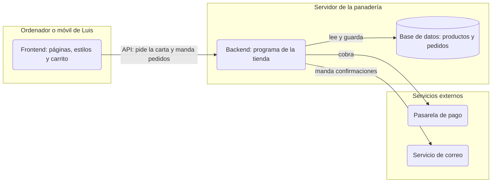
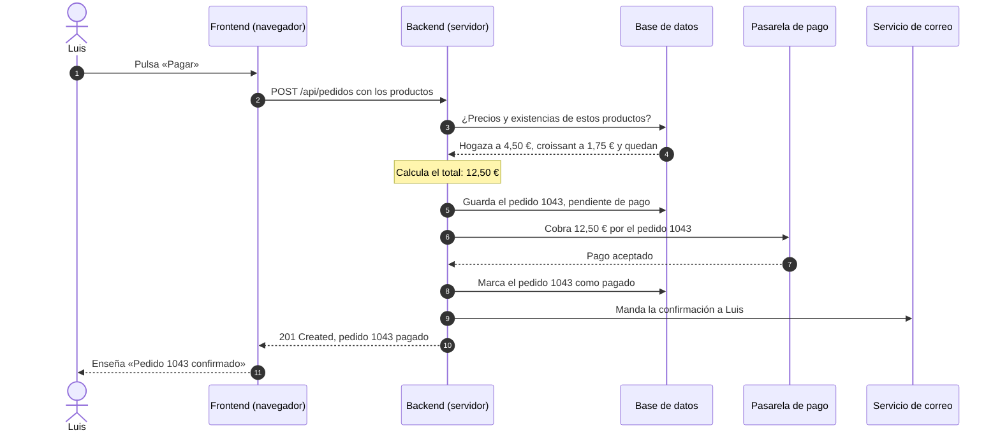
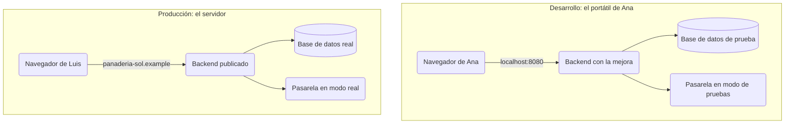
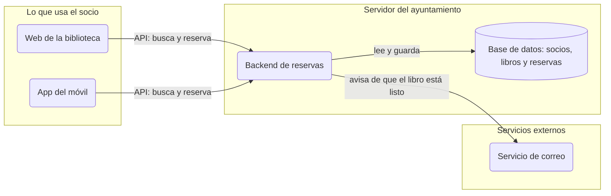
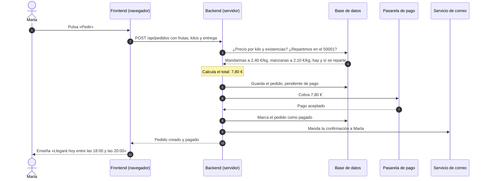

# 06.05 Las piezas de una aplicación

> **Conviene saber antes:** [06.01 Redes: IP, router, DNS y cortafuegos](01-redes.md) · [06.02 Puertos y localhost: tu ordenador como servidor](02-puertos-y-localhost.md) · [06.03 La web: HTTP, peticiones, respuestas y APIs](03-la-web-http-y-apis.md) · [06.04 Qué es una base de datos](04-que-es-una-base-de-datos.md) · [04.05 Diagramas y Mermaid, 1.8](../fase-04-formatos-y-diagramas/05-diagramas-y-mermaid.md#18-diagramas-de-secuencia)
> **Tiempo estimado:** 1,5 horas
> **Nivel:** Básico · Núcleo

## Qué aprenderás

- Qué son el **frontend**, el **backend**, la **base de datos**, la **API** y los **servicios externos**, y qué hace cada uno.
- Cómo **encajan** todas esas piezas cuando compras en una tienda en línea, paso a paso.
- Por qué una aplicación puede ser **un programa entero** o **varios programas que se hablan**.
- Dónde **vive** cada pieza: en tu dispositivo, en un servidor o en la nube.
- Qué es **desplegar** una aplicación y qué papel tienen el servidor, el dominio y el *hosting*.
- Qué son los **entornos** de desarrollo, pruebas y producción, y por qué no se prueba nunca con los datos de verdad.
- **Qué curso de la academia enseña cada pieza**, para que sepas qué estudiar después.

## 1. Teoría

En los módulos anteriores de esta fase has visto las piezas una a una: cómo viajan los datos por la red y qué es un [servidor](01-redes.md#13-cliente-y-servidor), cómo escucha un programa en un [puerto](02-puertos-y-localhost.md#11-una-dirección-ip-no-basta-el-puerto), cómo se piden y se contestan las cosas con [HTTP y las API](03-la-web-http-y-apis.md#13-http-pedir-y-responder-con-texto) y dónde se guardan los datos en una [base de datos](04-que-es-una-base-de-datos.md#13-base-de-datos-y-motor). Este módulo no añade piezas nuevas: **las junta**, para que veas cómo funciona una aplicación entera.

### 1.1. Lo que ves y lo que no ves

Luis entra en la tienda en línea de la **Panadería Sol** (la web que hacía Ana en [02.02](../fase-02-tu-ordenador/02-archivos-carpetas-y-rutas.md#21-un-árbol-real-la-web-de-una-panadería) y cuyas piezas dibujaste en [04.05](../fase-04-formatos-y-diagramas/05-diagramas-y-mermaid.md#17-agrupar-con-subgraph-diagramas-de-bloques)). Ve la carta con sus fotos, mete dos hogazas y dos croissants en el carrito, pulsa «Pagar» y, un minuto después, le llega un correo: «Pedido 1043 confirmado».

Para Luis, la tienda es **lo que ve en la pantalla**. Pero esa pantalla es solo la punta del iceberg. Para que todo eso funcione han tenido que trabajar, a la vez y en sitios distintos:

| Pieza | Dónde está | Qué ha hecho en la compra de Luis |
|---|---|---|
| **Frontend** | En el navegador de Luis | Enseñar la carta y el carrito, y mandar el pedido |
| **Backend** | En un servidor de la panadería | Comprobar el pedido, calcular el precio, cobrar y guardar |
| **Base de datos** | Normalmente, junto al backend | Guardar los productos, los precios y los pedidos |
| **API** | Entre el frontend y el backend | Ser la forma acordada de pedir y contestar |
| **Servicios externos** | En los servidores de otras empresas | Cobrar con la tarjeta y enviar el correo |

Cada una de esas palabras tiene su apartado a continuación. Se usan en todos los cursos, en todas las ofertas de trabajo y en todas las conversaciones entre quienes programan: «eso es un fallo del frontend», «el backend tarda en responder», «hay que cambiar la API».

### 1.2. El frontend: la parte que ves

El **frontend** es la parte de una aplicación que **ve y usa la persona**: las pantallas, los botones, los formularios, los menús. Funciona **en el dispositivo de quien la usa**: en su navegador, si es una web, o en su móvil, si es una app.

En una web, el frontend son los ficheros que viste en el árbol de la panadería: las páginas (`index.html`, `carta.html`), la hoja de estilos (`css/estilos.css`) y el programa del carrito (`js/carrito.js`). Están escritos en los tres lenguajes que entienden todos los navegadores:

| Lenguaje | Qué hace en la página |
|---|---|
| **HTML** | Lo que hay: títulos, textos, imágenes, botones ([04.04, apartado 1.7](../fase-04-formatos-y-diagramas/04-xml-csv-y-otros.md#17-html-el-pariente-de-xml)) |
| **CSS** | Cómo se ve: colores, letras, tamaños, dónde va cada cosa |
| **JavaScript** | Lo que pasa al hacer algo: sumar el carrito al pulsar «Añadir», avisar si falta un dato del formulario, pedir datos al backend sin recargar la página |

El servidor manda esos ficheros al navegador, y **es el navegador quien los ejecuta**, en el ordenador o el móvil de Luis. Eso tiene una consecuencia muy importante: **todo lo que hay en el frontend lo puede ver y cambiar quien usa la aplicación**. Cualquiera puede abrir las herramientas de su navegador y leer el JavaScript de una página, o cambiar lo que manda. Lo verás en el [error típico 3.2](#32-fiarse-del-frontend).

> **📌 Nota:** en inglés se escribe *front end*, *front-end* o *frontend*, y en español se usa tal cual, a veces traducido como «la parte del cliente». En las ofertas de trabajo verás «desarrollador *frontend*»: quien hace esta parte.

### 1.3. El backend: la parte que manda

El **backend** es la parte de la aplicación que **no se ve**: un programa que funciona en un **servidor** ([06.01](01-redes.md#13-cliente-y-servidor)), escuchando en un [puerto](02-puertos-y-localhost.md#14-escuchar-en-un-puerto), y que **atiende las peticiones** de los frontends. Es el que de verdad **decide**:

- **Comprueba** lo que le llega: ¿existe ese producto?, ¿quedan hogazas?, ¿el día de recogida es un día que abre la panadería?
- **Calcula**: el precio de cada producto lo saca de la base de datos, no de lo que diga el navegador, y suma el total.
- **Guarda y lee** los datos en la base de datos.
- **Habla con los servicios externos**: le pide a la pasarela de pago que cobre y al servicio de correo que mande la confirmación.
- **Guarda los secretos**: las claves para hablar con la pasarela o con la base de datos están en el servidor, nunca en el frontend.

A estas reglas de la aplicación («no se venden más hogazas de las que hay», «los pedidos de más de 50 € no pagan envío») se las llama **lógica de negocio**, y su sitio es el backend, porque el backend está en una máquina de la panadería, que nadie de fuera puede tocar.

El backend se puede escribir en casi cualquier lenguaje: Java, Python, JavaScript, C#, PHP, Go… Al frontend le da igual, porque no habla con el código del backend: habla con su **API** ([apartado 1.5](#15-la-api-el-mostrador-entre-frontend-y-backend)).

> **📌 Nota:** a la pareja frontend y backend se la llama a veces **cliente** y **servidor**, como en el [modelo cliente-servidor](01-redes.md#13-cliente-y-servidor) de 06.01. A quien hace las dos partes se le llama desarrollador *full stack* («de toda la pila»).

### 1.4. La base de datos: la memoria de la aplicación

El backend **no guarda los datos en su memoria**: si lo hiciera, se perderían cada vez que se reiniciara el servidor (recuerda que la [RAM es olvidadiza](../fase-02-tu-ordenador/01-como-funciona-un-ordenador.md#15-la-memoria-ram-rápida-y-olvidadiza)). Los guarda en una **base de datos** ([06.04](04-que-es-una-base-de-datos.md#13-base-de-datos-y-motor)), que en la panadería tiene, por ejemplo, los productos con sus precios y existencias, los clientes y los pedidos.

Lo importante aquí es **quién habla con quién**:

- El **backend** es el único que habla con la base de datos.
- El **frontend nunca** habla directamente con ella. Si lo hiciera, cualquiera que mirase el código de la página tendría la llave de la base de datos y podría leer los pedidos de todos los clientes o cambiar los precios.

Así, el backend hace de **portero**: el frontend le pide cosas y el backend decide qué se puede hacer y qué no, antes de tocar los datos.

### 1.5. La API: el mostrador entre frontend y backend

El frontend y el backend son programas distintos, en máquinas distintas, y a menudo escritos por personas distintas. Para entenderse necesitan un **acuerdo**: qué se puede pedir, cómo se pide y qué se contesta. Ese acuerdo es la **API** del backend, que ya conoces de [06.03](03-la-web-http-y-apis.md#111-qué-es-una-api-web): direcciones como `/api/productos` o `/api/pedidos`, peticiones HTTP y respuestas en [JSON](../fase-04-formatos-y-diagramas/03-json-y-yaml.md#13-json-el-formato-para-intercambiar-datos).

Piensa en el mostrador de la panadería. El cliente no entra en el obrador a coger el pan: pide en el mostrador, con unas reglas conocidas (qué hay, cuánto cuesta, cómo se paga), y la dependienta va dentro y se lo trae. **La API es el mostrador**:

- El frontend **no sabe** cómo está hecho el backend por dentro, ni en qué lenguaje, ni cómo es la base de datos. Solo conoce la API.
- Si Ana cambia el backend por dentro (otro lenguaje, otra base de datos) y **la API sigue igual**, el frontend sigue funcionando sin tocar nada.
- Si cambia la API, **todos** los que la usan tienen que cambiar. Por eso una API se cambia con mucho cuidado.

Y un mismo backend puede tener **varios frontends**: la web de la panadería y, si algún día la tiene, una app del móvil, hablando con la misma API. Es lo que hacía el club de tenis La Ribera de [04.05](../fase-04-formatos-y-diagramas/05-diagramas-y-mermaid.md#22-un-diagrama-de-bloques-la-reserva-de-pistas-de-un-club): la app y la web reservaban en el mismo servidor.

### 1.6. Servicios de otros: pagos, correo, mapas

Hay cosas que casi ninguna aplicación hace por su cuenta, porque son difíciles, delicadas o caras de mantener. Para eso usa **servicios externos**: programas de otras empresas, que funcionan en sus servidores y que el backend usa a través de **sus API**.

| Servicio | Para qué | Por qué no se hace en casa |
|---|---|---|
| **Pasarela de pago** | Cobrar con tarjeta, Bizum o similares | Manejar tarjetas exige mucha seguridad y acuerdos con los bancos |
| **Envío de correo** | Confirmaciones, avisos, recuperar la contraseña | Que los correos lleguen y no acaben en «correo no deseado» es un oficio |
| **Mapas** | Enseñar dónde está la tienda o calcular rutas | Hacer un mapa del mundo no está al alcance de nadie |
| **Inicio de sesión** | «Entra con tu cuenta de…» | Guardar contraseñas bien es difícil y peligroso |

Ahora ya sabes qué era la **pasarela de pago** del diagrama de [04.05](../fase-04-formatos-y-diagramas/05-diagramas-y-mermaid.md#23-un-diagrama-de-secuencia-pagar-con-tarjeta-en-la-panadería): un servicio externo que se pone entre la tienda y el banco del cliente. Muchas tiendas ni siquiera llegan a ver el número de la tarjeta: lo normal es que el cliente lo escriba en una página o un recuadro de la propia pasarela, y la tienda solo recibe el aviso de «pago aceptado» o «pago rechazado».

Para usar la API de un servicio externo, el backend necesita una **clave** que le da ese servicio: es la prueba de que es la panadería quien pide cobrar. Esa clave es un [secreto](../fase-04-formatos-y-diagramas/04-xml-csv-y-otros.md#114-el-fichero-env-y-los-secretos): vive en el servidor, en la configuración, nunca en el código ni en el frontend (lo verás a fondo en [Seguridad básica](../fase-07-aprender-a-aprender/05-seguridad-basica.md#113-los-secretos-dónde-se-guardan), en la fase 7).

### 1.7. El mapa completo de una tienda en línea

Con todas las piezas, así es la tienda de la Panadería Sol. Es el diagrama de [04.05](../fase-04-formatos-y-diagramas/05-diagramas-y-mermaid.md#17-agrupar-con-subgraph-diagramas-de-bloques), ahora con el frontend y el backend separados y con sus nombres de verdad:



En texto: en el ordenador o el móvil de Luis funciona el frontend, que, a través de la API, pide la carta y manda los pedidos al backend; el backend, en el servidor de la panadería, lee y guarda en la base de datos, cobra con la pasarela de pago y manda las confirmaciones con el servicio de correo, que son servicios externos.

**Fíjate en las flechas:** todas las del frontend van **solo al backend**. El backend está en el centro: es el único que habla con todos.

### 1.8. Un programa entero o varios que se hablan

No todas las aplicaciones tienen todas estas piezas. Hay dos grandes formas de hacerlas:

**Un programa entero.** Todo en un solo programa, en un solo ordenador: el procesador de textos, la calculadora, un juego sin conexión, VS Code o los scripts que hiciste en la fase 3. No hay frontend y backend separados ni red: las pantallas, la lógica y los ficheros donde guarda los datos están en tu máquina. Funcionan sin internet, pero los datos están solo en ese ordenador.

**Varios programas que se hablan.** Es el caso de la tienda: el frontend en el navegador, el backend en un servidor, la base de datos (que es otro programa, su motor), los servicios externos… cada uno en su sitio, hablando por la red. Así funcionan casi todas las aplicaciones que usas a diario: el correo, el banco, las redes sociales, la tienda. Ventaja: los datos están en un sitio y los ve cualquiera desde cualquier dispositivo. Precio: si falla la red o el servidor, no funciona.

Y dentro de la segunda forma, el **backend** también se puede organizar de dos maneras:

- **Un solo backend** para todo (se le llama **monolito**): el programa de la tienda hace la carta, los pedidos, los pagos y los correos. Es lo normal para empezar, y muchas aplicaciones grandes siguen así.
- **Varios backends pequeños**, cada uno con una tarea (uno para la carta, otro para los pedidos, otro para los pagos), que se hablan entre sí por sus API: son los **microservicios**. Sirven cuando una aplicación es muy grande y la hacen muchos equipos a la vez, pero son bastante más difíciles de mantener.

No tienes que elegir nada ahora: basta con que, cuando un curso te hable de un monolito o de microservicios, sepas que se refiere a **cómo se reparte el backend**.

### 1.9. Dónde vive cada pieza: tu ordenador, un servidor o la nube

Cada pieza tiene que estar **en algún ordenador**, encendido y conectado a la red:

| Pieza | Dónde funciona |
|---|---|
| Frontend | En el dispositivo de cada usuario. El servidor solo le **entrega** los ficheros; los ejecuta el navegador |
| Backend | En un servidor, encendido día y noche, con una dirección a la que puedan llegar los frontends |
| Base de datos | En un servidor: el mismo del backend o, mejor, otro |
| Servicios externos | En los servidores de sus empresas. No son tuyos: solo usas su API |

¿Y de dónde saca la panadería un servidor? Tiene tres opciones:

1. **Un ordenador propio**, en la tienda, encendido siempre. Es posible, pero se apaga si se va la luz, la conexión de casa no está pensada para eso y alguien tiene que cuidarlo (actualizaciones, copias de seguridad, cortafuegos).
2. **Alquilar un trozo de servidor** a una empresa de *hosting* ([apartado 1.10](#110-qué-es-desplegar-servidor-dominio-y-hosting)).
3. **La nube.** Ya sabes de [02.01](../fase-02-tu-ordenador/01-como-funciona-un-ordenador.md#111-la-nube-el-ordenador-de-otro) que la nube son **ordenadores de otra empresa**, en un centro de datos. Para una aplicación, eso quiere decir que la panadería **alquila** lo que necesita y la empresa se encarga del resto: desde un servidor entero hasta **servicios ya montados**, como una base de datos que la propia empresa instala, actualiza y copia cada noche. Normalmente se paga **por lo que se usa**, y se puede pedir más en pocos minutos si llegan las Navidades y se dispara el número de pedidos.

Los proveedores de nube más conocidos son **Amazon Web Services (AWS)**, **Microsoft Azure** y **Google Cloud**, y hay muchos más, grandes y pequeños, también europeos. Cada uno tiene sus precios, sus nombres para cada servicio y sus condiciones, que cambian a menudo: cuando te toque usar uno, consulta su web oficial.

> **📌 Nota:** la línea entre *hosting* y nube es borrosa: muchas empresas de *hosting* ofrecen hoy servicios en la nube, y al revés. Lo que importa es la idea: **tu aplicación funciona en un ordenador que no es el tuyo**, y alguien (tú o la empresa) tiene que cuidarlo.

### 1.10. Qué es desplegar: servidor, dominio y hosting

Ana tiene la tienda funcionando en su portátil, en [`localhost`](02-puertos-y-localhost.md#15-localhost-tu-propio-ordenador). Pero Luis no puede entrar en el portátil de Ana. **Desplegar** es llevar la aplicación desde el ordenador de quien la hace hasta los servidores donde la usarán los demás, y dejarla funcionando allí. En inglés, *deploy*; también se dice «poner en producción» o «publicar».

Para desplegar la tienda hacen falta tres cosas:

| Qué | Qué es | En la panadería |
|---|---|---|
| **Servidor** | El ordenador donde funcionarán el backend y la base de datos, y desde el que se entregará el frontend | Alquilado a una empresa de *hosting* o en la nube |
| **Dominio** | El nombre fácil de recordar que llevará a ese servidor, en vez de su [dirección IP pública](01-redes.md#18-ip-privada-e-ip-pública). Se alquila por años a una empresa que vende dominios, y el [DNS](01-redes.md#111-dns-de-nombres-a-números) hace la traducción | `panaderia-sol.example` |
| **Certificado HTTPS** | Lo que permite que la web vaya por [HTTPS](03-la-web-http-y-apis.md#19-https-http-con-candado), con el candado del navegador. Hoy se puede conseguir gratis y muchos *hosting* lo ponen solos | Para que los datos de Luis viajen cifrados |

El **hosting** (en español, **alojamiento**) es el servicio de una empresa que te deja tu web o tu aplicación **en sus servidores**, encendidos y conectados día y noche. Los hay de muchos tipos, de menos a más trabajo para ti:

- **Para webs estáticas**, que son solo ficheros (HTML, CSS, JavaScript, imágenes) que se entregan tal cual: subes los ficheros y listo. Es lo que hace [GitHub Pages](../fase-05-git-y-github/03-github.md#115-lo-que-verás-más-adelante-pages-actions-y-gh), que usarás en el proyecto final.
- **Para aplicaciones**: subes tu backend y el servicio lo arranca, lo vigila y lo reinicia si se cae.
- **Un servidor entero** (o un trozo de uno grande que se comporta como si fuera un ordenador entero, un **servidor virtual**): te dan la máquina con su sistema operativo, casi siempre Linux, y todo lo demás lo instalas y lo cuidas tú.

**Una web estática no tiene backend.** Sus páginas son siempre las mismas para todos, y no guardan nada de lo que hace el visitante. La primera web de la panadería (la carta, el horario, la dirección) era así, y podía estar en GitHub Pages. La **tienda**, en cambio, necesita un backend que reciba los pedidos, una base de datos que los guarde y alguien que cobre: GitHub Pages no le vale. Además, su documentación dice expresamente que no se debe usar para transacciones delicadas, como enviar contraseñas o números de tarjeta, ni como *hosting* gratuito para llevar un negocio en línea (documentación de GitHub, consultada el 16 de noviembre de 2026).

> **📌 Nota:** `panaderia-sol.example` es un dominio de ejemplo. Los terminados en `.example` están **reservados para la documentación** y no existen de verdad, como `example.com`. Así ningún ejemplo del curso lleva a la web de nadie.

### 1.11. Entornos: desarrollo, pruebas y producción

La tienda de la panadería existe, a la vez, en varios sitios. Cada uno es un **entorno**: una copia de la aplicación con su propia configuración y sus propios datos, que sirve para una cosa distinta.

| Entorno | Dónde | Datos | Para qué |
|---|---|---|---|
| **Desarrollo** | En el portátil de Ana, en `localhost` | Inventados: «Cliente de Prueba», productos de mentira | Escribir el código y probarlo mientras se hace |
| **Pruebas** (o preproducción) | En un servidor parecido al de verdad | Inventados, o copias sin datos personales | Comprobar que todo funciona junto antes de publicarlo |
| **Producción** | En el servidor de verdad, en `panaderia-sol.example` | Los **reales**: clientes, pedidos y cobros de verdad | Lo que usa Luis |

La regla de oro: **producción no se toca para probar**. Un error en desarrollo no le importa a nadie; un error en producción le cobra dos veces a Luis o pierde los pedidos de la mañana. Por eso los cambios se prueban antes en desarrollo y en pruebas, y solo después se despliegan.

**El mismo código, distinta configuración.** El programa es el mismo en los tres entornos; lo que cambia es la **configuración**: a qué base de datos se conecta, con qué clave habla con la pasarela, en qué dirección está. Por eso esos datos no se escriben dentro del código, sino en la configuración de cada entorno, como el [fichero `.env`](../fase-04-formatos-y-diagramas/04-xml-csv-y-otros.md#114-el-fichero-env-y-los-secretos) de 04.04:

| Configuración | Desarrollo | Producción |
|---|---|---|
| Dirección de la API | `http://localhost:8080/api` | `https://panaderia-sol.example/api` |
| Base de datos | Una en el portátil de Ana, con datos inventados | La del servidor, con los pedidos reales |
| Pasarela de pago | **Modo de pruebas**: tarjetas de prueba, no cobra a nadie | Modo real: cobra de verdad |

> **📌 Nota:** las pasarelas de pago suelen tener ese **modo de pruebas**, con números de tarjeta de mentira que «pagan» sin mover dinero. Así se puede probar la tienda entera sin cobrar a nadie.

Cuando algo funciona en el portátil y falla en producción, casi siempre es por una **diferencia entre los dos entornos**: una configuración que no se cambió, un dato que en el portátil existía y en el servidor no… Lo verás en el [error típico 3.3](#33-en-mi-ordenador-funciona).

### 1.12. Qué curso enseña cada pieza

Este curso te ha dado el mapa. Cada pieza tiene detrás un oficio, y la academia tiene (o tendrá) un curso para cada una. Estos son los del catálogo de la academia a 16 de noviembre de 2026; **todavía no hay ninguno publicado**, así que se nombran sin enlace:

| Pieza | Qué aprenderás a hacer | Curso de la academia |
|---|---|---|
| **Frontend** | Páginas con HTML y CSS, JavaScript, TypeScript y aplicaciones web completas con React o Angular, que hablan con una API | «Frontend» |
| **Backend y API** | El programa del servidor y su API, en un lenguaje concreto | «Java de 0 a experto» (con Spring Boot en su parte 4) o la rama web de «Python» |
| **Base de datos** | Diseñar tablas, consultar con SQL, PostgreSQL a fondo, y también bases de datos que no son de tablas | «SQL y bases de datos» |
| **Desplegar, servidores y nube** | Linux, Docker, desplegar automáticamente con cada cambio y la nube | «DevOps práctico» |
| **Trabajar en equipo con Git** | Git por dentro, *pull requests*, revisión de código, GitHub Actions | «Git y GitHub a fondo» |
| **Repartir el backend en piezas** | Monolitos bien organizados y microservicios: cuándo sí y cuándo no | «Arquitectura de software y microservicios» (para quien ya tiene experiencia programando en Java) |
| **IA dentro de una aplicación** | Usar modelos de lenguaje desde el backend | «IA aplicada con Java» o la rama de IA de «Python» |

No hace falta hacerlos todos, ni en este orden. Lo normal es **empezar por un lenguaje** (el backend con Java o con Python, o el frontend) y añadir después la base de datos y el despliegue. Si no sabes por dónde empezar, piensa qué te gustaría construir: si es lo que se ve, empieza por el frontend; si es lo que decide y guarda, por el backend.

## 2. Ejemplos de código

En este módulo los ejemplos son **diagramas y datos**: cómo se hablan las piezas y qué se dicen. Los diagramas están en Mermaid ([04.05](../fase-04-formatos-y-diagramas/05-diagramas-y-mermaid.md)) y los datos, en JSON ([04.03](../fase-04-formatos-y-diagramas/03-json-y-yaml.md)).

### 2.1. Una compra en la Panadería Sol, paso a paso

**Situación real:** Ana quiere explicar a su socia, que no programa, qué pasa exactamente cuando Luis pulsa «Pagar». Dibuja un diagrama de secuencia con todas las piezas del [apartado 1.7](#17-el-mapa-completo-de-una-tienda-en-línea). Para no alargarlo, el pago sale bien (los dos finales posibles ya los viste en [04.05](../fase-04-formatos-y-diagramas/05-diagramas-y-mermaid.md#23-un-diagrama-de-secuencia-pagar-con-tarjeta-en-la-panadería)).



En texto: (1) Luis pulsa «Pagar»; (2) el frontend manda el pedido al backend con un `POST`; (3) el backend pregunta a la base de datos los precios y si quedan productos, y (4) la base de datos contesta; el backend calcula el total; (5) guarda el pedido como pendiente de pago; (6) pide a la pasarela que cobre, y (7) la pasarela acepta el pago; (8) el backend marca el pedido como pagado; (9) pide al servicio de correo que mande la confirmación; (10) contesta al frontend que el pedido se ha creado, y (11) el frontend se lo enseña a Luis.

**En qué fijarte:**

- **Luis solo habla con el frontend, y el frontend solo con el backend.** Todo lo demás (base de datos, pasarela, correo) lo mueve el backend.
- **El precio lo saca el backend de la base de datos** (pasos 3 y 4), no del navegador.
- **El pedido se guarda antes de cobrar** (paso 5) y se marca como pagado después (paso 8): si la pasarela fallase a mitad, la panadería sabría que hay un pedido sin pagar, en vez de un cobro sin pedido.
- **El pago está simplificado.** En la práctica, Luis suele escribir la tarjeta en una página o un recuadro de la propia pasarela ([apartado 1.6](#16-servicios-de-otros-pagos-correo-mapas)); el backend no la ve, solo recibe «aceptado» o «rechazado».
- **`201 Created`** es el código de estado de HTTP para «he creado lo que pedías» ([06.03, apartado 1.7](03-la-web-http-y-apis.md#17-los-códigos-de-estado)). En una API, la respuesta suele traer además lo que se ha creado, como en el ejemplo siguiente.
- **Todo pasa en un par de segundos.** Para Luis es un clic; por dentro son once mensajes entre seis participantes.

### 2.2. Lo que viaja por la API: el pedido en JSON

**Situación real:** el paso 2 del diagrama anterior es una petición `POST /api/pedidos`. Su cuerpo, lo que manda el frontend al backend, es este JSON:

```json
{
  "cliente": "luis.moreno@example.com",
  "recoger_en_tienda": true,
  "dia_de_recogida": "2026-11-20",
  "productos": [
    { "producto_id": 12, "cantidad": 2 },
    { "producto_id": 7, "cantidad": 2 }
  ]
}
```

📁 **Código:** [`codigo/05-piezas-de-una-aplicacion/ejemplos/2.2-el-pedido-por-la-api/`](codigo/05-piezas-de-una-aplicacion/ejemplos/2.2-el-pedido-por-la-api/)

Y este es el pedido tal como queda en el paso 5, recién creado y antes de cobrarlo; la respuesta del paso 10 es igual, con `"estado": "pagado"`:

```json
{
  "pedido_id": 1043,
  "estado": "pendiente_de_pago",
  "lineas": [
    { "producto": "Hogaza de centeno", "cantidad": 2, "precio_unidad": 4.5, "importe": 9.0 },
    { "producto": "Croissant de mantequilla", "cantidad": 2, "precio_unidad": 1.75, "importe": 3.5 }
  ],
  "total": 12.5,
  "moneda": "EUR"
}
```

📁 **Código:** [`codigo/05-piezas-de-una-aplicacion/ejemplos/2.2-el-pedido-por-la-api/`](codigo/05-piezas-de-una-aplicacion/ejemplos/2.2-el-pedido-por-la-api/)

**En qué fijarte:**

- **El pedido no lleva ningún precio.** El frontend solo dice **qué** quiere Luis (el identificador de cada producto y cuántos); **cuánto cuesta** lo decide el backend con los datos de la base de datos. Así, aunque alguien cambie lo que manda su navegador, no puede ponerse los precios que quiera.
- **Los productos van por su identificador** (`12`, `7`), no por su nombre: es la [clave primaria](04-que-es-una-base-de-datos.md#16-la-clave-primaria) con la que la base de datos los encuentra. La respuesta, en cambio, trae los nombres, porque el frontend se los tiene que enseñar a Luis.
- **`pedido_id` lo pone el backend** (o la base de datos al guardarlo): el frontend no podía saber que sería el 1043.
- **Ni rastro de la tarjeta.** Los datos de pago no pasan por aquí: los maneja la pasarela ([apartado 1.6](#16-servicios-de-otros-pagos-correo-mapas)).
- **El correo es de ejemplo** (`example.com`), como todos los del curso. Y los importes van con **punto decimal**, como exige JSON ([04.03](../fase-04-formatos-y-diagramas/03-json-y-yaml.md#14-los-seis-tipos-de-valores-de-json)); el frontend los enseñará como «12,50 €».

### 2.3. La misma tienda en el portátil de Ana y en internet

**Situación real:** Ana trabaja en una mejora (poder elegir la hora de recogida). Mientras la hace, la tienda de verdad tiene que seguir vendiendo. Así conviven los dos entornos:



En texto: en desarrollo, el navegador de Ana habla con el backend que está escribiendo, en `localhost:8080`, que usa una base de datos de prueba y la pasarela en modo de pruebas. En producción, el navegador de Luis habla, a través de `panaderia-sol.example`, con el backend publicado, que usa la base de datos real y la pasarela en modo real. Los dos lados no se tocan.

**En qué fijarte:**

- **Son dos copias completas**, cada una con su base de datos y su configuración. Lo que Ana rompa en su portátil no afecta a los pedidos de Luis.
- **Luis no puede llegar al portátil de Ana**: `localhost` es siempre el propio ordenador ([06.02](02-puertos-y-localhost.md#15-localhost-tu-propio-ordenador)).
- **Cuando la mejora esté probada**, Ana la desplegará: el backend de producción pasará a tener la mejora, pero seguirá con **su** base de datos y **su** configuración.

### 2.4. La web de la panadería, antes y después de la tienda

**Situación real:** la socia de Ana pregunta por qué la web vieja «estaba gratis en GitHub» y la tienda necesita un servidor de pago. Ana se lo explica con esta tabla:

| | La web de antes | La tienda |
|---|---|---|
| **Qué hace** | Enseña la carta, el horario y la dirección | Además, recibe pedidos y cobra |
| **Frontend** | Sí: HTML, CSS, imágenes | Sí: lo mismo, más el carrito |
| **Backend** | No | Sí: comprueba, calcula, guarda y cobra |
| **Base de datos** | No: la carta está escrita en las páginas | Sí: productos, existencias y pedidos |
| **Servicios externos** | No | Pasarela de pago y correo |
| **Tipo de web** | Estática: igual para todos | Aplicación: cada cliente ve su carrito y sus pedidos |
| **Dónde puede estar** | En un *hosting* de webs estáticas, como GitHub Pages | En un *hosting* de aplicaciones, un servidor o la nube |
| **Qué hay que cuidar** | Casi nada: son ficheros | El servidor, la base de datos y sus copias de seguridad, los secretos, las actualizaciones |

**En qué fijarte:** la pregunta que decide todo es **¿la web tiene que recordar o decidir algo?** Si solo enseña lo mismo a todos, es estática y basta con un *hosting* sencillo. En cuanto tiene que guardar lo que hace cada visitante (un pedido, una reserva, un comentario), hace falta un backend y una base de datos, y con ellos, un servidor que alguien cuide.

## 3. Errores típicos

### 3.1. Creer que la aplicación es lo que se ve

**Qué pasa:** alguien pide «una web como la de la panadería, pero con pedidos», piensa que es cuestión de añadir un botón a las páginas y se sorprende de que cueste mucho más que la web de antes.

**Por qué ocurre:** solo se ve el frontend. El botón «Pagar» es lo de menos: detrás tiene que haber un backend que reciba el pedido, una base de datos que lo guarde, una pasarela que cobre y un servidor donde funcione todo ([apartado 1.1](#11-lo-que-ves-y-lo-que-no-ves)).

**Cómo se evita:** antes de decidir nada, **dibuja las piezas** con un diagrama de bloques, como en el [apartado 1.7](#17-el-mapa-completo-de-una-tienda-en-línea), y pregúntate qué tiene que recordar o decidir la aplicación.

### 3.2. Fiarse del frontend

**Qué pasa:** una tienda manda desde el navegador el precio de cada producto, y el backend cobra lo que le llega. Alguien cambia lo que manda su navegador y compra una hogaza a 0,01 €.

**Por qué ocurre:** el frontend funciona en el dispositivo del usuario, que puede ver y cambiar todo lo que hay en él ([apartado 1.2](#12-el-frontend-la-parte-que-ves)). Lo que llega al backend puede no venir de tu página, o venir cambiado.

**Cómo se arregla:** el backend **comprueba todo** y saca de la base de datos lo que importa (precios, existencias, permisos), como en el [ejemplo 2.2](#22-lo-que-viaja-por-la-api-el-pedido-en-json). Las comprobaciones del frontend («falta el correo») son para ayudar al usuario; las que protegen la aplicación, en el backend. Lo verás más a fondo en el módulo [Seguridad básica](../fase-07-aprender-a-aprender/05-seguridad-basica.md#111-mínimo-privilegio-cortafuegos-y-antivirus) (fase 7).

### 3.3. En mi ordenador funciona

**Qué pasa:** la tienda funciona perfectamente en el portátil de Ana, la despliega y en producción falla: no carga la carta, o no cobra.

**Por qué ocurre:** casi siempre, una **diferencia entre los entornos** ([apartado 1.11](#111-entornos-desarrollo-pruebas-y-producción)). La más típica: una dirección de desarrollo escrita dentro del código, como `http://localhost:8080/api`. En el portátil de Ana, `localhost` es su portátil, donde está el backend; en el navegador de Luis, `localhost` es **el ordenador de Luis**, donde no hay nada escuchando ([06.02](02-puertos-y-localhost.md#15-localhost-tu-propio-ordenador)). Otras: una clave de la pasarela en modo de pruebas, o un dato que solo existía en la base de datos de Ana.

**Cómo se arregla:** lo que cambia entre entornos va en la **configuración**, no en el código, y antes de producción se pasa por un entorno de pruebas lo más parecido posible al real.

### 3.4. Probar en producción

**Qué pasa:** para ver si funciona una mejora, alguien la prueba directamente en la tienda de verdad: hace pedidos de prueba que llegan al obrador, manda correos a clientes reales o borra «datos de prueba» que no lo eran.

**Por qué ocurre:** parece más rápido que montar un entorno de pruebas. Pero producción tiene datos y dinero de verdad.

**Cómo se evita:** **producción no se toca para probar**. Se prueba en desarrollo, con datos inventados y la pasarela en modo de pruebas, y después en el entorno de pruebas. Y nunca se copian los datos personales de los clientes al portátil para probar.

### 3.5. La clave de la pasarela en el frontend

**Qué pasa:** para que el carrito cobre «directamente», alguien pone la clave secreta de la pasarela de pago en el JavaScript de la página. Días después, hay cobros y devoluciones que nadie de la panadería ha hecho.

**Por qué ocurre:** todo lo que está en el frontend lo descarga cualquiera que visite la web ([apartado 1.2](#12-el-frontend-la-parte-que-ves)). Una clave en el frontend es una clave publicada.

**Cómo se arregla:** las claves secretas viven **solo en el backend**, en su configuración ([apartado 1.6](#16-servicios-de-otros-pagos-correo-mapas)). Si una clave se ha publicado, hay que **anularla** en el servicio y pedir otra: borrarla de la página no sirve, porque alguien puede tenerla ya. Lo verás en [Seguridad básica](../fase-07-aprender-a-aprender/05-seguridad-basica.md#115-si-se-escapa-un-secreto) (fase 7).

## 4. Buenas prácticas

- **Dibuja las piezas antes de construir nada**: un diagrama de bloques para ver qué hay y uno de secuencia para ver qué pasa ([04.05](../fase-04-formatos-y-diagramas/05-diagramas-y-mermaid.md)).
- **Pregúntate si la aplicación tiene que recordar o decidir algo.** Si no, una web estática basta, y es mucho más sencilla de mantener.
- **El frontend enseña y pregunta; el backend decide.** Precios, permisos y comprobaciones importantes, siempre en el backend.
- **Solo el backend habla con la base de datos** y con los servicios externos.
- **Cuida la API**: es el acuerdo entre las piezas. Si cambia, cambian todos los que la usan.
- **No reinventes lo delicado**: pagos, correo o inicio de sesión, con servicios especializados.
- **Los secretos, en la configuración del servidor**: ni en el código ni en el frontend.
- **Separa los entornos**: desarrollo y pruebas con datos inventados; producción, solo para los usuarios de verdad.
- **Lo que cambia entre entornos, en la configuración**: nada de `localhost` escrito en el código que se despliega.
- **Empieza sencillo**: un solo backend (un monolito) es lo normal; los microservicios, cuando de verdad hagan falta.

## 5. Ejercicios prácticos resueltos

> **💡 Consejo:** estos ejercicios son de **razonar**, y algunos de **dibujar** (con Mermaid, en VS Code o en el editor en línea de [04.05](../fase-04-formatos-y-diagramas/05-diagramas-y-mermaid.md#111-el-editor-en-línea-oficial)) o de **leer JSON**. Intenta cada uno antes de abrir las pistas y la solución.

### 🟢 Básico

#### Ejercicio 1 · Frontend, backend, base de datos o servicio externo

El gimnasio Fuerza Norte tiene una app para reservar clases. Di qué pieza hace cada cosa: frontend, backend, base de datos o servicio externo.

1. Enseña el calendario de clases de la semana con colores.
2. Guarda las reservas de todas las socias.
3. Comprueba que en la clase de las 19:00 quedan plazas antes de aceptar una reserva.
4. Cobra la cuota mensual con tarjeta.
5. Avisa en rojo de que falta escribir el teléfono, antes de enviar el formulario.
6. Manda el correo de «Tu reserva está confirmada».
7. Decide que una socia con la cuota sin pagar no puede reservar.
8. Guarda la clave para hablar con la pasarela de pago.

<details>
<summary>Pista 1</summary>

Para cada tarea, pregúntate: ¿pasa en la pantalla de la socia?, ¿es una regla que tiene que cumplirse aunque alguien haga trampas?, ¿es un dato que hay que recordar?, ¿lo hace otra empresa? Repasa el [apartado 1.1](#11-lo-que-ves-y-lo-que-no-ves).

</details>

<details>
<summary>Ver solución</summary>

**Razonamiento:** lo que se ve y ayuda a quien usa la app es del frontend; lo que decide o protege, del backend; lo que se recuerda, de la base de datos; lo que hace otra empresa, de un servicio externo.

| # | Pieza | Por qué |
|---|---|---|
| 1 | **Frontend** | Es lo que ve la socia en su pantalla |
| 2 | **Base de datos** | Hay que recordar las reservas, aunque se reinicie el servidor |
| 3 | **Backend** | Es una regla que no se puede saltar: tiene que comprobarse en el servidor, con los datos de la base de datos |
| 4 | **Servicio externo** (pasarela de pago) | Cobrar con tarjeta lo hace una empresa especializada; el backend se lo pide |
| 5 | **Frontend** | Es una ayuda para la socia, para no enviar el formulario incompleto |
| 6 | **Servicio externo** (servicio de correo), a petición del backend | El backend decide mandarlo; el envío lo hace el servicio de correo |
| 7 | **Backend** | Es lógica de negocio: una regla del gimnasio |
| 8 | **Backend** (en su configuración) | Es un secreto: en el frontend lo vería cualquiera |

**Errores frecuentes al resolverlo:**

- En el 5, decir «backend». Esta comprobación es del frontend, porque ayuda a la socia antes de enviar. Aun así, el backend **también** debe comprobar que el teléfono llega: el del frontend se puede saltar ([error típico 3.2](#32-fiarse-del-frontend)).
- En el 2, decir «backend». El backend es quien guarda y lee, pero el dato vive en la base de datos.

</details>

#### Ejercicio 2 · Ordena lo que pasa al pulsar Reservar

Carmen pulsa «Reservar» en la clase de pilates de las 19:00, en la web del gimnasio Fuerza Norte. Estos son los pasos, desordenados. Ordénalos:

- A. El backend guarda la reserva en la base de datos.
- B. El frontend enseña «Reserva confirmada».
- C. El frontend manda la petición de reserva al backend.
- D. El backend pregunta a la base de datos cuántas plazas quedan.
- E. Carmen pulsa «Reservar».
- F. El backend contesta al frontend que la reserva está hecha.
- G. La base de datos contesta: quedan 4 plazas.

<details>
<summary>Pista 1</summary>

Empieza por Carmen y termina por Carmen. En medio, recuerda que el backend **comprueba antes de guardar**, como en el [ejemplo 2.1](#21-una-compra-en-la-panadería-sol-paso-a-paso).

</details>

<details>
<summary>Ver solución</summary>

**Orden:** E, C, D, G, A, F, B.

1. **E.** Carmen pulsa «Reservar».
2. **C.** El frontend manda la petición al backend.
3. **D.** El backend pregunta cuántas plazas quedan.
4. **G.** La base de datos contesta que quedan 4.
5. **A.** Como hay plazas, el backend guarda la reserva.
6. **F.** El backend contesta al frontend.
7. **B.** El frontend se lo enseña a Carmen.

**Explicación:** cada pregunta tiene su respuesta (D con G, C con F), y el backend no guarda nada sin comprobar antes (D y G van antes que A). Si la base de datos hubiera contestado «quedan 0», el backend no habría guardado nada y habría contestado al frontend que la clase está llena.

**Errores frecuentes al resolverlo:**

- Poner A antes de D: guardar y luego mirar si había plaza; si no la había, ya está guardada una reserva que no cabe. (Y aun en el orden correcto, si dos socias reservan la última plaza en el mismo instante, hace falta que el motor lo impida con una transacción o una regla: es el problema de «Varios a la vez» de [06.04](04-que-es-una-base-de-datos.md#12-los-límites-de-un-fichero-y-de-una-hoja-de-cálculo).)
- Poner B justo después de C: el frontend no puede confirmar nada hasta que el backend le conteste.

</details>

### 🟡 Intermedio

#### Ejercicio 3 · Dibuja las piezas de la biblioteca

La Biblioteca Municipal de Valdeluz quiere que sus socios reserven libros por internet. Habrá una **web** y una **app del móvil**; las dos hablarán con un **backend** en un servidor del ayuntamiento, que guardará los socios, los libros y las reservas en una **base de datos** y mandará un aviso por **correo** (con un servicio externo) cuando el libro esté listo para recoger. No se cobra nada.

Dibuja un diagrama de bloques en Mermaid con las piezas, agrupadas según dónde están, y flechas con verbos.

<details>
<summary>Pista 1</summary>

Usa `flowchart LR` y tres `subgraph`: lo que usa el socio, lo del ayuntamiento y los servicios externos. Mira el [apartado 1.7](#17-el-mapa-completo-de-una-tienda-en-línea).

</details>

<details>
<summary>Pista 2</summary>

¿Cuántas flechas salen de la web y de la app? ¿Adónde van? ¿Hay alguna flecha de la app a la base de datos?

</details>

<details>
<summary>Ver solución</summary>



En texto: la web y la app del móvil, que usa el socio, buscan y reservan a través de la API del backend de reservas; el backend, en el servidor del ayuntamiento, lee y guarda en la base de datos de socios, libros y reservas, y avisa con el servicio de correo cuando un libro está listo.

**Explicación:**

- **Dos frontends, un backend**: la web y la app usan la **misma API** ([apartado 1.5](#15-la-api-el-mostrador-entre-frontend-y-backend)). Así las reglas (cuántos libros puede reservar un socio, por ejemplo) se escriben una sola vez.
- **Ninguna flecha va de la web o la app a la base de datos**: solo el backend habla con ella.
- **No hay pasarela de pago**, porque no se cobra nada: no todas las aplicaciones tienen todas las piezas.

**Errores frecuentes al resolverlo:**

- Dibujar dos backends, uno para la web y otro para la app. Funcionaría, pero cada regla habría que escribirla dos veces, y tarde o temprano no coincidirían.
- Olvidar cerrar algún `subgraph` con su `end`: el diagrama no se dibuja.

</details>

#### Ejercicio 4 · Lee la respuesta del gimnasio

Cuando Carmen reserva la clase de pilates, el backend del gimnasio Fuerza Norte contesta al frontend con este JSON:

```json
{
  "reserva_id": 5521,
  "socia": "Carmen Ruiz",
  "clase": "Pilates",
  "dia": "2026-11-24",
  "hora": "19:00",
  "plazas_libres": 3,
  "correo_de_confirmacion": "enviado"
}
```

📁 **Código:** [`codigo/05-piezas-de-una-aplicacion/ejercicios/ej04-lee-la-respuesta-del-gimnasio/`](codigo/05-piezas-de-una-aplicacion/ejercicios/ej04-lee-la-respuesta-del-gimnasio/)

1. ¿Qué pieza ha puesto el número `5521`? ¿Por qué no lo manda el frontend en la petición?
2. ¿De dónde sale `plazas_libres`? Si en el ejercicio 2 quedaban 4, ¿por qué ahora dice 3?
3. ¿Qué pieza ha intervenido para que `correo_de_confirmacion` diga `"enviado"`, además del backend?
4. ¿Qué hará el frontend con esta respuesta?
5. Si Carmen pudiera cambiar lo que manda su navegador, ¿podría cambiar `plazas_libres` para reservar en una clase llena?

<details>
<summary>Pista 1</summary>

Recuerda qué sabe cada pieza: el frontend solo sabe lo que ha elegido Carmen; el backend y la base de datos saben todo lo demás. Mira el [ejemplo 2.2](#22-lo-que-viaja-por-la-api-el-pedido-en-json).

</details>

<details>
<summary>Ver solución</summary>

1. **El backend, o la base de datos al guardar la reserva.** El frontend no puede saber qué número le toca: hay miles de reservas de otras socias que no conoce. Es como el `pedido_id` del [ejemplo 2.2](#22-lo-que-viaja-por-la-api-el-pedido-en-json).
2. **Lo calcula el backend con los datos de la base de datos.** Quedaban 4 plazas antes de la reserva de Carmen; al guardarla, queda una menos.
3. **El servicio de correo**, un servicio externo al que el backend le ha pedido que mande la confirmación ([apartado 1.6](#16-servicios-de-otros-pagos-correo-mapas)).
4. **Enseñárselo a Carmen**: «Reserva confirmada: Pilates, martes 24 de noviembre a las 19:00. Te hemos mandado un correo». Quizá también actualice el calendario con las 3 plazas libres. Fíjate en que la fecha viaja como `2026-11-24`, y es el frontend quien la escribe bonita para una persona.
5. **No.** `plazas_libres` es lo que **contesta** el backend, no lo que se le manda. Y aunque Carmen mandase un número inventado en la petición, el backend no lo usaría: las plazas las cuenta él en la base de datos ([error típico 3.2](#32-fiarse-del-frontend)).

**Errores frecuentes al resolverlo:**

- En el 3, decir que el correo lo manda la base de datos. La base de datos solo guarda y devuelve datos; no manda nada.

</details>

### 🔴 Avanzado

#### Ejercicio 5 · Funciona en el portátil y no en internet

Óscar ha hecho la web de reservas de su academia de inglés. En su portátil funciona: abre `http://localhost:3000`, ve los horarios y reserva. La despliega en un servidor, con el dominio `academia-oscar.example`. Su amiga Irene entra desde su casa: la página carga, con sus colores y su logotipo, pero **la lista de horarios sale vacía** y, al reservar, sale «No se ha podido conectar».

Óscar mira el JavaScript del frontend y encuentra esta línea:

```text
const API = "http://localhost:8080/api";
```

1. ¿Por qué en el portátil de Óscar funciona y en el ordenador de Irene no?
2. ¿Por qué la página sí carga, con sus colores y su logotipo?
3. ¿Cómo debería arreglarlo?

<details>
<summary>Pista 1</summary>

No hace falta entender JavaScript: fíjate en la dirección. ¿Qué ordenador es `localhost` en el navegador de Irene? Repasa [06.02](02-puertos-y-localhost.md#15-localhost-tu-propio-ordenador).

</details>

<details>
<summary>Pista 2</summary>

¿Qué parte de la aplicación entrega los colores y el logotipo, y cuál los horarios? Repasa el [apartado 1.9](#19-dónde-vive-cada-pieza-tu-ordenador-un-servidor-o-la-nube).

</details>

<details>
<summary>Ver solución</summary>

1. **El frontend busca el backend en `localhost`, y `localhost` es siempre el ordenador donde funciona el navegador.** En el portátil de Óscar, ahí está su backend escuchando en el puerto 8080, y funciona. El frontend funciona en el navegador de Irene, así que pregunta a `localhost:8080` **de Irene**, donde no hay nada escuchando: «No se ha podido conectar» ([06.02](02-puertos-y-localhost.md#32-no-se-puede-conectar-no-hay-nadie-en-ese-puerto)). Es el [error típico 3.3](#33-en-mi-ordenador-funciona).
2. **Porque el frontend sí ha llegado**: el servidor de `academia-oscar.example` le ha entregado las páginas, los estilos y las imágenes al navegador de Irene. Lo que falla es lo siguiente: cuando el JavaScript de esa página intenta pedir los horarios al backend, lo busca en el sitio equivocado.
3. **Sacar la dirección de la API del código y ponerla en la configuración de cada entorno** ([apartado 1.11](#111-entornos-desarrollo-pruebas-y-producción)): en desarrollo, `http://localhost:8080/api`; en producción, la del servidor, como `https://academia-oscar.example/api`. Y, antes de publicar, probarlo en un entorno de pruebas que no sea su portátil: ahí lo habría visto él antes que Irene.

**Errores frecuentes al resolverlo:**

- Pensar que el servidor está caído. Si lo estuviera, no cargaría ni la página.
- «Arreglarlo» escribiendo en el código la dirección de producción. Funcionaría en internet, pero entonces el portátil de Óscar usaría el backend y la base de datos **de producción** mientras desarrolla: el [error típico 3.4](#34-probar-en-producción).

</details>

#### Ejercicio 6 · Qué hace falta para publicarla

Para cada proyecto, di si basta con una **web estática** (por ejemplo, en GitHub Pages) o necesita **backend y base de datos**, y qué piezas tendría. Razónalo.

1. La web de un grupo de música: quiénes son, fotos, las fechas de los próximos conciertos (las cambian ellos cada mes) y un enlace a la tienda de entradas de otra empresa.
2. Un foro de un club de lectura, donde los socios entran con su cuenta y escriben comentarios sobre cada libro.
3. Tu portfolio: quién eres, tus proyectos con enlaces a GitHub y tu correo de contacto escrito en la página.
4. Una calculadora de la hipoteca: escribes el importe, los años y el interés, y te dice la cuota mensual. No guarda nada.
5. La web de una peluquería donde se pide cita y la peluquera ve en su móvil las citas del día.

<details>
<summary>Pista 1</summary>

La pregunta del [ejemplo 2.4](#24-la-web-de-la-panadería-antes-y-después-de-la-tienda): ¿la web tiene que **recordar** o **decidir** algo de lo que hace cada visitante?

</details>

<details>
<summary>Pista 2</summary>

Un cálculo que no guarda nada lo puede hacer el JavaScript del frontend, en el navegador. Y vender entradas puede hacerlo otra empresa.

</details>

<details>
<summary>Ver solución</summary>

| # | ¿Qué hace falta? | Por qué |
|---|---|---|
| 1 | **Web estática** | Es igual para todos. Las fechas cambian cada mes, pero las cambia el grupo editando la página y volviéndola a publicar. Las entradas las vende otra empresa: un enlace a su web, y su backend es problema suyo |
| 2 | **Backend y base de datos** | Tiene que recordar los comentarios de cada socio y decidir quién puede escribir (las cuentas). Piezas: frontend, backend, base de datos y, quizá, un servicio de correo para recuperar contraseñas o uno de inicio de sesión |
| 3 | **Web estática** | Es igual para todos y no guarda nada. Es justo lo que harás en el [proyecto final](../fase-08-proyecto-final/01-primer-repositorio.md), con GitHub Pages |
| 4 | **Web estática** | El cálculo lo hace el JavaScript del frontend, en el navegador de quien la usa. No hay nada que recordar ni que proteger |
| 5 | **Backend y base de datos** | Tiene que recordar las citas y decidir si un hueco está libre (dos clientas no pueden coger el mismo). Piezas: un frontend para las clientas, otro (o la misma web, con otra pantalla) para la peluquera, un backend, una base de datos y, seguramente, un servicio de correo o de mensajes para los recordatorios |

**Explicación:** «estática» no quiere decir «que nunca cambia» ni «sin JavaScript»: quiere decir que **el servidor entrega siempre los mismos ficheros**. Una web estática puede hacer cálculos en el navegador (el 4) o cambiar cada mes (el 1); lo que no puede es **guardar** lo que hace un visitante para que lo vea otro.

**Errores frecuentes al resolverlo:**

- En el 4, decir «backend» porque «calcula». Calcular no obliga a tener backend; guardar o proteger, sí.
- En el 1, decir «backend» por las entradas. Venderlas sí necesita uno, pero es el de la empresa de entradas, no el del grupo.

</details>

### 🏆 Caso real

#### Ejercicio 7 · La frutería de Teresa vende por internet

Teresa tiene una frutería en Zaragoza y quiere que sus clientes hagan pedidos por internet y se los lleven a casa por la tarde. Su sobrino Dani, que está empezando a programar, le va a ayudar. Antes de escribir una línea de código, Dani prepara un pequeño documento con:

1. **Las piezas**: qué piezas tendrá la aplicación y dónde estará cada una. ¿Le vale GitHub Pages?
2. **Un pedido, paso a paso**: un diagrama de secuencia en Mermaid, desde que Marta pulsa «Pedir» hasta que ve la confirmación, con pago con tarjeta y correo.
3. **Lo que viaja por la API**: el JSON que manda el frontend con el pedido de Marta (1,5 kg de mandarinas, producto 3, y 2 kg de manzanas, producto 8, a la calle Mayor 14, 2.º B, código postal 50001, entre las 18:00 y las 20:00).
4. **Los entornos**: qué usará Dani mientras programa y qué usarán los clientes.
5. **Qué estudiar**: qué cursos de la academia le servirían para cada parte.

Haz tú el documento de Dani.

<details>
<summary>Pista 1</summary>

Es la tienda de la panadería con otros productos: repasa el [apartado 1.7](#17-el-mapa-completo-de-una-tienda-en-línea) y el [ejemplo 2.1](#21-una-compra-en-la-panadería-sol-paso-a-paso). Lo nuevo es que hay que llevar el pedido a casa.

</details>

<details>
<summary>Pista 2</summary>

En el JSON, ¿manda el frontend los precios? ¿Y el nombre de las frutas, o su identificador? Mira el [ejemplo 2.2](#22-lo-que-viaja-por-la-api-el-pedido-en-json).

</details>

<details>
<summary>Ver solución</summary>

**1. Las piezas.**

| Pieza | Qué hace | Dónde está |
|---|---|---|
| Frontend | La lista de frutas, el carrito, el formulario de entrega | En el navegador de cada cliente |
| Backend | Comprueba el pedido (que haya fruta y que reparta en ese código postal), calcula el precio por kilo, guarda, cobra y avisa | En un servidor: un *hosting* de aplicaciones o la nube |
| Base de datos | Frutas con su precio por kilo y existencias, clientes y pedidos | En un servidor, junto al backend o en un servicio de base de datos de la nube |
| Pasarela de pago | Cobrar con tarjeta | Servicio externo |
| Servicio de correo | La confirmación del pedido | Servicio externo |

**No le vale GitHub Pages**: la tienda tiene que recordar pedidos y cobrar, así que necesita backend y base de datos ([ejemplo 2.4](#24-la-web-de-la-panadería-antes-y-después-de-la-tienda)). Para desplegarla hará falta un servidor, un dominio (por ejemplo, `fruteria-teresa.example`) y HTTPS ([apartado 1.10](#110-qué-es-desplegar-servidor-dominio-y-hosting)).

**2. Un pedido, paso a paso.**



En texto: (1) Marta pulsa «Pedir»; (2) el frontend manda el pedido al backend; (3 y 4) el backend pregunta a la base de datos los precios, las existencias y si se reparte en ese código postal, y le contesta que sí; el backend calcula el total, 7,80 € (1,5 × 2,40 + 2 × 2,10); (5) guarda el pedido pendiente de pago; (6 y 7) la pasarela cobra; (8) el backend lo marca como pagado; (9) manda la confirmación por correo; (10) contesta al frontend, y (11) el frontend se lo enseña a Marta.

**3. Lo que viaja por la API.**

```json
{
  "cliente": "marta.gil@example.com",
  "entrega": {
    "direccion": "Calle Mayor 14, 2.º B",
    "codigo_postal": "50001",
    "franja": "18:00-20:00"
  },
  "productos": [
    { "producto_id": 3, "kilos": 1.5 },
    { "producto_id": 8, "kilos": 2 }
  ]
}
```

📁 **Código:** [`codigo/05-piezas-de-una-aplicacion/ejercicios/ej07-la-fruteria-de-teresa-vende-por-internet/`](codigo/05-piezas-de-una-aplicacion/ejercicios/ej07-la-fruteria-de-teresa-vende-por-internet/)

Sin precios (los pone el backend), con los identificadores de las frutas, los kilos con punto decimal y el código postal **como texto**, porque no es una cantidad y no debe perder un cero delante, como el teléfono de [04.03](../fase-04-formatos-y-diagramas/03-json-y-yaml.md#21-la-ficha-de-una-socia).

**4. Los entornos.**

| | Desarrollo | Producción |
|---|---|---|
| Dónde | El portátil de Dani, en `localhost` | El servidor, en `fruteria-teresa.example` |
| Datos | Frutas y clientes inventados | Los de verdad |
| Pasarela | Modo de pruebas | Modo real |
| Dirección de la API, base de datos y claves | En la configuración de desarrollo | En la configuración de producción, solo en el servidor |

**5. Qué estudiar.** Para el frontend, «Frontend»; para el backend y la API, «Java de 0 a experto» o la rama web de «Python»; para la base de datos, «SQL y bases de datos»; para desplegarla y cuidar el servidor, «DevOps práctico» ([apartado 1.12](#112-qué-curso-enseña-cada-pieza)). Por dónde empezar: por un lenguaje para el backend, que es donde está casi todo lo que hace la tienda.

**Errores frecuentes al resolverlo:**

- Mandar desde el frontend el precio o el total del pedido ([error típico 3.2](#32-fiarse-del-frontend)).
- Poner el código postal como número (`50001`): parece igual, pero un código como `08012` perdería el cero.
- Olvidar que el backend debe comprobar si se reparte en ese código postal: es una regla de la frutería, y su sitio es el backend.
- Dibujar una flecha del frontend a la pasarela con la clave secreta de Teresa en el JavaScript ([error típico 3.5](#35-la-clave-de-la-pasarela-en-el-frontend)).

</details>

## 6. Chuleta

### Las piezas

| Pieza | Qué es | Dónde está |
|---|---|---|
| **Frontend** | Lo que ve y usa la persona: pantallas, botones, formularios | En su navegador o su móvil |
| **Backend** | El programa que decide: comprueba, calcula, guarda, cobra | En un servidor |
| **Base de datos** | La memoria de la aplicación | En un servidor; solo habla con el backend |
| **API** | El acuerdo para pedir y contestar entre programas | Entre frontend y backend, y entre el backend y los servicios externos |
| **Servicio externo** | Lo que hace otra empresa: pagos, correo, mapas, inicio de sesión | En sus servidores; se usa por su API |

### Quién habla con quién

```text
Persona → Frontend → (API) → Backend → Base de datos
                                     → Servicios externos
```

### Publicar una aplicación

| Palabra | Qué es |
|---|---|
| **Desplegar** | Llevar la aplicación a los servidores donde la usan los demás y dejarla funcionando |
| **Servidor** | El ordenador donde funcionan el backend y la base de datos |
| **Dominio** | El nombre que lleva al servidor (`panaderia-sol.example`) |
| **Hosting** | Empresa o servicio que te deja tu web o tu aplicación en sus servidores |
| **Nube** | Ordenadores de otra empresa que se alquilan, a menudo con servicios ya montados |
| **Web estática** | Solo ficheros, iguales para todos; sin backend (GitHub Pages) |

### Entornos

| Entorno | Datos | Para qué |
|---|---|---|
| **Desarrollo** | Inventados | Programar y probar mientras se hace |
| **Pruebas** | Inventados | Comprobar todo junto antes de publicar |
| **Producción** | Reales | Los usuarios de verdad. No se toca para probar |

### Reglas de oro

- **¿Tiene que recordar o decidir algo?** Si no, web estática.
- **El frontend enseña; el backend decide.**
- **Solo el backend** habla con la base de datos y guarda los secretos.
- **Lo que cambia entre entornos, en la configuración**, no en el código.

## 7. Preguntas de repaso

1. ¿Qué diferencia hay entre el frontend y el backend? ¿Dónde funciona cada uno?

   <details>
   <summary>Ver respuesta</summary>

   El frontend es lo que ve y usa la persona (pantallas, botones, formularios) y funciona en su dispositivo, en el navegador o en una app. El backend es el programa que no se ve, que comprueba, calcula, guarda y habla con los demás servicios, y funciona en un servidor. Lo tienes en [1.2. El frontend: la parte que ves](#12-el-frontend-la-parte-que-ves) y [1.3. El backend: la parte que manda](#13-el-backend-la-parte-que-manda).

   </details>

2. ¿Por qué el frontend no debe hablar directamente con la base de datos?

   <details>
   <summary>Ver respuesta</summary>

   Porque todo lo que hay en el frontend lo puede ver y cambiar quien usa la aplicación: tendría la llave de la base de datos y podría leer o cambiar los datos de todos. El backend hace de portero y decide qué se puede hacer. Lo tienes en [1.4. La base de datos: la memoria de la aplicación](#14-la-base-de-datos-la-memoria-de-la-aplicación).

   </details>

3. ¿Para qué sirve la API entre el frontend y el backend? ¿Qué pasa si cambia?

   <details>
   <summary>Ver respuesta</summary>

   Es el acuerdo de qué se puede pedir, cómo y qué se contesta. Gracias a ella, el frontend no necesita saber cómo está hecho el backend por dentro, y un mismo backend puede servir a varios frontends. Si la API cambia, todos los que la usan tienen que cambiar. Lo tienes en [1.5. La API: el mostrador entre frontend y backend](#15-la-api-el-mostrador-entre-frontend-y-backend).

   </details>

4. ¿Qué es una pasarela de pago y por qué la usan casi todas las tiendas?

   <details>
   <summary>Ver respuesta</summary>

   Un servicio externo que cobra con tarjeta (u otros medios) entre la tienda y el banco del cliente. Se usa porque manejar tarjetas exige mucha seguridad y acuerdos con los bancos; muchas tiendas ni siquiera ven el número de la tarjeta. Lo tienes en [1.6. Servicios de otros: pagos, correo, mapas](#16-servicios-de-otros-pagos-correo-mapas).

   </details>

5. ¿Qué diferencia hay entre un monolito y los microservicios?

   <details>
   <summary>Ver respuesta</summary>

   Son dos formas de organizar el backend: un monolito es un solo backend que lo hace todo; los microservicios son varios backends pequeños, cada uno con una tarea, que se hablan por sus API. Lo normal es empezar con un monolito. Lo tienes en [1.8. Un programa entero o varios que se hablan](#18-un-programa-entero-o-varios-que-se-hablan).

   </details>

6. ¿Qué es desplegar? ¿Qué tres cosas necesita la tienda de la panadería para estar en internet?

   <details>
   <summary>Ver respuesta</summary>

   Llevar la aplicación desde el ordenador de quien la hace a los servidores donde la usan los demás, y dejarla funcionando. La tienda necesita un servidor (alquilado a un *hosting* o en la nube), un dominio y un certificado para HTTPS. Lo tienes en [1.10. Qué es desplegar: servidor, dominio y hosting](#110-qué-es-desplegar-servidor-dominio-y-hosting).

   </details>

7. ¿Por qué la web de un portfolio puede estar en GitHub Pages y una tienda en línea no?

   <details>
   <summary>Ver respuesta</summary>

   Porque el portfolio es una web estática: los mismos ficheros para todos, sin nada que recordar. La tienda tiene que guardar pedidos y cobrar, así que necesita un backend y una base de datos, que GitHub Pages no tiene; además, su documentación dice que no se use para transacciones delicadas ni para llevar un negocio en línea. Lo tienes en [1.10. Qué es desplegar: servidor, dominio y hosting](#110-qué-es-desplegar-servidor-dominio-y-hosting) y en el [ejemplo 2.4](#24-la-web-de-la-panadería-antes-y-después-de-la-tienda).

   </details>

8. ¿Qué son los entornos de desarrollo y de producción? ¿Por qué no se prueba en producción?

   <details>
   <summary>Ver respuesta</summary>

   Son copias de la misma aplicación con su configuración y sus datos: desarrollo, en el ordenador de quien programa y con datos inventados; producción, en el servidor, con los usuarios y los datos reales. En producción no se prueba porque un error afecta a clientes, datos y dinero de verdad. Lo tienes en [1.11. Entornos: desarrollo, pruebas y producción](#111-entornos-desarrollo-pruebas-y-producción).

   </details>

9. Una web funciona en el portátil de quien la hace y, al publicarla, el frontend no consigue hablar con el backend. ¿Qué es lo primero que mirarías?

   <details>
   <summary>Ver respuesta</summary>

   Si la dirección del backend está escrita en el código como `localhost`: en el navegador de otra persona, `localhost` es su propio ordenador, donde no hay ningún backend. Esa dirección tiene que ir en la configuración de cada entorno. Lo tienes en el [error típico 3.3](#33-en-mi-ordenador-funciona).

   </details>

---
⬅️ [Anterior: Qué es una base de datos](04-que-es-una-base-de-datos.md) · 📚 [Índice](../00-indice.md) · ➡️ [Siguiente: Qué es la IA y cómo funciona por dentro](06-que-es-la-ia.md)
