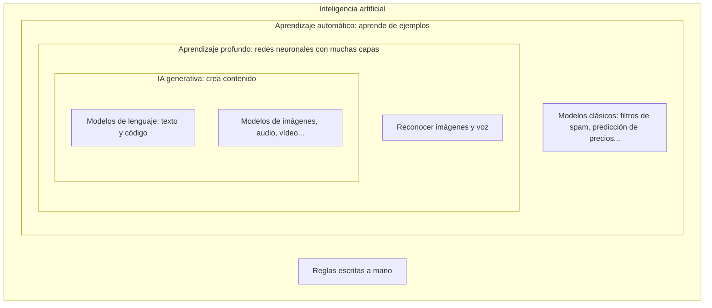
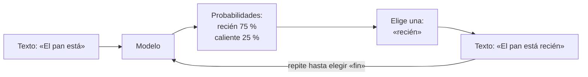
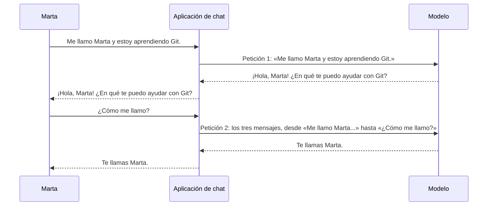

# 06.06 Qué es la IA y cómo funciona por dentro

> **Conviene saber antes:** [01.01 Qué es programar](../fase-01-que-es-programar/01-que-es-programar.md) · [01.02 Algoritmos y pseudocódigo, 1.11](../fase-01-que-es-programar/02-algoritmos-y-pseudocodigo.md#111-subalgoritmos) · [02.01 Cómo funciona un ordenador, 1.11](../fase-02-tu-ordenador/01-como-funciona-un-ordenador.md#111-la-nube-el-ordenador-de-otro) · [03.04 Errores y depuración, 1.13](../fase-03-herramientas/04-errores-y-depuracion.md#113-buscar-ayuda-internet-y-la-ia)
> **Tiempo estimado:** 2 horas
> **Nivel:** Básico · Núcleo

## Qué aprenderás

- Qué es la **inteligencia artificial** y en qué se diferencia un programa que **aprende de ejemplos** de uno que sigue reglas escritas a mano.
- Qué significan **aprendizaje automático**, **aprendizaje profundo**, **IA generativa** y **modelo de lenguaje**, y cómo encajan unos dentro de otros.
- Qué son el **entrenamiento** de un modelo y su **uso** después, y por qué son momentos tan distintos.
- Cómo funciona por dentro un **modelo de lenguaje**: un programa que **predice el siguiente trozo de texto**, comprobado a mano con un modelo de juguete.
- Qué son los **tokens** y por qué todo se mide en tokens.
- Por qué un modelo **no sabe** lo que dice, qué son las **alucinaciones** y cómo protegerte de ellas.
- Qué es el **contexto** y por qué el modelo **no recuerda nada** de una petición a la siguiente.
- Por qué la misma pregunta **no da siempre la misma respuesta** (la **temperatura**).
- Qué **no debes pegar nunca** en un chat de IA y por qué.
- Las diferencias entre usar un modelo **en la nube** o **en tu propio ordenador**.

## 1. Teoría

### 1.1. Programas que aprenden en vez de seguir reglas

Todo lo que has visto en el curso funciona igual: **alguien escribe las reglas** y el ordenador las sigue al pie de la letra. Un [algoritmo](../fase-01-que-es-programar/01-que-es-programar.md#13-qué-es-un-algoritmo) para calcular el precio con IVA dice exactamente qué hacer con cada número, y si el resultado está mal, hay un error en las reglas que lo buscas y lo corriges.

Hay problemas, sin embargo, en los que **nadie sabe escribir las reglas**:

- ¿Este correo es publicidad no deseada (*spam*)? Hay millones de formas de escribirla, y cambian cada semana.
- ¿En esta foto hay un gato o un perro? Intenta escribir un `SI` que lo decida mirando los puntos de colores de la imagen.
- ¿Esta reseña de un restaurante es buena o mala? «No está mal» es buena; «no está nada bien», mala.
- Traducir un texto, resumirlo o contestar una pregunta escrita con las palabras de cada persona.

La **inteligencia artificial** (IA) es la parte de la informática que construye programas capaces de hacer tareas que hasta ahora necesitaban la inteligencia de una persona: entender un texto, reconocer una imagen, decidir, conversar. No es nueva: el nombre ya aparece en el título de una propuesta de investigación de 1955 para un encuentro de verano en el Dartmouth College (Estados Unidos) en 1956 («A Proposal for the Dartmouth Summer Research Project on Artificial Intelligence», según su edición en la revista *AI Magazine* de la AAAI, consultada el 16 de noviembre de 2026). Durante décadas se intentó hacer **con reglas escritas a mano**: miles de `SI` escritos por expertos. Funcionaba en problemas muy acotados y se rompía en cuanto la realidad se salía de las reglas.

Lo que cambió las cosas fue otra idea: en lugar de escribir las reglas, **que el programa las aprenda de ejemplos**. Es lo que verás en el apartado siguiente, y es lo que hay debajo de casi todo lo que hoy se llama «IA».

> **📌 Nota:** «IA» es una palabra paraguas, y hoy se usa para casi cualquier cosa, también como reclamo publicitario. Cuando alguien te diga que una aplicación «tiene IA», la pregunta útil es **qué hace exactamente** y **cómo sabes si acierta**.

### 1.2. El aprendizaje automático: aprender de ejemplos

El **aprendizaje automático** (en inglés, *machine learning*) le da la vuelta a la programación de siempre: en lugar de escribir las reglas, **le das al ordenador muchos ejemplos con la respuesta correcta**, y un programa va ajustando un **modelo** hasta que acierta con ellos. Después, ese modelo se usa con datos nuevos que no ha visto nunca.

Un **modelo** es el resultado de ese aprendizaje: un fichero muy grande lleno de números que, junto con el programa que sabe usarlos, convierte una entrada (un correo, una foto, un texto) en una salida (spam o no, gato o perro, la continuación del texto).

| | Programación de siempre | Aprendizaje automático |
|---|---|---|
| **Qué le das** | Las reglas y los datos | Los datos y las respuestas correctas (ejemplos) |
| **Qué obtienes** | Las respuestas | Un **modelo**: las reglas, aprendidas |
| **Ejemplo** | `SI dias > 15 ENTONCES multa ← …` | 100 000 correos marcados como spam o no spam → un filtro de spam |
| **Si se equivoca** | Hay un error en el algoritmo: lo buscas y lo corriges | El modelo no ha aprendido bien: más ejemplos, mejores ejemplos u otro modelo |
| **¿Es exacto?** | Sí: hace exactamente lo que dicen las reglas | **No**: acierta casi siempre, y no sabes de antemano en qué caso fallará |

La última fila es la más importante de todo el módulo: **un modelo aprendido no es exacto**. Acierta mucho, pero se equivoca a veces, y **no avisa** cuando se equivoca. Todo lo que hagas con IA tiene que contar con eso.

> **💡 Consejo:** si un problema se puede resolver con reglas claras (calcular un precio, comprobar la letra de un DNI, ordenar una lista), un algoritmo de los de siempre es mejor: es exacto, se puede probar con [casos de prueba](../fase-01-que-es-programar/03-probar-un-programa.md#13-el-caso-de-prueba) y siempre da lo mismo. La IA tiene sentido donde las reglas no se pueden escribir.

### 1.3. Entrenar y usar un modelo

Un modelo tiene dos momentos en su vida, y conviene no confundirlos:

- **Entrenamiento:** el modelo aprende de los ejemplos. Por dentro, el modelo es una cantidad enorme de números ajustables, llamados **parámetros** (o «pesos»); entrenar es ir retocándolos poco a poco para que sus respuestas se parezcan cada vez más a las correctas. En los modelos grandes, el entrenamiento necesita muchísimos ejemplos, muchos ordenadores especiales trabajando durante mucho tiempo y mucho dinero. Lo hace **quien crea el modelo**, una vez.
- **Uso** (los especialistas lo llaman **inferencia**): se le da al modelo ya entrenado una entrada y devuelve una salida. Es lo que pasa cada vez que alguien escribe una pregunta en un chat. Cada uso cuesta poco comparado con el entrenamiento, pero se paga cada vez (en dinero, en electricidad o en el tiempo de tu ordenador).

Lo que más te importa de esto: **lo que el modelo aprendió, lo aprendió durante el entrenamiento**. Al usarlo, el modelo **no aprende nada nuevo** de lo que le escribes: sus parámetros no cambian. Lo que sí puede pasar es que la empresa que lo ofrece guarde tus conversaciones y las use para entrenar **versiones futuras** (lo verás en el [apartado 1.12](#112-privacidad-lo-que-escribes-sale-de-tu-ordenador)).

> **📌 Nota:** los modelos de hoy son **redes neuronales**: una forma de organizar los parámetros en capas, inspirada muy de lejos en las neuronas del cerebro. Por dentro, una red neuronal es una cadena gigantesca de multiplicaciones y sumas. No necesitas saber cómo se hacen esas cuentas para entender lo que sigue, igual que no necesitas saber cómo está hecho un [procesador](../fase-02-tu-ordenador/01-como-funciona-un-ordenador.md#14-el-procesador-velocidad-y-núcleos) para programar.

### 1.4. Cajas dentro de cajas: de la IA a la IA generativa

Vas a oír muchos nombres. La forma más sencilla de ordenarlos es como cajas, una dentro de otra:

- **Inteligencia artificial:** la caja grande, cualquier programa que hace tareas «inteligentes», con reglas escritas a mano o aprendidas.
- **Aprendizaje automático:** la parte de la IA que **aprende de ejemplos** ([apartado 1.2](#12-el-aprendizaje-automático-aprender-de-ejemplos)).
- **Aprendizaje profundo** (*deep learning*): la parte del aprendizaje automático que usa **redes neuronales con muchas capas**. Es la que domina hoy el reconocimiento de imágenes, de voz y el texto.
- **IA generativa:** la parte del aprendizaje profundo que **crea contenido nuevo**: texto, imágenes, audio, vídeo o código. Los modelos de antes **clasifican** o **predicen** un dato (spam o no, gato o perro); estos **generan**.
- **Modelos de lenguaje:** los modelos de IA generativa que trabajan con **texto**. Son los que hay detrás de los asistentes de chat y de los asistentes de programación.



En texto: cuatro cajas, una dentro de otra. La más grande es la inteligencia artificial, que contiene las reglas escritas a mano y el aprendizaje automático; dentro de este, los modelos clásicos y el aprendizaje profundo; dentro del aprendizaje profundo, el reconocimiento de imágenes y voz y la IA generativa, que contiene los modelos de lenguaje y los de imágenes, audio y vídeo.

En el resto del módulo nos centramos en la caja más pequeña, los **modelos de lenguaje**, porque es la IA con la que vas a trabajar casi seguro: en el chat de tu editor ([03.03](../fase-03-herramientas/03-editor-de-codigo.md#115-lo-que-verás-más-adelante)), al buscar ayuda ([03.04](../fase-03-herramientas/04-errores-y-depuracion.md#113-buscar-ayuda-internet-y-la-ia)) y en tu trabajo.

### 1.5. Un modelo de lenguaje predice la siguiente palabra

Un **modelo de lenguaje grande** (en inglés, *large language model*, **LLM**) es una red neuronal entrenada con una cantidad enorme de texto (libros, páginas web, código, foros) para hacer **una sola cosa**:

> **Dado un texto, calcular qué trozo de texto es más probable que venga a continuación.**

Eso es todo. La documentación de los propios fabricantes lo dice así: por ejemplo, el glosario de Anthropic explica que sus modelos se entrenan primero «para predecir la siguiente palabra, dado el contexto anterior» (consultado el 16 de noviembre de 2026).

Para escribir una respuesta entera, el modelo **repite esa predicción en bucle**: calcula las probabilidades de cada posible continuación, elige una, la añade al texto y vuelve a empezar con el texto ya ampliado, hasta que elige una marca especial que significa «fin».



En texto: el texto de partida entra en el modelo, que calcula la probabilidad de cada posible siguiente palabra; se elige una, se añade al texto y el texto ampliado vuelve a entrar en el modelo, una y otra vez, hasta que se elige «fin». Las probabilidades del dibujo son de un modelo de juguete, el del [ejemplo 2.1](#21-un-modelo-de-lenguaje-de-juguete).

Lo sorprendente es que, para predecir bien la siguiente palabra de **cualquier** texto, el modelo ha tenido que quedarse con muchísimas cosas: la gramática de muchos idiomas, cómo se escribe una carta o un poema, muchos datos del mundo, cómo suele razonarse un problema de matemáticas, cómo se escribe código. Por eso **parece** que entiende. En el [ejemplo 2.1](#21-un-modelo-de-lenguaje-de-juguete) construirás uno de juguete, con lápiz y papel, y verás la idea funcionando.

> **📌 Nota:** casi todos los modelos de lenguaje actuales se basan en un tipo de red neuronal llamado **Transformer**, presentado en 2017 en el artículo «Attention Is All You Need» (publicado en arXiv el 12 de junio de 2017, consultado el 16 de noviembre de 2026). Su idea principal es que, al predecir cada palabra, el modelo puede «fijarse» en todas las anteriores a la vez, no solo en la última. No necesitas saber más; si te interesa, ese es el nombre que buscar.

### 1.6. Los tokens: los trozos con los que trabaja

En el apartado anterior hemos dicho «palabra» para simplificar, pero un modelo no trabaja con palabras ni con letras, sino con **tokens**: trozos de texto que pueden ser una palabra entera, parte de una palabra o un signo. Cada modelo tiene su propio **vocabulario** de tokens, aprendido de los textos con los que se entrenó: las palabras frecuentes suelen ser un solo token y las raras se parten en varios.

Así **podría** partir un modelo una frase (es un ejemplo **ilustrativo**, inventado para explicarlo: cada modelo la parte a su manera, y no es la de ningún modelo concreto):

```text
Texto:   ¿Cuánto cuesta la biblioteca municipal?
Tokens:  ¿ | Cu | ánto | cuesta | la | bibli | oteca | municipal | ?
```

Nueve tokens para seis palabras. Fíjate en que «cuesta» y «la», muy frecuentes, salen enteras; «biblioteca» se parte en dos, y los signos van aparte.

Por qué te importan los tokens:

- **Los límites se miden en tokens:** cuánto texto puede leer el modelo de una vez y cuánto puede escribir en una respuesta ([apartado 1.10](#110-el-contexto-la-memoria-de-trabajo-del-modelo)).
- **Los servicios de pago cobran por tokens:** por los que el modelo lee (tu mensaje y todo lo que va con él) y por los que escribe.
- **El tiempo depende de los tokens:** el modelo escribe la respuesta token a token. Por eso en un chat la ves aparecer poco a poco.
- **No todos los textos gastan igual:** un token suele ser un trozo de palabra, y cada modelo trocea a su manera: el mismo texto puede dar más o menos tokens según el modelo y el idioma.

> **⚠️ No los confundas:** estos tokens no tienen nada que ver con el [token de acceso personal](../fase-05-git-y-github/03-github.md#14-cómo-sabe-github-que-eres-tú-https) de GitHub. Es la misma palabra inglesa («ficha», «vale») usada para dos cosas distintas.

### 1.7. De predecir texto a conversar: cómo se entrena un asistente

Un modelo que solo ha aprendido a predecir texto todavía no sabe conversar: si le escribes una pregunta, igual la continúa con otra pregunta, como en una lista de preguntas de examen. Para llegar al asistente con el que chateas, el entrenamiento suele tener varias fases (lo cuenta, por ejemplo, el glosario de Anthropic, consultado el 16 de noviembre de 2026):

1. **Preentrenamiento:** el modelo aprende a predecir la siguiente palabra con una cantidad enorme de texto. Es la fase más larga y cara. El resultado «sabe» mucho, pero no sigue instrucciones.
2. **Ajuste fino** (*fine-tuning*): se le sigue entrenando con ejemplos de conversaciones «petición → buena respuesta», para que aprenda a contestar y a seguir instrucciones.
3. **Ajuste con valoraciones de personas:** personas comparan varias respuestas del modelo y dicen cuál es mejor, y el modelo aprende a preferir las mejor valoradas (más útiles, más claras, sin contenido dañino). En inglés se llama *reinforcement learning from human feedback* (RLHF).

Y de todo ese proceso sale una idea muy práctica, la **fecha de corte**: el modelo aprendió de textos escritos **hasta una fecha**. De lo que pasó después **no sabe nada**, salvo que alguien se lo dé en el mensaje. Si le preguntas por la última versión de un programa, te contestará con la última que conocía, que puede llevar meses o años anticuada, y con el mismo tono seguro de siempre. Cada fabricante publica la fecha de corte de sus modelos en su documentación.

> **📌 Nota:** algunas aplicaciones de chat **buscan en internet** por ti y le pasan al modelo lo que encuentran, dentro del mensaje. Es la aplicación la que busca, no el modelo. Lo que encuentre puede estar bien o mal, y el modelo lo resume igual de seguro: sigue tocando comprobarlo.

### 1.8. Predice, no sabe

Ahora ya puedes entender la idea más importante del módulo. Cuando un modelo de lenguaje contesta:

- **No consulta una base de datos** de hechos verdaderos ni una enciclopedia.
- **No comprueba** lo que escribe.
- **No tiene forma de saber que no sabe**: si una pregunta no tiene respuesta en lo que aprendió, sigue escribiendo el texto más probable, que **suena** a respuesta.

Escribe **lo que suena más probable** después de tu mensaje. Muchas veces, lo más probable coincide con lo verdadero, porque los textos con los que aprendió decían la verdad sobre eso muchas veces. Por eso acierta tanto. Pero «probable» y «verdadero» **no son lo mismo**, y la diferencia se nota justo donde menos lo esperas: datos poco conocidos, cifras concretas, nombres, fechas, citas, normas, versiones de programas, opciones de una orden.

Piensa en el modelo como en un **compañero que ha leído muchísimo, escribe muy bien y nunca dice «no lo sé»**. Es muy útil para que te explique, te dé ideas o te revise algo. Pero **lo que te diga, lo compruebas**, igual que comprobabas una hipótesis al [depurar](../fase-03-herramientas/04-errores-y-depuracion.md#12-un-método-para-depurar).

### 1.9. Las alucinaciones

Una **alucinación** es una respuesta que **suena segura y es falsa**: un libro que ese autor no escribió, una ley que no existe, una opción de `grep` inventada, una cita con su página y todo. La documentación de los fabricantes lo reconoce: incluso los modelos más avanzados generan a veces texto falso o que no cuadra con lo que se les ha dado (guía «Reduce hallucinations» de Anthropic, consultada el 16 de noviembre de 2026).

No es un fallo raro que se vaya a arreglar con la próxima versión, sino una consecuencia directa de cómo funciona un modelo de lenguaje ([apartado 1.8](#18-predice-no-sabe)): si le preguntas por un libro que no existe, lo más probable después de «La novela fue escrita por» es el nombre de un escritor, y el modelo lo escribe con el mismo tono que cuando acierta. Lo verás en el [ejemplo 2.5](#25-una-alucinación-de-libro).

Hoy no se pueden eliminar del todo, pero sí reducir y, sobre todo, **detectar**:

| Qué hacer | Por qué ayuda |
|---|---|
| **Darle los datos** en el mensaje (el texto, la tabla, el error exacto) y pedirle que conteste solo con ellos | Así no tiene que «recordar»: lo tiene delante |
| **Permitirle decir «no lo sé»**: «si no está en el texto, dilo» | Le das una salida que no sea inventar; la propia guía de Anthropic lo recomienda |
| **Pedirle de dónde lo saca** y mirar esa fuente tú | Una fuente que no existe o que no dice eso delata la invención |
| **Comprobar** con la documentación oficial, con tus [casos de prueba](../fase-01-que-es-programar/03-probar-un-programa.md#16-probar-a-mano-la-traza-y-la-tabla-de-casos-de-prueba) o ejecutándolo | Es lo único que de verdad te protege |
| **Que una persona decida** lo importante (dinero, salud, contratos, notas) | Un error del modelo no avisa; una persona que revisa, sí puede |

> **⚠️ Cuidado:** que una respuesta esté **bien escrita** no dice nada de si es **verdad**. Un modelo escribe igual de bien cuando acierta que cuando se lo inventa. Desconfía sobre todo de los datos concretos: cifras, fechas, nombres, versiones, opciones de órdenes y enlaces.

### 1.10. El contexto: la memoria de trabajo del modelo

La **ventana de contexto** (o simplemente **contexto**) es todo el texto que el modelo tiene en cuenta **de una vez** al escribir una respuesta, incluida la propia respuesta. Es su única «memoria de trabajo»: lo que no está en el contexto, para el modelo no existe. No hay que confundirlo con todo lo que leyó durante el entrenamiento, que es otra cosa (glosario y guía «Context windows» de Anthropic, consultados el 16 de noviembre de 2026).

Y aquí viene algo que sorprende a casi todo el mundo: **el modelo no recuerda nada de una petición a la siguiente**. Cada petición empieza de cero. Cuando chateas y parece que recuerda lo que le dijiste antes, es porque **la aplicación de chat le vuelve a enviar la conversación entera** (o lo que quepa de ella) cada vez que escribes algo nuevo. La guía de Anthropic lo describe así: en cada turno, la entrada contiene toda la conversación anterior más el mensaje nuevo. Lo verás dibujado en el [ejemplo 2.4](#24-una-conversación-por-dentro).

Consecuencias que vas a notar:

- **Una conversación nueva es una hoja en blanco.** Lo que le contaste ayer en otro chat no está en el contexto de hoy. Algunas aplicaciones guardan notas sobre ti o tus chats anteriores y las vuelven a meter en el contexto por su cuenta: incluso entonces, es la aplicación la que «recuerda», no el modelo.
- **El contexto tiene un límite**, que se mide en [tokens](#16-los-tokens-los-trozos-con-los-que-trabaja) y cambia mucho de un modelo a otro. Cuando una conversación se hace muy larga, la aplicación tiene que recortar (normalmente, lo más antiguo) o resumir, y el modelo «olvida» lo del principio.
- **Más no siempre es mejor.** La propia guía de Anthropic avisa de que, a medida que crece el texto, empeora la capacidad del modelo de encontrar y usar bien lo que hay dentro. Es mejor darle **poco y relevante** que mucho «por si acaso».
- **Si cambias de tema, empieza un chat nuevo.** Lo de antes sigue en el contexto, gasta espacio y puede confundirle.

> **💡 Consejo:** si una respuesta depende de algo que dijiste hace mucho en la misma conversación, o de otra conversación, **vuelve a dárselo**: pega otra vez el dato, el error o el fragmento que importa. Es lo mismo que harías con una persona que acaba de llegar a la reunión.

### 1.11. Por qué no responde siempre igual

Haz la misma pregunta dos veces y es muy probable que obtengas **dos respuestas distintas**. No es un fallo: es a propósito.

Cuando el modelo ha calculado las probabilidades del siguiente token, **no siempre elige el más probable**: hace un **sorteo** con esas probabilidades. Si «recién» tiene un 75 % y «caliente» un 25 %, la mayoría de las veces saldrá «recién», pero una de cada cuatro, más o menos, saldrá «caliente». Y en cuanto un token cambia, todo lo que viene detrás puede cambiar también. Lo verás con el modelo de juguete en el [ejemplo 2.6](#26-sortear-la-siguiente-palabra).

La **temperatura** es un ajuste que decide **cuánto se aleja** el sorteo de lo más probable (glosario de Anthropic, consultado el 16 de noviembre de 2026):

| Temperatura | Qué hace | Para qué |
|---|---|---|
| **Baja** | Se queda casi siempre con lo más probable: respuestas más previsibles y parecidas entre sí | Sacar datos de un texto, clasificar, contestar con hechos, código |
| **Alta** | Las opciones menos probables salen más a menudo: más variedad y más sorpresas (y, si te pasas, disparates) | Ideas, nombres, textos creativos |

Lo que conviene saber:

- **En un chat normalmente no la eliges tú**: la fija la aplicación. Donde sí se elige es cuando un programa usa el modelo directamente, algo que verás en los cursos que lo enseñen.
- **Ni con la temperatura más baja está garantizada la misma respuesta.** El glosario de Anthropic lo avisa: incluso con temperatura 0, entradas idénticas pueden dar salidas distintas.
- **Que cambie la respuesta no la hace ni mejor ni peor.** Si pides la misma cosa tres veces y te dan tres datos distintos, al menos dos están mal: buena señal de que hay que comprobarlo.

### 1.12. Privacidad: lo que escribes sale de tu ordenador

Cuando usas un asistente de IA **en la nube**, lo que escribes (y lo que pegas: un fichero, un error, una captura) **viaja por internet hasta los ordenadores de otra empresa**, que lo procesa allí ([la nube, en 02.01](../fase-02-tu-ordenador/01-como-funciona-un-ordenador.md#111-la-nube-el-ordenador-de-otro)). Según el servicio y tus ajustes, esa empresa **puede guardar** tus conversaciones durante un tiempo y, en algunos casos, **usarlas para entrenar** modelos futuros. Lo que diga cada servicio está en sus condiciones y en su política de privacidad, y cambia con el tiempo: léelas antes de confiarle nada.

Por eso hay cosas que **no se pegan nunca** en un chat de IA:

| Nunca | Ejemplos |
|---|---|
| **Contraseñas y claves** | La contraseña de tu correo, un [token de acceso](../fase-05-git-y-github/03-github.md#14-cómo-sabe-github-que-eres-tú-https), la clave de una API, el contenido de un [fichero `.env`](../fase-04-formatos-y-diagramas/04-xml-csv-y-otros.md#114-el-fichero-env-y-los-secretos), una clave privada SSH |
| **Datos personales** | Tuyos o, peor aún, de otros: nombres con DNI, direcciones, teléfonos, correos, datos de salud, nóminas |
| **Datos de tu trabajo o de tus clientes** | Ficheros de clientes, contratos, código de la empresa, salvo que la empresa lo permita expresamente y con el servicio que ella diga |

Es también una de las **normas sobre el uso de la IA** de la academia, que verás con las demás en [07.04](../fase-07-aprender-a-aprender/04-programar-con-asistentes-de-ia.md). Antes de pegar algo:

- **Quita lo que es solo tuyo o de otros**: usuarios, rutas personales, nombres, números. Como al [buscar un error en internet](../fase-03-herramientas/04-errores-y-depuracion.md#113-buscar-ayuda-internet-y-la-ia).
- **Sustituye los datos reales por inventados** que tengan la misma forma: «Ana García, 12345678Z» en lugar del cliente real.
- **Pega lo mínimo**: la línea del error, no el fichero entero.

> **⚠️ Cuidado:** si has pegado por error una contraseña o una clave, **bórrala del chat no basta**: puede haberse guardado ya. Cámbiala en el servicio al que pertenece, como harías con cualquier [secreto](../fase-04-formatos-y-diagramas/04-xml-csv-y-otros.md#114-el-fichero-env-y-los-secretos) que se ha escapado.

### 1.13. En la nube o en tu ordenador

Hay dos formas de usar un modelo de lenguaje, según dónde se ejecute:

| | En la nube (servicio de una empresa) | En tu ordenador (modelo local) |
|---|---|---|
| **Cómo se usa** | Desde una web, una aplicación o el chat de tu editor; la empresa ejecuta el modelo en sus ordenadores | Descargas el modelo y lo ejecutas con un programa en tu ordenador |
| **Calidad** | Suelen estar aquí los modelos más capaces | Buenos los grandes; los pequeños, que son los que caben en un ordenador normal, se equivocan bastante más |
| **Qué necesitas** | Internet y una cuenta; muchos tienen una parte gratuita con límites y otra de pago | Un ordenador con bastante [memoria RAM](../fase-02-tu-ordenador/01-como-funciona-un-ordenador.md#15-la-memoria-ram-rápida-y-olvidadiza) y espacio en disco; una tarjeta gráfica ayuda mucho |
| **Privacidad** | Lo que escribes sale de tu ordenador ([apartado 1.12](#112-privacidad-lo-que-escribes-sale-de-tu-ordenador)) | Lo que escribes **no sale** de tu ordenador |
| **Coste** | La cuota o lo que gastes, si pagas | Gratis el uso, pero pagas el ordenador y la electricidad |

Un modelo se puede ejecutar en tu ordenador cuando su creador publica sus parámetros para que cualquiera los descargue: se llaman modelos **de pesos abiertos**, cada uno con su licencia, que dice qué se puede hacer con él. Para ejecutarlos hay programas gratuitos; por ejemplo, **Ollama**, de código abierto (licencia MIT) y disponible para Windows, macOS y Linux, según su web, [ollama.com](https://ollama.com), y su repositorio oficial, [github.com/ollama/ollama](https://github.com/ollama/ollama) (consultados el 16 de noviembre de 2026); su web ofrece además usar modelos en su propia nube. Ten en cuenta que un modelo local necesita un ordenador potente: con uno normal, solo funcionan bien los modelos pequeños. Los cursos que trabajen con IA te dirán cuál usar y cómo instalarlo; en este curso no hace falta instalar nada.

> **📌 Nota:** «en local» no quiere decir «sin errores». Un modelo pequeño en tu ordenador alucina igual o más que uno grande en la nube. Lo que ganas es **privacidad**, no exactitud.

### 1.14. Para qué sirve y para qué no

Con todo lo anterior, ya puedes razonar en qué es buena una IA de texto y en qué no:

| Le va bien | Le va mal o hay que comprobar siempre |
|---|---|
| **Explicar** un concepto de otra forma, con otro ejemplo, cuantas veces haga falta | **Datos concretos**: cifras, fechas, versiones, nombres, citas, enlaces |
| **Explicar un mensaje de error** que le pegas | **Lo reciente**: lo posterior a su fecha de corte no lo sabe |
| **Resumir, traducir o reescribir** un texto que le das | **Cuentas exactas**: predice texto, no calcula; una suma larga puede salir mal |
| **Dar ideas**: nombres, enfoques, casos de prueba que no se te habían ocurrido | **Decidir** sobre personas, dinero, salud o leyes sin que nadie revise |
| **Revisar** algo que has hecho tú y señalar posibles fallos | **Hacerte los ejercicios**: el resultado lo tendrías, pero no lo habrías aprendido |

La última fila de la derecha es la que más te afecta mientras estudias. La IA es una herramienta estupenda **como profesor**: que te explique, te dé pistas o revise tu solución. Si la usas para que haga el trabajo por ti, terminarás el curso sin saber hacerlo.

### 1.15. Lo que verás más adelante

Este módulo explica **qué es** y **cómo funciona** la IA. Lo que viene después:

- **Las normas sobre el uso de la IA en la academia** (intentar cada ejercicio tú primero, comprobar siempre, no pegar datos que no debes, cómo usarla en el proyecto final…) y **cómo pedirle bien las cosas** están en el módulo [07.04 Programar con asistentes de IA](../fase-07-aprender-a-aprender/04-programar-con-asistentes-de-ia.md). Allí aprenderás a trabajar con un asistente de programación con criterio.
- **Usar un modelo desde un programa**, darle documentos para que conteste con ellos o dejarle hacer tareas por su cuenta son temas de los cursos que traten la IA a fondo, no de este.

## 2. Ejemplos de código

> **📌 Nota:** este módulo no tiene código que ejecutar. Los ejemplos son un modelo de lenguaje **de juguete** que puedes hacer con lápiz y papel, un algoritmo en [pseudocódigo](../fase-01-que-es-programar/02-algoritmos-y-pseudocodigo.md#15-pseudocódigo) y situaciones reales explicadas con lo que acabas de aprender. Las respuestas de un modelo que aparecen aquí son **ilustrativas**: están escritas para explicar la idea, no copiadas de ningún producto concreto.

### 2.1. Un modelo de lenguaje de juguete

**Situación real:** la panadería de Rosa tiene un cartel digital que cambia el mensaje cada hora. Rosa quiere que «escriba solo». Vamos a construirle un modelo de lenguaje de juguete que aprende de los mensajes que ya ha usado.

**Los ejemplos (lo que «lee» el modelo para entrenarse):**

```text
1. el pan está recién hecho
2. el pan está caliente
3. el pan está recién hecho
4. la tarta está recién hecha
5. el pan sale caliente
```

**El entrenamiento:** para cada palabra, contamos **qué palabra va justo detrás** y cuántas veces. Es lo único que va a aprender nuestro modelo:

| Palabra | Qué va detrás (veces) | Probabilidades |
|---|---|---|
| el | pan (4) | pan 100 % |
| la | tarta (1) | tarta 100 % |
| pan | está (3), sale (1) | está 75 %, sale 25 % |
| tarta | está (1) | está 100 % |
| está | recién (3), caliente (1) | recién 75 %, caliente 25 % |
| recién | hecho (2), hecha (1) | hecho 67 %, hecha 33 % |
| sale | caliente (1) | caliente 100 % |
| hecho, hecha, caliente | fin (las frases terminan ahí) | fin 100 % |

Cada probabilidad es las veces de esa palabra entre el total: detrás de «está» hay 4 casos, 3 de ellos «recién», así que 3 ÷ 4 = 75 %.

**El uso:** le damos el principio «el pan» y le pedimos que siga, eligiendo siempre la palabra **más probable**:

| Paso | Texto hasta ahora | Última palabra | Elige |
|---|---|---|---|
| 1 | el pan | pan | está (75 %) |
| 2 | el pan está | está | recién (75 %) |
| 3 | el pan está recién | recién | hecho (67 %) |
| 4 | el pan está recién hecho | hecho | fin |

Resultado: **«el pan está recién hecho»**.

**Qué demuestra:** nuestro juguete no sabe qué es el pan ni qué significa «recién». Solo ha contado. Y aun así escribe una frase correcta, porque **imita lo más frecuente** de lo que leyó. Un modelo de verdad hace lo mismo con una cantidad de texto y de parámetros inmensamente mayor, y mirando mucho más que la última palabra.

### 2.2. El bucle que escribe una respuesta

**Situación real:** Rosa quiere entender qué hace el cartel paso a paso, así que lo escribimos como algoritmo. Las reglas del juguete van en dos [subalgoritmos](../fase-01-que-es-programar/02-algoritmos-y-pseudocodigo.md#111-subalgoritmos): `PredecirSiguiente` mira la tabla del ejemplo anterior y devuelve las probabilidades de la siguiente palabra; `Elegir` escoge una de ellas.

```text
ALGORITMO GenerarTexto
    ENTRADA: el principio del texto
    SALIDA: el texto completo

INICIO
    LEER texto
    REPETIR
        probabilidades ← PredecirSiguiente(texto)    // en un modelo real, la red neuronal
        palabra ← Elegir(probabilidades)             // la más probable o un sorteo (2.6)
        SI palabra ≠ "fin" ENTONCES
            texto ← texto + " " + palabra
        FIN SI
    HASTA QUE palabra = "fin"
    ESCRIBIR texto
FIN
```

**Traza** con la entrada `la tarta` (eligiendo siempre la más probable):

| Vuelta | texto al empezar | probabilidades | palabra | texto al terminar |
|---|---|---|---|---|
| 1 | la tarta | está 100 % | está | la tarta está |
| 2 | la tarta está | recién 75 %, caliente 25 % | recién | la tarta está recién |
| 3 | la tarta está recién | hecho 67 %, hecha 33 % | hecho | la tarta está recién hecho |
| 4 | la tarta está recién hecho | fin 100 % | fin | la tarta está recién hecho |

Salida: **`la tarta está recién hecho`**. Una frase con una falta de concordancia, aunque en los ejemplos estaba bien escrita. Por qué pasa, en el ejemplo siguiente.

**Qué demuestra:** un modelo de lenguaje real es, por fuera, **este mismo bucle**. Todo lo difícil está dentro de `PredecirSiguiente`, que en un modelo de verdad es la red neuronal con su cantidad enorme de parámetros. El bucle, el «fin» y el `Elegir` son iguales.

### 2.3. Por qué el juguete se equivoca: el contexto

**Situación real:** Rosa ve en el cartel «la tarta está recién hecho» y pregunta qué ha pasado, si el modelo había leído «la tarta está recién hecha».

**Por qué ocurre:** nuestro `PredecirSiguiente` solo mira **la última palabra**. Al llegar a «recién», no sabe que tres palabras antes ponía «tarta»; solo sabe que detrás de «recién» suele venir «hecho» (2 de 3 veces). Para él, todo lo anterior a la última palabra **no existe**: su contexto es de una sola palabra.

**Cómo lo hace un modelo de verdad:** mira **todo el texto que tiene en su contexto** a la vez ([apartado 1.10](#110-el-contexto-la-memoria-de-trabajo-del-modelo)), así que «tarta», aunque esté lejos, influye en la elección: con ella delante, lo más probable es «hecha». Por eso los modelos reales casi nunca cometen errores de concordancia, y por eso **importa tanto lo que hay en el contexto**: es lo único que el modelo puede tener en cuenta.

**La lección:** lo que no está en el contexto no influye en la respuesta. Si quieres que el modelo tenga en cuenta algo, tiene que estar en lo que le envías.

### 2.4. Una conversación por dentro

**Situación real:** Marta, que está haciendo este curso, chatea con un asistente de IA:

```text
Marta:      Me llamo Marta y estoy aprendiendo Git.
Asistente:  ¡Hola, Marta! ¿En qué te puedo ayudar con Git?
Marta:      ¿Cómo me llamo?
Asistente:  Te llamas Marta.
```

Parece que el modelo recuerda su nombre. Lo que pasa de verdad, petición a petición:



En texto: Marta escribe a la aplicación de chat, que manda su mensaje al modelo y le devuelve la respuesta. Cuando Marta pregunta cómo se llama, la aplicación no manda solo la pregunta: manda al modelo la conversación entera, los dos mensajes de Marta y la respuesta del asistente, y el modelo contesta leyéndola.

**Qué demuestra:** en la petición 2, el nombre de Marta está **en el contexto**, porque la aplicación lo ha reenviado. El modelo no lo ha «recordado»: lo ha **leído otra vez**. Si Marta abre un chat nuevo y pregunta «¿Cómo me llamo?», el contexto está vacío y el modelo no puede saberlo (a no ser que la aplicación guarde notas sobre ella y las añada por su cuenta). Fíjate también en que cada petición es más larga que la anterior: en una conversación muy larga, llegará un momento en que no quepa entera.

### 2.5. Una alucinación de libro

**Situación real:** Andrés, del club de lectura «Entre Líneas» (el de [06.02](02-puertos-y-localhost.md#22-el-puerto-equivocado)), quiere preparar la próxima reunión y le pregunta a un asistente por un libro **que no existe** (se lo ha inventado él para probarlo). Esta conversación es **ilustrativa**: está escrita para el curso, pero es el tipo de respuesta que puede dar cualquier modelo de lenguaje.

```text
Andrés:     ¿Quién escribió la novela «El faro de las siete lunas» y de qué trata?

Asistente:  «El faro de las siete lunas» es una novela de la escritora gallega
            Carmen Ledo, publicada en 2009. Cuenta la historia de Inés, la hija del
            farero de un pueblo de la Costa da Morte, que descubre unas cartas
            escondidas en el faro...
```

Todo suena perfecto: autora, año, lugar, personaje, argumento. **Y todo es inventado.** Lo más probable después de «¿Quién escribió la novela…?» es el nombre de un escritor y un resumen con la forma de un resumen; el modelo escribe eso, sin forma de saber que el libro no existe ([apartado 1.9](#19-las-alucinaciones)).

Cómo podría haberse protegido Andrés:

- **Darle la salida de no saber:** «Si no conoces el libro, dímelo; no te lo inventes». Ayuda, aunque no lo garantiza.
- **Comprobar lo concreto:** buscar el título y la autora en el catálogo de una biblioteca o de una librería. Si no aparece en ninguno, mala señal.
- **Darle los datos:** si quiere un resumen de un libro real, pegarle la contraportada y pedirle que resuma **solo eso**.

**Qué demuestra:** el tono seguro y los detalles concretos **no son una prueba** de nada. Al contrario: los detalles concretos (nombres, fechas, cifras) son justo lo primero que hay que comprobar.

### 2.6. Sortear la siguiente palabra

**Situación real:** con el juguete del [ejemplo 2.1](#21-un-modelo-de-lenguaje-de-juguete), el cartel de Rosa siempre dice lo mismo, porque `Elegir` coge siempre la más probable. A Rosa le aburre. Cambiamos `Elegir` para que **sortee**, como hacen los modelos de verdad ([apartado 1.11](#111-por-qué-no-responde-siempre-igual)).

Con el principio «el pan», cada palabra se elige ahora por sorteo, con las probabilidades de la tabla. Estos son los textos posibles y la probabilidad de cada uno (se multiplican las probabilidades de cada paso):

| Camino | Texto | Probabilidad |
|---|---|---|
| está → recién → hecho | el pan está recién hecho | 75 % × 75 % × 67 % ≈ 38 % |
| está → recién → hecha | el pan está recién hecha | 75 % × 75 % × 33 % ≈ 19 % |
| está → caliente | el pan está caliente | 75 % × 25 % ≈ 19 % |
| sale → caliente | el pan sale caliente | 25 % × 100 % = 25 % |

(Las cuatro suman 100 %, salvo por el redondeo.)

Si el cartel cambia cada hora, a lo largo del día saldrán **mensajes distintos**, todos con sentido salvo uno: «el pan está recién hecha», que sale **casi una de cada cinco veces**.

- **Con poco sorteo** (temperatura baja) saldría casi siempre la primera frase: previsible y correcta.
- **Con mucho sorteo** (temperatura alta) las cuatro se igualarían más: más variedad, y también más veces la frase mal escrita.

**Qué demuestra:** el sorteo da variedad, y la variedad tiene un precio: cuanto más se aleja de lo probable, más fácil es que salga algo raro. Por eso, para tareas donde hay **una respuesta correcta**, conviene poco sorteo; para dar ideas, más.

## 3. Errores típicos

### 3.1. Usarla como si fuera una enciclopedia

**Qué pasa:** le preguntas un dato (la versión más reciente de un programa, la población de un pueblo, la fecha de una ley) y lo copias tal cual en un trabajo. Más tarde descubres que estaba mal.

**Por qué ocurre:** el modelo no consulta datos verdaderos: escribe lo más probable ([apartado 1.8](#18-predice-no-sabe)). Además, lo posterior a su fecha de corte no lo sabe ([apartado 1.7](#17-de-predecir-texto-a-conversar-cómo-se-entrena-un-asistente)).

**Cómo se arregla:** para los datos, la **fuente oficial** (la web del programa, el organismo que publica la cifra). Usa la IA para **entender** y para que te diga **dónde buscar**, y mira tú esa fuente.

### 3.2. Creer que si suena seguro es verdad

**Qué pasa:** la respuesta está bien escrita, con detalles y sin dudas, y la das por buena. Era una alucinación.

**Por qué ocurre:** el modelo escribe con el mismo tono cuando acierta que cuando se lo inventa; no tiene forma de saber que no sabe ([apartado 1.9](#19-las-alucinaciones)).

**Cómo se arregla:** separa en la respuesta **lo comprobable** (nombres, cifras, fechas, opciones de órdenes, enlaces) y compruébalo. Si es código o una orden, pruébalo con tus casos de prueba antes de fiarte.

### 3.3. Pegar datos que no debes

**Qué pasa:** para que te ayude con un error, pegas el fichero de configuración entero, con su contraseña; o el listado de clientes de la tienda donde trabajas, con nombres y teléfonos.

**Por qué ocurre:** el chat parece una conversación privada, pero lo que escribes sale de tu ordenador hacia los de otra empresa, que puede guardarlo ([apartado 1.12](#112-privacidad-lo-que-escribes-sale-de-tu-ordenador)).

**Cómo se arregla:** antes de pegar, **quita o sustituye** secretos y datos personales, y pega lo mínimo. Si ya has pegado una contraseña o una clave, **cámbiala**: borrar el mensaje no basta.

### 3.4. Esperar que recuerde lo que le dijiste en otra conversación

**Qué pasa:** ayer le explicaste tu proyecto con detalle. Hoy abres un chat nuevo, le pides «sigue con lo de ayer» y contesta algo que no tiene nada que ver (o se inventa en qué consistía).

**Por qué ocurre:** el modelo no recuerda nada entre peticiones; solo ve lo que hay en el contexto, y un chat nuevo empieza vacío ([apartado 1.10](#110-el-contexto-la-memoria-de-trabajo-del-modelo)).

**Cómo se arregla:** al empezar un chat nuevo, **dale el contexto** que necesita: qué estás haciendo, el fragmento que importa, el error exacto. Si lo usas a menudo, guarda en un fichero un párrafo con la descripción de tu proyecto para pegarlo al principio.

### 3.5. Preguntarle lo que no puede saber

**Qué pasa:** le preguntas qué ha cambiado en la versión de este mes de un programa, o por qué falla «tu script» sin pegarlo, y contesta con aplomo.

**Por qué ocurre:** lo posterior a su fecha de corte y lo que no está en el contexto no existe para él, pero sigue escribiendo lo más probable ([apartado 1.7](#17-de-predecir-texto-a-conversar-cómo-se-entrena-un-asistente)).

**Cómo se arregla:** para lo reciente, la documentación oficial o las notas de versión. Para lo tuyo, **dáselo**: el script, el error, la salida.

### 3.6. Pensar que una respuesta distinta es un fallo

**Qué pasa:** le haces la misma pregunta a un compañero y a ti os contesta distinto, y pensáis que uno de los dos lo ha hecho mal.

**Por qué ocurre:** el modelo sortea cada token; la misma pregunta puede dar respuestas distintas, a propósito ([apartado 1.11](#111-por-qué-no-responde-siempre-igual)). Además, el contexto de cada uno no es el mismo (lo que habíais hablado antes en ese chat).

**Cómo se arregla:** no compares respuestas, **compruébalas**. Si las dos dicen lo mismo con distintas palabras, bien; si dan datos distintos, al menos una está mal y toca mirar la fuente.

### 3.7. Pedirle cuentas exactas y no revisarlas

**Qué pasa:** le pides que sume una columna de 40 importes o que calcule el IVA de un trimestre, y el resultado tiene un error en los céntimos (o en los miles).

**Por qué ocurre:** un modelo de lenguaje **predice texto**: no hace la cuenta como una calculadora, escribe los números que le parecen más probables. En cuentas cortas suele acertar; en las largas, menos.

**Cómo se arregla:** las cuentas, con una herramienta que calcule de verdad (una hoja de cálculo, una calculadora, un programa). La IA te puede explicar **cómo** se hace la cuenta; el resultado, compruébalo.

### 3.8. Pegarle un documento enorme y dar por hecho que lo ha leído todo

**Qué pasa:** pegas un manual de 80 páginas y le preguntas por un detalle de la página 40. Te contesta algo general, o algo que no está en el manual.

**Por qué ocurre:** puede que el documento no quepa entero en el contexto y la aplicación lo haya recortado sin decírtelo; y, aunque quepa, con mucho texto el modelo encuentra y usa peor lo que hay dentro ([apartado 1.10](#110-el-contexto-la-memoria-de-trabajo-del-modelo)).

**Cómo se arregla:** pega **solo la parte que importa** (el apartado de la página 40, no el manual entero) y pídele que conteste con ese texto. Si la respuesta cita algo, búscalo tú en el documento.

## 4. Buenas prácticas

- **Úsala como profesor, no como quien hace el trabajo por ti**: que te explique, te dé pistas o revise lo tuyo.
- **Comprueba siempre lo concreto**: cifras, fechas, nombres, versiones, opciones de órdenes y enlaces, en la fuente oficial o con tus casos de prueba.
- **Dale los datos** en lugar de pedirle que los recuerde: el texto, el error exacto, el fragmento que importa.
- **Dale permiso para no saber**: «si no lo sabes o no está en el texto, dilo».
- **Nunca pegues contraseñas, claves ni datos personales**; sustituye los datos reales por otros inventados y pega lo mínimo.
- **Un chat por tema**, y vuelve a dar el contexto que importe cuando empieces uno nuevo.
- **Desconfía de lo reciente**: lo posterior a la fecha de corte del modelo no lo sabe.
- **Para cuentas exactas, una herramienta que calcule**; para decisiones importantes, una persona que revise.
- **Lee las condiciones y la política de privacidad** del servicio que uses, y las normas de tu empresa o centro de estudios.

## 5. Ejercicios prácticos resueltos

> **💡 Consejo:** son ejercicios de **razonar**: hazlos en papel o en un fichero del editor, sin usar ningún asistente de IA. Intenta cada uno **antes** de abrir las pistas y la solución; el objetivo es que entiendas cómo funciona la IA por dentro, y eso solo pasa si lo piensas tú.

### 🟢 Básico

#### Ejercicio 1 · Reglas o aprendizaje automático

Para cada tarea, di si la resolverías con un **algoritmo de reglas** escritas a mano o con un **modelo aprendido de ejemplos**, y por qué:

1. Calcular los gastos de envío de una tienda online: gratis a partir de 50 €, 4,95 € si no.
2. Separar los correos de reclamación de los de felicitación en el buzón de atención al cliente de una tienda que recibe 3000 al día.
3. Comprobar que la letra de un DNI es correcta.
4. Reconocer la matrícula de un coche en la foto de la cámara de un aparcamiento.
5. Traducir al inglés las descripciones de los productos de la tienda.
6. Ordenar alfabéticamente la lista de socios de un club.

<details>
<summary>Pista 1</summary>

Pregúntate: ¿sabrías escribir las reglas exactas en pseudocódigo, como en la fase 1? Si sí, reglas. Si las reglas son imposibles de escribir porque hay infinitas formas distintas, aprendizaje.

</details>

<details>
<summary>Ver solución</summary>

**Razonamiento:** si las reglas se pueden escribir con precisión, un algoritmo de los de siempre es mejor, porque es exacto y se puede probar; la IA se reserva para lo que no tiene reglas escribibles ([apartados 1.1](#11-programas-que-aprenden-en-vez-de-seguir-reglas) y [1.2](#12-el-aprendizaje-automático-aprender-de-ejemplos)).

| # | Cómo | Por qué |
|---|---|---|
| 1 | **Reglas** | Es un `SI importe ≥ 50`: exacto, sin excepciones |
| 2 | **Modelo aprendido** | Cada cliente escribe a su manera; no hay reglas que cubran todas las formas de quejarse o de dar las gracias |
| 3 | **Reglas** | La letra se calcula con una fórmula conocida (la viste en la fase 1) |
| 4 | **Modelo aprendido** | Luz, ángulo, suciedad, tipos de letra: imposible escribir las reglas mirando los puntos de la imagen |
| 5 | **Modelo aprendido** (un modelo de lenguaje) | Traducir bien depende del sentido de toda la frase; no hay reglas palabra por palabra que funcionen |
| 6 | **Reglas** | Ordenar es un algoritmo clásico, exacto y rápido |

**Errores frecuentes al resolverlo:**

- Elegir IA para el 1, el 3 o el 6 «porque es más moderno». Sería más lento, más caro y, sobre todo, **no siempre acertaría**, en tareas donde un algoritmo acierta siempre.
- Pensar que en el 2 basta con buscar palabras como «queja» o «gracias». Funcionaría a veces, pero «gracias por nada» es una queja.

</details>

#### Ejercicio 2 · La siguiente palabra en el club de lectura

El club de lectura de Andrés, «Entre Líneas», guarda frases cortas de sus reuniones. Con ellas vas a entrenar un modelo de juguete como el del [ejemplo 2.1](#21-un-modelo-de-lenguaje-de-juguete):

```text
1. el libro me gustó mucho
2. el libro me pareció largo
3. el final me gustó mucho
4. el libro me gustó poco
```

1. Haz la tabla: para cada palabra, qué palabras van detrás, cuántas veces y con qué probabilidad.
2. Empezando por «el», escribe la frase que sale eligiendo siempre la más probable.
3. ¿Puede salir la frase «el final me pareció largo» si se sortea? ¿Alguien del club la dijo? ¿Qué tiene que ver esto con las alucinaciones?

<details>
<summary>Pista 1</summary>

Mira palabra por palabra qué va justo detrás en cada frase. Detrás de «me» hay cuatro casos: cuenta cuántos son «gustó».

</details>

<details>
<summary>Pista 2</summary>

Para el punto 3, recorre el camino «el → final → me → pareció → largo» y mira si cada paso tiene una probabilidad mayor que 0 en tu tabla.

</details>

<details>
<summary>Ver solución</summary>

**Razonamiento:** se cuenta, para cada palabra, qué va detrás; la probabilidad es esas veces entre el total de casos de esa palabra ([ejemplo 2.1](#21-un-modelo-de-lenguaje-de-juguete)).

1. **La tabla:**

   | Palabra | Qué va detrás (veces) | Probabilidades |
   |---|---|---|
   | el | libro (3), final (1) | libro 75 %, final 25 % |
   | libro | me (3) | me 100 % |
   | final | me (1) | me 100 % |
   | me | gustó (3), pareció (1) | gustó 75 %, pareció 25 % |
   | gustó | mucho (2), poco (1) | mucho 67 %, poco 33 % |
   | pareció | largo (1) | largo 100 % |
   | mucho, poco, largo | fin | fin 100 % |

2. **Eligiendo siempre la más probable:** el → **libro** (75 %) → **me** (100 %) → **gustó** (75 %) → **mucho** (67 %) → fin. Sale **«el libro me gustó mucho»**, que es la frase 1.
3. **Sí puede salir**: el → final (25 %) → me (100 %) → pareció (25 %) → largo (100 %). Su probabilidad es 25 % × 100 % × 25 % × 100 % ≈ 6 %: poco probable, pero posible si se sortea. **Nadie la dijo**: el final sí gustó mucho (frase 3), y lo que pareció largo fue el libro (frase 2). El modelo ha **combinado** trozos de frases reales en una frase nueva, bien escrita y con apariencia de dato, **pero falsa**. Es una alucinación en miniatura ([apartado 1.9](#19-las-alucinaciones)): el modelo no guarda «qué opinó el club», solo qué palabras suelen ir detrás de cuáles.

**Lo importante:** un modelo de lenguaje no copia frases; las **genera** combinando lo que aprendió. Eso le permite escribir textos nuevos, y también inventarse cosas que suenan bien.

**Errores frecuentes al resolverlo:**

- Calcular la probabilidad de «gustó» detrás de «me» como 3 de 16 (todas las palabras) en lugar de 3 de 4 (los casos de «me»).
- Pensar que «el final me pareció largo» no puede salir «porque no está en los ejemplos». No está entera, pero cada paso sí está.

</details>

### 🟡 Intermedio

#### Ejercicio 3 · Por qué el asistente se olvidó de Lucía

Lucía usa un asistente de IA en el chat de su editor. Esto es lo que le pasa en una tarde:

1. A las 16:00, en un chat nuevo, le explica que su proyecto es la web de su club de baloncesto, con los ficheros `index.md` y `socios.json`, y le pide ayuda con el JSON. Todo bien.
2. Siguen hablando dos horas en ese chat: el JSON, una tabla en Markdown, un diagrama, un error de Git, otro error de Git…
3. A las 18:00, en el mismo chat, le pide «añade al JSON el campo que te dije al principio». El asistente propone un campo distinto del que hablaron.
4. A las 18:10 abre un chat nuevo y escribe «¿cómo se llamaba mi club?». El asistente contesta con un nombre de club que no es el suyo.

Explica qué ha pasado en los puntos 3 y 4, y qué debería hacer Lucía en cada caso.

<details>
<summary>Pista 1</summary>

¿Qué tiene el modelo delante en cada petición? Repasa el [apartado 1.10](#110-el-contexto-la-memoria-de-trabajo-del-modelo) y el [ejemplo 2.4](#24-una-conversación-por-dentro).

</details>

<details>
<summary>Pista 2</summary>

En el punto 4, ¿el modelo ha contestado «no lo sé»? ¿Por qué no?

</details>

<details>
<summary>Ver solución</summary>

**Razonamiento:** el modelo solo ve lo que hay en su contexto en cada petición; la conversación la reenvía la aplicación, y el contexto tiene un límite ([apartado 1.10](#110-el-contexto-la-memoria-de-trabajo-del-modelo)).

- **Punto 3:** tras dos horas de conversación, el chat es muy largo. Lo más probable es que **no quepa entero** en el contexto y la aplicación haya recortado o resumido lo más antiguo, justo donde estaba el campo del que hablaron. Y aunque cupiera, con tanto texto de temas distintos (Markdown, diagramas, Git), al modelo le cuesta más encontrar y usar bien lo de hace dos horas. Al no tenerlo claro, **no dice «no lo sé»**: propone el campo más probable.

  **Qué hacer:** decirle **otra vez el dato**: «añade al JSON el campo `fechaAlta`, con la fecha en formato año-mes-día». Y, mejor aún, abrir **un chat por tema**: uno para el JSON, otro para los errores de Git.
- **Punto 4:** un chat nuevo empieza **con el contexto vacío**. El modelo no recuerda nada del chat anterior, así que no puede saber cómo se llama el club. Pero en lugar de decir que no lo sabe, **ha escrito un nombre de club probable**: es una alucinación ([apartado 1.9](#19-las-alucinaciones)).

  **Qué hacer:** al empezar un chat nuevo, darle el contexto que necesita («Estoy haciendo la web del club de baloncesto Los Linces; tengo `index.md` y `socios.json`…»). Una buena costumbre es tener ese párrafo guardado en un fichero del proyecto para pegarlo al principio.

**Errores frecuentes al resolverlo:**

- Pensar que el asistente «se ha cansado» o «está fallando». Funciona exactamente como debe; el problema es lo que tiene (o no tiene) en el contexto.
- Pensar que en el punto 4 el asistente «sabe» el nombre pero se ha equivocado. No lo ha visto nunca: lo ha inventado.

</details>

#### Ejercicio 4 · Qué hay que comprobar en esta respuesta

Sergio le pregunta a un asistente cómo contar las líneas de un fichero en la terminal. Esta respuesta es **ilustrativa** (escrita para el curso, no copiada de ningún producto), y tiene partes buenas y partes que hay que comprobar:

```text
Para contar las líneas de un fichero usa la orden wc con la opción -l:

    wc -l datos.csv

Te mostrará el número de líneas seguido del nombre del fichero. Si quieres
contar solo las líneas que no están vacías, añade la opción --skip-empty:

    wc -l --skip-empty datos.csv

La orden wc se añadió a bash en su versión 5.0, en 2019, así que si tu bash
es más antiguo no la tendrás.
```

1. Señala cada afirmación que se puede comprobar y di si te la crees y **cómo la comprobarías** sin preguntar a otra IA.
2. ¿Qué parte de la respuesta es más peligrosa para un principiante, y por qué?

<details>
<summary>Pista 1</summary>

`wc` ya lo usaste en la fase 3. ¿Dónde puedes ver todas las opciones de una orden sin salir de la terminal?

</details>

<details>
<summary>Pista 2</summary>

¿`wc` es parte de bash o es un programa aparte? Piensa en cómo encontraba la terminal los programas en la fase 2 (`command -v`).

</details>

<details>
<summary>Ver solución</summary>

**Razonamiento:** se separan las afirmaciones concretas (órdenes, opciones, fechas, versiones) y se comprueba cada una en una fuente fiable: el manual, la ayuda de la orden o probándola ([apartados 1.8](#18-predice-no-sabe) y [1.9](#19-las-alucinaciones)).

1. **Las afirmaciones comprobables:**

   | Afirmación | ¿Te la crees? | Cómo se comprueba |
   |---|---|---|
   | `wc -l datos.csv` cuenta las líneas y escribe el número y el nombre | **Sí**: es lo que viste en la fase 3 | `man wc` o `wc --help`, y probarlo con un fichero cuyas líneas conozcas |
   | `--skip-empty` cuenta solo las líneas no vacías | **No**: es inventada | `wc --help` no la lista, y al probarla `wc` contesta con un error y no cuenta nada |
   | `wc` se añadió a bash en la versión 5.0, en 2019 | **No**: `wc` no es parte de bash | `command -v wc` dice que es un programa aparte (por ejemplo, `/usr/bin/wc`); y `man wc` dice de qué paquete es |

   Para contar solo las líneas no vacías existen otras formas (por ejemplo, con `grep`), que el manual de `grep` te permitiría comprobar igual.

2. **Lo más peligroso** es la opción inventada `--skip-empty`, por dos motivos: está **en medio de una respuesta que empieza bien** (la primera parte es correcta, y eso da confianza en el resto), y tiene **un nombre muy creíble**, en inglés y con la forma de las opciones de verdad. Un principiante la copiaría a un script sin dudarlo. La frase sobre bash 5.0 también es falsa, pero es más fácil de detectar si recuerdas la fase 3, y al menos no rompe nada.

**Lo importante:** una respuesta puede ser **parte verdad y parte invención**, y la parte verdadera hace más creíble la falsa. Por eso se comprueba cada dato concreto, no la respuesta «en general».

**Errores frecuentes al resolverlo:**

- Dar por buena la opción porque «suena a opción de verdad». Que suene bien es justo lo que hace un modelo de lenguaje.
- Comprobarla preguntando a otro asistente de IA. Puede inventarse lo mismo; la fuente es el manual o probarlo.

</details>

#### Ejercicio 5 · La conversación que no cabe

Para hacer las cuentas fáciles, imagina un modelo de juguete con un **contexto de 1000 tokens**, en el que cuentan lo que se le envía **y** la respuesta que escribe ([apartado 1.10](#110-el-contexto-la-memoria-de-trabajo-del-modelo)). Las cifras son inventadas: los modelos reales tienen contextos mucho mayores, pero funcionan igual.

Hugo chatea con él. Cada mensaje de Hugo gasta unos **100 tokens** y cada respuesta del asistente, unos **200**. En su primer mensaje, Hugo le explica que su proyecto es el inventario de la ferretería de su familia.

1. ¿Cuántos tokens envía la aplicación al modelo en la petición 1, en la 2, en la 3 y en la 4? ¿Cuántos ocupa el contexto en cada una, contando la respuesta?
2. ¿En qué petición deja de caber la conversación entera? Si la aplicación recorta quitando lo más antiguo (cada vez, un mensaje de Hugo con su respuesta), ¿qué ve el modelo en esa petición?
3. En la petición 4, Hugo pregunta «¿qué te dije que era mi proyecto?». ¿Qué puede pasar?
4. Si el servicio cobrara por cada token que el modelo lee, ¿por qué cada mensaje de Hugo sale más caro que el anterior?

<details>
<summary>Pista 1</summary>

En cada petición, la aplicación envía **todo lo anterior** (los mensajes de Hugo y las respuestas) **más** el mensaje nuevo. Haz una tabla con una fila por petición.

</details>

<details>
<summary>Ver solución</summary>

**Razonamiento:** en cada petición, la entrada es la conversación anterior entera más el mensaje nuevo, y el contexto tiene que llegar también para la respuesta ([apartado 1.10](#110-el-contexto-la-memoria-de-trabajo-del-modelo) y [ejemplo 2.4](#24-una-conversación-por-dentro)).

1. **Las cuentas** (cada pareja «mensaje + respuesta» son 100 + 200 = 300 tokens):

   | Petición | Lo que se envía | Tokens enviados | Con la respuesta | ¿Cabe en 1000? |
   |---|---|---|---|---|
   | 1 | Mensaje 1 | 100 | 300 | Sí |
   | 2 | Pareja 1 + mensaje 2 | 300 + 100 = 400 | 600 | Sí |
   | 3 | Parejas 1 y 2 + mensaje 3 | 600 + 100 = 700 | 900 | Sí |
   | 4 | Parejas 1, 2 y 3 + mensaje 4 | 900 + 100 = 1000 | 1200 | **No** |

2. **Deja de caber en la petición 4.** Quitando la pareja más antigua (la 1), quedan las parejas 2 y 3 más el mensaje 4: 600 + 100 = 700 tokens enviados, 900 con la respuesta, y ya cabe. Pero el modelo **ya no ve el primer mensaje de Hugo**.
3. Como la explicación del proyecto estaba en el mensaje 1, que se ha recortado, el modelo **no la tiene en el contexto**. Lo mejor que puede pasar es que diga que no lo sabe; pero también puede **contestar algo creíble a partir de lo que sí ve** (si en los mensajes 2 y 3 se habló de tornillos y precios, quizá diga «una tienda online de bricolaje»): una alucinación ([apartado 1.9](#19-las-alucinaciones)). Algunas aplicaciones, en lugar de recortar, resumen lo antiguo; entonces quizá se conserve la idea, o quizá no, según cómo se haya resumido.
4. **Porque cada petición lleva toda la conversación anterior:** el modelo lee 100 tokens en la primera, 400 en la segunda, 700 en la tercera y otros 700 en la cuarta (ya recortada). En total, 1900 tokens leídos para cuatro mensajes de 100. Es una razón más para **un chat por tema** y para empezar uno nuevo cuando la conversación se alarga.

**Errores frecuentes al resolverlo:**

- Olvidar las respuestas del asistente: también se reenvían, y ocupan más que los mensajes de Hugo.
- Olvidar que la respuesta también tiene que caber: en la petición 4 se envían exactamente 1000 tokens, pero no queda sitio para contestar.
- Pensar que, al recortar, la aplicación avisa al modelo de lo que ha quitado. El modelo solo ve lo que le llega; lo demás, para él, no existió.

</details>

### 🔴 Avanzado

#### Ejercicio 6 · Más o menos sorteo para cada tarea

Una aplicación de la tienda online de Pilar usa un modelo de lenguaje para varias tareas, y Pilar puede elegir para cada una si el sorteo es **bajo** (temperatura baja) o **alto** (temperatura alta). Elige para cada tarea y explica por qué:

1. Sacar de cada correo de un cliente el número de pedido y la fecha.
2. Proponer diez nombres para la nueva línea de mochilas.
3. Clasificar cada reseña como positiva, negativa o neutra.
4. Escribir un mensaje de felicitación de cumpleaños distinto para cada cliente.
5. Traducir al inglés el texto de la política de devoluciones.

Y una pregunta más: con el sorteo más bajo posible, Pilar manda el mismo correo dos veces a la tarea 1 y obtiene la misma fecha las dos veces. ¿Le asegura eso que la fecha es correcta?

<details>
<summary>Pista 1</summary>

¿La tarea tiene **una respuesta correcta** o se buscan **muchas respuestas distintas**? Repasa el [apartado 1.11](#111-por-qué-no-responde-siempre-igual) y el [ejemplo 2.6](#26-sortear-la-siguiente-palabra).

</details>

<details>
<summary>Ver solución</summary>

**Razonamiento:** si hay una respuesta correcta, conviene poco sorteo, para que se quede con lo más probable; si se busca variedad, más ([apartado 1.11](#111-por-qué-no-responde-siempre-igual)).

| # | Sorteo | Por qué |
|---|---|---|
| 1 | **Bajo** | Hay un número de pedido y una fecha correctos; la variedad solo añade errores |
| 2 | **Alto** | Se buscan ideas distintas; con sorteo bajo saldrían nombres muy parecidos entre sí |
| 3 | **Bajo** | Es clasificar: la misma reseña debería dar siempre la misma clase |
| 4 | **Alto** (moderado) | Se quiere que cada mensaje sea distinto; demasiado alto puede dar frases raras, como la «recién hecha» del pan |
| 5 | **Bajo** | La traducción tiene que ser fiel al original, sobre todo en un texto con condiciones |

**La pregunta final: no.** Que dé **la misma** respuesta dos veces solo dice que es **la más probable** para el modelo, no que sea **verdadera**. Si el correo es confuso («te escribí el martes por el pedido del día 3»), el modelo puede elegir con toda seguridad la fecha equivocada, y repetirla siempre. Además, ni con temperatura 0 está garantizado que salga lo mismo ([apartado 1.11](#111-por-qué-no-responde-siempre-igual)). Lo que protege a Pilar es **comprobar** (por ejemplo, que el número de pedido existe en su base de datos y que la fecha cuadra con él), no repetir la pregunta.

**Errores frecuentes al resolverlo:**

- Elegir sorteo alto para la traducción «para que suene más natural». En un texto con condiciones, cualquier cambio de sentido es un problema.
- Confundir «siempre lo mismo» con «siempre bien». Un modelo puede equivocarse de forma muy constante.

</details>

#### Ejercicio 7 · Limpiar un mensaje antes de pegarlo

Óscar trabaja en una academia de inglés y un script suyo para enviar recordatorios falla. Quiere pedir ayuda a un asistente de IA en la nube y ha preparado este mensaje:

```text
Hola, mi script falla. Te pego el fichero de configuración y el error:

SMTP_USUARIO=oscar.martinez@academia-oscar.example
SMTP_CONTRASENA=Prima2026!
DESTINATARIOS=alumnos.csv

Primeras líneas de alumnos.csv:
nombre,dni,telefono,correo
Elena Ruiz Gómez,12345678Z,600111222,elena.ruiz@example.com
Pablo Sanz Gil,87654321X,600333444,pablo.sanz@example.com

Error:
/home/oscar.martinez/academia/recordatorios.sh: línea 12: mail: orden no encontrada
```

1. Señala todo lo que **no debería** ir en el mensaje y por qué.
2. Escribe el mensaje limpio que mandarías tú.
3. Óscar ya lo había enviado antes de preguntarte. ¿Qué tiene que hacer ahora?

<details>
<summary>Pista 1</summary>

Busca tres tipos de cosas: secretos, datos personales de otras personas y datos que solo identifican a Óscar. Repasa el [apartado 1.12](#112-privacidad-lo-que-escribes-sale-de-tu-ordenador).

</details>

<details>
<summary>Pista 2</summary>

Lee el error con calma: ¿hace falta la configuración o el CSV para entenderlo? Ya viste uno muy parecido en [03.04](../fase-03-herramientas/04-errores-y-depuracion.md#113-buscar-ayuda-internet-y-la-ia).

</details>

<details>
<summary>Ver solución</summary>

**Razonamiento:** lo que se pega sale del ordenador y puede guardarse; se quita lo secreto y lo personal, y se pega solo lo necesario para entender el problema ([apartado 1.12](#112-privacidad-lo-que-escribes-sale-de-tu-ordenador)).

1. **Lo que sobra:**

   | Qué | Por qué |
   |---|---|
   | `SMTP_CONTRASENA=Prima2026!` | Es un **secreto**: con él, cualquiera puede enviar correos en nombre de Óscar |
   | `SMTP_USUARIO=oscar.martinez@…` | Identifica a Óscar y su empresa, y junto con la contraseña da acceso a su cuenta |
   | Las líneas de `alumnos.csv` | **Datos personales de otras personas** (nombre, DNI, teléfono, correo): Óscar no tiene derecho a compartirlos, y la academia seguramente tiene normas sobre ello |
   | `/home/oscar.martinez/academia/` | Su usuario y la carpeta de su trabajo: no ayudan a resolver nada |

   Además, **nada de eso hace falta**: el error dice que no se encuentra la orden `mail`, y eso no tiene que ver ni con la configuración ni con el CSV.

2. **El mensaje limpio:**

   ```text
   Estoy aprendiendo a usar la terminal (bash, en Linux). Un script mío falla con
   este error:

   recordatorios.sh: línea 12: mail: orden no encontrada

   La línea 12 es una orden que usa «mail» para enviar un correo. ¿Qué significa
   el error y cómo puedo comprobar si tengo ese programa? Explícamelo para que lo
   entienda; no me des el script hecho.
   ```

   Lleva el error exacto, qué estaba haciendo, el sistema y qué quiere. Si hiciera falta ver la configuración, se pegaría **con valores inventados** (`SMTP_CONTRASENA=escribe-aqui-la-clave`), y el CSV, con filas inventadas como «Ana García, 12345678Z».

3. **Ya lo ha enviado:** borrar la conversación no basta, porque puede haberse guardado. Tiene que **cambiar la contraseña del correo cuanto antes** y **avisar al responsable** de la academia de que ha compartido datos de alumnos con un servicio externo, para que decidan qué hacer: es un problema de la empresa, no solo suyo.

**Errores frecuentes al resolverlo:**

- Quitar la contraseña pero dejar el CSV «porque no es secreto». Los datos personales de otros son igual de delicados, o más.
- Pensar que borrando el chat ya está arreglado.

</details>

### 🏆 Caso real

#### Ejercicio 8 · La asesoría que quiere usar IA

Nuria tiene una pequeña asesoría fiscal con tres empleados y quiere empezar a usar IA. Le pide consejo a su sobrino, que está haciendo este curso. Estas son las tareas que tiene en mente:

1. Redactar un correo para todos los clientes avisando del cambio de horario de verano.
2. Resumir las declaraciones de la renta de cada cliente (con nombre, DNI, ingresos y familia) para preparar las reuniones.
3. Calcular cuánto tiene que pagar cada cliente en el trimestre.
4. Ideas para los artículos del blog de la asesoría.
5. Contestar a los clientes en la web a cualquier hora, con lo que diga el modelo, sin que nadie lo revise.

Para cada tarea, aconseja: ¿un asistente **en la nube**, un modelo **en su ordenador**, o **no usar IA** para eso? ¿Qué hay que comprobar en cada caso? Termina con tres reglas que le dejarías escritas a Nuria para su equipo.

<details>
<summary>Pista 1</summary>

Para cada tarea, hazte tres preguntas: ¿lleva datos personales o secretos? ¿Tiene una respuesta exacta que se pueda calcular? ¿Qué pasa si el modelo se equivoca y nadie lo ve?

</details>

<details>
<summary>Pista 2</summary>

Repasa las tablas de los [apartados 1.13](#113-en-la-nube-o-en-tu-ordenador) y [1.14](#114-para-qué-sirve-y-para-qué-no).

</details>

<details>
<summary>Ver solución</summary>

**Razonamiento:** se cruzan tres cosas: la privacidad de los datos ([apartado 1.12](#112-privacidad-lo-que-escribes-sale-de-tu-ordenador)), si la tarea tiene una respuesta exacta ([apartado 1.14](#114-para-qué-sirve-y-para-qué-no)) y el daño de un error que nadie revisa ([apartado 1.9](#19-las-alucinaciones)).

| # | Consejo | Qué comprobar |
|---|---|---|
| 1 | **Nube**, sin problema | No lleva datos personales. Revisar el texto antes de enviarlo: que las fechas y las horas sean **las de Nuria**, no unas inventadas |
| 2 | **En su ordenador**, o no usar IA | Son datos personales y fiscales de clientes: no deben ir a un servicio externo sin que Nuria sepa qué hace ese servicio con ellos (sus condiciones, dónde los guarda, si los usa para entrenar) y sin cumplir las leyes de protección de datos. Con un modelo local los datos no salen, pero el resumen se revisa contra la declaración: un modelo pequeño se equivoca más |
| 3 | **No usar IA** | Es una cuenta exacta con reglas conocidas: para eso están las hojas de cálculo y los programas de la asesoría. Un modelo de lenguaje predice números, no los calcula |
| 4 | **Nube**, sin problema | Es una tarea de ideas, sin datos personales. Lo que diga sobre impuestos (cifras, plazos, normas) se comprueba en la fuente oficial antes de publicar, y lo posterior a la fecha de corte del modelo no lo sabe |
| 5 | **No**, tal como está planteado | Sin nadie que revise, una alucinación (un plazo o una deducción inventados) llegaría al cliente con el nombre de la asesoría. Como mucho, que proponga borradores que un empleado revisa antes de enviar |

**Tres reglas para el equipo** (una posible versión):

1. **Ningún dato de clientes ni ninguna contraseña** en un servicio de IA externo; si hay que dar un ejemplo, con datos inventados.
2. **Todo lo que diga la IA se revisa** antes de usarlo: las cifras, los plazos y las normas, en la fuente oficial; las cuentas, con las herramientas de la asesoría.
3. **La IA prepara borradores; las decisiones y lo que llega al cliente, una persona.**

**Lo importante:** la pregunta no es «¿IA sí o no?», sino **para qué tarea, con qué datos y quién revisa**. La misma herramienta es estupenda para el correo del horario y una mala idea para calcular lo que paga un cliente.

**Errores frecuentes al resolverlo:**

- Aconsejar la nube para todo «porque es mejor». Para la tarea 2, la calidad no compensa sacar datos fiscales de clientes sin control.
- Aconsejar un modelo local para la tarea 3. El problema no es dónde se ejecuta, sino que un modelo de lenguaje no es una calculadora.
- Pensar que la tarea 5 se arregla con un modelo «mejor». Ningún modelo está libre de alucinaciones: lo que falta es la persona que revisa.

</details>

## 6. Chuleta

### Los términos

| Término | Qué es |
|---|---|
| Inteligencia artificial (IA) | Programas que hacen tareas que necesitaban la inteligencia de una persona |
| Aprendizaje automático | Aprender de ejemplos en lugar de escribir las reglas a mano |
| Modelo | El resultado del aprendizaje: muchísimos números (parámetros) que convierten una entrada en una salida |
| Entrenamiento | Ajustar los parámetros con ejemplos; lo hace quien crea el modelo |
| Uso (inferencia) | Darle una entrada al modelo ya entrenado; no aprende nada nuevo |
| Aprendizaje profundo | Aprendizaje automático con redes neuronales de muchas capas |
| IA generativa | La que crea contenido nuevo: texto, imágenes, audio, código |
| Modelo de lenguaje (LLM) | Predice el siguiente token de un texto, en bucle |
| Token | Trozo de texto con el que trabaja el modelo: palabra, parte de palabra o signo |
| Fecha de corte | Hasta cuándo son los textos con los que aprendió; de lo posterior no sabe nada |
| Alucinación | Respuesta que suena segura y es falsa |
| Contexto (ventana de contexto) | Todo lo que el modelo tiene delante en una petición; su única memoria |
| Temperatura | Cuánto se aleja el sorteo de lo más probable |
| Pesos abiertos | Modelos que se pueden descargar y ejecutar en tu ordenador |

### Cómo funciona un modelo de lenguaje

```text
REPETIR
    probabilidades ← PredecirSiguiente(texto)
    token ← Elegir(probabilidades)        // la más probable o un sorteo
    texto ← texto + token
HASTA QUE token = "fin"
```

### Comprobar siempre

- Cifras, fechas, nombres, versiones, opciones de órdenes y enlaces: en la fuente oficial.
- Código y órdenes: con tus casos de prueba o ejecutándolos.
- Cuentas: con una herramienta que calcule.
- Lo reciente: el modelo no lo sabe.

### Nunca pegues

- Contraseñas, claves, tokens de acceso, ficheros `.env`.
- Datos personales, tuyos o de otros.
- Datos de tu trabajo o de tus clientes sin permiso.

Si se te escapa un secreto: **cámbialo**.

### Nube o local

| | Nube | Local |
|---|---|---|
| Calidad | La más alta | Depende del tamaño |
| Privacidad | Los datos salen | Los datos no salen |
| Necesitas | Internet y cuenta | Memoria, disco y paciencia |

## 7. Preguntas de repaso

1. ¿En qué se diferencia un programa de aprendizaje automático de uno escrito con reglas?

   <details>
   <summary>Ver respuesta</summary>

   En el de reglas, una persona escribe las reglas y el programa las sigue: es exacto. En el de aprendizaje automático, el programa ajusta un modelo a partir de ejemplos con la respuesta correcta: sirve para problemas sin reglas escribibles, pero no es exacto y no avisa cuando falla. Lo tienes en [1.2. El aprendizaje automático: aprender de ejemplos](#12-el-aprendizaje-automático-aprender-de-ejemplos).

   </details>

2. ¿Aprende un modelo de lo que le escribes en un chat?

   <details>
   <summary>Ver respuesta</summary>

   No: aprende durante el entrenamiento, y al usarlo sus parámetros no cambian. Lo que sí puede pasar es que la empresa guarde tus conversaciones y las use para entrenar versiones futuras. Lo tienes en [1.3. Entrenar y usar un modelo](#13-entrenar-y-usar-un-modelo).

   </details>

3. ¿Qué hace exactamente un modelo de lenguaje?

   <details>
   <summary>Ver respuesta</summary>

   Dado un texto, calcula qué token es más probable que venga después; elige uno, lo añade y repite hasta elegir «fin». Lo tienes en [1.5. Un modelo de lenguaje predice la siguiente palabra](#15-un-modelo-de-lenguaje-predice-la-siguiente-palabra) y en el [ejemplo 2.2](#22-el-bucle-que-escribe-una-respuesta).

   </details>

4. ¿Qué es un token y por qué importa?

   <details>
   <summary>Ver respuesta</summary>

   Es el trozo de texto con el que trabaja el modelo: una palabra, parte de una palabra o un signo. Los límites del contexto, lo que cobran los servicios de pago y el tiempo de respuesta se miden en tokens, y cuántos caracteres hay en un token depende del modelo y del idioma. Lo tienes en [1.6. Los tokens: los trozos con los que trabaja](#16-los-tokens-los-trozos-con-los-que-trabaja).

   </details>

5. ¿Qué es la fecha de corte de un modelo y qué consecuencia tiene?

   <details>
   <summary>Ver respuesta</summary>

   Es hasta cuándo son los textos con los que aprendió. De lo que pasó después no sabe nada, pero si le preguntas, contesta igual de seguro con lo último que conocía. Lo tienes en [1.7. De predecir texto a conversar: cómo se entrena un asistente](#17-de-predecir-texto-a-conversar-cómo-se-entrena-un-asistente).

   </details>

6. ¿Por qué alucina un modelo de lenguaje?

   <details>
   <summary>Ver respuesta</summary>

   Porque escribe el texto más probable, no el verdadero, y no tiene forma de saber que no sabe: si la respuesta no está en lo que aprendió, escribe algo que suena a respuesta con el mismo tono seguro. Lo tienes en [1.8. Predice, no sabe](#18-predice-no-sabe) y [1.9. Las alucinaciones](#19-las-alucinaciones).

   </details>

7. Nombra tres formas de protegerte de las alucinaciones.

   <details>
   <summary>Ver respuesta</summary>

   Darle los datos en el mensaje y pedirle que conteste solo con ellos; permitirle decir «no lo sé»; y, sobre todo, comprobar lo concreto en la fuente oficial o con tus casos de prueba. Lo importante, además, lo decide una persona. Lo tienes en [1.9. Las alucinaciones](#19-las-alucinaciones).

   </details>

8. Si el modelo no recuerda nada, ¿cómo es que en un chat sabe lo que le dijiste hace un rato?

   <details>
   <summary>Ver respuesta</summary>

   Porque la aplicación de chat le reenvía la conversación entera (o lo que quepa) en cada petición: lo lee otra vez, no lo recuerda. En un chat nuevo el contexto está vacío. Lo tienes en [1.10. El contexto: la memoria de trabajo del modelo](#110-el-contexto-la-memoria-de-trabajo-del-modelo) y en el [ejemplo 2.4](#24-una-conversación-por-dentro).

   </details>

9. ¿Por qué la misma pregunta puede dar respuestas distintas? ¿Garantiza la temperatura más baja que salga siempre la misma?

   <details>
   <summary>Ver respuesta</summary>

   Porque el modelo sortea cada token según sus probabilidades, y la temperatura decide cuánto se aleja de lo más probable. Ni con la temperatura más baja está garantizada la misma respuesta, y que salga siempre la misma no la hace verdadera. Lo tienes en [1.11. Por qué no responde siempre igual](#111-por-qué-no-responde-siempre-igual).

   </details>

10. ¿Qué no debes pegar nunca en un chat de IA en la nube, y qué haces si se te escapa una contraseña?

    <details>
    <summary>Ver respuesta</summary>

    Contraseñas, claves y otros secretos; datos personales, tuyos o de otros; y datos de tu trabajo o de tus clientes sin permiso. Si se te escapa una contraseña o una clave, borrar el mensaje no basta: la cambias. Lo tienes en [1.12. Privacidad: lo que escribes sale de tu ordenador](#112-privacidad-lo-que-escribes-sale-de-tu-ordenador).

    </details>

11. ¿Qué ganas y qué no ganas usando un modelo en tu ordenador en lugar de en la nube?

    <details>
    <summary>Ver respuesta</summary>

    Ganas privacidad: lo que escribes no sale de tu ordenador. No ganas exactitud: los modelos que caben en un ordenador normal suelen equivocarse más, y alucinan igual. Lo tienes en [1.13. En la nube o en tu ordenador](#113-en-la-nube-o-en-tu-ordenador).

    </details>

12. ¿Para qué te conviene usar la IA mientras estudias, y para qué no?

    <details>
    <summary>Ver respuesta</summary>

    Como profesor: que te explique, te dé pistas o revise lo que has hecho. No para que haga los ejercicios por ti, porque tendrías el resultado sin haberlo aprendido. Las normas de la academia sobre la IA las verás en el módulo «Programar con asistentes de IA». Lo tienes en [1.14. Para qué sirve y para qué no](#114-para-qué-sirve-y-para-qué-no) y [1.15. Lo que verás más adelante](#115-lo-que-verás-más-adelante).

    </details>

---
⬅️ [Anterior: Las piezas de una aplicación](05-piezas-de-una-aplicacion.md) · 📚 [Índice](../00-indice.md) · ➡️ [Retos de la fase](retos.md)
