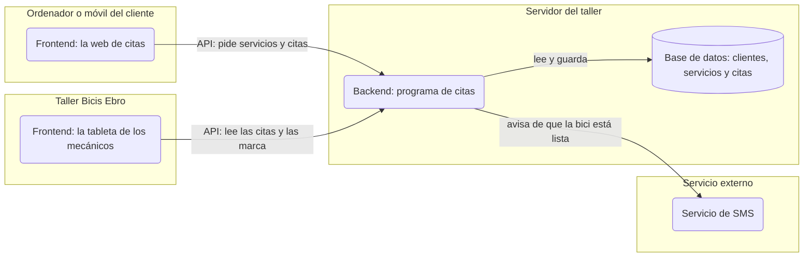
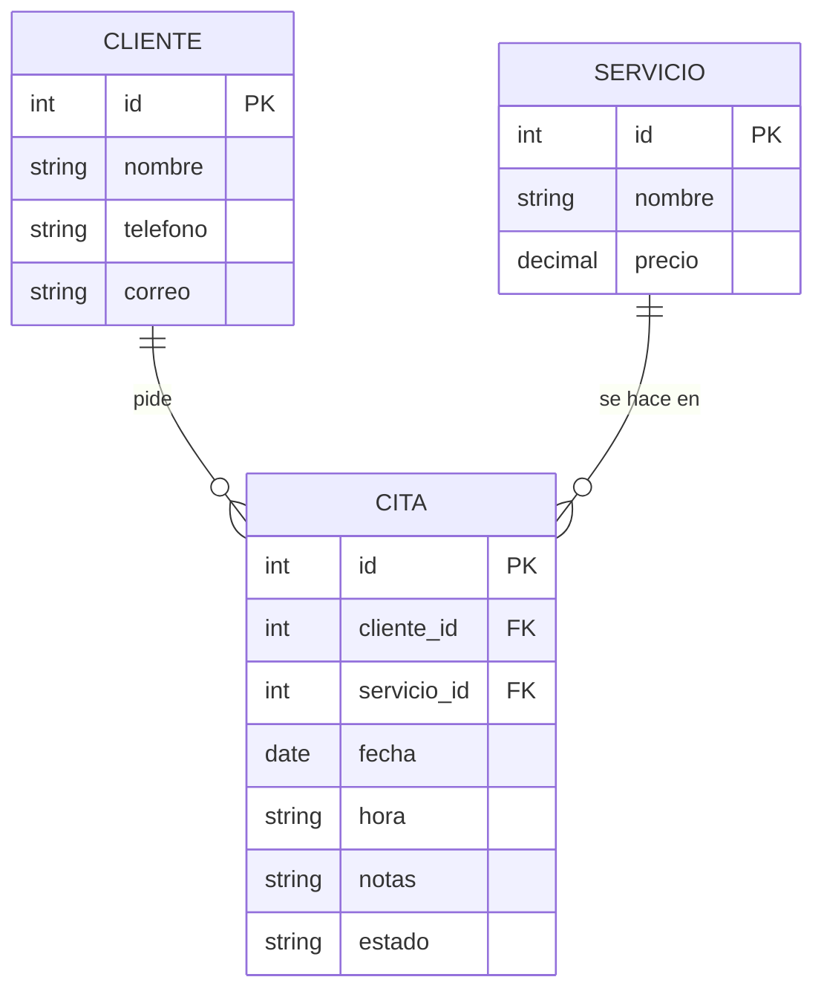

# Retos de la fase 06 — Internet y aplicaciones

> **Versiones:** curl 8.18.0 en las salidas, la de la terminal del curso (a 16 de noviembre de 2026) · Mermaid 12.2.0, la que usa la academia · API de GitHub, según su documentación a 16 de noviembre de 2026
> **Conviene saber antes:** [06.01 Redes](01-redes.md) · [06.02 Puertos y localhost](02-puertos-y-localhost.md) · [06.03 La web](03-la-web-http-y-apis.md) · [06.04 Qué es una base de datos](04-que-es-una-base-de-datos.md) · [06.05 Las piezas de una aplicación](05-piezas-de-una-aplicacion.md) · [06.06 Qué es la IA](06-que-es-la-ia.md)
> **Tiempo estimado:** 2,5 horas

Estos retos mezclan lo que has aprendido en la fase: cómo viajan los datos y quién traduce los nombres ([06.01](01-redes.md)), los puertos y `localhost` ([06.02](02-puertos-y-localhost.md)), HTTP, los códigos de estado y las API ([06.03](03-la-web-http-y-apis.md)), las tablas de una base de datos ([06.04](04-que-es-una-base-de-datos.md)) y las piezas de una aplicación ([06.05](05-piezas-de-una-aplicacion.md)), con un guiño a la IA ([06.06](06-que-es-la-ia.md)). Usarás también el JSON y Mermaid de la [fase 4](../fase-04-formatos-y-diagramas/03-json-y-yaml.md) y la terminal de la [fase 3](../fase-03-herramientas/02-terminal-sacarle-partido.md).

Van de menor a mayor dificultad, y el último es el más completo. Son **opcionales**: sirven para afianzar lo aprendido y no bloquean nada. Abre las pistas solo si te atascas y, si tu solución es distinta de la propuesta, comprueba que dice lo mismo: puede estar igual de bien.

**Sobre el servidor de prueba.** Como en los módulos, las peticiones con `curl` a `localhost` las ha hecho la terminal del curso, que arranca un servidor de prueba descrito en el `servidor.json` de cada carpeta ([06.03, apartado 1.14](03-la-web-http-y-apis.md#114-el-servidor-de-prueba-y-los-servidores-de-verdad)). **En tu ordenador no tienes ese servidor**: si tecleas esas órdenes, verás `000` y el código de salida `7` ([06.02, ejemplo 2.2](02-puertos-y-localhost.md#22-el-puerto-equivocado)). Por eso cada reto te dice qué hacer en tu equipo: el 1 y el 2 se resuelven razonando y escribiendo; el 3 trae una respuesta guardada para que trabajes con ella en tu terminal y, si tienes internet, una consulta a la API de GitHub. Recuerda que tus salidas no serán idénticas letra a letra ([el aviso de 02.03](../fase-02-tu-ordenador/03-instalar-programas-y-path.md#22-un-aviso-sobre-las-salidas-de-la-terminal)).

## Reto 1 · Por qué no carga la web de la escuela de música

**Situación real:** Marcos lleva la web de la **Escuela de Música Allegro**, `escuela-allegro.example`. La ha hecho él: un backend que escucha en el puerto 3000 y que saca los horarios de las clases de un servicio de calendario externo. Esta semana le han llegado varias quejas, todas con la misma frase: «la web no carga». Pero cada una tiene una causa distinta. Tu trabajo es averiguar cuál.

Las quejas, con lo que Marcos ha averiguado de cada una (las salidas de `nslookup` son **de ejemplo**, con el formato de Linux):

**A. Lucía**, una alumna, escribe la dirección a mano en su portátil y el navegador dice que no encuentra el sitio. Le pide que pruebe esto:

```text
$ nslookup escuela-alegro.example
Server:         192.168.1.1
Address:        192.168.1.1#53

** server can't find escuela-alegro.example: NXDOMAIN

```

**B. Gonzalo**, un padre, intenta entrar desde la wifi de una cafetería y no carga. Tampoco carga ninguna otra web, aunque el móvil dice que está conectado a la wifi. Marcos le pide que pruebe con un nombre que seguro que existe:

```text
$ nslookup example.com
;; communications error to 192.168.1.1#53: timed out
;; communications error to 192.168.1.1#53: timed out
;; communications error to 192.168.1.1#53: timed out
;; no servers could be reached

```

**C. Amaia**, la secretaria, ha mandado un correo a todas las familias con el enlace para matricularse, `https://escuela-allegro.example/matriculas`. Todo el que lo pulsa ve una página que dice «No encontrado». La página principal carga bien.

**D. Todo el mundo**: desde esta mañana, la página de los horarios dice «Servicio no disponible». El resto de la web va bien.

**E. Marcos**, en su portátil, arranca la web para probar los fallos y abre `http://localhost:8080`, como en todos los tutoriales. El navegador dice que no se puede conectar. Su fichero de configuración tiene estas dos líneas:

```yaml
host: 0.0.0.0
puerto: 3000
```

**F. Marcos**, otra vez: quiere ver cómo queda la web en su móvil, conectado a la misma wifi que el portátil. En el portátil, `http://localhost:3000` funciona; en el móvil, `http://192.168.1.20:3000` (la IP privada del portátil) se queda pensando y al final dice que no puede conectar. Marcos recuerda que, la primera vez que arrancó la web en este portátil con Windows, le salió una ventana del cortafuegos y la cerró sin leerla.

Para los casos C, D y E, Marcos ha hecho estas pruebas en la terminal de su portátil, con su copia de la web en marcha (que pide los horarios al mismo servicio de calendario que la publicada):

**En tu terminal** (`sesion.txt`):

```text
$ curl -s -w '%{http_code}\n' http://localhost:8080/
000
$ echo $?
7
$ curl -s -w '%{http_code}\n' http://localhost:3000/
Escuela de Música Allegro: la web, en pruebas
200
$ curl -s -o /dev/null -w '%{http_code}\n' http://localhost:3000/matriculas
404
$ curl -s -o /dev/null -w '%{http_code}\n' http://localhost:3000/matricula
200
$ curl -i http://localhost:3000/horarios
HTTP/1.1 503 Service Unavailable
Content-Type: application/json
Content-Length: 55

{
  "error": "El servicio de calendario no responde"
}
```

📁 **Código:** [`codigo/retos/reto-01-por-que-no-carga-la-web/`](codigo/retos/reto-01-por-que-no-carga-la-web/)

Para cada caso, de la A a la F:

1. **¿Dónde se rompe el camino?** En el **nombre** (el DNS no da la dirección), en la **conexión** (no se llega al programa: nadie escucha en ese puerto, o algo corta el paso) o en la **respuesta** (se llega al servidor y contesta, pero con un código que no es `200`).
2. **¿Cuál es la causa concreta**, y de quién es el problema: de quien pide, de Marcos o de alguien de fuera?
3. **¿Qué hay que hacer** para arreglarlo?

Y para terminar: 4. si mañana llega otra queja de «la web no carga», **¿en qué orden** comprobarías las cosas, y con qué orden de la terminal cada una?

<details>
<summary>Pista 1</summary>

Para A y B, repasa los dos fallos de `nslookup` de [06.01, ejemplo 2.7](01-redes.md#27-cuando-el-dns-no-contesta-o-el-nombre-no-existe): ¿alguien contesta, o nadie? Y lee el nombre de A letra a letra.

</details>

<details>
<summary>Pista 2</summary>

En la sesión de Marcos, `000` quiere decir que **nadie ha respondido**, y cualquier otro número, que **sí** se ha llegado a un servidor y este ha contestado con ese código ([06.02, apartado 1.12](02-puertos-y-localhost.md#112-responde-alguien-comprobarlo-con-curl)). Busca qué significan `404` y `503` en la tabla de [06.03, apartado 1.7](03-la-web-http-y-apis.md#17-los-códigos-de-estado), y fíjate en la primera cifra: ¿de quién es la culpa?

</details>

<details>
<summary>Pista 3</summary>

Para F: si la web escucha en `0.0.0.0`, el móvil **debería** poder entrar ([06.02, apartado 1.7](02-puertos-y-localhost.md#17-escuchar-en-localhost-o-en-0000)). ¿Qué hay entre el móvil y el programa que pueda cortar el paso, y qué hizo Windows cuando Marcos cerró aquella ventana ([06.02, apartado 1.8](02-puertos-y-localhost.md#18-el-cortafuegos-pregunta))?

</details>

<details>
<summary>Ver solución</summary>

**Razonamiento:** para que cargue una web tienen que salir bien tres cosas, en este orden: **el nombre** se traduce a una dirección (DNS), **se llega al programa** que escucha en esa dirección y ese puerto (sin que nada corte el paso) y **el servidor contesta** con un código de éxito. «La web no carga» puede ser cualquiera de las tres, y cada una se reconoce por una pista distinta.

| Caso | Dónde se rompe | Causa | De quién es | Qué hacer |
|---|---|---|---|---|
| A | Nombre | El nombre está mal escrito: `alegro`, con una ele. El DNS **contesta** (`Server: 192.168.1.1`) y dice que ese nombre no existe (`NXDOMAIN`) | De quien pide | Escribir bien el nombre, `escuela-allegro.example`, o, mejor, entrar desde un enlace o un marcador |
| B | Nombre | El servidor DNS de la cafetería **no contesta** (`timed out`, `no servers could be reached`): no se traduce **ningún** nombre | De la red de la cafetería | Nada que hacer en la web. Gonzalo puede avisar en la cafetería o usar los datos de su móvil |
| C | Respuesta | El enlace del correo lleva a `/matriculas`, y la ruta es `/matricula`, en singular: el servidor contesta `404` | De quien escribió el enlace (Amaia, o Marcos si se lo pasó así) | Mandar el enlace bien y, para quien use el viejo, que esa ruta lleve a la buena con una redirección (`301`) |
| D | Respuesta | El backend contesta `503`: no puede atender los horarios porque **el servicio de calendario** del que los saca no responde. Lo dice el cuerpo | Del servicio externo | Avisar al servicio de calendario y, mientras tanto, poner en la web un aviso que explique el problema |
| E | Conexión | En el 8080 no escucha nadie (`000` y código de salida `7`): la web escucha en el **3000**, como dice su configuración | De Marcos | Abrir `http://localhost:3000` |
| F | Conexión | La web escucha en `0.0.0.0`, así que el problema no es el programa: es el **cortafuegos** de Windows, que al cerrar la ventana creó una regla de bloqueo | De la configuración del portátil de Marcos | Permitir ese programa en el cortafuegos, **solo para redes privadas**, desde su configuración. Nunca apagarlo |

**4. El orden de las comprobaciones**, de lo primero que tiene que funcionar a lo último:

1. **El nombre:** `nslookup escuela-allegro.example`. ¿Contesta el DNS? ¿Con una dirección, o con `NXDOMAIN`? Si nadie contesta, prueba con otro nombre que exista: si tampoco, falla el DNS, no la web.
2. **La conexión:** `curl -s -o /dev/null -w '%{http_code}\n'` con la dirección, y `echo $?` justo después. Un `000` es que no se ha llegado al programa: el código de salida dice por qué (`7`, nadie escucha en ese puerto; `35`, hay alguien, pero no habla HTTPS, [06.02, ejemplo 2.3](02-puertos-y-localhost.md#23-http-no-es-https)). Si desde el propio ordenador llega y desde otro no, mira en qué dirección escucha y el cortafuegos.
3. **La respuesta:** el número que escribe esa misma orden. Un `2xx` es que todo va bien; un `4xx`, que la petición tiene algo mal (revisa la dirección); un `5xx`, que falla el servidor (avisa a quien lo lleve). Con `curl -i` ves además el cuerpo, que muchas veces explica el motivo, como en el caso D.

Es el mismo «de dentro hacia fuera» de [06.01](01-redes.md#diagnóstico-de-no-hay-internet-de-dentro-hacia-fuera), con dos pasos más al final: el puerto y el código.

**En qué fijarte:**

- **A y B parecen iguales y no lo son.** En A, el DNS funciona y responde «no existe»; en B, el DNS no responde. Por eso en A el arreglo está en el nombre, y en B ningún nombre funcionaría.
- **C, D y E dan «no carga» en el navegador, pero `curl` los separa.** E da `000`: no hay conversación. C y D dan un número: **sí** hay servidor, y contesta. El `404` (primera cifra 4) apunta a la petición; el `503` (primera cifra 5), al servidor.
- **El `503` no es culpa del backend de Marcos**, que funciona y lo explica en su respuesta: es de una pieza de fuera de la que depende ([06.05, apartado 1.6](05-piezas-de-una-aplicacion.md#16-servicios-de-otros-pagos-correo-mapas)). Por eso lo da también su copia de desarrollo: las dos piden los horarios al mismo servicio.
- **En F, «se queda pensando»** es otra pista: cuando un cortafuegos bloquea, el navegador suele esperar hasta rendirse, en vez de recibir un rechazo al momento como en E.
- **Con un dominio de verdad**, la petición de C iría por `https` y el puerto 443, y respondería un servidor de internet; la prueba de Marcos en `localhost` sirve porque su copia tiene las mismas rutas. Tú puedes hacer lo mismo con un servidor real, la API de GitHub, en el [reto 3](#reto-3--la-agenda-cultural-de-la-semana).

**Errores frecuentes al resolverlo:**

- Dar A por un problema de la web porque «el navegador no la encuentra»: el `NXDOMAIN` lo deja claro, el nombre no existe así escrito.
- Pensar en B que la web de la escuela está caída: no carga **ninguna** web, y el fallo es anterior a llegar a cualquier servidor.
- Confundir el `000` de E con un código de estado: no lo es, es `curl` diciendo que nadie ha respondido.
- Apagar el cortafuegos para arreglar F «solo un momento» ([06.01, error típico 3.4](01-redes.md#34-apagar-el-cortafuegos-para-que-funcione)), o permitir el programa también en redes públicas.
- Echar la culpa a las familias en C: el enlace lo escribió la escuela.

</details>

## Reto 2 · Las piezas de la web de citas de un taller de bicis

**Situación real:** Fermín tiene **Bicis Ebro**, un taller de bicicletas en Logroño, y quiere que sus clientes pidan cita por internet. Su sobrina Leire, que acaba de terminar esta fase, le va a ayudar a pensarlo antes de que nadie escriba una línea de código. Esto es lo que quiere Fermín:

- En la **web**, el cliente elige un servicio de la lista (revisión completa, cambio de cubierta, ajuste de frenos…), cada uno con su precio, y un día y una hora libres; escribe su nombre, su teléfono y su correo, y, si quiere, una nota sobre la avería.
- En el taller, los mecánicos tienen una **tableta** con la lista de citas del día. Cuando terminan una bici, la marcan como **lista**.
- Al marcarla, al cliente le llega un **SMS**: «Tu bici está lista». Los SMS los manda un servicio de mensajes externo.
- No se paga por internet: se paga en el taller al recoger la bici.

Haz tú el documento de Leire, con cuatro partes:

1. **Las piezas:** un diagrama de bloques en Mermaid con todas las piezas, agrupadas por dónde está cada una, y flechas con verbos.
2. **Las tablas:** qué tablas necesita la base de datos para los clientes, los servicios y las citas, con sus columnas, su clave primaria y sus claves foráneas, en un diagrama entidad-relación en Mermaid.
3. **La API:** una tabla con las peticiones que harán la web y la tableta (método y ruta, al estilo REST) y el código de estado que espera cada una cuando va bien. Hacen falta: ver los servicios, pedir una cita, ver las citas de un día, marcar una cita como lista y anularla.
4. **Los datos:** tres JSON. (a) Lo que manda la web cuando **Nerea Ruiz** (teléfono 600123456, correo `nerea.ruiz@example.com`) pide un **cambio de cubierta** (el servicio 2) para el lunes **23 de noviembre de 2026 a las 10:30**, con la nota «La rueda de atrás pierde aire». (b) Lo que contesta el backend si la cita se crea: es la cita 318, y el cambio de cubierta cuesta 18,50 €. (c) Lo que recibe la tableta al pedir las citas de ese lunes: la de Nerea; una de **Jon Etxeberria** (611234567) a las 9:00 para una revisión completa, que ya está lista; y una de **Álvaro Sáenz** (622345678) a las 12:00 para un ajuste de frenos. Las dos últimas, sin nota.

Se resuelve en VS Code, con la vista previa de Markdown para ver los diagramas ([04.05](../fase-04-formatos-y-diagramas/05-diagramas-y-mermaid.md)) y comprobando cada JSON como en [04.03, apartado 1.8](../fase-04-formatos-y-diagramas/03-json-y-yaml.md#18-comprobar-un-json-en-vs-code).

<details>
<summary>Pista 1</summary>

Para las piezas, parte del mapa de la panadería ([06.05, apartado 1.7](05-piezas-de-una-aplicacion.md#17-el-mapa-completo-de-una-tienda-en-línea)). Lo nuevo es que hay **dos frontends** (la web y la tableta) que hablan con la misma API, y que el servicio externo no es una pasarela de pago.

</details>

<details>
<summary>Pista 2</summary>

Para las tablas: una cita es **de un cliente** y **de un servicio**. ¿Qué columnas de la tabla de citas apuntan a las otras dos? Mira cómo lo hace la tabla de reservas del club en [06.04, apartado 1.7](04-que-es-una-base-de-datos.md#17-relacionar-tablas-la-clave-foránea). ¿Y dónde guardas si la bici está lista?

</details>

<details>
<summary>Pista 3</summary>

Para la API, dos direcciones por recurso: la colección (`/api/citas`) y cada elemento (`/api/citas/318`), con el método diciendo la acción ([06.03, apartado 1.12](03-la-web-http-y-apis.md#112-rest-recursos-y-métodos)). «Las citas de un día» es la colección **filtrada** con un parámetro. «Marcar como lista» cambia **una parte** de la cita. Y para los JSON: ¿manda la web el precio? ¿Quién pone el número de la cita?

</details>

<details>
<summary>Ver solución</summary>

**1. Las piezas.**



En texto: la web de citas, en el ordenador o el móvil del cliente, y la tableta de los mecánicos, en el taller, son dos frontends que hablan, a través de la misma API, con el backend, que está en el servidor del taller; el backend lee y guarda en la base de datos y pide al servicio externo de SMS que avise al cliente cuando su bici está lista.

- **Las dos pantallas solo hablan con el backend**, como en la panadería ([06.05, apartado 1.5](05-piezas-de-una-aplicacion.md#15-la-api-el-mostrador-entre-frontend-y-backend)): ni la web ni la tableta tocan la base de datos ni el servicio de SMS.
- **La clave del servicio de SMS vive en el servidor**, con el backend, nunca en la web ni en la tableta ([06.05, error típico 3.5](05-piezas-de-una-aplicacion.md#35-la-clave-de-la-pasarela-en-el-frontend)).
- **No le vale un *hosting* de webs estáticas** como GitHub Pages: la aplicación tiene que guardar las citas ([06.05, ejemplo 2.4](05-piezas-de-una-aplicacion.md#24-la-web-de-la-panadería-antes-y-después-de-la-tienda)).

**2. Las tablas.**



En texto: un cliente pide cero o más citas, y cada cita es de exactamente un cliente; un servicio se hace en cero o más citas, y cada cita es de exactamente un servicio.

- **`CITA` hace de tabla intermedia** entre clientes y servicios, como las reservas del club ([06.04, apartado 1.7](04-que-es-una-base-de-datos.md#17-relacionar-tablas-la-clave-foránea)): guarda **los números** del cliente y del servicio, no su nombre ni su teléfono, que están una sola vez en su tabla.
- **El precio está en `SERVICIO`**, no en cada cita: si el cambio de cubierta sube, se cambia en un sitio. (Un taller de verdad guardaría también en la cita el precio que se cobró, para que una subida no cambie las facturas viejas; para empezar, no hace falta.)
- **El estado (`pendiente` o `lista`) es una columna de la cita**: «marcar como lista» es cambiar ese valor.
- **Las claves son números que pone el motor** ([06.04, apartado 1.6](04-que-es-una-base-de-datos.md#16-la-clave-primaria)): ni el teléfono ni el nombre del cliente, que pueden cambiar o repetirse.

**3. La API.**

| Método y ruta | Quién la usa | Qué hace | Si va bien |
|---|---|---|---|
| `GET /api/servicios` | La web | La lista de servicios con su precio | `200` |
| `POST /api/citas` | La web | Pide una cita nueva | `201`, con `Location: /api/citas/318` |
| `GET /api/citas?fecha=2026-11-23` | La tableta | Las citas de ese día | `200` |
| `PATCH /api/citas/318` | La tableta | Cambia una parte de la cita: su estado, a `lista` | `200` |
| `DELETE /api/citas/318` | La web | Anula la cita | `204` |

- **Nombres en plural y la acción en el método**: no hay `/api/marcarComoLista` ni `/api/anularCita`.
- **`PATCH` y no `PUT`**: se cambia solo el estado, no la cita entera ([06.03, apartado 1.12](03-la-web-http-y-apis.md#112-rest-recursos-y-métodos)).
- **El SMS no tiene ruta en esta API**: lo manda el backend por su cuenta, cuando recibe el `PATCH`.
- **La dirección con `?` va entre comillas simples** si la pruebas con `curl` ([06.03, error típico 3.1](03-la-web-http-y-apis.md#31-una-url-con--sin-comillas)).

**4. Los datos.** (a) Lo que manda la web, el cuerpo del `POST /api/citas`:

```json
{
  "cliente": {
    "nombre": "Nerea Ruiz",
    "telefono": "600123456",
    "correo": "nerea.ruiz@example.com"
  },
  "servicio_id": 2,
  "fecha": "2026-11-23",
  "hora": "10:30",
  "notas": "La rueda de atrás pierde aire"
}
```

📁 **Código:** [`codigo/retos/reto-02-las-citas-del-taller-de-bicis/`](codigo/retos/reto-02-las-citas-del-taller-de-bicis/)

(b) Lo que contesta el backend, con el código `201 Created`:

```json
{
  "cita_id": 318,
  "estado": "pendiente",
  "servicio": "Cambio de cubierta",
  "precio": 18.5,
  "fecha": "2026-11-23",
  "hora": "10:30"
}
```

📁 **Código:** [`codigo/retos/reto-02-las-citas-del-taller-de-bicis/`](codigo/retos/reto-02-las-citas-del-taller-de-bicis/)

(c) Lo que recibe la tableta con `GET /api/citas?fecha=2026-11-23`:

```json
[
  {
    "cita_id": 312,
    "hora": "09:00",
    "cliente": "Jon Etxeberria",
    "telefono": "611234567",
    "servicio": "Revisión completa",
    "notas": null,
    "estado": "lista"
  },
  {
    "cita_id": 318,
    "hora": "10:30",
    "cliente": "Nerea Ruiz",
    "telefono": "600123456",
    "servicio": "Cambio de cubierta",
    "notas": "La rueda de atrás pierde aire",
    "estado": "pendiente"
  },
  {
    "cita_id": 320,
    "hora": "12:00",
    "cliente": "Álvaro Sáenz",
    "telefono": "622345678",
    "servicio": "Ajuste de frenos",
    "notas": null,
    "estado": "pendiente"
  }
]
```

📁 **Código:** [`codigo/retos/reto-02-las-citas-del-taller-de-bicis/`](codigo/retos/reto-02-las-citas-del-taller-de-bicis/)

**En qué fijarte:**

- **La web no manda el precio**, solo el identificador del servicio; el precio lo pone el backend, que lo saca de la tabla `SERVICIO` ([06.05, error típico 3.2](05-piezas-de-una-aplicacion.md#32-fiarse-del-frontend)). Tampoco manda el número de la cita ni su estado: los decide el servidor.
- **El cliente va como objeto dentro de la petición**: un cliente nuevo todavía no tiene número, y es el backend quien lo busca por su teléfono o lo da de alta en `CLIENTE`. Es el anidamiento de [04.03, apartado 1.5](../fase-04-formatos-y-diagramas/03-json-y-yaml.md#15-anidar-objetos-dentro-de-listas-dentro-de-objetos).
- **La respuesta (b) trae el nombre del servicio**, y no solo su número: la web se lo tiene que enseñar a Nerea.
- **La lista (c) junta datos de las tres tablas** (la hora de la cita, el nombre y el teléfono del cliente, el nombre del servicio): eso lo hace el backend al leer la base de datos, para que la tableta no tenga que hacer tres peticiones.
- **Los tipos:** el teléfono, como texto (no es una cantidad y podría llevar un `+34`); la fecha, como texto año-mes-día; el precio, con punto decimal; y las notas que no existen, como **`null`**, no como `""` ([04.03, apartado 1.4](../fase-04-formatos-y-diagramas/03-json-y-yaml.md#14-los-seis-tipos-de-valores-de-json)).

**Errores frecuentes al resolverlo:**

- Una flecha de la tableta a la base de datos «porque está en el taller»: es otro frontend, y pasa por la API como la web.
- Guardar en `CITA` el nombre y el teléfono del cliente en vez de `cliente_id` ([06.04, error típico 3.2](04-que-es-una-base-de-datos.md#32-repetir-los-mismos-datos-en-muchas-filas)).
- Usar el teléfono como clave primaria de `CLIENTE` ([06.04, error típico 3.1](04-que-es-una-base-de-datos.md#31-usar-el-nombre-como-clave)): la gente cambia de número.
- Rutas con verbos (`POST /api/marcarLista`), o un `GET` que cambia algo.
- Escribir `"precio": "18,50"` o `"precio": 18,50` en el JSON: lo primero es un texto, y lo segundo, un JSON roto.
- Tildes o espacios en los nombres de las tablas o las columnas del diagrama entidad-relación ([06.04, apartado 1.8](04-que-es-una-base-de-datos.md#18-dibujar-las-tablas-el-diagrama-entidad-relación)).

</details>

## Reto 3 · La agenda cultural de la semana

**Situación real:** Inés es voluntaria de la asociación de vecinos del casco antiguo de Valdeluz y prepara cada viernes el boletín de la semana: las actividades **gratuitas** de la agenda cultural del ayuntamiento. Hasta ahora las copiaba a mano de la web. Ahora sabe que la agenda tiene una API, y que el programa que monta el boletín puede leer un fichero JSON. Su documentación dice:

| Método y ruta | Responde |
|---|---|
| `GET /actividades` | `200` y la lista de actividades de la semana |
| `GET /actividades?gratis=true` | `200` y solo las gratuitas |
| `GET /actividades/{id}` | `200` y la ficha completa de esa actividad, o `404` si no existe |

Y el programa del boletín espera un fichero **`resumen.json`** con esta forma: un objeto con `desde` y `hasta` (las fechas de la semana, como texto `AAAA-MM-DD`), `origen` (la ruta de la API de donde salen los datos), `total` (cuántas actividades son) y `actividades`, una lista con un objeto por actividad con su `id`, `titulo`, `fecha`, `hora`, `lugar` y `plazas_libres`, copiados tal cual de la API. Esta semana va del sábado 21 al viernes 27 de noviembre de 2026.

Tu trabajo, con la terminal:

1. Comprueba que la API responde.
2. Pide las actividades gratuitas y guárdalas en `gratis.json`, viendo en la pantalla el código de estado, pero no el cuerpo ni la barra de progreso.
3. Cuenta cuántas son y saca sus títulos, sin abrir el fichero.
4. Un vecino pregunta si quedan plazas en el taller de encuadernación (la actividad 4): guarda su ficha en `actividad-4.json` y saca solo el dato de las plazas.
5. Alguien ha copiado mal un enlace, el de la actividad 9, que no existe. Pídela de forma que, si no existe, **no se guarde ningún fichero**, y comprueba que es así.
6. Escribe a mano, en VS Code, el `resumen.json` para el programa del boletín.
7. Sin ninguna orden: a Inés le han sugerido que, en vez de todo esto, le pregunte a un asistente de IA «qué actividades gratis hay esta semana en Valdeluz». ¿Qué le contestarías?

**En tu ordenador**, sin el servidor de la agenda, haz los pasos 1 a 3 sobre una respuesta ya guardada. Inés le pidió a un compañero que guardara la respuesta entera a `GET /actividades?gratis=true` (con su línea de estado y sus cabeceras) en el fichero **`respuesta-guardada.txt`**, que está en la carpeta del reto: [`codigo/retos/reto-03-la-agenda-cultural/`](codigo/retos/reto-03-la-agenda-cultural/). Descárgala, abre la terminal en ella y, con órdenes de la terminal: comprueba en ella el código de estado, saca el cuerpo a `gratis.json` y cuenta y lista las actividades. Después escribe tu `resumen.json` (en la carpeta hay uno con la solución: no lo abras hasta terminar). Para el paso 4, en la carpeta está también la ficha de la actividad 4 ya guardada, **`actividad-4.json`** (la que deja `curl` en ese paso): saca de ella el dato de las plazas. Y el paso 5, si tienes internet, practícalo con la API de GitHub: pide `https://api.github.com/users/octocat/no-existe`, una dirección que no existe, guardándola en `no-existe.json` solo si existe, y comprueba que no se ha guardado nada.

**Y si tienes internet** (opcional), practica el paso 2 con una API de verdad: guarda en `octocat.json` los datos de `octocat`, la cuenta de ejemplo de la documentación de GitHub, viendo solo el código, y saca de ese fichero cuántos repositorios públicos tiene.

<details>
<summary>Pista 1</summary>

Pasos 1 y 2: es la orden de «solo el código» de [06.03, ejemplo 2.3](03-la-web-http-y-apis.md#23-solo-el-código-de-estado), pero cambiando adónde va el cuerpo: `-o gratis.json` en lugar de `-o /dev/null`. ¿Por qué hace falta `-s` ([06.03, error típico 3.5](03-la-web-http-y-apis.md#35-la-barra-de-progreso-que-aparece-al-guardar))? ¿Y qué le pasa a la dirección con `?` en la terminal?

</details>

<details>
<summary>Pista 2</summary>

Paso 3: cada actividad tiene una línea con su `"id"`, como los libros de [06.03, ejemplo 2.4](03-la-web-http-y-apis.md#24-guardar-la-respuesta-en-un-fichero). Paso 5: hay una opción de `curl` que hace que una respuesta de error no escriba el cuerpo y termine con un código de salida distinto de 0 ([06.03, error típico 3.2](03-la-web-http-y-apis.md#32-creer-que-curl-avisa-de-un-404)).

</details>

<details>
<summary>Pista 3</summary>

En tu ordenador, el cuerpo de `respuesta-guardada.txt` empieza **después de la primera línea vacía**. `grep -n '^$'` te dice en qué línea está: en lo que busca `grep`, `^` quiere decir «principio de la línea» y `$`, «final de la línea», así que `^$` son las líneas en las que no hay nada entre el principio y el final, las vacías. Y `tail -n +N` escribe un fichero desde la línea N ([03.04, ejemplo 2.3](../fase-03-herramientas/04-errores-y-depuracion.md#23-la-traza-de-bash--x-los-clientes-que-sobran)).

</details>

<details>
<summary>Ver solución</summary>

**Razonamiento:** son tres trabajos distintos. **Pedir y guardar** es `curl` con `-s` y `-o`, y `-w` para ver el código sin ver el cuerpo. **Comprobar** lo guardado se hace con las órdenes de siempre: es un fichero de texto. Y **escribir el resultado** para otro programa es escribir un JSON con la forma exacta que ese programa espera, con los datos copiados de la API, no reescritos de memoria.

**Con el servidor de la agenda**, en la terminal del curso:

**En tu terminal** (`sesion-servidor.txt`):

```text
$ curl -s -o /dev/null -w '%{http_code}\n' http://localhost:8080/actividades
200
$ curl -s -o gratis.json -w '%{http_code}\n' 'http://localhost:8080/actividades?gratis=true'
200
$ grep -c '"id"' gratis.json
3
$ grep titulo gratis.json
    "titulo": "Cuentacuentos en la plaza",
    "titulo": "Taller de encuadernación",
    "titulo": "Concierto de la banda municipal",
$ curl -s -o actividad-4.json -w '%{http_code}\n' http://localhost:8080/actividades/4
200
$ grep plazas_libres actividad-4.json
  "plazas_libres": 6,
$ curl -s -f -o actividad-9.json http://localhost:8080/actividades/9
$ echo $?
22
$ ls actividad-9.json
ls: no se puede acceder a 'actividad-9.json': No existe el archivo o el directorio
$ curl -s -i 'http://localhost:8080/actividades?gratis=true' | tr -d '\r' > respuesta.txt
$ diff respuesta.txt respuesta-guardada.txt
```

📁 **Código:** [`codigo/retos/reto-03-la-agenda-cultural/`](codigo/retos/reto-03-la-agenda-cultural/)

- **Pasos 1 y 2:** `200` las dos veces. Con `-o gratis.json`, el cuerpo va al fichero; con `-w`, el código sale en la pantalla; y con `-s`, sin barra de progreso, que saldría porque el cuerpo ya no va a la pantalla. La dirección con `?` va entre comillas simples.
- **Paso 3:** tres actividades gratuitas, con sus títulos. `grep -c '"id"'` cuenta bien porque la API manda el JSON formateado, un dato por línea.
- **Paso 4:** quedan **6 plazas** en el taller. Es un número, sin comillas: un programa podría avisar cuando baje de 5.
- **Paso 5:** con **`-f`**, la respuesta `404` hace que `curl` no escriba el cuerpo y termine con el código **22**, y el fichero **no se crea**: `ls` no lo encuentra. Sin `-f`, tendrías un `actividad-9.json` con el mensaje de error del servidor dentro, y el programa del boletín podría tomarlo por una actividad.
- **Las dos últimas órdenes** comprueban que la respuesta guardada de la carpeta es **exactamente** la que da el servidor: se pide entera (`-i`), se le quitan los `\r` con los que HTTP termina la línea de estado y las cabeceras ([06.03, nota del ejemplo 2.4](03-la-web-http-y-apis.md#24-guardar-la-respuesta-en-un-fichero)) y se compara con `diff`, una orden que compara dos ficheros línea a línea (como `git diff` compara dos versiones, [05.01, apartado 1.10](../fase-05-git-y-github/01-git-fundamentos.md#110-ver-los-cambios-diff-y-show)) y **no escribe nada si son iguales**; si no lo fueran, enseñaría las líneas que cambian. No la necesitas para el reto: es la comprobación que se hizo al preparar el curso. Así se guardó `respuesta-guardada.txt`, y por eso puedes fiarte de ella.

**En tu ordenador**, con la respuesta guardada:

**En tu terminal** (`sesion-en-tu-ordenador.txt`):

```text
$ head -n 1 respuesta-guardada.txt
HTTP/1.1 200 OK
$ grep -n '^$' respuesta-guardada.txt
4:
$ tail -n +5 respuesta-guardada.txt > gratis.json
$ grep -c '"id"' gratis.json
3
$ grep titulo gratis.json
    "titulo": "Cuentacuentos en la plaza",
    "titulo": "Taller de encuadernación",
    "titulo": "Concierto de la banda municipal",
$ grep plazas_libres actividad-4.json
  "plazas_libres": 6,
```

📁 **Código:** [`codigo/retos/reto-03-la-agenda-cultural/`](codigo/retos/reto-03-la-agenda-cultural/)

- **La línea de estado** dice `200 OK`: la respuesta guardada es buena, y se puede usar. Si dijera `404` o `503`, su cuerpo sería un mensaje de error, no la lista.
- **La línea vacía es la 4**: `'^$'` busca las líneas sin nada entre el principio (`^`) y el final (`$`), y `grep -n` escribe el número de línea y, tras los dos puntos, la línea, que aquí no tiene nada. El cuerpo empieza en la 5, y `tail -n +5` lo saca entero a `gratis.json`: el **mismo fichero** que deja `curl -s -o` con el servidor. A partir de ahí, las mismas órdenes y los mismos resultados.
- **Si guardas tú una respuesta con `curl -i -o`**, sus líneas de cabecera llevan `\r` y la línea vacía no está vacía para `grep '^$'`: quítalos antes con `tr -d '\r'`, como en la sesión del servidor.
- **El paso 4** sale igual que con el servidor: `actividad-4.json` es el fichero que deja `curl -s -o` en ese paso.

**El paso 5, con la API de GitHub.** Una salida **de ejemplo**, del 16 de noviembre de 2026:

```text
$ curl -s -f -o no-existe.json https://api.github.com/users/octocat/no-existe
$ echo $?
22
$ ls no-existe.json
ls: no se puede acceder a 'no-existe.json': No existe el archivo o el directorio
```

Lo mismo que con la actividad 9: GitHub responde `404` porque esa ruta no existe, y con `-f`, `curl` no escribe el cuerpo, termina con el código **22** y no crea el fichero. (El mensaje de `ls` es el de un Linux en español; en tu sistema puede salir con otras palabras, o en inglés.)

**Paso 6, el `resumen.json`:**

```json
{
  "desde": "2026-11-21",
  "hasta": "2026-11-27",
  "origen": "/actividades?gratis=true",
  "total": 3,
  "actividades": [
    {
      "id": 2,
      "titulo": "Cuentacuentos en la plaza",
      "fecha": "2026-11-21",
      "hora": "12:00",
      "lugar": "Plaza Mayor",
      "plazas_libres": null
    },
    {
      "id": 4,
      "titulo": "Taller de encuadernación",
      "fecha": "2026-11-24",
      "hora": "18:00",
      "lugar": "Biblioteca Municipal",
      "plazas_libres": 6
    },
    {
      "id": 5,
      "titulo": "Concierto de la banda municipal",
      "fecha": "2026-11-27",
      "hora": "19:30",
      "lugar": "Teatro Principal",
      "plazas_libres": 120
    }
  ]
}
```

📁 **Código:** [`codigo/retos/reto-03-la-agenda-cultural/`](codigo/retos/reto-03-la-agenda-cultural/)

- **La forma la manda el programa del boletín**: las claves con esos nombres exactos, y el `total` igual al número de objetos de la lista (3, el de `grep -c`).
- **Los datos, copiados de `gratis.json`**, no reescritos: lo más seguro es copiar y pegar cada actividad en VS Code y borrar las claves que sobran (`precio`, que en todas es 0). VS Code te avisa si se te escapa una coma ([04.03, apartado 1.8](../fase-04-formatos-y-diagramas/03-json-y-yaml.md#18-comprobar-un-json-en-vs-code)).
- **`"plazas_libres": null`** en el cuentacuentos, como en la API: es en la calle y no tiene plazas que contar. `null` dice «no hay dato», que no es lo mismo que `0` («no queda sitio»): el boletín no debe decir que está lleno.

**Paso 7, la IA.** Que la API es mejor fuente. Un asistente de IA predice texto con lo que aprendió al entrenarse ([06.06, apartado 1.8](06-que-es-la-ia.md#18-predice-no-sabe)): no sabe qué ha programado el ayuntamiento esta semana, y lo más probable es que conteste algo que suena bien y es inventado o viejo, con fechas y lugares incluidos ([06.06, apartado 1.9](06-que-es-la-ia.md#19-las-alucinaciones)). La API da los datos del propio ayuntamiento, de hoy. Si un asistente puede buscar en internet, su respuesta tiene que llevar la fuente, y hay que comprobarla en ella; para un boletín que leerán los vecinos, lo directo es la API.

**Y con internet, la API de GitHub.** Una salida **de ejemplo**, del 16 de noviembre de 2026 (tu número de repositorios puede ser otro):

```text
$ curl -s -o octocat.json -w '%{http_code}\n' https://api.github.com/users/octocat
200
$ grep public_repos octocat.json
  "public_repos": 8,
```

Es la misma orden del paso 2, contra un servidor de verdad: el cuerpo es el JSON del [ejemplo 2.6 de 06.03](03-la-web-http-y-apis.md#26-una-api-de-verdad-la-de-github), formateado como el de la agenda. Usa solo `octocat`, la cuenta de ejemplo, y no la repitas en bucle: según la documentación de GitHub (a 16 de noviembre de 2026), sin identificarte puedes hacer **60 peticiones por hora**.

**Errores frecuentes al resolverlo:**

- `curl -o gratis.json` sin `-s`: la barra de progreso se mezcla con el código en la pantalla.
- La dirección con `?` sin comillas: aquí funcionaría, pero con un `&` se rompería ([06.03, error típico 3.1](03-la-web-http-y-apis.md#31-una-url-con--sin-comillas)). Mejor siempre entre comillas simples.
- Dar por buena la respuesta guardada sin mirar su línea de estado.
- Contar con `wc -l` las líneas de `gratis.json` en vez de los `"id"`: salen las líneas del JSON, no las actividades.
- Cortar el cuerpo por la línea que no es (`tail -n +4`): `gratis.json` empezaría con una línea vacía; sigue siendo JSON válido, pero no es el mismo fichero. Y con `+6`, perdería el `[` y dejaría de serlo.
- Escribir `"plazas_libres": 0` o `""` para el cuentacuentos, o `"total": "3"`, entre comillas: el programa espera un número.
- Pedir la actividad 9 sin `-f` y quedarse con un `actividad-9.json` que no es una actividad.

</details>

---
⬅️ [Anterior: Qué es la IA y cómo funciona por dentro](06-que-es-la-ia.md) · 📚 [Índice](../00-indice.md)
