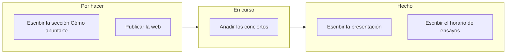
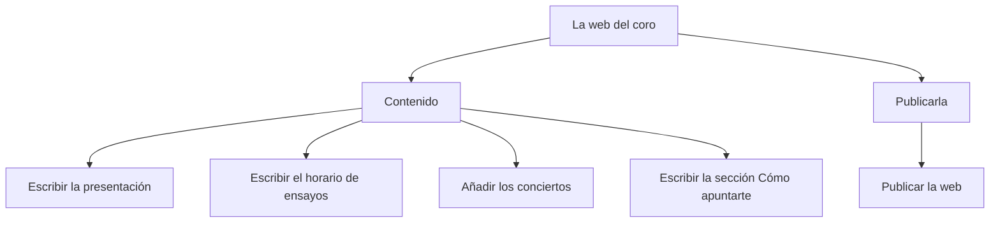

# 07.02 Organizar tu trabajo

> **Versiones:** GitHub (*issues*, plantillas de *issue* y Projects) según su documentación, consultada el 16 de noviembre de 2026 · Guía de Kanban, versión de mayo de 2025
> **Conviene saber antes:** [01.02 Algoritmos y pseudocódigo, 1.2](../fase-01-que-es-programar/02-algoritmos-y-pseudocodigo.md#12-descomponer-un-problema) · [05.03 GitHub, 1.11](../fase-05-git-y-github/03-github.md#111-issues-y-tableros) · [04.03 JSON y YAML, 1.9](../fase-04-formatos-y-diagramas/03-json-y-yaml.md#19-yaml-el-formato-para-que-lo-escriban-personas)
> **Tiempo estimado:** 1,5 horas
> **Nivel:** Básico · Núcleo

## Qué aprenderás

- Por qué conviene **organizar el trabajo** por escrito, también cuando trabajas solo.
- A **dividir un problema en tareas** pequeñas, que se puedan terminar en una sesión.
- A decir **cuándo está hecha** cada tarea, con condiciones que se puedan comprobar.
- Qué es un **tablero Kanban** (Por hacer, En curso, Hecho) y por qué se **limita el trabajo en curso**.
- A escribir una **buena *issue*** de GitHub.
- A crear una **plantilla de *issue*** (`.github/ISSUE_TEMPLATE/…md`), con su **cabecera YAML**.
- Qué es **GitHub Projects** y cómo se monta con él un tablero.
- Qué son Trello, Notion, Jira y Scrum, para reconocerlos cuando los oigas.
- A **preparar el tablero de tu proyecto final**.

## 1. Teoría

### 1.1. Por qué organizar el trabajo

Hasta ahora, cada módulo te ha dicho qué hacer y en qué orden. En tu proyecto final, y en los proyectos que hagas después, **nadie te lo va a decir**: tendrás un objetivo («una web para el coro», «una aplicación para apuntar los gastos») y tendrás que decidir tú por dónde empezar, qué falta y cuándo has terminado.

Sin organizarse pasan siempre las mismas cosas:

- **No sabes por dónde empezar**, porque el objetivo es demasiado grande para pensarlo de una vez.
- **Empiezas muchas cosas y no terminas ninguna**: un poco del diseño, un poco del texto, un poco de las fotos…
- **Se te olvidan cosas**, porque estaban solo en tu cabeza (o en un mensaje de hace tres semanas).
- **Nunca sabes si has terminado**: siempre se puede mejorar algo.

La solución no es una herramienta complicada. Son tres costumbres, que este módulo explica una a una: **dividir el trabajo en tareas** pequeñas, decir de cada una **cuándo está hecha** y **verlas todas en un tablero**. Valen para un equipo de cien personas y para ti solo con tu primer repositorio.

> **📌 Nota:** este módulo trata de **cómo organizar el trabajo**, no de un lenguaje. Lo que hay de GitHub (las plantillas y Projects) cambia de vez en cuando: se explica según su documentación, consultada el 16 de noviembre de 2026, y lo que importa (las ideas) vale para cualquier herramienta.

### 1.2. Dividir un problema en tareas

Ya sabes **descomponer un problema** en partes más pequeñas, hasta que cada una sea fácil de resolver: lo viste con los algoritmos en [01.02, apartado 1.2](../fase-01-que-es-programar/02-algoritmos-y-pseudocodigo.md#12-descomponer-un-problema). Para organizar el trabajo se hace lo mismo, pero lo que se divide no es un algoritmo, sino **el trabajo que hay que hacer**.

Una **tarea** es un trozo de trabajo que **una persona puede terminar** de una vez, o en pocas sesiones. Para que lo sea de verdad:

- **Empieza por un verbo** y dice qué resultado deja: «Escribir el horario de ensayos», «Publicar la web». No «Horario» (¿qué hay que hacer con él?).
- **Es pequeña**: cabe en una o dos sesiones de trabajo. Si calculas que te llevará una semana, divídela otra vez.
- **Deja algo que se puede ver** cuando termina: una página, un fichero, un commit. Una tarea que termina en «he estado mirando cosas» no ha dejado nada.
- **No depende de mil cosas**: si para hacerla hay que tener hechas otras cinco, quizá está mal cortada.

El mismo consejo de 01.02 vale aquí: si para explicar una tarea necesitas un «y» («escribir el horario **y** hacer la página de conciertos»), probablemente son dos tareas.

> **💡 Consejo:** divide **en trozos que funcionen solos**, no por tipos de trabajo. Para una web, «la página de conciertos, con su texto y sus fechas» es mejor tarea que «todos los textos» (y, después, «todas las fechas»): al terminarla, tienes una página entera que puedes enseñar. Con los trozos por tipo, no tienes nada que funcione hasta el final.

No hace falta acertar a la primera. Las tareas se dividen, se juntan y se reescriben a medida que aprendes cómo es el trabajo: un plan que se revisa es mucho mejor que un plan perfecto que nunca se toca.

### 1.3. Cuándo está hecha una tarea

Para cada tarea, decide **antes de empezarla** qué tiene que pasar para darla por terminada. Es su **criterio de hecho**: una o varias condiciones que **se pueden comprobar**, con un sí o un no.

| Tarea | Criterio que no sirve | Criterio que sirve |
|---|---|---|
| Escribir el horario de ensayos | «Que esté bien» | La página dice el día, la hora y el lugar de cada ensayo, y se llega a ella desde la portada |
| Añadir los conciertos | «Que salgan los conciertos» | `conciertos.json` es un JSON válido y tiene los tres conciertos de diciembre, con fecha, hora y lugar |
| Publicar la web | «Subirla» | La dirección de la web se abre desde el móvil de otra persona |

«Que esté bien» no se puede comprobar: siempre se puede mejorar algo, y nunca sabrás si has terminado. «Tiene los tres conciertos de diciembre», sí: los cuentas y ya está.

Es la misma idea que el [caso de prueba](../fase-01-que-es-programar/03-probar-un-programa.md#13-el-caso-de-prueba) de 01.03: decidir **antes** qué resultado esperas, para no conformarte después con lo que salga. Y tiene dos ventajas más:

- **Te dice cuándo parar.** Cuando se cumplen las condiciones, la tarea está hecha: lo que se te ocurra después es **otra tarea**.
- **Evita malentendidos.** Si la tarea te la pide otra persona, escribir juntos el criterio de hecho es la forma más rápida de descubrir que cada uno se imaginaba una cosa distinta.

> **📌 Nota:** en los equipos verás también la **definición de hecho** (en inglés, *definition of done*): las condiciones que cumple **toda** tarea para darla por terminada, además de las suyas («está en la rama principal», «otra persona la ha revisado»). Es la misma idea, para todo el equipo a la vez.

### 1.4. El tablero Kanban

Con las tareas escritas, falta **verlas**: qué queda, qué estás haciendo y qué has terminado. Para eso se usa un **tablero Kanban**.

**Kanban** es una palabra japonesa («tarjeta» o «letrero») y una forma de trabajar que viene de las fábricas de Toyota. En el software, la [Guía de Kanban](https://kanbanguides.org/es-es/the-kanban-guide/) (versión de mayo de 2025, consultada el 16 de noviembre de 2026) la define como «una estrategia para optimizar el flujo de valor a través de un proceso». Dicho más sencillo: **que el trabajo avance sin atascarse, de «por hacer» a «hecho»**.

El tablero más sencillo tiene **tres columnas** y una **tarjeta** por tarea:



Dicho en texto: en «Por hacer» están las tareas que aún no has empezado («Escribir la sección Cómo apuntarte», «Publicar la web»); en «En curso», la que estás haciendo («Añadir los conciertos»); y en «Hecho», las terminadas («Escribir la presentación», «Escribir el horario de ensayos»). Las tarjetas avanzan de izquierda a derecha.

Las reglas son pocas:

- **Una tarjeta por tarea**, con su título (el verbo y el resultado) y, dentro, su criterio de hecho.
- **Al empezar una tarea, su tarjeta pasa a «En curso».** Al cumplirse su criterio de hecho, a «Hecho». No antes.
- **«Por hacer» va en orden**: arriba, lo siguiente que toca. Cuando terminas algo, coges la de arriba.
- **Lo nuevo entra en «Por hacer»**, no directamente en «En curso». Así no se cuela delante de lo que ya habías decidido.

Un tablero puede ser una pared con notas adhesivas, una hoja de papel o una herramienta en internet ([apartado 1.9](#19-otras-herramientas-y-otras-formas-de-trabajar)). Lo que importa es que lo mires cada vez que te sientas a trabajar: es lo primero que te dice qué toca hoy.

> **📌 Nota:** muchos equipos añaden columnas para los pasos de su trabajo, como «En revisión» (esperando a que otra persona revise la [*pull request*](../fase-05-git-y-github/03-github.md#110-pull-requests-y-revisión)). Empieza con tres; añade una columna solo cuando veas que las tareas se quedan esperando en un paso concreto.

### 1.5. Limitar el trabajo en curso

La regla más importante de Kanban, y la que menos se cumple: **no empezar más tareas de las que puedes llevar a la vez**. Se llama **límite de trabajo en curso** (en inglés, *work in progress*, WIP): un número máximo de tarjetas en la columna «En curso». Si estás en el límite, **no empiezas nada nuevo hasta terminar algo**.

Parece que ir de una cosa a otra adelanta trabajo, pero pasa lo contrario:

- **Cambiar de tarea cuesta**: cada vez tienes que volver a recordar dónde estabas.
- **Lo empezado y sin terminar no sirve de nada**: nadie puede usar media página.
- **Los atascos se ven**: si algo lleva días «en curso», el límite te obliga a mirar por qué, en vez de esconderlo empezando otra cosa.

Hay un lema muy repetido para recordarlo: **«deja de empezar, empieza a terminar»**.

¿Qué número poner? Trabajando solo, **uno o dos**: una tarea principal y, como mucho, otra que está esperando algo (una respuesta, una revisión). En un equipo, se acuerda entre todos y se ajusta mirando cómo va. El número exacto importa menos que **tener uno y respetarlo**.

### 1.6. Una buena issue

En [05.03, apartado 1.11](../fase-05-git-y-github/03-github.md#111-issues-y-tableros), viste qué es una [*issue*](../glosario.md#issue) de GitHub: el aviso de un fallo o de una tarea pendiente, con su número, su descripción en Markdown, sus comentarios y sus *labels*, y cómo una *pull request* la cierra con «Closes #3». En un proyecto en GitHub, **cada tarea de tu tablero puede ser una *issue***: así la tarea, la conversación sobre ella y el cambio que la resuelve quedan unidos.

Una buena *issue* se entiende sin preguntar nada a quien la escribió, ni siquiera dentro de tres meses (cuando esa persona puedes ser tú, y ya no te acuerdas). Tiene:

- **Un título que dice qué hay que hacer**, con un verbo: «Añadir los conciertos de diciembre», no «Conciertos».
- **El contexto**: por qué hace falta o quién lo ha pedido.
- **El criterio de hecho**, como una lista de tareas de Markdown (`- [ ]`, de [04.02, apartado 1.7](../fase-04-formatos-y-diagramas/02-markdown.md#17-listas-de-tareas)): GitHub dibuja las casillas y deja marcarlas con un clic a medida que se cumplen.
- **Solo una cosa**: si una *issue* pide dos, se cierra una a medias o no se cierra nunca. Mejor dos *issues*.
- **Sus *labels***, si el proyecto las usa: `bug` para un fallo, `enhancement` para una mejora.

Si la *issue* avisa de un **fallo**, además necesita lo que hace falta para [reproducirlo](../glosario.md#reproducir-un-error): qué pasó, qué esperabas que pasara, los pasos para que vuelva a pasar y dónde (en qué aparato y en qué navegador). Sin eso, quien lo arregle empieza adivinando.

Lo verás con una *issue* real en el [ejemplo 2.4](#24-una-issue-escrita-con-la-plantilla).

### 1.7. Plantillas de issue

Cuando varias personas abren *issues* en un proyecto, cada una las escribe a su manera, y casi siempre falta algo. Por eso GitHub deja guardar en el repositorio **plantillas de *issue***: un texto con los apartados que tiene que rellenar quien la abre. Al pulsar **New issue**, GitHub ofrece elegir una de ellas (según su documentación, a 16 de noviembre de 2026).

Una plantilla es un fichero **Markdown** (`.md`) que se guarda en una carpeta concreta del repositorio:

```text
.github/
└── ISSUE_TEMPLATE/
    ├── tarea.md
    └── fallo.md
```

- La carpeta se llama **`.github`**, con punto: es una [carpeta oculta](../glosario.md#fichero-oculto), así que `ls` no la enseña (`ls -a`, sí). Dentro va **`ISSUE_TEMPLATE`**, en mayúsculas y con guion bajo. Cada fichero `.md` de esa carpeta es una plantilla.
- Las plantillas tienen que estar en la **rama por defecto** del repositorio (la `main`). Si solo están en otra rama, GitHub no las ofrece.

Cada plantilla empieza con una **cabecera YAML** (en inglés, *front matter*): unas líneas de [YAML](../glosario.md#yaml) entre dos líneas de tres guiones (`---`), **al principio del fichero**, que no forman parte del texto sino que dan datos sobre él. Después de la cabecera va el cuerpo de la plantilla, en Markdown normal:

```markdown
---
name: Tarea
about: Algo que hay que hacer en la web del coro
title: "Tarea: "
labels: enhancement
---

## Qué hay que hacer
…
```

Las claves de la cabecera, según la documentación de GitHub (consultada el 16 de noviembre de 2026):

| Clave | Para qué | ¿Obligatoria? |
|---|---|---|
| `name` | El nombre de la plantilla en la lista de **New issue** (más de 3 caracteres) | Sí |
| `about` | Una frase que explica para qué es la plantilla | Sí |
| `title` | El título con el que empieza la *issue*, para completarlo | No |
| `labels` | Las *labels* que se ponen solas a la *issue* | No |
| `assignees` | Las personas a las que se asigna sola | No |

> **⚠️ Cuidado:** la cabecera es YAML de verdad, así que valen las reglas de [04.03](../fase-04-formatos-y-diagramas/03-json-y-yaml.md#110-mapas-listas-y-sangría): `clave: valor`, con un espacio después de los dos puntos. Un título que termina en espacio, como `"Tarea: "`, va entre comillas para que el espacio no se pierda. Si la cabecera está mal escrita o falta `name` o `about`, la plantilla no funciona como esperas.

Dos cosas más que verás en otros repositorios, y que no necesitas ahora:

- **Formularios de *issue*** (*issue forms*): plantillas escritas entero en YAML (`.yml`), que GitHub enseña como un formulario con campos obligatorios. Son más potentes y más largas de escribir.
- Un fichero **`config.yml`** en la misma carpeta, que configura la lista de plantillas (por ejemplo, si se puede abrir una *issue* en blanco, sin plantilla).

También se puede crear una plantilla **desde la web de GitHub**, en **Settings** del repositorio, apartado **Features**, **Issues**, botón **Set up templates**: GitHub escribe la cabecera por ti y la guarda con un commit (según su documentación, a 16 de noviembre de 2026). Por dentro, el resultado es el mismo fichero.

### 1.8. GitHub Projects

**GitHub Projects** es la herramienta de GitHub para organizar el trabajo: un tablero (y más cosas) con las *issues* y las *pull requests* de tus repositorios. Lo anunciaba [05.03, apartado 1.11](../fase-05-git-y-github/03-github.md#111-issues-y-tableros). Lo que sigue es según su documentación, consultada el 16 de noviembre de 2026; las pantallas cambian a menudo, así que fíjate en las ideas más que en dónde está cada botón.

- **Un proyecto vive en tu perfil** (o en el de una organización), no dentro de un repositorio, y puede reunir *issues* de varios. Se crea desde tu perfil, en la pestaña **Projects**, con **New project**.
- **Tiene vistas**: la misma lista de tareas se puede ver como **tabla** (*table*), como **tablero** (*board*), que es el tablero Kanban, o como **hoja de ruta** en el tiempo (*roadmap*). Al crear el proyecto eliges con cuál empezar, o una plantilla.
- **Las tarjetas son *issues***, *pull requests* o **borradores** (*draft issues*): ideas que todavía no son *issues*, que más tarde puedes convertir en una.
- **Las columnas del tablero** salen de un campo de cada tarjeta, normalmente **Status** (el estado), con valores como **Todo** (por hacer), **In Progress** (en curso) y **Done** (hecho). Puedes renombrarlos, añadir más y crear campos propios (prioridad, fecha…), hasta 50 por proyecto.
- **Límite por columna**: cada columna puede tener un **límite de tarjetas**. GitHub **no impide** pasarlo: enseña la cuenta arriba y la marca cuando se supera. Respetarlo sigue siendo cosa tuya.
- **Automatizaciones**: al crear un proyecto vienen activadas dos: cuando una *issue* o una *pull request* del proyecto **se cierra**, su estado pasa a **Done**, y cuando una *pull request* **se fusiona**, también. Con «Closes #3» ([05.03](../fase-05-git-y-github/03-github.md#111-issues-y-tableros)), fusionar la *pull request* cierra la *issue*, y su tarjeta se mueve sola a «Done».

> **📌 Nota:** el curso **no comprueba** lo que hace GitHub Projects: necesita una cuenta de GitHub y cambia con el tiempo. Los pasos del [ejemplo 2.5](#25-el-tablero-en-github-projects) son una descripción de ejemplo, según la documentación de GitHub a 16 de noviembre de 2026.

### 1.9. Otras herramientas y otras formas de trabajar

GitHub Projects no es la única forma de llevar un tablero. Para reconocerlas cuando las oigas:

- **Trello**: tableros Kanban muy sencillos, con tarjetas que se arrastran. Mucha gente empieza por ahí, también para cosas que no son de programación.
- **Notion**: una aplicación de notas y documentos que también tiene tableros y listas de tareas.
- **Jira** (de la empresa Atlassian): la herramienta más habitual en las empresas grandes, con tableros, informes y muchísimas opciones.

Todas tienen lo mismo en el fondo: **tarjetas, columnas y reglas**. La herramienta importa mucho menos que las costumbres de este módulo; con una hoja de papel bien llevada se trabaja mejor que con una herramienta llena de tarjetas que nadie mira.

Y una palabra que oirás mucho: **Scrum**. Es otra forma de organizar a un equipo, en la que el trabajo se hace en ciclos de duración fija, de un mes o menos, llamados **sprints**, con unas reuniones y unos papeles definidos en la Guía de Scrum (versión de noviembre de 2020). Lo verás en los cursos que lo necesiten; para tu trabajo de ahora, un tablero Kanban es todo lo que hace falta.

## 2. Ejemplos de código

Los ejemplos siguen a **Gael**, que canta en el coro de su barrio, el **Coro Alameda**. **Marisa**, la directora, le ha pedido una web sencilla para el coro: quiénes son, cuándo ensayan, los próximos conciertos y cómo apuntarse. Gael está aprendiendo, como tú, y decide organizarse antes de escribir una sola línea.

### 2.1. Dividir el encargo en tareas

**Situación real:** «Una web para el coro» es demasiado grande para empezar. Gael la descompone como en [01.02](../fase-01-que-es-programar/02-algoritmos-y-pseudocodigo.md#12-descomponer-un-problema), hasta tener trozos que se terminan en una o dos tardes:



Dicho en texto: la web del coro se divide en el contenido y en publicarla; el contenido, en cuatro tareas (la presentación, el horario de ensayos, los conciertos y la sección «Cómo apuntarte»), y publicarla es una tarea más.

Después escribe, para cada tarea, **cuándo está hecha**:

| Tarea | Está hecha cuando… |
|---|---|
| Escribir la presentación | Hay dos párrafos sobre el coro en la portada y Marisa les ha dado el visto bueno |
| Escribir el horario de ensayos | La página dice el día, la hora y el lugar de los ensayos, y se llega a ella desde la portada |
| Añadir los conciertos | `conciertos.json` es un JSON válido y tiene los tres conciertos de diciembre, con fecha, hora y lugar |
| Escribir la sección Cómo apuntarte | Dice qué voces buscan, cuándo se hace la prueba y a quién escribir |
| Publicar la web | La dirección de la web se abre desde el móvil de Marisa |

**En qué fijarte:**

- **Cada tarea empieza por un verbo** y deja algo que se puede enseñar: una página, un fichero, una web publicada.
- **Los criterios se comprueban con un sí o un no**: los párrafos tienen el visto bueno o no; el JSON es válido o no ([04.03, apartado 1.8](../fase-04-formatos-y-diagramas/03-json-y-yaml.md#18-comprobar-un-json-en-vs-code) te dice cómo comprobarlo).
- **El primer criterio depende de otra persona**: la tarea no está hecha cuando Gael termina de escribir, sino cuando Marisa la aprueba. Es normal, y conviene saberlo antes de empezar.

### 2.2. Un día en el tablero

**Situación real:** Gael pone las cinco tareas en un tablero con un **límite de dos en curso**. Así está el miércoles por la tarde:

```text
POR HACER                    EN CURSO (máx. 2)                 HECHO
---------------------------  --------------------------------  -----------------------------
Escribir la sección          Escribir la presentación          Escribir el horario de ensayos
  Cómo apuntarte               (esperando el visto bueno
Publicar la web                de Marisa)
                             Añadir los conciertos
```

Esa tarde, Marisa le escribe: «¿Puedes poner también una galería con las fotos del concierto de verano?».

Gael **no** la empieza. Está en el límite (dos en curso), así que hace dos cosas:

1. **Apunta la petición** como tarea nueva al final de «Por hacer»: «Añadir la galería de fotos del concierto de verano». No se pierde, pero tampoco se cuela delante de lo que ya estaba decidido.
2. **Sigue con «Añadir los conciertos»** hasta que se cumple su criterio de hecho, y entonces la pasa a «Hecho».

El jueves, Marisa aprueba la presentación: pasa a «Hecho», y «En curso» queda vacía. Gael mira la primera de «Por hacer» y la empieza. Si Marisa le dice que la galería corre más prisa que «Cómo apuntarte», basta con **subirla** en «Por hacer»: el orden de esa columna es la prioridad.

**En qué fijarte:** la tarea que espera a otra persona («esperando el visto bueno») **cuenta en el límite**. Por eso el límite de dos tiene sentido trabajando solo: una tarea en la que trabajas y otra que espera algo.

### 2.3. Una plantilla de issue para las tareas

**Situación real:** la web del coro ya está en GitHub, y otras dos personas del coro van a ayudar a Gael. Para que todas las tareas se escriban igual, Gael crea una plantilla de *issue*: el fichero `.github/ISSUE_TEMPLATE/tarea.md`.

```markdown
---
name: Tarea
about: Algo que hay que hacer en la web del coro
title: "Tarea: "
labels: enhancement
---

## Qué hay que hacer

Explica la tarea en una o dos frases, empezando por un verbo.

## Por qué

Para qué sirve o quién lo ha pedido.

## Cuándo está hecha

- [ ] Primera condición que se pueda comprobar
- [ ] Segunda condición que se pueda comprobar

## Notas

Enlaces, ideas o dudas. Si no hay nada, borra este apartado.
```

📁 **Código:** [`codigo/02-organizar-tu-trabajo/ejemplos/2.3-plantilla-de-tarea/`](codigo/02-organizar-tu-trabajo/ejemplos/2.3-plantilla-de-tarea/)

En la terminal, la carpeta del ejemplo parece vacía, porque `.github` es una carpeta oculta:

**En tu terminal** (`sesion.txt`):

```text
$ ls
$ ls .github
ISSUE_TEMPLATE
$ find .github -type f
.github/ISSUE_TEMPLATE/tarea.md
$ head -n 6 .github/ISSUE_TEMPLATE/tarea.md
---
name: Tarea
about: Algo que hay que hacer en la web del coro
title: "Tarea: "
labels: enhancement
---
```

📁 **Código:** [`codigo/02-organizar-tu-trabajo/ejemplos/2.3-plantilla-de-tarea/`](codigo/02-organizar-tu-trabajo/ejemplos/2.3-plantilla-de-tarea/)

> **📌 Nota:** si descargas la carpeta del ejemplo, en el explorador de archivos tampoco verás `.github` hasta que actives que se muestren los ficheros ocultos ([02.02, apartado 1.15](../fase-02-tu-ordenador/02-archivos-carpetas-y-rutas.md#115-ficheros-ocultos)). En el explorador de VS Code, sí aparece.

**En qué fijarte:**

- **`ls` no enseña nada**, pero **`ls .github`** enseña lo que hay dentro, `ISSUE_TEMPLATE`: la carpeta está ahí, solo que oculta. Con `ls -a`, que enseña también lo oculto, la verías en la lista (en tu ordenador, junto a `.` y `..`).
- **`find .github -type f`** lista los ficheros que hay dentro, con su ruta: la plantilla está justo donde GitHub la busca.
- **`head -n 6`** enseña las seis primeras líneas, que son la cabecera YAML entera: las dos líneas `---`, las claves obligatorias `name` y `about`, y dos opcionales, `title` y `labels`.
- **El cuerpo** tiene los apartados de una buena *issue* ([1.6](#16-una-buena-issue)), con el criterio de hecho como lista de tareas. Lo que va en cada apartado son instrucciones para quien la rellena, que las sustituye por lo suyo.
- **`labels: enhancement`** usa una de las *labels* que GitHub crea en los repositorios nuevos (la de las mejoras).

### 2.4. Una issue escrita con la plantilla

**Situación real:** Celia, una de las ayudantes, abre **New issue**, elige la plantilla **Tarea** y escribe la de los conciertos. GitHub le da el título `Tarea: ` y el cuerpo de la plantilla; ella lo completa así:

```markdown
## Qué hay que hacer

Añadir los tres conciertos de diciembre a conciertos.json, para que salgan en la portada.

## Por qué

Marisa quiere que la gente pueda ver las fechas antes de que repartamos los carteles.

## Cuándo está hecha

- [ ] conciertos.json es un JSON válido
- [ ] Tiene los tres conciertos (6, 13 y 20 de diciembre), con fecha, hora y lugar
- [ ] Se ven en la portada al abrir la web
```

Y de título: **Tarea: Añadir los conciertos de diciembre**. GitHub le da el número **#4** y le pone sola la *label* `enhancement`.

**En qué fijarte:**

- **Se entiende sin preguntar**: qué hay que hacer, por qué y cuándo está hecha. Quien la coja dentro de un mes no necesita a Celia para empezar.
- **El criterio de hecho son casillas**: en GitHub se marcan con un clic a medida que se cumplen, así que se ve de un vistazo cuánto falta.
- **Cuando la tarea esté hecha**, la *pull request* que añade los conciertos dirá `Closes #4` y, al fusionarla, la *issue* se cerrará sola ([05.03](../fase-05-git-y-github/03-github.md#111-issues-y-tableros)).

### 2.5. El tablero en GitHub Projects

**Situación real:** con las tareas convertidas en *issues*, Gael monta el tablero en GitHub Projects. Estos son los pasos **según la documentación de GitHub, a 16 de noviembre de 2026** (no se comprueban en el curso: pueden haber cambiado de nombre o de sitio):

1. En su perfil de GitHub, pestaña **Projects**, pulsa **New project**.
2. Elige empezar con un **tablero** (**Board**) y le pone de nombre «Web del coro».
3. Añade las *issues* del repositorio: en el campo para añadir tarjetas, abajo, pega la dirección de cada *issue* y pulsa <kbd>Intro</kbd>. Las ideas que aún no son *issues* las escribe ahí mismo, como borradores.
4. En el menú de la columna de «en curso» (los tres puntos junto a su nombre), elige **Set column limit** y pone **2**.
5. Ordena las tarjetas de la primera columna, con la siguiente que toca arriba.

Desde ese día, el trabajo sigue el camino de los módulos anteriores: una rama por *issue*, una *pull request* con `Closes #4` y, al fusionarla, la *issue* se cierra y su tarjeta pasa sola a **Done** (por la automatización que viene activada).

**En qué fijarte:** el tablero no tiene nada que no tuviera el de papel del [ejemplo 2.2](#22-un-día-en-el-tablero): columnas, tarjetas en orden y un límite. Lo que añade es que **las tarjetas son las *issues***, así que el tablero se mueve solo cuando el trabajo de verdad (las *pull requests*) avanza.

## 3. Errores típicos

### 3.1. Tareas demasiado grandes

**Qué pasa:** en el tablero hay una tarjeta «Hacer la web». Lleva tres semanas «en curso», y no sabes cuánto falta.

**Por qué ocurre:** no es una tarea, es el proyecto entero. No se puede terminar en una sesión ni comprobar con un sí o un no.

**Cómo se arregla:** divídela como en el [apartado 1.2](#12-dividir-un-problema-en-tareas) hasta que cada trozo quepa en una o dos sesiones, empiece por un verbo y deje algo que se pueda enseñar.

### 3.2. Tareas sin «cuándo está hecha»

**Qué pasa:** una tarea nunca termina. Siempre hay algo más que retocar, o la das por hecha y la otra persona te dice que no era eso.

**Por qué ocurre:** no se decidió antes qué tenía que pasar para darla por terminada ([apartado 1.3](#13-cuándo-está-hecha-una-tarea)).

**Cómo se arregla:** escribe el criterio de hecho **antes de empezar**, con condiciones que se comprueben. Si la tarea es de otra persona, escribidlo juntos. Lo que se te ocurra cuando ya se cumple, a una tarea nueva.

### 3.3. Todo en curso a la vez

**Qué pasa:** la columna «En curso» tiene seis tarjetas. Trabajas mucho, pero «Hecho» casi no crece.

**Por qué ocurre:** cada vez que algo se complica o llega una petición nueva, empiezas otra cosa en vez de terminar la que tenías.

**Cómo se arregla:** pon un **límite de trabajo en curso** (uno o dos, si trabajas solo) y respétalo ([apartado 1.5](#15-limitar-el-trabajo-en-curso)). Lo nuevo va a «Por hacer». Si una tarea está atascada, mira por qué y pide ayuda; no la escondas empezando otra.

### 3.4. La plantilla de issue no aparece

**Qué pasa:** has creado la plantilla, pero al pulsar **New issue** GitHub no la ofrece (o la ofrece sin el nombre que le diste).

**Por qué ocurre:** casi siempre, una de estas:

- La carpeta no se llama exactamente **`.github/ISSUE_TEMPLATE`** (sin el punto, `ISSUE-TEMPLATE` con guion, `templates`…), o está fuera de la raíz del repositorio.
- El fichero no termina en **`.md`** (por ejemplo, `tarea.md.txt`, la [extensión escondida](../fase-02-tu-ordenador/02-archivos-carpetas-y-rutas.md#36-la-extensión-escondida) de 02.02).
- La plantilla solo está en **otra rama**, no en `main`, o no se ha hecho el commit y el `git push`.
- La **cabecera** está mal: falta una de las líneas `---`, no está al principio del fichero, falta `name` o `about`, o el YAML tiene un error (como `name:Tarea`, sin espacio).

**Cómo se arregla:** comprueba la ruta con `find .github -type f` (como en el [ejemplo 2.3](#23-una-plantilla-de-issue-para-las-tareas)), que esté en `main` en GitHub y que la cabecera sea YAML válido, con `name` y `about` ([apartado 1.7](#17-plantillas-de-issue)).

### 3.5. Issues que no se entienden

**Qué pasa:** alguien abre una *issue* titulada «No va», sin nada más. Hay que escribirle para preguntarle qué no va, dónde y cómo, y a veces ya no contesta.

**Por qué ocurre:** quien la escribe sabe lo que ha visto y da por hecho que los demás también.

**Cómo se arregla:** un título con lo que hay que hacer (o lo que falla), el contexto, el criterio de hecho y, en un fallo, los pasos para reproducirlo ([apartado 1.6](#16-una-buena-issue)). Una **plantilla** lo pide a cada persona que abre una *issue*, sin tener que recordárselo.

### 3.6. Organizar en lugar de trabajar

**Qué pasa:** pasas una tarde probando herramientas, colores de *labels* y columnas, y el proyecto no avanza. O al revés: montas el tablero el primer día y no lo vuelves a mirar.

**Por qué ocurre:** la herramienta parece el trabajo, cuando solo es la forma de verlo.

**Cómo se arregla:** empieza con lo mínimo (tres columnas, tareas con su criterio de hecho y un límite) y añade algo solo cuando lo eches de menos. Y mira el tablero **cada vez que te sientes a trabajar**: es lo que te dice qué toca.

## 4. Buenas prácticas

- **Divide hasta que cada tarea quepa en una o dos sesiones**, empiece por un verbo y deje algo que se pueda enseñar.
- **Escribe cuándo está hecha cada tarea antes de empezarla**, con condiciones que se comprueben.
- **Lo que se te ocurra a mitad de una tarea, a una tarea nueva**, no a la que estás haciendo.
- **Tres columnas para empezar**: Por hacer, En curso y Hecho. «Por hacer», en orden de prioridad.
- **Un límite de trabajo en curso, y respetarlo**: termina antes de empezar algo nuevo.
- **Una *issue* por tarea**, con un título que diga qué hacer, el contexto y el criterio de hecho en casillas.
- **Una plantilla de *issue*** en cuanto otra persona vaya a abrir *issues* en tu proyecto, y otra para los fallos.
- **Une las *pull requests* a sus *issues*** con `Closes #N`, para que el tablero se mueva solo.
- **Revisa el tablero cada vez que trabajes**, y las tareas cuando aprendas algo nuevo: el plan se ajusta, no se tira.

## 5. Ejercicios prácticos resueltos

> **💡 Consejo:** casi todos los ejercicios son **de pensar y escribir**, en papel o en un fichero Markdown de tu editor. El 5 se hace en la terminal. Intenta cada uno **antes** de abrir las pistas y la solución.

### 🟢 Básico

#### Ejercicio 1 · Tareas que se pueden terminar

Celia ha escrito estas tarjetas para el tablero de la web del coro. Para cada una, di si es una buena tarea y, si no lo es, por qué y cómo la reescribirías:

1. «Fotos».
2. «Escribir el texto de la sección Quiénes somos».
3. «Hacer el diseño de toda la web y escribir los textos».
4. «Mirar cosas de GitHub Pages».
5. «Añadir el enlace al formulario de inscripción en Cómo apuntarte».

<details>
<summary>Pista 1</summary>

Pásale a cada tarjeta las preguntas del [apartado 1.2](#12-dividir-un-problema-en-tareas): ¿empieza por un verbo? ¿Cabe en una o dos sesiones? ¿Deja algo que se pueda enseñar? ¿Lleva un «y»?

</details>

<details>
<summary>Ver solución</summary>

| # | ¿Buena tarea? | Por qué | Cómo la reescribiría |
|---|---|---|---|
| 1 | No | No dice qué hay que hacer con las fotos | «Añadir cinco fotos del concierto de verano a la galería» |
| 2 | Sí | Verbo, resultado claro y cabe en una sesión | (falta su criterio de hecho, que es el ejercicio 2) |
| 3 | No | Es casi el proyecto entero, y lleva un «y»: son muchas tareas | Dividirla: «Elegir los colores y la letra de la web» (una decisión que se puede enseñar), «Escribir la presentación», «Escribir el horario de ensayos»… |
| 4 | No | No deja nada que se pueda enseñar: ¿cuándo has terminado de «mirar»? | «Publicar una página de prueba con GitHub Pages», o, si de verdad hay que investigar, «Anotar en el README los tres pasos para publicar con GitHub Pages» |
| 5 | Sí | Pequeña, con verbo y con un resultado que se puede comprobar | — |

**Errores frecuentes al resolverlo:**

- Dar por buena la 3 porque «empieza por un verbo». El verbo es necesario, pero no basta: tiene que caber en una o dos sesiones.
- Tachar la 4 sin más. Investigar es trabajo de verdad; solo hay que convertirlo en algo con un resultado («anotar», «publicar una prueba»), para saber cuándo has terminado.

</details>

#### Ejercicio 2 · Cuándo está hecha

Escribe un criterio de hecho para cada tarea, con condiciones que se puedan comprobar con un sí o un no:

1. «Escribir el texto de la sección Quiénes somos».
2. «Añadir la galería de fotos del concierto de verano».
3. «Corregir la hora del ensayo del jueves, que está mal».
4. «Escribir el README del repositorio de la web».

<details>
<summary>Pista 1</summary>

Imagina que la tarea ya está hecha y que otra persona va a comprobarlo sin preguntarte nada: ¿qué miraría? Lo que miraría es el criterio.

</details>

<details>
<summary>Pista 2</summary>

Evita las palabras que no se comprueban: «bien», «bonito», «completo», «mejorar». Cámbialas por cosas que se cuentan, se ven o se abren.

</details>

<details>
<summary>Ver solución</summary>

Una solución posible (la tuya puede ser otra, si se comprueba con un sí o un no):

1. **Quiénes somos:** la sección tiene uno o dos párrafos con cuándo nació el coro, cuántas personas lo forman y qué música canta, y Marisa le ha dado el visto bueno.
2. **Galería:** hay al menos cinco fotos del concierto de verano; cada una tiene su [texto alternativo](../glosario.md#texto-alternativo); se llega a la galería desde la portada.
3. **Hora del ensayo:** la página de ensayos dice «jueves, a las 19:30» (la hora correcta, que hay que preguntar antes de empezar) y la hora mala no aparece en ninguna otra página de la web.
4. **README:** dice qué es el repositorio, la dirección de la web publicada y cómo proponer un cambio, y sus enlaces funcionan.

**Por qué así:** cada condición se puede comprobar mirando, contando o abriendo algo. En la 3, fíjate en «no aparece en ninguna otra página»: corregir un dato en un sitio y dejarlo mal en otro es un fallo muy común, y el criterio te obliga a buscarlo (la búsqueda en todos los ficheros de [03.03](../fase-03-herramientas/03-editor-de-codigo.md#18-buscar-y-reemplazar) lo hace en un momento).

**Errores frecuentes al resolverlo:**

- Escribir un criterio que repite la tarea con otras palabras («la galería está añadida»). No dice nada que no dijera ya el título.
- Olvidar el visto bueno de otra persona cuando la tarea lo necesita. Si sin él no está hecha, va en el criterio.

</details>

### 🟡 Intermedio

#### Ejercicio 3 · Mueve las tarjetas

Este es el tablero de Celia el lunes por la mañana. Su límite de trabajo en curso es **2**:

```text
POR HACER                          EN CURSO (máx. 2)                  HECHO
---------------------------------  ---------------------------------  ---------------------------
1. Añadir la galería de fotos      Escribir Quiénes somos             Escribir la presentación
2. Escribir el README              Corregir la hora del ensayo
3. Añadir el mapa del local          (esperando que Marisa confirme
                                     la hora)
```

Durante la semana pasa esto, en este orden. Di qué hace Celia en cada momento y cómo queda el tablero al final:

1. El lunes termina «Escribir Quiénes somos» y se cumple su criterio de hecho.
2. El martes, Gael le pide que añada «cuanto antes» la lista de canciones del concierto de Navidad.
3. El miércoles, Marisa sigue sin confirmar la hora del ensayo.
4. El jueves, Marisa confirma la hora y Celia la corrige.

<details>
<summary>Pista 1</summary>

Cada vez que algo sale de «En curso», queda un hueco: ¿qué tarjeta entra? Y lo nuevo, ¿dónde entra, y en qué posición si corre prisa?

</details>

<details>
<summary>Pista 2</summary>

Una tarea que espera a otra persona sigue ocupando su sitio en «En curso». ¿Qué puede hacer Celia para que no se quede ahí parada para siempre?

</details>

<details>
<summary>Ver solución</summary>

1. **Lunes:** «Escribir Quiénes somos» pasa a «Hecho». Queda un hueco en «En curso», y Celia coge **la primera** de «Por hacer»: «Añadir la galería de fotos».
2. **Martes:** está en el límite (la galería y la hora del ensayo), así que **no empieza la lista de canciones**. La apunta en «Por hacer» y, como corre prisa, la pone **la primera**. Le dice a Gael cuándo podrá empezarla: en cuanto termine la galería o se resuelva la hora.
3. **Miércoles:** la tarea de la hora lleva días esperando. No la saca del tablero ni empieza otra para «aprovechar el hueco»: **escribe otra vez a Marisa** (o la llama). Una tarea atascada se resuelve, no se esconde.
4. **Jueves:** corrige la hora, comprueba el criterio y la pasa a «Hecho». Entra en «En curso» la primera de «Por hacer», que ahora es la lista de canciones.

Así queda el tablero el jueves (suponiendo que la galería aún no está terminada):

```text
POR HACER                          EN CURSO (máx. 2)                  HECHO
---------------------------------  ---------------------------------  ---------------------------
1. Escribir el README              Añadir la galería de fotos         Escribir la presentación
2. Añadir el mapa del local        Añadir la lista de canciones       Escribir Quiénes somos
                                     de Navidad                       Corregir la hora del ensayo
```

**Por qué así:** el límite no hace que lo urgente espere más, sino que entra en cuanto queda un hueco, por delante de lo demás, sin dejar a medias lo que ya estaba empezado ([apartado 1.5](#15-limitar-el-trabajo-en-curso)).

**Errores frecuentes al resolverlo:**

- Empezar la lista de canciones el martes, «porque es urgente», con tres tareas en curso. Si todo lo urgente se salta el límite, el límite no sirve.
- Sacar la tarea de la hora de «En curso» el miércoles para hacer sitio. Sigue sin estar hecha: si se mueve, se olvida.

</details>

#### Ejercicio 4 · Mejora una issue

Un corista ha abierto esta *issue* en el repositorio de la web del coro, sin usar ninguna plantilla:

```markdown
Título: no va

no me sale lo de los conciertos y tampoco se ve bien la foto de la portada
```

Explica qué le falta y reescríbela como debería ser. Puedes inventarte lo que no sabes, pero di qué habría que preguntarle.

<details>
<summary>Pista 1</summary>

Repasa lo que necesita un aviso de fallo en el [apartado 1.6](#16-una-buena-issue): qué pasó, qué esperabas, cómo hacer que vuelva a pasar y dónde. ¿Y cuántas cosas cuenta esta *issue*?

</details>

<details>
<summary>Ver solución</summary>

**Lo que le falta:** un título que diga qué falla; qué esperaba ver; los pasos para que vuelva a pasar; dónde (aparato y navegador); y, sobre todo, **habla de dos problemas** distintos, que deberían ser dos *issues*.

Habría que preguntarle: en qué página y aparato lo vio, qué sale exactamente donde deberían estar los conciertos y qué le pasa a la foto (¿no carga?, ¿sale cortada?).

Con lo que contestara, la primera quedaría así (la de la foto, en otra *issue* igual):

```markdown
Título: Los conciertos no salen en la portada desde el móvil

## Qué ha pasado

En la portada, donde deberían estar los conciertos de diciembre, no sale nada:
el apartado está vacío.

## Qué esperabas que pasara

Ver los tres conciertos de diciembre, con su fecha, hora y lugar.

## Cómo hacer que vuelva a pasar

1. Abre la web del coro en el móvil.
2. Baja hasta el apartado Próximos conciertos.

## Dónde

- Aparato: móvil
- Navegador: el que viene con el móvil, actualizado

(En el ordenador sí salen.)
```

Con la *label* `bug`.

**Por qué así:** con esta *issue*, Gael puede intentar ver el fallo él mismo sin escribir a nadie, y la frase «en el ordenador sí salen» ya le da una pista de dónde buscar. Separar la foto en su propia *issue* permite cerrar cada una cuando se arregle.

**Errores frecuentes al resolverlo:**

- Dejar los dos problemas en una sola *issue*. Si se arregla uno, la *issue* no se puede cerrar, y el otro se olvida dentro.
- Rellenar a ciegas lo que no se sabe. Lo honrado es preguntar al corista; si se inventa, el fallo que se busca puede no ser el suyo.

</details>

### 🔴 Avanzado

#### Ejercicio 5 · Una plantilla para avisar de un fallo

Las *issues* como la del ejercicio 4 se repiten. Escribe una plantilla de *issue* para avisar de fallos en la web del coro, `fallo.md`, en la carpeta donde GitHub la busca. Debe:

- Llamarse **Fallo** en la lista de plantillas, con una frase que explique para qué es.
- Empezar el título por `Fallo: ` y poner sola la *label* `bug`.
- Pedir qué ha pasado, qué se esperaba, los pasos para que vuelva a pasar y dónde (aparato y navegador), y una captura si se puede.

Después, en la terminal, crea un repositorio nuevo, copia en él la carpeta `.github` y haz un commit con la plantilla. Comprueba con `git ls-files` que Git la guarda.

<details>
<summary>Pista 1</summary>

Parte de la plantilla de tareas del [ejemplo 2.3](#23-una-plantilla-de-issue-para-las-tareas): cambia la cabecera y los apartados. La ruta tiene que ser `.github/ISSUE_TEMPLATE/fallo.md`.

</details>

<details>
<summary>Pista 2</summary>

Para copiar una carpeta entera con todo lo que tiene dentro, `cp` necesita la opción `-r` ([03.01, apartado 1.7](../fase-03-herramientas/01-terminal-lo-basico.md#17-copiar-mover-y-renombrar-cp-y-mv)). Y recuerda que `git status` enseña una carpeta nueva como una sola línea, con `/` al final.

</details>

<details>
<summary>Ver solución</summary>

La plantilla, `.github/ISSUE_TEMPLATE/fallo.md`:

```markdown
---
name: Fallo
about: Algo de la web del coro no funciona como debería
title: "Fallo: "
labels: bug
---

## Qué ha pasado

Cuéntalo en una o dos frases.

## Qué esperabas que pasara

## Cómo hacer que vuelva a pasar

1. Entra en…
2. Pulsa…
3. Fíjate en…

## Dónde

- Aparato (móvil, tableta u ordenador):
- Navegador:

## Captura de pantalla

Si puedes, arrastra aquí una imagen. Si no, borra este apartado.
```

📁 **Código:** [`codigo/02-organizar-tu-trabajo/ejercicios/ej05-plantilla-de-fallo/`](codigo/02-organizar-tu-trabajo/ejercicios/ej05-plantilla-de-fallo/)

Y en la terminal, desde la carpeta de la solución (la que tiene la carpeta `.github`):

**En tu terminal** (`sesion.txt`):

```text
$ mkdir web-del-coro && cp -r .github web-del-coro/ && cd web-del-coro && git init
Inicializado repositorio Git vacío en /home/alumno/web-del-coro/.git/
$ git status --short
?? .github/
$ git add .
$ git status --short
A  .github/ISSUE_TEMPLATE/fallo.md
$ git commit -m "Añade la plantilla para avisar de un fallo"
[main (commit-raíz) b4e54e3] Añade la plantilla para avisar de un fallo
 1 file changed, 27 insertions(+)
 create mode 100644 .github/ISSUE_TEMPLATE/fallo.md
$ git ls-files
.github/ISSUE_TEMPLATE/fallo.md
```

📁 **Código:** [`codigo/02-organizar-tu-trabajo/ejercicios/ej05-plantilla-de-fallo/`](codigo/02-organizar-tu-trabajo/ejercicios/ej05-plantilla-de-fallo/)

**Explicación:**

- **La cabecera** lleva las dos claves obligatorias (`name` y `about`) y dos opcionales: `title`, entre comillas para no perder el espacio del final, y `labels: bug`, otra de las *labels* que GitHub crea en los repositorios nuevos.
- **Los pasos van como lista numerada** con el principio de cada frase («Entra en…», «Pulsa…»): así quien la rellena entiende que tiene que contar los suyos en orden.
- **La primera línea de la sesión** crea la carpeta del repositorio, copia dentro la carpeta `.github` entera (con `-r`), entra y crea el repositorio, encadenado con `&&` para que cada paso solo se haga si el anterior ha ido bien.
- **`git status --short`** enseña `?? .github/`: una carpeta oculta para `ls` no lo es para Git, que la ofrece como cualquier otra.
- **Después del `git add .`**, ya enseña el fichero de dentro, preparado (`A`). El commit lo guarda y **`git ls-files`** lo confirma: la plantilla va en el repositorio, en la ruta correcta. En GitHub, en cuanto esté en `main`, aparecerá al pulsar **New issue**.

**Errores frecuentes al resolverlo:**

- Copiar con `cp .github web-del-coro/`, sin `-r`. `cp` se niega a copiar una carpeta y no copia nada.
- Escribir la cabecera sin el espacio después de los dos puntos (`labels:bug`). Para YAML ya no es una clave con su valor, y la plantilla no queda como esperas.
- Guardar la plantilla en `.github/fallo.md`, sin la carpeta `ISSUE_TEMPLATE`. Git la guarda igual, pero GitHub no la busca ahí.

</details>

### 🏆 Caso real

#### Ejercicio 6 · El tablero de tu proyecto final

En la fase 8 harás tu proyecto final: **un repositorio tuyo, planificado con *issues* en un tablero de GitHub**, con un README en Markdown, unos datos en JSON, un diagrama en Mermaid, su historial en Git y **publicado en internet con GitHub Pages**. El módulo de la fase 8 te dirá exactamente qué tiene que tener; este ejercicio es tu **primer plan**, para llegar con él preparado.

Elige el tema (algo que te guste: tus recetas, tus rutas, tu colección de discos, la web de un club…) y escribe:

1. Las **tareas** del proyecto, entre 6 y 10, cada una con su **criterio de hecho**.
2. El **orden** de «Por hacer»: cuál va primero y por qué.
3. Tu **límite de trabajo en curso**, y por qué ese número.
4. Qué **plantilla de *issue*** usarás para tus tareas (puedes partir de la del [ejemplo 2.3](#23-una-plantilla-de-issue-para-las-tareas)).

Si ya tienes cuenta en GitHub, puedes crear el repositorio y el tablero en GitHub Projects como en el [ejemplo 2.5](#25-el-tablero-en-github-projects); si no, en papel o en un fichero Markdown es igual de válido.

<details>
<summary>Pista 1</summary>

Empieza por el final: ¿qué tiene que haber cuando el proyecto esté terminado? Cada pieza de la lista del enunciado (README, datos en JSON, diagrama, Pages) es al menos una tarea.

</details>

<details>
<summary>Pista 2</summary>

Para el orden, piensa qué tareas necesitan otras antes (no puedes enseñar los datos en la web si aún no existen) y cuál te deja **antes** algo que funcione, aunque sea pequeño.

</details>

<details>
<summary>Ver solución</summary>

Un ejemplo con un tema concreto, **«Mis rutas en bici»**: una web con las rutas que has hecho por tu zona. El tuyo tendrá otro tema y otras tareas; lo que importa es la forma.

**1. Tareas y criterio de hecho:**

| # | Tarea | Está hecha cuando… |
|---|---|---|
| 1 | Crear el repositorio con su README mínimo | Está en GitHub, con un README que dice qué es el proyecto en una frase, y con su `.gitignore` |
| 2 | Publicar una página de prueba con GitHub Pages | La dirección de Pages abre la página desde otro aparato |
| 3 | Escribir las rutas en `rutas.json` | Es un JSON válido, con al menos cinco rutas, cada una con nombre, kilómetros y dificultad |
| 4 | Enseñar las rutas en la web | Las cinco rutas de `rutas.json` se ven en la página publicada |
| 5 | Dibujar el diagrama de cómo está hecho el proyecto | El diagrama Mermaid se ve en el README de GitHub, con su frase en texto |
| 6 | Completar el README | Dice qué es, cómo verlo, cómo está organizado y la sección «Cómo lo hice», y sus enlaces funcionan |
| 7 | Revisar el proyecto antes de darlo por terminado | Ningún secreto en el historial, todos los enlaces funcionan y otra persona lo ha abierto desde su móvil |

**2. Orden de «Por hacer»:** 1, 2, 3, 4, 5, 6, 7. La 1 va primero porque todo lo demás vive en el repositorio. La **2 va muy pronto a propósito**: publicar una página casi vacía al principio te dice si Pages funciona cuando aún no hay nada que perder; si lo dejas para el final y falla, falla con todo hecho. La 3 va antes que la 4 porque no se pueden enseñar unos datos que no existen. El README completo y la revisión, al final, porque hablan de todo lo demás.

**3. Límite de trabajo en curso: 2.** Trabajando solo, una tarea principal y otra que puede estar esperando (por ejemplo, la 7 espera a que otra persona abra la web en su móvil). Con más, empezarías mucho y terminarías poco.

**4. Plantilla:** la de tareas del [ejemplo 2.3](#23-una-plantilla-de-issue-para-las-tareas), cambiando el `about` («Algo que hay que hacer en Mis rutas en bici»). Con ella, cada tarea de la tabla es una *issue* con su criterio de hecho en casillas, y cada *pull request* la cierra con `Closes #N`.

**Por qué así:** cada tarea deja algo que se puede enseñar, y ninguna es «hacer la web». Al terminar la 2 ya tienes algo publicado, y al terminar la 4, una web que funciona con tus datos: desde ahí, todo es mejorar algo que ya existe.

**Errores frecuentes al resolverlo:**

- Una tarea «Hacer la web» que lo contiene todo ([error típico 3.1](#31-tareas-demasiado-grandes)).
- Dejar la publicación para el final. Es la tarea que más sorpresas da la primera vez.
- Olvidar la revisión final: es la que comprueba que no se ha escapado ningún secreto ni ningún enlace roto antes de enseñar el proyecto.

</details>

## 6. Chuleta

### Tareas

| Una buena tarea… | Ejemplo |
|---|---|
| Empieza por un verbo y dice qué resultado deja | «Escribir el horario de ensayos» |
| Cabe en una o dos sesiones | Si lleva una semana, divídela |
| Deja algo que se puede enseñar | Una página, un fichero, un commit |
| No lleva «y» | «Escribir A y hacer B» son dos tareas |
| Tiene su criterio de hecho, escrito antes | Condiciones que se comprueban con un sí o un no |

### Tablero Kanban

- Columnas: **Por hacer** (en orden de prioridad) → **En curso** → **Hecho**.
- Una tarjeta por tarea. A «Hecho», solo cuando se cumple su criterio.
- **Límite de trabajo en curso** (WIP): trabajando solo, 1 o 2. Si estás en el límite, no empiezas nada: terminas algo.
- Lo nuevo entra en «Por hacer»; si corre prisa, arriba.

### Una buena issue

- Título con lo que hay que hacer (o lo que falla).
- Contexto: por qué hace falta.
- Criterio de hecho en casillas (`- [ ]`).
- Una sola cosa por *issue*.
- Si es un fallo: qué pasó, qué esperabas, pasos para que vuelva a pasar y dónde.

### Plantilla de issue (GitHub, a 16 de noviembre de 2026)

```text
.github/ISSUE_TEMPLATE/tarea.md     ← en la rama por defecto (main)
```

```markdown
---
name: Tarea                  # obligatoria: nombre en la lista (más de 3 caracteres)
about: Para qué es           # obligatoria
title: "Tarea: "             # opcional: principio del título
labels: enhancement          # opcional
assignees: usuario           # opcional
---
```

La cabecera YAML es lo **primero** del fichero, entre dos líneas `---`.

### GitHub Projects (según su documentación, a 16 de noviembre de 2026)

- Perfil → **Projects** → **New project** → **Board**.
- Vistas: tabla, tablero y hoja de ruta. Columnas según **Status** (Todo, In Progress, Done…).
- **Set column limit**: avisa, no impide.
- Vienen activadas: cerrar una *issue* o *pull request*, o fusionar una *pull request*, la pasa a **Done**.

### Otras herramientas

Trello, Notion y Jira (tableros); Scrum (trabajo en *sprints* de un mes o menos).

## 7. Preguntas de repaso

1. ¿Qué tres preguntas le harías a una tarea para saber si está bien escrita?

   <details>
   <summary>Ver respuesta</summary>

   Si empieza por un verbo y dice qué resultado deja, si cabe en una o dos sesiones y si deja algo que se pueda enseñar (y, además, si lleva un «y», que suele indicar que son dos). Lo tienes en [1.2. Dividir un problema en tareas](#12-dividir-un-problema-en-tareas).

   </details>

2. ¿Por qué «que quede bien» no sirve como criterio de hecho? ¿Cuándo se escribe el criterio?

   <details>
   <summary>Ver respuesta</summary>

   Porque no se puede comprobar con un sí o un no: siempre se puede mejorar algo y nunca sabrías si has terminado. El criterio se escribe **antes de empezar** la tarea, como un caso de prueba. Lo tienes en [1.3. Cuándo está hecha una tarea](#13-cuándo-está-hecha-una-tarea).

   </details>

3. ¿Cuáles son las tres columnas básicas de un tablero Kanban, y cuándo pasa una tarjeta de una a otra?

   <details>
   <summary>Ver respuesta</summary>

   Por hacer, En curso y Hecho. Pasa a «En curso» cuando empiezas la tarea, y a «Hecho» cuando se cumple su criterio de hecho, no antes. Lo nuevo entra siempre en «Por hacer». Lo tienes en [1.4. El tablero Kanban](#14-el-tablero-kanban).

   </details>

4. ¿Qué es el límite de trabajo en curso y qué haces si ya estás en él y te llega algo urgente?

   <details>
   <summary>Ver respuesta</summary>

   El número máximo de tareas que puede haber a la vez en «En curso». Si estás en el límite, no empiezas lo urgente: lo pones el primero de «Por hacer» y entra en cuanto termines algo (o resuelvas lo que está atascado). Lo tienes en [1.5. Limitar el trabajo en curso](#15-limitar-el-trabajo-en-curso).

   </details>

5. ¿Qué necesita una *issue* que avisa de un fallo, además de un buen título?

   <details>
   <summary>Ver respuesta</summary>

   Qué pasó, qué esperabas que pasara, los pasos para que vuelva a pasar y dónde (aparato y navegador). Y que trate de un solo fallo. Lo tienes en [1.6. Una buena issue](#16-una-buena-issue).

   </details>

6. ¿Dónde se guarda una plantilla de *issue* y qué claves de su cabecera son obligatorias?

   <details>
   <summary>Ver respuesta</summary>

   En `.github/ISSUE_TEMPLATE/`, como un fichero `.md`, en la rama por defecto del repositorio. Su cabecera YAML, al principio del fichero y entre dos líneas `---`, necesita `name` y `about`; `title`, `labels` y `assignees` son opcionales. Lo tienes en [1.7. Plantillas de issue](#17-plantillas-de-issue).

   </details>

7. ¿Por qué `ls` no enseña la carpeta `.github`? ¿Y Git, la guarda?

   <details>
   <summary>Ver respuesta</summary>

   Porque su nombre empieza por punto y es una carpeta oculta: se ve con `ls -a`. Git sí la guarda, como cualquier otra carpeta. Lo tienes en el [ejemplo 2.3](#23-una-plantilla-de-issue-para-las-tareas) y en el [ejercicio 5](#ejercicio-5--una-plantilla-para-avisar-de-un-fallo).

   </details>

8. En GitHub Projects, ¿qué pasa con la tarjeta de una *issue* cuando se fusiona la *pull request* que dice «Closes» con su número?

   <details>
   <summary>Ver respuesta</summary>

   La *pull request* cierra la *issue* al fusionarse, y una de las automatizaciones que vienen activadas pasa a **Done** las *issues* que se cierran: la tarjeta se mueve sola (según la documentación de GitHub, a 16 de noviembre de 2026). Lo tienes en [1.8. GitHub Projects](#18-github-projects).

   </details>

9. ¿Necesitas GitHub Projects (o Trello, o Jira) para organizarte bien?

   <details>
   <summary>Ver respuesta</summary>

   No. Todas tienen lo mismo en el fondo (tarjetas, columnas y reglas), y lo que importa son las costumbres: tareas pequeñas, criterio de hecho, límite de trabajo en curso y mirar el tablero cada vez que trabajas. Un papel bien llevado sirve. Lo tienes en [1.9. Otras herramientas y otras formas de trabajar](#19-otras-herramientas-y-otras-formas-de-trabajar).

   </details>

---
⬅️ [Anterior: Cómo estudiar con estos cursos](01-como-estudiar.md) · 📚 [Índice](../00-indice.md) · ➡️ [Siguiente: Buscar ayuda](03-buscar-ayuda.md)
