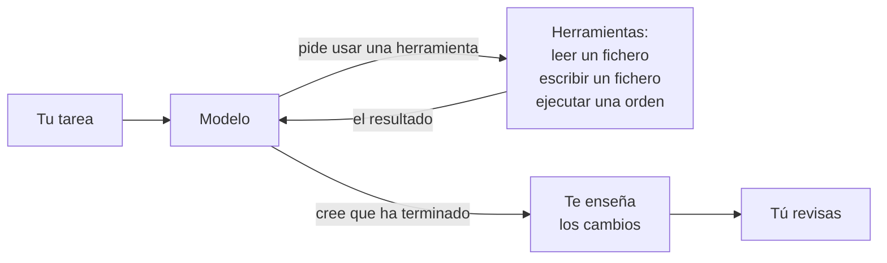
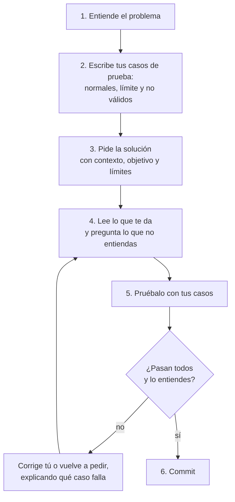

# 07.04 Programar con asistentes de IA

> **Versiones:** Git 2.56; salidas de la 2.56.0; la más reciente, la 2.56.1 (a 16 de noviembre de 2026)
> **Conviene saber antes:** [06.06 Qué es la IA y cómo funciona por dentro](../fase-06-internet-y-aplicaciones/06-que-es-la-ia.md) · [01.03 ¿Cómo sé que funciona? Probar un programa, 1.6](../fase-01-que-es-programar/03-probar-un-programa.md#16-probar-a-mano-la-traza-y-la-tabla-de-casos-de-prueba) · [03.02 La terminal: sacarle partido, 1.16](../fase-03-herramientas/02-terminal-sacarle-partido.md#116-decidir-y-repetir-en-un-script-if-y-for) · [05.01 Git: fundamentos, 1.10](../fase-05-git-y-github/01-git-fundamentos.md#110-ver-los-cambios-diff-y-show)
> **Tiempo estimado:** 2 horas
> **Nivel:** Básico · Núcleo

## Qué aprenderás

- Qué es un **asistente de programación** y qué tiene que ver con el modelo de lenguaje que viste en [06.06](../fase-06-internet-y-aplicaciones/06-que-es-la-ia.md).
- Los **tres tipos de asistente** que vas a encontrar: el **chat**, el **autocompletado en el editor** y los **asistentes que editan ficheros** por su cuenta, y cuánto hay que revisar con cada uno.
- **En qué fallan** los asistentes, una y otra vez, para saber qué buscar.
- La regla que lo ordena todo: **lo que entregas es tuyo**, lo haya escrito quien lo haya escrito.
- A **pedir bien**: contexto, objetivo, límites, un ejemplo y el formato de la respuesta.
- A darle al asistente el **contexto de tu proyecto** con un fichero que pegas o que lee él solo.
- A **comprobar siempre** lo que te da, con **tus** casos de prueba, y a revisar con **Git** lo que ha cambiado un asistente en tus ficheros.
- A usar la IA **como profesor**: que te explique, te dé pistas y revise lo tuyo, no que lo haga por ti.
- Las **cinco normas sobre el uso de la IA** de esta academia y el porqué de cada una.

## 1. Teoría

### 1.1. Qué es un asistente de programación

Un **asistente de programación** es un programa que usa un [modelo de lenguaje](../fase-06-internet-y-aplicaciones/06-que-es-la-ia.md#15-un-modelo-de-lenguaje-predice-la-siguiente-palabra) para ayudarte a escribir, entender y cambiar código, órdenes de la terminal o cualquier fichero de texto. Ya sabes cómo funciona por dentro: el modelo recibe un texto y **escribe lo que es más probable que venga después**. Si el texto es tu script hasta donde está el cursor, lo más probable es… el código que suele escribirse a continuación.

Esa idea explica casi todo lo que hace bien y casi todo lo que hace mal:

- **Bien:** ha leído muchísimo código. Sabe cómo se escribe un `if` en bash, un fichero JSON o un mensaje de commit, y lo escribe en segundos.
- **Mal:** escribe lo **probable**, no lo **correcto** ([06.06, 1.8](../fase-06-internet-y-aplicaciones/06-que-es-la-ia.md#18-predice-no-sabe)). No ha ejecutado tu código, no conoce tu proyecto y nunca dice «no lo sé» si no le das esa salida.

Piensa en él como en un **compañero recién llegado, muy rápido y muy seguro de sí mismo**: ha leído todos los libros, pero no conoce tu proyecto ni ha probado nada. Es muy útil, y no le dejarías publicar nada sin revisarlo.

> **📌 Nota:** en este módulo no se enseña a manejar ningún producto concreto, ni se comparan: cambian cada pocos meses, se renombran y algunos desaparecen. Se enseña **cómo trabajar** con cualquiera de ellos, que es lo que no caduca. Todo lo que se dice de los asistentes en general es lo que se veía a **16 de noviembre de 2026**.

### 1.2. Tres tipos de asistente

A 16 de noviembre de 2026, los asistentes de programación trabajan de tres formas, de menos a más autonomía. Muchos productos tienen las tres; VS Code, por ejemplo, las describe en su documentación (sugerencias mientras escribes, un chat y agentes que hacen cambios y comprueban el resultado; consultada el 16 de noviembre de 2026), y ya viste dónde está su chat en [03.03](../fase-03-herramientas/03-editor-de-codigo.md#115-lo-que-verás-más-adelante).

| Tipo | Qué hace | Ejemplo | Cuánto tienes que revisar |
|---|---|---|---|
| **Chat** | Le escribes una pregunta o una petición y contesta en una conversación: en una web, en una aplicación o en una ventana de tu editor | «¿Qué significa este error de Git?», «Escríbeme un script que cuente las líneas de un CSV» | Todo lo que te propone, **antes** de copiarlo a tu proyecto |
| **Autocompletado en el editor** | Mientras escribes, propone en gris el resto de la línea o varias líneas; si te gusta, lo aceptas con una tecla (normalmente <kbd>Tab</kbd>) | Escribes `if [ "$nota"` y te propone el resto de la condición | Poco cada vez, pero muchas veces al día: es fácil aceptar sin leer |
| **Asistente que edita ficheros** (a menudo lo llaman **agente**) | Le das una **tarea** y él solo lee ficheros de tu proyecto, los cambia, ejecuta órdenes (para probar lo que ha hecho) y repite hasta que cree que ha terminado | «Añade al README cómo se usa el script y compruébalo» | **Todo**: puede haber tocado muchos ficheros, y también los que no le pediste |

El tercero es el que más ha cambiado la forma de programar: ya no te sugiere una línea, sino que hace el trabajo de una tarde. Por dentro es un bucle como el de la [conversación de 06.06](../fase-06-internet-y-aplicaciones/06-que-es-la-ia.md#24-una-conversación-por-dentro), pero el programa que rodea al modelo le deja **usar herramientas** (leer un fichero, escribirlo, ejecutar una orden) y le devuelve el resultado:



En texto: le das la tarea al modelo; el modelo pide usar una herramienta (leer, escribir, ejecutar), recibe el resultado y vuelve a decidir, una y otra vez, hasta que **cree** que ha terminado; entonces te enseña los cambios, y el último paso es tuyo: revisarlos.

Fíjate en la palabra **cree**. Que crea que ha terminado no quiere decir que esté bien: el modelo sigue escribiendo lo más probable, también cuando decide que ya está.

> **📌 Nota:** los asistentes que editan ficheros suelen **pedirte permiso** antes de cambiar un fichero o de ejecutar una orden, y casi todos dejan elegir qué acciones necesitan tu confirmación (la documentación de VS Code lo llama «permissions and approvals», consultada el 16 de noviembre de 2026). Ese permiso es tu oportunidad de revisar: lo verás en el [apartado 1.8](#18-revisar-lo-que-cambia-un-asistente-que-edita-ficheros).

### 1.3. En qué fallan los asistentes

Las [alucinaciones](../fase-06-internet-y-aplicaciones/06-que-es-la-ia.md#19-las-alucinaciones) ya las conoces. Al programar, los fallos de un asistente se repiten tanto que tienen forma reconocible. Conócelos y sabrás qué buscar:

| Fallo | Qué pasa | Ejemplo |
|---|---|---|
| **Parece correcto y no lo es** | Se lee bien, funciona con el caso que pensaste… y falla con otro | Un script de notas que da «Suspenso» a un 5 ([ejemplo 2.2](#22-el-script-que-propuso-el-asistente)) |
| **Casos límite olvidados** | Cubre el caso de manual; el cero, el vacío, el valor justo de la frontera o el dato imposible, no | Contar socios contando también la cabecera del CSV ([ejercicio 4](#ejercicio-4--probar-el-script-de-los-socios)) |
| **Opciones u órdenes inventadas** | Usa una opción que «debería existir» porque se parece a otras que sí existen | El `wc -l --skip-empty` del [ejercicio 4 de 06.06](../fase-06-internet-y-aplicaciones/06-que-es-la-ia.md#ejercicio-4--qué-hay-que-comprobar-en-esta-respuesta) |
| **De otra época** | Aprendió de textos hasta su [fecha de corte](../fase-06-internet-y-aplicaciones/06-que-es-la-ia.md#17-de-predecir-texto-a-conversar-cómo-se-entrena-un-asistente): te da la forma antigua de hacer algo, o una versión que ya no es la última | Te dice que instales una versión de un programa que ya no se usa |
| **Pruebas que no prueban nada** | Si le pides los casos de prueba, a menudo saca la salida esperada de lo que hace su propio código, no del enunciado | El error de [01.03, 3.2](../fase-01-que-es-programar/03-probar-un-programa.md#32-sacar-la-salida-esperada-del-propio-programa), hecho por una máquina ([ejercicio 3](#ejercicio-3--los-casos-de-prueba-del-asistente)) |
| **Hace más de lo que le pides** | Un asistente que edita ficheros «aprovecha» para cambiar otros ficheros, reordenar datos o borrar algo que no entendía | Le pides cambiar el README y cambia también una nota del CSV ([ejemplo 2.4](#24-revisar-con-git-lo-que-ha-cambiado)) |
| **Te da la razón** | Si le dices «creo que el fallo está aquí», tiende a encontrarlo ahí, aunque no esté | Te confirma una explicación equivocada con mucha seguridad |
| **Cambia la prueba para que pase** | Si una prueba falla, «arregla» la prueba en lugar del programa | El error de [01.03, 3.5](../fase-01-que-es-programar/03-probar-un-programa.md#35-cambiar-la-prueba-para-que-pase) |
| **Fallos de seguridad** | Escribe una contraseña dentro del código o te propone una orden peligrosa | Una clave escrita en un script en lugar de en el [fichero `.env`](../fase-04-formatos-y-diagramas/04-xml-csv-y-otros.md#114-el-fichero-env-y-los-secretos) |

> **⚠️ Cuidado con lo que te propone instalar:** si un asistente te dice que instales un programa, una extensión o una biblioteca, comprueba que existe en su **web oficial** y quién lo publica antes de instalar nada ([02.03, 1.3](../fase-02-tu-ordenador/03-instalar-programas-y-path.md#13-descarga-siempre-de-la-web-oficial)). Un modelo puede inventarse un nombre que suena bien, y hay quien publica programas maliciosos justo con los nombres que los modelos suelen inventar.

### 1.4. La regla de oro: lo que entregas es tuyo

Hay una regla que ordena todo lo demás:

> **Eres responsable de cada línea que aceptas, igual que si la hubieras escrito tú.** Si no la entiendes, no la aceptes.

En la práctica, quiere decir tres cosas:

1. **Entender:** puedes explicar qué hace cada línea y por qué. Si no puedes, pregúntaselo al propio asistente («explícame este script línea a línea»), o búscalo en la documentación, **antes** de aceptarlo.
2. **Comprobar:** no basta con que «parezca bien». Se ejecuta y se prueba con **tus** casos de prueba ([apartado 1.7](#17-comprobar-siempre-con-tus-casos-de-prueba)).
3. **Responder:** si alguien te pregunta «¿por qué lo has hecho así?», «me lo dijo la IA» no es una respuesta. En un trabajo, si lo que entregas tiene un fallo, a nadie le importará quién lo escribió: lo entregaste tú.

### 1.5. Pedir bien

Lo que escribes al asistente (la **petición**; en inglés, *prompt*) es el texto que va a continuar el modelo: cuanto mejor sea, más se parecerá la respuesta a lo que necesitas. En la [conversación de 06.06](../fase-06-internet-y-aplicaciones/06-que-es-la-ia.md#110-el-contexto-la-memoria-de-trabajo-del-modelo) viste que el modelo solo sabe lo que hay en el contexto: **lo que no le digas, se lo imagina**. Una buena petición tiene cinco partes:

| Parte | Qué le dices | Petición mala | Petición buena |
|---|---|---|---|
| **Contexto** | Qué estás haciendo, con qué herramientas y qué nivel tienes | — | «Estoy aprendiendo bash. Uso Git Bash en Windows y el script tiene que funcionar también en macOS» |
| **Objetivo** | Qué quieres conseguir, en concreto | «Haz un script de notas» | «Un script que reciba una nota entera de 0 a 10 y escriba su calificación: Suspenso, Aprobado, Notable o Sobresaliente» |
| **Límites** | Las reglas que debe cumplir y lo que **no** debe hacer | — | «Calificaciones de España: 5 y 6 Aprobado, 7 y 8 Notable, 9 y 10 Sobresaliente. Una nota fuera de 0 a 10 se rechaza. Sin programas que haya que instalar» |
| **Un ejemplo** | Una entrada con la salida que esperas | — | «`bash nota.sh 7` debe escribir `Notable`» |
| **Formato de la respuesta** | Cómo quieres que te conteste | — | «Dame el script con un comentario en cada parte y explícame las líneas que sean nuevas para mí» |

La petición buena es más larga, y escribirla te obliga a algo muy útil: **pensar qué quieres antes de pedirlo**, igual que pensabas los [casos de prueba antes de programar](../fase-01-que-es-programar/03-probar-un-programa.md#15-piensa-los-casos-antes-de-programar). Si no sabes rellenar alguna de las cinco partes, todavía no has entendido el problema, y el asistente tampoco lo va a entender por ti.

Más consejos que funcionan con cualquier asistente:

- **Divide.** Una tarea grande («hazme la web del club») sale peor que varias pequeñas, cada una revisada antes de la siguiente. Es [descomponer un problema](../fase-01-que-es-programar/02-algoritmos-y-pseudocodigo.md#12-descomponer-un-problema), como en la fase 1.
- **Dale permiso para no saber:** «si no estás seguro, dímelo; no te lo inventes» ([06.06, 1.9](../fase-06-internet-y-aplicaciones/06-que-es-la-ia.md#19-las-alucinaciones)).
- **Dale los datos, no le pidas que los recuerde:** pega el error exacto, el fragmento que importa, la línea del CSV (sin datos personales: lo verás en la norma 3).
- **Corrige pronto.** Si ves que se va por otro camino, para y explícale por qué. Si después de dos o tres intentos sigue sin salir, **empieza una conversación nueva** con una petición mejor: una conversación larga llena de intentos fallidos ocupa el contexto y le confunde ([06.06, 1.10](../fase-06-internet-y-aplicaciones/06-que-es-la-ia.md#110-el-contexto-la-memoria-de-trabajo-del-modelo)).
- **Una conversación por tema.** Lo que hablasteis de otra cosa solo estorba.

### 1.6. El contexto de tu proyecto, escrito una vez

Cada conversación nueva empieza **en blanco**: el asistente no sabe qué es tu proyecto, con qué trabajas ni qué normas sigues. Puedes repetírselo cada vez o escribirlo **una sola vez** en un fichero y pegarlo al principio de cada conversación. Es la costumbre que ya te recomendaba [06.06 en su error típico 3.4](../fase-06-internet-y-aplicaciones/06-que-es-la-ia.md#34-esperar-que-recuerde-lo-que-le-dijiste-en-otra-conversación), y es como el papel de bienvenida que le darías a una persona nueva en el equipo.

Un buen fichero de contexto es **corto** y dice:

- **Qué es** el proyecto, en dos o tres líneas, y qué ficheros tiene.
- **Con qué trabajas**: herramientas, sistema y lo que debe funcionar también en otros sistemas.
- **Las normas** que no se ven en los ficheros: formatos de fecha, idioma, reglas del negocio.
- **Cómo se comprueba** que algo está bien: tus casos de prueba, una orden que lo revise.
- **Lo que no debe hacer**: tocar los datos de verdad, cambiar las pruebas para que pasen, inventarse lo que no sabe.

Y lo que **no** lleva: ni contraseñas, ni claves, ni datos personales (es un fichero que vas a pegar en un chat), ni párrafos largos que nadie lee. Verás uno entero en el [ejemplo 2.6](#26-un-fichero-de-contexto-del-proyecto).

> **📌 Nota:** muchos asistentes que editan ficheros leen ellos solos, al empezar, un fichero de instrucciones del proyecto, cada uno con su nombre. Hay además una convención que usan varias herramientas, **`AGENTS.md`**: un fichero Markdown en la raíz del proyecto, «como un README para agentes», con lo que necesitan para trabajar en él (órdenes para probar, normas, avisos de seguridad). Su web, [agents.md](https://agents.md/), lo presenta como «un formato sencillo y abierto» para guiar a los agentes (consultada el 16 de noviembre de 2026). El contenido es el mismo que el de tu fichero de contexto: lo que cambia es quién lo lee.

### 1.7. Comprobar siempre, con tus casos de prueba

Ya lo sabes desde [01.03](../fase-01-que-es-programar/03-probar-un-programa.md#16-probar-a-mano-la-traza-y-la-tabla-de-casos-de-prueba): un programa no funciona porque lo parezca, sino porque pasa una buena tabla de casos de prueba. Con lo que te da un asistente es **exactamente igual**, con un matiz importante: **los casos los pones tú**.

El orden de trabajo que funciona:



En texto: primero entiendes el problema y escribes tus casos de prueba; después pides la solución; la lees y preguntas lo que no entiendas; la pruebas con tus casos; si alguno falla o no la entiendes, corriges o vuelves a pedir explicando qué caso falla, y vuelves a leer y probar; cuando todo pasa y lo entiendes, haces el commit.

Por qué los casos **antes** y **tuyos**:

- **La salida esperada sale del enunciado, nunca de lo que dice la IA.** Si le pides al asistente el código **y** las pruebas, puede equivocarse igual en los dos sitios, y las pruebas pasarán. Es el error de [sacar la salida esperada del propio programa](../fase-01-que-es-programar/03-probar-un-programa.md#32-sacar-la-salida-esperada-del-propio-programa), con un ayudante muy convincente.
- **Los límites son donde falla.** El asistente suele acertar con el caso de manual; los errores están en la frontera (el 5 justo) y en los datos raros (el 11, el fichero vacío), justo los [casos límite y no válidos](../fase-01-que-es-programar/03-probar-un-programa.md#14-qué-casos-elegir-normales-límite-y-no-válidos) que tienes que poner tú.
- **Preguntarle «¿está bien?» no es comprobar.** Te dirá que sí con la misma seguridad con la que lo escribió. Comprobar es ejecutarlo con tus casos, mirar la documentación oficial o hacerlo a mano.

Además de los casos, una lista rápida para cada cosa que te propone:

1. **¿Hace lo que pedí, y solo eso?** Ni menos (se ha olvidado de las notas no válidas) ni más (ha cambiado otro fichero).
2. **¿Existe todo lo que usa?** Cada orden u opción que no conozcas, compruébala con `--help` o `man` ([03.01](../fase-03-herramientas/01-terminal-lo-basico.md)).
3. **¿Funciona donde lo vas a usar?** Tu sistema, tu versión, también macOS si hace falta.
4. **¿Hay algo peligroso?** Contraseñas escritas dentro, órdenes que borran o que piden `sudo` ([apartado 1.8](#18-revisar-lo-que-cambia-un-asistente-que-edita-ficheros)).
5. **¿Lo entiendo entero?** Si no, todavía no es tuyo ([apartado 1.4](#14-la-regla-de-oro-lo-que-entregas-es-tuyo)).

### 1.8. Revisar lo que cambia un asistente que edita ficheros

Con un chat, tú copias lo que quieres. Con un asistente que edita ficheros, **los cambios ya están en tu disco** cuando terminas de leer su resumen. Tu red de seguridad es [Git](../fase-05-git-y-github/01-git-fundamentos.md):

- **Commit antes de empezar.** Así tienes una foto del proyecto a la que volver pase lo que pase.
- **`git status` y `git diff` al terminar** ([05.01, 1.10](../fase-05-git-y-github/01-git-fundamentos.md#110-ver-los-cambios-diff-y-show)): qué ficheros ha tocado y qué líneas ha cambiado en cada uno. No te fíes de su resumen («he cambiado el README»): mira el `diff`, que no se equivoca.
- **Deshaz lo que no pediste** con `git restore` ([05.01, 1.13](../fase-05-git-y-github/01-git-fundamentos.md#113-deshacer-cambios)), y acepta el resto con un commit pequeño que diga qué cambia.

Lo verás entero en el [ejemplo 2.4](#24-revisar-con-git-lo-que-ha-cambiado).

**Las órdenes que quiere ejecutar.** Antes de ejecutar una orden, el asistente suele pedirte permiso. Léela **siempre** y aplica lo que ya sabes:

- **Si no la entiendes, no la apruebes.** Pregúntale qué hace, o mírala con `--help`.
- **Mucho cuidado con lo que borra o sobrescribe** (`rm`, `mv` encima de otro fichero, `>`), con lo que pide **`sudo`** (el [mínimo privilegio](../fase-03-herramientas/02-terminal-sacarle-partido.md#111-administrador-sudo-y-cuándo-no-usarlo) vale también para él) y con lo que **descarga y ejecuta** algo de internet en una sola orden.
- **Cuidado con lo que sale de tu ordenador:** un `git push`, sobre todo con `--force` ([05.03, 3.2](../fase-05-git-y-github/03-github.md#32-el-push-rechazado-y-el---force)), o una orden que envía datos a otro sitio.
- **No le des permiso para todo** «para ir más rápido». El permiso de cada orden es justo el momento en que puedes parar un error.

### 1.9. Usar la IA como profesor

La pregunta que más importa mientras estudias: **¿debes usar un asistente para hacer los ejercicios?**

Un ejercicio no sirve para tener la solución (la solución ya está en el curso, plegada): sirve para que **tu cabeza aprenda a resolver** ese tipo de problema. Si lo resuelve la IA, el ejercicio está hecho y tu cabeza no ha aprendido nada. Es como ir al gimnasio y que otro levante las pesas por ti. Y en [06.06](../fase-06-internet-y-aplicaciones/06-que-es-la-ia.md#114-para-qué-sirve-y-para-qué-no) viste que «hacerte los ejercicios» está en la columna de lo que le va mal a la IA, no porque no sepa, sino porque **no aprenderías tú**.

Pero un asistente puede ser un **profesor particular** excelente, disponible a cualquier hora y que no se cansa de explicar. La diferencia está en lo que le pides:

| Pídele que… | Ejemplo | No le pidas que… |
|---|---|---|
| **Te explique** un concepto, de otra forma o con otro ejemplo | «Explícame la diferencia entre `-gt` y `-ge` con un ejemplo de notas» | Te dé la solución del ejercicio antes de intentarlo |
| **Te dé una pista**, sin la solución | «Estoy en el ejercicio 4; no me des la solución: ¿qué tipo de caso me estoy dejando?» | Escriba lo que tú no sabrías escribir y no entiendes |
| **Revise** tu solución cuando ya la tienes | «Esta es mi tabla de casos de prueba: ¿qué caso límite me falta? No me la rehagas» | Corrija tu trabajo sin decirte qué estaba mal |
| **Te pregunte** a ti, como en un examen | «Hazme cinco preguntas sobre `git restore` y corrígeme las respuestas» | Te resuma un módulo para no leerlo |
| **Te explique un error** que te sale | «¿Qué significa este error y qué puede causarlo?» ([03.04, 1.13](../fase-03-herramientas/04-errores-y-depuracion.md#113-buscar-ayuda-internet-y-la-ia)) | Lo arregle sin que entiendas qué pasaba |

Y una prueba sencilla para saber si estás aprendiendo: **cierra el chat e intenta hacerlo otra vez tú solo**. Si puedes, lo has aprendido. Si no, la IA lo ha hecho por ti.

Más adelante, en el trabajo, la misma idea con otras palabras: un asistente **multiplica lo que sabes**. Si sabes mucho, te hace mucho más rápido. Si no sabes, multiplica por cero: no puedes revisar lo que no entiendes, y aceptarás los errores con la misma confianza que los aciertos.

### 1.10. Las cinco normas de la academia

Todo lo anterior se resume en **cinco normas** que valen para todos los cursos de MyOpenAcademy. Son **recomendaciones**: nadie corrige ni vigila si las cumples. Están para que aprendas de verdad.

1. **Intenta cada ejercicio tú primero.** Usa la IA como profesor: que te explique, te dé pistas o revise tu solución, no que la haga por ti.

   Es lo del [apartado 1.9](#19-usar-la-ia-como-profesor). Intentarlo primero no quiere decir sacarlo solo: quiere decir pensar, probar y equivocarte antes de pedir ayuda. Lo que aprendes está justo en ese esfuerzo.

2. **Comprueba siempre lo que te dé**, con casos de prueba (módulo [«Probar un programa»](../fase-01-que-es-programar/03-probar-un-programa.md)).

   Es lo del [apartado 1.7](#17-comprobar-siempre-con-tus-casos-de-prueba): tus casos, con su salida esperada sacada del enunciado, antes de fiarte de nada.

3. **Nunca pegues** contraseñas, claves ni datos personales en un chat de IA.

   Por qué, y cómo limpiar lo que vas a pegar, lo tienes en [06.06, 1.12](../fase-06-internet-y-aplicaciones/06-que-es-la-ia.md#112-privacidad-lo-que-escribes-sale-de-tu-ordenador). Con un asistente que edita ficheros, piensa además que **lee los ficheros de tu proyecto**: si hay un `.env` con secretos, puede leerlo y enviarlo con el resto. Dónde se guardan los secretos lo verás en [07.05, apartado 1.13](05-seguridad-basica.md#113-los-secretos-dónde-se-guardan).

4. **En el proyecto final puedes usarla**, pero debes entender y poder explicar todo lo que entregues. Cuéntalo en el README, en una sección «Cómo lo hice».

   El [proyecto final](../fase-08-proyecto-final/01-primer-repositorio.md) (fase 8) es tuyo y va a tu portfolio: cualquiera que lo vea puede preguntarte por cualquier línea. En la sección «Cómo lo hice» cuentas, con sinceridad, qué hiciste tú, en qué te ayudó la IA y cómo lo comprobaste. No es una confesión: es lo que hace un profesional, y dice mucho de cómo trabajas. Verás una en el [ejercicio 7](#ejercicio-7--la-sección-cómo-lo-hice).

5. **Las soluciones del curso ya están plegadas**: mira antes la tuya.

   Para comparar tu solución con una buena no necesitas un asistente: la del curso está debajo de cada ejercicio, comprobada y explicada. Por qué se abre **después** de intentarlo, y cómo usar antes las pistas, lo tienes en [07.01, apartado 1.4](01-como-estudiar.md#14-por-qué-las-soluciones-están-plegadas).

> **💡 Consejo:** si en algún curso usas la IA para algo que no encaja en estas normas, hazte la pregunta del [apartado 1.9](#19-usar-la-ia-como-profesor): ¿podría hacerlo yo solo ahora, sin el chat? Si la respuesta es no, todavía te queda algo por aprender.

## 2. Ejemplos de código

> **📌 Nota:** las conversaciones y el código «que propuso el asistente» de este módulo son **ilustrativos**: están escritos para el curso, no copiados de ningún producto concreto, porque la respuesta de un asistente cambia en cada ejecución y no se podría comprobar. Los fallos que llevan son los que cometen de verdad estas herramientas, y todo el código (el propuesto y el revisado) está ejecutado y comprobado en la terminal del curso.

### 2.1. La misma petición, mal y bien

**Situación real:** Maite da clases en la Academia Brújula, una academia de repaso, y está aprendiendo bash. Quiere un script que convierta las notas de sus alumnos en calificaciones. Su primera petición fue esta:

```text
Maite:     haz un script de notas
```

Una petición así obliga al modelo a imaginarse todo: qué lenguaje, qué notas (¿de 0 a 10?, ¿con decimales?), qué calificaciones (¿las de España?, ¿letras como A, B, C?), qué hacer con un 11. Escribirá lo más probable, y lo más probable puede no ser lo que Maite necesita.

Su segunda petición, con las cinco partes del [apartado 1.5](#15-pedir-bien):

```text
Maite:     Estoy aprendiendo bash. Uso Git Bash en Windows, y el script tiene que
            funcionar también en el Mac de la academia.

            Quiero un script, nota.sh, que reciba una nota entera de 0 a 10 como
            argumento y escriba su calificación.

            Son las calificaciones de España: de 0 a 4, Suspenso; 5 y 6, Aprobado;
            7 y 8, Notable; 9 y 10, Sobresaliente. Si la nota está fuera de 0 a 10,
            tiene que avisar. Sin programas que haya que instalar.

            Por ejemplo, «bash nota.sh 7» debe escribir «Notable».

            Dame el script con un comentario en cada parte y explícame las líneas
            que no haya visto en el curso. Si algo no está claro, pregúntame.
```

**Qué demuestra:** la segunda petición tiene contexto (bash, Git Bash, macOS), objetivo (el script y lo que hace), límites (las calificaciones exactas y qué hacer con las notas imposibles), un ejemplo y el formato de la respuesta. Y al escribirla, Maite ya tiene medio hecha su tabla de casos de prueba: sabe qué debe salir con cada nota.

### 2.2. El script que propuso el asistente

**Situación real:** con la primera petición, la corta, el asistente le propuso a Maite este script (es un ejemplo **ilustrativo**, con fallos típicos). `elif` es «si no, si»: si la condición anterior no se cumple, se prueba esta.

```bash
#!/usr/bin/env bash
# LO QUE PROPUSO EL ASISTENTE (ejemplo preparado para el curso, con fallos típicos)
# Convierte una nota de 0 a 10 en su calificación.
# Uso: bash nota.sh NOTA
nota=$1

if [ "$nota" -gt 9 ]; then
    echo "Sobresaliente"
elif [ "$nota" -gt 7 ]; then
    echo "Notable"
elif [ "$nota" -gt 5 ]; then
    echo "Aprobado"
else
    echo "Suspenso"
fi
```

📁 **Código:** [`codigo/04-programar-con-asistentes-de-ia/ejemplos/2.2-el-script-propuesto/`](codigo/04-programar-con-asistentes-de-ia/ejemplos/2.2-el-script-propuesto/)

Se lee bien y parece correcto. Maite lo prueba primero con tres notas «de manual», una de cada grupo, y después con su tabla de casos de prueba: los límites (5, 7 y 9) y dos notas imposibles (11 y −2).

**En tu terminal** (`sesion.txt`):

```text
$ bash nota.sh 3
Suspenso
$ bash nota.sh 6
Aprobado
$ bash nota.sh 10
Sobresaliente
$ bash nota.sh 5
Suspenso
$ bash nota.sh 7
Aprobado
$ bash nota.sh 9
Notable
$ bash nota.sh 11
Sobresaliente
$ bash nota.sh -2
Suspenso
```

📁 **Código:** [`codigo/04-programar-con-asistentes-de-ia/ejemplos/2.2-el-script-propuesto/`](codigo/04-programar-con-asistentes-de-ia/ejemplos/2.2-el-script-propuesto/)

Su tabla de casos de prueba, con lo que ha salido:

| Nº | Qué se prueba | Entrada | Salida esperada | Salida obtenida | ¿Pasa? |
|---|---|---|---|---|---|
| 1 | Suspenso normal | 3 | Suspenso | Suspenso | ✅ |
| 2 | Aprobado normal | 6 | Aprobado | Aprobado | ✅ |
| 3 | Sobresaliente normal | 10 | Sobresaliente | Sobresaliente | ✅ |
| 4 | Límite del aprobado | 5 | Aprobado | Suspenso | ❌ |
| 5 | Límite del notable | 7 | Notable | Aprobado | ❌ |
| 6 | Límite del sobresaliente | 9 | Sobresaliente | Notable | ❌ |
| 7 | Nota imposible por arriba | 11 | Aviso de nota no válida | Sobresaliente | ❌ |
| 8 | Nota imposible por abajo | −2 | Aviso de nota no válida | Suspenso | ❌ |

**Qué demuestra:** con los tres casos «de manual», el script pasa y cualquiera lo daría por bueno. Los fallos están **todos** en los límites y en los datos no válidos, justo donde dice [01.03](../fase-01-que-es-programar/03-probar-un-programa.md#14-qué-casos-elegir-normales-límite-y-no-válidos) que se concentran. Las tres primeras filas son el error de `>` frente a `≥` (`-gt` es «mayor que»: un 5 no es mayor que 5); las dos últimas, que nadie le dijo al asistente qué hacer con una nota imposible, y no lo hizo.

### 2.3. La versión revisada

**Situación real:** Maite le enseña al asistente su tabla con los casos que fallan y le pide que le **explique** por qué fallan antes de corregir nada. Con la explicación, entiende el problema de `-gt` y escribe ella los cambios. Esta es la versión revisada:

```bash
#!/usr/bin/env bash
# LA VERSIÓN REVISADA: límites con -ge y notas fuera de 0 a 10 rechazadas.
# Convierte una nota entera de 0 a 10 en su calificación.
# Uso: bash nota.sh NOTA

# Sin una nota no se puede calificar nada: se explica cómo se usa y se termina con 2
if [ $# -ne 1 ]; then
    echo "Uso: bash nota.sh NOTA (un número entero de 0 a 10)" >&2
    exit 2
fi

nota=$1

# Una nota fuera de 0 a 10 no tiene calificación: se avisa y se termina con 1
if [ "$nota" -lt 0 ] || [ "$nota" -gt 10 ]; then
    echo "Nota no válida: $nota (tiene que estar entre 0 y 10)" >&2
    exit 1
fi

# -ge quiere decir «mayor o igual»: el 9, el 7 y el 5 justos cuentan
if [ "$nota" -ge 9 ]; then
    echo "Sobresaliente"
elif [ "$nota" -ge 7 ]; then
    echo "Notable"
elif [ "$nota" -ge 5 ]; then
    echo "Aprobado"
else
    echo "Suspenso"
fi
```

📁 **Código:** [`codigo/04-programar-con-asistentes-de-ia/ejemplos/2.3-el-script-revisado/`](codigo/04-programar-con-asistentes-de-ia/ejemplos/2.3-el-script-revisado/)

Y vuelve a pasar **todos** los casos, no solo los que fallaban, más uno nuevo: el script sin nota.

**En tu terminal** (`sesion.txt`):

```text
$ bash nota.sh 3
Suspenso
$ bash nota.sh 6
Aprobado
$ bash nota.sh 10
Sobresaliente
$ bash nota.sh 5
Aprobado
$ bash nota.sh 7
Notable
$ bash nota.sh 9
Sobresaliente
$ bash nota.sh 11
Nota no válida: 11 (tiene que estar entre 0 y 10)
$ bash nota.sh -2
Nota no válida: -2 (tiene que estar entre 0 y 10)
$ bash nota.sh
Uso: bash nota.sh NOTA (un número entero de 0 a 10)
```

📁 **Código:** [`codigo/04-programar-con-asistentes-de-ia/ejemplos/2.3-el-script-revisado/`](codigo/04-programar-con-asistentes-de-ia/ejemplos/2.3-el-script-revisado/)

**En qué fijarte:**

- **Los límites, con `-ge`** («mayor o igual», [03.02, 1.16](../fase-03-herramientas/02-terminal-sacarle-partido.md#116-decidir-y-repetir-en-un-script-if-y-for)): ahora el 5, el 7 y el 9 justos caen en su grupo.
- **Las notas imposibles, rechazadas** por la salida de error y con el código 1. `||` es «o»: la nota es mala si es menor que 0 **o** mayor que 10.
- **Sin argumento, explica cómo se usa**, como el `stock.sh` de [03.02](../fase-03-herramientas/02-terminal-sacarle-partido.md#116-decidir-y-repetir-en-un-script-if-y-for).
- **Todavía no comprueba que la nota sea un número**: con `bash nota.sh siete`, bash se queja varias veces de que esperaba un entero (como en el [ejemplo 2.9 de 03.02](../fase-03-herramientas/02-terminal-sacarle-partido.md#29-un-script-con-argumentos)) y, aun así, el script termina escribiendo «Suspenso». Es el siguiente caso que Maite debería añadir a su tabla.
- **Lo ha escrito Maite, con ayuda**: entiende cada línea, y podría explicarla. Eso es lo que la hace suya ([apartado 1.4](#14-la-regla-de-oro-lo-que-entregas-es-tuyo)).

### 2.4. Revisar con Git lo que ha cambiado

**Situación real:** Maite tiene en Git las notas del primer examen: un `README.md` y un `notas.csv`. Le pide a un asistente que edita ficheros: «Añade al README un apartado que explique cómo se usa». El asistente dice que ha terminado y que «ha actualizado el README». Antes de aceptar nada, Maite mira **qué ha cambiado de verdad**.

En la sesión, el trabajo del asistente se **simula** copiando los ficheros tal como los dejó (están en la carpeta `propuesta/` del ejemplo); en tu ordenador, los habría cambiado él.

**En tu terminal** (`sesion.txt`):

```text
$ mkdir notas && cd notas && git init
Inicializado repositorio Git vacío en /home/alumno/notas/.git/
$ cp ../README.md ../notas.csv .
$ git add . && git commit -m "Notas del primer examen"
[main (commit-raíz) 9bf7190] Notas del primer examen
 2 files changed, 7 insertions(+)
 create mode 100644 README.md
 create mode 100644 notas.csv
$ cp ../propuesta/README.md ../propuesta/notas.csv .
$ git status --short
 M README.md
 M notas.csv
$ git diff
diff --git a/README.md b/README.md
index 0c8ee71..b6bb61d 100644
--- a/README.md
+++ b/README.md
@@ -1,3 +1,7 @@
 # Notas de la Academia Brújula
 
 Notas del primer examen de Matemáticas de 4.º de ESO.
+
+## Cómo se usa
+
+Las notas están en `notas.csv`, una fila por alumno, con su nota entera de 0 a 10.
diff --git a/notas.csv b/notas.csv
index c762627..974a63c 100644
--- a/notas.csv
+++ b/notas.csv
@@ -1,4 +1,4 @@
 alumno,nota
 Teo,6
-Carla,4
+Carla,5
 Óliver,9
$ git restore notas.csv
$ git status --short
 M README.md
$ git add README.md && git commit -m "Explica cómo se usa en el README"
[main eaf3c68] Explica cómo se usa en el README
 1 file changed, 4 insertions(+)
$ git log --oneline
eaf3c68 (HEAD -> main) Explica cómo se usa en el README
9bf7190 Notas del primer examen
```

📁 **Código:** [`codigo/04-programar-con-asistentes-de-ia/ejemplos/2.4-revisar-los-cambios-con-git/`](codigo/04-programar-con-asistentes-de-ia/ejemplos/2.4-revisar-los-cambios-con-git/)

**Qué ha pasado:**

1. **Un commit antes de empezar**: la foto a la que volver.
2. **`git status --short`** dice que ha cambiado **dos** ficheros, `README.md` y `notas.csv`, aunque el resumen del asistente solo hablaba del README.
3. **`git diff`** enseña qué líneas: en el README, el apartado nuevo, que es lo que se pidió. En `notas.csv`, **la nota de Carla ha pasado de 4 a 5**. Nadie lo pidió, y es un dato de verdad: un suspenso convertido en aprobado. Quizá el asistente «corrigió» lo que le pareció un error; da igual por qué: no se le pidió.
4. **`git restore notas.csv`** deshace ese cambio, y `git status` confirma que solo queda el del README.
5. **Un commit pequeño** con lo que sí se pidió.

**Qué demuestra:** el resumen de un asistente es su **opinión** de lo que ha hecho; el `diff` es **lo que ha hecho**. Con un commit antes y un `git diff` después, revisarlo cuesta un minuto, y Git te deja quedarte con lo bueno y tirar lo demás ([apartado 1.8](#18-revisar-lo-que-cambia-un-asistente-que-edita-ficheros)).

> **📌 Nota:** en tu ordenador, si el `diff` es largo, Git lo abre en el paginador `less`: se avanza con la barra espaciadora y se sale con <kbd>q</kbd>.

### 2.5. La IA como profesor

**Situación real:** Ulises está haciendo el ejercicio 4 de este módulo y se ha atascado: no entiende por qué el script de los socios da un número de más. En vez de pedirle la solución, le pide ayuda **como a un profesor**. La conversación es **ilustrativa**:

```text
Ulises:      Estoy aprendiendo bash con un curso. En un ejercicio, este script
            cuenta mal los socios de un CSV: con 3 socios dice 4.

                echo "Socios: $(wc -l < "$1")"

            No me des el script corregido: dame solo una pista de dónde está
            el problema.

Asistente:  Una pista: piensa en qué cuenta exactamente «wc -l» y mira la primera
            línea de tu fichero CSV. ¿Es un socio?

Ulises:      ¡La cabecera! wc -l cuenta todas las líneas, también la de los
            nombres de las columnas. ¿Voy bien?

Asistente:  Sí, ese es el problema principal. Ahora piensa cómo contar todas las
            líneas menos la primera. Y una pregunta más para tu tabla de casos:
            ¿qué debería salir con un CSV que solo tiene la cabecera?
```

**Qué demuestra:** Ulises da el contexto (aprende bash, es un ejercicio), pega **solo** la línea que importa y pide **una pista**, no la solución. El asistente le hace pensar, y Ulises encuentra el error él solo. Además le sale un caso de prueba nuevo, el CSV vacío. Es la norma 1 en acción: ha usado la IA, y ha aprendido.

Fíjate también en lo que **no** ha hecho: no ha pegado el CSV con los nombres de los socios. Para entender el problema no hacía falta (norma 3).

### 2.6. Un fichero de contexto del proyecto

**Situación real:** Maite usa el asistente varias veces por semana para el proyecto de las notas, y está cansada de explicarle lo mismo en cada conversación. Escribe, una vez, su fichero de contexto ([apartado 1.6](#16-el-contexto-de-tu-proyecto-escrito-una-vez)), y lo pega al principio de cada conversación nueva:

```markdown
# Contexto del proyecto: notas de la Academia Brújula

Pégalo al principio de cada conversación nueva con un asistente de IA.

## Qué es

Un script de bash, `nota.sh`, que convierte una nota entera de 0 a 10 en su calificación
(Suspenso, Aprobado, Notable o Sobresaliente), y el fichero `notas.csv` con las notas.

## Con qué trabajo

- bash, en Git Bash (Windows) y en Linux. El script tiene que funcionar también en macOS (bash 3.2).
- Solo órdenes básicas: nada que haya que instalar.
- El proyecto está en Git; hago un commit antes de cada cambio grande.

## Normas

- Las calificaciones son las de España: Suspenso de 0 a 4, Aprobado de 5 a 6, Notable de 7 a 8
  y Sobresaliente de 9 a 10.
- Una nota fuera de 0 a 10 se rechaza con un mensaje por la salida de error.
- Mensajes y comentarios, en español.

## Cómo se comprueba

Con la tabla de casos de prueba de `casos.md`: 0, 4, 5, 6, 7, 8, 9, 10, -1 y 11.

## Lo que no debes hacer

- No cambies `notas.csv`: son las notas de verdad.
- No cambies los casos de prueba para que pasen.
- Si no estás seguro de algo, dilo y pregúntame.
```

📁 **Código:** [`codigo/04-programar-con-asistentes-de-ia/ejemplos/2.6-el-contexto-del-proyecto/`](codigo/04-programar-con-asistentes-de-ia/ejemplos/2.6-el-contexto-del-proyecto/)

**En qué fijarte:**

- **Es corto**: se lee en un minuto, y cada línea sirve para algo.
- **Lleva lo que no se ve en los ficheros**: las calificaciones de España, que tiene que funcionar en macOS, cómo se comprueba.
- **Dice lo que no debe hacer**, y dos de esas líneas habrían evitado el cambio de la nota de Carla del [ejemplo 2.4](#24-revisar-con-git-lo-que-ha-cambiado) y el error de [cambiar la prueba para que pase](../fase-01-que-es-programar/03-probar-un-programa.md#35-cambiar-la-prueba-para-que-pase).
- **No lleva ningún dato personal ni ningún secreto**: ni nombres de alumnos, ni notas, ni contraseñas. Es un fichero para pegar en un chat.
- **Le da permiso para no saber**: «si no estás seguro, dilo».

Un fichero así también sirve para las personas: si mañana alguien se une al proyecto, con leerlo sabe por dónde empezar.

## 3. Errores típicos

### 3.1. Pegar el enunciado del ejercicio y copiar la solución

**Qué pasa:** pegas el enunciado de un ejercicio en el chat, te da una solución que funciona, la copias y pasas al siguiente. Una semana después, en un ejercicio parecido, no sabes ni por dónde empezar.

**Por qué ocurre:** el ejercicio era para que aprendieras a resolverlo, y lo ha resuelto otro. Tienes la solución, pero no lo que la solución tenía que enseñarte ([apartado 1.9](#19-usar-la-ia-como-profesor)).

**Cómo se arregla:** intenta cada ejercicio tú primero (norma 1). Si te atascas, abre las pistas del curso, y si aún así no sale, pídele a la IA **una pista o una explicación**, no la solución. Y al terminar, compara con la solución del curso (norma 5).

### 3.2. Aceptar lo que no entiendes

**Qué pasa:** el asistente te propone un script con una línea que no has visto nunca. Funciona, así que lo aceptas. Meses después falla, y no sabes ni qué hacía esa línea.

**Por qué ocurre:** «funciona con lo que he probado» parecía suficiente. Pero lo que no entiendes no lo puedes revisar, ni arreglar, ni explicar ([apartado 1.4](#14-la-regla-de-oro-lo-que-entregas-es-tuyo)).

**Cómo se arregla:** antes de aceptar, pregunta: «explícame esta línea», «¿qué pasa si el fichero no existe?». Y compruébalo en la documentación con `--help` o `man`. Si sigues sin entenderlo, no lo aceptes todavía.

### 3.3. Dejar que un asistente cambie ficheros sin un commit antes

**Qué pasa:** le das una tarea a un asistente que edita ficheros, cambia siete, y algo deja de funcionar. No sabes qué ha cambiado ni cómo era antes.

**Por qué ocurre:** sin un commit previo, no hay una foto a la que volver, ni un `git diff` que te diga qué ha cambiado.

**Cómo se arregla:** **commit antes de cada tarea**, `git status` y `git diff` al terminar, `git restore` para lo que no quieras ([ejemplo 2.4](#24-revisar-con-git-lo-que-ha-cambiado)). Y mejor tareas pequeñas: siete ficheros cambiados de golpe son difíciles de revisar.

### 3.4. Aprobar una orden que no entiendes

**Qué pasa:** el asistente te pide permiso para ejecutar una orden larga con `sudo` y un `rm`. Tienes prisa, y apruebas. Borra algo que no debía.

**Por qué ocurre:** el asistente escribió la orden más probable para lo que creía que había que hacer, sin saber qué hay en tu ordenador ni qué es importante para ti. Y con `sudo`, una orden equivocada puede hacer mucho más daño ([03.02, 1.11](../fase-03-herramientas/02-terminal-sacarle-partido.md#111-administrador-sudo-y-cuándo-no-usarlo)).

**Cómo se arregla:** lee **cada** orden antes de aprobarla. Si no la entiendes, pregúntale qué hace o mírala con `--help`, y no la apruebes hasta entenderla. Lo que borra, lo que pide `sudo`, lo que descarga y ejecuta y lo que envía algo fuera, con lupa ([apartado 1.8](#18-revisar-lo-que-cambia-un-asistente-que-edita-ficheros)).

### 3.5. Seguir insistiendo en una conversación que se ha torcido

**Qué pasa:** el asistente propone algo que no funciona; se lo dices y propone otra cosa que tampoco; y así diez veces. Cada respuesta es peor que la anterior, y vuelve a proponer cosas que ya no funcionaron.

**Por qué ocurre:** todos los intentos fallidos siguen en el contexto, ocupan espacio y confunden al modelo, que sigue «hablando» de ellos ([06.06, 1.10](../fase-06-internet-y-aplicaciones/06-que-es-la-ia.md#110-el-contexto-la-memoria-de-trabajo-del-modelo)).

**Cómo se arregla:** después de dos o tres intentos, **para**. Piensa qué faltaba en tu petición (¿el error exacto?, ¿un límite?, ¿un ejemplo?) y empieza una **conversación nueva**, con tu fichero de contexto y una petición mejor.

## 4. Buenas prácticas

- **Intenta cada ejercicio tú primero**, y usa la IA para que te explique, te dé pistas o revise lo tuyo.
- **Escribe tus casos de prueba antes de pedir nada**, con la salida esperada sacada del enunciado.
- **Pide con las cinco partes**: contexto, objetivo, límites, un ejemplo y el formato de la respuesta.
- **Ten un fichero de contexto** del proyecto, corto, sin secretos ni datos personales, y pégalo al empezar cada conversación.
- **No aceptes lo que no entiendes**: pregunta, comprueba en la documentación y, si sigues sin entenderlo, no lo uses todavía.
- **Commit antes, `git diff` después**, con cualquier asistente que edite ficheros. Deshaz lo que no pediste.
- **Lee cada orden antes de aprobarla**, sobre todo lo que borra, lo que pide `sudo`, lo que descarga y ejecuta y lo que envía algo fuera.
- **Comprueba que existe** lo que te propone instalar, en su web oficial.
- **Tareas pequeñas y una conversación por tema**; si se tuerce, empieza otra.
- **Nunca pegues** contraseñas, claves ni datos personales.
- **Cuenta cómo lo hiciste**: en tus proyectos, una sección «Cómo lo hice» con lo que hiciste tú, en qué te ayudó la IA y cómo lo comprobaste.

## 5. Ejercicios prácticos resueltos

> **💡 Consejo:** son ejercicios para hacer **sin ningún asistente de IA**: el objetivo es que aprendas a trabajar con ellos, y eso pasa por pensarlo tú. Intenta cada uno antes de abrir las pistas y la solución.

### 🟢 Básico

#### Ejercicio 1 · Una petición con sus cinco partes

Eloy lleva la web de su grupo de teatro, «La Bambalina», hecha con ficheros Markdown, y quiere que un asistente le ayude a poner el calendario de funciones en una tabla. Esta es su petición:

```text
hazme una tabla con las funciones
```

1. Di qué le falta a la petición, parte por parte (las cinco del [apartado 1.5](#15-pedir-bien)).
2. Reescríbela con las cinco partes. Datos que tiene Eloy: el calendario está en `funciones.md`, en una lista; hay cuatro funciones; de cada una quiere la fecha, la hora, la obra y el teatro; las fechas, en formato año-mes-día; está aprendiendo Markdown.

<details>
<summary>Pista 1</summary>

Para cada parte, pregúntate: si yo fuera el asistente y solo tuviera esta frase, ¿lo sabría? ¿En qué formato es la tabla? ¿Qué columnas? ¿Qué funciones?

</details>

<details>
<summary>Ver solución</summary>

**Razonamiento:** cada parte que falta es algo que el modelo tendrá que imaginarse, y se imaginará lo más probable, no lo que quiere Eloy ([apartado 1.5](#15-pedir-bien)).

1. **Lo que falta:**

   | Parte | ¿Está? | Qué tendría que imaginarse el asistente |
   |---|---|---|
   | Contexto | No | Que es una web en Markdown; podría darle una tabla en HTML o en una hoja de cálculo |
   | Objetivo | A medias | «Una tabla con las funciones», pero ¿qué funciones?, ¿dónde están? |
   | Límites | No | Las columnas, el formato de las fechas |
   | Un ejemplo | No | Cómo es una fila |
   | Formato de la respuesta | No | Si quiere solo la tabla o también una explicación |

   Además, el asistente **no tiene las funciones**: si no se las da, se las inventará (fechas, obras y teatros que suenan bien, como en la [alucinación de 06.06](../fase-06-internet-y-aplicaciones/06-que-es-la-ia.md#25-una-alucinación-de-libro)).

2. **Una petición con las cinco partes** (una posible versión):

   ```text
   Estoy aprendiendo Markdown. Llevo la web de mi grupo de teatro, hecha con
   ficheros Markdown que se ven en GitHub.

   En funciones.md tengo el calendario en una lista (te la pego abajo) y quiero
   pasarlo a una tabla de Markdown.

   Columnas: Fecha, Hora, Obra y Teatro, en ese orden. Fechas en formato
   año-mes-día. No cambies ni añadas ninguna función: usa solo las de la lista.

   Por ejemplo, la primera fila sería:
   | 2026-12-05 | 20:00 | Bodas de sangre | Teatro del Mercado |

   Dame solo la tabla, y después explícame en dos líneas cómo se escribe la
   fila que separa la cabecera.

   - 5 de diciembre de 2026, 20:00, Bodas de sangre, Teatro del Mercado
   - ...
   ```

**Lo importante:** la petición buena **le da los datos** (la lista) y le prohíbe inventar («usa solo las de la lista»). Con eso, lo único que tiene que hacer el asistente es cambiar el formato, que es justo lo que le va bien.

**Errores frecuentes al resolverlo:**

- Añadir contexto y límites pero no pegar la lista. Sin los datos, la tabla saldrá bien hecha… y con funciones inventadas.
- Pedir «y explícame todo lo de las tablas de Markdown». El formato de la respuesta tiene que ser concreto; para aprender tablas a fondo, mejor el [módulo de Markdown](../fase-04-formatos-y-diagramas/02-markdown.md).

</details>

#### Ejercicio 2 · Profesor o solucionador

Estas son peticiones de alumnos de la academia a un asistente de IA. Para cada una, di si cumple la **norma 1** (usar la IA como profesor) o no, y si no la cumple, reescríbela para que sí:

1. «Este es el enunciado del ejercicio 3 de Git: haz los commits que pide y dame las órdenes.»
2. «He hecho esta tabla de casos de prueba para el script de la piscina. No me la corrijas: dime solo si me falta algún tipo de caso.»
3. «No entiendo qué es el área de preparación de Git. Explícamelo con un ejemplo de la vida real, sin órdenes.»
4. «Resúmeme el módulo de JSON para no tener que leerlo.»
5. «Mi script falla con este error: `línea 7: [: siete: se esperaba un entero`. ¿Qué significa y qué puede causarlo?»
6. «Corrígeme este script y devuélvemelo arreglado.»

<details>
<summary>Pista 1</summary>

La pregunta clave: después de la respuesta, ¿habrás tenido que pensar tú, o te la habrá dado hecha? Repasa la tabla del [apartado 1.9](#19-usar-la-ia-como-profesor).

</details>

<details>
<summary>Ver solución</summary>

**Razonamiento:** cumple la norma 1 lo que te hace pensar a ti (explicar, dar pistas, revisar lo que ya has hecho); no la cumple lo que te da el trabajo hecho ([apartado 1.9](#19-usar-la-ia-como-profesor)).

| # | ¿Cumple? | Por qué | Cómo reescribirla |
|---|---|---|---|
| 1 | **No** | Le pide el ejercicio hecho | «Estoy en un ejercicio de Git y no sé qué orden va después de `git add`. Dame una pista, sin la orden» |
| 2 | **Sí** | Revisa algo que el alumno ya ha hecho, y le pide una pista, no la tabla | — |
| 3 | **Sí** | Pide una explicación de un concepto, de otra forma | — |
| 4 | **No** | El resumen sustituye al estudio; además, puede dejarse u inventarse cosas | «He leído el módulo de JSON. Hazme cinco preguntas sobre él y corrígeme las respuestas» |
| 5 | **Sí** | Pide que le explique un error ([03.04, 1.13](../fase-03-herramientas/04-errores-y-depuracion.md#113-buscar-ayuda-internet-y-la-ia)), con el mensaje exacto | — |
| 6 | **No** | Le da el script arreglado sin que sepa qué estaba mal | «Este script falla con esta entrada. Explícame por qué falla; lo arreglo yo» |

**Lo importante:** la misma herramienta sirve para aprender o para no aprender; lo decide la petición. Fíjate en que las reescritas no prohíben usar la IA: cambian **qué** le pides.

**Errores frecuentes al resolverlo:**

- Pensar que la 5 no cumple «porque le pide ayuda con un error». Entender un error es aprender; lo que no cumple es pedirle que lo arregle sin entenderlo.
- Pensar que la 4 está bien «porque solo es un resumen». Un resumen no te hace pensar, y puede dejarse justo lo que necesitabas.

</details>

### 🟡 Intermedio

#### Ejercicio 3 · Los casos de prueba del asistente

Ramiro trabaja en la Autoescuela Rotonda y quiere un programa que diga si un alumno aprueba el examen teórico de prueba que hacen en clase: son **30 preguntas** y se aprueba con **3 fallos como máximo**. Le pidió a un asistente el algoritmo **y** sus casos de prueba. Este es el algoritmo (en pseudocódigo) y la tabla que le dio (es un ejemplo **ilustrativo**):

```text
ALGORITMO ResultadoTeorico
    ENTRADA: fallos, el número de preguntas falladas
    SALIDA: "Apto" o "No apto"
INICIO
    LEER fallos
    SI fallos < 3 ENTONCES
        ESCRIBIR "Apto"
    SI NO
        ESCRIBIR "No apto"
    FIN SI
FIN
```

| Nº | Qué se prueba | Entrada | Salida esperada |
|---|---|---|---|
| 1 | Sin fallos | 0 | Apto |
| 2 | Pocos fallos | 1 | Apto |
| 3 | Tres fallos | 3 | No apto |
| 4 | Muchos fallos | 10 | No apto |

1. Haz la traza de cada caso: ¿pasan todos?
2. ¿Hay algún caso con la salida esperada mal? ¿De dónde la ha sacado el asistente?
3. ¿Qué casos faltan? Escribe la tabla completa.
4. Corrige el algoritmo.

<details>
<summary>Pista 1</summary>

Lee otra vez el enunciado: «3 fallos como máximo». Con 3 fallos, ¿aprueba o no? Calcula la salida esperada **a partir del enunciado**, no del algoritmo.

</details>

<details>
<summary>Pista 2</summary>

Para los casos que faltan, repasa los tres tipos de [01.03, 1.4](../fase-01-que-es-programar/03-probar-un-programa.md#14-qué-casos-elegir-normales-límite-y-no-válidos): el límite tiene dos lados, y ¿qué números son imposibles en un examen de 30 preguntas?

</details>

<details>
<summary>Ver solución</summary>

**Razonamiento:** la salida esperada sale del enunciado, nunca del programa; y los casos se eligen por grupos, con los dos lados de cada límite y los datos no válidos ([apartado 1.7](#17-comprobar-siempre-con-tus-casos-de-prueba)).

1. **La traza:** con 0 y 1, `fallos < 3` es verdad → «Apto»; con 3 y 10, es falso → «No apto». **Pasan los cuatro.**
2. **El caso 3 está mal.** «3 fallos como máximo» quiere decir que con 3 fallos **se aprueba**: la salida esperada es «Apto». El asistente la sacó de **su propio algoritmo** (con `< 3`, el 3 da «No apto») y no del enunciado. Por eso pasa: la prueba compara el algoritmo consigo mismo. Es el error de [01.03, 3.2](../fase-01-que-es-programar/03-probar-un-programa.md#32-sacar-la-salida-esperada-del-propio-programa).
3. **La tabla completa**, con las salidas esperadas sacadas del enunciado:

   | Nº | Qué se prueba | Entrada | Salida esperada |
   |---|---|---|---|
   | 1 | Sin fallos (el primer valor válido) | 0 | Apto |
   | 2 | Apto normal | 1 | Apto |
   | 3 | Límite: el último apto | 3 | Apto |
   | 4 | Límite: el primer no apto | 4 | No apto |
   | 5 | No apto normal | 10 | No apto |
   | 6 | Todas mal (el último valor válido) | 30 | No apto |
   | 7 | No válido: negativo | −1 | Aviso de dato no válido |
   | 8 | No válido: más fallos que preguntas | 31 | Aviso de dato no válido |

   Con esta tabla, el algoritmo del asistente **falla** en el caso 3 (da «No apto») y en el 7 y el 8 (da «Apto» y «No apto» en vez de avisar).
4. **El algoritmo corregido:**

   ```text
   ALGORITMO ResultadoTeorico
       ENTRADA: fallos, el número de preguntas falladas (de 0 a 30)
       SALIDA: "Apto", "No apto" o un aviso
   INICIO
       LEER fallos
       SI fallos < 0 O fallos > 30 ENTONCES
           ESCRIBIR "Dato no válido: los fallos van de 0 a 30"
       SI NO
           SI fallos ≤ 3 ENTONCES
               ESCRIBIR "Apto"
           SI NO
               ESCRIBIR "No apto"
           FIN SI
       FIN SI
   FIN
   ```

**Lo importante:** cuando el código y las pruebas vienen del mismo sitio, se equivocan juntos. El error de `<` frente a `≤` estaba en el algoritmo **y** en el caso 3, así que todo pasaba. Solo tu tabla, hecha desde el enunciado, lo descubre.

**Errores frecuentes al resolverlo:**

- Dar por buena la tabla porque «pasan todos los casos». Que pasen solo dice que el algoritmo y las pruebas están de acuerdo, no que estén bien.
- Probar el 3 pero no el 4. El límite tiene dos lados: si alguien escribe `≤ 4`, solo el 4 lo descubre.

</details>

#### Ejercicio 4 · Probar el script de los socios

Samuel lleva el Club de Ajedrez Enroque y le pidió a un asistente un script que contara los socios del fichero `socios.csv`. Esto es lo que le propuso (es un ejemplo **ilustrativo**, con fallos típicos):

```bash
#!/usr/bin/env bash
# LO QUE PROPUSO EL ASISTENTE (ejemplo preparado para el curso, con fallos típicos)
# Cuenta los socios de un fichero CSV del club.
# Uso: bash socios.sh FICHERO
echo "Socios: $(wc -l < "$1")"
```

📁 **Código:** [`codigo/04-programar-con-asistentes-de-ia/ejercicios/ej04-probar-el-script-de-los-socios/`](codigo/04-programar-con-asistentes-de-ia/ejercicios/ej04-probar-el-script-de-los-socios/)

En la carpeta del ejercicio tienes tres ficheros para probarlo:

- `socios.csv`: la cabecera (`nombre,categoria,alta`) y **3 socios**.
- `vacio.csv`: **solo la cabecera**, sin socios.
- `sin-salto.csv`: la cabecera y los mismos 3 socios, pero la **última línea no termina en salto de línea** (pasa a veces con los ficheros que exportan otros programas).

1. Antes de ejecutar nada, escribe tu tabla de casos de prueba con la salida esperada de cada fichero, y añade un caso más: un fichero que no existe.
2. Ejecuta el script con cada caso y rellena la salida obtenida. ¿Cuáles fallan y por qué?
3. Escribe una versión revisada que pase todos tus casos. Una ayuda: `tail -n +2 fichero` escribe el fichero **desde la línea 2**, y `grep -c .` cuenta las líneas que tienen al menos un carácter.

<details>
<summary>Pista 1</summary>

`wc -l` cuenta los **saltos de línea** del fichero ([03.02, 1.6](../fase-03-herramientas/02-terminal-sacarle-partido.md#16-los-filtros-grep-sort-uniq-wc-cut-head-y-tail)). ¿Cuántos tiene cada uno de los tres ficheros? Ojo con el último.

</details>

<details>
<summary>Pista 2</summary>

Para el script revisado, empieza como el `nota.sh` del [ejemplo 2.3](#23-la-versión-revisada): comprueba los argumentos y que el fichero existe (`[ ! -f "$fichero" ]`). Después, une `tail -n +2` y `grep -c .` con una tubería.

</details>

<details>
<summary>Ver solución</summary>

**Razonamiento:** se escriben los casos antes, con la salida esperada sacada de lo que hay en cada fichero; se ejecuta y se compara ([apartado 1.7](#17-comprobar-siempre-con-tus-casos-de-prueba)).

**1. La tabla, antes de ejecutar:**

| Nº | Qué se prueba | Entrada | Salida esperada |
|---|---|---|---|
| 1 | Fichero normal | `socios.csv` | Socios: 3 |
| 2 | Sin socios (solo la cabecera) | `vacio.csv` | Socios: 0 |
| 3 | Última línea sin salto | `sin-salto.csv` | Socios: 3 |
| 4 | Fichero que no existe | `no-existe.csv` | Un aviso claro, sin número |

**2. Lo que sale con el script del asistente:**

**En tu terminal** (`sesion-propuesto.txt`):

```text
$ bash socios.sh socios.csv
Socios: 4
$ bash socios.sh vacio.csv
Socios: 1
$ bash socios.sh sin-salto.csv
Socios: 3
$ bash socios.sh no-existe.csv
socios.sh: línea 5: no-existe.csv: No existe el archivo o el directorio
Socios: 
```

📁 **Código:** [`codigo/04-programar-con-asistentes-de-ia/ejercicios/ej04-probar-el-script-de-los-socios/`](codigo/04-programar-con-asistentes-de-ia/ejercicios/ej04-probar-el-script-de-los-socios/)

| Nº | Salida esperada | Salida obtenida | ¿Pasa? | Por qué |
|---|---|---|---|---|
| 1 | Socios: 3 | Socios: 4 | ❌ | `wc -l` cuenta también la cabecera |
| 2 | Socios: 0 | Socios: 1 | ❌ | Lo mismo: la cabecera cuenta como un socio |
| 3 | Socios: 3 | Socios: 3 | ✅ | **Por casualidad**: cuenta la cabecera, pero no la última línea, que no tiene salto. Dos errores que se compensan |
| 4 | Un aviso claro | Un error de bash y «Socios:» vacío | ❌ | No comprueba que el fichero exista |

El caso 3 es el más traicionero: **pasa**, pero con dos errores dentro. Si Samuel solo hubiera probado con ese fichero, habría dado el script por bueno.

**3. La versión revisada:**

```bash
#!/usr/bin/env bash
# LA VERSIÓN REVISADA: sin contar la cabecera, con la última línea aunque no
# termine en salto de línea, y avisando si falta el fichero.
# Uso: bash socios-revisado.sh FICHERO

# Sin el fichero no se puede contar nada: se explica cómo se usa y se termina con 2
if [ $# -ne 1 ]; then
    echo "Uso: bash socios-revisado.sh FICHERO" >&2
    exit 2
fi

fichero=$1

# Si el fichero no existe, se dice claramente y se termina con 1
if [ ! -f "$fichero" ]; then
    echo "No existe el fichero $fichero" >&2
    exit 1
fi

# tail -n +2 escribe desde la línea 2: se salta la cabecera.
# grep -c . cuenta las líneas que tienen algo, también la última aunque no termine en salto.
socios=$(tail -n +2 "$fichero" | grep -c .)
echo "Socios: $socios"
```

📁 **Código:** [`codigo/04-programar-con-asistentes-de-ia/ejercicios/ej04-probar-el-script-de-los-socios/`](codigo/04-programar-con-asistentes-de-ia/ejercicios/ej04-probar-el-script-de-los-socios/)

**En tu terminal** (`sesion-revisado.txt`):

```text
$ bash socios-revisado.sh socios.csv
Socios: 3
$ bash socios-revisado.sh vacio.csv
Socios: 0
$ bash socios-revisado.sh sin-salto.csv
Socios: 3
$ bash socios-revisado.sh no-existe.csv
No existe el fichero no-existe.csv
```

📁 **Código:** [`codigo/04-programar-con-asistentes-de-ia/ejercicios/ej04-probar-el-script-de-los-socios/`](codigo/04-programar-con-asistentes-de-ia/ejercicios/ej04-probar-el-script-de-los-socios/)

Pasan los cuatro casos. Fíjate en que `grep -c .` tampoco cuenta las líneas vacías, si las hubiera: una línea en blanco al final del CSV no es un socio.

**Lo importante:** un script de una línea, que parece imposible que esté mal, tenía dos errores. Los casos límite (el fichero sin socios, el que no termina en salto, el que no existe) los encontraron; el caso de manual, no. Y un caso que pasa no demuestra nada si pasa por casualidad: por eso se prueba con varios.

**Errores frecuentes al resolverlo:**

- Escribir la salida esperada después de ejecutar. Con el caso 1, «Socios: 4» parece razonable si no has contado los socios antes.
- Arreglar solo la cabecera con `wc -l` y restar 1: el caso 1 y el 2 pasan, pero el 3 ahora da 2. Por eso se vuelven a pasar **todos** los casos tras cada cambio.
- En macOS, `wc -l` escribe espacios delante del número (`Socios:        4`); la versión revisada no usa `wc`, y `grep -c` escribe el número sin espacios en los dos sistemas.

</details>

### 🔴 Avanzado

#### Ejercicio 5 · Las órdenes que quiere ejecutar el asistente

Jimena le ha pedido a un asistente que edita ficheros: «Ordena las fotos de la carpeta `excursion` en subcarpetas por mes». Mientras trabaja, el asistente le pide permiso para ejecutar estas órdenes, una a una. Para cada una, di si la aprobarías, la rechazarías o preguntarías antes, y por qué:

1. `ls excursion`
2. `mkdir excursion/2026-10 excursion/2026-11`
3. `mv excursion/IMG_0412.jpg excursion/2026-10/`
4. `sudo chmod -R 777 ~`
5. `rm -rf excursion/*`
6. `git add excursion && git commit -m "Ordena las fotos por mes"`
7. `git push --force`
8. `curl -s https://descargas.example/ordena-fotos.sh | bash`

<details>
<summary>Pista 1</summary>

Para cada orden, hazte tres preguntas: ¿la entiendo? ¿Hace falta para lo que pedí? ¿Qué es lo peor que puede pasar si está mal? Repasa el [apartado 1.8](#18-revisar-lo-que-cambia-un-asistente-que-edita-ficheros).

</details>

<details>
<summary>Pista 2</summary>

`chmod -R 777` cambia los permisos de una carpeta y de todo lo que tiene dentro ([03.02, 1.10](../fase-03-herramientas/02-terminal-sacarle-partido.md#110-permisos-quién-puede-leer-escribir-y-ejecutar)). ¿Qué carpeta es `~`? ¿Y qué hace `| bash` con lo que descarga `curl`?

</details>

<details>
<summary>Ver solución</summary>

**Razonamiento:** se aprueba lo que se entiende, hace falta para la tarea y, si sale mal, se puede deshacer; se rechaza o se pregunta lo que borra, da permisos de más, pide `sudo`, envía algo fuera o ejecuta código descargado ([apartado 1.8](#18-revisar-lo-que-cambia-un-asistente-que-edita-ficheros)).

| # | Decisión | Por qué |
|---|---|---|
| 1 | **Aprobar** | Solo lista la carpeta: no cambia nada, y el asistente necesita saber qué fotos hay |
| 2 | **Aprobar** | Crea las carpetas de los meses, que es lo que se pidió. Si sobran, se borran sin pérdida |
| 3 | **Aprobar**, mirando la ruta | Mueve una foto a su mes. Comprueba que el destino es una carpeta que existe: si no, `mv` la renombraría |
| 4 | **Rechazar** | No tiene nada que ver con ordenar fotos. Con `sudo` y `-R`, da a **todo el mundo** permiso para leer, escribir y ejecutar **toda tu carpeta personal**. Es lo contrario del [mínimo privilegio](../fase-03-herramientas/02-terminal-sacarle-partido.md#111-administrador-sudo-y-cuándo-no-usarlo) |
| 5 | **Rechazar** (y preguntar) | Borra **todo** lo que hay en la carpeta, sin papelera. Quizá quería limpiar algo tras mover las fotos, pero si alguna no se había movido, se pierde. Pregúntale qué pretende |
| 6 | **Preguntar o hacerlo tú** | Antes de un commit, mira tú `git status` y `git diff`, como en el [ejemplo 2.4](#24-revisar-con-git-lo-que-ha-cambiado). El commit lo apruebas cuando hayas revisado qué entra |
| 7 | **Rechazar** | Nadie le pidió publicar nada, y `--force` puede **borrar del repositorio remoto** el trabajo de otras personas ([05.03, 3.2](../fase-05-git-y-github/03-github.md#32-el-push-rechazado-y-el---force)) |
| 8 | **Rechazar** | Descarga un script de internet y lo **ejecuta sin que lo veas**. No sabes qué hace ni de quién es; ordenar fotos no lo necesita |

**Lo importante:** las órdenes peligrosas no avisan de que lo son: van mezcladas con las buenas, con el mismo tono. Las 1, 2 y 3 dan confianza, y eso hace más fácil aprobar la 4 sin leerla. Leer cada orden es el trabajo que te toca, y no se puede delegar en el asistente.

**Errores frecuentes al resolverlo:**

- Aprobar la 6 sin más «porque solo es un commit». Es un commit de cambios que todavía no has revisado: el `diff` va primero.
- Pensar que la 5 está bien porque «solo afecta a la carpeta de la excursión». Precisamente ahí están las fotos que querías ordenar.
- Rechazar todas por miedo. Las 1, 2 y 3 son seguras y necesarias; la idea no es no dejarle hacer nada, sino **saber qué le dejas hacer**.

</details>

#### Ejercicio 6 · El contexto del club de ajedrez

Samuel, el del [ejercicio 4](#ejercicio-4--probar-el-script-de-los-socios), está haciendo la web del Club de Ajedrez Enroque y usa un asistente varias veces por semana. Escribe su **fichero de contexto**, `contexto.md`, con los apartados del [apartado 1.6](#16-el-contexto-de-tu-proyecto-escrito-una-vez). Lo que sabes del proyecto:

- La web son ficheros Markdown publicados en GitHub Pages: `index.md` (la portada, con el horario y cómo apuntarse) y `torneos.md` (el calendario de torneos).
- En el proyecto está también `socios.csv`, con el nombre, la categoría y la fecha de alta de cada socio, que **no** se publica.
- Samuel trabaja con VS Code y Git, y está aprendiendo.
- Quiere todo en español de España, tuteando, y las fechas en formato año-mes-día.
- La última vez, el asistente le puso en la portada los nombres de los socios juveniles, que vio en el CSV, y se inventó la fecha de un torneo.

<details>
<summary>Pista 1</summary>

Las dos cosas que salieron mal la última vez tienen que acabar en «Lo que no debes hacer». ¿Y qué dato del club **no** debe aparecer en el contexto, aunque sea para explicar el problema?

</details>

<details>
<summary>Ver solución</summary>

**Razonamiento:** el contexto dice lo que no se ve en los ficheros (normas, cómo se comprueba, qué no hacer), es corto y no lleva ni secretos ni datos personales ([apartado 1.6](#16-el-contexto-de-tu-proyecto-escrito-una-vez)).

```markdown
# Contexto del proyecto: la web del Club de Ajedrez Enroque

Pégalo al principio de cada conversación nueva con un asistente de IA.

## Qué es

La web del club, hecha con ficheros Markdown y publicada en GitHub Pages:

- `index.md`: la portada, con el horario y cómo apuntarse.
- `torneos.md`: el calendario de torneos.
- `socios.csv`: el listado de socios (nombre, categoría, fecha de alta). No se publica.

## Con qué trabajo

- Markdown al estilo de GitHub (GFM) y Git, desde VS Code.
- Estoy aprendiendo: explícame lo que propongas y por qué.

## Normas

- Todo el texto, en español de España y tuteando.
- Las fechas, en formato año-mes-día (2026-11-16).
- Nada de datos personales de los socios en la web: ni nombres, ni teléfonos, ni correos.

## Cómo se comprueba

- Cada enlace de `index.md` y `torneos.md` lleva a un fichero o a un apartado que existe.
- Las tablas de `torneos.md` tienen las mismas columnas en todas las filas.

## Lo que no debes hacer

- No toques `socios.csv` ni lo copies en ninguna página.
- No añadas herramientas ni programas nuevos sin preguntarme.
- Si no sabes algo del club (fechas, precios, horarios), pregúntamelo: no lo inventes.
```

📁 **Código:** [`codigo/04-programar-con-asistentes-de-ia/ejercicios/ej06-el-contexto-del-club-de-ajedrez/`](codigo/04-programar-con-asistentes-de-ia/ejercicios/ej06-el-contexto-del-club-de-ajedrez/)

**En qué fijarte:**

- **Los dos problemas de la última vez** tienen su línea: los nombres de los socios («Nada de datos personales…», «No toques `socios.csv`…») y la fecha inventada («pregúntamelo: no lo inventes»).
- **No lleva ningún dato del CSV**: ni nombres, ni teléfonos, ni un ejemplo «real» de socio. Se describe qué columnas tiene, que es lo que el asistente necesita saber.
- **«Cómo se comprueba»** da al asistente (y a Samuel) algo que revisar antes de dar una tarea por terminada.
- **«Estoy aprendiendo: explícame…»** cambia el formato de todas las respuestas, y convierte al asistente en profesor (norma 1).

**Errores frecuentes al resolverlo:**

- Pegar dos líneas del CSV «para que vea el formato». Son datos personales, y el contexto se va a pegar en muchas conversaciones.
- Escribir solo lo que es el proyecto y olvidar «Lo que no debes hacer». Es la parte que habría evitado los dos problemas.
- Hacerlo muy largo, con la historia del club y todas las normas del reglamento. Un contexto largo gasta espacio y diluye lo importante ([06.06, 1.10](../fase-06-internet-y-aplicaciones/06-que-es-la-ia.md#110-el-contexto-la-memoria-de-trabajo-del-modelo)).

</details>

### 🏆 Caso real

#### Ejercicio 7 · La sección Cómo lo hice

Hernán ha terminado su primer proyecto para el portfolio: un **recetario familiar** en Markdown, en GitHub, con una carpeta por tipo de plato, un índice y una tabla de tiempos de cocina. Así lo cuenta él:

> «Elegí las recetas y escribí el texto de cada una. No sabía hacer tablas en Markdown, así que le pedí a un asistente que me lo explicara, y la tabla de tiempos la escribí yo. Le pedí ideas para organizar el índice y me quedé con una, cambiándola un poco. También le pedí un `.gitignore` para no subir las fotos originales, que son enormes; lo revisé línea a línea y quité dos líneas que no necesitaba, y comprobé con `git check-ignore` que las fotos no se suben. Al revisar el índice vi que tenía un enlace a una receta de croquetas que no existe: se la había inventado el asistente. Desde entonces compruebo cada enlace. Ah, y al principio le pegué la receta de mi abuela con su nombre completo y su dirección, porque venía en la ficha.»

1. Repasa la historia de Hernán con las **cinco normas** del [apartado 1.10](#110-las-cinco-normas-de-la-academia): ¿cuáles ha cumplido y cuál no?
2. Escribe el `README.md` del proyecto con un apartado «Cómo se usa» (el índice está en `index.md`) y la sección **«Cómo lo hice»**: qué hizo él, en qué le ayudó la IA, cómo lo comprobó y qué aprendió.
3. ¿Qué tiene que hacer Hernán con lo de la receta de su abuela? ¿Va en el README?

<details>
<summary>Pista 1</summary>

La sección «Cómo lo hice» no es una lista de excusas ni una confesión: cuenta **qué hiciste tú, qué te ayudó y cómo lo comprobaste**, de forma que cualquiera que la lea pueda preguntarte por cualquier parte y sepas contestar.

</details>

<details>
<summary>Pista 2</summary>

Para el punto 3, repasa [06.06, 1.12](../fase-06-internet-y-aplicaciones/06-que-es-la-ia.md#112-privacidad-lo-que-escribes-sale-de-tu-ordenador). ¿Ayudaría a alguien que lo leyera en el README, o es algo que solo le toca arreglar a Hernán?

</details>

<details>
<summary>Ver solución</summary>

**Razonamiento:** las normas se comprueban una a una con lo que hizo; la sección «Cómo lo hice» cuenta con sinceridad el reparto del trabajo y cómo se comprobó (norma 4); y los datos personales que se escaparon se arreglan, no se publican ([apartado 1.10](#110-las-cinco-normas-de-la-academia)).

**1. Las cinco normas:**

| Norma | ¿La cumple? | Por qué |
|---|---|---|
| 1. Intenta tú primero; la IA como profesor | **Sí** | Le pidió que le **explicara** las tablas y las escribió él; le pidió **ideas** para el índice y las adaptó |
| 2. Comprueba siempre | **Sí** | Revisó el `.gitignore` línea a línea, lo comprobó con `git check-ignore`, y encontró el enlace inventado revisando el índice |
| 3. Nunca pegues datos personales | **No** | Pegó el nombre completo y la dirección de su abuela |
| 4. Entiende y explica todo; «Cómo lo hice» | **Sí**, si escribe la sección | Puede explicar cada parte: sabe qué hizo él y qué le propuso el asistente |
| 5. Las soluciones están plegadas | No aplica | Es su proyecto, no un ejercicio del curso |

**2. El `README.md`:**

```markdown
# Recetario familiar

Las recetas de mi familia, en Markdown, con un índice y una tabla de tiempos.

## Cómo se usa

Abre `index.md`: desde ahí se llega a todas las recetas.

## Cómo lo hice

- **Lo hice yo:** elegí las recetas, escribí el texto de cada una y decidí cómo organizar las
  carpetas (una por tipo de plato).
- **Con ayuda de un asistente de IA:**
  - Le pedí que me explicara cómo se hace una tabla en Markdown y la escribí yo.
  - Le pedí ideas para el índice; me quedé con una y la adapté.
  - Me propuso un `.gitignore`. Lo revisé línea a línea y quité dos líneas que no necesitaba.
- **Cómo lo comprobé:** revisé todos los enlaces del índice uno a uno y comprobé con
  `git check-ignore` que las fotos originales, muy grandes, no se suben.
- **Lo que aprendí:** que el asistente se inventó un enlace a una receta que no existía; desde
  entonces compruebo cada enlace que me propone.
```

📁 **Código:** [`codigo/04-programar-con-asistentes-de-ia/ejercicios/ej07-la-seccion-como-lo-hice/`](codigo/04-programar-con-asistentes-de-ia/ejercicios/ej07-la-seccion-como-lo-hice/)

Fíjate en que no dice «lo hizo todo la IA» ni «no usé IA»: dice **qué** hizo cada uno. Y la parte de «Lo que aprendí» es la que más dice de cómo trabaja Hernán: encontró un error del asistente porque comprobaba.

**3. La receta de la abuela** no va en el README: es un error que tiene que arreglar Hernán, no algo que ayude a quien lea el proyecto. Lo que puede hacer: mirar en los ajustes del servicio si puede borrar esa conversación y si la usa para entrenar, y desactivarlo si es así; y, la próxima vez, quitar los datos personales antes de pegar (basta con el texto de la receta). Si hubiera sido una contraseña, tendría que cambiarla ([06.06, 1.12](../fase-06-internet-y-aplicaciones/06-que-es-la-ia.md#112-privacidad-lo-que-escribes-sale-de-tu-ordenador)). Y que no se le escape también al repositorio: el nombre y la dirección no deben estar en ningún fichero del proyecto.

**Lo importante:** la sección «Cómo lo hice» no resta valor a un proyecto: lo suma. Quien la lee ve a alguien que sabe usar las herramientas, que comprueba lo que le dan y que puede explicar su trabajo, que es justo lo que se busca en quien programa. Cuando llegues al [proyecto final](../fase-08-proyecto-final/01-primer-repositorio.md), la tuya irá en tu README.

**Errores frecuentes al resolverlo:**

- Escribir una sección genérica («usé IA para ayudarme»). No dice nada: hay que contar **en qué** y **cómo lo comprobaste**.
- Esconder la ayuda de la IA para que el proyecto «parezca más tuyo». La norma 4 pide contarlo, y alguien que te pregunte lo notaría enseguida si no sabes explicar una parte.
- Pensar que la norma 3 no se ha roto porque «solo era una receta». La receta no es el problema; el nombre completo y la dirección de una persona, sí.

</details>

## 6. Chuleta

### Los tres tipos de asistente

| Tipo | Qué hace | Qué revisas |
|---|---|---|
| Chat | Contesta en una conversación | Todo, antes de copiarlo |
| Autocompletado | Propone el resto de la línea mientras escribes | Cada sugerencia, antes de aceptarla |
| Asistente que edita ficheros (agente) | Lee, cambia ficheros y ejecuta órdenes por su cuenta | Cada orden que pide y todo lo que cambia (`git diff`) |

### Una petición con cinco partes

| Parte | Qué le dices |
|---|---|
| Contexto | Qué haces, con qué herramientas, qué nivel tienes |
| Objetivo | Qué quieres conseguir, en concreto |
| Límites | Las reglas y lo que no debe hacer |
| Un ejemplo | Una entrada con la salida que esperas |
| Formato de la respuesta | Cómo quieres que te conteste |

Y además: divide la tarea, dale los datos, dale permiso para no saber, y si se tuerce, conversación nueva.

### Comprobar siempre

1. Tus casos de prueba **antes** de pedir nada: normales, límite y no válidos, con la salida esperada sacada del enunciado.
2. Ejecútalo con tus casos; preguntarle «¿está bien?» no es comprobar.
3. ¿Hace lo que pedí, y solo eso? ¿Existe todo lo que usa? ¿Funciona en mi sistema? ¿Hay algo peligroso? ¿Lo entiendo entero?

### Con un asistente que edita ficheros

```bash
git add . && git commit -m "Antes de la tarea"   # la foto a la que volver
# ... trabaja el asistente ...
git status --short    # qué ficheros ha tocado
git diff              # qué líneas ha cambiado
git restore fichero   # deshace lo que no pediste
```

Lee cada orden antes de aprobarla. Con lupa: lo que borra (`rm`), lo que pide `sudo`, lo que descarga y ejecuta (`curl … | bash`) y lo que envía fuera (`git push --force`).

### La IA como profesor

- Sí: explícame, dame una pista, revisa lo mío, hazme preguntas, explícame este error.
- No: hazme el ejercicio, resúmeme el módulo, arréglalo sin decirme qué pasaba.
- La prueba: ¿podría hacerlo yo solo, sin el chat?

### Las cinco normas de la academia

1. Intenta cada ejercicio tú primero. Usa la IA como profesor: que te explique, te dé pistas o revise tu solución, no que la haga por ti.
2. Comprueba siempre lo que te dé, con casos de prueba.
3. Nunca pegues contraseñas, claves ni datos personales en un chat de IA.
4. En el proyecto final puedes usarla, pero debes entender y poder explicar todo lo que entregues. Cuéntalo en el README, en una sección «Cómo lo hice».
5. Las soluciones del curso ya están plegadas: mira antes la tuya.

## 7. Preguntas de repaso

1. ¿Qué tres tipos de asistente de programación hay, y con cuál tienes que revisar más?

   <details>
   <summary>Ver respuesta</summary>

   El chat (contesta en una conversación), el autocompletado en el editor (propone el resto de la línea mientras escribes) y el asistente que edita ficheros, o agente (lee, cambia ficheros y ejecuta órdenes por su cuenta). Con el último hay que revisar más: puede haber cambiado muchos ficheros, también los que no le pediste. Lo tienes en [1.2. Tres tipos de asistente](#12-tres-tipos-de-asistente).

   </details>

2. Nombra tres fallos típicos de los asistentes al programar.

   <details>
   <summary>Ver respuesta</summary>

   Por ejemplo: código que parece correcto y falla en un caso límite; opciones u órdenes inventadas; casos de prueba con la salida esperada sacada de su propio código; hacer más de lo que se le pide; darte la razón; cambiar la prueba para que pase. Lo tienes en [1.3. En qué fallan los asistentes](#13-en-qué-fallan-los-asistentes).

   </details>

3. ¿Qué quiere decir que lo que entregas es tuyo?

   <details>
   <summary>Ver respuesta</summary>

   Que eres responsable de cada línea que aceptas, como si la hubieras escrito tú: tienes que entenderla, haberla comprobado y poder explicarla. Si no la entiendes, no la aceptas. Lo tienes en [1.4. La regla de oro: lo que entregas es tuyo](#14-la-regla-de-oro-lo-que-entregas-es-tuyo).

   </details>

4. ¿Cuáles son las cinco partes de una buena petición?

   <details>
   <summary>Ver respuesta</summary>

   Contexto (qué haces y con qué), objetivo (qué quieres, en concreto), límites (las reglas y lo que no debe hacer), un ejemplo (una entrada con su salida) y el formato de la respuesta. Lo tienes en [1.5. Pedir bien](#15-pedir-bien).

   </details>

5. ¿Qué lleva un fichero de contexto del proyecto, y qué no debe llevar nunca?

   <details>
   <summary>Ver respuesta</summary>

   Qué es el proyecto, con qué trabajas, las normas que no se ven en los ficheros, cómo se comprueba y lo que no debe hacer el asistente, en poco espacio. Nunca lleva contraseñas, claves ni datos personales, porque se pega en un chat. Lo tienes en [1.6. El contexto de tu proyecto, escrito una vez](#16-el-contexto-de-tu-proyecto-escrito-una-vez).

   </details>

6. ¿Por qué tienes que escribir tú los casos de prueba, y antes de pedir el código?

   <details>
   <summary>Ver respuesta</summary>

   Porque si el código y las pruebas vienen del asistente, pueden equivocarse a la vez (la salida esperada sacada de su propio código) y pasar todas. Tus casos, con la salida esperada sacada del enunciado, son una comprobación independiente, y pensarlos antes te obliga a entender el problema. Lo tienes en [1.7. Comprobar siempre, con tus casos de prueba](#17-comprobar-siempre-con-tus-casos-de-prueba) y en el [ejercicio 3](#ejercicio-3--los-casos-de-prueba-del-asistente).

   </details>

7. Un asistente que edita ficheros dice que ha terminado. ¿Qué haces antes de aceptar sus cambios?

   <details>
   <summary>Ver respuesta</summary>

   Mirar qué ha cambiado de verdad, no su resumen: `git status` para ver los ficheros y `git diff` para las líneas, gracias al commit que hiciste antes de empezar. Lo que no pediste lo deshaces con `git restore`, y lo demás va a un commit pequeño. Lo tienes en [1.8. Revisar lo que cambia un asistente que edita ficheros](#18-revisar-lo-que-cambia-un-asistente-que-edita-ficheros) y en el [ejemplo 2.4](#24-revisar-con-git-lo-que-ha-cambiado).

   </details>

8. ¿Qué órdenes miras con más cuidado antes de dejar que un asistente las ejecute?

   <details>
   <summary>Ver respuesta</summary>

   Las que borran o sobrescriben (`rm`, `mv`, `>`), las que piden `sudo` o dan permisos de más, las que descargan y ejecutan algo de internet y las que envían algo fuera de tu ordenador (`git push`, sobre todo con `--force`). Y cualquiera que no entiendas: esa no se aprueba. Lo tienes en [1.8. Revisar lo que cambia un asistente que edita ficheros](#18-revisar-lo-que-cambia-un-asistente-que-edita-ficheros).

   </details>

9. ¿Qué diferencia hay entre usar la IA como profesor y usarla como solucionador? Pon un ejemplo de cada.

   <details>
   <summary>Ver respuesta</summary>

   Como profesor te hace pensar: te explica, te da una pista o revisa lo que ya has hecho («dime qué caso me falta, sin rehacer la tabla»). Como solucionador te da el trabajo hecho («hazme el ejercicio 3»): tienes la solución, pero no has aprendido. Lo tienes en [1.9. Usar la IA como profesor](#19-usar-la-ia-como-profesor).

   </details>

10. ¿Cuáles son las cinco normas sobre el uso de la IA de la academia?

    <details>
    <summary>Ver respuesta</summary>

    Intenta cada ejercicio tú primero y usa la IA como profesor; comprueba siempre lo que te dé, con casos de prueba; nunca pegues contraseñas, claves ni datos personales en un chat de IA; en el proyecto final puedes usarla, pero debes entender y poder explicar todo lo que entregues, y contarlo en el README, en una sección «Cómo lo hice»; y las soluciones del curso ya están plegadas: mira antes la tuya. Lo tienes en [1.10. Las cinco normas de la academia](#110-las-cinco-normas-de-la-academia).

    </details>

11. ¿Qué cuentas en la sección «Cómo lo hice» de un proyecto?

    <details>
    <summary>Ver respuesta</summary>

    Qué hiciste tú, en qué te ayudó la IA (en concreto), cómo lo comprobaste y, si quieres, qué aprendiste. No es una confesión: muestra que sabes usar las herramientas y explicar tu trabajo. Lo tienes en [1.10. Las cinco normas de la academia](#110-las-cinco-normas-de-la-academia) y en el [ejercicio 7](#ejercicio-7--la-sección-cómo-lo-hice).

    </details>

---
⬅️ [Anterior: Buscar ayuda](03-buscar-ayuda.md) · 📚 [Índice](../00-indice.md) · ➡️ [Siguiente: Seguridad básica](05-seguridad-basica.md)
