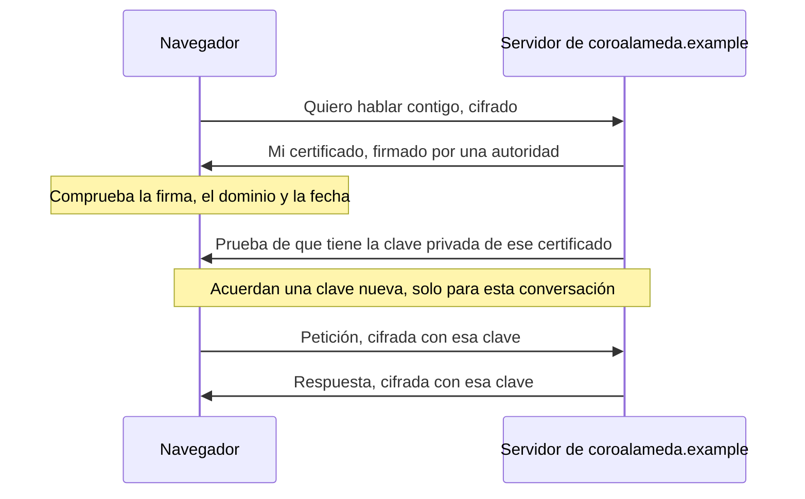

# 07.05 Seguridad básica

> **Versiones:** NIST SP 800-63B-4 (julio de 2025) y OWASP *Password Storage Cheat Sheet*, consultados el 16 de noviembre de 2026; salidas de `sha256sum` de GNU coreutils 9.7
> **Conviene saber antes:** [04.04 XML, CSV y otros, 1.14](../fase-04-formatos-y-diagramas/04-xml-csv-y-otros.md#114-el-fichero-env-y-los-secretos) · [05.01 Git: fundamentos, 1.12](../fase-05-git-y-github/01-git-fundamentos.md#112-lo-que-no-va-en-git-gitignore) · [05.03 GitHub](../fase-05-git-y-github/03-github.md) · [06.03 La web: HTTP, peticiones, respuestas y APIs, 1.9](../fase-06-internet-y-aplicaciones/03-la-web-http-y-apis.md#19-https-http-con-candado)
> **Tiempo estimado:** 2 horas
> **Nivel:** Básico · Núcleo

## Qué aprenderás

- Por qué la seguridad también es cosa tuya, y más cuando programas.
- Cómo es una **buena contraseña** según las recomendaciones actuales (larga y única, sin reglas de símbolos ni cambios cada poco), qué es una **frase de contraseña** y para qué sirve un **gestor de contraseñas**.
- Qué es un ***hash*** (una huella), calcularlo con `sha256sum` y usarlo para **comprobar una descarga**.
- Cómo guarda una web bien hecha tu contraseña (con un algoritmo **lento** y con **sal**), y qué hacer cuando hay una **filtración**.
- Qué es el **doble factor**, por qué protege tanto, para qué son los **códigos de recuperación** y qué son las ***passkeys***.
- Cómo reconocer el ***phishing*** leyendo el **dominio** de un enlace.
- Las costumbres de base: **actualizar**, descargar de la web oficial, **mínimo privilegio**, cortafuegos y antivirus.
- Cómo se protegen los datos que viajan por internet y qué hay **dentro de un certificado**.
- Dónde se guardan los **secretos** de un proyecto, cómo se pasan a otra persona por un **canal seguro** y qué hacer, en orden, **si se escapa uno**.

## 1. Teoría

### 1.1. Por qué la seguridad también es cosa tuya

Cuando se habla de seguridad informática, uno se imagina a un experto que entra en un banco tecleando muy deprisa. La realidad es más aburrida: la mayoría de los problemas empiezan por **descuidos corrientes**. Una contraseña repetida en diez webs, un enlace pulsado sin mirar, un programa sin actualizar o una clave subida a GitHub por error.

A quien ataca le interesan tus **cuentas** (tu correo es la llave de todas las demás, porque por él se recuperan las contraseñas), tu **dinero**, tus **datos** y tu **ordenador** (para usarlo contra otros). Y quien programa tiene más llaves que la mayoría: acceso a repositorios, a servidores, a bases de datos con datos de otras personas, a claves de servicios que cuestan dinero.

La buena noticia: unas pocas costumbres te protegen de casi todo lo habitual. Son las de este módulo, y no necesitas saber matemáticas ni ser experto para seguirlas. Muchas ya las has visto por el camino (descargar de la web oficial, no usar `sudo` para todo, el `.env` fuera de Git); aquí se juntan y se completan.

> **📌 Nota:** este módulo te enseña a **protegerte** y a no cometer los errores de principiante con los secretos. Cómo se programa una aplicación segura (guardar contraseñas, comprobar permisos, defenderse de ataques) es tarea de cada curso, con su lenguaje.

### 1.2. Contraseñas: largas y únicas

Muchos de los consejos sobre contraseñas que se repiten desde hace años **ya no se recomiendan**. La guía más citada es la del NIST (*National Institute of Standards and Technology*, el instituto de normas de Estados Unidos), cuya versión actual, la **SP 800-63B-4**, se publicó en julio de 2025. Lo que dice a quien construye un sistema con contraseñas (consultada el 16 de noviembre de 2026):

| Lo que dice | Qué quiere decir para ti |
|---|---|
| **Al menos 15 caracteres** si la contraseña es lo único que se pide para entrar; **al menos 8** si además hay un segundo factor ([apartado 1.7](#17-el-doble-factor)) | La **longitud** es lo que más cuenta |
| Admitir contraseñas de **al menos 64 caracteres**, con espacios y cualquier carácter | Una frase entera vale ([apartado 1.3](#13-frases-de-contraseña-y-gestor-de-contraseñas)) |
| **No imponer reglas de composición** («una mayúscula, un número y un símbolo») | Esas reglas no hacen las contraseñas más seguras: la gente pone `Verano2026!` |
| **No obligar a cambiarlas cada cierto tiempo**; sí cuando hay indicios de que alguien la conoce | Cambiarla cada tres meses lleva a `Verano2026!` → `Otono2026!`, que se adivina |
| **Comparar la contraseña nueva con una lista** de contraseñas comunes, esperables o filtradas, y rechazarla si está | `123456`, `contrasena` o el nombre del servicio no valen |
| **Permitir los gestores de contraseñas** y pegar la contraseña | Los gestores son la solución recomendada ([apartado 1.3](#13-frases-de-contraseña-y-gestor-de-contraseñas)) |

> **📌 Nota:** algunas guías todavía piden símbolos obligatorios o cambiar la contraseña cada pocos meses, y hay webs que te lo exigen. Si una web te lo exige, cúmplelo, claro; pero la recomendación actual del NIST es otra: **larga, única y cambiada solo si hay motivo**.

La otra regla, tan importante como la longitud: **una contraseña distinta para cada sitio**. Las webs sufren **filtraciones** (alguien se lleva su base de datos), y quien la consigue prueba esas mismas parejas de correo y contraseña en otras webs, de forma automática. Si repites, una filtración en una tienda pequeña abre tu correo. El INCIBE (Instituto Nacional de Ciberseguridad de España) lo resume así en su página de contraseñas (consultada el 16 de noviembre de 2026): «Crea contraseñas diferentes para cada cuenta online».

¿Y qué contraseña es mala? La que **se puede adivinar**: corta, una palabra del diccionario, tu nombre con tu año de nacimiento, el nombre de tu mascota, `qwerty`… Quien ataca no prueba al azar: prueba primero listas de contraseñas reales filtradas, que son las que usa la gente ([ejemplo 2.3](#23-por-qué-un-hash-rápido-y-sin-sal-no-protege)).

### 1.3. Frases de contraseña y gestor de contraseñas

Recordar una contraseña larga y distinta para cada uno de tus cincuenta sitios es imposible. Hay dos herramientas que lo resuelven, y se usan juntas.

**Una frase de contraseña** (*passphrase*) es una contraseña hecha de **varias palabras al azar**: `tejado-lunes-cereza-faro-nube`. Tiene 29 caracteres, se recuerda con una imagen («un faro con un tejado, un lunes, con una cereza y una nube») y es muchísimo más difícil de adivinar que `K7#pz!Qm2v`, que nadie recuerda. La clave está en **al azar**: las palabras no deben formar una frase conocida ni tener que ver contigo. (Esta, como todas las del curso, ya está publicada: no la uses.)

**Un gestor de contraseñas** es un programa que **guarda todas tus contraseñas cifradas** (ilegibles sin la clave: [apartado 1.4](#14-qué-es-un-hash)) detrás de **una sola contraseña maestra**. Lo que hace por ti:

- **Genera** una contraseña larga y aleatoria para cada sitio. No tienes que recordarla.
- **La rellena** cuando entras en la web. Y aquí hay un regalo de seguridad: el gestor la rellena **solo en el dominio donde la guardaste**. En una web falsa que imita a la de verdad, no la ofrece, y eso es una alarma ([apartado 1.9](#19-phishing-el-engaño-que-llega-por-mensaje)).
- **Te avisa**, en muchos casos, si una de tus contraseñas está repetida o aparece en una filtración conocida.

Los hay en los navegadores, en los sistemas operativos y como aplicaciones aparte, gratuitos y de pago; este curso no recomienda ninguno en concreto. El INCIBE lo aconseja («Para tener más seguras y controladas tus contraseñas es muy útil usar un gestor de contraseñas», a 16 de noviembre de 2026). Lo que importa al elegir: que sea de una empresa o un proyecto conocidos, que lo descargues de su web oficial y que admita el doble factor.

Tu **contraseña maestra** es la única que tienes que recordar, así que hazla bien: una **frase de contraseña** larga, que no uses en ningún otro sitio, y protegida además con el doble factor. Las pocas contraseñas que tienes que teclear de memoria (la de entrar en tu ordenador, la maestra) son frases; todas las demás, las genera el gestor.

### 1.4. Qué es un hash

Un ***hash*** (en español, **resumen** o **huella**) es el resultado de una **función hash**: una operación que toma unos datos de cualquier tamaño (una palabra, un fichero, una película entera) y calcula a partir de ellos un **número de tamaño fijo**, que se escribe en [hexadecimal](../fase-04-formatos-y-diagramas/01-texto-binario-y-codificacion.md#19-ver-los-bytes-de-un-fichero-od). Funciona como la huella dactilar de una persona: la identifica, pero no es la persona.

Una función hash criptográfica (la que sirve para seguridad) cumple cuatro propiedades:

| Propiedad | Qué significa |
|---|---|
| **Siempre la misma** | Los mismos datos dan siempre la misma huella, en cualquier ordenador y en cualquier año |
| **Tamaño fijo** | La huella mide lo mismo para una letra que para un disco entero |
| **Efecto avalancha** | Cambiar una sola letra cambia la huella por completo: dos datos casi iguales tienen huellas que no se parecen en nada |
| **Sin vuelta atrás** | Con la huella no se puede calcular qué datos la produjeron (solo **adivinarlos** y comprobar: [apartado 1.5](#15-cómo-guarda-una-web-tu-contraseña)) |

La más usada hoy es **SHA-256** (*Secure Hash Algorithm*, de 256 bits: 64 caracteres en hexadecimal). Ya has visto huellas sin saberlo: el identificador de cada [commit de Git](../fase-05-git-y-github/01-git-fundamentos.md#16-commit-una-foto-del-proyecto) es la huella de ese commit (Git usa por defecto otra función, SHA-1). Las verás en el [ejemplo 2.1](#21-la-huella-de-un-texto), con la orden **`sha256sum`**.

**Para qué sirve.** Para saber si algo **ha cambiado**. Muchas webs de descargas publican junto a cada fichero su huella SHA-256 (a veces en un fichero llamado `SHA256SUMS`). Tú calculas la del fichero que has descargado y comparas: si coinciden, es exactamente el que publicaron, sin un solo byte de diferencia; si no, se ha estropeado o lo ha cambiado alguien ([ejemplo 2.2](#22-comprobar-una-descarga)). Ojo: la huella tiene que venir de un sitio de confianza (la web oficial); si alguien cambia el fichero **y** la huella que lo acompaña, todo cuadra.

**Hash, cifrado y codificación no son lo mismo.** Es la confusión más común, así que vale la pena verlas juntas:

| | Codificar | Calcular un hash | Cifrar |
|---|---|---|---|
| Qué hace | Escribe lo mismo de otra forma | Calcula una huella de tamaño fijo | Lo convierte en algo ilegible sin la **clave** |
| ¿Se puede deshacer? | Sí, cualquiera: no hay secreto | No | Sí, **quien tenga la clave** |
| Para qué | Guardar o enviar datos en un formato | Comprobar que algo no ha cambiado; guardar contraseñas (con cuidado: [apartado 1.5](#15-cómo-guarda-una-web-tu-contraseña)) | Que solo lo lea quien deba |
| Ejemplo | UTF-8, Base64 | SHA-256 | Lo que viaja por HTTPS, tu gestor de contraseñas |

> **⚠️ Cuidado:** codificar **no protege nada**. Si alguna vez ves una contraseña «escondida» en Base64 (un texto como `QnJ1bm8xOTkw`), cualquiera la lee en un segundo con una orden: no hay ninguna clave.

**En los sistemas del curso:** `sha256sum` viene en Linux y en Git Bash. En macOS se usa normalmente `shasum -a 256 fichero`, que calcula la misma huella.

### 1.5. Cómo guarda una web tu contraseña

Cuando te registras en una web, ¿guarda tu contraseña tal cual? Si lo hiciera, cualquiera que se llevara su base de datos (o un empleado curioso) la leería. Una web bien hecha **no guarda tu contraseña**: guarda algo calculado a partir de ella, y cuando entras, lo vuelve a calcular con lo que escribes y compara.

¿Y ese cálculo es un SHA-256 como el del apartado anterior? **No.** Con `sha256sum` se enseña qué es un hash, pero **una web bien hecha no guarda las contraseñas así**, por dos motivos:

1. **SHA-256 es rápido**, y para esto es un defecto. Está pensado para resumir ficheros enormes en un momento; quien roba la tabla de huellas puede probar muchísimas contraseñas por segundo (las de una lista de filtradas, todas las de 8 caracteres…) hasta dar con las que coinciden. Es lo que harás en el [ejercicio 5](#ejercicio-5--las-contraseñas-de-una-tienda-filtrada).
2. **Sin nada más, la misma contraseña da la misma huella.** Si dos personas usan `123456`, se ve a simple vista; y basta calcular una vez la huella de cada contraseña común para encontrarlas en todas las bases de datos robadas ([ejemplo 2.3](#23-por-qué-un-hash-rápido-y-sin-sal-no-protege)).

Lo correcto, según la guía de OWASP (*Open Worldwide Application Security Project*, una fundación que publica guías de seguridad abiertas) *Password Storage Cheat Sheet*, consultada el 16 de noviembre de 2026:

- **Un algoritmo lento a propósito, pensado para contraseñas.** OWASP recomienda, por este orden, **Argon2id**, **scrypt**, **bcrypt** (para sistemas antiguos) y **PBKDF2** (cuando una norma lo exige). Calcular cada huella cuesta una fracción de segundo y, en los primeros, bastante memoria: a quien entra no le molesta, pero a quien quiere probar miles de millones de contraseñas le hace el trabajo inmensamente más caro.
- **Con sal.** La **sal** (*salt*) es un valor aleatorio, distinto para cada usuario, que se mezcla con la contraseña antes de calcular la huella y se guarda a su lado (no es secreta). Así, dos personas con la misma contraseña tienen huellas distintas, y quien ataca tiene que atacar cada huella por separado.

Cómo se programa eso es cosa del curso de cada lenguaje (se usa una biblioteca, nunca un algoritmo inventado). Lo que te llevas de aquí, como usuario:

- Una web bien hecha **no puede enviarte tu contraseña** si la olvidas: no la tiene. Te envía un enlace para crear otra. Si una web te manda por correo tu contraseña de siempre, la guarda mal: no repitas esa contraseña en ningún otro sitio (que ya no deberías).
- Aun guardada bien, una contraseña **corta o común** se adivina antes que una larga: el algoritmo lento ayuda, pero no hace milagros con `123456`.

### 1.6. Filtraciones: qué hacer cuando le pasa a una web

Una **filtración** (o brecha de datos) es cuando los datos de una web acaban en manos de quien no debe: correos, contraseñas (o sus huellas), direcciones, teléfonos. Pasa a empresas grandes y pequeñas, y no depende de ti. Te enteras por un correo de la propia web, por las noticias o por el aviso de tu gestor de contraseñas.

Qué hacer si una web donde tienes cuenta sufre una filtración:

1. **Cambia la contraseña de esa web.** La norma del NIST, que no obliga a cambiar las contraseñas cada poco, sí obliga cuando hay indicios de que alguien la conoce: este es el caso.
2. **Cámbiala en cualquier otro sitio donde la repitieras.** Es lo primero que probarán.
3. **Activa el doble factor** en esa web y en tu correo, si no lo tenías ([apartado 1.7](#17-el-doble-factor)).
4. **Desconfía de los mensajes que hablen de la filtración**: es el momento favorito del *phishing* («por la filtración, confirma tus datos aquí»), y quien ataca ya sabe que tienes cuenta en esa web ([apartado 1.9](#19-phishing-el-engaño-que-llega-por-mensaje)).

Con un gestor de contraseñas y una contraseña distinta en cada sitio, una filtración se queda en lo que es: cambiar **una** contraseña.

### 1.7. El doble factor

Para demostrar quién eres, hay tres tipos de prueba, que se llaman **factores**:

| Factor | Ejemplos |
|---|---|
| **Algo que sabes** | Una contraseña, un PIN |
| **Algo que tienes** | Tu móvil, una llave de seguridad (un aparato del tamaño de una memoria USB) |
| **Algo que eres** | Tu huella dactilar, tu cara |

El **doble factor** (*two-factor authentication*, **2FA**; también **verificación en dos pasos** o **autenticación multifactor**) pide **dos factores de tipos distintos**: normalmente, la contraseña y algo que tienes. En [05.03](../fase-05-git-y-github/03-github.md#13-tu-cuenta-de-github) viste que GitHub lo pide a quien sube código.

**Por qué protege tanto:** casi todos los ataques a cuentas consiguen **la contraseña** (por una filtración, por *phishing*, porque se adivina). Con el doble factor, la contraseña **sola ya no basta**: además, quien ataca necesitaría tu móvil o tu llave, que están en tu bolsillo, no en internet. Un ataque que funciona a miles de kilómetros se convierte en uno que exige robarte algo a ti.

Las formas más comunes, de menos a más segura:

| Forma | Cómo funciona | Cuidado con |
|---|---|---|
| **Código por SMS** | La web te manda un código de un solo uso al móvil | Se puede interceptar, por ejemplo, si alguien consigue un duplicado de tu tarjeta SIM. El NIST lo considera una opción «restringida» (SP 800-63B-4) |
| **Aplicación de códigos** | Una aplicación del móvil enseña un código de 6 cifras que cambia cada 30 segundos. Al activarlo, la web y la aplicación se quedan con un mismo secreto (lo pasa un código QR), y los dos calculan el código a partir de ese secreto y la hora, sin conexión | El código se puede dar por error en una web falsa si lo tecleas rápido ([apartado 1.9](#19-phishing-el-engaño-que-llega-por-mensaje)) |
| **Llave de seguridad o *passkey*** | Tu dispositivo demuestra quién eres con un par de claves ([apartado 1.8](#18-códigos-de-recuperación-y-passkeys)) | Es la más segura: no funciona en una web falsa |

Cualquiera de las tres es **mucho mejor que ninguna**. Activa el doble factor, como mínimo, en tu **correo** (la llave de todo lo demás), en tu **gestor de contraseñas**, en **GitHub** y en tu **banco**. El INCIBE también lo aconseja: «Siempre que sea posible en un servicio online, configura la autenticación de dos factores» (a 16 de noviembre de 2026).

> **⚠️ Cuidado:** algunas webs te mandan al móvil una notificación de «¿Eres tú quien intenta entrar?» con un botón para aprobar. **Si no estás entrando tú, no la apruebes**, aunque llegue diez veces seguidas: es alguien que ya tiene tu contraseña y espera que pulses por cansancio. Cambia la contraseña.

### 1.8. Códigos de recuperación y passkeys

**Códigos de recuperación.** Si el segundo factor es tu móvil, ¿qué pasa si lo pierdes? Al activar el doble factor, casi todas las webs te dan unos **códigos de recuperación**: unos pocos códigos largos, cada uno de **un solo uso**, que te dejan entrar sin el móvil. Trátalos como una contraseña:

- **Guárdalos** al activarlos, en tu gestor de contraseñas o impresos en un sitio seguro de casa. Sin ellos y sin el móvil, recuperar la cuenta puede ser muy difícil, o imposible.
- **No los guardes junto a la contraseña de esa misma cuenta en un sitio desprotegido** (un fichero `claves.txt` en el escritorio): quien encuentre los dos tiene la cuenta entera.
- Cuando gastes uno, queda tachado. Si gastas casi todos, la web te deja generar otros.

***Passkeys*** (en español, **llaves de acceso**). Son la forma de entrar que está sustituyendo a las contraseñas. Una *passkey* es un **par de claves**, como el de SSH que ya conoces de [05.03, apartado 1.5](../fase-05-git-y-github/03-github.md#15-ssh-un-par-de-claves): la **clave pública** se la queda la web; la **privada**, tus dispositivos (o tu gestor de contraseñas). Para entrar, desbloqueas tu dispositivo con tu huella, tu cara o tu PIN, y el dispositivo demuestra a la web que tiene la clave privada, sin enviarla. Según la FIDO Alliance, la organización que publica la norma (a 16 de noviembre de 2026):

- **Cada *passkey* está ligada a una web concreta**, así que **no se puede usar en una web falsa** que imite a la de verdad: resiste el *phishing*.
- La web **no guarda ninguna contraseña** que se pueda filtrar: solo tu clave pública, que no sirve para entrar.
- Tu huella o tu cara **no salen de tu dispositivo**: solo sirven para desbloquearlo.

Si una web te ofrece crear una *passkey*, acéptala: es más cómodo y más seguro. Mientras tanto, para las demás, contraseña única y doble factor.

### 1.9. Phishing: el engaño que llega por mensaje

El ***phishing*** (se pronuncia «fishing», de «pescar») es un mensaje que **se hace pasar por alguien de confianza** (tu banco, una empresa de paquetería, tu academia, un compañero) para que **pulses un enlace, des un dato o instales algo**. Llega por correo, por SMS, por mensajería y hasta por teléfono. No hace falta saber programar para caer: hace falta tener prisa.

Las señales casi siempre son las mismas:

- **Urgencia o miedo**: «tu cuenta se bloqueará en 24 horas», «último aviso», «paga hoy o se devuelve el paquete».
- **Un enlace** que lleva a una web para «confirmar», «verificar» o «pagar».
- **Te piden lo que nadie debería pedirte**: la contraseña, el código del doble factor, los datos de la tarjeta, que instales un programa.
- **El dominio no es el de verdad.**

La última es la que no engaña. Ya sabes de [02.03](../fase-02-tu-ordenador/03-instalar-programas-y-path.md#13-descarga-siempre-de-la-web-oficial) que lo que identifica a una web es su [dominio](../glosario.md#dominio), y que se lee **desde el final**, justo antes de la primera `/`. Imagina una paquetería inventada, Paquetería Veloz, cuya web es `paqueteria-veloz.example`:

| Enlace | ¿Es suyo? | Por qué |
|---|---|---|
| `https://paqueteria-veloz.example/seguimiento` | **Sí** | El dominio es `paqueteria-veloz.example` |
| `https://envios.paqueteria-veloz.example/pago` | **Sí** | Es una parte (un subdominio) de `paqueteria-veloz.example`: termina igual |
| `https://paqueteria-veloz.example.pagos-pendientes.invalid/pago` | **No** | El dominio es `pagos-pendientes.invalid`: lo de delante lo puede poner quien quiera |
| `https://paqueteria-ve1oz.example/pago` | **No** | Un `1` en lugar de la `l`: otro dominio, de otra persona |
| `https://paqueteria-veloz-envios.example/pago` | **No** | Se parece, pero es otro dominio |

(Todos estos nombres son inventados y usan `.example` e `.invalid`, terminaciones reservadas para ejemplos que no existen en internet.)

**El candado no te salva.** Como viste en [06.03, apartado 1.9](../fase-06-internet-y-aplicaciones/03-la-web-http-y-apis.md#19-https-http-con-candado), el candado dice que la conexión va cifrada con el dueño de **ese** dominio, no que el dominio sea quien dice ser. Una web falsa tiene su candado igual que la verdadera.

**Qué hacer con un mensaje sospechoso:**

- **No pulses el enlace.** Entra tú en la web o en la aplicación **por el camino de siempre** (escribiendo la dirección o desde tu marcador) y mira allí si hay algo pendiente. Si es de verdad, lo verás.
- **Si te llaman**, cuelga y llama tú al número oficial.
- **Nunca des el código del doble factor** a nadie que te lo pida: ninguna empresa te lo pedirá por teléfono ni por mensaje. Ese código sirve para entrar en tu cuenta, ahora.
- **Si dudas, pregunta** a la persona o la empresa por otro canal.

**Si ya has picado** (pulsaste y escribiste la contraseña, o diste un código): cambia **ya** esa contraseña desde la web de verdad (y donde la repitieras), cierra las sesiones abiertas si la web lo permite, revisa que el doble factor sigue siendo tuyo y, si diste datos de la tarjeta, llama a tu banco. En España, el INCIBE tiene una línea de ayuda gratuita y confidencial, **Tu Ayuda en Ciberseguridad**, en el **017** (de 8 de la mañana a 11 de la noche, todos los días del año, según su web a 16 de noviembre de 2026).

> **💡 Consejo:** el gestor de contraseñas es tu mejor detector de *phishing*. Si en una web que «parece la de siempre» no te ofrece rellenar la contraseña, **para**: probablemente no es la de siempre.

### 1.10. Actualizaciones y descargas oficiales

Los programas tienen errores, y algunos son **vulnerabilidades**: fallos que permiten a otro hacer lo que no debería (entrar en tu equipo, leer tus datos). Cuando se descubren, quien hace el programa publica una **actualización** que los corrige, y desde ese momento el fallo es **público**: quien ataca sabe que los equipos que no se han actualizado lo tienen. Por eso:

- **Activa las actualizaciones automáticas** del sistema operativo, del navegador y de los programas que lo permitan, y no pospongas eternamente el «reiniciar para actualizar».
- **Un sistema que ya no recibe actualizaciones** (porque es muy antiguo) es un riesgo: cada fallo nuevo se queda abierto para siempre.

Y lo que instalas, **solo de su web oficial**, de la tienda de aplicaciones o del gestor de paquetes de tu sistema, como viste en [02.03, apartado 1.3](../fase-02-tu-ordenador/03-instalar-programas-y-path.md#13-descarga-siempre-de-la-web-oficial). Vale para todo: los programas, las [extensiones del editor](../fase-03-herramientas/03-editor-de-codigo.md#110-extensiones-ampliar-el-editor-con-cuidado) y las bibliotecas que usarás en tus cursos. Ahora sabes además comprobar una descarga con su huella, cuando la web la publica ([ejemplo 2.2](#22-comprobar-una-descarga)).

### 1.11. Mínimo privilegio, cortafuegos y antivirus

**Mínimo privilegio.** En [03.02](../fase-03-herramientas/02-terminal-sacarle-partido.md#111-administrador-sudo-y-cuándo-no-usarlo) viste la idea con `sudo`: cada usuario y cada programa, con los permisos justos para su tarea y ni uno más. Es una regla que verás en todas partes:

- **Tu cuenta del ordenador**: trabaja con un usuario normal y usa el de administrador solo cuando haga falta.
- **Los *tokens* y las claves**: con los permisos justos y con fecha de caducidad, como el *token* de grano fino de GitHub de [05.03](../fase-05-git-y-github/03-github.md#14-cómo-sabe-github-que-eres-tú-https), que solo toca los repositorios que elijas.
- **Las aplicaciones del móvil**: si una linterna pide tus contactos, sobra.
- **Las personas de un proyecto**: cada una con su propio acceso, y solo al que necesita ([apartado 1.14](#114-pasar-un-secreto-por-un-canal-seguro)).

Si algo sale mal, el daño se queda en lo poco que podía tocar.

**No te fíes de lo que llega de fuera.** Es la misma idea, del lado de quien programa: lo que manda el usuario (un formulario, el navegador, una API) puede venir cambiado, así que el programa que recibe **lo comprueba todo**. Es lo que viste en [06.05, error típico 3.2](../fase-06-internet-y-aplicaciones/05-piezas-de-una-aplicacion.md#32-fiarse-del-frontend): el backend no se cree el precio que le manda el navegador. Cómo se hace en cada lenguaje lo verás en tus cursos.

**Cortafuegos y antivirus.** Como viste en [06.01](../fase-06-internet-y-aplicaciones/01-redes.md#114-el-cortafuegos), hacen cosas distintas, y conviene tener los dos activados:

| | Cortafuegos | Antivirus |
|---|---|---|
| Qué vigila | Las **conexiones**: quién puede hablar con tu equipo | Los **ficheros y programas**: si alguno es dañino (*malware*) |
| Te protege de | Que otro equipo de la red entre en el tuyo | Instalar o abrir algo dañino |
| No te protege de | Lo que tú descargas y abres | Que entregues tu contraseña en una web falsa |

Windows y macOS traen los dos de serie. Windows trae el antivirus Microsoft Defender Antivirus y el Firewall de Windows, que viene activado (según Microsoft Learn, consultado el 16 de noviembre de 2026); macOS trae un antivirus, XProtect, y un cortafuegos que se configura en los Ajustes del Sistema (según la guía de seguridad de plataformas de Apple, consultada el 16 de noviembre de 2026). Mantenlos **activados y actualizados**. Y ninguno de los dos sustituye a las costumbres de este módulo: ni el mejor antivirus impide que escribas tu contraseña en una web de *phishing*.

### 1.12. Cómo se protegen los datos que viajan: el certificado por dentro

En [06.03](../fase-06-internet-y-aplicaciones/03-la-web-http-y-apis.md#19-https-http-con-candado) viste que HTTPS protege lo que viaja (nadie lo lee ni lo cambia) y que el servidor demuestra quién es con un **certificado** firmado por una **autoridad de certificación**. Con lo que sabes del par de claves, ya se entiende cómo funciona por dentro, en una idea.

**El certificado** es un fichero público que dice, más o menos: «la clave pública de `coroalameda.example` es esta, y vale hasta tal fecha». Lo importante es quién lo firma: una autoridad de certificación, **con su clave privada**. Una **firma digital** es justo eso: algo que solo puede hacer quien tiene la clave privada y que cualquiera puede comprobar con la pública (es el mismo par de claves de [05.03, apartado 1.5](../fase-05-git-y-github/03-github.md#15-ssh-un-par-de-claves): la cerradura y su llave).

**Tu navegador** (o tu sistema operativo) trae de serie las claves públicas de las autoridades en las que confía. Al conectarte:



Dicho con palabras: el navegador **comprueba la firma** del certificado con la clave pública de la autoridad; si cuadra, sabe que la autoridad garantiza que esa clave pública es de ese dominio. El servidor demuestra después que tiene **la clave privada** correspondiente (copiar el certificado, que es público, no basta para hacerse pasar por él). Y con eso, los dos **acuerdan una clave** solo para esa conversación, con la que se **cifra** todo lo que viaja. Si algo no cuadra (firma falsa, otro dominio, caducado), el navegador enseña la pantalla de aviso.

No hace falta más: los detalles son de cursos posteriores. Quédate con que **la seguridad de HTTPS se apoya en pares de claves y en firmas**, y con que **una pantalla de aviso del certificado no se salta** «para ver si funciona».

### 1.13. Los secretos: dónde se guardan

Ya sabes qué es un [secreto](../glosario.md#secreto) y cómo se separa de la configuración con el `.env` y el `.env.example` ([04.04, apartado 1.14](../fase-04-formatos-y-diagramas/04-xml-csv-y-otros.md#114-el-fichero-env-y-los-secretos)), y que el `.gitignore` lo deja fuera de Git ([05.01, apartado 1.12](../fase-05-git-y-github/01-git-fundamentos.md#112-lo-que-no-va-en-git-gitignore)). Aquí se completa: **dónde vive cada secreto**.

| Secreto | Dónde se guarda |
|---|---|
| Tus contraseñas, tus *tokens* personales, tus códigos de recuperación | En tu **gestor de contraseñas** |
| Los secretos de un proyecto en tu ordenador (la clave del correo, la de una API de pruebas) | En el **`.env`** del proyecto, ignorado por Git **desde el primer commit** ([ejemplo 2.4](#24-un-proyecto-con-secretos-desde-el-primer-commit)) |
| Los de la aplicación ya publicada | En la **configuración del servidor o del servicio** donde se publica: los servicios de alojamiento y de integración continua tienen un sitio para guardar secretos, separado del código. Lo verás en tus cursos |
| Tu clave privada SSH | En tu ordenador, en `~/.ssh`, y **nunca sale de él** ([05.03](../fase-05-git-y-github/03-github.md#15-ssh-un-par-de-claves)) |

Y dónde **no** va nunca un secreto, aunque sea un momento:

- **En el código**, ni en un fichero que se sube a Git, ni en un mensaje de commit.
- **En una *issue*, un comentario, un chat o un correo.** Tampoco en una **captura de pantalla** (revisa la terminal antes de compartirla).
- **En el enlace para compartir un diagrama** o en cualquier herramienta en línea que guarde lo que escribes ([04.05, apartado 1.11](../fase-04-formatos-y-diagramas/05-diagramas-y-mermaid.md#111-el-editor-en-línea-oficial)).
- **En un asistente de IA**: lo que escribes sale de tu ordenador ([06.06, apartado 1.12](../fase-06-internet-y-aplicaciones/06-que-es-la-ia.md#112-privacidad-lo-que-escribes-sale-de-tu-ordenador)).
- **En el frontend** de una aplicación: lo descarga cualquiera ([06.05, error típico 3.5](../fase-06-internet-y-aplicaciones/05-piezas-de-una-aplicacion.md#35-la-clave-de-la-pasarela-en-el-frontend)).

> **📌 Nota:** que un repositorio sea **privado** no es un sitio seguro para un secreto. Lo pueden ver todos sus colaboradores (los de hoy y los de mañana), se copia en cada clon y puede volverse público algún día. Los secretos, fuera de Git siempre.

### 1.14. Pasar un secreto por un canal seguro

En el [caso real de 04.04](../fase-04-formatos-y-diagramas/04-xml-csv-y-otros.md#ejercicio-6--la-configuración-de-la-tienda-en-línea), Raúl tenía que dar a cada persona del equipo los valores de verdad del `.env`, «por un canal seguro». ¿Cuál?

**Lo mejor: no compartir el secreto, sino dar a cada persona el suyo.** Muchos servicios permiten crear **una clave o un *token* por persona** (o por programa), cada uno con sus permisos ([mínimo privilegio](#111-mínimo-privilegio-cortafuegos-y-antivirus)). Así, si una persona deja el proyecto o pierde su portátil, se **anula su clave** y las demás siguen funcionando; y se sabe quién hizo qué.

**Si hay que compartir el mismo secreto**, por este orden de preferencia:

1. **Con la función de compartir de un gestor de contraseñas**, si el equipo usa uno: el secreto viaja cifrado y queda guardado donde debe.
2. **Con un mensaje que se borra solo**, de un servicio que cifre el contenido y lo destruya al leerlo, o por una aplicación de mensajería cifrada, a esa persona sola (no al grupo); y **después se borra** el mensaje.
3. Si es de palabra o en persona, también vale: un secreto corto se puede dictar.

**Lo que no**: el chat del grupo del equipo (lo leen todos, se guarda para siempre y entra gente nueva), un correo normal, una *issue*, un documento compartido «de claves» o la pizarra de la oficina.

> **💡 Consejo:** si el secreto ha pasado por un canal que no era seguro (lo pegaste en el chat del grupo «solo un momento»), trátalo como **escapado**: [apartado 1.15](#115-si-se-escapa-un-secreto).

### 1.15. Si se escapa un secreto

Un secreto se **escapa** cuando lo ha podido ver quien no debía: subido a GitHub, pegado en un chat, en una captura, en un portátil perdido. Ya lo viste en la práctica en [05.01, ejercicio 6](../fase-05-git-y-github/01-git-fundamentos.md#ejercicio-6--una-contraseña-dentro-del-repositorio) (un `config.ini` con una contraseña en el historial) y en [05.03, error típico 3.6](../fase-05-git-y-github/03-github.md#36-subir-un-secreto-a-github) y [ejercicio 5](../fase-05-git-y-github/03-github.md#ejercicio-5--antes-de-hacer-público-el-repositorio-de-la-protectora) (antes de publicar el repositorio de la protectora). Aquí va el plan completo, **en orden**:

1. **Anúlalo o cámbialo ya.** En la web del servicio, anula la clave o el *token* (la palabra que verás es *revoke*, «revocar»), o cambia la contraseña. Es **lo único que de verdad lo arregla**: desde ese momento, el que se ha escapado no sirve. Hazlo **antes** que nada, aunque solo haya estado a la vista un minuto: hay programas que recorren GitHub buscando claves y las encuentran en minutos.
2. **Crea uno nuevo** y ponlo donde debe estar: el `.env` de cada persona, la configuración del servidor. Si lo usa más gente, dáselo por un [canal seguro](#114-pasar-un-secreto-por-un-canal-seguro).
3. **Mira si alguien lo ha usado.** Muchos servicios enseñan un registro de actividad (accesos, peticiones, gastos). Si ves algo raro, avisa al servicio.
4. **Arregla la causa**: quita el fichero del seguimiento de Git y añádelo al `.gitignore` (como en [05.01, ejercicio 6](../fase-05-git-y-github/01-git-fundamentos.md#ejercicio-6--una-contraseña-dentro-del-repositorio)), o borra el mensaje del chat.
5. **Avisa** a quien lleve el proyecto o el servicio: no es para buscar culpables, sino para que se pueda revisar todo.
6. **Limpiar el historial de Git** es opcional, delicado y **no sustituye** al paso 1: alguien puede haber copiado ya el secreto.

> **⚠️ Cuidado:** el error más común es hacer el paso 4 y olvidar el 1: «ya lo he quitado del repositorio, ya está». **No está**. Un secreto que se ha visto ya no es secreto, aunque lo borres.

## 2. Ejemplos de código

### 2.1. La huella de un texto

`sha256sum` calcula la huella SHA-256 de un fichero o, si no le das ninguno, de lo que le llega por una [tubería](../fase-03-herramientas/02-terminal-sacarle-partido.md#15-tuberías-la-salida-de-una-orden-es-la-entrada-de-otra). Se usa `printf` y no `echo` porque `echo` añade un salto de línea al final, y ese salto de línea también forma parte de los datos ([error típico 3.6](#36-calcular-la-huella-con-echo)):

**En tu terminal** (`sesion.txt`):

```text
$ printf 'hola' | sha256sum
b221d9dbb083a7f33428d7c2a3c3198ae925614d70210e28716ccaa7cd4ddb79  -
$ printf 'hola' | sha256sum
b221d9dbb083a7f33428d7c2a3c3198ae925614d70210e28716ccaa7cd4ddb79  -
$ printf 'Hola' | sha256sum
e633f4fc79badea1dc5db970cf397c8248bac47cc3acf9915ba60b5d76b0e88f  -
$ printf 'Ensayo del Coro Alameda: martes y jueves, a las 19:30' | sha256sum
56176073d93ba6c7159f6aad8730e140a52ae3db123dbb526d3946982da53b0f  -
$ echo 'hola' | sha256sum
133ee989293f92736301280c6f14c89d521200c17dcdcecca30cd20705332d44  -
```

📁 **Código:** [`codigo/05-seguridad-basica/ejemplos/2.1-la-huella-de-un-texto/`](codigo/05-seguridad-basica/ejemplos/2.1-la-huella-de-un-texto/)

Cada línea de `sha256sum` es la huella, dos espacios y el nombre de lo que ha resumido; el `-` quiere decir «lo que me ha llegado por la entrada», porque no le has dado un fichero. Fíjate en las cuatro propiedades del [apartado 1.4](#14-qué-es-un-hash):

- **Siempre la misma:** `hola` da la misma huella las dos veces. En tu ordenador, también: haz la prueba y compara.
- **Efecto avalancha:** `Hola`, con una sola letra distinta, da una huella que no se parece en nada.
- **Tamaño fijo:** la frase del ensayo, mucho más larga, da también 64 caracteres.
- **Sin vuelta atrás:** mirando `b221d9db…` no hay forma de calcular que era `hola`. Solo se puede **probar** con `hola` y ver que coincide.

Y la última: `echo 'hola'` envía `hola` **y un salto de línea**, que son otros datos, así que da otra huella.

### 2.2. Comprobar una descarga

La Floristería La Hiedra descarga cada año la tarifa de su proveedor, `tarifa-2027.csv`. El proveedor publica en su web, junto al fichero, un `SHA256SUMS` con su huella. Antes de usar la tarifa, se comprueba; después, para ver qué pasaría si alguien la hubiera cambiado por el camino, se añade una línea y se vuelve a comprobar:

**En tu terminal** (`sesion.txt`):

```text
$ ls
SHA256SUMS  tarifa-2027.csv
$ cat SHA256SUMS
396ae1f7481e83981e41ccd5963cb71557e1e4895ee84814c2235683b4a884b9  tarifa-2027.csv
$ sha256sum tarifa-2027.csv
396ae1f7481e83981e41ccd5963cb71557e1e4895ee84814c2235683b4a884b9  tarifa-2027.csv
$ sha256sum -c SHA256SUMS
tarifa-2027.csv: La suma coincide
$ echo 'Rosa roja,0.10' >> tarifa-2027.csv
$ sha256sum -c SHA256SUMS
tarifa-2027.csv: La suma no coincide
sha256sum: WARNING: 1 computed checksum did NOT match
$ echo $?
1
```

📁 **Código:** [`codigo/05-seguridad-basica/ejemplos/2.2-comprobar-una-descarga/`](codigo/05-seguridad-basica/ejemplos/2.2-comprobar-una-descarga/)

- `SHA256SUMS` tiene el mismo formato que escribe `sha256sum`: la huella, dos espacios y el nombre del fichero (puede tener muchas líneas, una por fichero).
- Comparar a ojo 64 caracteres es fácil de hacer mal. **`sha256sum -c`** (de *check*, «comprobar») lee la lista, calcula la huella de cada fichero y dice si coincide (`La suma coincide`) o no (`La suma no coincide`).
- Tras cambiar el fichero, ya no coincide, y `sha256sum` termina con el [código de salida](../fase-03-herramientas/02-terminal-sacarle-partido.md#113-códigos-de-salida) 1. Un script podría usarlo para no seguir.
- El aviso final sale en inglés aunque el resto esté en español: la traducción de estas órdenes no está completa. En Git Bash y en macOS los mensajes pueden variar (en macOS, `shasum -a 256 -c SHA256SUMS`), pero la idea es la misma: un **OK** o un aviso de que **no coincide**.

Si no coincide, **no uses el fichero**: vuelve a descargarlo de la web oficial y, si sigue sin coincidir, avisa a quien lo publica.

### 2.3. Por qué un hash rápido y sin sal no protege

La tienda de discos Vinilo Azul (inventada) guardaba las contraseñas de sus clientes como en el ejemplo anterior: la huella SHA-256 de cada una, sin sal. Alguien se llevó la tabla. Así se vería desde fuera:

**En tu terminal** (`sesion.txt`):

```text
$ cat filtrada.txt
aroa:8d969eef6ecad3c29a3a629280e686cf0c3f5d5a86aff3ca12020c923adc6c92
blas:dc40821ed56540eedd2aa67d8cfc1cf69c910046d9018be9a8ee00fc441fd496
coral:8d969eef6ecad3c29a3a629280e686cf0c3f5d5a86aff3ca12020c923adc6c92
dimas:1bf55293028c3536ca32200b245c58edefc8d337512d44dd283ad590bcdeecdc
$ cut -d: -f2 filtrada.txt | sort | uniq -d
8d969eef6ecad3c29a3a629280e686cf0c3f5d5a86aff3ca12020c923adc6c92
$ printf '123456' | sha256sum
8d969eef6ecad3c29a3a629280e686cf0c3f5d5a86aff3ca12020c923adc6c92  -
$ grep 8d969eef6ecad3c29a3a629280e686cf0c3f5d5a86aff3ca12020c923adc6c92 filtrada.txt
aroa:8d969eef6ecad3c29a3a629280e686cf0c3f5d5a86aff3ca12020c923adc6c92
coral:8d969eef6ecad3c29a3a629280e686cf0c3f5d5a86aff3ca12020c923adc6c92
```

📁 **Código:** [`codigo/05-seguridad-basica/ejemplos/2.3-huellas-sin-sal/`](codigo/05-seguridad-basica/ejemplos/2.3-huellas-sin-sal/)

Con los [filtros de 03.02](../fase-03-herramientas/02-terminal-sacarle-partido.md#16-los-filtros-grep-sort-uniq-wc-cut-head-y-tail):

- `cut -d: -f2` se queda con las huellas; `sort | uniq -d` enseña las que están **repetidas**. Sin abrir ninguna, ya se sabe que dos clientes tienen la misma contraseña. Sin sal, eso se ve a simple vista.
- Y no hace falta deshacer la huella: basta **probar**. La contraseña más común del mundo, `123456`, da justo esa huella, y `grep` dice de quién es. Con una lista de miles de contraseñas comunes y un SHA-256 tan rápido, se prueban todas en un momento.
- Dimas, con su frase de contraseña de cinco palabras al azar, no aparece en ninguna lista: su huella sigue sin decir nada.

Con un algoritmo lento y sal ([apartado 1.5](#15-cómo-guarda-una-web-tu-contraseña)), Aroa y Coral tendrían huellas distintas, y probar cada contraseña costaría muchísimo más, y una vez **por cada cliente**.

### 2.4. Un proyecto con secretos desde el primer commit

El Coro Alameda quiere un pequeño programa que mande su boletín por correo, y necesita la clave del correo del coro. Antes de escribir una sola línea, se prepara el repositorio para que esa clave **no pueda entrar nunca** en Git. El `.env.example` ya está en la carpeta del ejemplo:

```text
# Copia este fichero como .env y escribe ahí los valores de verdad.
# El .env no se sube nunca a Git: está en el .gitignore.
CORREO_USUARIO=boletin@coroalameda.example
CORREO_CLAVE=escribe-aqui-la-clave
```

📁 **Código:** [`codigo/05-seguridad-basica/ejemplos/2.4-secretos-desde-el-primer-commit/`](codigo/05-seguridad-basica/ejemplos/2.4-secretos-desde-el-primer-commit/)

En tu equipo harías `cp .env.example .env` y escribirías la clave de verdad con el editor. Aquí, para que la sesión quede entera, el `.env` se escribe con `printf`, con una clave de mentira:

**En tu terminal** (`sesion.txt`):

```text
$ mkdir boletin && cd boletin && git init
Inicializado repositorio Git vacío en /home/alumno/boletin/.git/
$ printf '.env\n' > .gitignore
$ cp ../.env.example .
$ printf 'CORREO_USUARIO=boletin@coroalameda.example\nCORREO_CLAVE=clave-de-prueba-123\n' > .env
$ ls -a
.  ..  .env  .env.example  .git  .gitignore
$ git check-ignore -v .env
.gitignore:1:.env       .env
$ git status --short
?? .env.example
?? .gitignore
$ git add .
$ git commit -m "Empieza el boletín del coro, con .gitignore y .env.example"
[main (commit-raíz) f34abcb] Empieza el boletín del coro, con .gitignore y .env.example
 2 files changed, 5 insertions(+)
 create mode 100644 .env.example
 create mode 100644 .gitignore
$ git ls-files
.env.example
.gitignore
```

📁 **Código:** [`codigo/05-seguridad-basica/ejemplos/2.4-secretos-desde-el-primer-commit/`](codigo/05-seguridad-basica/ejemplos/2.4-secretos-desde-el-primer-commit/)

Lo importante es **el orden**:

1. **El `.gitignore`, lo primero**, antes de que exista el `.env`. Así no hay ningún momento en que un `git add .` pueda llevárselo.
2. **Comprobar antes del primer commit** con [`git check-ignore -v`](../fase-05-git-y-github/01-git-fundamentos.md#112-lo-que-no-va-en-git-gitignore): la respuesta dice que lo ignora la línea 1 del `.gitignore`, el patrón `.env`. Si no escribiera nada, el `.env` **no** estaría ignorado.
3. **Mirar `git status`** antes de `git add .`: solo aparecen `.env.example` y `.gitignore`. El `.env` está en la carpeta (`ls -a` lo enseña), pero Git no lo ve.
4. **Confirmar con `git ls-files`** lo que ha entrado: ni rastro del `.env`.

(Tu identificador de commit será otro: depende de la fecha y de quién lo hace.)

### 2.5. Leer un mensaje sospechoso

Un sábado por la mañana, a Celia le llega este SMS (todo es inventado: la empresa, los dominios y el número):

```text
Paquetería Veloz: su envío 48213 está retenido por falta de
franqueo (1,99 €). Abone antes de 24 h o será devuelto:
https://paqueteria-veloz.example.envios-retenidos.invalid/p/48213
```

Celia espera un paquete, así que el mensaje tiene sentido. Antes de pulsar, lo lee como en el [apartado 1.9](#19-phishing-el-engaño-que-llega-por-mensaje):

| Señal | En este mensaje |
|---|---|
| Urgencia | «antes de 24 h o será devuelto» |
| Un enlace para pagar | Sí, y la cantidad es pequeña, para que no se piense mucho |
| Lo que piden | Pagar con tarjeta: los datos de su tarjeta |
| El dominio | Leído desde el final, antes de la primera `/`: `envios-retenidos.invalid`. **No es** `paqueteria-veloz.example`; el nombre de la empresa está delante para despistar |

Celia no pulsa. Abre la aplicación de la paquetería, como siempre, busca su envío y ve que está en reparto, sin nada pendiente. Borra el mensaje y avisa a su familia, por si les llega el mismo.

## 3. Errores típicos

### 3.1. Usar la misma contraseña en varios sitios

**Qué pasa:** una tienda en línea donde compraste una vez sufre una filtración, y a los pocos días alguien entra en tu correo.

**Por qué ocurre:** usabas la misma contraseña en los dos sitios, y quien tiene la lista filtrada la prueba de forma automática en los servicios más comunes ([apartado 1.2](#12-contraseñas-largas-y-únicas)).

**Cómo se arregla:** cambia la contraseña del correo **ya** y la de cualquier sitio donde la repitieras; activa el doble factor en el correo. Para que no vuelva a pasar, un **gestor de contraseñas** con una contraseña distinta para cada sitio ([apartado 1.3](#13-frases-de-contraseña-y-gestor-de-contraseñas)).

### 3.2. Hacer la contraseña «más segura» con un número y un símbolo

**Qué pasa:** la web te pide cambiar la contraseña y pones la de siempre con un número más: `Vinilo2026!` pasa a `Vinilo2027!`.

**Por qué ocurre:** las reglas antiguas (símbolos obligatorios, cambiar cada pocos meses) empujan a hacer cambios **previsibles**, y quien ataca lo sabe: si conoce la vieja, prueba la siguiente.

**Cómo se arregla:** una contraseña **nueva de verdad**, larga y aleatoria, generada por el gestor. Lo que da seguridad es la longitud y que no se pueda adivinar, no los símbolos ([apartado 1.2](#12-contraseñas-largas-y-únicas)).

### 3.3. Fiarse del candado

**Qué pasa:** un correo te lleva a una web idéntica a la de tu academia, con su candado en la barra de direcciones, y escribes tu contraseña.

**Por qué ocurre:** el candado solo dice que la conexión va cifrada con el dueño **de ese dominio**. Una web falsa también puede tener su certificado ([apartado 1.12](#112-cómo-se-protegen-los-datos-que-viajan-el-certificado-por-dentro)).

**Cómo se arregla:** mira el **dominio**, no el candado ([apartado 1.9](#19-phishing-el-engaño-que-llega-por-mensaje)). Y si ya has escrito la contraseña, cámbiala desde la web de verdad.

### 3.4. Dar el código del doble factor a quien te lo pide

**Qué pasa:** te llama alguien «del servicio técnico» de una web donde tienes cuenta. Te dice que van a «verificar tu cuenta», que te llegará un código y que se lo leas. Se lo lees, y pierdes la cuenta.

**Por qué ocurre:** esa persona ya tenía tu contraseña; le faltaba el segundo factor. El código no era para verificar nada: era **la llave para entrar**, en ese momento.

**Cómo se arregla:** **nunca des un código a nadie**, ni por teléfono ni por mensaje; los servicios de verdad no lo piden. Si ya lo has dado, entra en la web por tu cuenta, cambia la contraseña y revisa el doble factor y las sesiones abiertas ([apartado 1.7](#17-el-doble-factor)).

### 3.5. Perder el móvil sin los códigos de recuperación

**Qué pasa:** pierdes el móvil (o lo cambias y no pasas la aplicación de códigos) y no puedes entrar en tu correo ni en GitHub: te piden un código que ya no tienes.

**Por qué ocurre:** al activar el doble factor no guardaste los códigos de recuperación, o los guardaste en el mismo móvil.

**Cómo se arregla:** si la web lo permite, recupera la cuenta por el procedimiento que ofrece (suele ser lento y no siempre funciona). Para que no pase: **guarda los códigos de recuperación** al activar el doble factor, fuera del móvil ([apartado 1.8](#18-códigos-de-recuperación-y-passkeys)), y antes de cambiar de móvil, pasa las cuentas a la aplicación del nuevo.

### 3.6. Calcular la huella con echo

**Qué pasa:** comparas la huella de un texto con la que te han dado y no coincide, aunque el texto es exactamente el mismo.

**Por qué ocurre:** `echo` añade un **salto de línea** al final, y `sha256sum` lo resume también: son otros datos y, por el efecto avalancha, otra huella ([ejemplo 2.1](#21-la-huella-de-un-texto)). Lo mismo pasa con un espacio de más o con un fichero guardado con CRLF en lugar de LF.

**Cómo se arregla:** usa `printf '%s' "texto"` (o `printf 'texto'`), que no añade nada. Con ficheros, compara la huella del **fichero**, tal como se descargó, sin abrirlo y guardarlo antes.

### 3.7. Pasar la clave por el chat del equipo

**Qué pasa:** una compañera nueva necesita la clave de la API para probar el proyecto, y alguien la pega en el chat del grupo «para que la copie».

**Por qué ocurre:** es lo más rápido. Pero el chat lo leen todos, se guarda para siempre, se ve en todos los móviles y entra gente nueva cada año.

**Cómo se arregla:** trátala como **escapada**: anúlala y crea otra ([apartado 1.15](#115-si-se-escapa-un-secreto)). Para la próxima, una clave **para cada persona** si el servicio lo permite, o compartirla por un [canal seguro](#114-pasar-un-secreto-por-un-canal-seguro).

## 4. Buenas prácticas

- **Una contraseña distinta para cada sitio**, larga y generada por un **gestor de contraseñas**; de memoria, solo unas pocas **frases de contraseña**.
- **No cambies las contraseñas por cambiar**; cámbialas **ya** si hay una filtración o una sospecha.
- **Doble factor** en el correo, el gestor de contraseñas, GitHub y el banco, como mínimo; mejor con una aplicación o una llave que por SMS. Y ***passkeys*** donde te las ofrezcan.
- **Guarda los códigos de recuperación** fuera del móvil, en cuanto actives el doble factor.
- **Lee el dominio** antes de pulsar un enlace o escribir una contraseña; si el gestor no rellena, para.
- **Nunca des un código, una contraseña ni los datos de la tarjeta** a quien te los pide por mensaje o por teléfono.
- **Actualiza** el sistema y los programas, y descarga solo de la **web oficial**; comprueba la huella cuando la publiquen.
- **Mínimo privilegio**: usuario normal para el día a día, *tokens* con los permisos justos y caducidad, una clave para cada persona.
- **Cortafuegos y antivirus activados**, sabiendo que no sustituyen a lo demás.
- **El `.gitignore` antes del primer commit**, comprobado con `git check-ignore -v`, y `git status` antes de cada `git add .`.
- **Los secretos, fuera de** el código, Git, los chats, las capturas y la IA; y por un **canal seguro** cuando haya que pasarlos.
- **Si se escapa un secreto, primero anúlalo**; después, todo lo demás.

## 5. Ejercicios prácticos resueltos

> **💡 Consejo:** hay ejercicios de **razonar** (escribe tu respuesta y compárala después) y otros que se hacen en **tu terminal**, con los ficheros de su carpeta de código. Intenta cada uno **antes** de abrir las pistas y la solución.

### 🟢 Básico

#### Ejercicio 1 · Qué contraseña elegirías

Germán está creando las cuentas de su primer curso de programación y duda. Para cada caso, di si es buena idea o no, y por qué:

1. `Germán1998` para todo, «porque así no se me olvida».
2. `K7#pz!Qm2v` para su correo, aprendida de memoria.
3. `tejado-lunes-cereza-faro-nube` como contraseña maestra de su gestor de contraseñas. (Imagina que no está publicada en este curso.)
4. Las contraseñas de las webs, generadas por el gestor: 20 caracteres aleatorios, distintas en cada sitio.
5. La web de una tienda le obliga a cambiar la contraseña y pone `Vinilo2027!` en lugar de `Vinilo2026!`.
6. La contraseña de GitHub, larga y única, pero sin doble factor «porque ya es muy buena».

<details>
<summary>Pista 1</summary>

Pregúntate dos cosas en cada caso: ¿se puede **adivinar**? Y si una web la filtra, ¿qué más queda abierto?

</details>

<details>
<summary>Ver solución</summary>

**Razonamiento:** lo que cuenta es la longitud, que no se pueda adivinar y que sea única ([apartado 1.2](#12-contraseñas-largas-y-únicas)); y una contraseña sola, por buena que sea, puede robarse ([apartado 1.7](#17-el-doble-factor)).

| # | ¿Buena idea? | Por qué |
|---|---|---|
| 1 | **No** | Su nombre y un año: está en cualquier lista de las que se prueban primero. Y la misma para todo: una filtración en cualquier sitio lo abre todo |
| 2 | **Regular** | No es de las comunes, pero es corta (10 caracteres) para ir sin doble factor, y es difícil de recordar: acabará apuntada en un papel o repetida. Para el correo, mejor una frase larga, o que la genere el gestor, y doble factor |
| 3 | **Sí** | Larga (29 caracteres), de palabras al azar y fácil de recordar: justo lo que necesita la única contraseña que tiene que saberse de memoria. Con doble factor en el gestor, mejor aún |
| 4 | **Sí** | Es lo recomendado: largas, aleatorias y únicas. Germán no necesita recordarlas |
| 5 | **No** | Un cambio previsible: quien conozca la vieja prueba la siguiente. Que la genere el gestor, nueva de verdad |
| 6 | **No** | La contraseña puede escaparse aunque sea buena (un *phishing*, una filtración). GitHub, además, pide el doble factor a quien sube código |

**Errores frecuentes al resolverlo:**

- Pensar que la 2 es la mejor «porque tiene de todo». Los símbolos no compensan la falta de longitud, y una contraseña que no se recuerda acaba en un sitio inseguro.
- Dar por buena la 6: el doble factor está precisamente para cuando la contraseña falla.

</details>

#### Ejercicio 2 · De quién es cada enlace

El Coro Alameda tiene su web en `coroalameda.example`. Estos enlaces han llegado a sus socios por correo o por mensaje. Para cada uno, di cuál es su dominio y si es del coro:

1. `https://coroalameda.example/conciertos`
2. `https://socios.coroalameda.example/cuotas`
3. `https://coroalameda.example.cuotas-socios.invalid/pagar`
4. `https://coro-alameda.example/pagar`
5. `https://www.coroalameda.example/`
6. `http://coroa1ameda.example/socios`

Y una más: el enlace 3 abre una web idéntica a la del coro, con su candado. ¿Cambia algo?

<details>
<summary>Pista 1</summary>

Busca la primera `/` después de `https://`. El dominio es lo que va justo antes, y se lee **desde el final**. Para ser del coro, tiene que terminar exactamente en `coroalameda.example`.

</details>

<details>
<summary>Ver solución</summary>

**Razonamiento:** se mira solo lo que hay entre `://` y la primera `/`, empezando por el final ([apartado 1.9](#19-phishing-el-engaño-que-llega-por-mensaje)).

| # | Lo que hay antes de la primera `/` | ¿Del coro? | Por qué |
|---|---|---|---|
| 1 | `coroalameda.example` | **Sí** | Es su dominio |
| 2 | `socios.coroalameda.example` | **Sí** | Termina en `coroalameda.example`: es una parte de su web |
| 3 | `coroalameda.example.cuotas-socios.invalid` | **No** | Termina en `cuotas-socios.invalid`. El nombre del coro va delante para engañar |
| 4 | `coro-alameda.example` | **No** | Con un guion es **otro** dominio, aunque se parezca |
| 5 | `www.coroalameda.example` | **Sí** | `www` es una parte más de su web |
| 6 | `coroa1ameda.example` | **No** | Un `1` en lugar de la `l`. Y además, `http`, sin cifrar |

**El candado del enlace 3 no cambia nada**: dice que la conexión va cifrada con el dueño de `cuotas-socios.invalid`, que no es el coro ([06.03, apartado 1.9](../fase-06-internet-y-aplicaciones/03-la-web-http-y-apis.md#19-https-http-con-candado)). Lo que cuenta es el dominio.

**Errores frecuentes al resolverlo:**

- Leer el dominio desde el principio: en el 3, ver `coroalameda.example` y quedarse ahí.
- Dar por bueno el 4 «porque es lo mismo con un guion». Para internet son dos nombres distintos, y cualquiera puede comprar el segundo.

</details>

### 🟡 Intermedio

#### Ejercicio 3 · Comprueba los ficheros del concierto

El Coro Alameda publica en su web los ficheros de su concierto de primavera (el programa, las letras y el horario de ensayos) y, junto a ellos, un `SHA256SUMS` con sus huellas. Un socio los ha descargado de un enlace que le pasaron por mensaje, y los tiene en la carpeta del ejercicio. Comprueba con la terminal si son los que publicó el coro. Si alguno no lo es, ¿cuál? Mira qué tiene de raro y di qué harías.

Los ficheros están en [`codigo/05-seguridad-basica/ejercicios/ej03-comprueba-la-descarga/`](codigo/05-seguridad-basica/ejercicios/ej03-comprueba-la-descarga/) (sin abrir el `sesion.txt`, que es la solución).

<details>
<summary>Pista 1</summary>

No compares las huellas a ojo: hay una opción de `sha256sum` que lee la lista y las comprueba todas ([ejemplo 2.2](#22-comprobar-una-descarga)).

</details>

<details>
<summary>Pista 2</summary>

Para ver qué tiene de raro el que falla, basta con `cat`.

</details>

<details>
<summary>Ver solución</summary>

**En tu terminal** (`sesion.txt`):

```text
$ sha256sum -c SHA256SUMS
horario.csv: La suma coincide
letras.txt: La suma no coincide
programa.txt: La suma coincide
sha256sum: WARNING: 1 computed checksum did NOT match
$ echo $?
1
$ cat letras.txt
Canción de bienvenida

Abrid las puertas, que llega la primavera,
que canta el río y canta la ribera.
Descarga la partitura completa en http://partituras-gratis.invalid/coro
```

📁 **Código:** [`codigo/05-seguridad-basica/ejercicios/ej03-comprueba-la-descarga/`](codigo/05-seguridad-basica/ejercicios/ej03-comprueba-la-descarga/)

**Qué dice:** `horario.csv` y `programa.txt` son exactamente los que publicó el coro. **`letras.txt` no**: tiene algo distinto, y `sha256sum` termina con 1.

**Qué tiene de raro:** `cat letras.txt` enseña que, debajo de la letra, alguien ha añadido una línea: «Descarga la partitura completa en `http://partituras-gratis.invalid/coro`». Un enlace a otra web, sin cifrar, que el coro no publicó: alguien ha cambiado el fichero para que la gente vaya allí (a descargar algo o a dejar sus datos).

**Qué haría:**

1. **No usar `letras.txt` ni pulsar ese enlace.**
2. **Descargar los ficheros otra vez desde la web del coro**, escribiendo su dirección, no desde el enlace que le pasaron, y volver a comprobar.
3. **Avisar al coro** y a quien le pasó el enlace: puede haber más socios con el fichero cambiado.

**Errores frecuentes al resolverlo:**

- Calcular las huellas con `sha256sum *` y compararlas a ojo: se puede, pero es fácil saltarse un carácter. `-c` lo hace por ti.
- Pensar que «solo es una línea de más»: cualquier cambio, por pequeño que sea, significa que el fichero **no es** el publicado.
- Comprobar con un `SHA256SUMS` que viene del mismo enlace sospechoso: si alguien cambia el fichero, puede cambiar también la huella. La huella buena es la de la web oficial ([apartado 1.4](#14-qué-es-un-hash)).

</details>

#### Ejercicio 4 · El doble factor de la tesorera

Celia es la tesorera del Coro Alameda. Gestiona el correo del coro, la cuenta del banco y el repositorio de la web en GitHub. Quiere activar el doble factor y te hace estas preguntas:

1. En el banco solo le ofrecen códigos por SMS. ¿Merece la pena activarlo, o mejor esperar a algo más seguro?
2. Para el correo y GitHub puede elegir entre SMS, una aplicación de códigos y una llave de seguridad. ¿Qué le recomiendas?
3. Al activarlo, GitHub le da diez códigos de recuperación. Pensaba guardarlos en una nota del móvil. ¿Buena idea?
4. Un día le llega una notificación de «¿Eres tú quien intenta entrar en el correo?» mientras está en el ensayo, sin el ordenador. ¿Qué hace?
5. Otro socio le pregunta para qué sirve todo esto si su contraseña ya es larga y única. ¿Qué le contesta?

<details>
<summary>Pista 1</summary>

Repasa la tabla de formas del doble factor ([apartado 1.7](#17-el-doble-factor)) y lo que se hace con los códigos de recuperación ([apartado 1.8](#18-códigos-de-recuperación-y-passkeys)).

</details>

<details>
<summary>Ver solución</summary>

1. **Sí, que lo active ya.** El SMS es la forma menos segura, pero es **mucho mejor que nada**: con él, la contraseña sola ya no basta. Si un día el banco ofrece otra forma, que cambie.
2. **La aplicación de códigos o, mejor aún, la llave de seguridad** (o una *passkey*, si se la ofrecen): la llave no funciona en una web falsa. Como el correo es la llave de todo lo demás, merece la mejor opción disponible.
3. **No.** Si pierde el móvil, pierde a la vez el segundo factor y los códigos para recuperarlo. Mejor en su gestor de contraseñas (si no está solo en ese móvil) o impresos y guardados en casa.
4. **No la aprueba.** Si no está entrando ella, alguien tiene su contraseña. La rechaza y, en cuanto pueda, cambia la contraseña del correo y revisa las sesiones abiertas.
5. Que una contraseña buena **también se roba**: en una web de *phishing* o en una filtración de un sitio que la guardaba mal. El doble factor es lo que protege **cuando la contraseña ya no es secreta**, y eso no depende de lo buena que sea.

**Errores frecuentes al resolverlo:**

- No activar nada «hasta que haya algo mejor»: mientras tanto, la cuenta queda con un solo factor.
- Aprobar la notificación «para que deje de sonar».

</details>

### 🔴 Avanzado

#### Ejercicio 5 · Las contraseñas de una tienda filtrada

La tabla filtrada de la tienda Vinilo Azul del [ejemplo 2.3](#23-por-qué-un-hash-rápido-y-sin-sal-no-protege) era más larga: está en `filtrada.txt` (`usuario:huella`, SHA-256 sin sal). En `comunes.txt` tienes diez contraseñas de las más usadas, una por línea.

1. Escribe un script, `buscar.sh`, que diga qué usuarios tienen alguna contraseña de `comunes.txt`.
2. ¿Qué tienen en común los que no aparecen? ¿Están a salvo?
3. ¿Qué habría cambiado si la tienda hubiera guardado las contraseñas como recomienda OWASP?

<details>
<summary>Pista 1</summary>

Para cada contraseña de la lista, calcula su huella (sin salto de línea) y busca qué líneas de `filtrada.txt` terminan en ella. Un `for` que recorra `$(cat comunes.txt)` vale, porque las contraseñas no tienen espacios ([03.02, apartado 1.16](../fase-03-herramientas/02-terminal-sacarle-partido.md#116-decidir-y-repetir-en-un-script-if-y-for)).

</details>

<details>
<summary>Pista 2</summary>

`sha256sum` escribe la huella, dos espacios y un `-`. Con `cut -d' ' -f1` te quedas solo con la huella. Y `grep ":$huella\$"` busca las líneas que terminan (`$`) en `:` y esa huella.

</details>

<details>
<summary>Ver solución</summary>

```bash
#!/usr/bin/env bash
# Busca qué usuarios de filtrada.txt tienen una contraseña de comunes.txt.
# filtrada.txt: una línea por usuario, «usuario:huella» (SHA-256, sin sal).
# comunes.txt: una contraseña por línea, sin espacios.
# Uso: bash buscar.sh

for contrasena in $(cat comunes.txt); do
  # La huella de la contraseña: printf no añade salto de línea, y cut se queda
  # con la huella, sin el «  -» que escribe sha256sum detrás
  huella=$(printf '%s' "$contrasena" | sha256sum | cut -d' ' -f1)
  # Las líneas que terminan en esa huella; cut se queda con el usuario
  for usuario in $(grep ":$huella\$" filtrada.txt | cut -d: -f1); do
    echo "$usuario usa «$contrasena»"
  done
done
```

📁 **Código:** [`codigo/05-seguridad-basica/ejercicios/ej05-contrasenas-filtradas/`](codigo/05-seguridad-basica/ejercicios/ej05-contrasenas-filtradas/)

**Salida:**

```text
aroa usa «123456»
coral usa «123456»
eva usa «qwerty»
hilario usa «contrasena»
fausto usa «vinilo»
```

**1. Cómo funciona.** El primer `for` recorre las contraseñas comunes. Para cada una, calcula su huella con `printf '%s'` (sin salto de línea, [error típico 3.6](#36-calcular-la-huella-con-echo)) y se queda con los 64 caracteres. El segundo `for` recorre los usuarios cuya línea termina en esa huella: puede haber varios (`123456` la tienen Aroa y Coral) o ninguno. Con diez contraseñas, cinco de los ocho clientes caen en un momento. Fíjate en `vinilo`: el nombre de la tienda está en la lista porque quien ataca siempre lo prueba.

**2. Los que no aparecen** (Blas, Dimas y Gema) no usan una contraseña de **esta** lista. Pero no están igual de a salvo:

- **Blas** (`Blas1990`, aunque tú no lo sabes) usa su nombre y un año: está en listas más grandes, o se adivina probando nombres y años.
- **Gema** usa una de 10 caracteres aleatorios (`K7#pz!Qm2v`). No está en ninguna lista, pero con un SHA-256 tan rápido se pueden probar **todas** las combinaciones de esa longitud con equipos potentes. Es corta.
- **Dimas** usa una frase de cinco palabras al azar: ni está en listas ni se puede probar todo. Es la única tranquila.

Aun así, **los ocho deberían cambiarla**: su contraseña ha salido de la tienda, y si la repiten en otro sitio, también.

**3. Con lo que recomienda OWASP** (un algoritmo lento como Argon2id y una sal distinta por usuario, [apartado 1.5](#15-cómo-guarda-una-web-tu-contraseña)):

- Aroa y Coral tendrían **huellas distintas**: no se vería que comparten contraseña.
- No se podría calcular una vez la huella de `123456` y buscarla: habría que calcularla **para cada usuario**, con su sal.
- Y cada cálculo sería lentísimo comparado con un SHA-256. Probar diez contraseñas no costaría nada, pero probar millones, sí: Dimas y probablemente Gema estarían a salvo. Las de la lista corta (`123456`, `qwerty`) seguirían cayendo: **ningún algoritmo salva una contraseña común**.

**Errores frecuentes al resolverlo:**

- Usar `echo "$contrasena" | sha256sum`: la huella incluye el salto de línea y no encuentra a nadie.
- Buscar con `grep "$huella"` sin anclar: aquí funciona, pero `":$huella\$"` busca justo la huella entera al final de la línea, que es lo correcto.
- Pensar que quien no aparece está a salvo: solo no está en **esta** lista.

</details>

#### Ejercicio 6 · Un .gitignore para varios ficheros .env

La agenda del Coro Alameda tiene dos ficheros de secretos: `.env`, con la clave para probar en el portátil, y `.env.produccion`, con la de la agenda publicada. Un compañero ha preparado el repositorio con un `.gitignore` de una sola línea, `.env`. Haz la primera sesión tal cual:

**En tu terminal** (`sesion-1.txt`):

```text
$ mkdir agenda-coro && cd agenda-coro && git init
Inicializado repositorio Git vacío en /home/alumno/agenda-coro/.git/
$ printf 'AGENDA_CLAVE=escribe-aqui-la-clave\n' > .env.example
$ printf 'AGENDA_CLAVE=clave-de-prueba-123\n' > .env
$ printf 'AGENDA_CLAVE=clave-de-prueba-456\n' > .env.produccion
$ printf '.env\n' > .gitignore
$ git status --short
?? .env.example
?? .env.produccion
?? .gitignore
```

📁 **Código:** [`codigo/05-seguridad-basica/ejercicios/ej06-varios-ficheros-env/`](codigo/05-seguridad-basica/ejercicios/ej06-varios-ficheros-env/)

1. ¿Qué pasaría con un `git add .` ahora? ¿Por qué?
2. Cambia el `.gitignore` para que ignore **cualquier** fichero que empiece por `.env` (hoy son dos, mañana puede haber un `.env.pruebas`), **menos** `.env.example`, que sí debe entrar.
3. Compruébalo **antes** del primer commit para los tres ficheros, y haz el commit.

<details>
<summary>Pista 1</summary>

Repasa los patrones del `.gitignore` de [05.01, apartado 1.12](../fase-05-git-y-github/01-git-fundamentos.md#112-lo-que-no-va-en-git-gitignore): el comodín `*` y la excepción con `!`.

</details>

<details>
<summary>Pista 2</summary>

`git check-ignore -v` admite varios ficheros a la vez. Para una excepción, también dice qué línea la decide.

</details>

<details>
<summary>Ver solución</summary>

**1.** El `.gitignore` dice `.env`, que solo encaja con un fichero llamado **exactamente** `.env`. `.env.produccion` no está ignorado: `git status` lo enseña con `??`, y un `git add .` lo metería en el primer commit, **con la clave de la agenda publicada**.

**2 y 3.** El patrón `.env*` encaja con todo lo que empieza por `.env`; la línea `!.env.example`, después, hace la excepción:

**En tu terminal** (`sesion-2.txt`):

```text
$ cd agenda-coro
$ printf '.env*\n!.env.example\n' > .gitignore
$ cat .gitignore
.env*
!.env.example
$ git check-ignore -v .env .env.produccion .env.example
.gitignore:1:.env*      .env
.gitignore:1:.env*      .env.produccion
.gitignore:2:!.env.example      .env.example
$ git status --short
?? .env.example
?? .gitignore
$ git add .
$ git commit -m "Primer commit, sin secretos: .gitignore y .env.example"
[main (commit-raíz) 789016d] Primer commit, sin secretos: .gitignore y .env.example
 2 files changed, 3 insertions(+)
 create mode 100644 .env.example
 create mode 100644 .gitignore
$ git ls-files
.env.example
.gitignore
```

📁 **Código:** [`codigo/05-seguridad-basica/ejercicios/ej06-varios-ficheros-env/`](codigo/05-seguridad-basica/ejercicios/ej06-varios-ficheros-env/)

- `git check-ignore -v` da una línea por fichero: `.env` y `.env.produccion` los ignora la línea 1 (`.env*`). Para `.env.example`, la línea que lo decide es la 2, **`!.env.example`**: el `!` quiere decir que esa línea lo **saca** de los ignorados. Así que `.env.example` **no** está ignorado.
- `git status` lo confirma: solo `.env.example` y `.gitignore`. Después del commit, `git ls-files` dice lo mismo.
- Es el mismo patrón que usa el `.gitignore` de este curso. (Tu identificador de commit será otro.)

**Errores frecuentes al resolverlo:**

- Poner `!.env.example` **antes** de `.env*`: el `.gitignore` se lee de arriba abajo y gana la última línea que encaja, así que `.env*` lo volvería a ignorar.
- Añadir una línea por fichero (`.env`, `.env.produccion`): funciona hoy, pero el día que alguien cree `.env.pruebas`, entra en Git.
- Dar por buena la lectura de `git check-ignore -v` sin mirar el `!`: una línea con `!` quiere decir «no se ignora».
- Hacer el commit y comprobar después: si `.env.produccion` hubiera entrado, ya estaría en el historial ([05.01, ejercicio 6](../fase-05-git-y-github/01-git-fundamentos.md#ejercicio-6--una-contraseña-dentro-del-repositorio)).

</details>

### 🏆 Caso real

#### Ejercicio 7 · Se ha escapado la clave del boletín

El programa del boletín del Coro Alameda ([ejemplo 2.4](#24-un-proyecto-con-secretos-desde-el-primer-commit)) ya funciona. Lo mantienen Gael y Celia. Un martes pasa esto:

- Gael, para ayudar a un socio nuevo, Telmo, que quiere colaborar, pega **la clave del correo del coro** en el chat del grupo de socios (unas 60 personas): «copiadla en vuestro `.env`».
- Al día siguiente, Celia ve que el correo del coro ha enviado de madrugada 300 mensajes que nadie ha escrito.

Prepara para el coro un plan **en orden**: qué hacer hoy, cómo dar la clave nueva a quien la necesite y qué cambiar para que no vuelva a pasar.

<details>
<summary>Pista 1</summary>

Sigue el plan del [apartado 1.15](#115-si-se-escapa-un-secreto). ¿Qué paso es el único que impide que la clave escapada siga sirviendo?

</details>

<details>
<summary>Pista 2</summary>

Para la segunda parte, piensa en el [apartado 1.14](#114-pasar-un-secreto-por-un-canal-seguro): ¿necesitan 60 personas la clave? ¿Y Telmo?

</details>

<details>
<summary>Ver solución</summary>

**Razonamiento:** la clave pasó por un canal que no era seguro (el chat de 60 personas), así que está **escapada**, y los 300 correos dicen que alguien ya la está usando. Lo primero es que deje de servir; lo demás va después ([apartado 1.15](#115-si-se-escapa-un-secreto)).

**Hoy, en este orden:**

| # | Qué | Por qué |
|---|---|---|
| 1 | **Cambiar ya la clave del correo** del coro (y la contraseña de la cuenta, si es la misma) | Es lo único que impide que se sigan enviando correos. Antes que borrar el mensaje del chat o buscar culpables |
| 2 | **Activar el doble factor** en la cuenta del correo, si no lo tenía | Si alguien tenía también la contraseña, ya no le basta ([apartado 1.7](#17-el-doble-factor)) |
| 3 | **Poner la clave nueva** en el `.env` de Gael y de Celia | Para que el boletín vuelva a funcionar |
| 4 | **Revisar la actividad** de la cuenta del correo (enviados, sesiones abiertas, reglas de reenvío nuevas) y cerrar las sesiones que no sean suyas | Para saber qué se ha hecho y que nadie siga dentro |
| 5 | **Avisar** a los socios por el chat: que borren el mensaje con la clave y que no hagan caso a correos raros del coro de esa noche | Los 300 mensajes pueden ser *phishing* en nombre del coro |
| 6 | **Borrar el mensaje** del chat | Ya no sirve para nada, pero mejor que no quede |

**Cómo dar la clave nueva:** **a casi nadie**. Los 60 socios no necesitan la clave para nada: solo Gael y Celia, que mantienen el programa.

- **Telmo**, para probar el programa en su portátil, **no necesita la clave del correo de verdad**: le basta una cuenta de correo de pruebas, o la suya propia, en su `.env` ([mínimo privilegio](#111-mínimo-privilegio-cortafuegos-y-antivirus)). Así, si un día se le escapa, no afecta al coro.
- Entre Gael y Celia, la clave nueva va **por un canal seguro**: la función de compartir de un gestor de contraseñas, o un mensaje privado que se borra después, o en persona en el ensayo ([apartado 1.14](#114-pasar-un-secreto-por-un-canal-seguro)). Nunca el chat del grupo.

**Para que no vuelva a pasar:**

- **Una norma escrita en el README del proyecto**: «Las claves no se pegan en chats ni en *issues*. Para probar, usa tu propia cuenta en tu `.env` (copia `.env.example`)».
- **Si el servicio lo permite, una clave para cada uno** (Gael y Celia), para poder anular una sin tocar la otra.
- **El repositorio ya estaba bien** (el `.env` estaba en el `.gitignore` desde el primer commit, [ejemplo 2.4](#24-un-proyecto-con-secretos-desde-el-primer-commit)): el problema no fue Git, fue el canal. Por eso no hay que limpiar ningún historial; pero si la clave hubiera llegado a un commit, el plan sería el mismo, más quitarla del repositorio ([05.01, ejercicio 6](../fase-05-git-y-github/01-git-fundamentos.md#ejercicio-6--una-contraseña-dentro-del-repositorio)).

**Errores frecuentes al resolverlo:**

- **Empezar por borrar el mensaje del chat** y dar el problema por resuelto: la clave ya la han visto 60 personas y alguien la está usando. Sin cambiarla, los correos siguen saliendo.
- **Mandar la clave nueva al mismo chat** «pero esta vez borradla»: se repite el problema.
- **Darle a Telmo la clave del coro** porque «es de confianza». No es cuestión de confianza, sino de que cuantas menos copias haya de un secreto, menos sitios por donde se escape.

</details>

## 6. Chuleta

### Conceptos clave

| Concepto | En una línea |
|---|---|
| **Frase de contraseña** | Contraseña hecha de varias palabras al azar: larga, difícil de adivinar y fácil de recordar |
| **Gestor de contraseñas** | Programa que genera, guarda cifradas y rellena tus contraseñas detrás de una contraseña maestra |
| **Hash (huella)** | Número de tamaño fijo calculado a partir de unos datos; cambia por completo con cualquier cambio y no se puede deshacer |
| **Cifrar** | Convertir datos en algo ilegible para quien no tenga la clave |
| **Sal** | Valor aleatorio, distinto para cada usuario, que se mezcla con la contraseña antes de calcular su huella |
| **Filtración** | Los datos de una web, en manos de quien no debe |
| **Doble factor (2FA)** | Pedir dos pruebas de tipos distintos: algo que sabes y algo que tienes (o que eres) |
| **Códigos de recuperación** | Códigos de un solo uso para entrar si pierdes el segundo factor |
| ***Passkey*** | Par de claves ligado a una web, que sustituye a la contraseña y no funciona en una web falsa |
| ***Phishing*** | Mensaje que se hace pasar por alguien de confianza para que pulses, des un dato o instales algo |
| **Vulnerabilidad** | Fallo de un programa que permite a otro hacer lo que no debería; se corrige actualizando |
| **Firma digital** | Lo que solo puede hacer quien tiene la clave privada y cualquiera comprueba con la pública |

### Contraseñas (NIST SP 800-63B-4, a 16 de noviembre de 2026)

| Sí | No |
|---|---|
| Larga: 15 caracteres o más (8 con doble factor) | Reglas de símbolos obligatorios |
| Única en cada sitio, generada por el gestor | Cambiarla cada pocos meses sin motivo |
| Cambiarla ya si hay filtración o sospecha | Datos personales, palabras sueltas, las de las listas |

### sha256sum

| Para | Orden |
|---|---|
| La huella de un fichero | `sha256sum fichero` (en macOS, `shasum -a 256 fichero`) |
| La huella de un texto, sin salto de línea | `printf '%s' "texto" \| sha256sum` |
| Comprobar una lista de huellas | `sha256sum -c SHA256SUMS` |

### Leer un dominio

Entre `://` y la primera `/`, **desde el final**. `envios.paqueteria-veloz.example` es de `paqueteria-veloz.example`; `paqueteria-veloz.example.pagos.invalid`, no.

### Secretos en un proyecto

```text
1. .gitignore con .env* y !.env.example, antes del primer commit
2. git check-ignore -v .env      ¿lo ignora? ¿qué línea?
3. git status --short            antes de cada git add .
4. cp .env.example .env          y los valores de verdad, en el .env
```

### Si se escapa un secreto, en orden

1. **Anúlalo o cámbialo ya.**
2. Crea uno nuevo y ponlo en su sitio.
3. Mira si alguien lo ha usado.
4. Quítalo de donde se escapó (`git rm --cached`, `.gitignore`, borrar el mensaje).
5. Avisa.
6. Limpiar el historial: opcional, y nunca en lugar del paso 1.

## 7. Preguntas de repaso

1. ¿Qué dos consejos clásicos sobre contraseñas ya no recomienda el NIST, y por qué?

   <details>
   <summary>Ver respuesta</summary>

   Imponer reglas de composición (una mayúscula, un número, un símbolo) y obligar a cambiarlas cada cierto tiempo. Las dos llevan a contraseñas previsibles (`Verano2026!`, después `Otono2026!`). Lo que cuenta es la longitud, que no se pueda adivinar y que sea única; y se cambia cuando hay indicios de que alguien la conoce. Lo tienes en [1.2. Contraseñas: largas y únicas](#12-contraseñas-largas-y-únicas).

   </details>

2. ¿Por qué es tan peligroso repetir una contraseña en varios sitios?

   <details>
   <summary>Ver respuesta</summary>

   Porque las webs sufren filtraciones, y quien consigue una lista de correos y contraseñas la prueba de forma automática en otros servicios. Una filtración en una tienda pequeña abriría tu correo, y con él todo lo demás. Lo tienes en [1.2. Contraseñas: largas y únicas](#12-contraseñas-largas-y-únicas).

   </details>

3. ¿Qué te da un gestor de contraseñas, además de no tener que recordarlas?

   <details>
   <summary>Ver respuesta</summary>

   Genera contraseñas largas, aleatorias y distintas para cada sitio, las guarda cifradas, avisa de las repetidas o filtradas y las rellena solo en el dominio donde las guardaste, así que no te las ofrece en una web falsa. Lo tienes en [1.3. Frases de contraseña y gestor de contraseñas](#13-frases-de-contraseña-y-gestor-de-contraseñas).

   </details>

4. ¿Qué es un hash y qué cuatro propiedades tiene uno criptográfico? ¿En qué se diferencia de cifrar?

   <details>
   <summary>Ver respuesta</summary>

   Es una huella de tamaño fijo calculada a partir de unos datos. Es siempre la misma para los mismos datos, mide lo mismo para cualquier tamaño, cambia por completo con cualquier cambio (efecto avalancha) y no se puede deshacer. Cifrar sí se deshace, con la clave; un hash no tiene vuelta atrás. Lo tienes en [1.4. Qué es un hash](#14-qué-es-un-hash).

   </details>

5. ¿Por qué una web bien hecha no guarda las contraseñas con un SHA-256 sin más? ¿Cómo las guarda?

   <details>
   <summary>Ver respuesta</summary>

   Porque SHA-256 es rápido, y quien roba las huellas puede probar muchísimas contraseñas por segundo; y sin sal, la misma contraseña da la misma huella en todos los usuarios y en todas las webs. Según OWASP, se guardan con un algoritmo lento pensado para contraseñas (Argon2id, scrypt, bcrypt o PBKDF2) y con una sal distinta para cada usuario. Lo tienes en [1.5. Cómo guarda una web tu contraseña](#15-cómo-guarda-una-web-tu-contraseña).

   </details>

6. ¿Por qué protege tanto el doble factor? ¿Qué forma es la menos segura y cuál la más?

   <details>
   <summary>Ver respuesta</summary>

   Porque casi todos los ataques consiguen la contraseña, y con el doble factor la contraseña sola ya no basta: haría falta además tu móvil o tu llave. La menos segura es el SMS (se puede interceptar); las más, las llaves de seguridad y las *passkeys*, que no funcionan en una web falsa. Cualquiera es mucho mejor que ninguna. Lo tienes en [1.7. El doble factor](#17-el-doble-factor).

   </details>

7. ¿Por qué no basta con que una web tenga candado para fiarte de ella? ¿Qué miras?

   <details>
   <summary>Ver respuesta</summary>

   Porque el candado solo dice que la conexión va cifrada con el dueño de ese dominio, y una web falsa puede tener el suyo. Lo que se mira es el dominio, entre `://` y la primera `/`, leído desde el final. Lo tienes en [1.9. Phishing: el engaño que llega por mensaje](#19-phishing-el-engaño-que-llega-por-mensaje).

   </details>

8. ¿Cómo sabe tu navegador que un certificado es de verdad?

   <details>
   <summary>Ver respuesta</summary>

   El certificado está firmado por una autoridad de certificación con su clave privada, y el navegador trae de serie las claves públicas de las autoridades en las que confía: con ellas comprueba la firma. Además, el servidor demuestra que tiene la clave privada del certificado, y los dos acuerdan una clave para cifrar la conversación. Lo tienes en [1.12. Cómo se protegen los datos que viajan: el certificado por dentro](#112-cómo-se-protegen-los-datos-que-viajan-el-certificado-por-dentro).

   </details>

9. Hay que dar la clave de una API a una persona nueva del equipo. ¿Qué es lo mejor, y qué no se hace nunca?

   <details>
   <summary>Ver respuesta</summary>

   Lo mejor es no compartirla: darle su propia clave, con los permisos justos, para poder anularla sin tocar las demás. Si hay que compartir la misma, por la función de compartir de un gestor de contraseñas o un mensaje privado que se borra. Nunca por el chat del grupo, un correo normal o una *issue*. Lo tienes en [1.14. Pasar un secreto por un canal seguro](#114-pasar-un-secreto-por-un-canal-seguro).

   </details>

10. Se te ha escapado un *token*. ¿Qué es lo primero que haces, y por qué no basta con quitarlo del repositorio?

    <details>
    <summary>Ver respuesta</summary>

    Anularlo (o cambiarlo) en el servicio, ya: es lo único que hace que el escapado deje de servir. Quitarlo del repositorio no basta porque alguien puede haberlo copiado ya, y sigue en el historial de Git. Lo tienes en [1.15. Si se escapa un secreto](#115-si-se-escapa-un-secreto).

    </details>

---
⬅️ [Anterior: Programar con asistentes de IA](04-programar-con-asistentes-de-ia.md) · 📚 [Índice](../00-indice.md) · ➡️ [Retos de la fase](retos.md)
