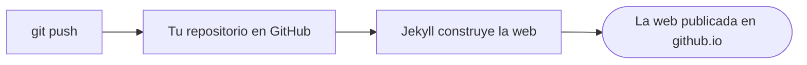
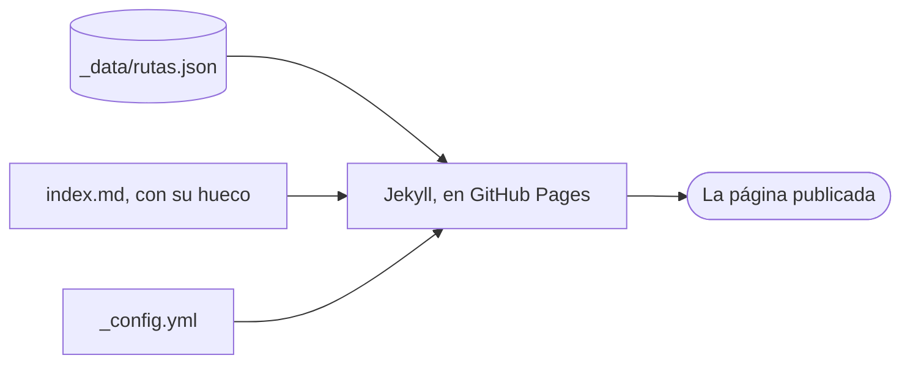
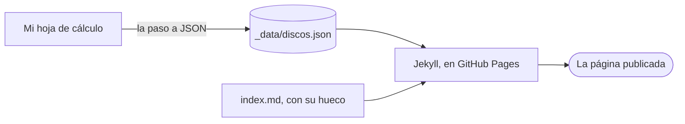

# 08.01 Tu primer repositorio

> **Versiones:** Git 2.56; salidas de la 2.56.0; la más reciente, la 2.56.1 (a 16 de noviembre de 2026) · GitHub Pages con Jekyll 3.10.0 y Liquid 4.0.4, según su lista de versiones a 16 de noviembre de 2026 · GitHub, según su documentación a 16 de noviembre de 2026
> **Conviene saber antes:** [05.03 GitHub](../fase-05-git-y-github/03-github.md) · [07.02 Organizar tu trabajo](../fase-07-aprender-a-aprender/02-organizar-tu-trabajo.md) · [04.03 JSON y YAML](../fase-04-formatos-y-diagramas/03-json-y-yaml.md) · [04.05 Diagramas y Mermaid](../fase-04-formatos-y-diagramas/05-diagramas-y-mermaid.md) · [07.04 Programar con asistentes de IA, 1.10](../fase-07-aprender-a-aprender/04-programar-con-asistentes-de-ia.md#110-las-cinco-normas-de-la-academia) · [07.05 Seguridad básica](../fase-07-aprender-a-aprender/05-seguridad-basica.md)
> **Tiempo estimado:** 6 horas
> **Nivel:** Básico · Núcleo

## Qué aprenderás

- Qué vas a construir en este proyecto final y **cuándo está terminado**: su lista de entrega.
- A elegir un **tema** y un **alcance** que quepan en unas horas, y a no publicar datos que no debes.
- A planificarlo con ***issues*** en un **tablero** de GitHub, con su criterio de hecho.
- A organizar sus **carpetas** y a guardar sus datos en **JSON**.
- Cómo publica **GitHub Pages** una web desde un repositorio, qué es **Jekyll** y cómo se activa.
- A enseñar tus datos en la web **rellenando huecos** en una plantilla, sin programar.
- A poner el **diagrama** en el README, donde GitHub lo dibuja, y a escribir un **README completo**, con la sección **«Cómo lo hice»**.
- A elegir la **licencia** y a **revisar** el proyecto antes de darlo por terminado.
- A preparar tu **perfil de GitHub** como portfolio, y qué **curso** puedes hacer después.

## 1. Teoría

Este módulo es diferente de los demás: aquí no aprendes una herramienta nueva, sino que **juntas todas las que ya tienes** en un proyecto tuyo. La teoría te dice qué hacer y en qué orden; los ejemplos lo hacen con un proyecto modelo; y el caso real es tu propio proyecto, que es donde se te irá la mayor parte del tiempo.

### 1.1. Qué vas a construir y cuándo está terminado

Al terminar este módulo tendrás **un repositorio tuyo en GitHub**, público, que cualquiera puede ver y que puedes enseñar: es la primera pieza de tu **portfolio**, el conjunto de trabajos que enseñas para que se vea lo que sabes hacer. Ese repositorio:

- Está **planificado con *issues*** en un **tablero** de GitHub, una por tarea ([07.02](../fase-07-aprender-a-aprender/02-organizar-tu-trabajo.md)).
- Tiene un **README** en Markdown que lo presenta ([04.02](../fase-04-formatos-y-diagramas/02-markdown.md#116-el-fichero-readme)).
- Guarda unos **datos en JSON** ([04.03](../fase-04-formatos-y-diagramas/03-json-y-yaml.md)).
- Explica cómo está hecho con un **diagrama en Mermaid** ([04.05](../fase-04-formatos-y-diagramas/05-diagramas-y-mermaid.md)).
- Tiene su **historial en Git**, con un commit por paso ([fase 5](../fase-05-git-y-github/01-git-fundamentos.md)).
- Está **publicado en internet con GitHub Pages**: una web con tus datos, en una dirección que puedes mandar a quien quieras.

El proyecto modelo de este módulo es el que ya planificaste en el [ejercicio 6 de 07.02](../fase-07-aprender-a-aprender/02-organizar-tu-trabajo.md#ejercicio-6--el-tablero-de-tu-proyecto-final): **«Mis rutas en bici»**, una web con las rutas que Ana hace en bici los fines de semana. Ana es la misma de los ejemplos de la fase 5. Tu proyecto tendrá otro tema; la forma será la misma. En las direcciones de GitHub de este módulo, `TU-USUARIO` ocupa el sitio del usuario de GitHub (el de Ana, el de cada persona de los ejercicios o el tuyo), como en [05.03, ejemplo 2.7](../fase-05-git-y-github/03-github.md#27-conectarte-a-github-de-verdad).

**Cuándo está terminado.** Igual que cada tarea tiene su [criterio de hecho](../fase-07-aprender-a-aprender/02-organizar-tu-trabajo.md#13-cuándo-está-hecha-una-tarea), el proyecto entero tiene el suyo. Es la **lista de entrega**, y el proyecto está terminado cuando se cumplen todas sus condiciones:

1. El repositorio es **público** en GitHub y su nombre dice qué es (`mis-rutas-en-bici`, no `proyecto-final`).
2. Cada tarea es una *issue* del **tablero**, con su criterio de hecho, y todas están cerradas.
3. Los datos están en un **JSON válido** en `_data/`, sin ningún dato personal.
4. La **web de GitHub Pages** abre desde otro aparato y enseña todos esos datos.
5. El **README** dice qué es, cómo verlo y cómo está organizado, tiene el **diagrama** (que GitHub dibuja) con su frase en texto, la sección **«Cómo lo hice»** y la licencia.
6. Hay un fichero **`LICENSE`**.
7. El **historial** tiene un commit por paso, con mensajes que dicen qué cambia.
8. Has hecho la **revisión final**: ningún secreto ni dato personal en ningún commit, todos los enlaces funcionan y otra persona ha abierto la web.

Y, como remate, tu **perfil de GitHub** enlaza al proyecto ([apartado 1.13](#113-tu-perfil-y-tu-portfolio)).

> **📌 Nota:** necesitas una **cuenta de GitHub** ([05.03, apartado 1.3](../fase-05-git-y-github/03-github.md#13-tu-cuenta-de-github)) y conectar Git con ella ([05.03, ejemplo 2.7](../fase-05-git-y-github/03-github.md#27-conectarte-a-github-de-verdad)). Lo que pasa en la web de GitHub (el tablero, activar Pages, la página publicada) no se puede comprobar en el curso: va como **salida de ejemplo**, según la documentación de GitHub a 16 de noviembre de 2026. Las pantallas de GitHub cambian a menudo; si algo no está donde dice el módulo, búscalo en la ayuda de GitHub ([07.03](../fase-07-aprender-a-aprender/03-buscar-ayuda.md)).

### 1.2. Elegir el tema y el alcance

**El tema.** Elige algo que te guste y de lo que tengas datos: tus rutas, tus recetas, tus libros leídos, tu colección de discos, los partidos de tu equipo, las plantas de tu terraza… Lo importante es que sean **datos que se puedan escribir como una lista** de cosas parecidas, cada una con los mismos campos. Así podrás guardarlos en JSON y enseñarlos en la web.

**El alcance.** El **alcance** de un proyecto es lo que entra en él y lo que no, decidido **antes de empezar**. Para este proyecto, el alcance es pequeño a propósito:

| Entra | No entra |
|---|---|
| Una web **estática**: una página, igual para todos, que enseña tus datos | Formularios, comentarios, usuarios, *likes*: nada que la web tenga que **recordar** |
| Unos datos en **un fichero JSON**, de 5 a 20 elementos | Una base de datos, o miles de datos |
| Un aspecto sencillo, el que da GitHub Pages | Diseñar la web a tu gusto con HTML y CSS |
| Tus propios datos | Datos de otras personas |

¿Por qué solo una web estática? Porque es lo que puede publicar GitHub Pages: ya viste en [06.05](../fase-06-internet-y-aplicaciones/05-piezas-de-una-aplicacion.md#110-qué-es-desplegar-servidor-dominio-y-hosting) que una web que tiene que recordar o decidir algo (un pedido, una reserva) necesita un *backend* y una base de datos, y eso ya no cabe aquí. Si tu idea los necesita, guárdala para cuando sepas programar, y haz ahora su **primera versión estática**: la carta del restaurante antes que los pedidos; la lista de tus libros antes que las reseñas de tus amigos.

**Lo que no se publica.** Un repositorio público y una web de GitHub Pages los **puede leer cualquiera**. Antes de elegir los datos, piensa qué dicen de ti y de los demás ([06.06, 1.12](../fase-06-internet-y-aplicaciones/06-que-es-la-ia.md#112-privacidad-lo-que-escribes-sale-de-tu-ordenador)):

- **Nada que diga dónde vives**: ni tu dirección, ni rutas que salen de tu portal, ni fotos con la ubicación guardada dentro. Las rutas de Ana salen de sitios públicos del pueblo (la estación, la plaza, el polideportivo), nunca de su casa.
- **Ningún dato de otras personas**: ni nombres completos, ni teléfonos, ni correos. Da igual que la web no los enseñe: si están en el repositorio, cualquiera puede leerlos ([07.04, ejercicio 5](../fase-07-aprender-a-aprender/04-programar-con-asistentes-de-ia.md#ejercicio-5--el-contexto-del-club-de-ajedrez)).
- **Ningún secreto**: ni contraseñas ni claves, ni en los ficheros de hoy ni en ningún commit del pasado ([07.05](../fase-07-aprender-a-aprender/05-seguridad-basica.md#113-los-secretos-dónde-se-guardan)).

### 1.3. Planificar con issues y un tablero

Con el tema y el alcance decididos, el proyecto se divide en **tareas**, cada una con su criterio de hecho, como en [07.02](../fase-07-aprender-a-aprender/02-organizar-tu-trabajo.md#12-dividir-un-problema-en-tareas). Estas son las siete de Ana, las de la solución del [ejercicio 6 de 07.02](../fase-07-aprender-a-aprender/02-organizar-tu-trabajo.md#ejercicio-6--el-tablero-de-tu-proyecto-final):

| # | Tarea | Está hecha cuando… |
|---|---|---|
| 1 | Crear el repositorio con su README mínimo | Está en GitHub, con un README que dice qué es el proyecto en una frase, y con su `.gitignore` |
| 2 | Publicar una página de prueba con GitHub Pages | La dirección de Pages abre la página desde otro aparato |
| 3 | Escribir las rutas en `rutas.json` | Es un JSON válido, con al menos cinco rutas, cada una con nombre, kilómetros y dificultad |
| 4 | Enseñar las rutas en la web | Las cinco rutas de `rutas.json` se ven en la página publicada |
| 5 | Dibujar el diagrama de cómo está hecho el proyecto | El diagrama Mermaid se ve en el README de GitHub, con su frase en texto |
| 6 | Completar el README | Dice qué es, cómo verlo, cómo está organizado y la sección «Cómo lo hice», y sus enlaces funcionan |
| 7 | Revisar el proyecto antes de darlo por terminado | Ningún secreto en el historial, todos los enlaces funcionan y otra persona lo ha abierto desde su móvil |

Ana las convierte en *issues* de su repositorio (la tarea 1 es la *issue* `#1`, la 2 es la `#2`…), con el criterio de hecho en casillas, y las pone en un tablero de GitHub Projects con las columnas **Todo**, **In Progress** y **Done** (por hacer, en curso y hecho) y un límite de 2 en **In Progress**, como en el [ejemplo 2.5 de 07.02](../fase-07-aprender-a-aprender/02-organizar-tu-trabajo.md#25-el-tablero-en-github-projects). Si quieres que todas tus *issues* tengan la misma forma, usa la plantilla del [ejemplo 2.3 de 07.02](../fase-07-aprender-a-aprender/02-organizar-tu-trabajo.md#23-una-plantilla-de-issue-para-las-tareas).

**Cerrar las *issues* desde los commits.** En 05.03 viste que una *pull request* con `Closes #3` cierra la *issue* 3 al fusionarse. Según la documentación de GitHub (a 16 de noviembre de 2026), **un mensaje de commit** también vale: la *issue* se cierra cuando ese commit llega a la rama principal del repositorio de GitHub. La palabra va en una segunda línea del mensaje, con otro `-m`:

```bash
git commit -m "Añade las cinco primeras rutas" -m "Closes #3"
```

Úsalo solo cuando **el commit cumple el criterio de hecho** de la tarea. Si el criterio se comprueba en la web («se ve en la página publicada», «abre desde otro aparato»), el commit no basta: subes el cambio, compruebas la web y cierras la *issue* tú a mano.

**En `main` o en una rama.** Como en este proyecto trabajas sola o solo, las tareas pequeñas puedes hacerlas con commits directamente en `main`. Pero haz **al menos una en una rama** que después fusionas en `main`, como en [05.02](../fase-05-git-y-github/02-ramas-y-conflictos.md#14-crear-ramas-y-cambiar-de-una-a-otra): la que más se presta es la que cambia la portada de la web. GitHub Pages publica lo que hay en `main`, así que, mientras trabajas en la rama, la web sigue como estaba; solo cambia cuando fusionas y subes. Es lo que hace Ana con la tarea 4 en el [ejemplo 2.4](#24-el-historial-tarea-a-tarea).

> **📌 Nota:** si quieres seguir [GitHub Flow](../fase-05-git-y-github/03-github.md#113-github-flow) entero, también puedes subir esa rama a GitHub, abrir una *pull request* y fusionarla allí, como en [05.03, ejemplo 2.5](../fase-05-git-y-github/03-github.md#25-una-rama-para-una-pull-request). Es opcional en este proyecto; el tablero se mueve igual.

### 1.4. Las carpetas del proyecto

El proyecto sigue las mismas reglas de nombres y carpetas que viste en [02.02](../fase-02-tu-ordenador/02-archivos-carpetas-y-rutas.md#113-cómo-nombrar-ficheros-y-carpetas) con la web de la escuela de guitarra: minúsculas, sin espacios, sin tildes ni eñes, y cada cosa en su sitio. Este es el de Ana, terminado:

```text
mis-rutas-en-bici
├── .gitignore         ← lo que Git no guarda
├── LICENSE            ← la licencia
├── README.md          ← la portada del repositorio, en GitHub
├── _config.yml        ← la configuración de la web
├── index.md           ← la portada de la web
└── _data
    └── rutas.json     ← los datos
```

Dos nombres te sonarán raros: `_config.yml` y la carpeta `_data`, que empiezan por un guion bajo. No son un capricho: son los nombres que espera **Jekyll**, el programa con el que GitHub Pages construye la web, y te los explica el [apartado 1.6](#16-cómo-publica-github-pages-jekyll-en-una-idea). Todo lo demás ya lo conoces: el `README.md` y la `LICENSE` en la raíz, donde GitHub los busca ([05.03, 1.14](../fase-05-git-y-github/03-github.md#114-el-escaparate-readme-licencia-y-perfil)), y el [`.gitignore`](../fase-05-git-y-github/01-git-fundamentos.md#112-lo-que-no-va-en-git-gitignore), que es un [fichero oculto](../fase-02-tu-ordenador/02-archivos-carpetas-y-rutas.md#115-ficheros-ocultos).

**Dos portadas.** Fíjate en que hay dos ficheros que hacen de portada, y cada uno es para un sitio:

| Fichero | Quién lo enseña | Para quién |
|---|---|---|
| `README.md` | GitHub, debajo de la lista de ficheros del repositorio | Quien mira **cómo está hecho** el proyecto |
| `index.md` | GitHub Pages, como página principal de la web | Quien quiere **ver** tus datos |

### 1.5. Los datos en JSON

Los datos de la web van en un fichero JSON dentro de `_data`. Ya sabes escribirlo ([04.03](../fase-04-formatos-y-diagramas/03-json-y-yaml.md#13-json-el-formato-para-intercambiar-datos)): una **lista** con un **objeto** por elemento, y en cada objeto, las mismas claves. Así empieza el de Ana:

```json
[
  {
    "nombre": "Vía verde del río",
    "km": 24,
    "dificultad": "fácil",
    "salida": "Estación de tren"
  },
```

(El fichero entero, con sus cinco rutas, está en el [ejemplo 2.1](#21-los-datos-y-la-configuración).)

Tres decisiones que conviene tomar antes de escribir el primer elemento:

- **Qué campos tiene cada elemento**, y que sean los mismos en todos. Si una ruta tiene `km` y otra `kilometros`, la web enseñará un hueco vacío en una de las dos.
- **El tipo de cada valor** ([04.03, apartado 1.4](../fase-04-formatos-y-diagramas/03-json-y-yaml.md#14-los-seis-tipos-de-valores-de-json)): los kilómetros, **número** (`24`, sin comillas); el nombre y la dificultad, **texto**; si quisieras marcar las favoritas, un **booleano** (`true` o `false`).
- **Nombres de clave cortos, sin tildes ni eñes ni espacios** (`km`, `anio`), como las [variables del pseudocódigo](../fase-01-que-es-programar/02-algoritmos-y-pseudocodigo.md#13-los-datos-de-un-algoritmo): los usarás para rellenar los huecos de la web.

Y, cada vez que lo cambies, **compruébalo en VS Code** ([04.03, apartado 1.8](../fase-04-formatos-y-diagramas/03-json-y-yaml.md#18-comprobar-un-json-en-vs-code)): un JSON roto hace que la web no se pueda construir ([error típico 3.3](#33-un-json-roto-y-la-web-que-no-cambia)).

### 1.6. Cómo publica GitHub Pages: Jekyll en una idea

En [05.03](../fase-05-git-y-github/03-github.md#115-lo-que-verás-más-adelante-pages-actions-y-gh) viste que [GitHub Pages](../glosario.md#github-pages) publica una web estática desde un repositorio. Lo que no viste es **cómo**: entre tus ficheros y la web hay un paso más.

Según la documentación de GitHub (a 16 de noviembre de 2026), cuando publicas desde una rama, **GitHub Pages construye la web con Jekyll**. **Jekyll** es un **generador de sitios estáticos**: un programa que toma tus ficheros (Markdown, datos, configuración) y **fabrica con ellos las páginas HTML** de la web, que es lo que se publica. Tú escribes en Markdown y Jekyll lo convierte; tú escribes los datos en JSON y Jekyll los mete en la página. Cada vez que subes un cambio, GitHub Pages vuelve a ejecutar Jekyll y la web se actualiza sola.



En texto: subes tus commits con `git push`; GitHub Pages toma los ficheros del repositorio, Jekyll construye con ellos la web y la publica en tu dirección de `github.io`.

> **📌 Nota:** Jekyll **no lo instalas tú**: funciona en los servidores de GitHub. Se puede instalar en tu ordenador para ver la web antes de subirla, pero necesita Ruby y más pasos, y para este proyecto no hace falta. Al subir un cambio, tardará unos minutos en verse ([apartado 1.7](#17-activar-github-pages)).

**Lo que Jekyll publica y lo que no.** No todo lo que hay en el repositorio acaba en la web. Según la documentación de GitHub (a 16 de noviembre de 2026), Jekyll **no publica** los ficheros y carpetas cuyo nombre:

- empieza por **guion bajo** (`_`): `_config.yml` y `_data` son para Jekyll, no para los visitantes;
- empieza por **punto** (`.`): `.gitignore`, `.github`…;
- empieza por almohadilla (`#`) o termina en `~` (copias que dejan algunos editores);

ni lo que está en las carpetas `node_modules` y `vendor` (de otros programas), ni lo que tú le digas en la opción `exclude` de `_config.yml`. Lo demás (tus `.md`, imágenes, ficheros sueltos) se publica.

**Los ficheros de Jekyll en tu proyecto:**

| Fichero | Qué hace |
|---|---|
| `index.md` | La **portada** de la web. Jekyll lo convierte en `index.html`, la página que se abre al entrar en la dirección |
| `_data/` | La carpeta de los **datos**. Jekyll lee los ficheros YAML, JSON, CSV y TSV que hay dentro (según la documentación de Jekyll, a 16 de noviembre de 2026) y deja que las páginas los usen por su nombre: `_data/rutas.json` es `site.data.rutas` |
| `_config.yml` | La **configuración** de la web, en [YAML](../fase-04-formatos-y-diagramas/03-json-y-yaml.md#19-yaml-el-formato-para-que-lo-escriban-personas): su título, su descripción, su idioma y lo que no se publica (`exclude`). Es opcional, pero conviene |

**La cabecera de `index.md`.** La portada empieza por una [cabecera YAML](../glosario.md#cabecera-yaml-front-matter) entre dos líneas `---`, como la de las plantillas de *issue* de [07.02](../fase-07-aprender-a-aprender/02-organizar-tu-trabajo.md#17-plantillas-de-issue). Según la documentación de Jekyll, un fichero con esa cabecera es para Jekyll una página que tiene que **procesar**: rellenar sus huecos y convertirla en HTML. Debe ser lo **primero** del fichero:

```markdown
---
title: Mis rutas en bici
---
```

`title` es el título de la página, el que sale en la pestaña del navegador.

**El aspecto.** La web sale con un **tema**, un diseño ya hecho: letra, márgenes, colores. En la prueba de este módulo, sin elegir ninguno, la web salió con un diseño sencillo, y para este proyecto basta; la documentación de GitHub explica cómo elegir un tema si quieres.

> **📌 Nota:** Jekyll es el generador **que trae** GitHub Pages, pero hay muchos otros (Hugo, Astro, Eleventy…), y GitHub Pages puede publicar lo que construyen con un flujo de trabajo de GitHub Actions. Para tu primer proyecto, quédate con Jekyll: no hay que instalar ni configurar nada.

### 1.7. Activar GitHub Pages

GitHub Pages se activa **una vez por repositorio**, en su web de GitHub. Antes de activarlo, el repositorio tiene que tener un **fichero de entrada**, la portada: según la documentación de GitHub, un `index.html`, un `index.md` o un `README.md` en lo más alto de la carpeta que publicas. Ana usa `index.md`. (Si no hubiera `index.md`, GitHub Pages usaría el README como portada; mejor tener las dos portadas separadas, como viste en el [apartado 1.4](#14-las-carpetas-del-proyecto).)

Los pasos, **según la documentación de GitHub a 16 de noviembre de 2026** (el curso no los puede comprobar: necesitan una cuenta, y los rótulos pueden cambiar):

1. En la página del repositorio, pulsa **Settings** (la configuración del repositorio).
2. En la barra lateral, en la sección «Code, planning, and automation», pulsa **Pages**.
3. En «Build and deployment», en **Source**, elige **Deploy from a branch** (publicar desde una rama).
4. En el desplegable de la rama, elige **`main`**; en el de la carpeta, **`/ (root)`**, la raíz del repositorio (la otra opción es `/docs`, una carpeta `docs` dentro de la rama).
5. Pulsa **Save**.

**La dirección.** La web de un repositorio de proyecto queda en `https://TU-USUARIO.github.io/NOMBRE-DEL-REPOSITORIO/`. La de Ana:

```text
https://TU-USUARIO.github.io/mis-rutas-en-bici/
```

Para encontrarla, en la misma página **Settings > Pages** hay un botón **Visit site** que la abre.

**Cuánto tarda.** Según la documentación de GitHub, después de cada `git push` **pueden pasar hasta 10 minutos** hasta que el cambio se vea en la web. Si al cabo de una hora no ha cambiado, algo ha fallado al construirla ([error típico 3.3](#33-un-json-roto-y-la-web-que-no-cambia)).

**Público.** Con una cuenta gratuita (GitHub Free), el repositorio tiene que ser **público** para usar GitHub Pages. Y, según su documentación, la web de GitHub Pages es **pública en internet**, aunque el repositorio fuera privado (con los planes que lo permiten). Por eso todo lo de la revisión del [apartado 1.12](#112-revisar-antes-de-publicar) importa tanto.

> **⚠️ Cuidado:** GitHub Pages no es para cualquier web. Su documentación dice que no se use para transacciones delicadas (enviar contraseñas o números de tarjeta) ni para llevar un negocio en línea ([06.05, 1.10](../fase-06-internet-y-aplicaciones/05-piezas-de-una-aplicacion.md#110-qué-es-desplegar-servidor-dominio-y-hosting)). Para una web personal como la tuya, es perfecta.

### 1.8. Enseñar los datos en la web: rellenar huecos

Ya tienes los datos en `_data/rutas.json`. Para que salgan en la portada, `index.md` lleva unas líneas especiales que Jekyll **rellena** con ellos al construir la web. No es programar: es una **plantilla**, un texto con **huecos**, como un formulario de papel con «Nombre: ____». Tú escribes el texto fijo y marcas los huecos; Jekyll los rellena.

Esas marcas son de **Liquid**, el lenguaje de plantillas que usa Jekyll. Según su documentación (a 16 de noviembre de 2026), sus marcas van entre dos tipos de delimitadores, y para este proyecto te bastan los dos:

| Marca | Qué hace | Ejemplo |
|---|---|---|
| `{{ … }}` | **Un hueco**: aquí va un dato | `{{ ruta.nombre }}` → `Vía verde del río` |
| `` | **Una instrucción** para la plantilla: no se ve en la página | `` … `` |

Así es la parte de la portada de Ana que enseña las rutas:

```markdown

- **{{ ruta.nombre }}**: {{ ruta.km }} km, dificultad {{ ruta.dificultad }}. Sale de: {{ ruta.salida }}.

```

Léelo así:

1. **``**: «para cada ruta de `rutas.json`…». Es el [`PARA cada … DE … HACER`](../fase-01-que-es-programar/02-algoritmos-y-pseudocodigo.md#19-repetición) del pseudocódigo: `site.data.rutas` es la lista del fichero, y `ruta` es el nombre que le das a cada elemento mientras lo recorres (podrías llamarlo `r` o `cada_ruta`; `ruta` se entiende mejor).
2. **La línea del medio** es lo que se repite, una vez por ruta: una línea de una lista de Markdown, con texto fijo («km», «dificultad», «Sale de:») y huecos. Cada hueco `{{ ruta.CLAVE }}` se rellena con el valor de esa clave en el objeto de la ruta.
3. **``** marca dónde termina lo que se repite.

Con las cinco rutas, Jekyll escribe cinco líneas, cada una con los datos de una ruta, y después las convierte en una lista de la web. Para cambiar cómo se ve cada ruta, cambias el texto de la línea del medio; para añadir una ruta, solo tocas el JSON.

> **📌 Nota:** no necesitas saber más de Liquid para este proyecto. Tiene más instrucciones (por ejemplo, `` para enseñar algo solo cuando se cumple una condición, que verás en el [ejercicio 4](#ejercicio-4--la-página-que-enseña-los-discos)), y las aprenderás si algún día trabajas con Jekyll. Lo que importa es la idea: **los datos en un sitio, la presentación en otro**, unidos por los nombres de las claves. Es la misma idea de las aplicaciones que viste en [06.05](../fase-06-internet-y-aplicaciones/05-piezas-de-una-aplicacion.md#14-la-base-de-datos-la-memoria-de-la-aplicación).

**Los nombres tienen que coincidir letra a letra.** `site.data.rutas` funciona porque el fichero se llama `rutas.json`, y `ruta.km` porque la clave se llama `km`. Si escribes `site.data.ruta` o `ruta.kilometros`, Jekyll **no da ningún error**: no encuentra nada y deja el hueco vacío, o no repite ninguna línea. Es el [error típico 3.2](#32-los-datos-no-salen-en-la-web).

**Qué se ve en GitHub.** Si abres `index.md` en la web de GitHub (no en la de Pages), verás las marcas tal cual, `{{ ruta.nombre }}`: GitHub enseña el fichero, no lo construye. Las rutas solo salen en la web publicada.

### 1.9. El diagrama, en el README

El diagrama explica **cómo está hecho** el proyecto, así que su sitio es el README: es para quien mira el repositorio, no para quien visita la web. Y hay otra razón: **GitHub dibuja los diagramas de Mermaid** en los ficheros Markdown del repositorio ([04.05, 1.10](../fase-04-formatos-y-diagramas/05-diagramas-y-mermaid.md#110-dónde-se-dibuja-github-la-academia-y-vs-code)), pero en la web de GitHub Pages **no se ven dibujados**.

Según la documentación de GitHub (a 16 de noviembre de 2026), los diagramas de Mermaid se dibujan en las *issues*, las discusiones, las *pull requests*, las wikis y los ficheros Markdown que ves en GitHub; GitHub Pages no figura en esa lista (la documentación no dice expresamente que no los dibuje). Y es lo que pasa al probarlo: Jekyll convierte el bloque `mermaid` en un **bloque de código**, y en la web se ve el texto del diagrama, sin dibujar (lo comprobamos para este módulo con la misma versión de Jekyll que usa GitHub Pages, la 3.10.0, el 16 de noviembre de 2026).

Por eso Ana pone el diagrama en el README y, desde la web, **lo enlaza**: un enlace a la sección del README en GitHub, con su [ancla](../glosario.md#ancla):

```markdown
[README del repositorio](https://github.com/TU-USUARIO/mis-rutas-en-bici#cómo-está-hecha)
```

Qué dibujar: lo que entra en el proyecto y lo que sale, con flechas. Para una web como esta, un [diagrama de bloques](../fase-04-formatos-y-diagramas/05-diagramas-y-mermaid.md#17-agrupar-con-subgraph-diagramas-de-bloques) pequeño basta: los datos y la portada entran en Jekyll, y sale la web. Cuatro o cinco cajas; si no cabe en la pantalla, sobra algo ([04.05, error típico 3.7](../fase-04-formatos-y-diagramas/05-diagramas-y-mermaid.md#37-el-diagrama-que-lo-quiere-contar-todo)). Y debajo, **la misma idea en texto**, para quien no pueda ver el dibujo.

### 1.10. El README completo, con Cómo lo hice

El README es la portada del repositorio, y lo leerá todo el que llegue a él: quien te esté conociendo, quien quiera saber cómo lo has hecho o tú misma dentro de un año. Lo que ya sabes de [04.02](../fase-04-formatos-y-diagramas/02-markdown.md#116-el-fichero-readme) vale aquí, ajustado a este proyecto. El de Ana tiene estas secciones, en este orden:

| Sección | Qué dice |
|---|---|
| **Título y una o dos frases** | Qué es el proyecto, para que se entienda sin leer nada más |
| **Cómo verla** | La dirección de la web, y dónde están los datos |
| **Cómo está organizado** | Una tabla con cada fichero y carpeta, y para qué es |
| **Cómo está hecha** | El diagrama, con su frase en texto |
| **Privacidad** | Qué datos no lleva, y por qué (opcional, pero dice mucho de ti) |
| **Cómo lo hice** | Qué hiciste tú, en qué te ayudó la IA y cómo lo comprobaste |
| **Licencia** | Cuál es y enlace al fichero `LICENSE` |

**«Cómo lo hice».** Es la norma 4 de la academia ([07.04, 1.10](../fase-07-aprender-a-aprender/04-programar-con-asistentes-de-ia.md#110-las-cinco-normas-de-la-academia)): en tu proyecto final puedes usar la IA, pero debes entender y poder explicar todo lo que entregas, y contarlo en el README. Ya escribiste una en el [ejercicio 6 de 07.04](../fase-07-aprender-a-aprender/04-programar-con-asistentes-de-ia.md#ejercicio-6--la-sección-cómo-lo-hice). Recuerda sus cuatro partes:

- **Lo hice yo:** qué decidiste y escribiste tú.
- **Con ayuda de un asistente de IA:** en qué te ayudó, concretamente. Si no usaste ninguno, dilo.
- **Cómo lo comprobé:** qué hiciste para saber que funciona (validar el JSON, abrir la web en el móvil, contar los datos…).
- **Lo que aprendí:** algo que salió mal y cómo lo resolviste. Es la parte que más dice de cómo trabajas.

No es una confesión ni una lista de excusas: quien la lee ve a alguien que sabe usar sus herramientas y comprueba lo que hace.

### 1.11. La licencia

Sin licencia, tu repositorio se puede ver, pero nadie puede legalmente reutilizar lo que hay en él ([05.03, 1.14](../fase-05-git-y-github/03-github.md#114-el-escaparate-readme-licencia-y-perfil)). Para un proyecto como este, lo habitual es la **MIT**, la misma que usa el código de este curso: cualquiera puede usar, copiar y cambiar tu código, siempre que mantenga el aviso con tu nombre, y tú no respondes de lo que hagan con él.

El texto de la licencia **no se escribe**: se copia entero, cambiando solo el año y tu nombre. Puedes sacarlo de la web `https://choosealicense.com` (la creó GitHub) o dejar que GitHub lo ponga por ti al crear el repositorio (en el formulario de **New repository**). Ana lo copió, y su fichero `LICENSE` empieza así:

```text
MIT License

Copyright (c) 2026 Ana García
```

(El fichero entero, en el [ejemplo 2.1](#21-los-datos-y-la-configuración).)

> **📌 Nota:** la licencia del texto de tu web y la de tus datos pueden ser otras (este curso usa CC BY-SA para el texto). Para tu primer proyecto, una sola licencia MIT para todo es suficiente; si algún día quieres separar, choosealicense.com explica las opciones.

### 1.12. Revisar antes de publicar

La última tarea del tablero es la **revisión**: comprobar, con calma y con la terminal, que lo que vas a enseñar está bien y no enseña lo que no debe. Es lo que hiciste con el repositorio de la protectora en el [ejercicio 5 de 05.03](../fase-05-git-y-github/03-github.md#ejercicio-5--antes-de-hacer-público-el-repositorio-de-la-protectora), con dos cosas más: los datos personales y la web.

| Qué revisas | Cómo |
|---|---|
| Qué ficheros hay en el repositorio | `git ls-files`: ¿sobra alguno? (notas personales, fotos, copias) |
| Que no hay nada sin subir | `git status`: «Tu rama está actualizada con 'origin/main'» y el árbol limpio |
| Que no hay **secretos ni datos personales** en los ficheros de hoy | `git grep -n -i` con las palabras que te preocupen (`casa`, `calle`, tu apellido, `contraseña`…), y leer los resultados uno a uno |
| Que no los hay **en el historial** | `git log -p` y buscar en él (`git log -p \| grep -i …`); un fichero borrado sigue en los commits de antes ([07.05, 1.15](../fase-07-aprender-a-aprender/05-seguridad-basica.md#115-si-se-escapa-un-secreto)) |
| Que el JSON es válido | VS Code, sin marcas rojas |
| Que el README se ve bien | En GitHub: el diagrama dibujado y los enlaces, uno a uno |
| Que la web funciona | La dirección de Pages, con **todos los datos**, en tu ordenador y **en otro aparato** (un móvil, el de otra persona) |

Si encuentras un secreto en el historial, cámbialo (la contraseña o la clave) antes que nada. Si encuentras **datos personales en el historial** y el repositorio todavía no es público y nadie lo ha clonado, lo más sencillo es **empezar un repositorio nuevo** con los ficheros ya corregidos, sin ese historial, como se dijo en 05.03. Si ya era público, cuenta con que alguien ha podido verlo.

> **⚠️ Cuidado:** buscar con `grep` encuentra **palabras**, no **problemas**. Lee lo que encuentra (que «casa» salga en «ninguna sale de mi casa» está bien) y piensa en lo que no busca: una foto, un número de teléfono escrito de otra forma… La herramienta ayuda; la revisión es tuya.

### 1.13. Tu perfil y tu portfolio

Tu proyecto ya existe; ahora tiene que **encontrarse**. Tu perfil de GitHub (`https://github.com/TU-USUARIO`) es lo primero que mira quien quiere conocer tu trabajo, y ya sabes de 05.03 que puedes añadirle una presentación: el **README de perfil**, un `README.md` en un repositorio **público** que se llama **igual que tu usuario** ([05.03, 1.14](../fase-05-git-y-github/03-github.md#114-el-escaparate-readme-licencia-y-perfil)).

Un buen README de perfil es **corto**:

- **Quién eres**, en una frase, y qué estás aprendiendo.
- **Tu proyecto**, con dos enlaces: el repositorio y la web.
- **Cómo hablar contigo** sin dar tus datos: por las *issues* de tus repositorios, por ejemplo.

Y tiene las mismas reglas de privacidad que el proyecto: ni tu dirección, ni tu teléfono, ni tu correo personal, ni datos de nadie más. Tu nombre, solo si quieres que salga (puedes presentarte con tu usuario).

**El portfolio crece.** Este es tu primer proyecto; cada curso que hagas después tendrá el suyo, y todos irán al mismo sitio: tu perfil. Fija los mejores arriba (GitHub deja elegir qué repositorios se enseñan primero en el perfil) y mantén al día su README. Un portfolio no tiene que ser grande: tiene que estar **terminado, explicado y publicado**, como este.

### 1.14. Y ahora, ¿qué curso sigue?

Con este proyecto terminas **Fundamentos para programar**. Ya sabes lo que todos los cursos de la academia dan por sabido: qué es programar, tu ordenador, la terminal, el editor, los formatos de datos, Git y GitHub, cómo funcionan internet y las aplicaciones, y cómo estudiar y usar la IA. Lo que falta es **un lenguaje**.

Cuál, depende de lo que quieras construir. Lo viste en [06.05, 1.12](../fase-06-internet-y-aplicaciones/05-piezas-de-una-aplicacion.md#112-qué-curso-enseña-cada-pieza): si te atrae **lo que se ve** (páginas, aplicaciones web), empieza por el frontend; si te atrae **lo que decide y guarda** (el programa del servidor, su API), por el backend, con Java o con Python. Después vendrán la base de datos, el despliegue o Git a fondo.

Y tu proyecto puede **crecer con lo que aprendas**: con HTML y CSS, le darás el aspecto que quieras; con JavaScript, filtrarás las rutas por dificultad; con un backend y una base de datos, tus amigos podrán apuntar las suyas. Esa es la mejor forma de usar un portfolio: **volver a tus proyectos** con lo que sabes ahora.

## 2. Ejemplos de código

Los ejemplos son **el proyecto de Ana, entero**: primero sus ficheros, uno a uno (2.1 a 2.3), y después cómo los fue subiendo, tarea a tarea, con su historial (2.4 y 2.5). Todo está en la carpeta del ejemplo:

```text
(carpeta del ejemplo)
└── terminado/          ← el proyecto de Ana, terminado: los ficheros de 2.1 a 2.3
```

Las sesiones de 2.4 crean al lado el repositorio de Ana (`mis-rutas-en-bici/`) y un remoto de prácticas (`github/`), como en [05.03](../fase-05-git-y-github/03-github.md#18-un-github-de-prácticas-en-tu-ordenador), y copian cada fichero de `terminado/` en el momento en que Ana lo escribió. En tu proyecto, esos ficheros los escribirás tú con el editor.

### 2.1. Los datos y la configuración

**Situación real:** Ana empieza por lo que no se ve: los datos de sus rutas y los ficheros que necesita la web para construirse.

**Los datos**, `_data/rutas.json`: una lista de cinco objetos, todos con las mismas cuatro claves. Los kilómetros son números; lo demás, texto.

```json
[
  {
    "nombre": "Vía verde del río",
    "km": 24,
    "dificultad": "fácil",
    "salida": "Estación de tren"
  },
  {
    "nombre": "Camino de los molinos",
    "km": 31,
    "dificultad": "media",
    "salida": "Estación de tren"
  },
  {
    "nombre": "Vuelta al embalse",
    "km": 38,
    "dificultad": "media",
    "salida": "Plaza Mayor"
  },
  {
    "nombre": "Subida al mirador",
    "km": 16,
    "dificultad": "difícil",
    "salida": "Polideportivo municipal"
  },
  {
    "nombre": "Ruta de los pinares",
    "km": 52,
    "dificultad": "difícil",
    "salida": "Plaza Mayor"
  }
]
```

📁 **Código:** [`codigo/01-primer-repositorio/ejemplos/2.1-mis-rutas-en-bici/`](codigo/01-primer-repositorio/ejemplos/2.1-mis-rutas-en-bici/)

**La configuración**, `_config.yml`: el título, la descripción y el idioma de la web, y lo que no se publica.

```yaml
# Configuración de la web: la lee Jekyll al construirla en GitHub Pages
title: Mis rutas en bici
description: Las rutas en bici que hago los fines de semana
lang: es

# Lo que no se publica en la web (sigue en el repositorio)
exclude:
  - README.md
  - LICENSE
```

📁 **Código:** [`codigo/01-primer-repositorio/ejemplos/2.1-mis-rutas-en-bici/`](codigo/01-primer-repositorio/ejemplos/2.1-mis-rutas-en-bici/)

**Lo que Git no guarda**, `.gitignore`: los ficheros que crean Windows (`Thumbs.db`) y macOS (`.DS_Store`) en las carpetas, y `_site/`, la carpeta donde Jekyll deja la web construida si algún día lo instalas en tu ordenador. Esa carpeta se fabrica a partir de los demás ficheros, así que no va en Git.

```text
# Ficheros que crea el sistema operativo
.DS_Store
Thumbs.db

# La web construida, si algún día la pruebas con Jekyll en tu ordenador
_site/
```

📁 **Código:** [`codigo/01-primer-repositorio/ejemplos/2.1-mis-rutas-en-bici/`](codigo/01-primer-repositorio/ejemplos/2.1-mis-rutas-en-bici/)

**La licencia**, `LICENSE`: el texto de la MIT, copiado entero, con el año y su nombre.

```text
MIT License

Copyright (c) 2026 Ana García

Permission is hereby granted, free of charge, to any person obtaining a copy
of this software and associated documentation files (the "Software"), to deal
in the Software without restriction, including without limitation the rights
to use, copy, modify, merge, publish, distribute, sublicense, and/or sell
copies of the Software, and to permit persons to whom the Software is
furnished to do so, subject to the following conditions:

The above copyright notice and this permission notice shall be included in all
copies or substantial portions of the Software.

THE SOFTWARE IS PROVIDED "AS IS", WITHOUT WARRANTY OF ANY KIND, EXPRESS OR
IMPLIED, INCLUDING BUT NOT LIMITED TO THE WARRANTIES OF MERCHANTABILITY,
FITNESS FOR A PARTICULAR PURPOSE AND NONINFRINGEMENT. IN NO EVENT SHALL THE
AUTHORS OR COPYRIGHT HOLDERS BE LIABLE FOR ANY CLAIM, DAMAGES OR OTHER
LIABILITY, WHETHER IN AN ACTION OF CONTRACT, TORT OR OTHERWISE, ARISING FROM,
OUT OF OR IN CONNECTION WITH THE SOFTWARE OR THE USE OR OTHER DEALINGS IN THE
SOFTWARE.
```

📁 **Código:** [`codigo/01-primer-repositorio/ejemplos/2.1-mis-rutas-en-bici/`](codigo/01-primer-repositorio/ejemplos/2.1-mis-rutas-en-bici/)

**En qué fijarte:**

- **Ninguna ruta sale de casa de Ana.** Las salidas son sitios públicos del pueblo, que comparten muchas rutas y no dicen nada de dónde vive.
- **`exclude`** deja fuera de la web el README y la licencia. Sin esa línea no pasaría nada grave (se publicarían como ficheros de texto sueltos), pero así la web tiene solo lo que es de la web. Los dos siguen en el repositorio, donde GitHub los enseña.
- **Los comentarios** con `#` del `_config.yml` y del `.gitignore` explican cada parte: el JSON no los admite ([04.03, error típico 3.3](../fase-04-formatos-y-diagramas/03-json-y-yaml.md#33-comentarios-en-un-json)), por eso `rutas.json` no lleva ninguno.

### 2.2. La portada, con su hueco

**Situación real:** con los datos listos, Ana escribe la portada de la web: un título, una frase, la lista de rutas (que rellena Jekyll) y un enlace al diagrama del README.

```markdown
---
title: Mis rutas en bici
---

# Mis rutas en bici

Las rutas que hago en bici los fines de semana. Todas salen de un sitio público del pueblo.

## Las rutas


- **{{ ruta.nombre }}**: {{ ruta.km }} km, dificultad {{ ruta.dificultad }}. Sale de: {{ ruta.salida }}.


## Cómo está hecha

La web se construye sola a partir de los datos de las rutas. El diagrama que lo explica está en el
[README del repositorio](https://github.com/TU-USUARIO/mis-rutas-en-bici#cómo-está-hecha), porque
GitHub Pages no dibuja los diagramas de Mermaid.
```

📁 **Código:** [`codigo/01-primer-repositorio/ejemplos/2.1-mis-rutas-en-bici/`](codigo/01-primer-repositorio/ejemplos/2.1-mis-rutas-en-bici/)

Cuando Ana sube este fichero, GitHub Pages lo construye y la página publicada se ve así en el navegador (**salida de ejemplo**):

```text
Mis rutas en bici

Las rutas que hago en bici los fines de semana. Todas salen de un sitio público del pueblo.

Las rutas

  • Vía verde del río: 24 km, dificultad fácil. Sale de: Estación de tren.
  • Camino de los molinos: 31 km, dificultad media. Sale de: Estación de tren.
  • Vuelta al embalse: 38 km, dificultad media. Sale de: Plaza Mayor.
  • Subida al mirador: 16 km, dificultad difícil. Sale de: Polideportivo municipal.
  • Ruta de los pinares: 52 km, dificultad difícil. Sale de: Plaza Mayor.

Cómo está hecha

La web se construye sola a partir de los datos de las rutas. El diagrama que lo explica está en el
README del repositorio, porque GitHub Pages no dibuja los diagramas de Mermaid.
```

> **📌 Nota:** el curso **no ejecuta Jekyll** al verificar sus ejemplos, así que esta página es una salida de ejemplo. Se ha sacado construyendo la web con las versiones que usa GitHub Pages (Jekyll 3.10.0, el 16 de noviembre de 2026). En tu navegador se verá con el diseño del tema: la letra, los márgenes y los colores serán otros, y los nombres de las rutas, en negrita. El texto será el mismo.

**Lo que fabrica Jekyll.** Por dentro, la página es HTML ([06.03](../fase-06-internet-y-aplicaciones/03-la-web-http-y-apis.md#11-qué-pasa-cuando-abres-una-web)). Si en el navegador miras su código fuente (<kbd>Ctrl</kbd>+<kbd>U</kbd> en Chrome, Edge y Firefox en Windows y Linux; en macOS, el atajo cambia según el navegador), la parte de las rutas empieza así (**salida de ejemplo**, de la misma construcción; recortada):

```text
<h2 id="las-rutas">Las rutas</h2>

<ul>
  <li>
    <p><strong>Vía verde del río</strong>: 24 km, dificultad fácil. Sale de: Estación de tren.</p>
  </li>
  <li>
    <p><strong>Camino de los molinos</strong>: 31 km, dificultad media. Sale de: Estación de tren.</p>
  </li>
```

No hace falta que entiendas cada etiqueta: fíjate en que **ya no hay ni rastro de las marcas** `` ni `{{ … }}`. Jekyll las ha sustituido por los datos, y el título `##` de Markdown se ha convertido en `<h2>`. Es lo que significa «generador de sitios estáticos»: la página se fabrica una vez, al subir el cambio, y después se entrega tal cual a cada visitante.

**En qué fijarte:**

- **La línea del bucle se ha repetido cinco veces**, una por ruta, y cada hueco se ha rellenado con su dato. Las marcas `` no se ven en la página.
- **El título de la página** (`# Mis rutas en bici`) lo escribe Ana en el Markdown; el `title` de la cabecera es el de la pestaña del navegador.
- **El enlace** lleva a la sección «Cómo está hecha» del README en GitHub, donde el diagrama sí se dibuja. Es una dirección completa (`https://github.com/…`), porque el README no está en la web.

### 2.3. El README, con su diagrama y Cómo lo hice

**Situación real:** con la web funcionando, Ana completa el README: lo que verá quien entre en su repositorio.

````markdown
# Mis rutas en bici

Una web con las rutas en bici que hago los fines de semana: cuántos kilómetros tiene cada una,
qué dificultad y desde dónde sale.

## Cómo verla

Está publicada con GitHub Pages en
[TU-USUARIO.github.io/mis-rutas-en-bici](https://TU-USUARIO.github.io/mis-rutas-en-bici/).
Se ve en cualquier navegador, también en el móvil.

Si prefieres los datos sin la web, están en [`_data/rutas.json`](_data/rutas.json).

## Cómo está organizado

| Fichero o carpeta | Qué es |
|---|---|
| `index.md` | La portada de la web, con el hueco donde salen las rutas |
| `_data/rutas.json` | Las rutas, en JSON: un objeto por ruta |
| `_config.yml` | La configuración de la web: título, idioma y lo que no se publica |
| `README.md` | Este fichero |
| `LICENSE` | La licencia del proyecto |
| `.gitignore` | Lo que Git no guarda |

## Cómo está hecha

Para añadir una ruta, basta con escribirla en `_data/rutas.json` y subir el cambio: GitHub Pages
vuelve a construir la web sola.



En texto: Jekyll, el programa con el que GitHub Pages construye la web, toma la portada
(`index.md`), rellena su hueco con las rutas de `_data/rutas.json`, le aplica la configuración de
`_config.yml` y publica el resultado como una página web.

## Privacidad

Todas las rutas salen de sitios públicos del pueblo: la estación, la plaza o el polideportivo.
Ninguna sale de mi casa ni dice dónde vivo.

## Cómo lo hice

- **Lo hice yo:** elegí las rutas y escribí sus datos, organicé las carpetas, escribí la portada
  y este README, y subí cada paso a GitHub con su commit.
- **Con ayuda de un asistente de IA:** le pedí que me explicara qué hace la línea
  ``, y después escribí yo la línea de cada ruta. También le pedí
  que revisara mi diagrama: me propuso la forma de cilindro para los datos, que no conocía.
- **Cómo lo comprobé:** validé `rutas.json` en VS Code, abrí la página publicada en mi ordenador
  y en el móvil de una amiga, conté que salieran las cinco rutas y probé todos los enlaces.
- **Lo que aprendí:** la primera vez no salía ninguna ruta, porque en la portada había escrito
  `site.data.ruta`, sin la ese. Jekyll no da ningún error: simplemente no encuentra nada. Desde
  entonces, cuando algo no sale, lo primero que compruebo son los nombres.

## Licencia

El código de este proyecto tiene licencia MIT: puedes usarlo y cambiarlo, siempre que mantengas
el aviso de autoría. Está en [LICENSE](LICENSE).
````

📁 **Código:** [`codigo/01-primer-repositorio/ejemplos/2.1-mis-rutas-en-bici/`](codigo/01-primer-repositorio/ejemplos/2.1-mis-rutas-en-bici/)

En GitHub, debajo de la lista de ficheros, este README se ve dibujado, con el diagrama como una imagen: un cilindro con `_data/rutas.json` y dos cajas, `index.md, con su hueco` y `_config.yml`, con flechas hacia la caja de Jekyll, y de ella, una flecha hacia la página publicada.

**En qué fijarte:**

- **Cada sección responde a una pregunta** de quien llega: qué es, cómo lo veo, qué hay en cada fichero, cómo funciona, qué hizo ella. Es la tabla del [apartado 1.10](#110-el-readme-completo-con-cómo-lo-hice).
- **El enlace a la web** va con la dirección completa; los enlaces a sus ficheros (`_data/rutas.json`, `LICENSE`), con [rutas relativas](../fase-04-formatos-y-diagramas/02-markdown.md#34-rutas-que-solo-funcionan-en-tu-ordenador), que funcionan en GitHub y en cualquier copia del repositorio.
- **El diagrama tiene su frase en texto** debajo, y la forma de cilindro (`[( … )]`) dice «aquí se guardan datos».
- **«Cómo lo hice»** cuenta lo que hizo Ana, en qué le ayudó el asistente (dos cosas concretas), cómo lo comprobó y un error suyo. Nadie que lo lea pensará que lo hizo la IA: se ve que sabe lo que ha hecho.
- **No hay ningún dato personal**: ni dirección, ni correo, ni el nombre de la amiga que abrió la web en su móvil.

### 2.4. El historial, tarea a tarea

**Situación real:** Ana crea en GitHub su repositorio `mis-rutas-en-bici`, **público y vacío** (sin README ni licencia: los subirá ella, como en [05.03, error típico 3.4](../fase-05-git-y-github/03-github.md#34-crear-el-repositorio-de-github-con-un-readme)). Abre las siete *issues* del [apartado 1.3](#13-planificar-con-issues-y-un-tablero), de la `#1` a la `#7`, y las pone en su tablero. Después trabaja tarea a tarea, con un commit por paso: en `main`, salvo la tarea 4, que hace en una rama.

Así es la *issue* `#4` de Ana, escrita con la plantilla de tareas de [07.02](../fase-07-aprender-a-aprender/02-organizar-tu-trabajo.md#23-una-plantilla-de-issue-para-las-tareas) (**salida de ejemplo**: es lo que Ana escribe en el cuerpo de la *issue*, en GitHub):

```markdown
## Qué hay que hacer

Enseñar en la portada de la web las rutas de `_data/rutas.json`.

## Por qué

Es lo que hace útil la web: sin las rutas, solo es una página en obras.

## Cuándo está hecha

- [ ] Las cinco rutas de `rutas.json` se ven en la página publicada
- [ ] Cada ruta enseña su nombre, sus kilómetros, su dificultad y su salida

## Notas

Necesita la #3 (las rutas en JSON). El diagrama de cómo se construye irá en el README (#5).
```

Y así está su tablero al empezar (**salida de ejemplo**: en GitHub se ve como columnas con tarjetas):

```text
Todo                              In Progress              Done
#1 Crear el repositorio…
#2 Publicar una página de prueba…
#3 Escribir las rutas…
#4 Enseñar las rutas en la web
#5 Dibujar el diagrama…
#6 Completar el README
#7 Revisar el proyecto…
```

`#3` en el texto de una *issue* es un enlace a la *issue* 3, que GitHub pone solo. Desde aquí, cada tarjeta irá pasando a «In Progress» cuando Ana empiece la tarea, y a «Done» cuando se cierre su *issue* (sola, si la cierra un commit, por la automatización que viene activada en GitHub Projects: [07.02, 1.8](../fase-07-aprender-a-aprender/02-organizar-tu-trabajo.md#18-github-projects)).

Aquí lo haces en tu carpeta, con un remoto de prácticas que hace de GitHub ([05.03, 1.8](../fase-05-git-y-github/03-github.md#18-un-github-de-prácticas-en-tu-ordenador)). Descarga la carpeta del ejemplo (su enlace «📁 Código»), abre la terminal en ella y escribe las órdenes de cada sesión, en orden. Cada sesión empieza en la carpeta del ejemplo; por eso, desde la segunda, empiezan con un `cd`. Recuerda que los identificadores de los commits, sus fechas y su autor serán distintos en tu equipo, y también los **hilos** y la **velocidad** de `git push` ([05.03, apartado 2](../fase-05-git-y-github/03-github.md#2-ejemplos-de-código)).

**Tarea 1: el repositorio con su README mínimo.** Ana crea el remoto y su repositorio, escribe un README de una frase, copia el `.gitignore` y la licencia, hace el primer commit y lo sube. El commit cumple el criterio de la tarea 1, así que lleva `Closes #1`.

**En tu terminal** (`sesion-1.txt`):

```text
$ mkdir github
$ git init --bare github/mis-rutas-en-bici.git
Inicializado repositorio Git vacío en /home/alumno/github/mis-rutas-en-bici.git/
$ mkdir mis-rutas-en-bici && cd mis-rutas-en-bici && git init
Inicializado repositorio Git vacío en /home/alumno/mis-rutas-en-bici/.git/
$ printf '# Mis rutas en bici\n\nLas rutas en bici que hago los fines de semana.\n' > README.md
$ cp ../terminado/.gitignore ../terminado/LICENSE .
$ git add README.md .gitignore LICENSE
$ git commit -m "Crea el repositorio con su README mínimo" -m "Closes #1"
[main (commit-raíz) 80018ee] Crea el repositorio con su README mínimo
 3 files changed, 30 insertions(+)
 create mode 100644 .gitignore
 create mode 100644 LICENSE
 create mode 100644 README.md
$ git remote add origin ../github/mis-rutas-en-bici.git
$ git push -u origin main
Enumerando objetos: 5, listo.
Contando objetos: 100% (5/5), listo.
Compresión delta usando hasta 16 hilos
Comprimiendo objetos: 100% (5/5), listo.
Escribiendo objetos: 100% (5/5), 1.12 KiB | 1.12 MiB/s, listo.
Total 5 (delta 0), reused 0 (delta 0), pack-reused 0 (from 0)
To ../github/mis-rutas-en-bici.git
 * [new branch]      main -> main
rama 'main' configurada para rastrear 'origin/main'.
```

📁 **Código:** [`codigo/01-primer-repositorio/ejemplos/2.1-mis-rutas-en-bici/`](codigo/01-primer-repositorio/ejemplos/2.1-mis-rutas-en-bici/)

**Tarea 2: una página de prueba.** Ana escribe un `index.md` provisional, con su cabecera y una frase, y añade el `_config.yml`. Este commit **no** lleva `Closes #2`: la tarea está hecha cuando la página abre desde otro aparato, y eso se comprueba después, en GitHub.

**En tu terminal** (`sesion-2.txt`):

```text
$ cd mis-rutas-en-bici
$ printf -- '---\ntitle: Mis rutas en bici\n---\n\n' > index.md
$ printf '# Mis rutas en bici\n\nPágina en obras.\n' >> index.md
$ cp ../terminado/_config.yml .
$ git add index.md _config.yml
$ git commit -m "Añade una página de prueba para GitHub Pages"
[main 5d0088f] Añade una página de prueba para GitHub Pages
 2 files changed, 16 insertions(+)
 create mode 100644 _config.yml
 create mode 100644 index.md
$ git push
Enumerando objetos: 5, listo.
Contando objetos: 100% (5/5), listo.
Compresión delta usando hasta 16 hilos
Comprimiendo objetos: 100% (4/4), listo.
Escribiendo objetos: 100% (4/4), 660 byte | 660.00 KiB/s, listo.
Total 4 (delta 0), reused 0 (delta 0), pack-reused 0 (from 0)
To ../github/mis-rutas-en-bici.git
   80018ee..5d0088f  main -> main
```

📁 **Código:** [`codigo/01-primer-repositorio/ejemplos/2.1-mis-rutas-en-bici/`](codigo/01-primer-repositorio/ejemplos/2.1-mis-rutas-en-bici/)

En la primera orden, `printf --` lleva dos guiones antes del texto porque el texto empieza por `-` (los `---` de la cabecera): sin ellos, `printf` lo tomaría por una opción.

Ahora Ana activa GitHub Pages en su repositorio, con los pasos del [apartado 1.7](#17-activar-github-pages): **Settings > Pages**, **Deploy from a branch**, rama `main`, carpeta `/ (root)` y **Save**. A los pocos minutos, `https://TU-USUARIO.github.io/mis-rutas-en-bici/` enseña la página en obras (**salida de ejemplo**):

```text
Mis rutas en bici

Página en obras.
```

Le manda la dirección a una amiga, que la abre en su móvil. Criterio cumplido: Ana cierra la *issue* `#2` a mano, en GitHub.

**Tareas 3 y 4: los datos y la portada que los enseña.** Ana crea la carpeta `_data` con `rutas.json` y hace su commit en `main` (`Closes #3`: el JSON es válido y tiene cinco rutas). La tarea 4 cambia la portada de la web, así que la hace en una rama, `rutas-en-la-web` ([05.02, apartado 1.4](../fase-05-git-y-github/02-ramas-y-conflictos.md#14-crear-ramas-y-cambiar-de-una-a-otra)): cambia la portada provisional por la de verdad, mira qué ha cambiado con `git diff --stat` ([05.01, apartado 1.10](../fase-05-git-y-github/01-git-fundamentos.md#110-ver-los-cambios-diff-y-show)) y hace su commit. Cuando la tiene lista, vuelve a `main`, fusiona la rama, la borra y lo sube todo.

**En tu terminal** (`sesion-3.txt`):

```text
$ cd mis-rutas-en-bici
$ mkdir _data
$ cp ../terminado/_data/rutas.json _data/
$ git add _data/rutas.json
$ git commit -m "Añade las cinco primeras rutas" -m "Closes #3"
[main 31b9dd8] Añade las cinco primeras rutas
 1 file changed, 32 insertions(+)
 create mode 100644 _data/rutas.json
$ git switch -c rutas-en-la-web
Cambiado a nueva rama 'rutas-en-la-web'
$ cp ../terminado/index.md .
$ git diff --stat
 index.md | 14 +++++++++++++-
 1 file changed, 13 insertions(+), 1 deletion(-)
$ git add index.md
$ git commit -m "Enseña las rutas en la portada"
[rutas-en-la-web d161d75] Enseña las rutas en la portada
 1 file changed, 13 insertions(+), 1 deletion(-)
$ git switch main
Cambiado a rama 'main'
Tu rama está adelantada a 'origin/main' por 1 commit.
  (usa "git push" para publicar tus commits locales)
$ git merge --no-ff --no-edit rutas-en-la-web
Merge made by the 'ort' strategy.
 index.md | 14 +++++++++++++-
 1 file changed, 13 insertions(+), 1 deletion(-)
$ git branch -d rutas-en-la-web
Eliminada la rama rutas-en-la-web (era d161d75).
$ git push
Enumerando objetos: 10, listo.
Contando objetos: 100% (10/10), listo.
Compresión delta usando hasta 16 hilos
Comprimiendo objetos: 100% (7/7), listo.
Escribiendo objetos: 100% (8/8), 1.26 KiB | 1.26 MiB/s, listo.
Total 8 (delta 3), reused 0 (delta 0), pack-reused 0 (from 0)
To ../github/mis-rutas-en-bici.git
   5d0088f..3d37c8b  main -> main
```

📁 **Código:** [`codigo/01-primer-repositorio/ejemplos/2.1-mis-rutas-en-bici/`](codigo/01-primer-repositorio/ejemplos/2.1-mis-rutas-en-bici/)

**En qué fijarte:**

- **`git diff --stat`** resume el cambio: `index.md` tiene 13 líneas nuevas y 1 menos (la de «Página en obras.»).
- **Al volver a `main`**, Git avisa de que está **adelantada** a `origin/main` por 1 commit: el de las rutas, que aún no ha subido. La portada nueva no está en `main`: está en su rama.
- **`git merge --no-ff --no-edit`** fusiona la rama con un commit de fusión aunque bastara un avance rápido, como el botón **Merge pull request** de GitHub ([05.02, apartado 1.6](../fase-05-git-y-github/02-ramas-y-conflictos.md#16-fusionar-con-avance-rápido)): así el historial deja a la vista que la portada se hizo en su rama. Sin `--no-ff` también valdría.
- **`git branch -d`** borra la rama, ya fusionada, y **`git push`** sube a la vez el commit de las rutas, el de la portada y el de la fusión.

Mientras la portada estaba en su rama, la web seguía enseñando la página en obras, porque GitHub Pages publica lo que hay en `main`. Unos minutos después del `git push`, la web enseña las cinco rutas, como en el [ejemplo 2.2](#22-la-portada-con-su-hueco). Ana las cuenta en la página publicada y cierra la *issue* `#4` a mano.

**Tareas 5 y 6: el diagrama y el README completo.** Ana sustituye el README mínimo por el del [ejemplo 2.3](#23-el-readme-con-su-diagrama-y-cómo-lo-hice).

**En tu terminal** (`sesion-4.txt`):

```text
$ cd mis-rutas-en-bici
$ cp ../terminado/README.md .
$ git add README.md
$ git commit -m "Completa el README con el diagrama y Cómo lo hice"
[main 5d6683b] Completa el README con el diagrama y Cómo lo hice
 1 file changed, 61 insertions(+), 1 deletion(-)
$ git push
Enumerando objetos: 5, listo.
Contando objetos: 100% (5/5), listo.
Compresión delta usando hasta 16 hilos
Comprimiendo objetos: 100% (3/3), listo.
Escribiendo objetos: 100% (3/3), 1.60 KiB | 1.60 MiB/s, listo.
Total 3 (delta 1), reused 0 (delta 0), pack-reused 0 (from 0)
To ../github/mis-rutas-en-bici.git
   3d37c8b..5d6683b  main -> main
```

📁 **Código:** [`codigo/01-primer-repositorio/ejemplos/2.1-mis-rutas-en-bici/`](codigo/01-primer-repositorio/ejemplos/2.1-mis-rutas-en-bici/)

En GitHub, Ana comprueba que el diagrama se dibuja, con su frase debajo, y prueba cada enlace del README. Entonces cierra las *issues* `#5` y `#6`.

### 2.5. La revisión final

**Situación real:** queda la tarea 7. Ana revisa con la terminal lo que ha publicado, con la lista del [apartado 1.12](#112-revisar-antes-de-publicar).

**En tu terminal** (`sesion-5.txt`):

```text
$ cd mis-rutas-en-bici
$ git status
En la rama main
Tu rama está actualizada con 'origin/main'.

nada para hacer commit, el árbol de trabajo está limpio
$ git ls-files
.gitignore
LICENSE
README.md
_config.yml
_data/rutas.json
index.md
$ git log --oneline --graph
* 5d6683b (HEAD -> main, origin/main) Completa el README con el diagrama y Cómo lo hice
*   3d37c8b Merge branch 'rutas-en-la-web'
|\
| * d161d75 Enseña las rutas en la portada
|/
* 31b9dd8 Añade las cinco primeras rutas
* 5d0088f Añade una página de prueba para GitHub Pages
* 80018ee Crea el repositorio con su README mínimo
$ git grep -n -i -e casa -e calle -e contraseña
README.md:45:Ninguna sale de mi casa ni dice dónde vivo.
$ git log -p | grep -c -i -e calle -e contraseña
0
```

📁 **Código:** [`codigo/01-primer-repositorio/ejemplos/2.1-mis-rutas-en-bici/`](codigo/01-primer-repositorio/ejemplos/2.1-mis-rutas-en-bici/)

**En qué fijarte:**

- **`git status`**: no queda nada sin subir. Lo que Ana ve en GitHub es lo mismo que tiene en su carpeta.
- **`git ls-files`**: seis ficheros, todos con su papel en la tabla del README. Ninguna nota personal, ninguna copia, ninguna foto.
- **`git log --oneline --graph`** ([05.02, apartado 1.5](../fase-05-git-y-github/02-ramas-y-conflictos.md#15-ver-todas-las-ramas-git-log---oneline---graph---all)): un commit por paso, con mensajes que dicen qué cambia, y la tarea 4 en su rama, que sale y vuelve a `main` en el commit de fusión. Quien lea el historial entiende cómo se hizo el proyecto.
- **`git grep`** busca en los ficheros que sigue Git, y encuentra «casa» en una línea: la del README que dice que ninguna ruta sale de su casa. Ana la lee y está bien. Por eso no basta con buscar: hay que **leer lo que sale**.
- **`git log -p | grep -c`** cuenta las líneas de todo el historial (con los cambios de cada commit) que tienen esas palabras: `0`. Ningún commit antiguo tuvo una calle o una contraseña.

El resto de la revisión no es de la terminal: Ana abre el README en GitHub (el diagrama se dibuja, los enlaces funcionan) y la web en su ordenador y en el móvil de su amiga. Todo bien: cierra la *issue* `#7`. Con las siete en **Done**, el proyecto está terminado.

## 3. Errores típicos

### 3.1. La dirección de Pages da un error 404

**Qué pasa:** abres `https://TU-USUARIO.github.io/TU-REPOSITORIO/` y sale una página de GitHub con un error [404](../fase-06-internet-y-aplicaciones/03-la-web-http-y-apis.md#17-los-códigos-de-estado): no hay nada en esa dirección.

**Por qué ocurre:** casi siempre, por una de estas cuatro razones:

- **GitHub Pages no está activado**, o está activado en otra rama o en otra carpeta (`/docs` en lugar de `/ (root)`).
- **No hay fichero de entrada** en lo más alto de esa carpeta: ni `index.md`, ni `index.html`, ni `README.md`. O está, pero con otro nombre (`Index.md`, `inicio.md`, o dentro de una subcarpeta).
- **Aún no ha dado tiempo**: la primera publicación y cada cambio pueden tardar hasta 10 minutos.
- **La dirección está mal escrita**: el usuario o el nombre del repositorio, letra a letra.

**Cómo se arregla:** revisa **Settings > Pages** (rama `main`, carpeta `/ (root)`), comprueba con `git ls-files` que `index.md` está en la raíz y se llama así, en minúsculas, y espera unos minutos. Para la dirección exacta, usa el botón **Visit site** de esa misma página en lugar de escribirla a mano.

### 3.2. Los datos no salen en la web

**Qué pasa:** la web se publica, con su título y su texto, pero donde tendría que estar la lista no hay nada. O salen las líneas, pero sin los datos: solo el texto fijo, «km», «dificultad», «Sale de:».

**Por qué ocurre:** un nombre no coincide, y Jekyll **no avisa**: lo que no encuentra lo deja vacío.

- **No sale ninguna línea:** el nombre del fichero y el de `site.data` no coinciden (`site.data.ruta` con un fichero `rutas.json`), o el fichero no está en `_data` (está en `data`, sin guion bajo, o en la raíz).
- **Salen las líneas, con huecos vacíos:** las claves no coinciden (`{{ ruta.kilometros }}` con la clave `km`), o se ha cambiado el nombre del elemento en una parte (`` con `{{ r.nombre }}`).

**Cómo se arregla:** compara letra a letra, con el JSON y la plantilla abiertos a la vez en el editor: el nombre del fichero con lo que va detrás de `site.data.`; cada clave del JSON con lo que va detrás de `ruta.`. Mayúsculas y minúsculas cuentan.

### 3.3. Un JSON roto y la web que no cambia

**Qué pasa:** has añadido una ruta, has hecho `git push` y, al cabo de un buen rato, la web sigue como antes.

**Por qué ocurre:** si Jekyll no puede construir la web, no publica la nueva. Una causa habitual es un fichero de `_data` que no se puede leer: una coma de más, una comilla sin cerrar ([04.03, errores típicos](../fase-04-formatos-y-diagramas/03-json-y-yaml.md#31-una-coma-después-del-último-elemento)). O un `_config.yml` mal escrito. Según la documentación de GitHub (a 16 de noviembre de 2026), cuando la construcción falla te llega un **correo** a tu dirección principal, y el error se ve también en las ejecuciones de los flujos de trabajo del repositorio (su pestaña **Actions**).

**Cómo se arregla:** lee el correo o el registro: dice qué fichero ha fallado y, muchas veces, la línea. Arréglalo, compruébalo en VS Code, y haz otro commit y otro `git push`. Y para la próxima: **valida el JSON antes de cada commit**.

### 3.4. El diagrama se ve como texto en la web

**Qué pasa:** has puesto el diagrama en `index.md` y, en la web publicada, en lugar del dibujo sale su código: `flowchart LR`, flechas `-->` y nombres entre corchetes.

**Por qué ocurre:** GitHub Pages no dibuja los diagramas de Mermaid: Jekyll convierte el bloque en un bloque de código, como cualquier otro ([apartado 1.9](#19-el-diagrama-en-el-readme)).

**Cómo se arregla:** pon el diagrama en el `README.md`, donde GitHub sí lo dibuja, y desde la web, enlázalo. Dibujarlo en la web también es posible, pero necesita JavaScript, que no es de este curso.

### 3.5. Enlaces que funcionan en GitHub y no en la web

**Qué pasa:** desde la portada de la web enlazas al README con `[el README](README.md)`, o con `[el README](/README.md)`, y el enlace da un 404.

**Por qué ocurre:** la web y el repositorio son dos sitios distintos. Un enlace relativo en `index.md` lleva a otra página **de la web**, y el README no está en la web (Ana lo excluye en `_config.yml`; y aunque estuviera, no se vería dibujado). Un enlace que empieza por `/` es aún peor: lleva a la raíz de `TU-USUARIO.github.io`, no a la de tu proyecto, que está en `/TU-REPOSITORIO/`.

**Cómo se arregla:** desde la web, enlaza a lo del repositorio con la **dirección completa de GitHub** (`https://github.com/TU-USUARIO/TU-REPOSITORIO#ancla`), como hace Ana. Y prueba **cada enlace en la web publicada**, no solo en GitHub: es parte de la revisión.

### 3.6. Datos personales en un repositorio público

**Qué pasa:** en tus datos hay una ruta que sale de tu portal, con tu calle; o una nota con el teléfono de alguien que se te olvidó en la carpeta y entró en un `git add .`.

**Por qué ocurre:** los datos salen de tu vida real, y lo natural es escribirlos tal cual. Y `git add .` añade todo lo que hay en la carpeta, sin preguntar.

**Cómo se arregla:** antes del primer `git push`, la revisión del [apartado 1.12](#112-revisar-antes-de-publicar). Si el dato ya está en un commit, no basta con borrarlo en otro commit: sigue en el historial. Si nadie ha clonado aún el repositorio, empieza uno nuevo con los ficheros corregidos; si ya era público, cuenta con que se ha podido ver. Y para que no vuelva a pasar: añade los ficheros uno a uno (`git add rutas.json`) o revisa `git status` antes de cada commit, y guarda tus notas personales **fuera** de la carpeta del proyecto.

### 3.7. El push rechazado después de editar en la web de GitHub

**Qué pasa:** has corregido una errata del README directamente en la web de GitHub (tiene un botón para editar los ficheros). Después haces un cambio en tu ordenador, un commit y `git push`, y Git lo rechaza: el remoto tiene trabajo que tú no tienes.

**Por qué ocurre:** editar en la web de GitHub **es hacer un commit** en el remoto. Tu repositorio local no lo tiene, así que tu `main` y el de GitHub se han separado, como cuando otra persona sube antes que tú ([05.03, error típico 3.2](../fase-05-git-y-github/03-github.md#32-el-push-rechazado-y-el---force)).

**Cómo se arregla:** `git pull` para traer ese commit (y, si Git lo pide, decidir cómo reconciliar las ramas, como en [05.03, error típico 3.3](../fase-05-git-y-github/03-github.md#33-necesita-especificar-cómo-reconciliar-las-ramas-divergentes)), y después `git push`. **Nunca `--force`**: borraría el cambio que hiciste en la web. Para no liarte, elige un sitio para trabajar (tu ordenador) y, si alguna vez editas en la web, haz `git pull` antes de seguir.

### 3.8. Cerrar la tarea antes de comprobarla

**Qué pasa:** la *issue* «Enseñar las rutas en la web» está cerrada, en la columna **Done**, pero al abrir la web no sale ninguna ruta.

**Por qué ocurre:** el commit llevaba `Closes #4`, y la *issue* se cerró sola al subirlo, sin que nadie mirara la web. O se cerró a mano «porque el commit ya estaba».

**Cómo se arregla:** vuelve a abrir la *issue* (tiene un botón para reabrirla), arregla lo que falle y ciérrala cuando se cumpla su criterio. Y la próxima vez, `Closes` solo en los commits que cumplen el criterio por sí solos; lo que se comprueba en la web, se cierra después de mirarla ([apartado 1.3](#13-planificar-con-issues-y-un-tablero)).

## 4. Buenas prácticas

- **Decide el alcance antes de empezar**, y apunta las ideas que no caben para la próxima versión, en vez de meterlas todas ahora.
- **Publica pronto**: activa GitHub Pages con una página de prueba en la tarea 2, cuando aún no hay nada que perder.
- **Un commit por paso**, con un mensaje que diga qué cambia, y **al menos una tarea en una rama**, fusionada después en `main`. Usa `Closes #N` solo cuando el commit cumple el criterio de hecho; lo que se comprueba en la web, ciérralo a mano después de comprobarlo.
- **Los datos en un sitio y la presentación en otro**: para cambiar una ruta, solo tocas el JSON.
- **Valida el JSON** en VS Code antes de cada commit.
- **El diagrama, en el README**, con su frase en texto; desde la web, un enlace a él.
- **Enlaces relativos** entre ficheros del repositorio; **direcciones completas** desde la web hacia GitHub.
- **Ningún dato personal**, tuyo o de otros, en ningún fichero ni en ningún commit: el repositorio y la web son públicos.
- **Cuenta en «Cómo lo hice»** qué hiciste tú, en qué te ayudó la IA y cómo lo comprobaste.
- **Revisa antes de darlo por terminado**, con la terminal y con otro aparato. Y pide a otra persona que abra la web.
- **Termina**: un proyecto pequeño publicado vale más que uno grande a medias.

## 5. Ejercicios prácticos resueltos

Los ejercicios 1 a 6 preparan cada pieza con proyectos de otras personas; los dos del caso real son **tu proyecto** y **tu perfil**, y se llevan la mayor parte del tiempo del módulo. Si quieres, haz los primeros ya con el tema de tu proyecto en la cabeza.

### 🟢 Básico

#### Ejercicio 1 · Cinco ideas y su alcance

Cinco personas te cuentan qué quieren hacer como proyecto final. Para cada una, di si **cabe** en el alcance del [apartado 1.2](#12-elegir-el-tema-y-el-alcance) tal como lo cuentan. Si no cabe, propón una **primera versión** que sí quepa.

1. Irene quiere una web con los libros que ha leído este año: título, autor, cuántas páginas y una nota del 1 al 5.
2. Tomás quiere una web donde los socios de su club de pádel se apunten a los partidos del sábado.
3. Carmen quiere una web con los cumpleaños de su familia, con el nombre, la fecha y el teléfono de cada uno, para no olvidarse de felicitarlos.
4. Luis quiere una web con las plantas de su terraza: nombre, cada cuántos días se riegan y si les tiene que dar el sol.
5. Marina quiere una web de su panadería para vender pan por encargo y cobrar con tarjeta.

<details>
<summary>Pista 1</summary>

Hazle tres preguntas a cada idea: ¿la web tiene que **recordar** algo de quien la visita? ¿Los datos son **suyos** o de otras personas? ¿Hay algo que **no deba ser público**?

</details>

<details>
<summary>Ver solución</summary>

**Razonamiento:** cabe una web **estática** con datos **propios** y **públicos**. Lo que tiene que recordar algo (apuntarse, pedir, pagar) necesita *backend* y base de datos ([06.05, 1.10](../fase-06-internet-y-aplicaciones/05-piezas-de-una-aplicacion.md#110-qué-es-desplegar-servidor-dominio-y-hosting)); lo que lleva datos de otras personas no va en un repositorio público.

| # | ¿Cabe? | Por qué | Primera versión que sí cabe |
|---|---|---|---|
| 1 | **Sí** | Una lista de libros, con los mismos campos en todos, igual para todos los que la visitan | La que cuenta |
| 2 | **No** | Que los socios se apunten es que la web **recuerde** algo: necesita *backend* y base de datos. Además, la lista de quién juega son datos de personas | El calendario de partidos del club (fecha, hora, pista), sin nombres de socios. Para apuntarse, que sigan usando lo que usen ahora |
| 3 | **No** | Nombres, fechas de cumpleaños y teléfonos de su familia son **datos personales de otras personas**, y la web sería pública | Ninguna con esos datos. Para eso le sirve el calendario de su móvil. Que elija otro tema |
| 4 | **Sí** | Una lista de plantas con sus cuidados: datos suyos, que no dicen nada de nadie | La que cuenta. Un campo `sol` con `true` o `false` es un buen booleano |
| 5 | **No** | Vender y cobrar necesita *backend*, base de datos y una pasarela de pago, y GitHub Pages no se puede usar para transacciones delicadas ni para llevar un negocio en línea ([apartado 1.7](#17-activar-github-pages)) | La carta de la panadería: productos, precios y horario, como la primera web de la Panadería Sol de [06.05, ejemplo 2.4](../fase-06-internet-y-aplicaciones/05-piezas-de-una-aplicacion.md#24-la-web-de-la-panadería-antes-y-después-de-la-tienda) |

**Errores frecuentes al resolverlo:**

- Dar por buena la 3 «porque es de su familia»: siguen siendo datos personales de otras personas, y un repositorio público lo lee cualquiera.
- Descartar la 2 y la 5 sin más. Casi todas las ideas tienen una primera versión estática; encontrarla es la mitad del trabajo.

</details>

#### Ejercicio 2 · Las carpetas de la web de los discos

Pablo colecciona discos de vinilo y quiere publicar su colección con GitHub Pages. Tiene esta carpeta en el Escritorio:

```text
Discos Pablo
├── Mis Discos.json
├── portada.md
├── config.yml
├── README.md
├── lista discos (copia).xlsx
└── notas.txt
```

`Mis Discos.json` tiene sus discos; `portada.md`, la página principal con el bucle; `config.yml`, el título de la web; `lista discos (copia).xlsx`, la hoja de cálculo de la que sacó el JSON; y en `notas.txt` apunta qué discos le faltan y a quién se los ha prestado, con su teléfono.

1. ¿Dónde guardarías la carpeta, y con qué nombre?
2. Dibuja el árbol tal como debe quedar para que GitHub Pages construya la web con los datos. ¿Qué cambias de nombre, qué mueves y qué falta?
3. ¿Qué ficheros **no** deben ir en el repositorio, y por qué?

<details>
<summary>Pista 1</summary>

Repasa el [apartado 1.4](#14-las-carpetas-del-proyecto): ¿cómo tienen que llamarse la portada, la configuración y la carpeta de los datos para que Jekyll los encuentre? Y las reglas de nombres de [02.02](../fase-02-tu-ordenador/02-archivos-carpetas-y-rutas.md#113-cómo-nombrar-ficheros-y-carpetas).

</details>

<details>
<summary>Ver solución</summary>

**1. Dónde y cómo se llama.** En su carpeta de proyectos, no en el Escritorio (`~/proyectos/discos`). El nombre de la carpeta será el del repositorio, y por tanto parte de la dirección de la web (`https://TU-USUARIO.github.io/discos/`): corto, en minúsculas y sin espacios.

**2. El árbol:**

```text
discos
├── .gitignore
├── LICENSE
├── README.md
├── _config.yml
├── index.md
└── _data
    └── discos.json
```

| Antes | Después | Por qué |
|---|---|---|
| `portada.md` | `index.md` | El fichero de entrada de GitHub Pages tiene que ser `index.md` (o `index.html`, o el README) |
| `config.yml` | `_config.yml` | Jekyll solo lee su configuración en `_config.yml`, con guion bajo |
| `Mis Discos.json` | `_data/discos.json` | Los datos van en `_data`, y el nombre sin espacios ni mayúsculas, porque es el que irá en `site.data.discos` |
| No está | `LICENSE` | Sin licencia, nadie puede reutilizar legalmente su trabajo |
| No está | `.gitignore` | Para que no se cuelen los ficheros del sistema |

**3. Lo que no va:**

- **`notas.txt`**: tiene **teléfonos de otras personas**. Fuera de la carpeta del proyecto, en algún sitio solo suyo. Si se queda dentro, un `git add .` lo subiría a un repositorio público.
- **`lista discos (copia).xlsx`**: es su hoja de cálculo de trabajo, un fichero binario que Git no sabe comparar ([05.01, 1.11](../fase-05-git-y-github/01-git-fundamentos.md#111-texto-y-binario-lo-que-git-sabe-comparar)), y los datos ya están en el JSON. Se queda en su ordenador, fuera del proyecto.

**Errores frecuentes al resolverlo:**

- Dejar `portada.md` o `config.yml` con su nombre: la web saldría vacía o sin título, sin ningún error que lo explique.
- Meter `notas.txt` en el `.gitignore` y dejarlo en la carpeta. Funciona, pero un fichero con datos de otras personas está mejor fuera del proyecto: un descuido con el `.gitignore` y se sube.

</details>

### 🟡 Intermedio

#### Ejercicio 3 · Los datos de los discos en JSON

Estos son los discos que Pablo quiere en la web (los discos y los grupos son inventados). De cada uno quiere el título, el grupo, el año y si es de sus favoritos:

| Título | Grupo | Año | Favorito |
|---|---|---|---|
| Brisa de levante | Los Búhos del Páramo | 1971 | Sí |
| La noche del faro | Lola Marín | 1979 | Sí |
| Ciudad de neón | Ruido Polar | 1986 | No |
| Mapas de papel | La Orquesta Invisible | 2008 | No |
| Raíz y viento | Candela Ríos | 2018 | Sí |

Escribe `_data/discos.json`. Decide los nombres de las claves y el tipo de cada valor, y comprueba que es válido.

<details>
<summary>Pista 1</summary>

Una lista con un objeto por disco, como `rutas.json` ([ejemplo 2.1](#21-los-datos-y-la-configuración)). Para «Año» y «Favorito», piensa qué [tipo de valor de JSON](../fase-04-formatos-y-diagramas/03-json-y-yaml.md#14-los-seis-tipos-de-valores-de-json) es cada uno: no son texto.

</details>

<details>
<summary>Ver solución</summary>

**Razonamiento:** una lista de cinco objetos con las mismas cuatro claves; claves cortas y sin tildes (`anio`), porque irán en los huecos de la plantilla; el año, número; el favorito, booleano.

```json
[
  {
    "titulo": "Brisa de levante",
    "grupo": "Los Búhos del Páramo",
    "anio": 1971,
    "favorito": true
  },
  {
    "titulo": "La noche del faro",
    "grupo": "Lola Marín",
    "anio": 1979,
    "favorito": true
  },
  {
    "titulo": "Ciudad de neón",
    "grupo": "Ruido Polar",
    "anio": 1986,
    "favorito": false
  },
  {
    "titulo": "Mapas de papel",
    "grupo": "La Orquesta Invisible",
    "anio": 2008,
    "favorito": false
  },
  {
    "titulo": "Raíz y viento",
    "grupo": "Candela Ríos",
    "anio": 2018,
    "favorito": true
  }
]
```

📁 **Código:** [`codigo/01-primer-repositorio/ejercicios/ej03-los-datos-de-los-discos/`](codigo/01-primer-repositorio/ejercicios/ej03-los-datos-de-los-discos/)

**En qué fijarte:**

- **`anio`** es un número (`1971`, sin comillas): así se podría ordenar o comparar. Con comillas sería texto, y el JSON seguiría siendo válido: es un error que el editor no marca.
- **`favorito`** es un booleano, `true` o `false`, sin comillas. No `"Sí"`: con un booleano, la plantilla puede preguntar «¿es favorito?» ([ejercicio 4](#ejercicio-4--la-página-que-enseña-los-discos)).
- **Las tildes van en los valores** («Búhos», «Páramo», «Ríos»), que son texto en UTF-8, y **no en las claves**.

**Errores frecuentes al resolverlo:**

- Una coma después del último disco o después del último campo de un objeto ([04.03, error típico 3.1](../fase-04-formatos-y-diagramas/03-json-y-yaml.md#31-una-coma-después-del-último-elemento)).
- Claves con tilde o con espacios (`"año"`, `"es favorito"`): son JSON válido, pero dan problemas al escribirlas en la plantilla. Mejor como en el pseudocódigo.

</details>

#### Ejercicio 4 · La página que enseña los discos

Pablo tiene su `discos.json` del ejercicio anterior. Esta es su portada, con los huecos sin rellenar:

```text
---
title: Los discos de Pablo
---

# Los discos de Pablo

Mi colección de vinilos, del más antiguo al más reciente.


- **{{ disco.___ }}**, de {{ disco.___ }} ({{ disco.___ }})

```

1. Rellena los huecos para que cada disco salga en una línea así: «**Brisa de levante**, de Los Búhos del Páramo (1971)».
2. Pablo quiere que se note cuáles son sus favoritos: detrás de cada favorito, «. De mis favoritos». Liquid tiene una instrucción para eso: `` … ``, que solo deja en la página lo que hay entre las dos marcas si se cumple la condición. Añádela a la línea.
3. ¿Qué verá Pablo en la web publicada? Escríbelo como texto.

<details>
<summary>Pista 1</summary>

Lo que va detrás de `site.data.` es el nombre del fichero sin `.json`; lo que va detrás de `disco.`, las claves del JSON. Y el nombre del elemento lo eliges en el `for`: fíjate en cómo se usa en la línea de abajo.

</details>

<details>
<summary>Pista 2</summary>

La condición puede ser directamente la clave booleana: ``. Ponlo justo detrás del paréntesis del año, en la misma línea, para que el texto quede pegado.

</details>

<details>
<summary>Ver solución</summary>

```markdown
---
title: Los discos de Pablo
---

# Los discos de Pablo

Mi colección de vinilos, del más antiguo al más reciente.


- **{{ disco.titulo }}**, de {{ disco.grupo }} ({{ disco.anio }}). De mis favoritos

```

📁 **Código:** [`codigo/01-primer-repositorio/ejercicios/ej04-la-pagina-de-los-discos/`](codigo/01-primer-repositorio/ejercicios/ej04-la-pagina-de-los-discos/)

**1. Los huecos:** el elemento se llama `disco`, porque así lo usa la línea de abajo; `site.data.discos`, por el nombre del fichero; `titulo`, `grupo` y `anio`, las claves del JSON; y el bucle se cierra con ``.

**2. Los favoritos:** `. De mis favoritos`. Como `favorito` es un booleano, la condición es la propia clave: si vale `true`, se escribe el texto; si vale `false`, nada.

**3. La página publicada** (**salida de ejemplo**, construida con la versión de Jekyll de GitHub Pages el 16 de noviembre de 2026; el curso no ejecuta Jekyll):

```text
Los discos de Pablo

Mi colección de vinilos, del más antiguo al más reciente.

  • Brisa de levante, de Los Búhos del Páramo (1971). De mis favoritos
  • La noche del faro, de Lola Marín (1979). De mis favoritos
  • Ciudad de neón, de Ruido Polar (1986)
  • Mapas de papel, de La Orquesta Invisible (2008)
  • Raíz y viento, de Candela Ríos (2018). De mis favoritos
```

**En qué fijarte:**

- **El orden de la página es el del JSON.** «Del más antiguo al más reciente» es verdad porque Pablo los escribió en ese orden en `discos.json`.
- **El `if` va en la misma línea** que el resto. Si lo pusieras en otra línea, el texto de los favoritos quedaría en una línea aparte, y Markdown lo mostraría de otra forma.

**Errores frecuentes al resolverlo:**

- `site.data.discos.json`: el nombre va **sin** la extensión.
- Llamar al elemento de una forma en el `for` y de otra en los huecos (`` con `{{ disco.titulo }}`): los huecos salen vacíos ([error típico 3.2](#32-los-datos-no-salen-en-la-web)).
- Escribir ``: con el JSON del ejercicio 3, `favorito` es un booleano, no el texto «Sí», y la condición no se cumpliría nunca.

</details>

### 🔴 Avanzado

#### Ejercicio 5 · El README de los discos

La web de Pablo ya está publicada, en `https://TU-USUARIO.github.io/discos/` (con su usuario de GitHub en lugar de `TU-USUARIO`). Escribe su `README.md`, con las secciones del [apartado 1.10](#110-el-readme-completo-con-cómo-lo-hice): qué es, cómo verla, cómo está organizado, un **diagrama** de cómo está hecha (con su frase en texto) y **«Cómo lo hice»**. Esto es lo que te cuenta Pablo:

> «Tenía mis discos en una hoja de cálculo, solo con los discos, sin nada más. Le pedí a un asistente de IA que la pasara a JSON. Lo validé en VS Code y estaba bien, pero al compararlo disco a disco con la hoja vi que el año de *La noche del faro* estaba entre comillas, como texto, y lo cambié a número. La portada con el bucle y el `if` de los favoritos la escribí yo, y el diagrama también. Le puse la licencia MIT. La configuración solo tiene el título y el idioma.»

<details>
<summary>Pista 1</summary>

El diagrama de Pablo tiene un paso más que el de Ana: antes del JSON está su hoja de cálculo. Un texto en la flecha ([04.05, 1.6](../fase-04-formatos-y-diagramas/05-diagramas-y-mermaid.md#16-flechas-y-textos-en-las-flechas)) puede decir qué pasa en ese paso.

</details>

<details>
<summary>Pista 2</summary>

Para «Lo que aprendí», mira lo que le pasó con el año: el JSON era válido y, aun así, un dato estaba mal. ¿Qué dice eso de comprobar?

</details>

<details>
<summary>Ver solución</summary>

````markdown
# Los discos de Pablo

Mi colección de discos de vinilo, en una web: título, grupo y año de cada disco, y cuáles son
mis favoritos.

## Cómo verla

Está publicada con GitHub Pages en
[TU-USUARIO.github.io/discos](https://TU-USUARIO.github.io/discos/).

## Cómo está organizado

| Fichero o carpeta | Qué es |
|---|---|
| `index.md` | La portada, con el hueco donde salen los discos |
| `_data/discos.json` | Los discos, en JSON: un objeto por disco |
| `_config.yml` | El título y el idioma de la web |
| `LICENSE` | La licencia del proyecto (MIT) |

## Cómo está hecha



En texto: paso la lista de discos de mi hoja de cálculo a `_data/discos.json`; Jekyll, en GitHub
Pages, rellena con esos datos el hueco de `index.md` y publica la página.

## Cómo lo hice

- **Lo hice yo:** elegí qué datos guardar de cada disco, escribí la portada con su hueco y
  dibujé el diagrama.
- **Con ayuda de un asistente de IA:** le pedí que pasara a JSON la lista de discos de mi hoja de
  cálculo (solo los discos: no tenía nada más).
- **Cómo lo comprobé:** validé el JSON en VS Code y lo revisé disco a disco con la hoja de
  cálculo. Así vi que el asistente había puesto un año entre comillas, `"1979"`, como texto en
  lugar de como número; lo corregí.
- **Lo que aprendí:** un JSON puede ser válido y tener un dato mal. Que el editor no marque nada
  no quiere decir que los datos estén bien: hay que compararlos con los de verdad.
````

📁 **Código:** [`codigo/01-primer-repositorio/ejercicios/ej05-el-readme-de-los-discos/`](codigo/01-primer-repositorio/ejercicios/ej05-el-readme-de-los-discos/)

**En qué fijarte:**

- **El diagrama empieza en la hoja de cálculo**, porque es de donde salen los datos, y la flecha lo dice con su texto: «la paso a JSON». Debajo, la misma idea en una frase.
- **La tabla de organización** no nombra la hoja de cálculo: no está en el repositorio.
- **«Cómo lo hice»** dice exactamente en qué le ayudó la IA (pasar la hoja a JSON), que solo le pasó los discos (ningún dato personal, norma 3) y **cómo lo comprobó**: no basta con que el JSON sea válido, hay que compararlo con los datos de verdad. Ese «Lo que aprendí» es lo mejor del README.
- **El enlace a la web** lleva la dirección completa, y la sección de licencia de Ana aquí se ha resumido en una fila de la tabla: las dos formas valen, mientras el fichero `LICENSE` esté en el repositorio.

**Errores frecuentes al resolverlo:**

- Un «Cómo lo hice» que dice solo «me ayudó la IA». Hay que decir **en qué** y **cómo lo comprobaste**.
- Poner el diagrama sin la frase en texto: quien no pueda verlo se queda sin la explicación.
- Copiar el `index.md` entero en el README «para explicarlo»: el README dice qué es cada fichero y cómo funciona el conjunto; el fichero ya está en el repositorio.

</details>

#### Ejercicio 6 · Revisa el repositorio de Jorge antes de publicarlo

Jorge ha hecho una web con sus rutas de senderismo y te pide que la revises antes de crear el repositorio en GitHub y subirla. Te pasa su carpeta, `de-jorge/`, y la primera sesión crea su repositorio tal como lo tiene él (cópiala tal cual):

**En tu terminal** (`sesion-1.txt`):

```text
$ mkdir rutas-a-pie && cd rutas-a-pie && git init
Inicializado repositorio Git vacío en /home/alumno/rutas-a-pie/.git/
$ cp -r ../de-jorge/. .
$ git add .
$ git commit -m "Primera versión de la web"
[main (commit-raíz) 7ddeebc] Primera versión de la web
 4 files changed, 25 insertions(+)
 create mode 100644 README.md
 create mode 100644 _data/rutas.json
 create mode 100644 index.md
 create mode 100644 notas.txt
$ git rm -q notas.txt
$ git commit -m "Quita mis notas"
[main 2894dd2] Quita mis notas
 1 file changed, 1 deletion(-)
 delete mode 100644 notas.txt
```

📁 **Código:** [`codigo/01-primer-repositorio/ejercicios/ej06-revisa-antes-de-publicar/`](codigo/01-primer-repositorio/ejercicios/ej06-revisa-antes-de-publicar/)

Revísalo con la terminal, con la lista del [apartado 1.12](#112-revisar-antes-de-publicar), y responde:

1. ¿Qué hay en el repositorio que **no debe** publicarse, en los ficheros de hoy o en el historial?
2. Jorge dice que, al probar la web, «las rutas no salen». ¿Por qué?
3. ¿Qué más le falta para cumplir la lista de entrega del [apartado 1.1](#11-qué-vas-a-construir-y-cuándo-está-terminado)?
4. ¿Qué le recomiendas hacer, y en qué orden?

<details>
<summary>Pista 1</summary>

`git grep -n -i` busca palabras en los ficheros de hoy. Para el historial, `git log --oneline -- notas.txt` dice qué commits tocaron un fichero aunque ya no exista, y `git show HEAD~1:notas.txt` lo enseña tal como estaba en el commit anterior al último.

</details>

<details>
<summary>Pista 2</summary>

Para la pregunta 2, busca qué escribió Jorge detrás de `site.data.` en `index.md`, y compáralo con lo que hay en la carpeta `_data`.

</details>

<details>
<summary>Ver solución</summary>

**En tu terminal** (`sesion-2.txt`):

```text
$ cd rutas-a-pie
$ ls
_data  index.md  README.md
$ git ls-files
README.md
_data/rutas.json
index.md
$ git grep -n -i -e casa -e calle
_data/rutas.json:5:    "salida": "Mi casa, calle del Olmo 14"
$ git log --oneline -- notas.txt
2894dd2 (HEAD -> main) Quita mis notas
7ddeebc Primera versión de la web
$ git show HEAD~1:notas.txt
Pendiente: preguntar a Lola (600 000 000) por la ruta del pico.
$ grep -n 'site.data' index.md
7:
$ ls _data
rutas.json
```

📁 **Código:** [`codigo/01-primer-repositorio/ejercicios/ej06-revisa-antes-de-publicar/`](codigo/01-primer-repositorio/ejercicios/ej06-revisa-antes-de-publicar/)

**1. Lo que no debe publicarse:**

| Qué | Dónde | Por qué |
|---|---|---|
| «Mi casa, calle del Olmo 14» | `_data/rutas.json`, línea 5 (`git grep`) | Dice **dónde vive Jorge**, en un fichero que se publicaría en el repositorio y en la web |
| El teléfono de Lola | `notas.txt`, en el **primer commit** | Jorge lo borró en el segundo commit (`git ls-files` ya no lo lista), pero **sigue en el historial**: `git show HEAD~1:notas.txt` lo enseña. Al subir el repositorio se suben todos los commits. Y es un dato de **otra persona** |

**2. Por qué no salen las rutas:** `index.md` recorre `site.data.ruta`, pero el fichero se llama `rutas.json`, así que los datos son `site.data.rutas`. Jekyll no encuentra `ruta`, no da ningún error y no repite ninguna línea ([error típico 3.2](#32-los-datos-no-salen-en-la-web)). La web saldría con el título y nada más.

**3. Lo que le falta:** un fichero `LICENSE` (`ls` no lo enseña), un `.gitignore`, un `_config.yml` con el título y el idioma, y un README que diga cómo verla, cómo está organizada, con su diagrama y «Cómo lo hice»: el de ahora tiene una frase. Y, cuando esté en GitHub, sus *issues* y su tablero.

**4. Qué hacer, en orden:**

1. **Corregir los datos**: la ruta que sale de su casa, desde un sitio público (el aparcamiento del arroyo, la plaza…). Que ninguna ruta diga dónde vive.
2. **Empezar el historial de nuevo**, porque el teléfono de Lola está en un commit. Como el repositorio aún no está en GitHub y nadie lo ha clonado, es lo más sencillo: un repositorio nuevo, en otra carpeta, con los ficheros ya corregidos y sin `notas.txt`, que se queda fuera del proyecto.
3. **Arreglar `index.md`**: `site.data.rutas`.
4. **Añadir lo que falta**: `LICENSE`, `.gitignore`, `_config.yml` y el README completo.
5. **Repetir la revisión** (`git ls-files`, `git grep`, `git log -p`) en el repositorio nuevo, y solo entonces crear el de GitHub y subirlo.

Jorge lo hace así. Tiene los ficheros corregidos en la carpeta `corregido/` (en la carpeta del ejercicio): las rutas con salidas públicas, `index.md` con `site.data.rutas`, y lo que faltaba. Crea el repositorio nuevo **en otra carpeta**, sin tocar el viejo, y repite la revisión:

**En tu terminal** (`sesion-3.txt`):

```text
$ mkdir rutas-a-pie-nuevo && cd rutas-a-pie-nuevo && git init
Inicializado repositorio Git vacío en /home/alumno/rutas-a-pie-nuevo/.git/
$ cp -r ../corregido/. .
$ git add .
$ git commit -m "Primera versión de la web, revisada"
[main (commit-raíz) 832d61d] Primera versión de la web, revisada
 6 files changed, 98 insertions(+)
 create mode 100644 .gitignore
 create mode 100644 LICENSE
 create mode 100644 README.md
 create mode 100644 _config.yml
 create mode 100644 _data/rutas.json
 create mode 100644 index.md
$ git grep -n -i -e casa -e calle -e 600
$ git log -p | grep -c -i -e casa -e calle -e lola
0
$ grep -n 'site.data' index.md
9:
```

📁 **Código:** [`codigo/01-primer-repositorio/ejercicios/ej06-revisa-antes-de-publicar/`](codigo/01-primer-repositorio/ejercicios/ej06-revisa-antes-de-publicar/)

Un solo commit, con seis ficheros y ninguno de más. `git grep` no encuentra nada en los ficheros de hoy (ni «casa», ni «calle», ni el principio del teléfono), y en todo el historial del repositorio nuevo, tampoco: `0`. Y la plantilla ya recorre `site.data.rutas`. Ahora sí puede crear el repositorio en GitHub y subirlo. La carpeta vieja, `rutas-a-pie`, la puede borrar cuando haya comprobado que la nueva tiene todo lo que necesita.

> **⚠️ Cuidado:** si el repositorio **ya** hubiera estado en GitHub, público, borrarlo y empezar de nuevo no quitaría el teléfono de Lola de quien ya lo hubiera visto o clonado. Lo justo sería contárselo a Lola. Por eso la revisión se hace **antes** del primer `git push`.

**Errores frecuentes al resolverlo:**

- Quedarse con `git ls-files` y dar `notas.txt` por resuelto: está en el historial.
- Pensar que la calle no importa porque «es solo el punto de salida»: una ruta que sale siempre del mismo portal dice dónde vive quien la hace.
- Buscar el fallo de las rutas en el JSON (que es válido) en lugar de en el nombre que usa la plantilla.

</details>

### 🏆 Caso real

#### Ejercicio 7 · Tu proyecto, de principio a fin

Es el momento: haz **tu proyecto final**, con el tema que elegiste en el [ejercicio 6 de 07.02](../fase-07-aprender-a-aprender/02-organizar-tu-trabajo.md#ejercicio-6--el-tablero-de-tu-proyecto-final) (o con otro, si has cambiado de idea). Sigue los pasos del módulo:

1. **Tema y alcance**: escribe en una frase qué es, y qué entra y qué no ([apartado 1.2](#12-elegir-el-tema-y-el-alcance)).
2. **Repositorio y tablero**: crea el repositorio público y vacío en GitHub, tus *issues* con su criterio de hecho y el tablero ([apartado 1.3](#13-planificar-con-issues-y-un-tablero)).
3. **Trabaja tarea a tarea**, con un commit por paso, al menos una tarea en una rama que fusionas en `main` y la web publicada desde la tarea 2, como Ana en el [ejemplo 2.4](#24-el-historial-tarea-a-tarea).
4. **Revisa** con la lista del [apartado 1.12](#112-revisar-antes-de-publicar).
5. **Comprueba la lista de entrega** del [apartado 1.1](#11-qué-vas-a-construir-y-cuándo-está-terminado), punto por punto.

**Cómo repartir el tiempo.** Este ejercicio se lleva la mayor parte de las 6 horas del módulo. Un reparto que funciona, en sesiones cortas como las de [07.01](../fase-07-aprender-a-aprender/01-como-estudiar.md#19-sesiones-cortas-con-descansos-y-repartidas):

| Sesión | Qué haces | Tareas |
|---|---|---|
| 1 | Tema, alcance, repositorio vacío, *issues* y tablero | Planificar y la 1 |
| 2 | Página de prueba y GitHub Pages activado | La 2 |
| 3 | Los datos en JSON y la portada que los enseña | La 3 y la 4 |
| 4 | El diagrama y el README completo, con «Cómo lo hice» | La 5 y la 6 |
| 5 | La revisión, otra persona abre la web, y tu perfil | La 7 y el ejercicio 8 |

Cuando termines, escribe tu propia **lista de entrega** con las direcciones de tu repositorio y de tu web, y marca cada punto.

<details>
<summary>Pista 1</summary>

Copia la estructura de Ana: los mismos ficheros (`index.md`, `_config.yml`, `_data/…json`, `README.md`, `LICENSE`, `.gitignore`) con tu contenido. Cambia una cosa cada vez, y cada vez que algo funcione, haz un commit.

</details>

<details>
<summary>Pista 2</summary>

Si te atascas, vuelve a los errores típicos: casi todo lo que falla la primera vez está en el 3.1 (la web no aparece), el 3.2 (los datos no salen) o el 3.3 (un JSON roto). Y pregunta bien ([07.03](../fase-07-aprender-a-aprender/03-buscar-ayuda.md)): qué esperabas, qué ves y qué has probado.

</details>

<details>
<summary>Ver solución</summary>

Tu proyecto es tuyo y no tiene una solución única: la solución modelo es el de Ana, en los [ejemplos](#2-ejemplos-de-código) y en la carpeta `terminado/` de su código. Esta es su **lista de entrega**, rellena. La tuya tendrá tus direcciones y, cuando esté entera marcada, habrás terminado:

```markdown
# Lista de entrega: Mis rutas en bici

- Repositorio: https://github.com/TU-USUARIO/mis-rutas-en-bici
- Web: https://TU-USUARIO.github.io/mis-rutas-en-bici/

- [x] El repositorio es público y su nombre dice qué es
- [x] Cada tarea es una issue del tablero, con su criterio de hecho, y las siete están cerradas
- [x] Las rutas están en _data/rutas.json, que es válido y no tiene datos personales
- [x] La web abre desde otro aparato y enseña las cinco rutas
- [x] El README dice qué es, cómo verla y cómo está organizado, con el diagrama (que GitHub dibuja),
      su frase en texto, «Cómo lo hice» y la licencia
- [x] Hay un fichero LICENSE (MIT)
- [x] El historial tiene un commit por paso, con mensajes claros, y la tarea 4 en su rama, fusionada
- [x] Revisión hecha: nada sin subir, ningún secreto ni dato personal en el historial,
      enlaces probados y la web abierta en el móvil de una amiga
- [x] Mi README de perfil enlaza al proyecto
```

Puedes guardarla como una *issue* más del tablero («Entrega del proyecto»), con las casillas: GitHub las dibuja y puedes marcarlas con un clic.

**Lo que suele pasar la primera vez,** y cómo seguir:

| Si… | Mira… |
|---|---|
| La web da 404 | El [error típico 3.1](#31-la-dirección-de-pages-da-un-error-404) y **Settings > Pages** |
| La web sale sin los datos | El [error típico 3.2](#32-los-datos-no-salen-en-la-web): los nombres, letra a letra |
| La web no cambia tras un `git push` | Diez minutos de paciencia y, si no, el [error típico 3.3](#33-un-json-roto-y-la-web-que-no-cambia) |
| El diagrama no se dibuja en el README | Pruébalo en la vista previa de VS Code o en el editor en línea de Mermaid ([04.05, 1.11](../fase-04-formatos-y-diagramas/05-diagramas-y-mermaid.md#111-el-editor-en-línea-oficial)) |
| Te ha llevado más de lo previsto | Normal: anota lo que no ha cabido como *issues* nuevas en **Todo**, para una próxima versión |

**Errores frecuentes al resolverlo:**

- Ampliar el alcance a mitad del proyecto («y ya que estoy, un formulario…»). Apúntalo como *issue* para después y termina lo que tenías.
- Dejar la web para el final y descubrir entonces que Pages no estaba activado.
- Dar el proyecto por terminado sin la revisión, o sin que nadie más haya abierto la web.

</details>

#### Ejercicio 8 · Tu README de perfil

Con tu proyecto publicado, prepara tu **README de perfil** ([apartado 1.13](#113-tu-perfil-y-tu-portfolio)): crea en GitHub el repositorio público con **el mismo nombre que tu usuario**, con un `README.md` que diga quién eres (sin datos personales), qué estás aprendiendo, y que enlace a tu proyecto y a su web. Después, abre tu perfil (`https://github.com/TU-USUARIO`) y comprueba que aparece.

<details>
<summary>Pista 1</summary>

Tres secciones cortas bastan: quién eres y qué estás aprendiendo; tu proyecto, con sus dos enlaces; y cómo hablar contigo sin dar tu correo ni tu teléfono.

</details>

<details>
<summary>Ver solución</summary>

El de Ana, en el repositorio que se llama como su usuario de GitHub:

```markdown
# Hola, soy Ana

Estoy aprendiendo a programar. Ya sé manejar la terminal, Git y GitHub, y escribir en Markdown,
JSON y YAML; ahora voy a por mi primer lenguaje.

## Mi proyecto

- **[Mis rutas en bici](https://github.com/TU-USUARIO/mis-rutas-en-bici):** una web con mis
  rutas en bici, hecha con datos en JSON y publicada con GitHub Pages.
  [Ver la web](https://TU-USUARIO.github.io/mis-rutas-en-bici/).

## Qué estoy aprendiendo

- Fundamentos para programar, en MyOpenAcademy (terminado).
- Mi primer lenguaje de programación (empiezo ahora).

## Cómo hablar conmigo

Abre una *issue* en cualquiera de mis repositorios: las leo todas.
```

📁 **Código:** [`codigo/01-primer-repositorio/ejercicios/ej08-tu-readme-de-perfil/`](codigo/01-primer-repositorio/ejercicios/ej08-tu-readme-de-perfil/)

Según la documentación de GitHub (a 16 de noviembre de 2026; el curso no lo puede comprobar), el README aparece arriba de tu perfil si el repositorio se llama exactamente como tu usuario, es público y tiene el `README.md` en su raíz con algo escrito ([05.03, 1.14](../fase-05-git-y-github/03-github.md#114-el-escaparate-readme-licencia-y-perfil)). En el perfil de Ana se vería así (**salida de ejemplo**):

```text
Hola, soy Ana

Estoy aprendiendo a programar. Ya sé manejar la terminal, Git y GitHub, y escribir en Markdown,
JSON y YAML; ahora voy a por mi primer lenguaje.

Mi proyecto
  • Mis rutas en bici: una web con mis rutas en bici, hecha con datos en JSON y publicada
    con GitHub Pages. Ver la web.
...
```

**En qué fijarte:**

- **Ningún dato personal**: ni ciudad, ni correo, ni teléfono. Para hablar con ella, las *issues*, que son públicas y no dan sus datos.
- **Dos enlaces al proyecto**: el repositorio (para quien quiera ver cómo está hecho) y la web (para quien quiera verlo funcionando).
- **Corto y al día**: cuando haga su siguiente proyecto, añadirá una línea, y cambiará «Qué estoy aprendiendo».

**Errores frecuentes al resolverlo:**

- Llamar al repositorio de otra forma (`perfil`, `about-me`): solo funciona con el nombre exacto de tu usuario.
- Dejarlo privado: el README de perfil solo aparece si el repositorio es público.
- Llenarlo de insignias, contadores y estadísticas antes de tener nada que enseñar. Lo que importa es el enlace a tu proyecto.

</details>

## 6. Chuleta

### La lista de entrega

1. Repositorio **público**, con un nombre que dice qué es.
2. Una *issue* por tarea, con su criterio de hecho, en un **tablero**; todas cerradas.
3. Datos en **`_data/…json`**, válidos y sin datos personales.
4. **Web de GitHub Pages** que abre desde otro aparato y enseña todos los datos.
5. **README**: qué es, cómo verlo, cómo está organizado, **diagrama** con su frase, **«Cómo lo hice»**, licencia.
6. Fichero **`LICENSE`**.
7. **Historial** con un commit por paso.
8. **Revisión** hecha, y tu **perfil** enlaza al proyecto.

### Los ficheros del proyecto

```text
mi-proyecto
├── .gitignore         ← lo que Git no guarda (.DS_Store, Thumbs.db, _site/)
├── LICENSE            ← MIT: se copia entera, con el año y tu nombre
├── README.md          ← portada del repositorio; aquí va el diagrama
├── _config.yml        ← título, descripción, idioma, exclude
├── index.md           ← portada de la web, con su cabecera YAML
└── _data
    └── datos.json     ← en las plantillas, site.data.datos
```

### GitHub Pages (según su documentación, a 16 de noviembre de 2026)

| Qué | Cómo |
|---|---|
| Activar | **Settings > Pages** → **Deploy from a branch** → rama `main`, carpeta `/ (root)` → **Save** |
| Portada | `index.md`, `index.html` o `README.md`, en lo más alto de la carpeta publicada |
| Dirección | `https://TU-USUARIO.github.io/NOMBRE-DEL-REPOSITORIO/` (botón **Visit site**) |
| Tras un `git push` | Hasta 10 minutos para verse |
| Si falla la construcción | Un correo a tu dirección principal; el detalle, en **Actions** |
| Con GitHub Free | Solo en repositorios públicos |
| Lo que Jekyll no publica | Lo que empieza por `_`, `.` o `#`, lo que acaba en `~`, `node_modules`, `vendor` y lo de `exclude` |
| Mermaid | No figura entre los sitios donde GitHub lo dibuja, y Jekyll lo deja como código: el diagrama, en el README |

### Rellenar huecos (Liquid, en Jekyll)

```markdown
---
title: Título de la pestaña
---


- **{{ cosa.nombre }}**: {{ cosa.otra_clave }} (favorita)

```

- `{{ … }}`: un hueco, se rellena con un dato. ``: una instrucción, no se ve.
- `site.data.datos` ← `_data/datos.json`. `cosa.nombre` ← la clave `nombre`. Letra a letra.
- Un nombre que no existe **no da error**: sale vacío.

### Git en el proyecto

| Orden | Para qué |
|---|---|
| `git commit -m "Qué cambia" -m "Closes #3"` | Commit que cierra la *issue* 3 al llegar a `main` en GitHub |
| `git switch -c rama` … `git switch main` y `git merge --no-ff --no-edit rama` | Una tarea en su rama, fusionada después en `main` |
| `git ls-files` | Qué ficheros guarda Git (y subirán a GitHub) |
| `git grep -n -i palabra` | Buscar en los ficheros de hoy |
| `git log -p \| grep -i palabra` | Buscar en todo el historial |
| `git show HEAD~1:fichero` | Un fichero como estaba un commit antes |

### README de perfil

Repositorio **público** que se llama **como tu usuario**, con `README.md` en la raíz: quién eres, qué aprendes, tu proyecto (repositorio y web), cómo hablar contigo. Sin datos personales.

## 7. Preguntas de repaso

1. ¿Cuándo está terminado el proyecto final? Di al menos cinco condiciones de su lista de entrega.

   <details>
   <summary>Ver respuesta</summary>

   Cuando se cumplen todas: repositorio público con buen nombre; una *issue* por tarea en un tablero, todas cerradas; datos en un JSON válido en `_data`, sin datos personales; la web de GitHub Pages abre desde otro aparato y enseña los datos; README con qué es, cómo verlo, organización, diagrama con su frase, «Cómo lo hice» y licencia; fichero `LICENSE`; un commit por paso; y la revisión hecha. Lo tienes en [1.1. Qué vas a construir y cuándo está terminado](#11-qué-vas-a-construir-y-cuándo-está-terminado).

   </details>

2. Una persona quiere que su proyecto final sea una web donde sus amigos se apunten a las cenas del mes. ¿Cabe? ¿Qué le propondrías?

   <details>
   <summary>Ver respuesta</summary>

   No cabe tal cual: que la gente se apunte es que la web **recuerde** algo, y eso necesita *backend* y base de datos, que GitHub Pages no tiene; además, quién va a cada cena son datos de otras personas. Una primera versión estática sí cabe: el calendario de cenas (fecha y restaurante), sin nombres. Lo tienes en [1.2. Elegir el tema y el alcance](#12-elegir-el-tema-y-el-alcance).

   </details>

3. ¿Cuándo pones `Closes #N` en un mensaje de commit, y cuándo cierras la *issue* a mano?

   <details>
   <summary>Ver respuesta</summary>

   `Closes #N` (en una segunda línea, con otro `-m`), cuando el commit cumple el criterio de hecho de la tarea: la *issue* se cierra al llegar el commit a la rama principal de GitHub. Si el criterio se comprueba en la web publicada («se ve en la página», «abre desde otro aparato»), subes el cambio, lo compruebas y la cierras tú. Lo tienes en [1.3. Planificar con issues y un tablero](#13-planificar-con-issues-y-un-tablero).

   </details>

4. ¿Qué es Jekyll, y por qué `_config.yml` y `_data` no aparecen en la web publicada?

   <details>
   <summary>Ver respuesta</summary>

   Es el generador de sitios estáticos que usa GitHub Pages al publicar desde una rama: toma tus ficheros (Markdown, datos, configuración) y fabrica con ellos las páginas HTML. No publica los ficheros y carpetas que empiezan por guion bajo (ni por punto, ni lo de `exclude`): `_config.yml` y `_data` son para Jekyll, no para los visitantes. Lo tienes en [1.6. Cómo publica GitHub Pages: Jekyll en una idea](#16-cómo-publica-github-pages-jekyll-en-una-idea).

   </details>

5. Has activado GitHub Pages, has subido tu `index.md` y la dirección da un 404. Di tres cosas que comprobarías.

   <details>
   <summary>Ver respuesta</summary>

   Que en **Settings > Pages** está elegida la rama `main` y la carpeta `/ (root)`; que `index.md` está en la raíz y se llama exactamente así; y que han pasado unos minutos (hasta 10). Y que la dirección es la buena: mejor abrirla con **Visit site**. Lo tienes en el [error típico 3.1](#31-la-dirección-de-pages-da-un-error-404) y en [1.7. Activar GitHub Pages](#17-activar-github-pages).

   </details>

6. En `` y `{{ libro.titulo }}`, ¿de dónde sale cada nombre? ¿Qué pasa si uno está mal escrito?

   <details>
   <summary>Ver respuesta</summary>

   `libros` es el nombre del fichero `_data/libros.json`, sin la extensión; `libro` es el nombre que tú le das a cada elemento en el `for`; `titulo` es una clave del JSON. Si uno está mal escrito, Jekyll no da ningún error: no repite ninguna línea, o deja el hueco vacío. Lo tienes en [1.8. Enseñar los datos en la web: rellenar huecos](#18-enseñar-los-datos-en-la-web-rellenar-huecos).

   </details>

7. ¿Por qué el diagrama va en el README y no en la portada de la web?

   <details>
   <summary>Ver respuesta</summary>

   Porque explica cómo está hecho el proyecto, que interesa a quien mira el repositorio; y porque GitHub dibuja los diagramas de Mermaid en los ficheros Markdown del repositorio, pero GitHub Pages no: en la web se vería el código del diagrama. Desde la web, se enlaza a la sección del README. Lo tienes en [1.9. El diagrama, en el README](#19-el-diagrama-en-el-readme).

   </details>

8. ¿Qué cuatro partes tiene la sección «Cómo lo hice»?

   <details>
   <summary>Ver respuesta</summary>

   Lo que hiciste tú; en qué te ayudó un asistente de IA, concretamente (o que no usaste ninguno); cómo lo comprobaste; y lo que aprendiste, normalmente de algo que salió mal. Lo tienes en [1.10. El README completo, con Cómo lo hice](#110-el-readme-completo-con-cómo-lo-hice).

   </details>

9. Al revisar tu repositorio, `git ls-files` no lista ningún fichero con datos personales. ¿Ya está? ¿Qué más miras?

   <details>
   <summary>Ver respuesta</summary>

   No: `git ls-files` dice qué hay **hoy**. Un fichero borrado sigue en los commits de antes, y al subir el repositorio se suben todos. Hay que buscar también en el historial (`git log -p`, `git log --oneline -- fichero`), además de leer lo que encuentra `git grep` en los ficheros de hoy, y abrir la web en otro aparato. Lo tienes en [1.12. Revisar antes de publicar](#112-revisar-antes-de-publicar) y en el [ejercicio 6](#ejercicio-6--revisa-el-repositorio-de-jorge-antes-de-publicarlo).

   </details>

10. Has corregido una errata del README en la web de GitHub, y ahora tu `git push` desde el ordenador se rechaza. ¿Por qué, y qué haces?

    <details>
    <summary>Ver respuesta</summary>

    Porque editar en la web es hacer un commit en el remoto, y tu repositorio local no lo tiene: las dos ramas `main` se han separado. Se arregla con `git pull` y después `git push`; nunca con `--force`, que borraría el cambio de la web. Lo tienes en el [error típico 3.7](#37-el-push-rechazado-después-de-editar-en-la-web-de-github).

    </details>

11. ¿Para qué sirve la licencia MIT, y cómo se escribe el fichero `LICENSE`?

    <details>
    <summary>Ver respuesta</summary>

    Para que otros puedan usar, copiar y cambiar tu código legalmente, siempre que mantengan el aviso con tu nombre; sin licencia, se puede ver pero no reutilizar. El texto no se escribe: se copia entero (de choosealicense.com o del formulario de GitHub al crear el repositorio), cambiando solo el año y el nombre. Lo tienes en [1.11. La licencia](#111-la-licencia).

    </details>

12. ¿Qué condiciones tiene que cumplir tu README de perfil para aparecer en tu perfil, y qué no debe llevar?

    <details>
    <summary>Ver respuesta</summary>

    Estar en un repositorio **público** que se llame exactamente como tu usuario, con un `README.md` en su raíz que tenga algo escrito. No debe llevar datos personales: ni dirección, ni teléfono, ni correo personal, ni datos de otras personas. Lo tienes en [1.13. Tu perfil y tu portfolio](#113-tu-perfil-y-tu-portfolio).

    </details>

---
⬅️ [Anterior: Retos de la fase 7](../fase-07-aprender-a-aprender/retos.md) · 📚 [Índice](../00-indice.md)
