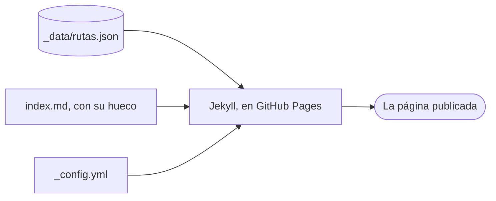

# Mis rutas en bici

Una web con las rutas en bici que hago los fines de semana: cuántos kilómetros tiene cada una,
qué dificultad y desde dónde sale.

## Cómo verla

Está publicada con GitHub Pages en
[TU-USUARIO.github.io/mis-rutas-en-bici](https://TU-USUARIO.github.io/mis-rutas-en-bici/).
Se ve en cualquier navegador, también en el móvil.

Si prefieres los datos sin la web, están en [`_data/rutas.json`](_data/rutas.json).

## Cómo está organizado

| Fichero o carpeta | Qué es |
|---|---|
| `index.md` | La portada de la web, con el hueco donde salen las rutas |
| `_data/rutas.json` | Las rutas, en JSON: un objeto por ruta |
| `_config.yml` | La configuración de la web: título, idioma y lo que no se publica |
| `README.md` | Este fichero |
| `LICENSE` | La licencia del proyecto |
| `.gitignore` | Lo que Git no guarda |

## Cómo está hecha

Para añadir una ruta, basta con escribirla en `_data/rutas.json` y subir el cambio: GitHub Pages
vuelve a construir la web sola.

En texto: Jekyll, el programa con el que GitHub Pages construye la web, toma la portada
(`index.md`), rellena su hueco con las rutas de `_data/rutas.json`, le aplica la configuración de
`_config.yml` y publica el resultado como una página web.

## Privacidad

Todas las rutas salen de sitios públicos del pueblo: la estación, la plaza o el polideportivo.
Ninguna sale de mi casa ni dice dónde vivo.

## Cómo lo hice

- **Lo hice yo:** elegí las rutas y escribí sus datos, organicé las carpetas, escribí la portada
  y este README, y subí cada paso a GitHub con su commit.
- **Con ayuda de un asistente de IA:** le pedí que me explicara qué hace la línea
  ``, y después escribí yo la línea de cada ruta. También le pedí
  que revisara mi diagrama: me propuso la forma de cilindro para los datos, que no conocía.
- **Cómo lo comprobé:** validé `rutas.json` en VS Code, abrí la página publicada en mi ordenador
  y en el móvil de una amiga, conté que salieran las cinco rutas y probé todos los enlaces.
- **Lo que aprendí:** la primera vez no salía ninguna ruta, porque en la portada había escrito
  `site.data.ruta`, sin la ese. Jekyll no da ningún error: simplemente no encuentra nada. Desde
  entonces, cuando algo no sale, lo primero que compruebo son los nombres.

## Licencia

Este proyecto (el código, los datos y el texto) tiene licencia MIT: puedes usarlo y cambiarlo,
siempre que mantengas el aviso de autoría y el texto de la licencia. Está en [LICENSE](LICENSE).
