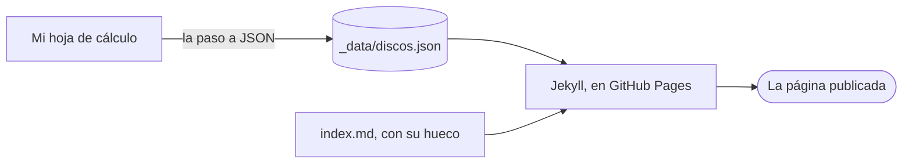

# Los discos de Pablo

Mi colección de discos de vinilo, en una web: título, grupo y año de cada disco, y cuáles son
mis favoritos.

## Cómo verla

Está publicada con GitHub Pages en
[TU-USUARIO.github.io/discos](https://TU-USUARIO.github.io/discos/).

## Cómo está organizado

| Fichero o carpeta | Qué es |
|---|---|
| `index.md` | La portada, con el hueco donde salen los discos |
| `_data/discos.json` | Los discos, en JSON: un objeto por disco |
| `_config.yml` | El título y el idioma de la web |
| `LICENSE` | La licencia del proyecto (MIT) |

## Cómo está hecha

En texto: paso la lista de discos de mi hoja de cálculo a `_data/discos.json`; Jekyll, en GitHub
Pages, rellena con esos datos el hueco de `index.md` y publica la página.

## Cómo lo hice

- **Lo hice yo:** elegí qué datos guardar de cada disco, escribí la portada con su hueco y
  dibujé el diagrama.
- **Con ayuda de un asistente de IA:** le pedí que pasara a JSON la lista de discos de mi hoja de
  cálculo (solo los discos: no tenía nada más).
- **Cómo lo comprobé:** validé el JSON en VS Code y lo revisé disco a disco con la hoja de
  cálculo. Así vi que el asistente había puesto un año entre comillas, `"1979"`, como texto en
  lugar de como número; lo corregí.
- **Lo que aprendí:** un JSON puede ser válido y tener un dato mal. Que el editor no marque nada
  no quiere decir que los datos estén bien: hay que compararlos con los de verdad.
