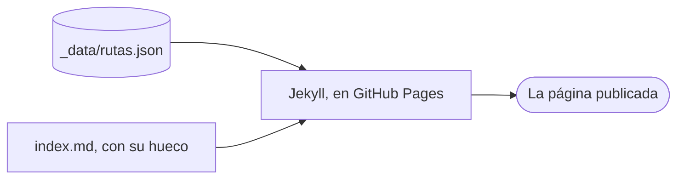

# Rutas a pie

Una web con las rutas de senderismo que hago por la sierra: nombre, kilómetros y punto de salida.

## Cómo verla

Está publicada con GitHub Pages en
[TU-USUARIO.github.io/rutas-a-pie](https://TU-USUARIO.github.io/rutas-a-pie/).

## Cómo está organizado

| Fichero o carpeta | Qué es |
|---|---|
| `index.md` | La portada de la web, con el hueco donde salen las rutas |
| `_data/rutas.json` | Las rutas, en JSON |
| `_config.yml` | El título y el idioma de la web, y lo que no se publica |
| `LICENSE` | La licencia (MIT) |

## Cómo está hecha

En texto: Jekyll, en GitHub Pages, rellena el hueco de `index.md` con las rutas de
`_data/rutas.json` y publica la página.

## Cómo lo hice

- **Lo hice yo:** todo el proyecto: los datos, la portada, la configuración y este README. No usé
  ningún asistente de IA.
- **Cómo lo comprobé:** validé el JSON en VS Code y pedí a otra persona que revisara el
  repositorio antes de publicarlo.
- **Lo que aprendí:** en esa revisión salieron dos datos personales que no debían estar, uno de
  ellos en un commit que ya había borrado. Empecé el historial de nuevo, sin ellos, antes de
  subirlo a GitHub.
